```txt
return true;
        }
    }

    // 无可用位置. 逐出一个随机项
    int i = 0;
    do
    {
        pos = myhash( x, r.nextInt( numHashFunctions ) );
        } while( pos == lastPos && i++ < 5 );

        lastPos = pos;
        std::swap( x, array[ pos ].element );
    }

    if( ++rehashes > ALLOWED_REHASHES )
    {
        expand( );      // 使散列表扩大
        rehashes = 0;   // 重置 rehashes 的计数
    }
    else
        rehash( );      // 表大小相同, 散列函数都是新的
}
}
```

图 5.43(续) 杜鹃散列的插入例程使用不同的算法，该算法随机选择要逐出的项，但不再试图重新逐出最后的项。如果存在太多的逐出项则散列表将尝试选取新的散列函数(再散列)，而若有太多的再散列则散列表将扩张

这里的基本思路不同于传统方案。我们已经测试到所要插入的项没出现。在第15行到第25行上，我们查看是否合法的位置中有空位。若有，则将被插入项置入第1个可用的位置上，插入完成。否则，逐出一个已存在的项。然而，这里存在一些复杂的问题:

- 逐出第1项在实验中效果并不理想。
- 逐出最后1项在实验中效果也不理想。
- 依序逐出各项(即第1次逐出使用散列函数0，下一次逐出使用散列函数1，等等)在实验中运行得也不理想。
- 完全随机地逐出项在实验中运行也有问题，特别是只用两个散列函数时有产生循环的趋向。

为了缓解最后一个问题，我们保留最后被逐出的位置，如果随机项是最后逐出的项，那么就选择一个新的随机项。如果使用两个散列函数，且碰巧这两个散列函数又都探测到相同的位置，该位置此前又被逐出，那么这将永远循环下去，因此，我们限制循环只能反复5次(故意使用一个奇数)。

expand 和 rehash 的代码如图 5.44 所示。expand 创建一个大数组但使用那些相同的散列函数。零-参数 rehash 保留数组的大小不变，但却创建一个新的数组，该数组使用那些新选出的散列函数填充。

最后，图 5.45 显示了 StringHashFamily 类，该类为字符串提供一组简单的散列函数。这些散列函数利用随机选取的数（不必是素数）替换图 5.4 中的常数 37。

```cpp
void expand( )
{
    rehash( static_cast<int>( array.size( ) / MAX_LOAD ) );
}

void rehash( )
{
    hashFunctions.generateNewFunctions( );
    rehash( array.size( ) );
}

void rehash( int newSize )
{
    vector<HashEntry> oldArray = array;

    // 创建新的双倍大小的空散列表
    array.resize( nextPrime( newSize ) );
    for( auto & entry : array )
        entry.isActive = false;

    // 复制整个表
    currentSize = 0;
    for( auto & entry : oldArray )
        if( entry.isActive )
            insert( std::move( entry.element ) );
}
```

图 5.44 杜鹃散列表的再散列和扩张程序

```cpp
template <int count>
class StringHashFamily
{
    public:
        StringHashFamily( ) : MULTIPLIERS( count )
        {
            generateNewFunctions( );
        }

        int getNumberOfFunctions( ) const
        {
            return count;
        }

        void generateNewFunctions( )
        {
            for( auto & mult : MULTIPLIERS )
                mult = r.nextInt( );
        }
```

图 5.45 杜鹃散列法的非正式字符串散列。这些散列函数并未验证满足杜鹃散列所需的要求，但如果散列表不是高度负载的，并且使用图 5.43 的插入例程，那么它却提供了相当不错的性能

```cpp
size_t hash( const string & x, int which ) const
    {
        const int multiplier = MULTIPLIERS[ which ];
        size_t hashVal = 0;

        for( auto ch : x )
            hashVal = multiplier * hashVal + ch;

        return hashVal;
    }

    private:
    vector<int> MULTIPLIERS;
    UniformRandom r;
};
```

图 5.45(续) 杜鹃散列法的非正式字符串散列。这些散列函数并未验证满足杜鹃散列所需的要求，但如果散列表不是高度负载的，并且使用图 5.43 的插入例程，那么它却提供了相当不错的性能

杜鹃散列的好处包括最坏情形常数查找和删除次数，避免懒惰删除和额外的数据，以及并行处理的可能。然而，杜鹃散列对散列函数的选择非常敏感。杜鹃散列表的发明者们宣称，他们所尝试的许多标准散列函数在试验中均表现拙劣。此外，虽然只要装填因子低于1/2，插入的用时期望为常数时间，但是，对于带有两个分离的散列表(它们的装填因子均为 $\lambda$ )的传统杜鹃散列期望的插入开销，业已证明其界大致为 $1/(1-(4\lambda^{2})^{1/3})$ ，它随着装填因子逐渐接近1/2而急速恶化(当 $\lambda$ 等于或超过1/2时公式本身无意义)。看来，使用较小的装填因子或多于两个的散列函数似乎是合理的选择。

## 5.7.3 跳房子散列

跳房子散列是一个新算法，它尝试改进经典的线性探测算法。回忆在线性探测法中，单元从散列位置开始依序被尝试。由于一次聚集和二次聚集，尝试的序列随着散列表的负载增加可能平均很长，于是诸如平方探测、双散列等许多改进方法被提出，以减少冲突的次数。然而，对于某些现代体系结构，通过探测相邻单元而产生的局部性是比一些附加的探测更为重要的因素，线性探测可能仍然是实用的，甚至是最好的选择。

跳房子散列法(hopscotch hashing)的思路是:通过预先确定的、在计算机结构体系的基础上优化的常数，来为探测序列的最大长度定界。这么做将给出在最坏情形下常数时间的查找，并且像杜鹃散列一样，查找或许与同时检测可能位置的有界集是并行的。

如果一次插入将一个新项放置得离它的散列位置太远，那么我们向该散列位置有效地回返，逐出那些可能的潜在项。若我们细心，则这些逐出可能很快完成，并保证被逐出的各项不会放到离它们的散列位置太远处。该算法是确定的，因为给定一个散列函数，这些项或者可能被逐出，或者不能被逐出。后者意味着，散列表可能太拥挤，再散列势在必行，不过这只能在超过0.9的极高的装填因子的情形下进行。对于一个装填因子为1/2的散列表，失败的概率几乎为0(练习5.23)。

令 MAX\_DIST 为对最大探测序列所选定的界。这意味着，项 x 必须在以 hash(x), hash(x) + 1, …, hash(x) + (MAX\_DIST - 1) 列出的 MAX\_DIST 个位置中的某个位置上被找到。为了有效地处理逐出，我们保留这样的信息，即对每个位置 $x$ ，它能够指出备选位置上的项是否被散列到位置 $x$ 的一个元素所占据。

例如，图 5.46 显示了一个相当拥挤的跳房子散列表，使用的是 MAX\_DIST=4。位置 6 上的比特位组指出，只有位置 6 有一个具有散列值 6 的项 (C):Hop[6] 上只有第 1 个比特位被置 1。Hop[7] 的前两位置 1，意味着位置 7 和位置 8 (A 和 D) 被散列值是 7 的项占据。Hop[8] 只有第 3 个比特位置 1，意味着位置 10 (E) 上的项散列值是 8。如果 MAX\_DIST 不大于 32，那么 Hop 数组实际上就是一些 32 比特位整数构成的数组，于是额外的空间需求并不大。如果对某个 pos，Hop[pos] 包含的全是 1，那么企图插入散列值为 pos 的项显然是要失败的，因为现在有 MAX\_DIST+1 项试图占据在 pos 的 MAX\_DIST 个位置——这是不可能的。

<table><tr><td></td><td>项</td><td>Hop</td></tr><tr><td colspan="3">…</td></tr><tr><td>6</td><td>C</td><td>1000</td></tr><tr><td>7</td><td>A</td><td>1100</td></tr><tr><td>8</td><td>D</td><td>0010</td></tr><tr><td>9</td><td>B</td><td>1000</td></tr><tr><td>10</td><td>E</td><td>0000</td></tr><tr><td>11</td><td>G</td><td>1000</td></tr><tr><td>12</td><td>F</td><td>1000</td></tr><tr><td>13</td><td></td><td>0000</td></tr><tr><td>14</td><td></td><td>0000</td></tr><tr><td colspan="3">…</td></tr></table>

| A: 7 |
| --- |
| B: 9 |
| C: 6 |
| D: 7 |
| E: 8 |
| F: 12 |
| G: 11 |

图5.46 跳房子散列表。这些Hop值告诉我们，区块中哪些位置被含有该散列值的那些单元所占据。于是，$\mathrm{Hop}[8] = 0010$ 表明当前只有位置10包含那些散列值为8的项，而位置8、9和11则不含这样的项

现在假设在这个例子中我们插入散列值是 9 的项 H。正常的线性探测法试图把它放到位置 13，但是它离 9 的散列值太远，因此改为查看能否逐出一项并把其重新安置在 13。去到位置 13 的项只有散列值是 10、11、12、13 的各项。如果考察 Hop[10]，那么就会看到没有散列值是 10 的候选项。可是 Hop[11]通过值 11 产生一个候选项 G，它可以被放到位置 13 处。由于位置 11 现在足够接近 H 的散列值，因此现在插入 H。这些步骤以及对 Hop 信息的改动都显示在图 5.47 中。


<details>
<summary>text_image</summary>

项 Hop
...
6 C 1000
7 A 1100
8 D 0010
9 B 1000
10 E 0000
11 G 1000
12 F 1000
13 0000
14 0000
...
→
项 Hop
...
6 C 1000
7 A 1100
8 D 0010
9 B 1000
10 E 0000
11 0010
12 F 1000
13 G 0000
14 0000
...
→
项 Hop
...
6 C 1000
7 A 1100
8 D 0010
9 B 1010
10 E 0000
11 H 0010
12 F 1000
13 G 0000
14 0000
...
A: 7
B: 9
C: 6
D: 7
E: 8
F: 12
G: 11
H: 9
</details>

图 5.47 跳房子散列表。试图插入 H。线性探测得出的是位置 13，但这个位置太远，因此我们从位置 11 逐出 G 从而为 H 找到一个更近的位置

最后，我们想要插入 I，它的散列值是 6。线性探测指出位置 14，显然这个位置太远。于是，我们查看 Hop[11]，它告诉我们 G 可以向下移而空出位置 13。既然 13 是空的，那么我们可以查看 Hop[10] 内部，以找出另一个要被逐出的元素。可是，Hop[10] 的前 3 个位置都是 0，因此不存在能够被移动的其散列值是 10 的项。于是考察 Hop[11]，在那里我们发现前两个位置都是 0。

因此尝试 Hop[12]，此处我们需要第 1 个位置是 1，而它就是 1。这样，F 可以向下移动。这两步显示在图 5.48 中。注意，假如情况不是这样，那么——譬如要是 hash(F) 不是 12 而是 9 的话——我们就被卡住而不得不再散列。但是，这不是我们算法的问题，而是不存在将 C、I、A、D、E、B、H、F 都置入表中的方法（如果 F 的散列值是 9 的话）；这些项的散列值就会都在 6 和 9 之间，从而也就需要被放置在 6 和 12 之间的 7 个位置上。可是，那就要造成在 7 个位置上有 8 项的局面——这是不可能的。然而，由于我们的例子不是这种情况，我们已经从位置 12 逐出了一项，因此现在我们还能继续下去。图 5.49 显示了从位置 9 剩下的逐出以及其后对 I 的放置。


<details>
<summary>text_image</summary>

项 Hop
...
6 C 1000
7 A 1100
8 D 0010
9 B 1010
10 E 0000
11 H 0010
12 F 1000
13 G 0000
14 0000
...
项 Hop
...
6 C 1000
7 A 1100
8 D 0010
9 B 1010
10 E 0000
11 H 0001
12 F 1000
13 0000
14 G 0000
...
项 Hop
...
6 C 1000
7 A 1100
8 D 0010
9 B 1010
10 E 0000
11 H 0001
12 0100
13 F 0000
14 G 0000
...
A: 7
B: 9
C: 6
D: 7
E: 8
F: 12
G: 11
H: 9
I: 6
</details>

图 5.48 跳房子散列表。试图插入 I。线性探测得出的是位置 14，但它太远；查阅 Hop[11] 我们看到，G 可以下移，把位置 13 空出来。查阅 Hop[10] 提不出什么结果来。而 Hop[11] 对二者又无能为力（为什么？），于是 Hop[12] 建议下移 F


<details>
<summary>text_image</summary>

项 Hop
...
6 C 1000
7 A 1100
8 D 0010
9 B 1010
10 E 0000
11 H 0001
12 
13 F 0000
14 G 0000
...
项 Hop
...
6 C 1000
7 A 1100
8 D 0010
9 
10 E 0000
11 H 0001
12 B 0100
13 F 0000
14 G 0000
...
项 Hop
...
6 C 1001
7 A 1100
8 D 0010
9 I 0011
10 E 0000
11 H 0001
12 B 0100
13 F 0000
14 G 0000
...
A: 7
B: 9
C: 6
D: 7
E: 8
F: 12
G: 11
H: 9
I: 6
</details>

图 5.49 跳房子散列表。继续插入 I:接着，B 被逐出，最后得到一处距散列值足够接近的位置，I 可被插入到此处

跳房子散列是相对新的算法，但是，初始的一些试验结果还是非常有前途的，特别是对那些利用多处理器以及要求并行性和协同性(concurrency)的应用而言。杜鹃散列或跳房子散列是否能够作为传统分离链接和线性/平方探测方案的实用备选方案而出现，我们将拭目以待。

## 5.8 通用散列

虽然散列表非常有效，并且在适当的装填因子的假设下每次操作花费常数平均开销，但是它们的分析和性能却依赖于具有如下两个基本性质的散列函数:

1. 散列函数必须是常数时间内可计算的(即，与散列表中的项数无关)。
2. 散列函数必须在数组所包含的位置之间均匀地分布表项。

特别是，如果散列函数很差，那么所有的希望就会落空，每次操作的开销可能是线性的。在这一小节，我们讨论通用散列函数(universal hash functions)，它使我们以上面的条件2得以满足的方式随机选择散列函数。正如5.7节那样，我们用 $M$ 代表TableSize。虽然使用通用散列函数的强烈动机是为用于传统散列表分析的假设提供理论依据，但是这些函数还是可以用在需要高水平健壮性的应用中的，其中最坏情形(或者本质上被降低了的)性能实在让人不能容忍，这样的性能或许基于由破坏者或电脑黑客生成的输入而造成。

如5.7节那样，我们用 $M$ 代表TableSize。

定义5.1 如果对任意 $x \neq y$，散列函数簇 $H$ 中使得 $h(x) = h(y)$ 的散列函数 $h$ 的个数最多为 $|H| / M$，则称散列函数簇 $H$ 是通用的(universal)。

注意，这个定义对于每两项都成立，而不是对所有的项对取平均而言。该定义意味着，如果从通用簇 $H$ 中随机选择一个散列函数，那么在任意两个不同的项间发生冲突的概率最多是 $1 / M$ ，而当把 $N$ 项添加到一个散列表中时，在初始时刻发生冲突的概率最多为 $N / M$ ，或是表的装填因子。

对分离链接法或跳房子散列法使用通用散列函数将充分满足用于分析这些数据结构的假设。然而，它对杜鹃散列法却不是充分的，需要一个更强的无关性概念。在杜鹃散列中，首先要看是否存在一个空位置；如果不存在，那就进行一次逐出，此时在寻找空位过程中涉及一个不同的项。重复该过程直到发现一个空位或者决定再散列为止（一般在 $O(\log N)$ 步之内）。为了使分析工作能够进行，使用满足散列函数的不同的项 $x$ ，每一步必须要有一个独立的冲突概率 $N / M$ 。我们可以把这个独立性需求形式化成下面的定义。

定义 5.2 散列函数簇 H 是 k 通用的 (k-universal)，如果对于任意的  $x_{1} \neq y_{1}, x_{2} \neq y_{2}, \cdots, x_{k} \neq y_{k}$ ，簇 H 中满足  $h(x_{1}) = h(y_{1}), h(x_{2}) = h(y_{2}), \cdots, h(x_{k}) = h(y_{k})$  的散列函数 h 的个数最多为  $|H| / M^{k}$ 。

由这个定义看到，杜鹃散列需要一个 $O(\log N)$-通用散列函数(在如此多次的逐出之后，我们放弃继续并进行再散列)。本节将只考察通用散列函数。

为了设计一个简单的通用散列函数，首先假设把非常大的整数映射到从0到 $M - 1$ 的较小整数。令 $p$ 是一个比最大的输入关键字还要大的素数。

我们的通用簇 H 由下列一组函数组成，其中 a 和 b 是随机选出的:

$$
H = \{H _ {a, b} (x) = ((a x + b) \bmod p) \bmod M, \text {其中} 1 \leqslant a \leqslant p - 1, 0 \leqslant b \leqslant p - 1 \}
$$

例如，在这个函数簇中， $a$ 和 $b$ 的3个可能的随机选择产生3个不同的散列函数:

$$
\begin{array}{l} H _ {3, 7} (x) = ((3 x + 7) \bmod p) \bmod M \\ H _ {4, 1} (x) = ((4 x + 1) \bmod p) \bmod M \\ H _ {8, 0} (x) = ((8 x) \bmod p) \bmod M \\ \end{array}
$$

可以看出，存在 $p(p - 1)$ 个可以被选出的可能的散列函数。

定理5.4 散列函数簇 $H = \{H_{a,b}(x) = ((ax + b)\bmod p)\bmod M,$ 其中 $1\leqslant a\leqslant p - 1,0$ $\leqslant b\leqslant p - 1\}$ 是通用的。

证明:令 x 和 y 是使得  $H_{a,b}(x)=H_{a,b}(y)$  成立的两个互异的值，且 x>y。

显然，如果 $(ax + b) \bmod p$ 等于 $(ay + b) \bmod p$，则将产生一个冲突。可是，这是不可能发生的:两式相减得到 $a(x - y) \equiv 0 \bmod p$，它意味着 $p$ 整除 $a$ 或 $p$ 整除 $x - y$，因为 $p$ 是素数。但是由于 $a$ 和 $x - y$ 都在 1 和 $p - 1$ 之间，这两种情形均不会发生。

于是，令 $r = (ax + b) \mod p$ 以及 $s = (ay + b) \mod p$，由上面的论证可知 $r \neq s$。如此则存在 $r$ 的 $p$ 个可能的值，并对每个 $r$ 存在 $s$ 的 $p - 1$ 个可能的值，总共有 $p(p - 1)$ 个可能的 $(r, s)$ 对。注意，$(a, b)$ 对的个数与 $(r, s)$ 对的个数是相等的，因此，若能够用 $r$ 和 $s$ 表示 $(a, b)$，则每个 $(r, s)$ 对将恰好对应一个 $(a, b)$ 对。可是这并不难做到:就像上面所做的那样，两个等式相减得到 $a(x - y) \equiv (r - s) (\mod p)$，这意味着，通过用 $(x - y)$ 唯一的乘法逆元乘式的两边（这个逆元必然存在，因为 $x - y$ 非零且 $p$ 是素数），我们得到用 $r$ 和 $s$ 表示的 $a$。然后得到 $b$ 由 $r$ 与 $s$ 的表示。

最后，上述结果意味着 $x$ 和 $y$ 冲突的概率等于 $r \equiv s (\bmod M)$ 的概率，上面的分析使我们假设，$r$ 和 $s$，而非 $a$ 和 $b$，是随机选取的。简单的直觉会把这个概率置为 $1 / M$，但只有当 $p$ 正好是 $M$ 的倍数，且所有可能的 $(r, s)$ 对都是等可能的时候，它才为真。既然 $p$ 是素数，且 $r \neq s$，那这样它就不保证成立了，因此需要更仔细的分析。

对于给定的 $r$，那个经 $\mod M$ 可产生冲突的 $s$ 的值最多是 $[p / M] - 1$ 个（这里的-1是因为 $r \neq s$）。容易看出，它最多是 $(p - 1) / M$。于是，$r$ 和 $s$ 产生冲突的概率最多为 $1 / M$（我们用 $p - 1$ 除之，因为，正如前面在证明中提到的，给定 $r$ 后，$s$ 只存在 $p - 1$ 种选择）。这意味着上述散列簇是通用的。

这个散列函数的实现看来需要两次 mod 运算:第 1 个是 mod p，第 2 个是 mod M。图 5.50 以 C++ 显示了一种简单的实现，假设 M 比  $2^{31}-1$  小得多。因为现在计算必须准确地按照规定的进行，并且不再接受溢出，所以我们提升到 long long 型来计算，它至少是 64 个比特位。

```txt
int universalHash( int x, int A, int B, int P, int M )
{
    return static_cast<int>(( ( static_cast<long long>( A ) * x ) + B ) % P ) % M;
}
```

图 5.50 通用散列的简单实现

然而，我们可以选择任意素数 $p$ ，只要它大于 $M$ 。因此，选择一个最有利于计算的素数是有意义的。 $p=2^{31}-1$  就是一个这样的素数。这种形式的素数叫作 Mersenne 素数 (Mersenne prime); 其他一些 Mersenne 素数包括  $2^{5}-1$ 、 $2^{61}-1$  和  $2^{89}-1$ 。正像用诸如 31 这样的 Mersenne 素数进行乘法可以通过一次移位和一次减法实现一样，涉及 Mersenne 素数的模运算 (mod operation) 也可以通过一次移位和一次减法实现:

设 $r \equiv y (\bmod p)$ 。若用 $(p + 1)$ 去除 $y$ ，则 $y = q'(p + 1) + r'$，其中 $q'$ 和 $r'$ 分别为商和余数。因此，$r \equiv q'(p + 1) + r' (\bmod p)$ 。而由于 $(p + 1) \equiv 1 (\bmod p)$，于是得到 $r \equiv q' + r' (\bmod p)$ 。

图 5.51 实现了这个想法，它被称为 Carter-Wegman 技巧(Carter-Wegman trick)。在第 8 行上，移位操作计算用  $(p+1)$  去除所得的商，而按位与则计算它的余数。因为  $(p+1)$  是 2 的一个准确的幂，所以这些位操作能够得到所要的结果。由于余数可能几乎与 p 一样大，因此结果所得到的和可能比 p 还要大，于是我们在第 9 行和第 10 行可以再把它减下来。

```txt
const int DIGS = 31;
const int mersennep = (1<<DIGS) - 1;

int universalHash( int x, int A, int B, int M )
{
    long long hashVal = static_cast<long long>( A ) * x + B;

    hashVal = ( ( hashVal >> DIGS ) + ( hashVal & mersennep ) );
    if( hashVal >= mersennep )
        hashVal -= mersennep;

    return static_cast<int>( hashVal ) % M;
}
```

图5.51 通用散列的简单实现

通用散列函数对于字符串也是存在的。首先，选取大于 $M$ 的任意素数 $p$ (并大于最大的字符代码)。然后，使用我们标准的字符串散列函数，在1和 $p - 1$ 之间随机选择乘数，并返回在0和 $p - 1$ (包括0和 $p - 1$) 之间的中间散列值。最后，应用一个通用散列函数来生成在0和$M - 1$ 之间的最终的散列值。

## 5.9 可扩散列

本章最后的论题处理数据量太大以至于装不进主存的情况。正如我们在第 4 章看到的，此时主要的考虑是检索数据所需的磁盘存取次数。

与前面一样，假设在任一时刻都有 $N$ 个记录要存储，$N$ 的值随时间而变化。此外，最多可把 $M$ 个记录放入一个磁盘区块。本节将设 $M = 4$。

如果使用探测散列或分离链接散列，那么主要的问题在于，在一次查找操作期间冲突可能引起多个区块被考察，甚至对于理想分布的散列表也在所难免。不仅如此，当散列表变得过满的时候，必须执行代价极为巨大的再散列这一步，它需要  $O(N)$  次磁盘访问。

一种聪明的选择叫作可扩散列(extendible hashing)，它使得用两次磁盘访问执行一次查找。插入操作也需要很少的磁盘访问。

回忆第4章，B树具有 $O(\log_{M / 2}N)$ 的深度。随着 $M$ 的增加，B树的深度降低。理论上我们可以选择 M 如此的大，使得 B 树的深度为 1。此时，在第一次以后的任何查找都将花费一次磁盘访问，因为根节点可能存在主存中。这种方法的问题在于分支系数 (branching factor) 太高，以至于为了确定数据在哪片树叶上要进行大量的处理工作。如果运行这一步的时间可以减缩，那么我们就将有一个实用的方案。这正是可扩散列使用的思路。

现在让我们假设，数据由几个6位(比特)整数组成。图5.52显示了这些数据的可扩散列格式。这里“树”的根含有4个指针，它们由这些数据最高的两个比特位确定。每片树叶有直到$M = 4$ 个元素。碰巧这里每片树叶中数据的前两个比特都是相同的，它们由圆括号内的数指出。为了更正式，用 $D$ 代表根所使用的比特数，有时称其为目录(directory)。于是，目录中的项数为 $2^{D}$ 。 $d_{L}$ 为树叶 $L$ 所有元素共有的最高位的比特位数。 $d_{L}$ 将依赖于特定的树叶，因此 $d_{L} \leqslant D$ 。

设欲插入关键字 100100。它将进入第三片树叶，但是第三片树叶已经满了，没有空间存放它。因此我们将这片树叶分裂成两片树叶，它们由前 3 位确定。这需要将目录的大小增加到 3。这些变化由图 5.53 反映出来。


<details>
<summary>flowchart</summary>

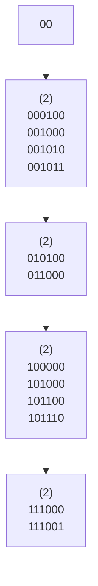
</details>

图 5.52 可扩散列:原始数据


<details>
<summary>flowchart</summary>

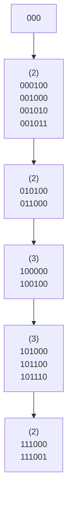
</details>

图5.53 可扩散列:在100100插入及目录分裂之后

注意，所有在分裂中未涉及到的树叶现在各由两个相邻目录项所指。因此，虽然整个目录被重写，但是其他树叶都没有被实际访问。

如果现在插入关键字 000000，那么第一片树叶就要被分裂，生成 $d_{L} = 3$ 的两片树叶。由于 $D = 3$，故在目录中所作的唯一变化是 000 和 001 两个指针的更新，见图 5.54。


<details>
<summary>flowchart</summary>

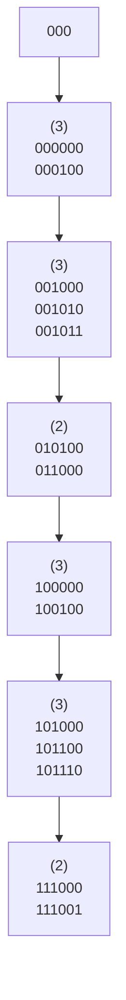
</details>

图 5.54 可扩散列:在 000000 插入及树叶分裂之后

这个非常简单的方法提供了对大型数据库 insert 操作和查找操作的快速存取时间。这里，还有一些重要细节尚未考虑。

首先，有可能当一片树叶的元素有多于 $D + 1$ 个前导比特位相同时需要多个目录分裂。例如，从原例开始，$D = 2$，如果插入111010，111011，并在最后插入111100，那么目录大小必须增加到4以区分5个关键字。这是一个容易考虑到的细节，但是千万不要忘记它。其次，存在重复关键字(duplicate keys)的可能性。若存在多于 $M$ 个重复关键字，则该算法根本无效。此时，需要做出某些其他的安排。

上述可能性指出，这些比特充分随机是相当重要的，我们可以通过把这些关键字散列到合理的长整数(从而是名字)来完成。

最后，介绍可扩散列的某些性能，这些性能是经过非常困难的分析后得到的。这些结果基于合理的假设:位模式(bit pattern)是均匀分布的。

树叶的期望个数为 $(N / M)\log_2e$ 。因此，平均树叶满的程度为 $\ln 2 = 0.69$ 。这和B树是一样的，其实这完全不奇怪，因为对于这两种数据结构都是当第 $(M + 1)$ 项被添加进来时一些新的节点被创建。

更惊奇的结果是，目录的期望大小(换句话说即 $2^{D}$)为 $O(N^{1 + 1 / M} / M)$ 。如果 $M$ 很小，那么目录可能过大。在这种情况下，可以让树叶包含指向记录的指针而不是实际的记录，从而增加 $M$ 的值。为了维持更小的目录，可以对每个查找操作添加第二次磁盘访问。如果目录太大装不进主存，那么第二次磁盘访问不管怎么说也还是需要的。

## 小结

散列表可以用来以常数平均时间实现 insert 和 contains 操作。当使用散列表时注意诸如装填因子这样的细节是特别重要的，因为否则时间界将不再有效。当关键字不是短的字符串或整数时，仔细选择散列函数也是很重要的。

对于分离链接散列法，虽然装填因子不是特别大时性能并不明显降低，但装填因子还是应该接近于1。对于探测散列算法，除非完全不可避免，否则装填因子不应该超过0.5。如果使用线性探测，那么性能随着装填因子接近于1将急速下降。再散列算法可以通过使散列表增长(和收缩)来实现，这样将会保持一个合理的装填因子。这对于空间紧缺并且不可能声明巨大散列表的情况是很重要的。

其他一些方法，诸如杜鹃散列和跳房子散列，也能够产生好的结果。因为所有这些算法都是常数时间的，所以强调哪个散列表的实现“最佳”是困难的。最近的模拟结果提供了对于冲突的指导和建议:算法的性能可能严重依赖于所处理的项的类型、底层计算机硬件和程序设计语言。

二叉查找树也可以用来实现 insert 和 contains 运算。虽然平均时间界为 $O(\log N)$，但是二叉查找树还支持那些需要序从而功能更强大的例程。使用散列表不可能找出最小元素。除非知道准确的字符串，否则散列表也不可能有效地查找它。二叉查找树可以迅速找到在一定范围内的所有项，而散列表是做不到的。此外，$O(\log N)$ 这个时间界也未必比 $O(1)$ 大那么多，这特别是因为使用查找树不需要乘法和除法的缘故。

另一方面，散列的最坏情况一般来自于实现的错误，而有序的输入却可能使二叉树运行得很差。平衡查找树实现的代价相当高，因此，如果不需要序的信息以及对输入是否被排序持有怀疑，那么就应该选择散列这种数据结构。

散列有着丰富的应用。编译器使用散列表跟踪源代码中声明的变量。这种数据结构叫作符号表(symbol table)。散列表是这种问题的理想应用。标识符一般都不长，因此其散列函数能够迅速被算出，而按字母顺序排列变量通常没有必要。

散列表对于任何图论问题都是有用的，在图论问题中，节点都有实际的名字而不是数字。这里，当输入被读进的时候，顶点则按照它们出现的顺序从1开始被指定一些整数。再有，输入很可能有一组一组依字母顺序排列的项。例如，顶点可以是计算机。此时，如果一个特定的计算中心把它的计算机列表，成为ibm1, ibm2, ibm3, …，那么，若使用查找树则在效率方面可能会产生戏剧性的效果。

散列表第三种常见的用途是在为游戏编制的程序中。当程序搜索游戏不同的行时，它跟踪通过计算基于位置的散列函数而看到的一些位置(并把对于该位置的移动存储起来)。如果同样的位置再出现，程序通常通过移动的简单变换来避免昂贵的重复计算。所有游戏程序的这种一般特点叫作置换表(transposition table)。

散列的另一个用途是在线拼写检验程序。如果错拼检测(与纠正相比)更重要，那么整个词典可以预先被散列，单词则可以以常数时间被检测。散列表很适合这项工作，因为以字母顺序排列单词并不重要，而以它们在文件中出现的顺序显示拼写错误当然是可接受的。

在软件(例如，互联网浏览器中的高速缓存)和硬件(例如，现代计算机中的内存高速缓冲区)方面，散列表常常用于实现高速缓冲存储区。它们还用在路由器的硬件实现中。

我们通过返回到第1章的字谜问题来结束这一章。如果使用第1章中描述的第二个算法，并且假设最大单词的大小是某个小的常数，那么读入包含 $W$ 个单词的词典并把它放入散列表的时间是 $O(W)$ 。这个时间很可能由磁盘I/O而不是由那些散列例程起支配作用。算法的其余部分将对每一个四元组(行，列，方向，字符数)测试一个单词是否出现。由于每次查询时间为 $O(1)$，而只存在常数个方向(8)和每个单词的字符，因此这一阶段的运行时间为 $O(R \cdot C)$ 。总的运行时间是 $O(R \cdot C + W)$，它是对原始 $O(R \cdot C \cdot W)$ 明显的改进。我们还可以做进一步的优化，它能够降低实际的运行时间。这些将在练习中描述。

## 练习

5.1 给定输入{4371, 1323, 6173, 4199, 4344, 9679, 1989}和散列函数 $h(x) = x (\bmod 10)$，指出下列结果:

a. 分离链接散列表。
b. 使用线性探测的散列表。
c. 使用平方探测的散列表。
d. 二级散列函数为  $h_{2}(x)=7-x\pmod{7}$  的散列表。

5.2 指出将练习 5.1 中的散列表再散列的结果。
5.3 编写一个程序，计算使用线性探测、平方探测以及双散列的长的随机插入序列所需要的冲突次数。
5.4 在分离链接散列表中进行大量的删除可能造成表非常稀疏，浪费空间。在这种情况下，可以再散列一个表，为原表的一半大。设当存在相当于表大小的2倍那么多的元素时，我们再散列到一个更大的表。该表应该有多么稀疏我们才能再散列到一个更小的表？
5.5 使用单链表的一个 vector 而不是多个 vector 重新实现分离链接散列表。

5.6 平方探测的 isEmpty 例程还没有写出，你能通过返回表达式 currentSize==0 实现它吗？

5.7 在平方探测散列表中，设我们把一个新元素插入到搜索路径上第一个非活动的单元而不是把它插入到由 findPos 指定的位置(这样，能够回收一个标记为 “deleted” 的单元，潜在地节省了空间)。

a. 使用上述思路重新编写插入算法。通过使用一个附加变量让 findPos 保留它遇到的第一个非活动单元的位置来完成重写的工作。
b. 解释使得重写的算法快于原来算法的环境。重写的算法可能会更慢吗？

5.8 设我们不用平方探测而改用“立方探测”，此处第 $i$ 次探测是在 $\text{hash}(x) + i^3$ 处。立方探测改进平方探测了吗？

5.9 使用一本标准词典，且散列表的大小接近装填因子 1，比较由图 5.4 的散列函数和图 5.55 中的散列函数产生的冲突的次数。

```c
/**
 * 字符串对象的 FNV-1a 散列例程.
 */
unsigned int hash( const string & key, int tableSize )
{
    unsigned int hashVal = 2166136261;

    for( char ch : key )
        hashVal = ( hashVal ^ ch )* 16777619;

    return hashVal % tableSize;
}
```

图5.55 练习5.9中的另一个散列函数

5.10 各种冲突解决方案的优点和缺点是什么？

5.11 假设为了减轻二次聚集的影响，我们使用 $f(i) = i \cdot r(\text{hash}(x))$ 作为冲突解决函数，其中 $\text{hash}(x)$ 为32比特位的散列值(尚未化成适当的数组下标)，而 $r(y) = |48271y (\text{mod } (2^{31} - 1))| \mod \text{TableSize}$。(10.4.1节描述一种执行这种计算而不溢出的方法，不过，在这种情况下溢出是不太可能的。)解释为什么这种方法趋向于避免二次聚集，并将这种方法与双散列和平方探测进行比较。

5.12 再散列要求对散列表中的所有项重新计算散列函数。由于计算散列函数代价昂贵，因此设对象提供它们自己的散列成员函数，而每个对象在散列函数第 1 次被计算时将把结果存入一个附加的数据成员中。指出这种方案如何用于图 5.8 中的 Employee 类，并解释在什么样的情况下所记忆的散列值在每个 Employee 中仍然有效。

5.13 编写一个程序, 实现下面将大小分别为 M 和 N 的两个稀疏多项式 (sparse polynomial)  $P_{1}$  和  $P_{2}$  相乘的策略。每个多项式表示成为由一个系数和一个幂组成的一系列对象。我们用  $P_{2}$  的项乘以  $P_{1}$  的每一项，总数为 MN 次运算。一种方法是将这些项排序并合并同类项，但是，这需要排序 MN 个记录，代价可能很高，特别是在小内存环境下。另一种方案，我们可在多项式的项进行计算时将它们合并，然后将结果排序。

a. 编写一个程序实现第二种方案。

b. 如果输出多项式大约有 $O(M + N)$ 项，两种方法的运行时间各是多少？

\*5.14 描述一个避免初始化散列表的过程(以内存消耗为代价)。

5.15 设欲找出在长输入串 $A_{1}A_{2}\cdots A_{N}$ 中串 $P_{1}P_{2}\cdots P_{k}$ 的第一次出现。我们可以通过散列模式串(pattern string)得到一个散列值 $H_{p}$，并将该值与从 $A_{1}A_{2}\cdots A_{k}, A_{2}A_{3}\cdots A_{k+1}, A_{3}A_{4}\cdots A_{k+2}$，等等，直到 $A_{N-k+1}A_{N-k+2}\cdots A_{N}$ 形成的散列值比较来解决这个问题。如果得到散列值的一个匹配，那么再一个字符一个字符地对串进行比较以检验这个匹配。如果实际上两个字符串确实匹配，那么返回其(在 $A$ 中的)位置，而在匹配失败这种不大可能的情况下继续进行查找。

\*a. 证明如果 $A_{i}A_{i+1}\cdots A_{i+k-1}$ 的散列值已知，那么 $A_{i+1}A_{i+2}\dots A_{i+k}$ 的散列值可以以常数时间算出。

b. 证明运行时间为  $O(k+N)$  加上排除错误匹配所耗费的时间。

\*c. 证明错误匹配的期望次数是微不足道的。

d. 编写一个程序实现该算法。

\*\*e. 描述一个算法，其最坏情形的运行时间为 $O(k + N)$。

\*\*f. 描述一个算法，其平均运行时间为  $O(N/k)$ 。

5.16 一个非标准的 C++ 扩展添加了这样的语法:允许开关语句 (switch statement) 使用 string 类型 (而不是基本整数类型)。解释编译器如何能够使用散列表实现语言附加功能。

5.17 一个(老式的)BASIC 程序由一系列按递增顺序编号的语句组成。控制是通过使用 goto 或 gosub 和一个语句编号实现的。编写一个程序读进合法的 BASIC 程序并给语句重新编号，使得第一句在序号 F 处开始并且每一个语句的序号比前一语句高 D。可以假设 N 条语句的上限，但是在输入中这些语句序号可以大到一个 32 比特的整数。所编的程序必须以线性时间运行。

5.18 a. 利用本章末尾描述的算法实现字谜程序。

b. 通过存储每一个单词 $W$ 以及 $W$ 的所有前缀，可以大大加快运行速度。（如果 $W$ 的一个前缀刚好是词典中的一个单词，那么就把它作为实际的单词来存储。）虽然这看起来似乎极大地增加了散列表的大小，但实际上并不，因为许多单词有相同的前缀。当以某个特定的方向执行一次扫描的时候，如果被查找的单词甚至作为前缀都不在散列表中，那么在这个方向上的扫描可以及早终止。利用这种想法编写一个改进的程序来解决字谜游戏问题。

c. 如果我们愿意牺牲散列表 ADT 的纯洁性, 那么可以在 (b) 部分使程序加速: 例如, 如果我们刚刚计算出 “excel” 的散列函数, 那么就不必再从头开始计算 “excels” 的散列函数。调整散列函数使得它能够利用前面的计算。

d. 在第 2 章我们建议使用折半查找。把使用前缀的想法结合到你的折半查找算法中。
修改工作应该是简单的。哪个算法更快？

5.19 在某些假设下，向带有二次聚集的散列表进行的一次插入操作的期望开销由 $1 / (1 - \lambda) - \lambda -\ln (1 - \lambda)$ 给出。遗憾的是，这个公式对于平方探测并不精确。但这里我们假设它是准确的，确定:

a. 一次不成功查找的期望开销。

b. 一次成功查找的期望开销。

5.20 实现支持 insert 操作和 lookup 操作的泛型 Map。该实现将存储(关键字, 定义)对的散列表。你将通过提供一个关键字来查找(lookup)一个定义。图 5.56 提供了 Map 的说明(去掉某些细节)。

```cpp
template <typename HashedObj, typename Object>
class Pair
{
    HashedObj key;
    Object    def;
    // 一些适当的构造函数，等等
};

template <typename HashedObj, typename Object>
class Dictionary
{
    public:
        Dictionary();
        void insert( const HashedObj & key, const Object & definition );
        const Object & lookup( const HashedObj & key ) const;
        bool isEmpty() const;
        void makeEmpty();

    private:
        HashTable<Pair<HashedObj,Object>> items;
};
```

图5.56 练习5.20的词典架构

5.21 通过使用散列表实现一个拼写检查程序。设词典来自两个来源:一本现有的大词典以及包含一本个人词典的第二个文件。输出所有错拼的单词和这些单词出现的行号。再有，对于每个错拼的单词，列出应用下列任一种法则所能够得到的词典中的任何单词:

a. 添加一个字符。
b. 去掉一个字符。
c. 交换两个相邻的字符。

5.22 证明 Marcov 不等式 (Markov's Inequality): 如果 X 是任一个随机变量而 a>0，那么  $\Pr(|X|\geqslant a)\leqslant E(|X|)/a$ 。指出这个不等式如何用于定理 5.2 和定理 5.3。
5.23 如果带有参数 MAX\_DIST 的跳房子散列表的装填因子为 0.5，那么一次插入需要再散列的近似概率是多少？
5.24 实现一个跳房子散列表，并比较它和线性探测、分离链接以及杜鹃散列各方法的性能。
5.25 实现拥有两个单独散列表的传统杜鹃散列表。最简单的做法是使用一个数组，并修改散列函数以访问其上半部分或下半部分。
5.26 推广传统的杜鹃散列表，使得能够使用 $d$ 个散列函数。
5.27 指出将关键字 10111101、00000010、10011011、10111110、01111111、01010001、10010110、00001011、11001111、10011110、11011011、00101011、01100001、11110000、01101111 插入到一个空的初始可扩散列数据结构中的结果，其中 M=4。

5.28 编写一个程序实现可扩散列法。如果散列表小到足可装入内存，那么它的性能与分离链接法和开放定址散列法相比如何？

## 参考文献

尽管散列方法具有显而易见的简单特性，然而对它的很多分析还是相当困难的，而且仍然留有许多未解决的问题，也还存在诸多有趣的理论议题。

散列方法至少可以追溯到1953年，当时H.P.Luhn写了一篇内部IBM备忘录，其中用到分离链接散列方法。早期论述散列的论文为文献[11]和[32]。关于该论题的大量信息，包括对在完全随机且独立散列的假设下使用线性探测进行散列的分析，可在文献[25]中找到。更近的结果指出，线性探测方法只需要5个独立的散列函数[31]。文献[28]是对早期传统散列表方法的极好的综述；文献[29]则包含对选择散列函数提出的一些建议、易犯的错误。对分离链接、线性探测、平方探测和双散列的精确分析和模拟结果可见于文献[19]。然而，由于计算机体系结构和编译器的变化(改进)，模拟结果常常很快就过时了。

对双散列的分析可见于文献[20]和[27]。另外一种冲突解决方案是联合散列(coalesced hashing)，文献[33]对此做了描述。Yao[37]业已证明，关于一次成功查找的开销，假设各项一旦置入表中便不可移动，则均匀散列(uniform hashing)是最优的，在这种散列中不存在聚集。

通用散列函数首先在文献[5]和[35]中描述，后者介绍了使用Mersenne素数以避免昂贵的mod运算的“Carter-Wegman技巧”。完美散列在文献[16]中做了描述，完美散列的动态版在文献[8]中述及。文献[12]是某些传统动态散列方案的综述。

分离链接中最长链表的长度的界 $\Theta (\log N / \log \log N)$ 在文献[18]中(以精确的形式)证明。指出当选择两个随机选出的链表中较短的链表时, 最长链表的长度的界低至只有 $\Theta (\log \log N)$ 的“双选威力”首先在文献[2]中描述。双选威力一个早期的例子见于文献[4]。对杜鹃散列的经典工作在文献[30]进行。自从这篇初始论文以后, 大量的新结果发表, 它们分析了散列函数所需要的独立性的全部含义, 并描述了多种实现方案$^{[7,34,15,10,23,24,1,6,9,17]}$。跳房子散列出自于文献[21]。

可扩散列发表于文献[13]，分析见于文献[14]和[36]。

练习 5.15(a～d) 取自文献[22]，(e) 部分取自文献[26]，而 (f) 部分取自文献[3]。在练习 5.9 中描述的 FNV-1a 散列函数属于 Fowler、Noll 和 Vo。

1. Y. Arbitman, M. Naor, and G. Segev, "De-Amortized Cuckoo Hashing: Provable Worst-Case Performance and Experimental Results," Proceedings of the 36th International Colloquium on Automata, Languages and Programming (2009), 107–118.
2. Y. Azar, A. Broder, A. Karlin, and E. Upfal, "Balanced Allocations," SIAM Journal of Computing, 29 (1999), 180–200.
3. R. S. Boyer and J. S. Moore, "A Fast String Searching Algorithm," Communications of the ACM, 20 (1977), 762–772.
4. A. Broder and M. Mitzenmacher, "Using Multiple Hash Functions to Improve IP Lookups," Proceedings of the Twentieth IEEE INFOCOM (2001), 1454–1463.
5. J. L. Carter and M. N. Wegman, "Universal Classes of Hash Functions," Journal of Computer and System Sciences, 18 (1979), 143–154.
6. J. Cohen and D. Kane, "Bounds on the Independence Required for Cuckoo Hashing," preprint.
7. L. Devroye and P. Morin, "Cuckoo Hashing: Further Analysis," Information Processing Letters, 86 (2003), 215–219.
8. M. Dietzfelbinger, A. R. Karlin, K. Melhorn, F. Meyer auf der Heide, H. Rohnert, and R. E. Tarjan, "Dynamic Perfect Hashing: Upper and Lower Bounds," SIAM Journal on Computing, 23 (1994), 738–761.
9. M. Dietzfelbinger and U. Schellbach, "On Risks of Using Cuckoo Hashing with Simple Universal Hash Classes," Proceedings of the Twentieth Annual ACM-SIAM Symposium on Discrete Algorithms (2009), 795–804.
10. M. Dietzfelbinger and C. Weidling, "Balanced Allocation and Dictionaries with Tightly Packed Constant Size Bins," Theoretical Computer Science, 380 (2007), 47–68.
11. I. Dumey, "Indexing for Rapid Random-Access Memory," Computers and Automation, 5 (1956), 6–9.
12. R. J. Enbody and H. C. Du, "Dynamic Hashing Schemes," Computing Surveys, 20 (1988), 85–113.
13. R. Fagin, J. Nievergelt, N. Pippenger, and H. R. Strong, "Extendible Hashing—A Fast Access Method for Dynamic Files," ACM Transactions on Database Systems, 4 (1979), 315–344.
14. P. Flajolet, "On the Performance Evaluation of Extendible Hashing and Trie Searching," Acta Informatica, 20 (1983), 345–369.
15. D. Fotakis, R. Pagh, P. Sanders, and P. Spirakis, "Space Efficient Hash Tables with Worst Case Constant Access Time," Theory of Computing Systems, 38 (2005), 229–248.
16. M. L. Fredman, J. Komlos, and E. Szemeredi, "Storing a Sparse Table with O(1) Worst Case Access Time," Journal of the ACM, 31 (1984), 538–544.
17. A. Frieze, P. Melsted, and M. Mitzenmacher, "An Analysis of Random-Walk Cuckoo Hashing," Proceedings of the Twelfth International Workshop on Approximation Algorithms in Combinatorial Optimization (APPROX) (2009), 350–364.
18. G. Gonnet, "Expected Length of the Longest Probe Sequence in Hash Code Searching," Journal of the Association for Computing Machinery, 28 (1981), 289–304.
19. G. H. Gonnet and R. Baeza-Yates, Handbook of Algorithms and Data Structures, 2d ed., Addison-Wesley, Reading, Mass., 1991.
20. L. J. Guibas and E. Szemeredi, "The Analysis of Double Hashing," Journal of Computer and System Sciences, 16 (1978), 226–274.
21. M. Herlihy, N. Shavit, and M. Tzafrir, "Hopscotch Hashing," Proceedings of the Twenty-Second International Symposium on Distributed Computing (2008), 350–364.
22. R. M. Karp and M. O. Rabin, "Efficient Randomized Pattern-Matching Algorithms," Aiken Computer Laboratory Report TR-31-81, Harvard University, Cambridge, Mass., 1981.
23. A. Kirsch and M. Mitzenmacher, "The Power of One Move: Hashing Schemes for Hardware," Proceedings of the 27th IEEE International Conference on Computer Communications (INFOCOM) (2008), 106–110.
24. A. Kirsch, M. Mitzenmacher, and U. Wieder, "More Robust Hashing: Cuckoo Hashing with a Stash," Proceedings of the Sixteenth Annual European Symposium on Algorithms (2008), 611–622.
25. D. E. Knuth, The Art of Computer Programming, Vol. 3: Sorting and Searching, 2d ed., Addison-Wesley, Reading, Mass., 1998.
26. D. E. Knuth, J. H. Morris, and V. R. Pratt, "Fast Pattern Matching in Strings," SIAM Journal on Computing, 6 (1977), 323–350.
27. G. Lueker and M. Molodowitch, "More Analysis of Double Hashing," Proceedings of the Twentieth ACM Symposium on Theory of Computing (1988), 354–359.
28. W. D. Maurer and T. G. Lewis, "Hash Table Methods," Computing Surveys, 7 (1975), 5–20.
29. B. J. McKenzie, R. Harries, and T. Bell, "Selecting a Hashing Algorithm," Software—Practice and Experience, 20 (1990), 209–224.
30. R. Pagh and F. F. Rodler, "Cuckoo Hashing," Journal of Algorithms, 51 (2004), 122–144.
31. M. Pătrașcu and M. Thorup, "On the k-Independence Required by Linear Probing and Minwise Independence," Proceedings of the 37th International Colloquium on Automata, Languages, and Programming (2010), 715–726.
32. W. W. Peterson, "Addressing for Random Access Storage," IBM Journal of Research and Development, 1 (1957), 130–146.
33. J. S. Vitter, "Implementations for Coalesced Hashing," Communications of the ACM, 25 (1982), 911–926.
34. B. Vöcking, "How Asymmetry Helps Load Balancing," Journal of the ACM, 50 (2003), 568–589.
35. M. N. Wegman and J. Carter, "New Hash Functions and Their Use in Authentication and Set Equality," Journal of Computer and System Sciences, 22 (1981), 265–279.
36. A. C. Yao, "A Note on the Analysis of Extendible Hashing," Information Processing Letters, 11 (1980), 84–86.
37. A. C. Yao, "Uniform Hashing Is Optimal," Journal of the ACM, 32 (1985), 687–693.

## 第6章 优先队列(堆)

虽然发送到打印机的作业一般被放到队列中，但这未必总是最好的做法。例如，可能有一项作业特别重要，因此希望打印机只要一有空闲就来处理这项作业。反过来，若在打印机空闲时正好有多个单页的作业及一项100页的作业等待打印，则更合理的做法也许是最后处理长的作业，尽管它不是最后提交上来的。（遗憾的是，大多数的系统并不这么做，有时可能特别令人懊恼。）

类似地，在多用户环境中，操作系统调度程序必须决定在若干进程中运行哪个进程。一般一个进程只能被允许运行一个固定的时间片。一种算法是使用一个队列。开始时作业被放到队列的末尾。调度程序将反复提取队列中的第一个作业并运行它，直到或者运行完毕，或者该作业的时间片用尽，并在作业未被运行完毕时把它放到队列的末尾。这种策略一般并不太合适，因为一些很短的作业由于一味等待运行而要花费很长的时间去处理。一般说来，短的作业要尽可能快地结束，这一点很重要，因此在已经被运行的作业当中这些短作业应该拥有优先权。此外，有些作业虽不短小但很重要，也应该拥有优先权。

这种特殊的应用似乎需要一类特殊的队列, 我们称之为优先队列 (priority queue)。在本章, 我们将讨论:

- 优先队列 ADT 的有效实现。
- 优先队列的使用。
- 优先队列的高级实现。

我们将看到的这类数据结构属于计算机科学中最精致的一种。

## 6.1 模型

优先队列是允许至少下列两种操作的数据结构:insert(插入)，它的作用是显而易见的；以及 deleteMin(删除最小者)，它的工作是找出、返回并删除优先队列中最小的元素。 $^{①}$  insert 操作等价于 enqueue(入队)，而 deleteMin 则是队列运算 dequeue(出队)在优先队列中的等价操作。

如同大多数数据结构那样，有时可能要添加一些其他的操作，但这些添加的操作属于扩展的操作，而不是图 6.1 所描述的基本模型的一部分。

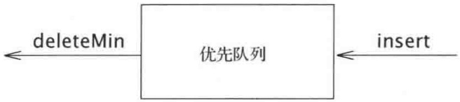

<details>
<summary>flowchart</summary>

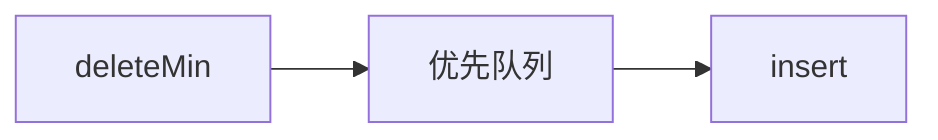
</details>

图6.1 优先队列的基本模型

除了操作系统外，优先队列还有许多的应

用。在第 7 章，我们将看到优先队列如何用于外部排序。在贪婪算法的实现方面优先队列也是重要的，该算法通过反复找出最小元来进行计算。在第 9 章和第 10 章我们将看到一些特殊的例子，本章将介绍优先队列在离散事件模拟中的一个应用。

<small><span class="docvortex-page-footnote" data-block-type="page_footnote" style="color:#6b7280">① C++代码提供两种版本的 deleteMin。一种是删除最小值；而另一种不仅删除最小值，而且还把删去的值存储到由引用传递的对象中。</span></small>

## 6.2 一些简单的实现

有几种明显的方法实现优先队列。我们可以使用一个简单链表在表头以 $O(1)$ 执行插入操作，并且遍历该链表以删除最小元，但这需要 $O(N)$ 时间。另一种方法是，始终让链表保持排序状态，这使得插入代价高昂 $(O(N))$ 而deleteMin花费低廉 $(O(1))$ 。基于deleteMin的操作从不多于插入操作的事实，因此前者恐怕是更好的想法。

再一种实现优先队列的方法是使用二叉查找树，它对这两种操作的平均运行时间都是 $O(\log N)$ 。尽管插入是随机的，而删除则不是，但这个结论还是成立的。记住我们删除的唯一元素是最小元。反复除去左子树中的节点似乎损害树的平衡，使得右子树加重。然而，右子树是随机的。在最坏的情形，即 deleteMin 将左子树删空的情形下，右子树拥有的元素最多也就是它应具有的元素数的两倍。这只是在它的期望深度上加了一个小常数。注意，通过使用平衡树，可以把这个界变成最坏情形的界，这将防止出现坏的插入序列。

使用查找树可能有些过头，因为它支持许许多多并不需要的操作。我们将要使用的基本的数据结构不需要链，它以最坏情形时间 $O(\log N)$ 支持上述两种操作。插入操作实际上将平均花费常数时间，若无删除操作的干扰，该结构的实现将以线性时间建立一个具有 $N$ 项的优先队列。然后，我们将讨论如何实现优先队列以支持有效的合并。这个附加的操作似乎有些复杂，它显然需要使用链接的结构。

## 6.3 二叉堆

我们将要使用的这种工具叫作二叉堆(binary heap)，它的使用对于优先队列的实现是如此的普遍，以至于当堆(heap)这个词不加修饰地用在优先队列的上下文中时，一般都是指的数据结构的这种实现。在本小节，我们把二叉堆只叫作堆。像二叉查找树一样，堆也有两个性质，即结构性和堆序性。恰似AVL树，对堆的一次操作可能破坏这两个性质中的一个，因此，堆的操作必须到堆的所有性质都被满足时才能终止。事实上这并不难做到。

## 6.3.1 结构性质

堆是一棵被完全填满的二叉树，有可能的例外是在底层，底层上的元素从左到右填入。这样的树称为完全二叉树 (complete binary tree)。图 6.2 给出了一个例子。

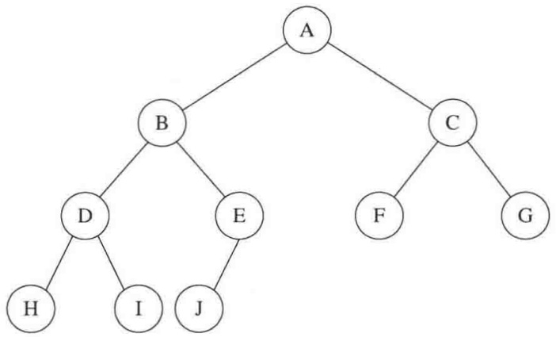

<details>
<summary>flowchart</summary>

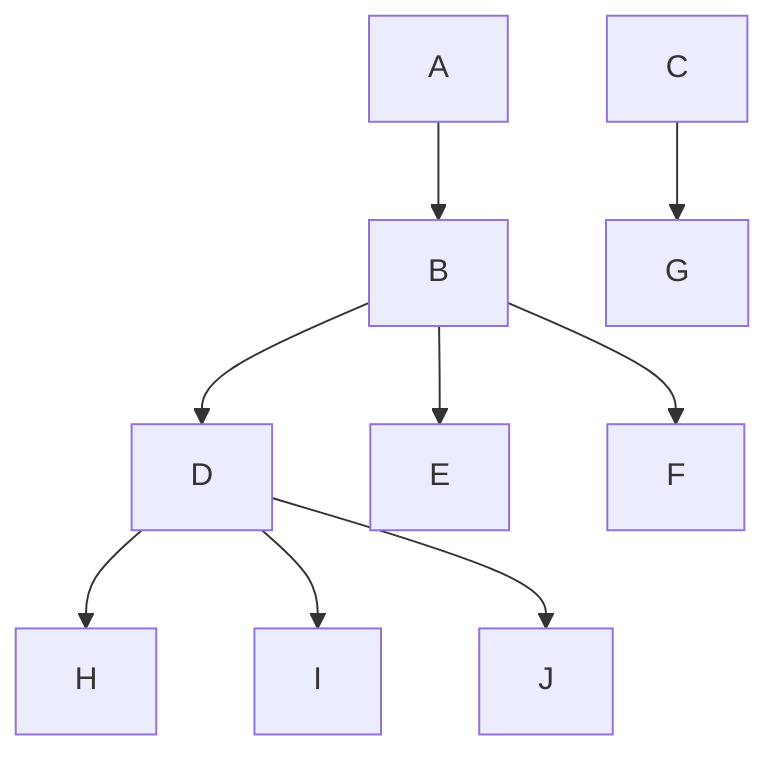
</details>

图 6.2 一棵完全二叉树

容易证明，一棵高为 $h$ 的完全二叉树有 $2^{h}$ 到 $2^{h + 1} - 1$ 个节点。这意味着，完全二叉树的高是 $\lfloor \log N\rfloor$ ，显然它是 $O(\log N)$ 。

一个重要的观察发现，因为完全二叉树这么有规律，所以它可以用一个数组表示而不需要使用链。图6.3中的数组对应图6.2中的堆。

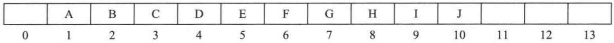

<details>
<summary>text_image</summary>

A B C D E F G H I J 
0 1 2 3 4 5 6 7 8 9 10 11 12 13
</details>

图6.3 完全二叉树的数组实现

对于数组中任一位置 $i$ 上的元素, 其左儿子在位置 $2i$ 上, 右儿子在左儿子后的单元 $(2i + 1)$ 中, 它的父亲则在位置 $\lfloor i / 2 \rfloor$ 上。因此, 这里不仅不需要链, 而且遍历该树所需要的操作也极为简单, 在大部分计算机上运行很可能都非常快。这种实现的唯一问题在于, 最大的堆大小需要事先估计, 但一般这并不成问题 (而且如果需要, 可以重新调整大小)。在图6.3中, 堆大小的限界是13个元素。该数组有一个位置0, 后面将详细叙述。

因此，一个堆结构将由一个(Comparable对象的)数组和一个代表当前堆的大小的整数组成。图6.4显示了一个优先队列接口。

本章将始终把堆画成树，这意味着，具体的实现将使用简单的数组。

```cpp
template <typename Comparable>
class BinaryHeap
{
    public:
        explicit BinaryHeap( int capacity = 100 );
        explicit BinaryHeap( const vector<Comparable> & items );

        bool isEmpty( ) const;
        const Comparable & findMin( ) const;

        void insert( const Comparable & x );
        void insert( Comparable && x );
        void deleteMin( );
        void deleteMin( Comparable & minItem );
        void makeEmpty( );

    private:
        int            currentSize;  // 堆中元素的个数
        vector<Comparable> array;      // 堆的数组

        void buildHeap( );
        void percolateDown( int hole );
};
```

图6.4 优先队列的类接口

## 6.3.2 堆序性质

使操作被快速执行的性质是堆序性质(heap-order property)。由于我们想要能够快速地找出最小元，因此最小元应该在根上。如果考虑任意子树也应该是一个堆，那么任意节点就应该小于它的所有后裔。

应用这个逻辑，我们得到堆序性质。在一个堆中，对于每一个节点 $X$ ， $X$ 的父亲中的关键字小于(或等于) $X$ 中的关键字，根节点除外(它没有父亲)。①在图6.5中左边的树是一个堆，但是，右边的树则不是(虚线表示堆的有序性被破坏)。

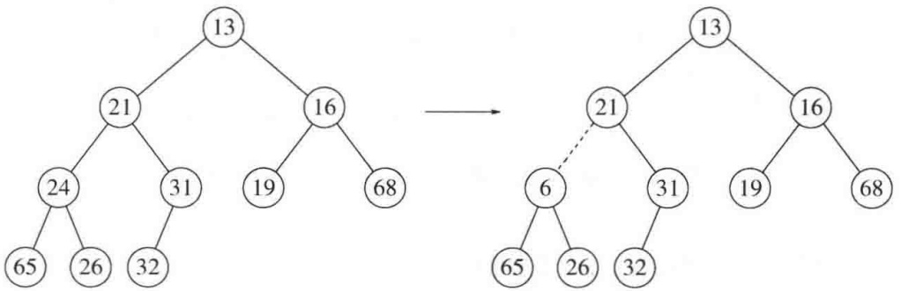

<details>
<summary>flowchart</summary>

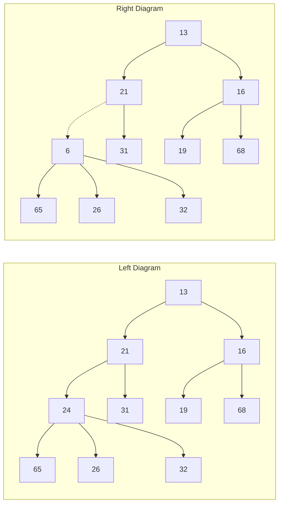
</details>

图 6.5 两棵完全树(只有左边的树是堆)

根据堆序性质，最小元总可以在根处找到。因此，我们以常数时间得到附加操作 findMin。

## 6.3.3 基本的堆操作

无论从概念上还是实际上考虑，执行这两个所要求的操作都是容易的。所有的工作需要保证始终保持堆序性质。

insert(插入)

为将一个元素 $X$ 插入到堆中，我们在下一个可用位置创建一个空穴(hole)，因为否则该堆将不是完全树。如果 $X$ 可以放在该空穴中而并不破坏堆的序，那么插入完成。否则，我们把空穴的父节点上的元素移入该空穴中，这样，空穴就朝着根的方向上冒一步。继续该过程直到 $X$ 能被放入空穴中为止。图6.6表示，为了插入14，我们在堆的下一个可用位置建立一个空穴。由于将14插入空穴破坏了堆序性质，因此将31移入该空穴。在图6.7中继续这种策略，直到找出置入14的正确位置。

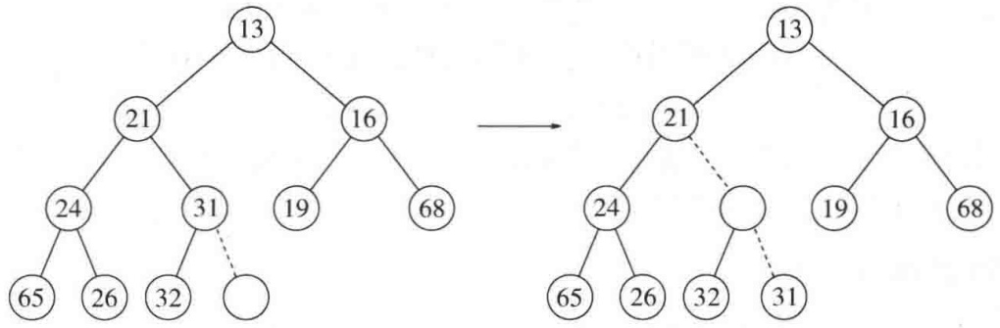

<details>
<summary>flowchart</summary>

```mermaid
graph LR
  subgraph Left Diagram
  A["13"] --> B["21"]
  B --> C["16"]
  C --> D["24"]
  D --> E["31"]
    E -.-> F[""]
  G["19"] --> H["68"]
  I["65"] --> J["26"]
  J --> K["32"]
  K --> L[""]
  end
  subgraph Right Diagram
  B --> M["13"]
  M --> N["21"]
  N --> O["16"]
  O --> P["68"]
  Q["19"] --> R["24"]
  R --> S["65"]
  S --> T["26"]
  T --> U["32"]
    U -.-> V["31"]
  W["65"] --> X["26"]
  X --> Y["32"]
  Y --> Z["68"]
  end
```
</details>

图 6.6 尝试插入 14:创建一个空穴，再将空穴上冒

这种一般的策略叫作上滤(percolate up)。新元素在堆中上滤直到找出正确的位置。使用图6.8所示的代码很容易实现插入。

其实我们本可以在 insert 例程中通过反复实施交换操作直至建立正确的序来实现上滤过程，可是一次交换需要 3 条赋值语句。如果一个元素上滤 $d$ 层，那么由于交换而实施的赋值的次数就达到 $3d$，而我们这里的方法却只用到 $d + 1$ 次赋值。

<small><span class="docvortex-page-footnote" data-block-type="page_footnote" style="color:#6b7280">① 类似地，我们可以声明一个(max)堆，它使我们通过改变堆序性质能够有效地找出和删除最大元。因此，优先队列可以用来找出最大元或最小元，但这需要提前决定。</span></small>

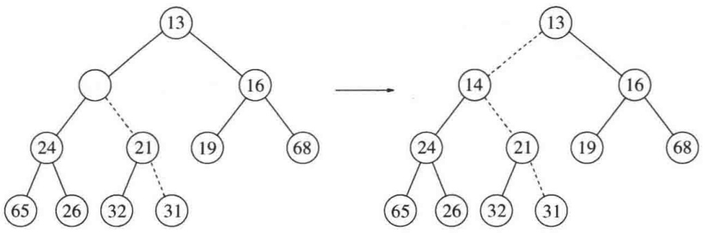

<details>
<summary>flowchart</summary>

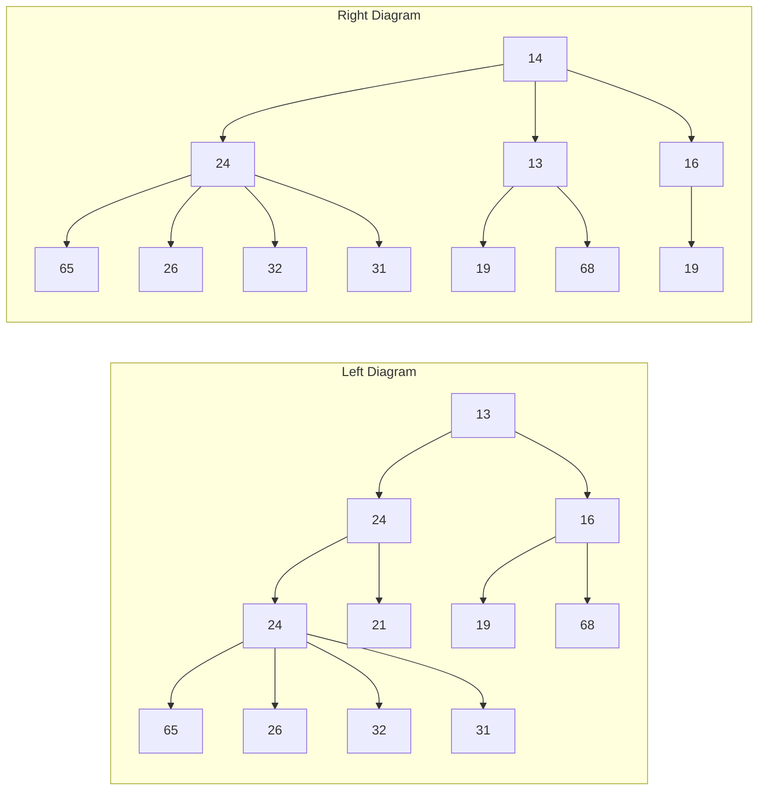
</details>

图 6.7 将 14 插入到前面的堆中剩余的两步

```cpp
/**
 * 将项x插入，允许重复元.
 */
void insert( const Comparable & x )
{
    if( currentSize == array.size( ) - 1 )
        array.resize( array.size( ) * 2 );

    // 上滤
    int hole = ++currentSize;
    Comparable copy = x;

    array[ 0 ] = std::move( copy );
    for( ; x < array[ hole / 2 ]; hole /= 2 )
        array[ hole ] = std::move( array[ hole / 2 ] );
    array[ hole ] = std::move( array[ 0 ] );
}
```

图6.8 插入到一个二叉堆的过程

如果要插入的元素是新的最小值，那么它将一直被推向顶端。这样会在某一时刻 hole 将是 1，并且需要程序跳出循环。当然，可以用明显的测试做到这一点，或者把对被插入项的一个拷贝放到位置 0 处以使循环得以终止。我们选择把 X 放到位置 0 处。

如果欲插入的元素是新的最小元从而一直上滤到根处，那么这种插入的时间将长达 $O(\log N)$ 。平均看来，上滤终止得要早。业已证明，执行一次插入平均需要2.607次比较，因此平均insert将元素上移1.607层。

## deleteMin(删除最小元)

deleteMin 以类似于插入的方式处理。找出最小元是容易的，困难的是删除它。当删除一个最小元时，要在根节点建立一个空穴。由于现在的堆少了一个元素，因此堆中最后一个元素 X 必须移动到该堆的某个地方。如果 X 可以被放到空穴中，那么 deleteMin 完成。不过这一般不太可能，因此我们将空穴的两个儿子中较小者移入空穴，这样就把空穴向下推了一层。重复该步骤直到 X 可以被放入空穴中。因此，我们的做法是将 X 置入沿着从根开始包含最小儿子的一条路径上的一个正确的位置。

在图 6.9 中左边的图显示 deleteMin 之前的堆。删除 13 后，我们必须试图正确地将 31 放到堆中。31 不能放在空穴中，因为这将破坏堆序性质。于是，我们把较小的儿子 14 置入空穴，同时空穴下滑一层(见图 6.10)。重复该过程，由于 31 大于 19，因此把 19 置入空穴，在更下一层上建立一个新的空穴。然后，因为 31 还是太大，于是再把 26 置入空穴，在底层又建立一个新的空穴。最后，我们得以将 31 置入空穴中(见图 6.11)。这种一般的策略叫作下滤(percolate down)。在其实现例程中我们使用类似于在 insert 例程中用过的技巧来避免进行交换操作。

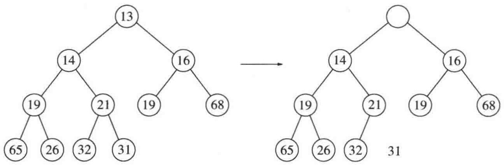

<details>
<summary>flowchart</summary>

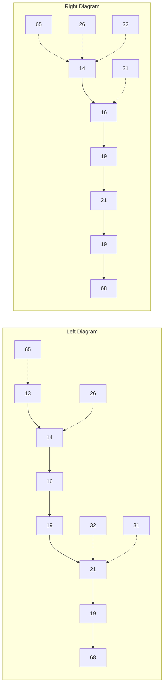
</details>

图6.9 在根处建立空穴

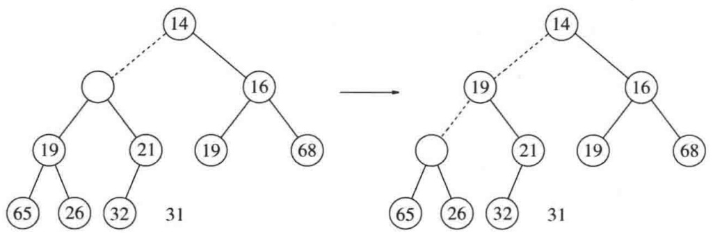

<details>
<summary>flowchart</summary>

This image displays two tree diagrams illustrating a transformation process. The left diagram shows a hierarchical tree structure with nodes labeled 14, 16, 19, 21, 32, and 65, while the right diagram shows a simplified version of the same structure with nodes labeled 14, 16, 19, 21, 32, 65, 19, and 68.
</details>

图 6.10 在 deleteMin 中的下两步操作

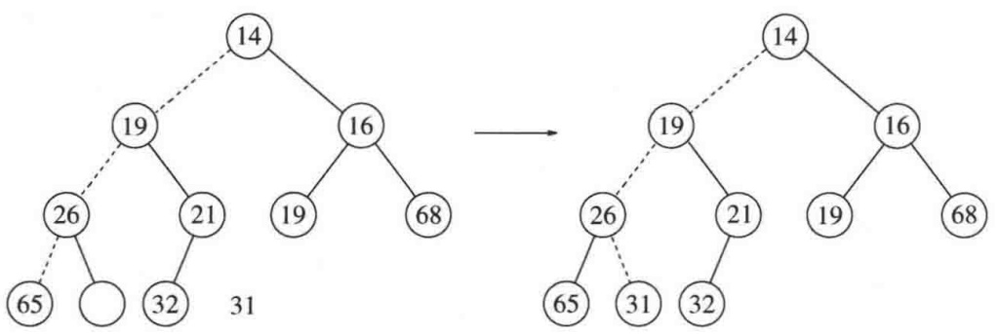

<details>
<summary>flowchart</summary>

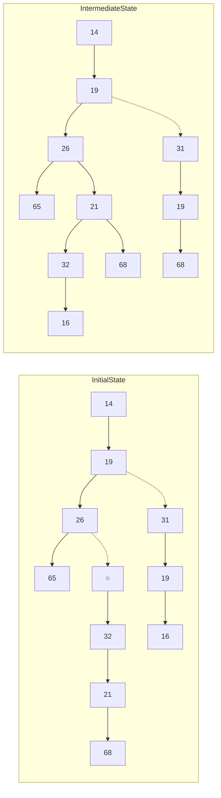
</details>

图 6.11 deleteMin 中最后的两步操作

在堆的实现中经常发生的错误是当堆中存在偶数个元素的时候，此时将遇到一个节点只有一个儿子的情况。我们必须以节点不总有两个儿子为前提，因此这就涉及到一个附加的测试。在图 6.12 描述的程序中，在第 40 行已经进行了这种测试。一种极其巧妙的解决方法是始终保证算法把每一个节点都看成有两个儿子。为了实施这种解法，当堆的大小为偶数时在每个下滤开始处，可将其值大于堆中任何元素的标记放到堆的终端后面的位置上。我们必须在深思熟滤以后再这么做，而且必须插入一个是否确实使用这种技巧的评判。虽然这不再需要测试右儿子的存在性，但还是需要测试何时到达底层，因为对每一片树叶算法将需要一个标记。

这种操作最坏情形运行时间为 $O(\log N)$ 。平均而言，被放到根处的元素几乎下滤到堆的底层(即它所来自的那层)，因此平均运行时间为 $O(\log N)$ 。

```cpp
/**
 * 删除最小项.
 * 如果为空则抛出 UnderflowException 异常.
 */
void deleteMin( )
{
    if( isEmpty( ) )
        throw UnderflowException{ };

    array[ 1 ] = std::move( array[ currentSize-- ] );
    percolateDown( 1 );
}

/**
 * 删除最小项并将其放在 minItem 处.
 * 若为空则抛出UnderflowException异常.
 */
void deleteMin( Comparable & minItem )
{
    if( isEmpty( ) )
        throw UnderflowException{ };

    minItem = std::move( array[ 1 ] );
    array[ 1 ] = std::move( array[ currentSize-- ] );
    percolateDown( 1 );
}

/**
 * 在堆中进行下滤的内部方法.
 * 空穴是下滤开始处的下标.
 */
void percolateDown( int hole )
{
    int child;
    Comparable tmp = std::move( array[ hole ] );

    for( ; hole * 2 <= currentSize; hole = child )
    {
        child = hole * 2;
        if( child != currentSize && array[ child + 1 ] < array[ child ] )
            ++child;
        if( array[ child ] < tmp )
            array[ hole ] = std::move( array[ child ] );
        else
            break;
    }
    array[ hole ] = std::move( tmp );
}
```

图 6.12 在二叉堆中执行 deleteMin 的方法

## 6.3.4 其他的堆操作

注意，虽然查找最小值的操作可以以常数时间完成，但是，按照求最小元设计的堆(也称作最小堆(min heap))在求最大元方面却无能为力。事实上，一个堆所蕴涵的序信息很少，因此，若不对整个堆进行线性搜索，是没有办法找出任何特定的元素的。为说明这一点，考虑图6.13所示的大型堆结构(具体元素没有标出)，我们在这里看到，关于最大值的元素所知道的唯一信息是:该元素在树叶上。但是，半数的元素位于树叶上，因此该信息实际上是没什么用途的。由于这个原因，如果重要的是要知道元素都在什么地方，那么除堆之外，还必须用到诸如散列表等某些其他的数据结构。(回忆:该模型并不允许查看堆内部。)

如果假设通过某种其他方法得知每一个元素的位置，那么就有几种其他操作的开销变小。下述前三种操作均以对数最坏情形时间运行。

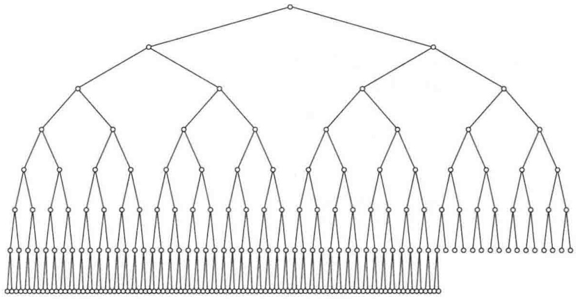

<details>
<summary>natural_image</summary>

Abstract geometric pattern composed of interconnected nodes and lines, no text or symbols present
</details>

图 6.13 一棵巨大的完全二叉树

## decreaseKey(降低关键字的值)

decreaseKey $(p, \Delta)$ 操作降低在位置 $p$ 处的项的值，降值的幅度为正的量 $\Delta$ 。由于这可能破坏堆序性质，因此必须通过上滤对堆进行调整。该操作对系统管理程序是有用的:系统管理程序能够使它们的程序以最高的优先级来运行。

## increaseKey(增加关键字的值)

increaseKey(p,Δ)操作增加在位置p处的项的值，增值的幅度为正的量Δ。这可以用下滤来完成。许多调度程序自动地降低正在过多地消耗CPU时间的进程的优先级。

## remove(删除)

remove(p) 操作删除堆中位置 p 上的节点。该操作通过首先执行 decreaseKey(p,∞) 然后再执行 deleteMin() 来完成。当一个进程被用户中止(而不是正常终止)时，它必须从优先队列中被除去。

## buildHeap(构建堆)

有时二叉堆是由一些项的一个初始集合构造而得的，这种构造函数以 $N$ 项作为输入，并把它们放到一个堆中。显然，这可以使用 $N$ 个相继的 insert 操作来完成。由于每个 insert将花费 $O(1)$ 平均时间以及 $O(\log N)$ 的最坏情形时间，因此该算法的总的运行时间平均是 $O(N)$ 时间，而最坏情形则是 $O(M\log N)$ 时间。由于这是一种特殊的指令，没有其他操作干扰，而且我们已经知道该指令能够以线性平均时间实施，因此，期望能够保证线性时间界的考虑是合乎情理的。

一般的算法是将 $N$ 项以任意顺序放入树中，保持结构特性。此时，如果percolateDown(i)从节点i下滤，那么图6.14中的buildHeap例程则可以由构造函数用于创建一棵堆序的树(heap-ordered tree)。

```txt
explicit BinaryHeap( const vector<Comparable> & items )
    : array( items.size( ) + 10 ), currentSize{ items.size( ) }
{
    for( int i = 0; i < items.size( ); ++i )
        array[ i + 1 ] = items[ i ];
    buildHeap( );
}

/**
 * 从项的任一排列建立堆序性质
 * 以线性时间运行.
 */
void buildHeap( )
{
    for( int i = currentSize / 2; i > 0; --i )
        percolateDown( i );
}
```

图6.14 buildHeap和构造函数

图6.15中的第一棵树是无序树。图6.15～图6.18中其余7棵树表示出7个percolteDown中每一个的执行结果。每条虚线对应两次比较:一次是找出较小的子节点，另一次是将较小的儿子与该节点进行比较。注意，在整个算法中只有10条虚线(可能已经存在第11条——在哪里？)，它们对应20次比较。

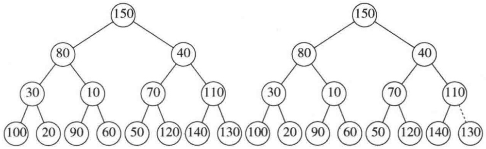

<details>
<summary>funnel</summary>

| Node | Left Structure Value | Right Structure Value |
| --- | --- | --- |
| 1 | 150 | 150 |
| 2 | 80 | 80 |
| 3 | 30 | 30 |
| 4 | 10 | 10 |
| 5 | 60 | 90 |
| 6 | 50 | 60 |
| 7 | 120 | 50 |
| 8 | 140 | 120 |
| 9 | 130 | 140 |
| 10 | — | 130 |
</details>

图 6.15 左:初始堆；右:在 percolateDown(7) 后

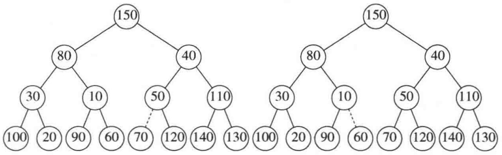

<details>
<summary>dendrogram</summary>

| Node | Left Structure Value | Right Structure Value |
| --- | --- | --- |
| 1 | 150 | 150 |
| 2 | 80 | 80 |
| 3 | 30 | 30 |
| 4 | 10 | 10 |
| 5 | 70 | 60 |
| 6 | 120 | 70 |
| 7 | 140 | 120 |
| 8 | 130 | 140 |
| 9 | — | 130 |
| 10 | — | 110 |
| 11 | — | 110 |
| 12 | — | 110 |
| 13 | — | 110 |
| 14 | — | 110 |
| 15 | — | 110 |
| 16 | — | 110 |
| 17 | — | 110 |
| 18 | — | 110 |
| 19 | — | 110 |
| 20 | — | 110 |
| 21 | — | 110 |
| 22 | — | 110 |
| 23 | — | 110 |
| 24 | — | 110 |
| 25 | — | 110 |
| 26 | — | 110 |
| 27 | — | 110 |
| 28 | — | 110 |
| 29 | — | 110 |
| 30 | — | 110 |
| 31 | — | 110 |
| 32 | — | 110 |
| 33 | — | 110 |
| 34 | — | 110 |
| 35 | — | 110 |
| 36 | — | 110 |
| 37 | — | 110 |
| 38 | — | 110 |
| 39 | — | 110 |
| 40 | — | 110 |
| 41 | — | 110 |
| 42 | — | 110 |
| 43 | — | 110 |
| 44 | — | 110 |
| 45 | — | 110 |
| 46 | — | 110 |
| 47 | — | 110 |
| 48 | — | 110 |
| 49 | — | 110 |
| 50 | — | 110 |
| 51 | — | 110 |
| 52 | — | 110 |
| 53 | — | 110 |
| 54 | — | 110 |
| 55 | — | 110 |
| 56 | — | 110 |
| 57 | — | 110 |
| 58 | — | 110 |
| 59 | — | 110 |
| 60 | — | 110 |
| 61 | — | 110 |
| 62 | — | 110 |
| 63 | — | 110 |
| 64 | — | 110 |
| 65 | — | 110 |
| 66 | — | 110 |
| 67 | — | 110 |
| 68 | — | 110 |
| 69 | — | 110 |
| 70 | — | 110 |
| 71 | — | 110 |
| 72 | — | 110 |
| 73 | — | 110 |
| 74 | — | 110 |
| 75 | — | 110 |
| 76 | — | 110 |
| 77 | — | 110 |
| 78 | — | 110 |
| 79 | — | 110 |
| 80 | — | 80 |
| 81 | — | 40 |
</details>

图6.16 左:在percolateDown(6)后；右:在percolateDown(5)后

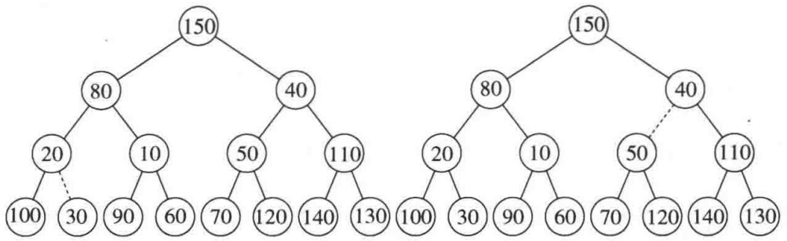

<details>
<summary>dendrogram</summary>

| Node | Left Structure Value | Right Structure Value |
| --- | --- | --- |
| 1 | 150 | 150 |
| 2 | 80 | 80 |
| 3 | 20 | 20 |
| 4 | 10 | 10 |
| 5 | 100 | 100 |
| 6 | 30 | 30 |
| 7 | 90 | 90 |
| 8 | 60 | 60 |
| 9 | 70 | 60 |
| 10 | 120 | 70 |
| 11 | 140 | 120 |
| 12 | 130 | 140 |
| 13 | — | 130 |
| 14 | — | 110 |
| 15 | — | 40 |
| 16 | — | 40 |
| 17 | — | 110 |
| 18 | — | 50 |
| 19 | — | 110 |
| 20 | — | 20 |
| 21 | — | 10 |
| 22 | — | 100 |
| 23 | — | 30 |
| 24 | — | 90 |
| 25 | — | 60 |
| 26 | — | 70 |
| 27 | — | 120 |
| 28 | — | 140 |
| 29 | — | 130 |
</details>

图 6.17 左:在 percolateDown(4) 后 右:在 percolateDown(3) 后

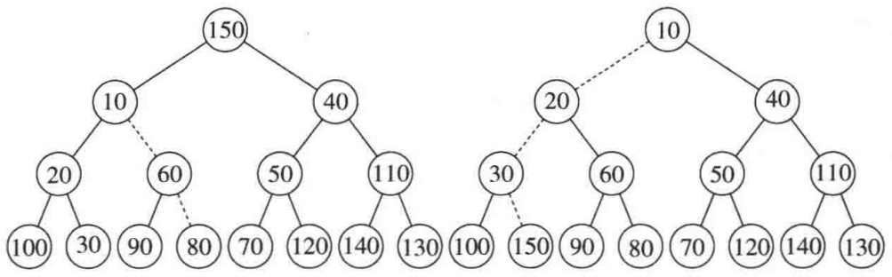

<details>
<summary>dendrogram</summary>

| Node | Left Structure Value | Right Structure Value |
| --- | --- | --- |
| 1 | 150 | 10 |
| 2 | 10 | 40 |
| 3 | 20 | 20 |
| 4 | 100 | 100 |
| 5 | 30 | 150 |
| 6 | 90 | 90 |
| 7 | 80 | 80 |
| 8 | 70 | 70 |
| 9 | 120 | 120 |
| 10 | 140 | 140 |
| 11 | 130 | 130 |
| 12 | 50 | 50 |
| 13 | 110 | 110 |
| 14 | — | 130 |
| 15 | — | 130 |
| 16 | — | 120 |
| 17 | — | 140 |
| 18 | — | 130 |
| 19 | — | 80 |
| 20 | — | 60 |
| 21 | — | 60 |
| 22 | — | 60 |
| 23 | — | 60 |
| 24 | — | 60 |
| 25 | — | 60 |
| 26 | — | 60 |
| 27 | — | 60 |
| 28 | — | 60 |
| 29 | — | 60 |
| 30 | — | 60 |
| 31 | — | 60 |
| 32 | — | 60 |
| 33 | — | 60 |
| 34 | — | 60 |
| 35 | — | 60 |
| 36 | — | 60 |
| 37 | — | 60 |
| 38 | — | 60 |
| 39 | — | 60 |
| 40 | — | 60 |
| 41 | — | 60 |
| 42 | — | 60 |
| 43 | — | 60 |
| 44 | — | 60 |
| 45 | — | 60 |
| 46 | — | 60 |
| 47 | — | 60 |
| 48 | — | 60 |
| 49 | — | 60 |
| 50 | — | 60 |
| 51 | — | 60 |
| 52 | — | 60 |
| 53 | — | 60 |
| 54 | — | 60 |
| 55 | — | 60 |
| 56 | — | 60 |
| 57 | — | 60 |
| 58 | — | 60 |
| 59 | — | 60 |
| 60 | — | 60 |
| 61 | — | 60 |
| 62 | — | 60 |
| 63 | — | 60 |
| 64 | — | 60 |
| 65 | — | 60 |
| 66 | — | 60 |
| 67 | — | 60 |
| 68 | — | 60 |
| 69 | — | 60 |
| 70 | — | 60 |
| 71 | — | 60 |
| 72 | — | 60 |
| 73 | — | 60 |
| 74 | — | 60 |
| 75 | — | 60 |
| 76 | — | 60 |
| 77 | — | 60 |
| 78 | — | 60 |
| 79 | — | 60 |
| 80 | — | 60 |
| 81 | — | 60 |
| 82 | — | 60 |
| 83 | — | 60 |
| 84 | — | 60 |
| 85 | — | 60 |
| 86 | — | 60 |
| 87 | — | 60 |
| 88 | — | 60 |
| 89 | — | 60 |
| 90 | — | 60 |
| 91 | — | 60 |
| 92 | — | 60 |
| 93 | — | 60 |
| 94 | — | 60 |
| 95 | — | 60 |
| 96 | — | 60 |
| 97 | — | 60 |
| 98 | — | 60 |
| 99 | — | 60 |
</details>

图 6.18 左:在 percolateDown(2) 后 右:在 percolateDown(1) 后

为了确定 buildHeap 的运行时间的界，必须确定虚线的条数的界。这可以通过计算堆中所有节点的高度的和来得到，它是虚线的最大条数。现在我们想要说明的是:该和为  $O(N)$ 。

## 定理6.1

包含 $2^{h + 1} - 1$ 个节点高为 $h$ 的理想二叉树(perfect binary tree)的节点的高度的和为 $2^{h + 1} - 1 - (h + 1)$ 。

证明:

容易看出，该树由高度 $h$ 上的1个节点、高度 $h - 1$ 上的2个节点、高度 $h - 2$ 上的 $2^{2}$ 个节点以及一般地在高度 $h - i$ 上的 $2^{i}$ 个节点等组成。于是，所有节点的高度的和为

$$
\begin{array}{l} S = \sum_ {i = 0} ^ {h} 2 ^ {i} (h - i) \\ = h + 2 (h - 1) + 4 (h - 2) + 8 (h - 3) + 1 6 (h - 4) + \dots + 2 ^ {h - 1} (1) \tag {6.1} \\ \end{array}
$$

两边乘以 2 得到方程

$$
2 S = 2 h + 4 (h - 1) + 8 (h - 2) + 1 6 (h - 3) + \dots + 2 ^ {h} (1) \tag {6.2}
$$

将这两个方程相减得到式(6.3)。我们发现, 非常数项差不多都消去了, 例如, $2h - 2(h - 1) = 2, 4(h - 1) - 4(h - 2) = 4$, 等等。式(6.2)的最后一项 $2^{h}$ 在式(6.1)中不出现, 因此, 它出现在式(6.3)中。式(6.1)中的第一项 $h$ 在式(6.2)中不出现, 因此, $-h$ 出现在式(6.3)中。我们得到

$$
S = - h + 2 + 4 + 8 + \dots + 2 ^ {h - 1} + 2 ^ {h} = (2 ^ {h + 1} - 1) - (h + 1) \tag {6.3}
$$

这就证明了该定理。

一棵完全树 (complete tree) 不是理想二叉树 (perfect binary tree), 但是我们得到的结果却是一棵完全树的节点高度的和的上界。由于一棵完全树节点数在 $2^{h}$ 和 $2^{h+1}$ 之间, 因此该定理意味着这个和是 $O(N)$, 其中 $N$ 是节点的个数。

虽然我们得到的结果对证明 buildHeap 是线性的而言是充分的，但高度和的界却不是尽可能强的界。对于具有 $N = 2^{h}$ 个节点的完全树，我们得到的界大致是 $2N$ 。由归纳法可以证明，高度的和是 $N - b(N)$，其中 $b(N)$ 是在 $N$ 的二进制表示法中1的个数。

## 6.4 优先队列的应用

我们已经提到优先队列如何用于操作系统的设计中。在第 9 章将看到优先队列如何用在有效地实现几个图论算法中。此处，我们介绍如何应用优先队列来得到两个问题的解答。

## 6.4.1 选择问题

我们将要考察的第一个问题是来自第1章1.1节的选择问题(selection problem)。回忆当时的输入是 $N$ 个元素以及一个整数 $k$，这 $N$ 个元素可以是全序的(totally ordered)。该选择问题是要找出第 $k$ 个最大的元素。

在第 1 章中给出了两个算法，不过它们都不是很有效的算法。第一个算法我们将称其为 1A，是把这些元素读入数组并将它们排序，返回适当的元素。假设使用的是简单的排序算法，则运行时间为 $O(N^{2})$ 。另一个算法叫作 1B，是将 $k$ 个元素读入一个数组并将其排序。这些元素中的最小者在第 $k$ 个位置上。我们一个一个地处理其余的元素。当一个元素被读入时，它先与数组中第 $k$ 个元素比较，如果该元素大，那么将第 $k$ 个元素除去，而这个新元素则被放在其余 $k-1$ 个元素间的正确的位置上。当算法结束时，第 $k$ 个位置上的元素就是问题的解答。该方法的运行时间为 $O(N \cdot k)$（为什么？）。如果 $k = \lceil N / 2 \rceil$，那么这两种算法都是 $O(N^{2})$。注意，对于任意的 $k$，我们可以求解对称的问题:找出第 $(N - k + 1)$ 个最小的元素，从而 $k = \lceil N / 2 \rceil$ 实际上是这两个算法最困难的情况。这刚好也是最有趣的情形，因为 $k$ 的这个值称为中位数 (median)。

我们在这里给出两个算法，在 $k = \lceil N / 2\rceil$ 的极端情形它们均以 $O(N\log N)$ 运行，这是明显的改进。

## 算法6A

为了简单起见，假设只考虑找出第 $k$ 个最小的元素。该算法很简单。我们将 $N$ 个元素读入一个数组。然后对该数组应用 buildHeap 算法。最后，执行 $k$ 次 deleteMin 操作。从该堆最后提取的元素就是我们的答案。显然，只要改变堆序性质，就可以求解原始的问题:找出第 $k$ 个最大的元素。

这个算法的正确性应该是显然的。如果使用 buildHeap，构造堆的最坏情形用时是 $O(N)$，而每次 deleteMin 用时 $O(\log N)$。由于有 $k$ 次 deleteMin，因此得到总的运行时间为 $O(N + k \log N)$。如果 $k = O(N / \log N)$，那么运行时间取决于 buildHeap 操作，即 $O(N)$。对于大的 $k$ 值，运行时间为 $O(k \log N)$。如果 $k = \lceil N / 2 \rceil$，那么运行时间则为 $\Theta(N \log N)$。

注意，如果对 $k = N$ 运行该程序并在元素离开堆时记录它们的值，那么实际上已经对输入文件以时间 $O(N\log N)$ 做了排序。在第7章，我们将细化该想法，得到一种快速的排序算法，叫作堆排序(heapsort)。

## 算法 6B

关于第2个算法，我们回到原始问题，找出第 $k$ 个最大的元素。我们使用算法1B的思路。

在任一时刻我们都将保留 $k$ 个最大元素的集合 $S$ 。在前 $k$ 个元素读入以后，当再读入一个新的元素时，该元素将与第 $k$ 个最大元素进行比较，记这第 $k$ 个最大的元素为 $S_{k}$ 。注意，$S_{k}$ 是 $S$ 中最小的元素。如果新的元素更大，那么用新元素代替 $S$ 中的 $S_{k}$ 。此时，$S$ 将有一个新的最小元素，它可能是新添加进的元素，也可能不是。在输入终了时，我们找到 $S$ 中最小的元素，将其返回，它就是答案。

这基本上与第1章中描述的算法相同。不过，这里使用一个堆来实现 $S$ 。前 $k$ 个元素通过调用一次buildHeap以总时间 $O(k)$ 被置入堆中。处理每个其余的元素的时间为 $O(1)$，用于检测是否元素进入 $S$，再加上时间 $O(\log k)$，用于在必要时删除 $S_{k}$ 并插入新元素。因此，总的时间是 $O(k + (N - k)\log k) = O(N\log k)$ 。该算法也给出找出中位数的时间界 $\Theta(N\log N)$ 。

在第7章，我们将看到如何以平均时间 $O(N)$ 解决这个问题。在第10章，我们将看到一个以 $O(N)$ 最坏情形时间求解该问题的算法，虽然不实用但却很精妙。

## 6.4.2 事件模拟

第3章3.7.3节描述了一个重要的排队问题。回忆在那里我们有一个系统，比如银行，顾客们到达并站队等在那里直到 $k$ 个出纳员有一个腾出手来。顾客的到达情况由概率分布函数控制，服务时间(一旦出纳员腾出时间用于服务的时间量)也是如此。我们的兴趣在于一位顾客平均必须要等多久或所排的队伍可能有多长这类统计问题。

对于某些概率分布以及 $k$ 的一些值，答案都可以精确地计算出来。然而随着 $k$ 的变大，分析明显地变得困难，因此使用计算机模拟银行的运作很有吸引力。用这种方法，银行官员可以确定为保证合理的通畅服务需要多少出纳员。

模拟由处理中的事件组成。这里的两个事件是:(a)一位顾客的到达；(b)一位顾客的离去，从而腾出一名出纳员。

我们可以使用概率函数来生成一个输入流，它由每位顾客的到达时间和服务时间的序偶组成，并通过到达时间排序。我们不必使用一天中的准确时间，而是使用一份单位时间量，我们称之为一个滴答(tick)。

进行这种模拟的一种方法是启动处在 0 滴答处的一台模拟钟表。我们让钟表一次走一个滴答，同时查看是否有一个事件发生。如果有，那么我们处理这个(些)事件，搜集统计资料。当没有顾客留在输入流且所有的出纳员都被腾出而闲在的时候，模拟结束。

这种模拟策略的问题是，它的运行时间不依赖顾客数或事件数(每位顾客有两个事件)，但是却依赖滴答数，而后者实际又不是输入的一部分。为了看清为什么问题在于此，假设将钟表的单位改成毫滴答(millitick)，即千分之一滴答，并将输入中的所有时间乘以1000，则结果将是:模拟用时长1000倍。

避免这种问题的关键是在每一个阶段让钟表直接走到下一个事件时间。从概念上看这是容易做到的。在任一时刻，可能出现的下一事件或者是(a)在输入文件中下一顾客的到达，或者是(b)在一名出纳员处一位顾客离开。由于事件将要发生的所有时间都是可以达到的，因此只需找出在最近的将来发生的事件并处理这个事件。

如果事件是离开，那么处理过程包括搜集离开的顾客的统计资料以及检验队伍(队列)看是否还有别的顾客在等待。如果有，则加上这位顾客，处理需要的统计资料，计算顾客将要离开的时间，并将离开加到等待发生的事件集中去。

如果事件是到达，则检查闲在的出纳员。如果没有，则把该到达放到队伍(队列)中去；否则，我们分配给顾客一个出纳员，计算顾客的离开时间，并将离开添加到等待发生的事件集中去。

正在等待的顾客队伍可以实现为一个队列。由于需要找到最近的将来发生的事件，因此合适的办法是将等待发生离开的集合编入一个优先队列中。下一事件是下一个到达或下一个离开(哪个先发生就是哪个)，它们都容易达到。

现在就可以为模拟编写例程了，不过很可能要耗费些时间。如果有 $C$ 个顾客(因此有2C个事件)和 $k$ 个出纳员，那么模拟的运行时间将会是 $O(C\log (k + 1))$ ，因为计算和处理每个事件花费 $O(\log H)$ ，其中 $H = k + 1$ 为堆的大小。①

## 6.5 $d$ 堆

二叉堆是如此简单，以至于它们几乎总是用在需要优先队列的时候。 $d$ 堆 $(d$-heap) 是二叉堆的简单推广，它恰像一个二叉堆，只是所有的节点都有 $d$ 个儿子（因此，二叉堆是2堆）。

图 6.19 表示的是一个 3 堆。注意，d 堆要比二叉堆浅得多，它将 insert 操作的运行时间改进为  $O(\log_{d} N)$ 。然而，对于大的 d，deleteMin 操作费时得多，因为虽然树是浅了，但是 d 个儿子中的最小者是必须要找出的，如使用标准的算法，这会花费 d-1 次比较，于是将操作的用时提高到  $O(d \log_{d} N)$ 。如果 d 是常数，那么当然两者的运行时间都是  $O(\log N)$ 。虽然仍然可以使用一个数组，但是，现在找出儿子和父亲的乘法和除法都有个因子 d，除非 d 是 2 的幂，否则将会大大地增加运行时间，因为我们不能再通过一次二进制移位来实现除法了。d 堆在理论上很有趣，因为存在许多算法，其插入次数比 deleteMin 的次数多很多（从而理论上的加速是可能的）。当优先队列太大不能完全装入主存的时候，d 堆也是很有用的。在这种情况下，d 堆能够以与 B 树大致相同的方式发挥作用。最后，有证据显示，在实践中 4 堆可以胜过二叉堆。

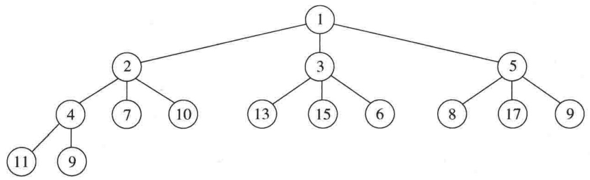

<details>
<summary>flowchart</summary>

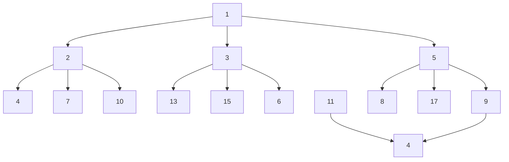
</details>

图6.19 一个 $d$ 堆 $(d = 3)$

除不能实施 find 外，堆实现的最明显的缺点是:将两个堆合并成一个堆是困难的操作。这种附加的操作叫作合并(merge)。存在许多实现堆的方法使得一次 merge 操作的运行时间是 $O(\log N)$ 。现在我们就来讨论 3 种复杂程度不一的数据结构，它们都有效地支持 merge 操作。我们将把复杂的分析推迟到第 11 章讨论。

<small><span class="docvortex-page-footnote" data-block-type="page_footnote" style="color:#6b7280">① 我们用 $O(C\log (k + 1))$ 而不用 $O(C\log k)$ 以避免 $k = 1$ 情形出现的混乱。</span></small>

## 6.6 左式堆

设计一种堆结构有效地支持合并操作(即以 $o(N)$ 时间处理一次 merge)而且像二叉堆那样只使用一个数组似乎很困难。原因在于，合并似乎需要把一个数组复制到另一个数组中去，对于相同大小的堆这将花费时间 $\Theta (N)$ 。正因为如此，所有支持有效合并的高级数据结构都需要使用链式数据结构。实践中，我们预计这将可能使得所有其他的操作变慢。

左式堆(leftist heap)像二叉堆那样也具有结构性和有序性。事实上，和所有使用的堆一样，左式堆具有相同的堆序性质，该性质我们已经看到过了。不仅如此，左式堆也是二叉树。左式堆和二叉堆唯一的区别是:左式堆不是理想平衡的(perfectly balanced)，而实际上是趋向于非常的不平衡。

## 6.6.1 左式堆的性质

我们把任一节点 $X$ 的零路径长 (null path length) $\mathrm{npl}(X)$ 定义为从 $X$ 到一个不具有两个儿子的节点的最短路径的长。因此，具有 0 个或 1 个儿子的节点的 $\mathrm{npl}$ 为 0，而 $\mathrm{npl}(\mathrm{nullptr}) = -1$ 。在图 6.20 给出的树中，零路径长标记在树的节点内。

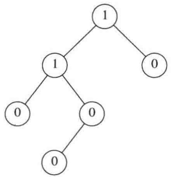

<details>
<summary>flowchart</summary>

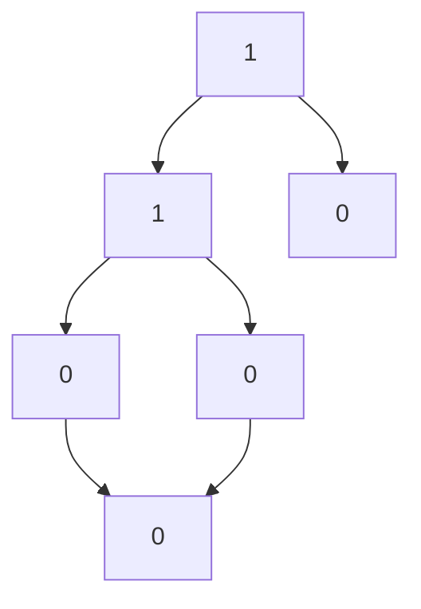
</details>

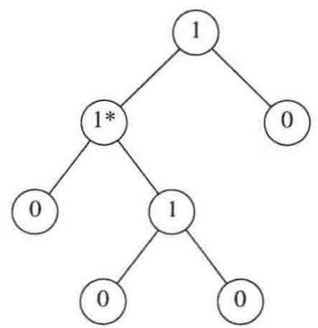

<details>
<summary>flowchart</summary>

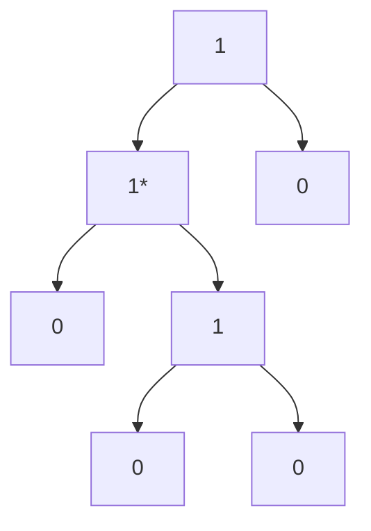
</details>

图6.20 两棵树的零路径长；只有左边的树是左式的

注意，任一节点的零路径长比它的诸儿子节点的零路径长的最小值多1。这个结论也适用少于两个儿子的节点，因为 nullptr 的零路径长是-1。

左式堆性质是:对于堆中的每一个节点 $X$ ，左儿子的零路径长至少与右儿子的零路径长一样。图6.20中只有一棵树，即左边的那棵树满足该性质。这个性质实际上超出了它确保树不平衡的要求，因为它显然偏重于使树向左增加深度。确实有可能存在由左节点形成的长路径构成的树(而且实际上更便于合并操作)——因此，我们就有了名称左式堆(leftist heap)。

因为左式堆趋向于加深左路径，所以右路径应该短。事实上，沿左式堆往下的右路径确实是该堆中最短的路径。否则，就会存在过某个节点 $X$ 的一条路径通达它的左儿子，此时 $X$ 就破坏了左式堆的性质。

## 定理6.2

在右路径上有 $r$ 个节点的左式树必然至少有 $2^{r} - 1$ 个节点。

证明:

数学归纳法证明。如果 $r = 1$，则必然至少存在一个树节点。其次，设定理对 1、2、…、 $r$ 个节点成立。考虑在右路径上有 $r + 1$ 个节点的左式树。此时，根具有在右路径上含 $r$ 个节点的右子树，以及在右路径上至少含 $r$ 个节点的左子树(否则它就不是左式的)。对这两棵树应用归纳假设，得知在每棵树上最少有 $2^{r} - 1$ 个节点，再加上根节点，于是在该树上至少有 $2^{r + 1} - 1$ 个节点，定理得证。

从这个定理立刻得到，N 个节点的左式树有一条最多含有  $\left\lfloor \log(N+1) \right\rfloor$  个节点的右路径。对左式堆操作的一般思路是将所有的工作放到右路径上进行，它保证树深度短。唯一的棘手部分在于，对右路径的 insert 和 merge 可能会破坏左式堆性质。事实上，恢复该性质是非常容易的。

## 6.6.2 左式堆操作

对左式堆的基本操作是合并。注意，插入只是合并的特殊情形，因为可以把插入看成是单节点堆与一个更大的堆的 merge。首先，我们给出一个简单的递归解法，然后介绍如何能够非递归地施行该解法。我们的输入是两个左式堆 $H_{1}$ 和 $H_{2}$，见图6.21。读者应该验证，这两个堆确实是左式堆。注意，最小的元素在根处。除数据、左指针和右指针所用空间外，每个节点还要有一个指示零路径长的项。

如果这两个堆中有一个堆是空的，则可以返回另外一个堆。否则，为了合并这两个堆，可比较它们的根。首先，我们递归地将具有较大的根值的堆与具有较小的根值的堆的右子堆合并。在本例中这就是说，我们递归地将 $H_{2}$ 与 $H_{1}$ 的根在8处的右子堆合并，得到图6.22中的堆。

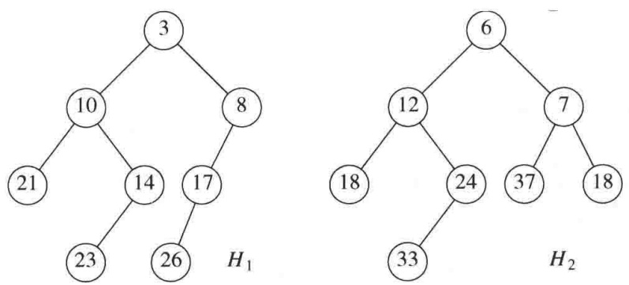

图6.21 两个左式堆 $H_{1}$ 和 $H_{2}$

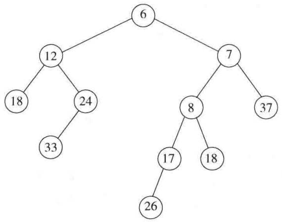

<details>
<summary>flowchart</summary>

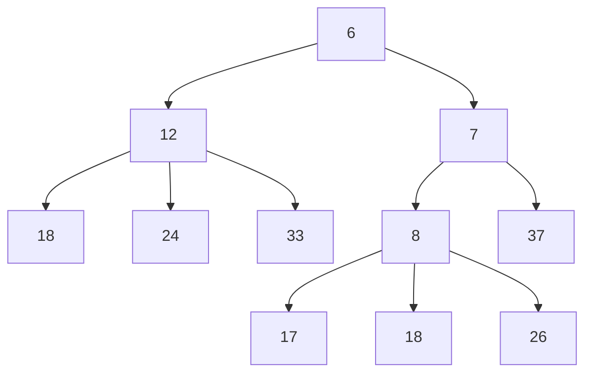
</details>

图6.22 将 $H_{2}$ 与 $H_{1}$ 的右子堆合并的结果

由于这棵树是递归地形成的，而我们尚未对算法描述完毕，因此现在还不能说明该堆是如何得到的。不过，有理由假设，最后得到的树是一个左式堆，因为它是通过递归的步骤得到的。这很像归纳法证明中的归纳假设。既然我们能够处理基准情形(发生在一棵树是空的时候)，当然可以假设，只要我们能够完成合并，那么递归步骤就是成立的。这是递归法则3，我们在第1章中讨论过它。现在，我们让这个新的堆成为 $H_{1}$ 的根的右儿子(见图6.23)。

虽然最后得到的堆满足堆序性质，但它不是左式堆，因为根的左子树的零路径长为1而根的右子树的零路径长为2。因此，左式的性质在根处被破坏。不过，容易看到，树的其余部分必然是左式的。由于递归步骤，根的右子树是左式的。根的左子树没有变化，当然它也必然还是左式的。这样一来，我们只要对根进行调整就可以了。使整个树是左式的做法如下:只要交换根的左儿子和右儿子(见图6.24)并更新零路径长，就完成了merge，新的零路径长