是新的右儿子的零路径长加 1。注意，如果零路径长不更新，那么所有的零路径长都将是 0，而堆将不是左式的，只是随机的。在这种情况下，算法仍然成立，但是，我们宣称的时间界将不再有效。

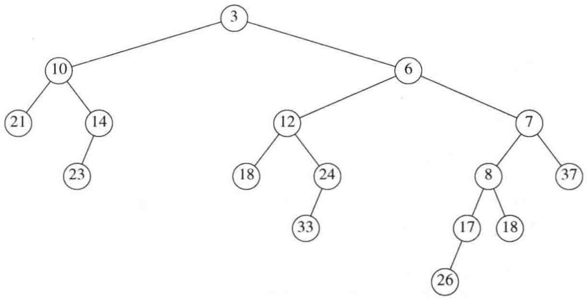

<details>
<summary>flowchart</summary>

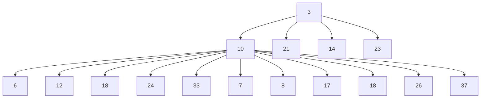
</details>

图6.23 将前面图中的左式堆作为 $H_{1}$ 的右儿子接上后的结果

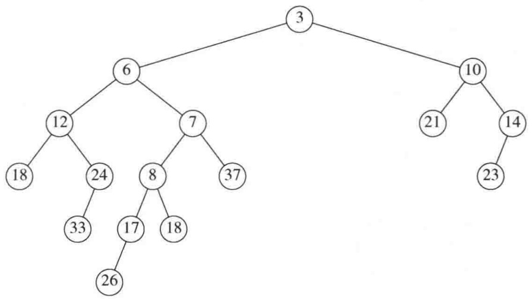

<details>
<summary>flowchart</summary>

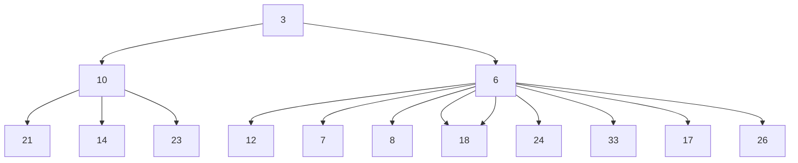
</details>

图 6.24 交换  $H_{1}$  的根的儿子得到的结果

将算法的描述直接翻译成代码。除了增加 npl(零路径长)数据成员外, 节点类(见图 6.25)与二叉树是相同的。左式堆把指向根的指针作为其数据成员存储。我们在第 4 章已经看到, 当一个元素被插入到一棵空的二叉树时, 由根引用的节点将需要改变。我们使用通常的实现 private 递归方法的技巧进行合并。该类的架构也在图 6.25 中示出。

两个 merge 例程(见图 6.26)是些被设计成消除一些特殊情形并保证 $H_{1}$ 有较小根的驱动程序。实际的合并操作在 merge1 中进行(见图 6.27)。公有的 merge 方法将 rhs 合并到控制堆中。rhs 变为空。在这个公有方法中的别名测试不接受 h.merge(h)。

执行合并所用的时间与右路径的长的和成正比，因为在递归调用期间对每一个被访问的节点花费的是常数工作量。因此，我们得到合并两个左式堆的时间界为 $O(\log N)$ 。我们也可以分两趟来非递归地实施该操作。在第一趟中，通过合并两个堆的右路径建立一棵新的树。为此，我们以排序的方式安排 $H_{1}$ 和 $H_{2}$ 右路径上的节点，保持它们各自的左儿子不变。在我们的例子中，新的右路径是3，6，7，8，18，而最后得到的树如图6.28所示。第二趟构建堆，儿子的交换工作在左式堆性质被破坏的那些节点上进行。在图6.28中，在节点7和3各有一次交换，并得到与前面相同的树。非递归的做法更容易理解，但编程困难。我们留给读者去证明:递归过程和非递归过程的结果是相同的。

```cpp
template <typename Comparable>
class LeftistHeap
{
    public:
        LeftistHeap( );
        LeftistHeap( const LeftistHeap & rhs );
        LeftistHeap( LeftistHeap && rhs );

        ~LeftistHeap( );

        LeftistHeap & operator=( const LeftistHeap & rhs );
        LeftistHeap & operator=( LeftistHeap && rhs );

        bool isEmpty( ) const;
        const Comparable & findMin( ) const;

        void insert( const Comparable & x );
        void insert( Comparable && x );
        void deleteMin( );
        void deleteMin( Comparable & minItem );
        void makeEmpty( );
        void merge( LeftistHeap & rhs );

private:
    struct LeftistNode
    {
        Comparable element;
        LeftistNode *left;
        LeftistNode *right;
        int npl;

        LeftistNode( const Comparable & e, LeftistNode *lt = nullptr,
            LeftistNode *rt = nullptr, int np = 0 )
        : element{ e }, left{ lt }, right{ rt }, npl{ np } { }

        LeftistNode( Comparable && e, LeftistNode *lt = nullptr,
            LeftistNode *rt = nullptr, int np = 0 )
        : element{ std::move( e ) }, left{ lt }, right{ rt }, npl{ np } { }
    };

    LeftistNode *root;

    LeftistNode * merge( LeftistNode *h1, LeftistNode *h2 );
    LeftistNode * merge1( LeftistNode *h1, LeftistNode *h2 );

    void swapChildren( LeftistNode *t );
    void reclaimMemory( LeftistNode *t );
    LeftistNode * clone( LeftistNode *t ) const;
};
```

图 6.25 左式堆类型声明

```c
/**
 * 将rhs合并到优先队列.
 * rhs变为空。rhs必须不同于this。
 */
void merge( LeftistHeap & rhs )
{
    if( this == &rhs )    // 避免别名问题
        return;

    root = merge( root, rhs.root );
    rhs.root = nullptr;
}

/**
 * 合并两个根的内部方法。
 * 处理不正常情形并调用递归的merge1.
 */
LeftistNode * merge( LeftistNode *h1, LeftistNode *h2 )
{
    if( h1 == nullptr )
        return h2;
    if( h2 == nullptr )
        return h1;
    if( h1->element < h2->element )
        return merge1( h1, h2 );
    else
        return merge1( h2, h1 );
}
```

图 6.26 合并左式堆的驱动例程

```c
/**
 * 合并两个根的内部方法.
 * 假设树非空，并设 h1 的根包含最小项.
 */
LeftistNode * merge1( LeftistNode *h1, LeftistNode *h2 )
{
    if( h1->left == nullptr )  // 单节点
        h1->left = h2;          // h1中其他的域已经精确
    else
    {
        h1->right = merge( h1->right, h2 );
        if( h1->left->npl < h1->right->npl )
            swapChildren( h1 );
        h1->npl = h1->right->npl + 1;
    }
    return h1;
}
```

图 6.27 合并左式堆的实际例程

上面提到，可以通过把被插入项看成单节点堆并执行一次 merge 来完成插入。为了执行 deleteMin，我们只要除掉根而得到两个堆，然后再将这两个堆合并。因此，执行一次 deleteMin 的时间为 $O(\log N)$ 。这两个例程在图 6.29 和图 6.30 中给出。

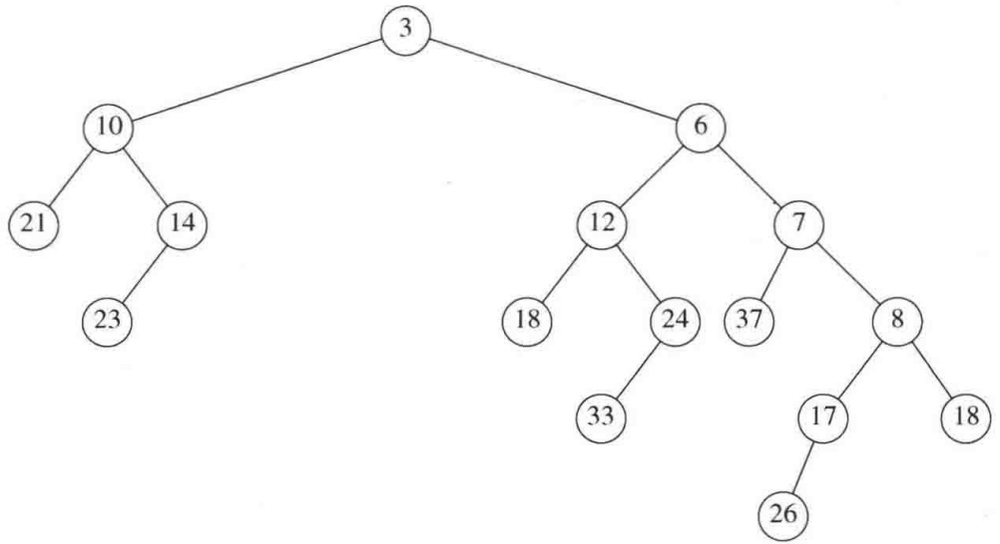

<details>
<summary>flowchart</summary>

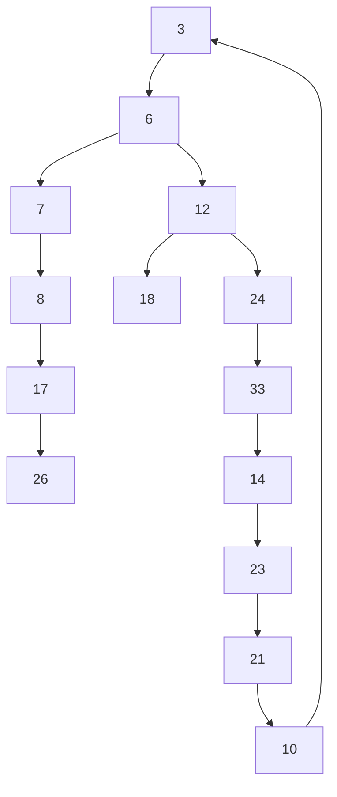
</details>

图6.28 合并 $H_{1}$ 和 $H_{2}$ 的右路径的结果

```txt
/**
     * 插入 x；允许项重复.
     */
    void insert( const Comparable & x )
    {
        root = merge( new LeftistNode{ x }, root );
    }
```

图 6.29 左式堆的插入例程

```c
/**
 * 删除最小项.
 * 若为空，则抛出异常UnderflowException.
 */
void deleteMin( )
{
    if( isEmpty( ) )
        throw UnderflowException{ };

    LeftistNode *oldRoot = root;
    root = merge( root->left, root->right );
    delete oldRoot;
}

/**
 * 删除最小项并将其放入minItem.
 * 若为空，则抛出异常UnderflowException.
 */
void deleteMin( Comparable & minItem )
{
    minItem = findMin( );
    deleteMin( );
}
```

图6.30 左式堆的deleteMin例程

最后，可以通过建立一个二叉堆(显然使用链接实现)来以 $O(N)$ 时间建立一个左式堆。尽管二叉堆显然是左式的，但这未必是最佳解决方案，因为我们得到的堆可能是最差的左式堆。不仅如此，以相反的层序遍历树也不像用一些链那么容易。buildHeap 的效果可以通过递归地建立左右子树然后将根下滤而达到。练习中包括另一个解决方案。

## 6.7 斜堆

斜堆(skew heap)是左式堆的自调节形式，实现起来极其简单。斜堆和左式堆间的关系类似于伸展树和 AVL 树间的关系。斜堆是具有堆序的二叉树，但是不存在对树的结构限制。不同于左式堆，关于任意节点的零路径长的任何信息都不再保留。斜堆的右路径在任何时刻都可以任意长，因此，所有操作的最坏情形运行时间均为 $O(N)$ 。然而，正如同伸展树，可以证明(见第 11 章)对任意 $M$ 次连续操作，总的最坏情形运行时间是 $O(M \log N)$ 。因此，斜堆每次操作的摊还开销(amortized cost)为 $O(\log N)$ 。

与左式堆相同，斜堆的基本操作也是合并操作。merge 例程还是递归的，我们执行与以前完全相同的操作，但有一个例外，即:对于左式堆，我们查看是否左儿子和右儿子满足左式堆结构性质并在不满足该性质时将它们交换。但对于斜堆，交换是无条件的，除那些右路径上所有节点的最大者不交换它的左右儿子的例外之外，我们都要进行这种交换。这个例外就是在自然递归实现时所发生的情况，因此它实际上根本不算是特殊情形。此外，证明时间界也是不必要的，但是，由于这样的节点肯定没有右儿子，因此执行交换赋予它一个右儿子是不明智的。（在我们的例子中，该节点没有儿子，因此不必为此担心。）另外，仍设我们的输入是与前面相同的两个堆，见图 6.31。

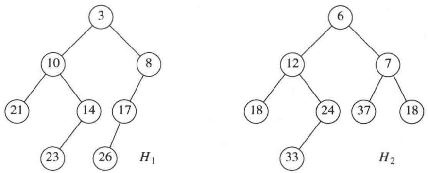

图6.31 两个斜堆 $H_{1}$ 和 $H_{2}$

如果递归地将 $H_{2}$ 与 $H_{1}$ 的根在8处的子堆合并，那么将得到图6.32中的堆。

这又是递归地完成的，因此，根据递归的第三个法则(见1.3节)，我们不必担心它是如何得到的。这个堆碰巧是左式的，不过不能保证情况总是如此。我们使这个堆成为 $H_{1}$ 的新的左儿子，而 $H_{1}$ 的老的左儿子变成了新的右儿子(见图6.33)。

整个树是左式的，但容易看到这并不总是成立的:将 15 插入到新堆中将破坏左式性质。

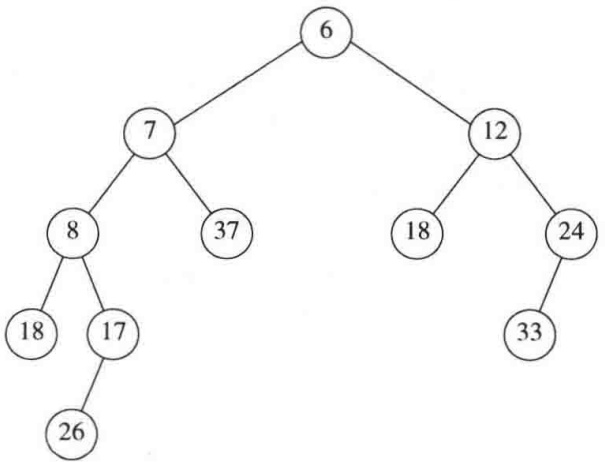

<details>
<summary>flowchart</summary>

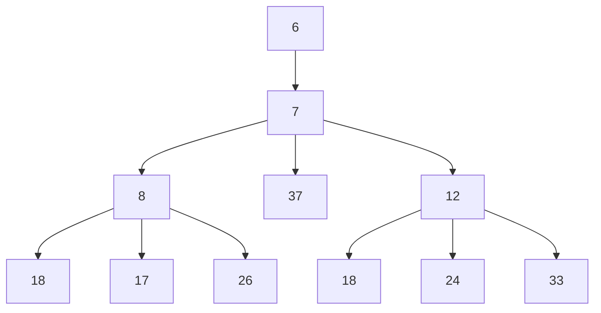
</details>

图6.32 将 $H_{2}$ 与 $H_{1}$ 的右子堆合并的结果

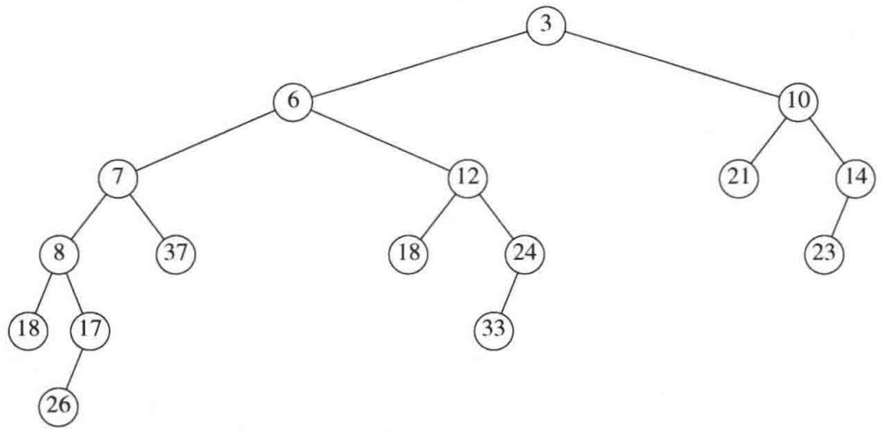

<details>
<summary>flowchart</summary>

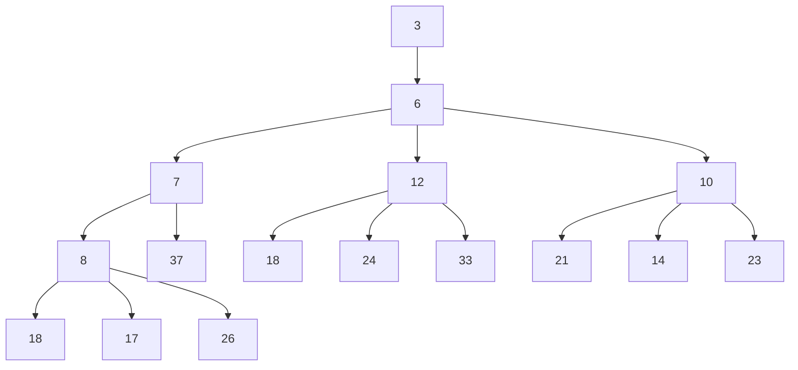
</details>

图6.33 合并斜堆 $H_{1}$ 和 $H_{2}$ 的结果

我们也可像左式堆那样非递归地进行所有的操作:合并右路径，除最后的节点外交换右路径上每个节点的左儿子和右儿子。经过几个例子之后，事情变得很清楚，由于除去右路径上最后的节点外的所有节点都将它们的儿子交换，因此纯效果是它变成了新的左路径(为了确信，请参见前面的例子)。这使得合并两个斜堆非常容易。 $^{①}$

斜堆的实现留作(平凡的)练习。注意，因为右路径可能很长，所以递归实现可能由于缺乏栈空间而失败，不过在其他方面性能还是可接受的。斜堆有一个优点，即不需要附加的空间保留路径长以及不需要测试以确定何时交换儿子。精确确定左式堆和斜堆的右路径长的期望值是一个尚未解决的问题(后者无疑更为困难)。这样的比较将更容易确定平衡信息的轻微损失是否可由缺少的测试来补偿。

## 6.8 二项队列

虽然左式堆和斜堆都在每次操作以 $O(\log N)$ 时间有效地支持合并、插入和deleteMin，但还是有改进的余地，因为我们知道，二叉堆以每次操作平均花费常数时间支持插入。二项队列支持所有这三种操作，每次操作的最坏情形运行时间为 $O(\log N)$，但插入操作平均花费常数时间。

## 6.8.1 二项队列构建

二项队列(binomial queue)不同于我们已经看到的所有优先队列的实现之处在于，一个二项队列不是一棵堆序的树，而是一组堆序树(heap-ordered tree)，称为森林(forest)。堆序树中的每一棵都是有约束的形式，叫作二项树(binomial tree，后面将看到该名称的由来是显然的)。每一个高度上至多存在一棵二项树。高度为0的二项树是一棵单节点树，高度为 $k$ 的二项树$B_{k}$ 通过将一棵二项树 $B_{k - 1}$ 附接到另一棵二项树 $B_{k - 1}$ 的根上而构成。图6.34显示出二项树 $B_{0}$ 、$B_{1}$ 、 $B_{2}$ 、 $B_{3}$ 以及 $B_{4}$ 。

<small><span class="docvortex-page-footnote" data-block-type="page_footnote" style="color:#6b7280">① 这与递归实现不完全一样(但服从相同的时间界)。如果一个堆的右路径用完而导致右路径合并终止，而我们只交换终止的那一点上面的右路径上那些节点的儿子，那么将得到与递归做法相同的结果。</span></small>

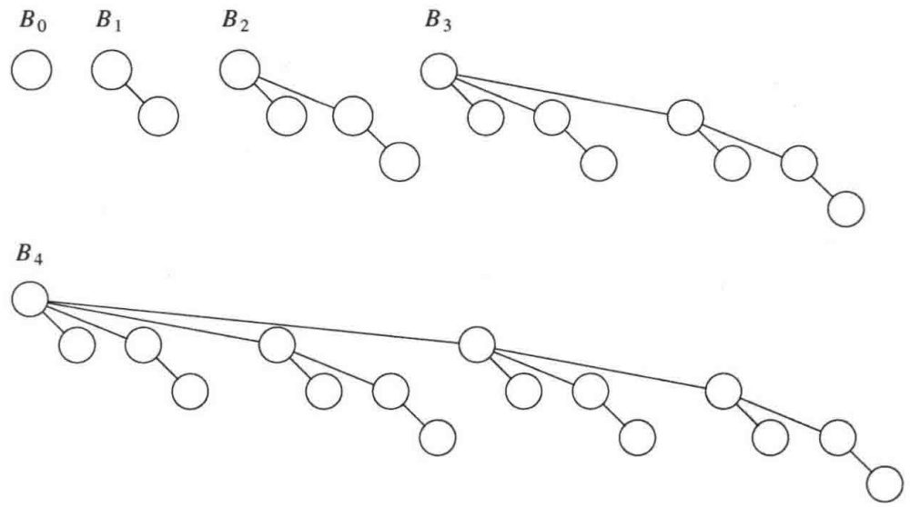

<details>
<summary>flowchart</summary>

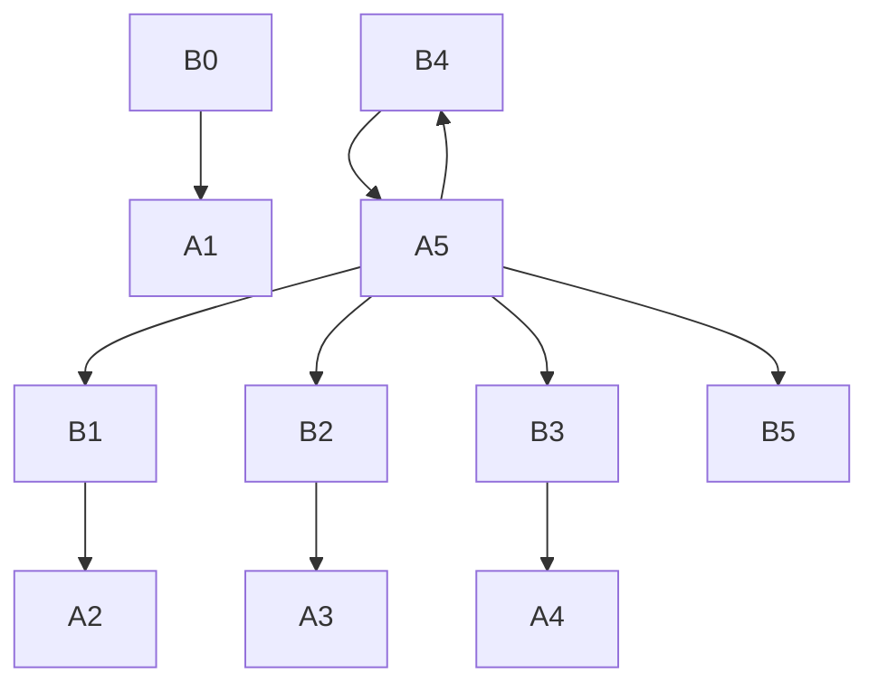
</details>

图6.34 二项树 $B_{0}, B_{1}, B_{2}, B_{3}$ 以及 $B_{4}$

从图中看到，二项树  $B_{k}$  由一个带有儿子  $B_{0}, B_{1}, \cdots, B_{k-1}$  的根组成。高度为 k 的二项树恰好有  $2^{k}$  个节点，而在深度 d 处的节点个数是二项系数  $\binom{k}{d}$ 。如果把堆序施加到二项树上并允许任意高度上最多一棵二项树，那么我们就能够用二项树的集合表示任意大小的优先队列。

例如，大小为 13 的优先队列可以用森林  $B_{3}, B_{2}, B_{0}$  表示。我们可以把这种表示写成 1101，它不仅以二进制表示了 13，而且也表示这样的事实:在上述表示中， $B_{3}, B_{2}, B_{0}$  出现，而  $B_{1}$  则没有。

作为一个例子，6 个元素的优先队列可以表示为图 6.35 中的形状。

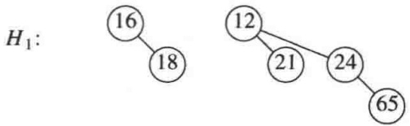

<details>
<summary>flowchart</summary>

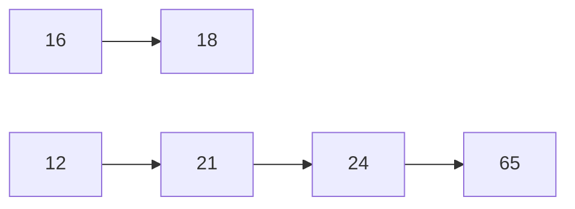
</details>

图6.35 具有6个元素的二项队列 $H_{1}$

## 6.8.2 二项队列操作

此时，最小元可以通过搜索所有的树的根来找出。由于最多有 $\log N$ 棵不同的树，因此最小元可以时间 $O(\log N)$ 找到。另外，如果我们记住当最小元在其他操作期间变化时更新它，那么也可以保留最小元的信息并以 $O(1)$ 时间执行这种操作。

合并两个二项队列在概念上是一个容易的操作，我们将通过例子描述它。考虑两个二项

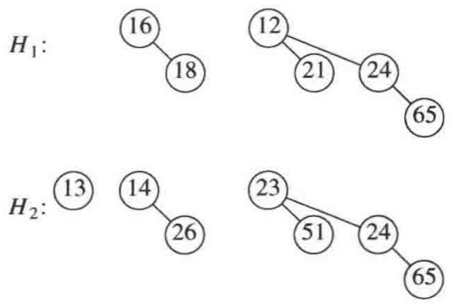

<details>
<summary>text_image</summary>

H₁:
16
18
12
21
24
65
H₂:
13
14
26
23
51
24
65
</details>

图 6.36 两个二项队列  $H_{1}$  和  $H_{2}$

队列  $H_{1}$  和  $H_{2}$ ，它们分别具有 6 个和 7 个元素，见图 6.36。

合并操作基本上是通过将两个队列加到一起来完成的。令 $H_{3}$ 是新的二项队列。由于 $H_{1}$ 没有高度为0的二项树而 $H_{2}$ 有，因此我们就用 $H_{2}$ 中高度为0的二项树作为 $H_{3}$ 的一部分。然后，将两个高度为1的二项树相加。由于 $H_{1}$ 和 $H_{2}$ 都有高度为1的二项树，因此可以将它们合并，让大的根成为小的根的子树，从而建立高度为2的二项树，见图6.37。这样，$H_{3}$ 将没有高度为1的二项树。现在存在3棵高度为2的二项树，即 $H_{1}$ 和 $H_{2}$ 原有

的两棵二项树以及由上一步形成的一棵二项树。我们将一棵高度为2的二项树放到 $H_{3}$ 中，并合并其他两棵二项树，得到一棵高度为3的二项树。由于 $H_{1}$ 和 $H_{2}$ 都没有高度为3的二项树，因此该二项树就成为 $H_{3}$ 的一部分，合并结束。最后得到的二项队列如图6.38所示。

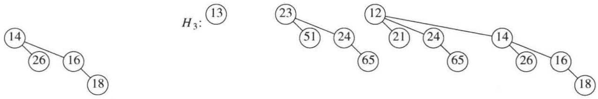

图6.37 $H_{1}$ 和 $H_{2}$ 中两棵 $B_{1}$ 树的合并

图6.38 二项队列 $H_{3}$ :合并 $H_{1}$ 和 $H_{2}$ 的结果

由于几乎使用任意合理的实现方法合并两棵二项树均花费常数时间，而总共存在 $O(\log N)$ 棵二项树，因此合并操作在最坏情形下花费时间 $O(\log N)$ 。为使该操作更有效，需要将这些树放到按照高度排序的二项队列中，当然这做起来是件简单的事情。

插入实际上就是特殊情形的合并，因为我们只要创建一棵单节点树并执行一次合并即可。这种操作的最坏情形运行时间也是 $O(\log N)$ 。更准确地说，如果在优先队列中不存在的最小的二项树是 $B_{i}$，那么将元素插入其中的运行时间与 $i + 1$ 成正比。例如，$H_{3}$（见图6.38）缺少高度为1的二项树，因此插入将进行两步终止。由于二项队列中的每棵树均以概率1/2出现，于是我们预计插入在两步后终止，因此，平均时间是常数。不仅如此，分析将指出，对一个初始为空的二项队列进行 $N$ 次insert将花费 $O(N)$ 最坏情形时间。事实上，只用 $N - 1$ 次比较就有可能进行该操作，我们把它留作练习。

作为一个例子，我们用图 6.39～图 6.45 演示通过依序插入 1～7 来构成一个二项队列。4 的插入展现一种坏的情形。我们把 4 与 $B_{0}$ 合并，得到一棵新的高度为 1 的树。然后将该树与 $B_{1}$ 合并，得到一棵高度为 2 的树，它是新的优先队列。我们把这些算作 3 步（两次树的合并再加上终止情形）。在插入 7 以后的下一次插入又是一个坏情形，需要 3 次树的合并操作。

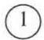

图6.39 在1插入之后

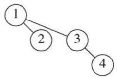

图6.42 在4插入之后

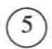

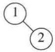

图6.40 在2插入之后

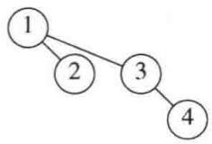

图6.43 在5插入之后

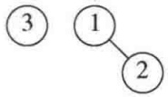

图6.41 在3插入之后

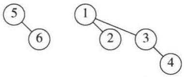

<details>
<summary>flowchart</summary>

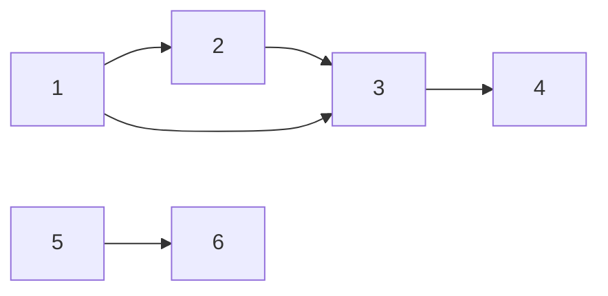
</details>

图6.44 在6插入之后

deleteMin 可以通过首先找出一棵具有最小根的二项树来完成。令该树为 $B_{k}$，并令原始的优先队列为 $H$。我们从 $H$ 的树的森林中删除二项树 $B_{k}$，形成新的二项队列 $H'$。再在 $B_{k}$ 中删除它的根，得到二项树 $B_{0}, B_{1}, \cdots, B_{k-1}$，它们形成优先队列 $H''$。合并 $H'$ 和 $H''$，操作结束。

作为例子，设对 $H_{3}$ 执行一次 deleteMin，它也在图6.46中给出。最小的根是12，因此得到图6.47和图6.48中的两个优先队列 $H'$ 和 $H''$ 。合并 $H'$ 和 $H''$ 得到的二项队列是最后的答案，如图6.49所示。

为了分析，首先注意，deleteMin 操作将原二项队列一分为二。找出含有最小元素的树并创建队列 $H'$ 和 $H''$，花费时间 $O(\log N)$。合并这两个队列又花费 $O(\log N)$ 时间，因此，整个 deleteMin 操作花费时间 $O(\log N)$。

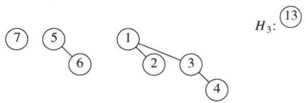

<details>
<summary>text_image</summary>

⑦ ⑤ ⑥
① ② ③ ④
H₃: ⑬
</details>

图6.45 在7插入之后

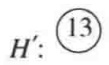

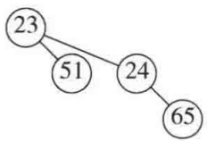

图 6.47 二项队列  $H'$ ，包含  $H_{3}$  中除  $B_{3}$  外所有的二项树

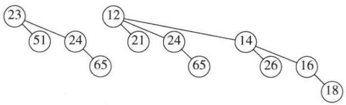

<details>
<summary>flowchart</summary>

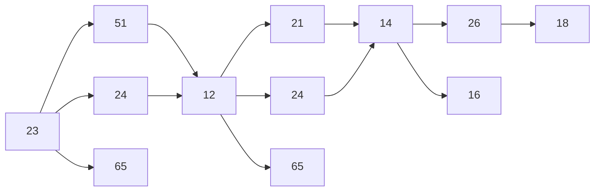
</details>

图6.46 二项队列 $H_{3}$

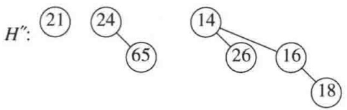

<details>
<summary>text_image</summary>

H": 21 24 65 14 26 16 18
</details>

图 6.48 二项队列  $H''$ :删除 12 后的  $B_{3}$

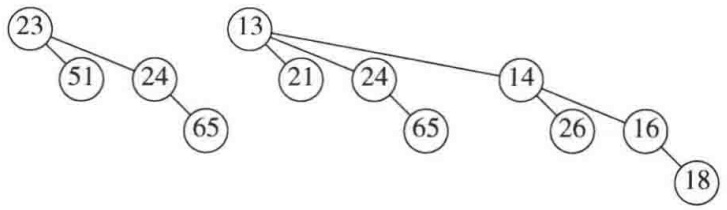

<details>
<summary>flowchart</summary>

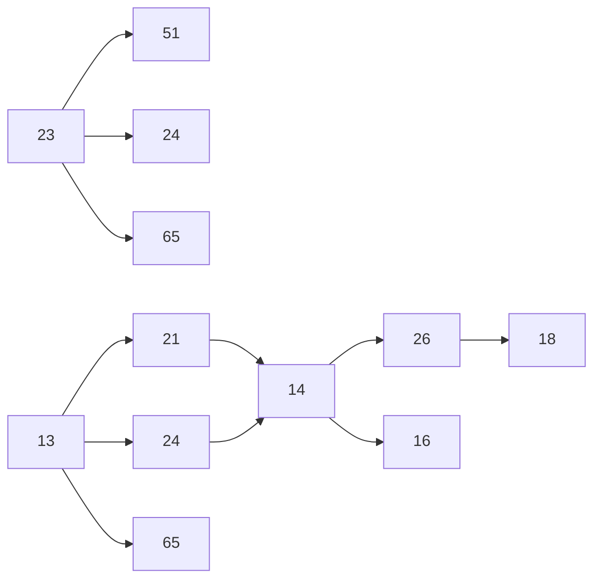
</details>

图6.49 对 $H_{3}$ 应用deleteMin的结果

## 6.8.3 二项队列的实现

deleteMin 操作需要快速找出根的所有子树的能力，因此，需要一般树的标准表示:每个节点的儿子都留在一个链表中，而且每个节点都有一个指针指向它的第一个儿子(如果有的话)。该操作还要求诸儿子按照它们子树的大小排序。我们还需要保证合并两棵树容易。当两棵树被合并时，其中的一棵树作为儿子被加到另一棵树上。由于这棵新树将是最大的子树，因此，以大小递减的方式保持这些子树是有意义的。只有这时才能够有效地合并两棵二项树从而合并两个二项队列。二项队列将是二项树的数组。

总而言之，二项树的每一个节点都将包含数据、第一个儿子以及右兄弟。二项树中的诸儿子以递减次序排列。

图 6.51 解释了如何表示图 6.50 中的二项队列。图 6.52 显示了二项树中节点的类型声明以及二项队列的类接口。

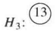

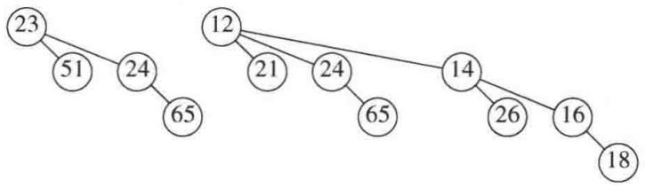

<details>
<summary>flowchart</summary>

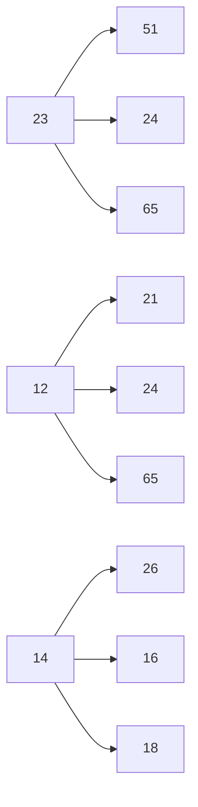
</details>

图 6.50 画成森林的二项队列  $H_{3}$

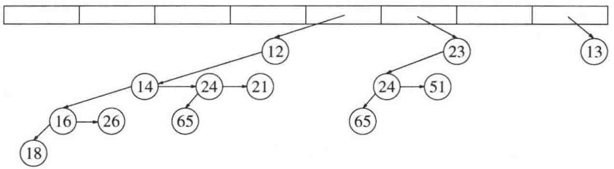

<details>
<summary>flowchart</summary>

```mermaid
graph LR
  A[""] --> B["12"]
  B --> C["14"]
  C --> D["16"]
  D --> E["26"]
  E --> F["18"]
  F --> C
  C --> G["24"]
  G --> H["21"]
  H --> I["65"]
  I --> C
  C --> J["23"]
  J --> K["24"]
  K --> L["51"]
  L --> M["65"]
  M --> K
  J --> N["13"]
```
</details>

图 6.51 二项队列  $H_{3}$  的表示方式

```cpp
template <typename Comparable>
class BinomialQueue
{
    public:
        BinomialQueue( );
        BinomialQueue( const Comparable & item );
        BinomialQueue( const BinomialQueue & rhs );
        BinomialQueue( BinomialQueue && rhs );

        ~BinomialQueue( );

        BinomialQueue & operator=( const BinomialQueue & rhs );
        BinomialQueue & operator=( BinomialQueue && rhs );

        bool isEmpty( ) const;
        const Comparable & findMin( ) const;

        void insert( const Comparable & x );
        void insert( Comparable && x );
        void deleteMin( );
        void deleteMin( Comparable & minItem );

        void makeEmpty( );
        void merge( BinomialQueue & rhs );

    private:
        struct BinomialNode
        {
            Comparable element;
            BinomialNode *leftChild;
            BinomialNode *nextSibling;

            BinomialNode( const Comparable & e, BinomialNode *lt, BinomialNode *rt )
                : element{ e }, leftChild{ lt }, nextSibling{ rt } { }

            BinomialNode( Comparable && e, BinomialNode *lt, BinomialNode *rt )
                : element{ std::move( e ) }, leftChild{ lt }, nextSibling{ rt } { }
        };

        const static int DEFAULT_TREES = 1;

        vector<BinomialNode *> theTrees; // 树根组成的数组
        int currentSize;                 // 优先队列中的项数

        int findMinIndex( ) const;
        int capacity( ) const;
        BinomialNode * combineTrees( BinomialNode *t1, BinomialNode *t2 );
        void makeEmpty( BinomialNode * & t );
        BinomialNode * clone( BinomialNode * t ) const;
};
```

图 6.52 二项队列类接口及节点定义

为了合并两个二项队列，我们需要一个例程来合并两棵同样大小的二项树。图 6.53 指出两棵二项树合并时链是如何变化的。合并同样大小的两棵二项树的程序很简单，见图 6.54。

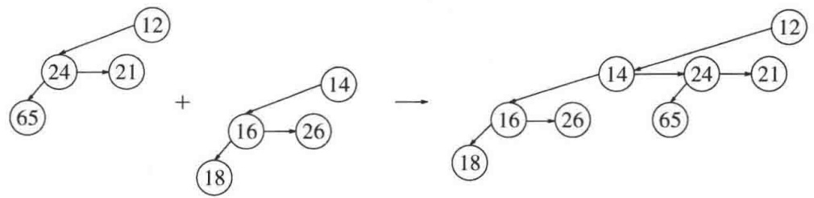

<details>
<summary>flowchart</summary>

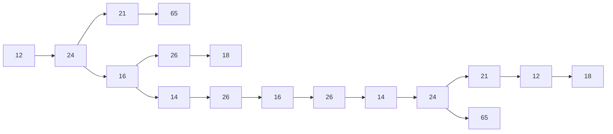
</details>

图 6.53 合并两棵二项树

```c
/**
 * 返回合并t1和t2的结果，其中t1和t2大小相同.
 */
BinomialNode * combineTrees( BinomialNode *t1, BinomialNode *t2 )
{
    if( t2->element < t1->element )
        return combineTrees( t2, t1 );
    t2->nextSibling = t1->leftChild;
    t1->leftChild = t2;
    return t1;
}
```

图 6.54 合并同样大小的两棵二项树的例程

现在介绍 merge 例程的简单实现。 $H_{1}$  由当前的对象表示而  $H_{2}$  用 rhs 表示。该例程将  $H_{1}$  和  $H_{2}$  合并，把合并结果放入  $H_{1}$  中，并清空  $H_{2}$ 。在任意时刻我们在处理的是秩 (rank) 为 i 的那些树。t1 和 t2 分别是  $H_{1}$  和  $H_{2}$  中的树，而 carry 是从上一步得来的树（它可能是 nullptr）。从秩为 i 的树以及秩为  $i+1$  的 carry 的树所得到的树的形成，依赖于 8 种可能情形中的每一种。这个过程从秩 0 开始直至所得出的二项队列中最后的秩。程序见图 6.55。对程序的改进在练习 6.35 中提出。

```javascript
/**
 * 将rhs合并到优先队列中.
 * rhs 变为空。rhs 必须不同于 this.
 * 为使该操作更为高效，需要用到练习6.35。
 */
void merge( BinomialQueue & rhs )
{
    if( this == &rhs )    // 避免别名问题
        return;

    currentSize += rhs.currentSize;

    if( currentSize > capacity() )
    {
        int oldNumTrees = theTrees.size( );
        int newNumTrees = max( theTrees.size( ), rhs.theTrees.size( )) + 1;
        theTrees.resize( newNumTrees );
        for( int i = oldNumTrees; i < newNumTrees; ++i )
            theTrees[ i ] = nullptr;
    }
}
```

图 6.55 合并两个优先队列的例程

```txt
BinomialNode *carry = nullptr;
for( int i = 0, j = 1; j <= currentSize; ++i, j *= 2 )
{
    BinomialNode *t1 = theTrees[ i ];
    BinomialNode *t2 = i < rhs.theTrees.size( ) ? rhs.theTrees[ i ]
                      : nullptr;
    int whichCase = t1 == nullptr ? 0 : 1;
    whichever += t2 == nullptr ? 0 : 2;
    whichCase += carry == nullptr ? 0 : 4;

    switch( whichCase )
    {
        case 0: /*无树的情形*/
        case 1: /* 只有this的情形 */
            break;
        case 2: /* 只有 rhs 的情形 */
            theTrees[ i ] = t2;
            rhs.theTrees[ i ] = nullptr;
            break;
        case 4: /* 只有 carry 的情形 */
            theTrees[ i ] = carry;
            carry = nullptr;
            break;
        case 3: /* this 和rhs的情形 */
            carry = combineTrees( t1, t2 );
            theTrees[ i ] = rhs.theTrees[ i ] = nullptr;
            break;
        case 5: /* this 和 carry 的情形 */
            carry = combineTrees( t1, carry );
            theTrees[ i ] = nullptr;
            break;
        case 6: /* rhs 和carry 的情形 */
            carry = combineTrees( t2, carry );
            rhs.theTrees[ i ] = nullptr;
            break;
        case 7: /* 全体树的情形 */
            theTrees[ i ] = carry;
            carry = combineTrees( t1, t2 );
            rhs.theTrees[ i ] = nullptr;
            break;
        }
    }

    for( auto & root : rhs.theTrees )
        root = nullptr;
    rhs.currentSize = 0;
}
```

图 6.55(续) 合并两个优先队列的例程

二项队列的 deleteMin 例程见图 6.56。

```txt
/**
 * 删除最小项并把它放入 minItem.
 * 若为空，则抛出UnderflowException 异常.
 */
void deleteMin( Comparable & minItem )
{
    if( isEmpty( ) )
        throw UnderflowException{ };

    int minIndex = findMinIndex( );
    minItem = theTrees[ minIndex ]->element;

    BinomialNode *oldRoot = theTrees[ minIndex ];
    BinomialNode *deletedTree = oldRoot->leftChild;
    delete oldRoot;

    // 构建 H''
    BinomialQueue deletedQueue;
    deletedQueue.theTrees.resize( minIndex + 1 );
    deletedQueue.currentSize = ( 1 << minIndex ) - 1;
    for( int j = minIndex - 1; j >= 0; --j )
    {
        deletedQueue.theTrees[ j ] = deletedTree;
        deletedTree = deletedTree->nextSibling;
        deletedQueue.theTrees[ j ]->nextSibling = nullptr;
    }

    // 构建 H'
    theTrees[ minIndex ] = nullptr;
    currentSize -= deletedQueue.currentSize + 1;

    merge( deletedQueue );
}

/**
 * 找出包含优先队列中最小项的树的下标.
 * 这个优先队列必须不空.
 * 返回包含最小项的树的下标.
 */
int findMinIndex( ) const
{
    int i;
    int minIndex;

    for( i = 0; theTrees[ i ] == nullptr; ++i )
        ;

    for( minIndex = i; i < theTrees.size( ); ++i )
        if( theTrees[ i ] != nullptr &&
            theTrees[ i ]->element < theTrees[ minIndex ]->element )
            minIndex = i;

    return minIndex;
}
```

图 6.56 二项队列的 deleteMin

当受到影响的元素的位置已知时，我们可以将二项队列扩展到支持二叉堆所允许的某些非标准的操作，诸如 decreaseKey 和 remove 等。decreaseKey 就是一趟 percolateUp，如果在每个节点上添加一个数据成员，存储其父链，那么这个操作可以时间  $O(\log N)$  完成。一次任意的 remove 可以通过联合 decreaseKey 和 deleteMin 而以时间  $O(\log N)$  完成。

## 6.9 标准库中的优先队列

STL 中的二叉堆是通过名为 priority\_queue 的类模板实现的，我们可以在标准的头文件 queue 中找到它。不过，STL 实现的是最大堆 (max-heap) 而不是最小堆 (min-heap)，因此，要处理的是最大项而不是最小项。核心的成员函数是:

```javascript
void push( const Object & x );
const Object & top( ) const;
void pop( );
bool empty( );
void clear( );
```

push 是把 x 添加到优先队列中，top 是返回优先队列中的最大元素，而 pop 则从优先队列中删除最大元素。这里是允许重复元存在的。如果同时有几个最大元素，则只有其中的一个被删除。

优先队列模板用项的类型、容器类型(几乎总是要用 vector 对象来存储这些项)以及比较器来实例化。对于最后的两个参数是允许默认的，且默认产生的是最大堆。使用 greater 函数对象作为比较器则得到最小堆。

图 6.57 显示了一个测试程序，它阐释 priority\_queue 类模板如何能够用来作为既是默认的最大堆又是最小堆。

```cpp
#include <iostream>
#include <vector>
#include <queue>
#include <functional>
#include <string>
using namespace std;

// 清空优先队列并打印它的内容
template <typename PriorityQueue>
void dumpContents( const string & msg, PriorityQueue & pq )
{
    cout << msg << ":" << endl;
    while( !pq.empty( ) )
    {
        cout << pq.top( ) << endl;
        pq.pop( );
    }
}

//(在 dumpContents 内) 进行一些插入和删除的操作
int main( )
```

图 6.57 演示 STL priority\_queue 的例程。注释指明输出的预期顺序

```cpp
{
    priority_queue<int> maxPQ;
    priority_queue<int,vector<int>,greater<int>> minPQ;

    minPQ.push( 4 ); minPQ.push( 3 ); minPQ.push( 5 );
    maxPQ.push( 4 ); maxPQ.push( 3 ); maxPQ.push( 5 );

    dumpContents( "minPQ", minPQ ); // 3 4 5
    dumpContents( "maxPQ", maxPQ ); // 5 4 3

    return 0;
}
```

图 6.57(续) 演示 STL priority\_queue 的例程。注释指明输出的预期顺序

## 小结

在这一章，我们看到优先队列 ADT 的各种实现和使用。标准的二叉堆实现由于简单和快速从而很便捷。它不需要链，只需要常量的附加空间，而且有效地支持优先队列的操作。

我们考虑了附加的 merge 操作，开发了 3 种实现方法，每种都有它自己的独到之处。左式堆是体现递归威力的完美实例。斜堆由于缺省了平衡原则从而代表一种重要的数据结构。它的分析本身颇为有趣，我们将在第 11 章讨论。二项队列表明，一个简单的想法如何能够用来达到好的时间界。

我们还看到优先队列的几个用途，从操作系统的工作调度到事件模拟。在第7章、第9章和第10章还会再次看到它们的应用。

## 练习

6.1 操作 insert 和 findMin 都能以常数时间实现吗?

6.2 a. 写出一次一个地将 10、12、1、14、6、5、8、15、3、9、7、4、11、13 和 2 插入到一个初始为空的二叉堆中的结果。
b. 写出使用相同的输入通过线性时间算法建立二叉堆的结果。

6.3 写出对上面练习中的堆执行 3 次 deleteMin 操作的结果。

6.4 N 个元素的完全二叉树用到数组位置 1～N。设我们试图使用数组表示一棵非完全的二叉树。对于下列的情况确定数组必须要多大:

a. 一棵有两个附加层(即它是非常轻微地不平衡)的二叉树。
b. 在深度  $2 \log N$  处有一个最深的节点的二叉树。
c. 在深度  $4.1 \log N$  处有一个最深的节点的二叉树。
d. 最坏情形的二叉树。

6.5 通过把被插入项的拷贝放在位置 0 处重写 BinaryHeap 的 inset 例程。

6.6 在图 6.13 中的大的堆中有多少节点？

6.7 a. 证明对于二叉堆，buildHeap 至多在元素间进行 2N-2 次比较。

b. 证明 8 个元素的堆可以通过堆元素间的 8 次比较构成。

\*\*c. 给出一个算法，使以 $\frac{13}{8} N + O(\log N)$ 次元素比较构建一个二叉堆。

6.8 证明下列关于堆中最大项的结论:

a. 它必然在一片树叶上。
b. 恰好存在 $N/2$ 片树叶。
c. 为找出它必须考查每一片树叶。

\*\*6.9 证明，在一个大的完全堆(可以假设 $N = 2^{k} - 1$ )中第 $k$ 个最小元的期望深度以 $\log k$ 为界。

6.10 \*a. 给出一个算法以找出二叉堆中小于某个值 $X$ 的所有节点。你的算法应该以 $O(K)$ 运行，其中，$K$ 是输出的节点的个数。

b. 你的算法可以扩展到本章讨论过的任意其他堆结构吗？

\*c. 给出一个算法，最多使用大约 3N/4 次比较找出二叉堆中的任意一项 X。

\*\*6.11 提出一个算法，使以 $O(M + \log N\log \log N)$ 时间将 $M$ 个节点插入到 $N$ 个元素的二叉堆中。证明算法的时间界。

6.12 编写一个程序输入 N 个元素并

a. 将它们一个一个地插入到一个堆中。
b. 以线性时间建立一个堆。

比较两个算法对于已排序、反序以及随机输入的运行时间。

6.13 每个 deleteMin 操作在最坏情形下使用  $2 \log N$  次比较。

\*a. 提出一种方案使得 deleteMin 操作只使用  $\log N + \log \log N + O(1)$  次元素间的比较。这并不意味着较少的数据移动。
\*\*b. 扩展在(a)部分中的方案，使得只执行  $\log N + \log \log \log N + O(1)$  次比较。
\*\*c. 你能够把这种想法推向多远？
d. 在比较中节省下的资源能否补偿算法所增加的复杂度？

6.14 如果一个 $d$ 堆作为一个数组存储，对位于位置 $i$ 处的项，其父亲和儿子都在哪里？
6.15 设一个 $d$ 堆初始时有 $N$ 个元素，而我们需要对其执行 $M$ 次 percolateUp 和 $N$ 次 deleteMin。

a. 用 M、N 和 d 表示的所有操作的总的运行时间是多少？
b. 如果 d=2，所有的堆操作的运行时间是多少？
c. 如果  $d = \Theta(N)$ ，总的运行时间是多少？
\*d. 对 d 做什么样的选择将使总的运行时间最小?

6.16 设二叉堆用显式链表示。给出一个简单算法来找出位于隐式位置 $i$ 上的树节点。
6.17 设二叉堆用显式链表示。考虑将二叉堆 lhs 和 rhs 合并的问题。假设这两个二叉堆均为完美二叉树 (perfect binary tree)，分别包含  $2^{l}-1$  和  $2^{r}-1$  个节点。

a. 若 l = r，则给出合并这两个堆的  $O(\log N)$  算法。
b. 若 $|l - r| = 1$，则给出合并这两个堆的 $O(\log N)$ 算法。
\*c. 给出合并这两个堆的与 l 和 r 无关的  $O(\log^{2} N)$  算法。

6.18 最小-最大堆(min-max heap)是支持两种操作 deleteMin 和 deleteMax 的数据结构，每个操作均用时  $O(\log N)$ 。该结构与二叉堆相同，不过，其堆序性质为:对于在偶数深度上的任意节点 X，存储在 X 上的元素小于它的父亲但是大于它的祖父（当这是有意义的时候），对于奇数深度上的任意节点 X，存储在 X 上的元素大于它的父亲但是小于它的祖父，见图 6.58。

a. 如何找到最小元和最大元？

\*b. 给出一个算法将一个新节点插入到该最小-最大堆中。

\*c. 给出一个算法执行 deleteMin 和 deleteMax。

\*d. 能否以线性时间建立一个最小-最大堆?

\*\*e. 设我们想要支持操作 deleteMin、deleteMax 以及 merge。提出一种数据结构以时间 $O(\log N)$ 支持所有的操作。

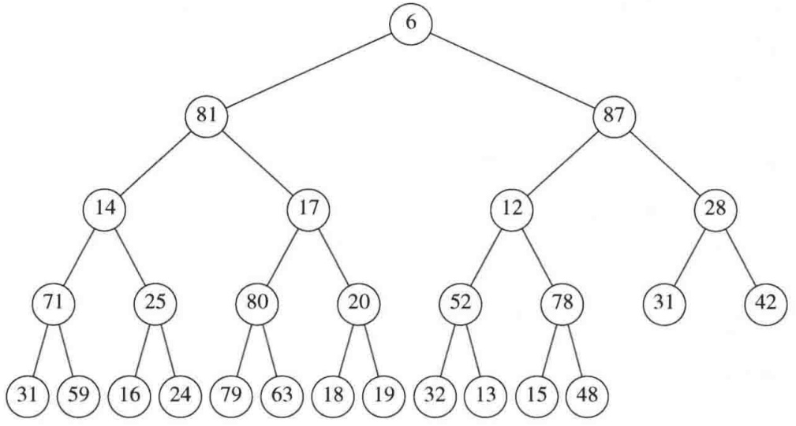

<details>
<summary>funnel</summary>

| Node | Value |
| --- | --- |
| Top | 6 |
| Root | 87 |
| Top | 14 |
| Top | 81 |
| Top | 17 |
| Bottom | 71 |
| Bottom | 25 |
| Bottom | 80 |
| Bottom | 20 |
| Bottom | 52 |
| Bottom | 78 |
| Bottom | 31 |
| Bottom | 42 |
| Bottom | 31 |
| Bottom | 59 |
| Bottom | 16 |
| Bottom | 24 |
| Bottom | 79 |
| Bottom | 63 |
| Bottom | 18 |
| Bottom | 19 |
| Bottom | 32 |
| Bottom | 13 |
| Bottom | 15 |
| Bottom | 48 |
</details>

图 6.58 最小-最大堆

6.19 合并图 6.59 中的两个左式堆。

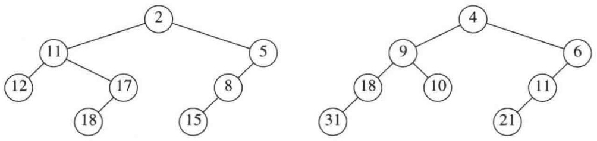

<details>
<summary>flowchart</summary>

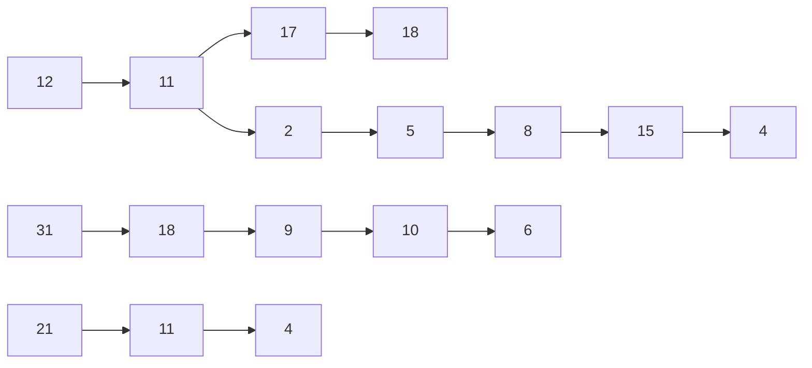
</details>

图 6.59 练习 6.19 和练习 6.26 的输入

6.20 写出依序将关键字 1\~15 插入到一个初始为空的左式堆中的结果。

6.21 证明下述结论成立或证明其不成立:如果将关键字 $1 \sim 2^{k} - 1$ 依序插入到一个初始为空的左式堆中，那么结果形成一棵理想平衡树(perfectly balanced tree)。

6.22 给出生成最佳左式堆的输入的例子。

6.23 a. 左式堆能否有效地支持 decreaseKey?

b. 完成该功能(如果可能的话)，需要做出哪些改变？

6.24 从左式堆中一个已知位置删除节点的一种方法是使用懒惰策略。为了删除一个节点，只要将其标记为删除即可。当执行一个 findMin 或 deleteMin 时，若根节点被标记删除则存在一个潜在的问题，因为此时该节点必须确实被删除且需要找到实际的最小元，这可能涉及到删除其他一些已做标记的节点。在该策略中，这些 remove 花费一个单位的开销，但一次 deleteMin 或 findMin 的开销却依赖于被做了删除标记的节点的个数。设在一次 deleteMin 或 findMin 后做标记的节点比操作前少了 k 个。

\*a. 说明如何以 $O(k \log N)$ 时间执行 deleteMin。

\*\*b. 提出一种实现方法，通过分析证明执行 deleteMin 的时间为 $O(k \log (2N / k))$。

6.25 我们可以以线性时间对一些左式堆执行 buildHeap 操作:把每个元素当作是单节点左式堆，把所有这些堆放到一个队列中，之后，让两个堆出队，把它们合并，再将合并结果入队，直到队列中只有一个堆为止。

a. 证明该算法在最坏情形下为  $O(N)$ 。

b. 为什么该算法优于正文中描述的算法？

6.26 合并图 6.59 中的两个斜堆。

6.27 写出将关键字 1\~15 依序插入到一斜堆内的结果。

6.28 证明下述结论成立或不成立:如果将关键字 $1 \sim 2^{k} - 1$ 依序插入到一个初始为空的斜堆中，那么结果形成一棵理想平衡树(perfectly balanced tree)。

6.29 使用标准的二叉堆算法可以建立一个 N 个元素的斜堆。我们能否将练习 6.25 中描述的同样的合并策略用于斜堆而得到  $O(N)$  运行时间？

6.30 证明二项树  $B_{k}$  以二项树  $B_{0}, B_{1}, \cdots, B_{k-1}$  作为其根的儿子。

6.31 证明高度为 $k$ 的二项树在深度 $d$ 处有 $\binom{k}{d}$ 个节点。

6.32 将图 6.60 中的两个二项队列合并。

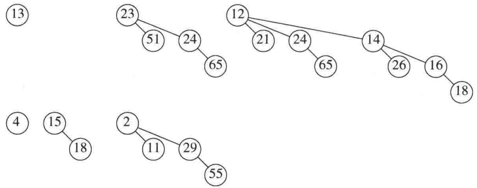

<details>
<summary>flowchart</summary>

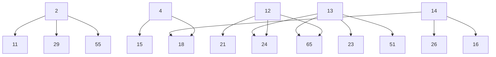
</details>

图6.60 练习6.32的输入

6.33 a. 证明:向初始为空的二项队列进行 $N$ 次 insert 在最坏情形下花费 $O(N)$ 的时间。
b. 给出一个算法来建立有 N 个元素的二项队列，在元素间最多使用 N-1 次比较。
\*c. 提出一个算法, 以 $O(M + \log N)$ 最坏情形运行时间将 $M$ 个节点插入到 $N$ 个元素的二项队列中。证明该算法的界。

6.34 写出一个高效的例程使用二项队列来完成 insert 操作，不要调用 merge。

6.35 对于二项队列:

a. 若没有树留在  $H_{2}$  中且 carry 树为 nullptr，则修改 merge 例程以终止合并。
b. 修改 merge 使得较小的树总被合并到较大的树中。

\*\*6.36 假设将二项队列扩展为允许每个结构同一高度至多有两棵树。我们能否在保留其他操作为 $O(\log N)$ 时得到插入为 $O(1)$ 的最坏情形时间？

6.37 设有许多盒子, 每个盒子都能容纳总重量 C 而物品  $i_{1}, i_{2}, i_{3}, \cdots, i_{N}$  分别重  $w_{1}, w_{2}, w_{3}, \cdots, w_{N}$ 。现在想要把所有的物品包装起来, 但任一盒子都不能放置超过其容量的重物, 而且要使用尽量少的盒子。例如, 若 C = 5, 物品分别重 2, 2, 3, 3, 则可用两个盒子解决该问题。

一般说来，这个问题很困难，尚不知有高效的解决方案。编写程序高效地实现下列各近似方法:

\*a. 将重物放入能够承受其重量的第一个盒子内(如果没有盒子拥有足够的容量就开辟一个新的盒子)。(该方法以及后面所有的方法都将得出3个盒子, 这不是最优的结果。)

b. 把重物放入对其有最大空间的盒子内。

\*c. 把重物放入能够容纳下它而又不过载的装填得最满的盒子中。

\*\*d. 这些方法有通过将重物按重量预先排序而功能得到增强的吗？

6.38 设我们想要将操作 decreaseAllKeys( $\Delta$ ) 添加到堆的指令系统中去。该操作的结果是:堆中所有的关键字都将它们的值减少量 $\Delta$ 。对于你所选择的堆的实现方法，解释所做的必要的修改使得所有其他操作均保持它们的运行时间而 decreaseAllKeys 以 O(1) 运行。

6.39 两个选择算法中哪个具有更好的时间界？

6.40 对于左式堆，标准的拷贝构造函数和makeEmpty可能由于用到太多的递归调用而失败。虽然这对二叉查找树成立，但对左式堆却问题不少，因为尽管它对基本操作具有较好的最坏情形性能，可左式堆可能会非常深。因此，拷贝构造函数和makeEmpty函数需要重新实现，以避免在左式堆中的深层递归。我们的做法如下:

a. 重新整理递归例程，使得对 t->left 的递归调用置于对 t->right 递归调用之后。

b. 将各个例程重写，使得最后的语句是对左子树的递归调用。

c. 消除尾递归。

d. 这些函数仍然是递归的。给出所剩递归的精确的深度之界。

\*e. 解释如何为斜堆重写拷贝构造函数和 makeEmpty 函数。

## 参考文献

二叉堆首先在文献[28]中描述。构造它的线性时间算法取自文献[14]。

$d$ 堆最初的描述见于文献[19]。最近的结果提出，4叉堆在某些情形下可以改进二叉堆[22]。左式堆由Crane[11]发现并在Knuth[21]中描述。斜堆由Sleator和Tarjan[24]开发。二项队列由Vuillemin[27]发明；Brown提供了详细的分析和经验性的研究，指出若能仔细地实现则它们在实践中性能很好[4]。

练习6.7(b)和(c)取自文献[17]。练习6.10(c)源于文献[6]。平均使用大约 $1.52N$ 次比较构造二叉堆的方法在文献[23]中描述。左式堆中的懒惰删除(练习6.24)出自文献[10]。练习6.36的一种解法可在文献[8]中找到。

最小-最大堆(练习6.18)原始描述见于文献[1]。这些操作的更有效的实现在文献[18]和[25]中给出。双端优先队列(double-ended priority queues)的另外一些表示形式是deap和diamond deque。细节可见于文献[5]、[7]和[9]。练习6.18(e)的解法在文献[12]和[20]中给出。

理论上有趣的优先队列表示法是斐波那契堆(Fibonacci heap) $^{[16]}$ ，我们将在第11章给出详细描述。斐波那契堆使得所有的操作均以O(1)摊还时间执行，但删除操作除外，它是 $O(\log N)$ 。松堆(relaxed heaps) $^{[13]}$ 得到最坏情形下完全相同的界(但merge除外)。文献 $[3]$ 的过程对所有操作均得到最佳的最坏情形界。另外一种有趣的实现是配对堆(pairing heap) $^{[15]}$ ，它将在第12章描述。最后，当数据由一些小的整数组成时仍能正常工作的优先队列在文献 $[2]$ 和 $[26]$ 中描述。

1. M. D. Atkinson, J. R. Sack, N. Santoro, and T. Strothotte, "Min-Max Heaps and Generalized Priority Queues," Communications of the ACM, 29 (1986), 996–1000.
2. J. D. Bright, "Range Restricted Mergeable Priority Queues," Information Processing Letters, 47 (1993), 159–164.
3. G. S. Brodal, "Worst-Case Efficient Priority Queues," Proceedings of the Seventh Annual ACM-SIAM Symposium on Discrete Algorithms (1996), 52–58.
4. M. R. Brown, "Implementation and Analysis of Binomial Queue Algorithms," SIAM Journal on Computing, 7 (1978), 298–319.
5. S. Carlsson, "The Deap—A Double-Ended Heap to Implement Double-Ended Priority Queues," Information Processing Letters, 26 (1987), 33–36.
6. S. Carlsson and J. Chen, "The Complexity of Heaps," Proceedings of the Third Symposium on Discrete Algorithms (1992), 393–402.
7. S. Carlsson, J. Chen, and T. Strothotte, "A Note on the Construction of the Data Structure 'Deap'," Information Processing Letters, 31 (1989), 315–317.
8. S. Carlsson, J. I. Munro, and P. V. Poblete, "An Implicit Binomial Queue with Constant Insertion Time," Proceedings of First Scandinavian Workshop on Algorithm Theory (1988), 1–13.
9. S. C. Chang and M. W. Due, "Diamond Deque: A Simple Data Structure for Priority Deques," Information Processing Letters, 46 (1993), 231–237.
10. D. Cheriton and R. E. Tarjan, "Finding Minimum Spanning Trees," SIAM Journal on Computing, 5 (1976), 724–742.
11. C. A. Crane, "Linear Lists and Priority Queues as Balanced Binary Trees," Technical Report STAN-CS-72-259, Computer Science Department, Stanford University, Stanford, Calif., 1972.
12. Y. Ding and M. A. Weiss, "The Relaxed Min-Max Heap: A Mergeable Double-Ended Priority Queue," Acta Informatica, 30 (1993), 215–231.
13. J. R. Driscoll, H. N. Gabow, R. Shrairman, and R. E. Tarjan, "Relaxed Heaps: An Alternative to Fibonacci Heaps with Applications to Parallel Computation," Communications of the ACM, 31 (1988), 1343–1354.
14. R. W. Floyd, "Algorithm 245: Treesort 3," Communications of the ACM, 7 (1964), 701.
15. M. L. Fredman, R. Sedgewick, D. D. Sleator, and R. E. Tarjan, "The Pairing Heap: A New Form of Self-adjusting Heap," Algorithmica, 1 (1986), 111–129.
16. M. L. Fredman and R. E. Tarjan, "Fibonacci Heaps and Their Uses in Improved Network Optimization Algorithms," Journal of the ACM, 34 (1987), 596–615.
17. G. H. Gonnet and J. I. Munro, "Heaps on Heaps," SIAM Journal on Computing, 15 (1986), 964–971.
18. A. Hasham and J. R. Sack, "Bounds for Min-max Heaps," BIT, 27 (1987), 315–323.
19. D. B. Johnson, "Priority Queues with Update and Finding Minimum Spanning Trees," Information Processing Letters, 4 (1975), 53–57.
20. C. M. Khoong and H. W. Leong, "Double-Ended Binomial Queues," Proceedings of the Fourth Annual International Symposium on Algorithms and Computation (1993), 128–137.
21. D. E. Knuth, The Art of Computer Programming, Vol. 3: Sorting and Searching, 2d ed., Addison-Wesley, Reading, Mass., 1998.
22. A. LaMarca and R. E. Ladner, "The Influence of Caches on the Performance of Sorting," Proceedings of the Eighth Annual ACM-SIAM Symposium on Discrete Algorithms (1997), 370–379.
23. C. J. H. McDiarmid and B. A. Reed, "Building Heaps Fast," Journal of Algorithms, 10 (1989), 352–365.
24. D. D. Sleator and R. E. Tarjan, "Self-adjusting Heaps," SIAM Journal on Computing, 15 (1986), 52–69.
25. T. Strothotte, P. Eriksson, and S. Vallner, "A Note on Constructing Min-max Heaps," BIT, 29 (1989), 251–256.
26. P. van Emde Boas, R. Kaas, and E. Zijlstra, "Design and Implementation of an Efficient Priority Queue," Mathematical Systems Theory, 10 (1977), 99–127.
27. J. Vuillemin, "A Data Structure for Manipulating Priority Queues," Communications of the ACM, 21 (1978), 309–314.
28. J. W. J. Williams, "Algorithm 232: Heapsort," Communications of the ACM, 7 (1964), 347–348.

## 第7章 排序

在这一章，我们讨论将元素的数组排序的问题。为简单起见，假设在我们的例子中数组只包含整数，当然我们的程序也允许更一般的对象。对于本章的大部分内容，我们还假设整个排序工作能够在主存中完成，因此，元素的个数相对来说比较小(小于几百万)。当然，不能在主存中完成而必须在磁盘或磁带上完成的排序也相当重要。这种类型的排序叫作外部排序(external sorting)，将在本章末尾进行讨论。

我们对内部排序的考查将指出:

- 存在几种容易的算法以 $O(N^2)$ 排序，如插入排序。
- 有一种算法叫作希尔排序(Sellsort)，它编程非常简单，以 $o(N^2)$ 运行，而且在实践中很有效。
- 存在一些稍微复杂的 $O(N \log N)$ 的排序算法。
- 任何通用的排序算法均需要 $\Omega (N\log N)$ 次比较。

本章的其余部分将描述和分析各种排序算法。这些算法包含一些有趣和重要的代码优化和算法设计思想。排序也是使得分析能够精确进行的实例。预先说明，在时机适当的时候，我们将尽可能多地做一些分析。

## 7.1 预备知识

我们描述的算法都将是可以互换的。每个算法都要接收包含一些元素的数组，假设数组的所有位置都包含要被排序的数据。我们还假设 N 是传递到排序例程的元素个数。

我们的再一个假设是存在操作符“<”和“>”，它们可以用于对输入数据赋予一个一致的顺序。除赋值运算符外，这是仅有的允许对输入数据进行的操作。在这些条件下的排序叫作基于比较的排序(comparison-based sorting)。

这里的接口不同于 STL 中的排序算法。在 STL 中，排序是通过使用函数模板 sort 完成的。sort 的参数代表容器(中某个范围)的开始和终端标记(endmarker)以及一个可选的比较器:

```txt
void sort( Iterator begin, Iterator end );
void sort( Iterator begin, Iterator end, Comparator cmp );
```

迭代器必须支持随机访问。sort 算法并不保证相等的项保持它们原有的顺序(若这很重要，则可使用 stable\_sort 而不用 sort)。

例如，在

```cpp
std::sort( v.begin( ), v.end( ) );
std::sort( v.begin( ), v.end( ), greater<int>{ } );
std::sort( v.begin( ), v.begin( ) + ( v.end( ) - v.begin( )) / 2 );
```

中第一个调用是将整个容器 v 以非降顺序排序，第二个调用是将整个容器以非增顺序排序，第三个调用则将容器的前半部分以非降顺序排序。

所使用的算法一般是快速排序(quicksort)，我们将在7.7节描述它。在7.2节，我们将实现最简单的排序算法，使用的是传递可比较项的数组的方式和由STL所支持的接口的传递方式。前者生成最直接的代码，而后者则需要更多的代码。

## 7.2 插入排序

最简单的排序算法之一是插入排序(insertion sort)。

## 7.2.1 算法

插入排序由 $N - 1$ 趟排序组成。对于 $p = 1$ 到 $N - 1$ 趟，插入排序保证从位置0到位置 $p$ 上的元素为已排序状态。插入排序利用了这样的事实:已知位置0到位置 $p - 1$ 上的元素已经处于排过序的状态。图7.1显示一个数组样例在每一趟插入排序后的情况。

| 原始数组 | 34 | 8 | 64 | 51 | 32 | 21 | 移动的位置数 |
| --- | --- | --- | --- | --- | --- | --- | --- |
| 在$p=1$之后 | 8 | 34 | 64 | 51 | 32 | 21 | 1 |
| 在$p=2$之后 | 8 | 34 | 64 | 51 | 32 | 21 | 0 |
| 在$p=3$之后 | 8 | 34 | 51 | 64 | 32 | 21 | 1 |
| 在$p=4$之后 | 8 | 32 | 34 | 51 | 64 | 21 | 3 |
| 在$p=5$之后 | 8 | 21 | 32 | 34 | 51 | 64 | 4 |

图7.1 每趟后的插入排序

图 7.1 表达了一般的思路。在第 p 趟，我们将位置 p 上的元素向左移动直至找到它在前 p + 1 个元素中的正确位置为止。图 7.2 中的程序实现了这种思路。第 11～14 行实现数据移动而没有明显使用交换。位置 p 上的元素移动到 tmp，而 (在位置 p 之前) 所有更大的元素都被向右移动一个位置。然后 tmp 被置于正确的位置上。这与在二叉堆实现时所用到的技巧相同。

```cpp
/**
 * 简单的插入排序.
 */
template <typename Comparable>
void insertionSort( vector<Comparable> & a )
{
    for( int p = 1; p < a.size( ); ++p )
    {
        Comparable tmp = std::move( a[ p ] );

        int j;
        for( j = p; j > 0 && tmp < a[ j - 1 ]; --j )
            a[ j ] = std::move( a[ j - 1 ] );
        a[ j ] = std::move( tmp );
    }
}
```

图7.2 插入排序例程

## 7.2.2 插入排序的STL实现

在 STL 中，排序例程并不使用其各项之间可以进行比较的数组作为单参数，而是接收一对迭代器作为参数，它们代表一个范围的开始和尾标记。2-参数排序例程就使用这对迭代器，并假设所处理的项是可被排序的，而 3-参数排序例程则用一个函数对象作为第三个参数。

将图 7.2 中的算法转换成使用 STL 则会产生几个问题。明显的问题是:

1. 必须编写一个 2-参数的排序和一个 3-参数的排序。恐怕 2-参数排序还要调用 3-参数的排序，且使用 less&lt;Object&gt;{}作为第三个参数。
2. 数组访问必须转换成迭代器访问。
3. 原代码的第 9 行要求我们创建 tmp，而它在新的代码中将是 Object 类类型。

第一个问题最为棘手，因为 2-参数排序的模板类型参数(即泛型类型)都是 Iterator; 可是，Object 不是一个泛型类型参数。在 C++11 之前，人们只能编写一些额外的例程来解决这个问题。但 C++11 引入了 decltype，它清楚地表达了这个意图，如图 7.3 所示。

```c
/*
 * 2-参数版排序调用 3-参数版排序,
 * 用到C++11中的decltype
 */
template <typename Iterator>
void insertionSort( const Iterator & begin, const Iterator & end )
{
    insertionSort( begin, end, less<decltype(*begin)>{ } );
}
```

图 7.3 2-参数排序通过 C++11 的 decltype 调用 3-参数排序

图 7.4 显示主要的排序代码，它使用迭代器来代替数组下标，并用对 lessThan 函数对象的调用来代替对 operator<的调用。

```cpp
template <typename Iterator, typename Comparator>
void insertionSort( const Iterator & begin, const Iterator & end,
                          Comparator lessThan )
{
    if( begin == end )
        return;

    Iterator j;

    for( Iterator p = begin+1; p != end; ++p )
    {
        auto tmp = std::move( *p );
        for( j = p; j != begin && lessThan( tmp, *( j-1 ) ); --j )
            *j = std::move( *(j-1) );
        *j = std::move( tmp );
    }
}
```

图 7.4 使用迭代器的 3-参数排序

我们注意到，一旦对 insertionSort 算法进行具体的编码，则原代码中的每一条语句都要被直接使用迭代器和函数对象的新代码的相应语句所代替。可是，原代码读起来要简单得多，这就是为什么在这里给排序算法编码时，此处使用我们更简单的接口而不使用 STL 的接口的原因。

## 7.2.3 插入排序的分析

由于嵌套循环中的每一个都可能用到 $N$ 次迭代，因此插入排序为 $O(N^2)$，而且这个界还是精确的，因为以反序的输入可以达到该界。精确计算指出，在图7.2的内循环中测试次数对于每个 $p$ 值最多是 $p + 1$ 次。对所有的 $p$ 求和得到总数为

$$
\sum_ {i = 2} ^ {N} i = 2 + 3 + 4 + \dots + N = \Theta (N ^ {2})
$$

另一方面，如果输入数据已预先排序，那么运行时间为 $O(N)$，因为内层 for 循环中的检测总是立即失败而使下一语句得不到执行。事实上，如果输入几乎被排序（该术语将在下一节更严格地定义），那么插入排序将运行得很快。由于这种变化差别很大，因此值得我们去分析该算法平均情形的行为。实际上，和各种其他排序算法一样，插入排序的平均情形也是 $\Theta(N^2)$，详见下节的分析。

## 7.3 一些简单排序算法的下界

成员为数的数组的一个逆序(inversion)即具有性质 $i < j$ 但 $a[i] > a[j]$ 的序偶(ordered pair) $(a[i], a[j])$ 。在上节的例子中，输入数据34,8,64,51,32,21有9个逆序，即(34,8)，(34,32)，(34,21)，(64,51)，(64,32)，(64,21)，(51,32)，(51,21)，以及(32,21)。注意，这正好是需要由插入排序(隐含)执行的交换次数。情况总是这样，因为交换两个不按顺序排列的相邻元素恰好消除一个逆序，而一个排过序的数组没有逆序。由于算法中还有 $O(N)$ 项其他的工作，因此插入排序的运行时间是 $O(I + N)$，其中 $I$ 为原始数组中的逆序数。于是，若逆序数是 $O(N)$，则插入排序以线性时间运行。

我们可以通过计算排列的平均逆序数而得出插入排序平均运行时间的精确的界。如往常一样，定义平均是一个困难的课题。我们将假设不存在重复元素(如果允许重复，那么甚至连重复元的平均次数究竟是什么都不清楚)。利用该假设，可设输入数据是前 $N$ 个整数的某个排列(因为只有相对顺序才是重要的)并设所有的排列都是等可能的。在这些假设下，我们有如下定理:

## 定理7.1

N个互异元素的数组的平均逆序数是 $N(N-1)/4$。

证明:

对于元素构成的任一表 $L$，考虑以相反顺序形成的表 $L_{r}$。如上例34,8,64,51,32,21中的反序表是21,32,51,64,8,34。考虑表中由任意两个元素如下构成的序偶 $(x,y)$，$y > x$。显然，在且只在 $L$ 和 $L_{r}$ 的一个中存在该序偶的一个逆序 $(y,x)$。在表 $L$ 和它的反序表 $L_{r}$ 中这样的序偶 $(x,y)$ 的总个数为 $N(N - 1)/2$。因此，平均来看，表的逆序数应为该量的一半，即 $N(N - 1)/4$ 个逆序。

这个定理意味着插入排序平均是二次的，同时也提供了只交换相邻元素的任何算法的一个很强的下界。

## 定理 7.2

通过交换相邻元素进行排序的任何算法平均都需要 $\Omega (N^2)$ 时间。

## 证明:

初始时平均逆序数是 $N(N - 1) / 4 = \Omega (N^2)$，而每次交换只减少一个逆序，因此需要 $\Omega (N^2)$ 次交换。

这是证明下界的一个例子，它不仅对隐含地实施相邻元素交换的插入排序有效，而且对诸如冒泡排序和选择排序等其他一些简单算法也是有效的，不过这些算法将不在这里描述。事实上，它对一整类只进行相邻元素交换的排序算法，包括那些未被发现的算法，都是有效的。正因为如此，这个证明在经验上是不能被认可的。虽然这个下界的证明非常简单，但是一般说来证明下界要比证明上界复杂得多，在某些情形下甚至有些像变魔术。

这个下界告诉我们，为了使一个排序算法以亚二次(subquadratic)或 $o(N^2)$ 时间运行，必须执行一些比较，特别是要对相距较远的元素进行交换。一个排序算法通过删除逆序得以向前进行，而为了有效地进行，它必须使每次交换删除不止一个逆序。

## 7.4 希尔排序

希尔排序(Shellsort)的名称源于它的发明者 Donald Shell，该算法是冲破二次的时间屏障的第一批算法之一，不过，直到它最初被发现的若干年后才证明了它的亚二次时间界。正如上节所提到的，它通过比较相距一定间隔的元素来工作。各趟比较所用的距离随着算法的进行而减小，直到只比较相邻元素的最后一趟排序为止。由于这个原因，希尔排序有时也叫作缩减增量排序(diminishing increment sort)。

希尔排序使用一个序列 $h_1, h_2, \dots, h_t$，叫作增量序列 (increment sequence)。只要 $h_1 = 1$，任何增量序列都是可行的，不过，有些增量序列比另外一些增量序列更好（后面将讨论这个问题）。在使用增量 $h_k$ 的一趟排序之后，对于每一个 $i$ 我们都有 $a[i] \leqslant a[i + h_k]$（这里该不等号是有意义的），所有相隔 $h_k$ 的元素都被排序。此时称文件是 $h_k$ 排序的 ($h_k$-sorted)。例如，图7.5显示在几趟希尔排序后数组的情况。希尔排序的一个重要性质（我们只叙述而不证明）是:一个 $h_k$ 排序的文件（此后将是 $h_{k-1}$ 排序的）保持它的 $h_k$ 排序性。事实上，假如情况不是这样的话，那么该算法很可能也就没什么价值了，因为前面各趟排序的成果就会被后面各趟排序给打乱。

| 原始数组 | 81 | 94 | 11 | 96 | 12 | 35 | 17 | 95 | 28 | 58 | 41 | 75 | 15 |
| --- | --- | --- | --- | --- | --- | --- | --- | --- | --- | --- | --- | --- | --- |
| 在5排序后 | 35 | 17 | 11 | 28 | 12 | 41 | 75 | 15 | 96 | 58 | 81 | 94 | 95 |
| 在3排序后 | 28 | 12 | 11 | 35 | 15 | 41 | 58 | 17 | 94 | 75 | 81 | 96 | 95 |
| 在1排序后 | 11 | 12 | 15 | 17 | 28 | 35 | 41 | 58 | 75 | 81 | 94 | 95 | 96 |

图 7.5 希尔排序每趟之后的情况

$h_{k}$  排序的一般策略是, 对于  $h_{k}, h_{k}+1,\cdots,N-1$  中的每一个位置 i, 把其上的元素放到  $i, i-h_{k}, i-2h_{k}, \cdots$  中的正确位置上。虽然这并不影响最终结果, 但是仔细的观察指出, 一趟  $h_{k}$  排序的作用就是对  $h_{k}$  个独立的子数组执行一次插入排序。当我们分析希尔排序的运行时间时, 这个观察结果将是很重要的。

增量序列的一个流行(但是不好)的选择是使用 Shell 建议的序列: $h_t = \lfloor N / 2 \rfloor$ 和 $h_k$ $= \left\lfloor h_{k + 1} / 2 \right\rfloor$ 。图7.6包含一个使用该序列实现希尔排序的函数。后面我们将看到，存在一些递增的序列，它们对该算法的运行时间给出了重要的改进，即使是一个小的改变都可能剧烈地影响着算法的性能(见练习7.10)。

图 7.6 中的程序避免明显地使用交换, 所用的方法与我们在实现插入排序时所用过的方法相同。

```cpp
/**
 * 使用希尔（不理想）增量的希尔排序.
 */
template <typename Comparable>
void shellsort( vector<Comparable> & a )
{
    for( int gap = a.size( ) / 2; gap > 0; gap /= 2 )
        for( int i = gap; i < a.size( ); ++i )
        {
            Comparable tmp = std::move( a[ i ] );
            int j = i;

            for( ; j >= gap && tmp < a[ j - gap ]; j -= gap )
                a[ j ] = std::move( a[ j - gap ] );
            a[ j ] = std::move( tmp );
        }
}
```

图 7.6 使用希尔增量的希尔排序例程(可能有更好的增量)

## 7.4.1 希尔排序的最坏情形分析

虽然希尔排序编程简单，但是，其运行时间的分析则完全是另外一回事。希尔排序的运行时间依赖于增量序列的选择，而证明可能相当复杂。希尔排序的平均情形分析，除最平凡的一些增量序列外，是一个长期未解决的问题。我们将对两个特别的增量序列证明最坏情形精确的界。

## 定理7.3

使用希尔增量时希尔排序的最坏情形运行时间为 $\Theta(N^{2})$ 。

证明:证明不仅需要指出最坏情形运行时间的上界，而且还需要指出存在某个输入实际上正好花费 $\Omega (N^2)$ 时间运行。首先通过构造一个坏情形来证明下界。我们首先选择 $N$ 是2的幂。这使得除最后一个增量是1外所有的增量都是偶数。现在，我们给出一个数组作为输入，它的偶数位置上有 $N / 2$ 个同是最大的数，而在奇数位置上有 $N / 2$ 个同为最小的数(对该证明，第一个位置是位置1)。由于除最后一个增量外所有的增量都是偶数，因此，当进行最后一趟排序前，$N / 2$ 个最大的元素仍然在偶数位置上，而 $N / 2$ 个最小的元素也还是在奇数位置上。于是，在最后一趟排序开始之前第 $i$ 个最小的数 $(i\leqslant N / 2)$ 在位置 $2i - 1$ 上。将第 $i$ 个元素恢复到其正确位置需要在数组中移动 $i - 1$ 个间隔。这样，仅仅将 $N / 2$ 个最小的元素放到正确的位置上就需要至少 $\sum_{i = 1}^{N / 2}i - 1 = \Omega (N^2)$ 的工作。作为一个例子，图7.7显示一个 $N = 16$ 时的坏(但不是最坏)的输入。在2-排序后的逆序数一直保持恰好为 $1 + 2 + 3 + 4 + 5 + 6 + 7 = 28$ ，因此，最后一趟排序将花费相当多的时间。

现在我们证明上界 $O(N^{2})$ 以结束本证明。前面我们已经观察到，带有增量 $h_k$ 的一趟排序由大约 $N / h_k$ 个元素的 $h_k$ 次插入排序组成。由于插入排序是二次的，因此一趟排序总的开销是 $O(h_k(N / h_k)^2) = O(N^2 /h_k)$ 。对所有各趟排序求和则给出总的界为 $O(\sum_{i = 1}^{t}N^{2} / h_{i}) = O(N^{2}\sum_{i = 1}^{t}1 / h_{i})$ 。因为这些增量形成一个几何级数，其公比为2，而该级数中的最大项是 $h_1 = 1$ ，因此， $\sum_{i = 1}^{t}1 / h_{i} <   2$ 。于是，我们得到总的界 $O(N^{2})$ 。

| 开始的状态 | 1 | 9 | 2 | 10 | 3 | 11 | 4 | 12 | 5 | 13 | 6 | 14 | 7 | 15 | 8 | 16 |
| --- | --- | --- | --- | --- | --- | --- | --- | --- | --- | --- | --- | --- | --- | --- | --- | --- |
| 在8排序后 | 1 | 9 | 2 | 10 | 3 | 11 | 4 | 12 | 5 | 13 | 6 | 14 | 7 | 15 | 8 | 16 |
| 在4排序后 | 1 | 9 | 2 | 10 | 3 | 11 | 4 | 12 | 5 | 13 | 6 | 14 | 7 | 15 | 8 | 16 |
| 在2排序后 | 1 | 9 | 2 | 10 | 3 | 11 | 4 | 12 | 5 | 13 | 6 | 14 | 7 | 15 | 8 | 16 |
| 在1排序后 | 1 | 2 | 3 | 4 | 5 | 6 | 7 | 8 | 9 | 10 | 11 | 12 | 13 | 14 | 15 | 16 |

图 7.7 具有希尔增量的希尔排序的坏情形(位置从 1 到 16 编号)

希尔增量的问题在于，这些增量对未必互素，因此较小的增量可能影响很小。Hibbard 提出一个稍微不同的增量序列，它在实践中(并且理论上)给出更好的结果。他的增量形如 1, 3, 7, …, $2^{k} - 1$ 。虽然这些增量几乎是相同的，但关键的区别是相邻的增量没有公因子。现在我们就来分析使用这个增量序列的希尔排序的最坏情形运行时间，这个证明相当复杂。

定理7.4 使用Hibbard增量的希尔排序的最坏情形运行时间为 $\Theta (N^{3 / 2})$ 。

证明:

我们只证明上界而将下界的证明留作练习。这个证明需要堆垒数论(additive number theory)中某些众所周知的结果。本章末提供了这些结果的参考资料。

和前面一样，对于上界，我们还是计算每一趟排序运行时间的界然后对各趟求和。对于那些 $h_k > N^{1/2}$ 的增量，我们将使用前一定理得到的界 $O(N^2 / h_k)$ 。虽然这个界对于其他增量也是成立的，但是它太大，用不上。直观地看，必须利用这个增量序列是特殊的这样一个事实。需要证明的是，对于位置 $p$ 上的任意元素 $a[p]$，当要执行 $h_k$-排序时，只有几个元素在位置 $p$ 的左边且大于 $a[p]$。

当对输入数组进行 $h_k$-排序时, 我们知道它已经是 $h_{k+1}$-排序和 $h_{k+2}$-排序的了。在 $h_k$-排序以前, 考虑位置 $p$ 和 $p - i$ 上的两个元素, 其中 $i \leqslant p$ 。如果 $i$ 是 $h_{k+1}$ 或 $h_{k+2}$ 的倍数, 那么显然 $a[p - i] < a[p]$ 。不仅如此, 如果 $i$ 可以表示为 $h_{k+1}$ 和 $h_{k+2}$ 的线性组合 (以非负整数的形式), 那么也有 $a[p - i] < a[p]$ 。作为一个例子, 当我们进行 3-排序时, 文件已经是 7-排序和 15-排序的了。52 可以表示为 7 和 15 的线性组合: $52 = 1 \times 7 + 3 \times 15$ 。因此, $a[100]$ 不可能大于 $a[152]$, 因为 $a[100] \leqslant a[107] \leqslant a[122] \leqslant a[137] \leqslant a[152]$ 。

现在， $h_{k + 2} = 2h_{k + 1} + 1$ ，因此 $h_{k + 1}$ 和 $h_{k + 2}$ 没有公因子。在这种情形下，可以证明，至少和$(h_{k + 1} - 1)(h_{k + 2} - 1) = 8h_k^2 +4h_k$ 一样大的所有整数都可以表示为 $h_{k + 1}$ 和 $h_{k + 2}$ 的线性组合(见本章末尾的参考文献）。

这就告诉我们，最内层 for 循环体对于这些 $N - h_k$ 位置上的每一个最多被执行 $8h_k + 4 = O(h_k)$ 次。于是得到每趟的界 $O(Nh_k)$。

利用大约一半的增量满足 $h_k < \sqrt{N}$ 的事实，并假设 $t$ 是偶数，那么总的运行时间为

$$
O \left(\sum_ {k = 1} ^ {t / 2} N h _ {k} + \sum_ {k = t / 2 + 1} ^ {t} N ^ {2} / h _ {k}\right) = O \left(N \sum_ {k = 1} ^ {t / 2} h _ {k} + N ^ {2} \sum_ {k = t / 2 + 1} ^ {t} 1 / h _ {k}\right)
$$

因为两个和都是几何级数，并且 $h_{t / 2} = \Theta (\sqrt{N})$ ，所以上式简化为

$$
= O (N h _ {t / 2}) + O \left(\frac {N ^ {2}}{h _ {t / 2}}\right) = O (N ^ {3 / 2})
$$

使用Hibbard增量的希尔排序平均情形运行时间基于模拟的结果被认为是 $O(N^{5/4})$ ，但是没有人能够证明该结果。Pratt证明了， $\Theta (N^{3/2})$ 的界适用于广泛的增量序列。

Sedgewick 提出了几种增量序列，其最坏情形运行时间(也是可以达到的)为  $O(N^{4/3})$  。对于这些增量序列的平均运行时间猜测为  $O(N^{7/6})$  。经验研究指出，在实践中这些序列的运行要比 Hibbard 的好得多，其中最好的是序列  $\{1, 5, 19, 41, 109, \cdots\}$ ，该序列中的项或者是  $9 \cdot 4^{i} - 9 \cdot 2^{i} + 1$  的形式，或者是  $4^{i} - 3 \cdot 2^{i} + 1$  的形式。该算法通过将这些值放到一个数组中最容易实现。虽然有可能或许存在某个增量序列使得能够对希尔排序的运行时间给出重大改进，但是，上述这个增量序列在实践中还是最为人们称道的。

关于希尔排序还有几个其他结果, 它们一般需要数论和组合数学中一些困难的定理而且主要是在理论上有用。希尔排序是算法非常简单且又分析起来极其复杂的一个好例子。

希尔排序的性能在实践中是完全可以接受的，即使是对于数以万计的 N 仍是如此。编程的简单特性使得它成为对适度的大量的输入数据经常选用的算法。

## 7.5 堆排序

正如第6章提到的，优先队列可以用于以 $O(N\log N)$ 时间的排序。基于该想法的算法叫作堆排序(heapsort)，并给出我们至今所见到的最佳的大O运行时间。

回忆在第6章，其基本策略是建立 $N$ 个元素的二叉堆，这个阶段花费 $O(N)$ 时间。然后执行 $N$ 次 deleteMin 操作。按照顺序，最小的元素先离开堆。通过将这些元素记录到第二个数组然后再将数组复制回来，我们得到将 $N$ 个元素的排序。由于每次 deleteMin 花费时间 $O(\log N)$，因此总的运行时间是 $O(N \log N)$。

该算法的主要问题在于它使用了一个附加的数组。因此，存储需求增加一倍。在某些实例中这可能是个问题。注意，将第二个数组复制回第一个数组的附加时间消耗只是 $O(N)$，这不可能显著影响运行时间。这里的问题是空间的问题。

回避使用第二个数组的聪明方法是利用这样的事实:在每次 deleteMin 之后，堆减少了 1 个位置。因此，位于堆中最后的单元可以用来存放刚刚删去的元素。例如，设我们有一个堆，它含有 6 个元素。第一次 deleteMin 产生个 $a_1$ 。现在该堆只有 5 个元素，因此可以把 $a_1$ 放在位置 6 上。下一次 deleteMin 产生个 $a_2$ ，由于该堆现在只有 4 个元素，因此把 $a_2$ 放在位置 5 上。

使用这种策略，在最后一次 deleteMin 后，该数组将以递减的顺序包含这些元素。如果想要这些元素排成更典型的递增顺序，那么可以改变堆序的特性使得父亲的元素大于儿子的元素。这样我们就得到一个 (max) 堆。

在我们的实现方法中将使用一个(max)堆，但由于速度的原因避免实际的ADT。照通常的习惯，每一件事都是在数组中完成的。第一步以线性时间建立一个堆。然后通过每次将堆中的最后元素与第一个元素交换，执行 $N - 1$ 次deleteMax操作，每次将堆的大小缩减1并进行下滤。当算法终止时，数组则以排成的顺序包含这些元素。例如，考虑输入序列31,41,59,26,53,58,97，最后得到的堆如图7.8所示。

图 7.9 显示了在第一次 deleteMax 之后的堆。从图中看出，堆中的最后元素是 31；97 已经被放在堆数组的从技术上说不再属于该堆的部分上。在此后的 5 次 deleteMax 操作之后，该堆实际上只有一个元素，而在堆数组中留下的元素将是排序的顺序。


<details>
<summary>funnel</summary>

| Node | Value |
| --- | --- |
| 1 | 97 |
| 2 | 53 |
| 3 | 59 |
| 4 | 26 |
| 5 | 41 |
| 6 | 58 |
| 7 | 31 |
| 8 | — |
| 9 | — |
| 10 | — |
</details>

图 7.8 在 buildHeap 阶段之后的 (max) 堆


<details>
<summary>funnel</summary>

| Level | Value |
| --- | --- |
| Top | 59 |
| Second | 53 |
| Third | 26 |
| Fourth | 41 |
| Fifth | 31 |
| Bottom | 59, 53, 58, 26, 41, 31, 97, 0, 1, 2, 3, 4, 5, 6, 7, 8, 9, 10 |
</details>

图 7.9 在第一次 deleteMax 后的堆

执行堆排序的代码在图 7.10 中给出。稍微有些复杂的是，这里不像二叉堆，二叉堆时的数据在数组下标 1 处开始，而此处堆排序的数组包含位置 0 处的数据。因此，这时的程序与二叉堆的代码有些不同，不过变化很小。

```cpp
/**
 * 标准的堆排序.
 */
template <typename Comparable>
void heapsort( vector<Comparable> & a )
{
    for( int i = a.size( ) / 2 - 1; i >= 0; --i ) /* buildHeap */
        percDown( a, i, a.size( ) );
    for( int j = a.size( ) - 1; j > 0; --j )
    {
        std::swap( a[ 0 ], a[ j ] );          /* deleteMax */
        percDown( a, 0, j );
    }
}

/**
 * 堆排序的内部方法.
 * i 是堆中一项的下标.
 * 返回左儿子的下标.
 */
inline int leftChild( int i )
{
```

图7.10 堆排序

```cpp
return 2 * i + 1;
}

/**
 * 在deleteMax 和 buildHeap 中用到的堆排序的内部方法.
 * i 是开始下滤的位置.
 * n 是二叉堆的逻辑大小.
 */
template <typename Comparable>
void percDown( vector<Comparable> & a, int i, int n )
{
    int child;
    Comparable tmp;

    for( tmp = std::move( a[ i ] ); leftChild( i ) < n; i = child )
    {
        child = leftChild( i );
        if( child != n - 1 && a[ child ] < a[ child + 1 ] )
            ++child;
        if( tmp < a[ child ] )
            a[ i ] = std::move( a[ child ] );
        else
            break;
    }
    a[ i ] = std::move( tmp );
}
```

图 7.10(续) 堆排序

## 7.5.1 堆排序的分析

我们在第6章看到，第一阶段构建堆用到少于 $2N$ 次的比较。在第二阶段，第 $i$ 次deleteMax最多用到少于 $2\left\lfloor \log (N - i + 1)\right\rfloor$ 次比较，总数最多为 $2N\log N - O(N)$ 次比较（设 $N\geqslant 2$）。因此，在最坏的情形下堆排序最多使用 $2N\log N - O(N)$ 次比较。练习7.13要求证明对于所有的deleteMax操作有可能同时达到它们的最坏情形。

经验指出，堆排序的性能极其稳定:平均它使用的比较只比最坏情形界指出的略少。多年来，还没有人能够指出堆排序平均运行时间的非平凡界。似乎问题在于连续的 deleteMax 操作破坏了堆的随机性，使得概率论证非常复杂。终于，另一种处理方法进行了成功的证明。

## 定理 7.5

对 $N$ 个互异项的随机排列进行堆排序所用比较的平均次数为 $2N\log N - O(N\log \log N)$。

证明:

构建堆的阶段平均使用 $\Theta(N)$ 次比较，因此只需要证明第二阶段的界。假设有 $\{1,2,\cdots,N\}$ 的一个排列。

设第 $i$ 次 deleteMax 将根元素向下推低 $d_{i}$ 层。此时它使用了 $2d_{i}$ 次比较。对于任意输入数据的堆排序, 存在一个开销序列 (cost sequence) $D: d_{1}, d_{2}, \cdots, d_{N}$, 它确定了第二阶段的开销, 该开销由 $M_{D} = \sum_{i=1}^{N} d_{i}$ 给出, 因此所使用的比较次数是 $2M_{D}$ 。

令 $f(N)$ 是 N 项的堆的个数。可以证明(练习 7.58)，$f(N) > (N/(4e))^{N}$，其中，$e = 2.71828\cdots$。我们将证明，只有这些堆中指数上很小的部分(特别是 $(N/16)^{N}$ )的开销小于 $M = N(\log N - \log \log N - 4)$。当该结论得证时可以推出，$M_{D}$ 的平均值至少是 M 减去大小为 $o(1)$ 的一项，这样，比较的平均次数至少是 2M。因此，我们的基本目标则是证明存在很少的堆，它们具有小的开销序列。

因为第 $d_{i}$ 层上最多有 $2^{d_{i}}$ 个节点，所以对于任意的 $d_{i}$ 存在根元素可能去到的 $2^{d_{i}}$ 个可能的位置。于是，对任意的序列 $D$ ，对应deleteMax的互异序列的个数最多是

$$
S _ {D} = 2 ^ {d _ {1}} 2 ^ {d _ {2}} \dots 2 ^ {d _ {N}}
$$

简单的代数处理指出，对一个给定的序列 $D$

$$
S _ {D} = 2 ^ {M _ {D}}
$$

因为每个 $d_{i}$ 可取1和 $\lfloor \log N\rfloor$ 之间的任一值，所以最多存在 $(\log N)^{N}$ 个可能的序列 $D$ 。由此可知，需要花费的开销恰好为 $M$ 的互异deleteMax序列的个数最多是总开销为 $M$ 的开销序列的个数乘以每个这种开销序列的deleteMax序列的个数。这样就立刻得到界 $(\log N)^{N}2^{M}$ 。

开销序列小于 $M$ 的堆的总数最多为

$$
\sum_ {i = 1} ^ {M - 1} (\log N) ^ {N} 2 ^ {i} <   (\log N) ^ {N} 2 ^ {M}
$$

如果选择 $M = N(\log N - \log \log N - 4)$，那么开销序列小于 $M$ 的堆的个数最多为 $(N / 16)^{N}$，根据前面的评述，定理得证。

通过更复杂的论证，可以证明，堆排序总是使用至少 $N\log N - O(N)$ 次比较，而且存在能够达到这个界的输入。而平均情形分析也可以改进为 $2N\log N - O(N)$ 次比较(而不是定理7.5中非线性的第二项）。

## 7.6 归并排序

现在我们把注意力转向归并排序(mergesort)。归并排序以 $O(N\log N)$ 最坏情形时间运行，而所使用的比较次数几乎是最优的。它是递归算法的一个很好的实例。

这个算法中基本的操作是合并两个已排序的表。因为这两个表是已排序的，所以若将输出放到第3个表中，则该算法可以通过对输入的一趟排序来完成。基本的合并算法是取两个输入数组 $A$ 和 $B$ ，一个输出数组 $C$ ，以及3个计数器Actr, Bctr, Cctr，它们初始置于对应数组的开始端。A[Actr]和B[Bctr]中的较小者被复制到 $C$ 中的下一个位置，相关的计数器向前推进一步。当两个输入表有一个用完的时候，则将另一个表中剩余部分复制到 $C$ 中。合并例程工作情况的例子见下面各图。


<details>
<summary>text_image</summary>

1 13 24 26
↑
Actr
2 15 27 38
↑
Bctr
↑
Cctr
</details>

如果数组 $A$ 含有1、13、24、26，数组 $B$ 含有2、15、27、38，那么该算法进行如下:首先，比较在1和2之间进行，1被添加到 $C$ 中，然后13和2进行比较。