是一些背向边，如(A, B)和(I, H)。另外，还有一些前向边(forward edge)，如(C, D)和(C, E)，它们从树的一个节点通向一个后裔。最后就是一些交叉边(cross edge)，如(F, C)和(G, F)，它们把不直接相关的两个树节点连接起来。深度优先搜索森林一般通过把一些子节点和一些添加到森林中的新的树从左到右画出。在以这种方式画出的有向图的深度优先搜索中，交叉边总是从右到左行进的。

有些使用深度优先搜索的算法需要区别这 3 种类型的非树边。当进行深度优先搜索时这是容易检验的，我们把它留作一道练习题。

深度优先搜索的一种用途是检测一个有向图是否是无圈图，法则如下:一个有向图是无圈图当且仅当它没有背向边。（上面的图有背向边，因此它不是无圈图。）读者可能还记得，拓扑排序也可以用来确定一个图是否是无圈图。进行拓扑排序的另一种方法是通过深度优先生成森林的后序遍历给顶点指定拓扑编号 $N, N - 1, \cdots, 1$ 。只要图是无圈的，这种排序就是一致的。

## 9.6.5 查找强分支

通过执行两次深度优先搜索，我们可以测试一个有向图是否是强连通的，如果它不是强连通的，那么实际上可以得到顶点的一些子集，它们到其自身是强连通的。这也可以只用一次深度优先搜索做到，不过，这里所使用的方法理解起来要简单得多。

首先，在输入图 G 上执行一次深度优先搜索。通过对深度优先生成森林的后序遍历将 G 的顶点编号，然后再把 G 的所有的边反向，形成  $G_{r}$ 。图 9.78 代表图 9.76 所示的图 G 的  $G_{r}$ ，顶点用它们的编号表出。


<details>
<summary>flowchart</summary>

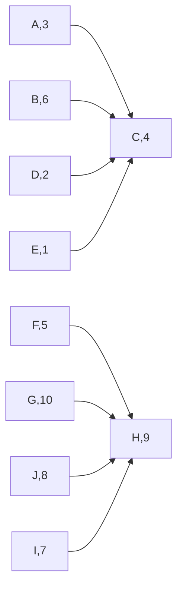
</details>

图 9.78 通过对(图 9.76 中的)图 G 的后序遍历所编号的  $G_{r}$

该算法通过对 $\mathrm{G_r}$ 执行一次深度优先搜索而完成，新的深度优先搜索总是在编号最高的顶点开始。于是，我们在顶点G开始对 $\mathrm{G_r}$ 的深度优先搜索，G的编号为10。但该顶点不通向任何顶点，因此下一次搜索在H点开始。这次调用访问I和J。下一次调用在B点开始并访问A、C和F。此后的调用是dfs(D)及最终调用dfs(E)。结果得到的深度优先生成森林如图9.79所示。

在该深度优先生成森林中的每棵树(如果完全忽略所有的非树边, 那么这会更容易看出)均形成一个强连通的分支。因此, 对于我们的例子, 这些强连通分支为 $\{\mathrm{G}\}, \{\mathrm{H}, \mathrm{I}, \mathrm{J}\}, \{\mathrm{B}, \mathrm{A}, \mathrm{C}, \mathrm{F}\}, \{\mathrm{D}\}$ 和 $\{\mathrm{E}\}$ 。


<details>
<summary>flowchart</summary>

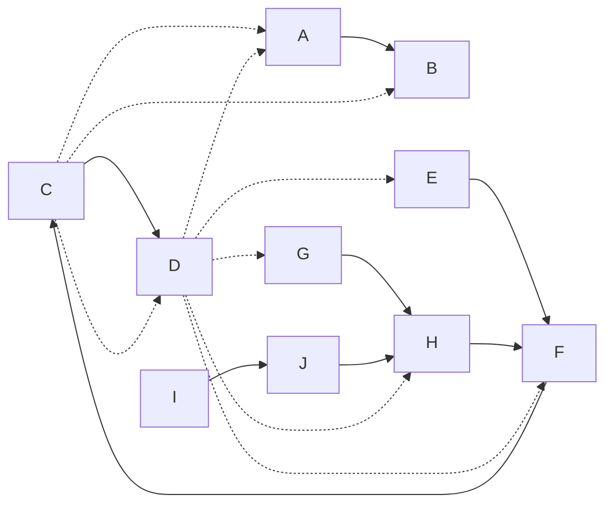
</details>

图 9.79 ${\mathrm{G}}_{\mathrm{r}}$ 的深度优先搜索——强分支为 $\{ \mathrm{G}\} ,\{ \mathrm{H},\mathrm{I},\mathrm{J}\} ,\{ \mathrm{B},\mathrm{A},\mathrm{C},\mathrm{F}\} ,\{ \mathrm{D}\} ,\{ \mathrm{E}\}$

为了理解该算法为什么成立，首先注意到，如果两个顶点 $v$ 和 $w$ 在同一个强连通分支中，那么在原图 $\mathbf{G}$ 中就存在从 $v$ 到 $w$ 的路径和从 $w$ 到 $v$ 的路径，因此，它们在 $\mathrm{G_r}$ 中也存在。现在，如果两个顶点 $v$ 和 $w$ 不在 $\mathrm{G_r}$ 的同一个深度优先生成树中，那么显然它们也不可能在同一个强连通分支中。

为了证明该算法成立，我们必须指出，如果两个顶点 $v$ 和 $w$ 在 $\mathrm{G_r}$ 的同一个深度优先生成树中，那么必然存在从 $v$ 到 $w$ 的路径和从 $w$ 到 $v$ 的路径。等价地，我们可以证明，如果 $x$ 是 $\mathrm{G_r}$ 包含 $v$ 的深度优先生成树的根，那么存在一条从 $x$ 到 $v$ 和从 $v$ 到 $x$ 的路径。对 $w$ 应用相同的推理则得到从 $x$ 到 $w$ 路径和从 $w$ 到 $x$ 的路径。这些路径意味着(经过 $x$) 从 $v$ 到 $w$ 的路径和从 $w$ 到 $v$ 的路径。

由于 $v$ 是 $x$ 在 $\mathrm{G_r}$ 的深度优先生成树中的一个后裔, 因此存在 $\mathrm{G_r}$ 中一条从 $x$ 到 $v$ 的路径, 从而存在 $\mathrm{G}$ 中一条从 $v$ 到 $x$ 的路径。此外, 由于 $x$ 是根节点, 因此 $x$ 从第一次深度优先搜索得到更高的后序编号。于是, 在第一次深度优先搜索期间所有处理 $v$ 的工作都在 $x$ 的工作结束前完成。既然存在一条从 $v$ 到 $x$ 的路径, 因此 $v$ 必然是 $x$ 在 $\mathrm{G}$ 的生成树中的一个后裔——否则 $v$ 将在 $x$ 之后结束。这意味着 $\mathrm{G}$ 中从 $x$ 到 $v$ 有一条路径, 证明完成。

## 9.7 NP 完全性介绍

在这一章，我们已经看到各种各样图论问题的解法。所有这些问题都有一个多项式运行时间，除网络流问题外，运行时间或者是线性的，或者稍微比线性多一些 $(O(|E|\log|E|))$ 。顺便指出，我们还提到，对于某些问题，有些变化似乎比原问题要困难。

回忆欧拉回路问题，它要求找出一条经过图的每条边恰好一次的路径，该问题是线性时间可解的。哈密尔顿圈问题要求找出一个简单圈，该圈包含图的每一个顶点。对于这个问题，尚不知道有线性算法。

对于有向图的单源无权最短路径问题也是线性时间可解的。但对应的最长简单路径问题(longest-simple-path problem)尚不知有线性时间算法。

这些问题的变化，其情况实际上比我们描述的还要糟。对于这些变种问题不仅不知道线性算法，而且不存在保证以多项式时间运行的已知算法。这些问题的一些熟知算法对于某些输入可能要花费指数时间。

在这一节，我们将简要考查这类问题。这个论题相当复杂，因此我们只进行快速和非正式的探讨。这样一来，本节的讨论可能(必然地)在一些地方或多或少地有些不严密的缺憾。

我们将看到，存在大量重要的问题，它们在复杂性上大体是等价的。这些问题形成一个类，叫作 NP 完全问题(NP-complete problems)。这些 NP 完全问题精确的复杂度仍然有待确定，并且在计算机理论科学方面它仍然是最重要的开放性问题。或者所有这些问题都有多项式时间解法，或者它们都没有多项式时间解法。

## 9.7.1 难与易

在给问题分类时，第一步要考虑的是分界。我们已经看到，许多问题可以用线性时间求解。我们还看到某些 $O(\log N)$ 的运行时间，但是它们或者假定已做了某些预处理(如输入数据已读入或数据结构已建立)，或者出现在运算实例中。例如，gcd(最高公因数)算法，当用于两个数 $M$ 和 $N$ 时，花费 $O(\log N)$ 时间。由于这两个数分别由 $\log M$ 和 $\log N$ 个二进制位组成，因此 gcd 算法实际上花费的时间对于输入数据的量或大小而言是线性的。由此可知，当度量运行时间时，我们将把运行时间考虑成输入数据的量的函数。一般说来，我们不能期望运行时间比线性更好。

另一方面，确实存在某些真正难的问题。这些问题是如此的难，以至于它们不可能解出。但这并不意味着通常那种懊恼叹息，期待着天才来求解该问题。正如实数不足以表示 $x^{2} < 0$ 的解那样，可以证明，计算机不可能解决碰巧发生的每一个问题。这些“不可能”解决的问题叫作不可判定问题(undecidable problem)。

一个特殊的不可判定问题是停机问题(halting problem)。是否能够让你的 C++ 编译器拥有一个附加的特性，即不仅能够检查语法错误，而且还能够检查所有的无限循环？这似乎是一个难的问题，但是人们或许期望，假如某些非常聪明的程序员花上足够的时间，他们也许能够编制出这种增强型的编译器。

该问题是不可判定的直观原因在于，这样一个程序可能很难检查它自己。由于这个原因，有时这些问题叫作是递归不可判定的 (recursively undecidable)。

假如一个无限循环检测程序能够被写出，那么它肯定可以用于自检。假设此时我们可以编制出一个程序叫作 LOOP。LOOP 把一个程序 P 作为输入并使 P 对其自身运行。如果 P 自身运行时出现循环，则显示短语 YES。如果 P 自身运行时终止了，那么自然要做的事是显示 NO。现在，我们不显示 NO，而是让 LOOP 进入一个无限循环。

当 LOOP 将自身作为输入时会发生什么呢？或者 LOOP 停止，或者不停止。问题在于，这两种可能性均导致矛盾，与短语 “我的话是谎言” 产生的矛盾大致相同。

根据我们的定义，如果 P(P) 终止，则 LOOP(P) 进入一个无限循环。设当 P = LOOP 时，P(P) 终止。此时，按照 LOOP 程序，LOOP(P) 应该进入一个无限循环。因此，我们必须让 LOOP(LOOP) 终止并进入一个无限循环，显然这是不可能的。另一方面，设当 P = LOOP 时 P(P) 进入一个无限循环，则 LOOP(P) 必然终止，而我们得到同样的一组矛盾。因此，我们看到，程序 LOOP 不可能存在。

## 9.7.2 NP类

NP 类是在难度上逊于不可判定问题的类。NP(nondeterministic polynomial-time)代表非确定型多项式时间(nondeterministic polynomial-time)。确定型机器在每一时刻都在执行一条指令。根据这条指令，机器再去执行某条接下来的指令，这是唯一确定的。而一台非确定型机器(nondeterministic machine)对其后的步骤是有选择的。它可以自由进行它想要的任意的选择，如果这些后面的步骤中有一条导致问题的解，那么它将总是选择这个正确的步骤。因此，非确定型机器具有非常好的猜测(优化)能力。这好像一台奇怪的模型，因为没有人能够构建一台非确定型计算机，还因为这台机器是对标准计算机的令人难以置信的改进(此时每一个问题都变成易解的了)。我们将看到，非确定性是非常有用的理论结构。此外，非确定性也不像人们想象得那么强大。例如，即使使用非确定性，不可判定问题仍然还是不可判定的。

检验一个问题是否属于 NP 的简单方法是将该问题用 “是/否(yes/no) 问题” 的语言描述。如果我们在多项式时间内能够证明一个问题的任意 “是” 的实例是正确的，那么该问题就属于 NP 类。我们不必担心 “否” 的实例，因为程序总是进行正确的选择。因此，对于哈密尔顿圈问题，一个 “是” 的实例就是图中任意一个包含所有顶点的简单回路。由于给定一条路径，验证它是否真的是哈密尔顿圈是一件简单的事情，因此哈密尔顿圈问题属于 NP。诸如 “存在长度 >K 的简单路径吗？” 这样一些恰当表述的问题也能够容易验证从而属于 NP。满足这条性质的任何路径均可容易地检验。

由于解本身显然提供了验证方法，因此，NP 类包括所有具有多项式时间解的问题。人们会预计，既然验证一个答案要比从头开始算出一个答案容易得多，因此在 NP 中就会存在不具有多项式时间解法的问题。这样的问题至今没有发现，于是，完全有可能非确定性并不是那么重要的改进，尽管有些专家很可能不这么认为。问题在于，证明指数下界是一项极其困难的工作。我们曾用来证明排序需要  $\Omega(N \log N)$  次比较的信息理论定界方法似乎还不足以完成这样的工作，因为决策树都远不够大。

还要注意，不是所有的可判定问题都属于 NP。考虑确定一个图是否没有哈密尔顿圈的问题。证明一个图有哈密尔顿圈是相对简单的一件事情——我们只需展示一个即可。然而却没有人知道如何以多项式时间证明一个图没有哈密尔顿圈。似乎人们只能枚举所有的圈并且将它们一个一个地验证才行。因此，无哈密尔顿圈的问题不知属于不属于 NP。

## 9.7.3 NP 完全问题

在已知属于 NP 的所有问题中, 存在一个子集, 叫作 NP 完全问题 (NP-complete problem), 它包含了 NP 中最难的问题。NP 完全问题有一个性质, 即 NP 中的任一问题都能被多项式归约 (polynomially reduced) 成 NP 完全问题。

一个问题 $P_{1}$ 可以归约成问题 $P_{2}$ 如下:设有一个映射，使得 $P_{1}$ 的任何实例都可以变换成$P_{2}$ 的一个实例。求解 $P_{2}$，然后将答案映射回原始的解答。作为一个例子，考虑把数用十进制输入到一个计算器。将这些十进制数转化成二进制数，所有的计算都用二进制进行。然后，再把最后答案转变成十进制显示。对于可多项式地归约成 $P_{2}$ 的 $P_{1}$，与变换相联系的所有工作必须以多项式时间完成。

NP 完全问题是最难的 NP 问题的原因在于，一个 NP 完全的问题基本上可以用作 NP 中任何问题的子例程，其花费只不过是多项式的开销量。因此，如果任意 NP 完全问题有一个多项式时间解，那么 NP 中的每一个问题必然都有一个多项式时间的解。这使得 NP 完全问题是所有 NP 问题中最难的问题。

设我们有一个 NP 完全问题 $P_{1}$, 并设 $P_{2}$ 已知属于 NP。再进一步假设 $P_{1}$ 多项式地归约成 $P_{2}$, 使得我们可以通过使用 $P_{2}$ 求解 $P_{1}$ 只多损耗了多项式时间。由于 $P_{1}$ 是 NP 完全的, NP 中的每一个问题都可多项式地归约成 $P_{1}$ 。应用多项式的封闭性, 我们看到, NP 中的每一个问题均可多项式地归约成 $P_{2}$: 我们把问题归约成 $P_{1}$, 然后再把 $P_{1}$ 归约成 $P_{2}$ 。因此, $P_{2}$ 是 NP 完全的。

作为一个例子，设我们已经知道哈密尔顿圈问题是 NP 完全问题。巡回售货员问题 (traveling salesman problem) 表述如下。

## 巡回售货员问题:

给定一完全图 $G = (V,E)$ 、它的边的值以及整数 $K$ ，是否存在一个访问所有顶点并且总值$\leqslant K$ 的简单圈？

这个问题不同于哈密尔顿圈问题，因为全部 $|V|(V|-1)/2$ 条边都存在而且图是赋权图。该问题有很多重要的应用。例如，印刷电路板需要穿一些孔使得芯片、电阻器以及其他的电子元件可以置入。这是可以机械完成的。穿孔是快速的操作，时间耗费在给穿孔器定位上。定位所需要的时间依赖于从孔到孔间行进的距离。由于我们希望给每一个孔位穿孔（然后返回到开始位置以便给下一块电路板穿孔），并将钻头移动所耗费的总时间限制到最小，因此我们得到的是一个巡回售货员问题。

巡回售货员问题是 NP 完全的。容易看到，其解可以用多项式时间检验，当然它属于 NP。为了证明它是 NP 完全的，我们可多项式地将哈密尔顿圈问题归约为巡回售货员问题。为此，构造一个新的图 $G'$，$G'$ 和 $G$ 有相同的顶点。对于 $G'$ 的每一条边 $(v, w)$，如果 $(v, w) \in G$，那么它就有权 1，否则，它的权就是 2。我们选取 $K = |V|$，见图 9.80。


图9.80 哈密尔顿圈问题变换成巡回售货员问题

容易验证， $G$ 有一个哈密尔顿圈当且仅当 $G^{\prime}$ 有一个总权为 $|V|$ 的巡回售货员的巡回路线。

现在有许多已知是 NP 完全的问题。为了证明某个新问题是 NP 完全的，必须证明它属于 NP，然后将一个适当的 NP 完全问题变换到该问题。虽然到巡回售货员问题的变换是相当简单的，但是，大部分变换实际上却是相当复杂的，需要某些复杂的构造。一般说来，在考虑了多个不同的 NP 完全问题之后才考虑具体提供归约的问题。由于我们只关注一般的想法，因此也就不再讨论更多的变换，有兴趣的读者可以查阅本章后面的参考文献。

细心的读者可能想知道第一个 NP 完全问题是如何具体地被证明是 NP 完全的。由于证明一个问题是 NP 完全的需要从另外一个 NP 完全问题变换到它，因此必然存在某个 NP 完全问题，对于这个问题使用上述思路行不通。第一个被证明是 NP 完全的问题是可满足性问题 (satisfiability problem)。这个可满足性问题把一个布尔表达式作为输入，并提问是否该表达式对式中各变量的一次赋值取值 true。

可满足性当然属于 NP，因为容易计算一个布尔表达式的值并检查结果是否为真(true)。在 1971 年，Cook 通过直接证明 NP 中的所有问题都可以变换成可满足性问题而证明了可满足性问题是 NP 完全的。为此，他用到了对 NP 中每一个问题都已知的事实:NP 中的每一个问题都可以用一台非确定型计算机在多项式时间内求解。计算机的这种形式化的模型称作图灵机 (Turing machine)。Cook 指出这台机器的动作如何能够用一个极其复杂但仍然是多项式的冗长的布尔公式来模拟。该布尔公式为真，当且仅当在由图灵机运行的程序对其输入得到一个“是”的答案。

一旦可满足性被证明是 NP 完全的, 则一大批新的 NP 完全问题, 包括某些最经典的问题, 也都被证明是 NP 完全的。

除了已经讨论过的可满足性问题、哈密尔顿回路问题、巡回售货员问题、最长路径问题，还有一些我们尚未讨论的更为著名的 NP 完全问题，它们是装箱(bin packing)问题、背包(knapsack)问题、图的着色(graph coloring)问题以及团(clique)的问题等。这些 NP 完全问题相当广泛，包括来自操作系统(调度与安全)、数据库系统、运筹学、逻辑学、特别是图论等不同领域的问题。

## 小结

在这一章，我们已经看到图是如何用来对许多现实的实际问题给出模型的。许多实际出现的图常常是非常稀疏的，因此，对用于实现这些图的数据结构给予足够的专注是很重要的。

我们还看到一类问题，它们似乎没有有效的解法。第10章将讨论处理这些问题的一些方法。

## 练习

9.1 找出图 9.81 中的一个拓扑排序。


<details>
<summary>flowchart</summary>

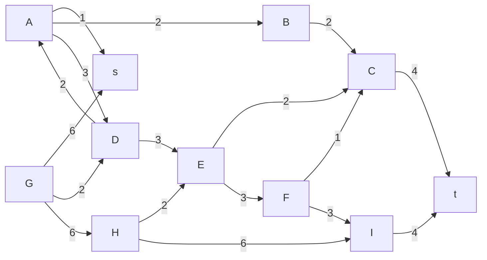
</details>

图9.81 练习9.1和练习9.11中使用的图

9.2 如果用一个栈代替 9.2 节中拓扑排序算法中的队列，是否得到不同的排序？为什么一种数据结构会给出“更好”的答案？

9.3 编写程序执行对一个图的拓扑排序。

9.4 使用标准的二重循环，一个邻接矩阵仅仅初始化就需要时间  $O(|V|^{2})$  。试提出一种方法将一个图存储在一个邻接矩阵中（使得测试一条边是否存在花费  $O(1)$  时间）但要避免二次的运行时间。

9.5 a. 找出图 9.82 中从 A 点到所有其他顶点的最短路径。

b. 找出图 9.82 中从 B 点到所有其他顶点的最短无权路径。


<details>
<summary>flowchart</summary>

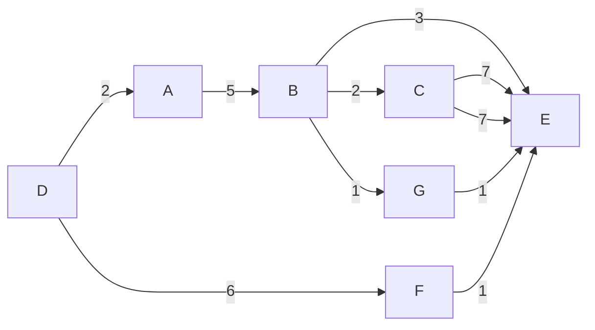
</details>

图9.82 练习9.5使用的图

9.6 当用 d 堆实现时 (6.5 节)，Dijkstra 算法最坏情形的运行时间是多少？

9.7 a. 给出在有一条负边但无负值圈出现时 Dijkstra 算法得到错误答案的例子。

\*\*b. 证明，如果存在负权的边但无负值圈，则 9.3.3 节中提出的赋权最短路径算法是成立的，并证明该算法的运行时间为 $O(|E| \cdot |V|)$。

\*9.8 设一个图的所有边的权都是在 1 和 $|E|$ 之间的整数。Dijkstra 算法可以多快被实现？

9.9 编写一个程序来求解单源最短路径问题。

9.10 a. 解释如何修改 Dijkstra 算法以得到从 v 到 w 的不同最小路径的条数的计数。

b. 解释如何修改 Dijkstra 算法使得如果存在多于一条从 v 到 w 的最小路径，那么具有最少边数的路径将被选中。

9.11 找出图 9.81 中网络的最大流。

9.12 设  $G = (V, E)$  是一棵树，s 是它的根，并且我们添加一个顶点 t 以及从 G 中所有树叶到 t 的具有无穷容量的边。给出一个线性时间算法以找出从 s 到 t 的最大流。

9.13 一个二分图 (bipartite graph) $G = (V, E)$ 是把 $V$ 划分成两个子集 $V_{1}$ 和 $V_{2}$ 并且其每条边的两个顶点都不在同一个子集中的图。

a. 给出一个线性算法以确定一个图是否是二分图。

b. 二分匹配问题 (bipartite matching problem) 是找出 $E$ 的最大子集 $E'$, 使得没有顶点含在多于一条的边中。图 9.83 所示的是四条边的一个匹配 (由虚线表示)。存在一个五条边的匹配, 它是最大的匹配。

指出二分匹配问题如何能够用于解决下列问题:我们有一组教师、一组课程，以及每位教师有资格讲授的课程表。如果没有教师需要讲授多于一门的课程，而且只有一位教师可以教授一门给定的课程，那么可以提供开设的课程数是多少？

c. 证明网络流问题可以用来解决二分匹配问题。

d. 你对问题 b 的解法的时间复杂度如何？

\*9.14 a. 给出一个算法找出容许最大流通过的一条增长通路。

b. 令 f 是在残余图中剩余的流的量。证明，由本题 a 部分的算法所产生的增长通路容许容量为  $f/E|$  的路径通过。

c. 证明:经过 $|E|$ 次连续迭代后，在残余图中剩余的全部流从f减少到最多为f/e，其中 $e\approx2.71828$ 。

d. 证明: $|E|\ln f$ 次迭代足以得到最大流。

9.15 a. 使用 Prim 和 Kruskal 两种算法求出图 9.84 的最小生成树。

b. 这棵最小生成树是唯一的吗？为什么？


<details>
<summary>natural_image</summary>

Abstract diagram of interconnected nodes with solid and dotted lines, no text or symbols present
</details>

图9.83 一个二分图


<details>
<summary>flowchart</summary>

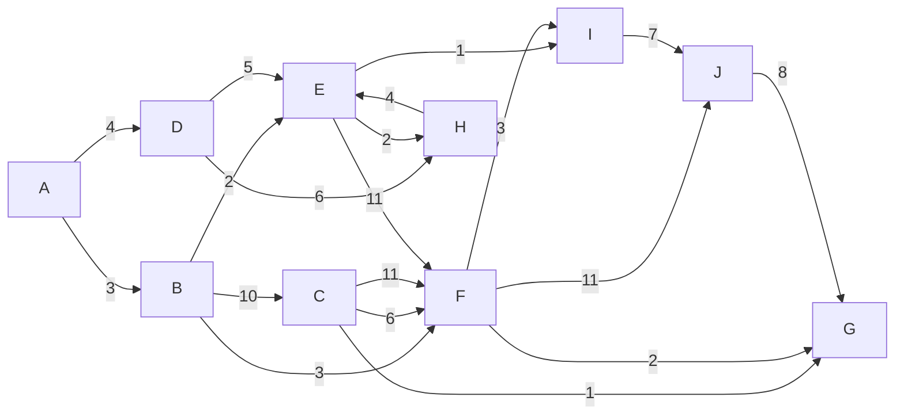
</details>

图 9.84 用于练习 9.15 的图

9.16 如果有一些负的边权，那么 Prim 算法或 Kruskal 算法还能行得通吗？

9.17 证明 V 个顶点的图可以有  $V^{y-2}$  棵最小生成树。

9.18 编写一个程序实现 Kruskal 算法。

9.19 如果一个图的所有边的权都在 1 和 $|E|$ 之间，那么能有多快算出最小生成树？

9.20 给出一个算法求解最大生成树(maximum spanning tree)。这比求解最小生成树更难吗？

9.21 求出图 9.85 的所有的割点。指出深度优先生成树以及每个顶点的 Num 和 Low 的值。

9.22 证明查找割点的算法能够正常运行。

9.23 a. 给出一种算法求出从一个无向图中被删除后使所得的图是无圈图所需要的最小的边数。

\*b. 证明:这个问题对有向图是 NP 完全的。

9.24 证明，在一个有向图的深度优先生成森林中，所有交叉边的方向都是从右到左的。

9.25 给出一个算法以确定在一个有向图的深度优先生成森林中的一条边 $(v, w)$ 是否是树、背向边、交叉边或前向边。

9.26 找出图 9.86 的强连通分支。


<details>
<summary>flowchart</summary>

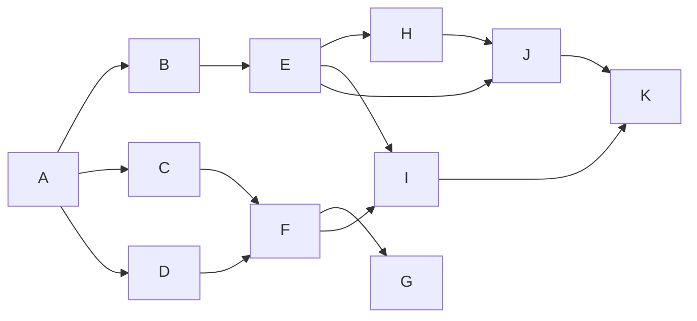
</details>

图 9.85 练习 9.21 所使用的图


<details>
<summary>flowchart</summary>

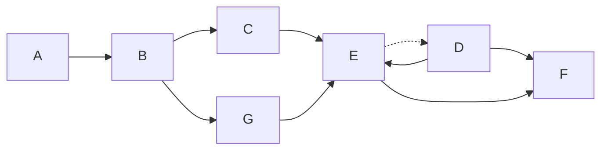
</details>

图 9.86 练习 9.26 所使用的图

9.27 编写一个程序，使其找出有向图中的那些强连通分支。
\*9.28 给出一个算法只用一次深度优先搜索即可找出那些强连通分支。使用类似于双连通性算法(biconnectivity algorithm)的算法。
9.29 一个图 $G$ 的双连通分支(biconnected components)是把边分成一些集合的划分，使得每个边集所形成的图是双连通的。修改图 9.69 中的算法，使其能够找出双连通分支而不是找出割点。

9.30 设我们对一个无向图进行广度优先搜索(breadth-first search)并建立一棵广度优先生成树(breadth-first spanning tree)。证明该树所有的边或者是树边或者是交叉边。

9.31 给出一个算法以在一无向(连通)图中找出一条路径，使其在每个方向上恰好通过每条边一次。

9.32 a. 编写一个程序以找出图中的一条欧拉回路(如果存在的话)。

b. 编写一个程序以找出图中的一条欧拉环游(如果存在的话)。

9.33 有向图中的欧拉回路是一个圈，该圈中的每条边恰好被访问一次。

\*a. 证明:有向图有欧拉回路当且仅当它是强连通的并且每个顶点有相等的入度(indegree)和出度(outdegree)。

\*b. 给出一个线性时间算法，在存在欧拉回路的有向图中找出一条欧拉回路。

9.34 a. 考虑欧拉回路问题的下列解法:假设图是双连通的。执行一次深度优先搜索，只在万不得已的时候使用背向边。如果图不是双连通的，则对双连通分支递归地应用该算法。这个算法行得通吗？

b. 设当用到背向边时, 我们取用连接到最近祖先节点的背向边, 那么该算法是否行得通?

9.35 平面图(planar graph)是可以画在一个平面上而其任何两条边都不相交叉的图。

\*a. 证明图 9.87 中的两个图都不是平面图。

b. 证明:在平面图中，必然存在某个顶点与最多不超过 5 个顶点相连。

\*\*c. 证明在平面图中 $|E| \leqslant 3|V| - 6$。


<details>
<summary>natural_image</summary>

Two geometric diagrams showing interconnected nodes with lines, no text or symbols present
</details>

图 9.87 练习 9.35 使用的图

9.36 多重图(multigraph)是在其内的顶点对之间可以有多条边(multiple edges)的图。本章中哪些算法对于多重图不用修改就能正确运行？对其余的算法需要进行哪些修改？

\*9.37 令 $G = (V, E)$ 是一个无向图。使用深度优先搜索设计一个线性算法，把 $G$ 的每条边转换成有向边使得所得到的图是强连通的，或者确定这是不可能做到的。

9.38 给你一套棍共 N 根，它们以某种结构相互叠压摆放。每根棍由它的两个端点确定；每个端点是由 x、y 和 z 坐标确定的有序三元组，没有棍垂直摆放。一根棍仅当其上没有其他棍放置时可以取走。

a. 解释如何编写一个例程接收两根棍 a 和 b，并报告 a 是否在 b 上面、b 下面，或是与 b 无关。(本问与图论毫无关系。)

b. 给出一个算法确定是否能够取走所有的棍，如果能，那么提供完成这项工作的棍拾取次序。

9.39 如果一个图的每个顶点都可以给定 $k$ 种颜色之一，并且没有边连接相同颜色的顶点，则称该图是 $\pmb{k}$ 可着色(k-colorable)的。给出一个线性时间算法测试图的2可着色性。假设图以邻接表的形式存储；此时，必须指明任何所需要的附加的数据结构。

9.40 给出一种多项式时间算法，使得在任意的无向图中能够找出 $V/2$ 个顶点，这些顶点至少覆盖图的3/4的边。

9.41 指出如何修改拓扑排序算法，使得如果图不是无圈图，则该算法将显示出某个圈来。可以不使用深度优先搜索。

9.42 令 $G$ 为一有向图，该图有 $N$ 个顶点。如果对 $V$ 中每一个顶点 $v$，图 $G$ 存在边 $(v, s)$ 但是不存在形如 $(s, v)$ 的边，其中顶点 $s \neq v$，则顶点 $s$ 叫作收点 (sink)。给出一个 $O(N)$ 时间算法，确定 $G$ 是否有收点，假设 $G$ 由它的 $n \times n$ 邻接矩阵给定。

9.43 当把一个顶点和与它关联的边从一棵树中删除后，则剩下一组子树。给出一个线性时间算法，使能找出一个顶点，从 N 个顶点的树中删除该顶点将不会留下多于 N/2 个顶点的子树。

9.44 给出一个线性时间算法，确定无圈无向图(即树)中的最长无权路径。

9.45 考虑一个  $N \times N$  网格，网格中一些方格由黑色圆形占据。若两个方格同享一条公共边，则它们属于同一组。在图 9.88 中，有一组由 4 个黑圆占据的方格组成，有三组由 2 个黑圆占据的方格组成，还有两个由单个黑圆占据的方格。假设网格由 2 维数组表示，编写一个程序进行下列工作:

a. 当给出组中一个方格时计算该组的大小。

b. 计算不同的组的个数。

c. 列出所有的组。


<details>
<summary>text_image</summary>

Go game board position with black stones arranged in a grid, showing move sequence
</details>

图 9.88 练习 9.45 所用的网格

9.46 8.7 节描述了迷宫的生成。设我们想要输出迷宫中的路径。假设迷宫由一个矩阵表示，矩阵中的每个单元存储关于墙存在(或不存在)的信息。

a. 编写一个程序，计算输出迷宫中路径的足够的信息。以 SEN...(代表向南行进，然后向东行进，然后再向北行进，等等)的形式给出输出结果。

b. 如果你在使用带有视窗包(windowing package)的 C++ 编译器，那么就请编写一个画出迷宫的程序，并且在按下一个按钮时画出上述路径。

9.47 设迷宫中的墙可以推倒，但要受罚 P 个方块，P 为指定给算法的参数。（如果处罚是 0，那么问题是平凡的。）描述一种算法，解决这种类型的问题。该算法的运行时间是多少？

9.48 设迷宫可以有解也可以没有解。

a. 描述一个线性时间算法，该算法确定为了建立一个解而需要推倒的墙的最小面数。(提示:使用一个双端队列。)

b. 描述一个算法(不必是线性的)，该算法能够在推倒最小数目的墙之后找到最短路径。注意，问题 a 的解法给不出哪些面墙最好被推倒的信息。(提示: 用到练习 9.47。)

9.49 编写一个程序计算词梯，其中单字母替换取值为1，而单字母添加或删除取值 $p > 0$取值由用户指定。在 9.3.6 节末尾曾经提到，这本质上是一个赋权最短路径问题。解释下列每个问题(练习 9.50～练习 9.53)应用最短路径算法如何能够解出。然后设计一种表示输入的机制，并编写一个程序求解相应的问题。

9.50 输入是一组联赛成绩得分(没有平局)。如果所有的队至少有一场赢和一场输，那么可以通过愚蠢的传递性论证一般性地“证明”，任一队都比别的队强。例如，在6队联赛中，每队进行3局比赛，设我们有下列结果:A胜B和C；B胜C和F；C胜D；D胜E；E胜A；F胜D和E，此时可以证明A比F强，因为A胜B而B又胜了F。类似地，还可以证明F比A强，因为F胜E而E又胜了A。给定一组比赛得分和两支运动队X和Y，要么找出一个X比Y强的证明(若存在的话)，要么指出找不到这种形式的证明。

9.51 设输入为一组货币和它们的兑换率。是否存在一种兑换顺序能够立刻赚到钱？例如，如果货币是 $X$ ， $Y$ 和 $Z$ ，兑换率为 $1X$ 等于 $2Y$ ， $1Y$ 等于 $2Z$ ，而 $1X$ 等于 $3Z$ ，那么，$300Z$ 将买到 $100X$ ，而 $100X$ 又能买到 $200Y$ ，后者将换到 $400Z$ 。这样，我们就得到$33\%$ 的收益。

9.52 一名学生需要选修一定数量的课程才可获得学位，而课程的选取必须遵守选修顺序。假设每个学期都提供所有的课程，并设学生可以选修无限多门课程。给定提供的课程表和它们的先修课，计算出需要最少学期数的课程表。

9.53 Kevin Bacon 游戏(Kevin Bacon Game)的目标是通过一些分享的电影角色把电影演员和著名演员 Kevin Bacon 链接起来。链接的最小数目为演员的 Bacon 数。例如，Tom Hanks 的 Bacon 数为 1，他在 Apollo 13 中与 Kevin Bacon 分享角色。Sally Fields 的 Bacon 数是 2，因为她在电影 Forrest Gump 中与 Tom Hanks 分享角色，而后者又在电影 Apollo 13 中与 Kevin Bacon 分享角色。几乎所有著名演员的 Bacon 数都是 1 或者 2。假设你有一个广泛的演员表，且包含他们所演的角色， $^{①}$ 完成下列工作:

a. 解释如何查找演员的 Bacon 数。
b. 解释如何查找具有最高 Bacon 数的演员。
c. 解释如何查找任意两个演员之间的最小链接数目。

9.54 团问题(clique problem)可以叙述如下:给定无向图 $G = (V, E)$ 和一个整数 $K$，那么，$G$ 是否包含至少 $K$ 个顶点的完全子图？

顶点覆盖问题(vertex cover problem)可以叙述如下:给定无向图 $G = (V, E)$ 和一个整数 $K$，$G$ 是否包含一个子集 $V' \subset V$，使得 $|V'| \leqslant K$ 并且 $G$ 的每条边都有一个顶点在 $V'$ 中？团问题的证明可以多项式归约成顶点覆盖问题。

9.55 设哈密尔顿圈问题对无向图是 NP 完全的。

a. 证明哈密尔顿圈问题对有向图也是 NP 完全的。
b. 证明无权简单最长路径问题对有向图是 NP 完全的。

9.56 棒球卡收藏家问题 (baseball card collector problem) 如下: 给定卡片包 $P_{1}, P_{2}, \cdots, P_{M}$ 以及一个整数 $K$, 其中每个包包含年度棒球卡的一个子集, 问是否可能通过选择 $\leqslant K$ 个包而搜集到所有的棒球卡? 证明棒球卡收藏家问题是 NP 完全的。

<small><span class="docvortex-page-footnote" data-block-type="page_footnote" style="color:#6b7280">① 例如，可见 Internet Movie Database 文件:actors.list.gz 和 actress.list.gz，网址为 ftp://ftp.fu-berlin.de/pub/misc/movies/database。</span></small>

## 参考文献

好的图论教科书包括文献[9]、[14]、[24]和[39]。更深入的论题，包括对运行时间更为仔细的考虑，见文献[41]、[44]和[51]。

邻接表的使用在文献[26]中倡导。拓扑排序算法来自文献[31]，其描述如文献[36]。Dijkstra算法初现于文献[10]，使用 $d$ 堆和斐波那契堆所做的改进分别在文献[30]和[16]中描述。具有负的边权的最短路径算法归于 Bellman[3]；Tarjan[51]描述了一种更为有效的方法，以确保能够终止。

Ford 和 Fulkerson 关于网络流的开创性工作见文献[15]。沿最短路径增长或在容许最大流增加的路径上增长的想法源自文献[13]。对该问题的其他一些处理方法可在文献[11]、[34]、[23]、[7]、[35]、[22]和[43]中找到。关于最小-值(min-cost)流问题的一个算法可见于文献[20]。

早期的最小生成树算法可以在文献[4]中找到。Prim算法取自文献[45]，Kruskal算法出于文献[37]。两个 $O(|E|\log \log |V|)$ 算法见文献[6]和[52]。理论上一些最著名的算法出现在文献[16]、[18]、[32]和[5]。这些算法的经验性研究提出，用decreaseKey实现的Prim算法在实践中对于大多数图而言是最好的[42]。

关于双连通性的算法出自文献[47]。第一个线性时间强分支算法(练习9.28)也发表在这同一篇论文中。正文里介绍的算法归于Kosaraju(未发表)和Sharir[46]。深度优先搜索的另外一些应用见于文献[27]、[28]、[48]和[49](正如第8章提到的，文献[48]和[49]中的结果已被改进，但是基本算法没变)。

NP 完全问题理论经典的介绍性工作是文献[21]。在文献[1]中可以找到另外的材料。可满足性的 NP 完全性在文献[8]中(并且也被 Levin 独立地)证明。另一篇开创性的论文是文献[33]，它证明了 21 个问题的 NP 完全性。复杂性理论的一篇极好的概括性论述是文献[50]。巡回售货员问题的一个近似算法可见于文献[40]，它一般性地给出几近最优的结果。

练习9.8的解法可以在文献[2]中找到。对于练习9.13中二分匹配问题的解法可见于文献[25]和[38]。该问题可通过给边赋权并去掉图是二分的限制而得以推广。一般图的无权匹配问题的有效解法是相当复杂的，细节可以在文献[12]、[17]和[19]中找到。

练习 9.35 处理平面图，它通常产生于实践。平面图是非常稀疏的，许多困难问题以平面图的方式处理会更容易。有一个例子是图的同构问题，对于平面图它是线性时间可解的 $^{[29]}$ 。对于一般的图，尚不知有多项式时间算法。

1. A. V. Aho, J. E. Hopcroft, and J. D. Ullman, The Design and Analysis of Computer Algorithms, Addison-Wesley, Reading, Mass., 1974.
2. R. K. Ahuja, K. Melhorn, J. B. Orlin, and R. E. Tarjan, "Faster Algorithms for the Shortest Path Problem," Journal of the ACM, 37 (1990), 213–223.
3. R. E. Bellman, "On a Routing Problem," Quarterly of Applied Mathematics, 16 (1958), 87–90.
4. O. Borůvka, "Ojistém problému minimálním (On a Minimal Problem)," Práca Moravské Přirodo-vědecké Společnosti, 3 (1926), 37–58.
5. B. Chazelle, "A Minimum Spanning Tree Algorithm with Inverse-Ackermann Type Complexity," Journal of the ACM, 47 (2000), 1028–1047.
6. D. Cheriton and R. E. Tarjan, "Finding Minimum Spanning Trees," SIAM Journal on Computing, 5 (1976), 724–742.
7. J. Cheriyan and T. Hagerup, "A Randomized Maximum-Flow Algorithm," SIAM Journal on Computing, 24 (1995), 203–226.
8. S. Cook, "The Complexity of Theorem Proving Procedures," Proceedings of the Third Annual ACM Symposium on Theory of Computing (1971), 151–158.
9. N. Deo, Graph Theory with Applications to Engineering and Computer Science, Prentice Hall, Englewood Cliffs, N.J., 1974.
10. E. W. Dijkstra, "A Note on Two Problems in Connexion with Graphs," Numerische Mathematik, 1 (1959), 269–271.
11. E. A. Dinic, "Algorithm for Solution of a Problem of Maximum Flow in Networks with Power Estimation," Soviet Mathematics Doklady, 11 (1970), 1277-1280.
12. J. Edmonds, "Paths, Trees, and Flowers," Canadian Journal of Mathematics, 17 (1965), 449–467.
13. J. Edmonds and R. M. Karp, "Theoretical Improvements in Algorithmic Efficiency for Network Flow Problems," Journal of the ACM, 19 (1972), 248–264.
14. S. Even, Graph Algorithms, Computer Science Press, Potomac, Md., 1979.
15. L. R. Ford, Jr., and D. R. Fulkerson, Flows in Networks, Princeton University Press, Princeton, N.J., 1962.
16. M. L. Fredman and R. E. Tarjan, "Fibonacci Heaps and Their Uses in Improved Network Optimization Algorithms," Journal of the ACM, 34 (1987), 596–615.
17. H. N. Gabow, "Data Structures for Weighted Matching and Nearest Common Ancestors with Linking," Proceedings of First Annual ACM-SIAM Symposium on Discrete Algorithms (1990), 434–443.
18. H. N. Gabow, Z. Galil, T. H. Spencer, and R. E. Tarjan, "Efficient Algorithms for Finding Minimum Spanning Trees on Directed and Undirected Graphs," Combinatorica, 6 (1986), 109–122.
19. Z. Galil, "Efficient Algorithms for Finding Maximum Matchings in Graphs," ACM Computing Surveys, 18 (1986), 23–38.
20. Z. Galil and E. Tardos, "An $O(n^{2}(m + n\log n)\log n)$ Min-Cost Flow Algorithm," Journal of the ACM, 35 (1988), 374-386.
21. M. R. Garey and D. S. Johnson, Computers and Intractability: A Guide to the Theory of NP-Completeness, Freeman, San Francisco, 1979.
22. A. V. Goldberg and S. Rao, "Beyond the Flow Decomposition Barrier," Journal of the ACM, 45 (1998), 783–797.
23. A. V. Goldberg and R. E. Tarjan, "A New Approach to the Maximum-Flow Problem," Journal of the ACM, 35 (1988), 921–940.
24. F. Harary, Graph Theory, Addison-Wesley, Reading, Mass., 1969.
25. J. E. Hopcroft and R. M. Karp, "An $n^{5/2}$ Algorithm for Maximum Matchings in Bipartite Graphs," SIAM Journal on Computing, 2 (1973), 225-231.
26. J. E. Hopcroft and R. E. Tarjan, "Algorithm 447: Efficient Algorithms for Graph Manipulation," Communications of the ACM, 16 (1973), 372–378.
27. J. E. Hopcroft and R. E. Tarjan, "Dividing a Graph into Triconnected Components," SIAM Journal on Computing, 2 (1973), 135–158.
28. J. E. Hopcroft and R. E. Tarjan, "Efficient Planarity Testing," Journal of the ACM, 21 (1974), 549–568.
29. J. E. Hopcroft and J. K. Wong, "Linear-Time Algorithm for Isomorphism of Planar Graphs," Proceedings of the Sixth Annual ACM Symposium on Theory of Computing (1974), 172–184.
30. D. B. Johnson, "Efficient Algorithms for Shortest Paths in Sparse Networks," Journal of the ACM, 24 (1977), 1–13.
31. A. B. Kahn, "Topological Sorting of Large Networks," Communications of the ACM, 5 (1962), 558–562.
32. D. R. Karger, P. N. Klein, and R. E. Tarjan, "A Randomized Linear-Time Algorithm to Find Minimum Spanning Trees," Journal of the ACM, 42 (1995), 321–328.
33. R. M. Karp, "Reducibility among Combinatorial Problems," Complexity of Computer Computations (eds. R. E. Miller and J. W. Thatcher), Plenum Press, New York, 1972, 85–103.
34. A. V. Karzanov, "Determining the Maximal Flow in a Network by the Method of Preflows," Soviet Mathematics Doklady, 15 (1974), 434–437.
35. V. King, S. Rao, and R. E. Tarjan, "A Faster Deterministic Maximum Flow Algorithm," Journal of Algorithms, 17 (1994), 447–474.
36. D. E. Knuth, The Art of Computer Programming, Vol. 1: Fundamental Algorithms, 3d ed., Addison-Wesley, Reading, Mass., 1997.
37. J. B. Kruskal, Jr., "On the Shortest Spanning Subtree of a Graph and the Traveling Salesman Problem," Proceedings of the American Mathematical Society, 7 (1956), 48–50.
38. H. W. Kuhn, "The Hungarian Method for the Assignment Problem," Naval Research Logistics Quarterly, 2 (1955), 83–97.
39. E. L. Lawler, Combinatorial Optimization: Networks and Matroids, Holt, Reinhart and Winston, New York, 1976.
40. S. Lin and B. W. Kernighan, "An Effective Heuristic Algorithm for the Traveling Salesman Problem," Operations Research, 21 (1973), 498–516.
41. K. Melhorn, Data Structures and Algorithms 2: Graph Algorithms and NP-completeness, Springer-Verlag, Berlin, 1984.
42. B. M. E. Moret and H. D. Shapiro, "An Empirical Analysis of Algorithms for Constructing a Minimum Spanning Tree," Proceedings of the Second Workshop on Algorithms and Data Structures (1991), 400–411.
43. J. B. Orlin, "Max Flows in O(nm) Time, or Better," Proceedings of the Forty-fifth Annual ACM Symposium on Theory of Computing (2013).
44. C. H. Papadimitriou and K. Steiglitz, Combinatorial Optimization: Algorithms and Complexity, Prentice Hall, Englewood Cliffs, N.J., 1982.
45. R. C. Prim, "Shortest Connection Networks and Some Generalizations," Bell System Technical Journal, 36 (1957), 1389–1401.
46. M. Sharir, "A Strong-Connectivity Algorithm and Its Application in Data Flow Analysis," Computers and Mathematics with Applications, 7 (1981), 67–72.
47. R. E. Tarjan, "Depth First Search and Linear Graph Algorithms," SIAM Journal on Computing, 1 (1972), 146–160.
48. R. E. Tarjan, "Testing Flow Graph Reducibility," Journal of Computer and System Sciences, 9 (1974), 355–365.
49. R. E. Tarjan, "Finding Dominators in Directed Graphs," SIAM Journal on Computing, 3 (1974), 62–89.
50. R. E. Tarjan, "Complexity of Combinatorial Algorithms," SIAM Review, 20 (1978), 457–491.
51. R. E. Tarjan, Data Structures and Network Algorithms, Society for Industrial and Applied Mathematics, Philadelphia, 1983.
52. A. C. Yao, "An $O(|E|\log \log |V|)$ Algorithm for Finding Minimum Spanning Trees," Information Processing Letters, 4 (1975), 21-23.

## 第10章 算法设计技巧

迄今，我们已经涉及到一些算法的有效的实现。我们看到，当一个算法给定时，具体的数据结构无须指定。为使运行时间尽可能地少，需要由编程人员来选择适当的数据结构。

本章我们将把注意力从算法的实现转向算法的设计上来。到现在为止，我们已经看到的大部分算法都是直接的和简单的。第9章包含的一些算法要深奥得多，有些需要(在有些情形下很长的)论证以证明它们确实是正确的。在这一章，我们将集中讨论用于求解问题的5种常见类型的算法。对于许多问题，很可能这些方法中至少有一种方法是可以解决问题的。特别地，对于每种类型的算法我们将

- 看到一般的处理方法。
● 考查几个例子(本章末尾的练习题提供了更多的例子)。
● 在适当的地方概括地讨论时间和空间复杂性。

## 10.1 贪婪算法

我们将要考查的第一种类型的算法是贪婪算法(greedy algorithm)。在第9章我们已经看到3个贪婪算法:Dijkstra算法、Prim算法和Kruskal算法。贪婪算法分阶段地工作。在每一个阶段，可以认为所作决定是好的，而不考虑将来的后果。一般地说，这意味着选择的是某个局部的最优。这种“眼下能拿就拿”的策略即是这类算法名称的由来。当算法终止时，我们希望局部最优等于全局最优。如果是这样的话，那么算法就是正确的；否则，算法得到的是一个次最优解(suboptimal solution)。如果不要求绝对最优答案，那么有时候可以用简单的贪婪算法来生成近似的答案，而不是使用一般说来产生准确答案所需要的复杂算法。

有几个现实的贪婪算法的例子，最明显的是货币找零钱问题。为了使用美国货币找零钱，我们反复地配发最大面额货币。于是，为了找出17美元61美分的零钱，我们拿出一张十美元钞，一张五美元钞，两张一美元钞，两个二十五分币，一个十分币，以及一个分币。这么做，我们保证使用最少的钞票和硬币。这个算法不是对所有的货币系统都行得通，但幸运的是，我们可以证明它对美国货币系统确实是正确的。事实上，即使允许使用两美元钞和五十美分币该算法仍然是可行的。

交通问题有一个例子，在这个例子中，进行局部最优选择不总是行得通的。例如，在迈阿密的某些交通高峰期间，即使一些主要马路看起来空荡荡的，你最好还是把车停在这些街道以外，因为交通将会沿着马路阻塞1英里长，你也就被堵在那里动弹不得了。有时甚至更糟，为了回避所有的交通瓶颈，最好是朝着你的目的地相反的方向临时绕道行驶。

本节其余部分，我们将考查几个使用贪婪算法的应用。第一个应用是简单的调度问题。实际上，所有的调度问题或者是 NP 完全的(或属于类似的难度)，或者是贪婪算法可解的。第二个应用处理文件压缩，它是计算机科学最早的成果之一。最后，我们将介绍一个贪婪近似算法的例子。

## 10.1.1 一个简单的调度问题

今有作业 $j_{1}, j_{2}, \cdots, j_{N}$，已知对应的运行时间分别为 $t_{1}, t_{2}, \cdots, t_{N}$，而处理器只有一个。为了把作业平均完成的时间最小化，调度这些作业最好的方式是什么？整个这一节我们将假设非

预占调度(nonpreemptive scheduling): 一旦开始一个作业，就必须把该作业运行到完成。

作为一个例子，设有4个作业和相关的运行时间如图10.1所示。一个可能的调度在图10.2中指出。因为 $j_{1}$ 用15(个时间单位)运行结束，$j_{2}$ 用23，$j_{3}$ 用26，而 $j_{4}$ 用36个时间单位，所以平均完成时间为25。一个更好的调度如图10.3所示，它产生的平均完成时间为17.75。

| 作业 | 时间 |
| --- | --- |
| $j_{1}$ | 15 |
| $j_{2}$ | 8 |
| $j_{3}$ | 3 |
| $j_{4}$ | 10 |

图10.1 作业和时间


<details>
<summary>text_image</summary>

j₁ | j₂ | j₃ | j₄
0 15 23 26 36
</details>

图10.2 1号调度


<details>
<summary>text_image</summary>

j₃ | j₂ | j₄ | j₁
0 3 11 21 36
</details>

图 10.3 2 号调度(最优)

图 10.3 给出的调度是按照最短的作业最先进行来安排的。我们可以证明这将总会产生一个最优的调度。令调度表中的作业是  $j_{i_{1}}, j_{i_{2}}, \cdots, j_{i_{N}}$  。第一个作业以时间  $t_{i_{1}}$  完成。第二个作业在  $t_{i_{1}} + t_{i_{2}}$  后完成，而第三个作业在  $t_{i_{1}} + t_{i_{2}} + t_{i_{3}}$  后完成。由此可以看到，该调度总的开销 C 为

$$
C = \sum_ {k = 1} ^ {N} (N - k + 1) t _ {i _ {k}} \tag {10.1}
$$

$$
C = (N + 1) \sum_ {k = 1} ^ {N} t _ {i _ {k}} - \sum_ {k = 1} ^ {N} k \cdot t _ {i _ {k}} \tag {10.2}
$$

注意，在方程(10.2)中第一个和与作业的排序无关，因此只有第二个和影响到总开销。设在一个排序中存在某个 $x > y$ 使得 $t_{i_x} < t_{i_y}$ 。此时，计算表明，交换 $j_{i_x}$ 和 $j_{i_y}$，第二个和增加，从而降低了总的开销。因此，其所用时间不是单调非减的任何作业调度必然是次最优的。剩下的只有那些其作业按照最小运行时间最先安排的调度才是所有调度方案中最优的。

## 多处理器的情况

可以把这个问题扩展到多个处理器的情形。我们还是有作业 $j_{1}, j_{2}, \cdots, j_{N}$ ，对应的运行时间分别为 $t_{1}, t_{2}, \cdots, t_{N}$ ，另有处理器P个。不失一般性，我们将假设作业是排了序的，最短的运行时间最先处理。作为一个例子，设P=3，而作业则如图10.4所示。

图 10.5 显示了一个最优的安排，它把平均完成时间优化到最小。作业  $j_{1}, j_{4}$  和  $j_{7}$  在处理器 1 上运行。处理器 2 处理作业  $j_{2}, j_{5}$  和  $j_{8}$，而处理器 3 运行其余的作业。总的完成时间为 165，平均是  $\frac{165}{9} = 18.33$。

这个结果指出了操作系统调度程序一般把优先权赋予那些更短的作业的原因。

| 作业 | 时间 |
| --- | --- |
| $j_{1}$ | 3 |
| $j_{2}$ | 5 |
| $j_{3}$ | 6 |
| $j_{4}$ | 10 |
| $j_{5}$ | 11 |
| $j_{6}$ | 14 |
| $j_{7}$ | 15 |
| $j_{8}$ | 18 |
| $j_{9}$ | 20 |

图10.4 作业和时间


<details>
<summary>text_image</summary>

j₁
j₄
j₇
j₂
j₅
j₈
j₃
j₆
j₉
0 3 5 6 13 16 20 28 34 40
</details>

图10.5 多处理器情形的一个最优解

解决多处理器情形的算法是按顺序开始作业，处理器之间轮换分配作业。不难证明，没有哪个其他的顺序能够做得更好，不过，当处理器个数 $P$ 能够整除作业数 $N$ 时存在多个最优的排序。对于每一个 $0 \leqslant i < N / P$ ，通过把从 $j_{iP + 1}$ 直到 $j_{(i + 1)P}$ 的每一个作业放到不同的处理器上，可以得到这样的结果。在我们的例子中，图10.6指出第二个最优解。


<details>
<summary>text_image</summary>

j₁ j₅ j₉
j₂ j₄ j₇
j₃ j₆ j₈
0 3 5 6 14 15 20 30 34 38
</details>

图10.6 多处理器情形的第二个最优解

即使 $P$ 不恰好整除 $N$ ，哪怕所有的作业时间是互异的，也还是仍然能够有许多的最优解。我们把进一步的考查留作练习。

## 将最后完成时间最小化

在本小节最后，考虑一个非常类似的问题。假设我们只关注最后的作业的结束时间。在上面的两个例子中，它们的完成时间分别是40和38。图10.7指出最少的最后完成时间是34，

而这个结果显然不能再改进了，因为每一个处理器都一直在忙着。

虽然这个调度没有最小平均完成时间，但是它有个优点，即整个序列的完成时间更早。如果同一个用户拥有所有这些作业，那么该调度是更可取的调度方法。虽然这些问题非常相似，但是这个新问题实际上是 NP 完全的，它


<details>
<summary>text_image</summary>

j2
j5
j8
j6
j9
j1
j3
j4
j7
0 3 5 9 14 16 19 34
</details>

图10.7 将最后完成时间最小化

恰是背包问题或装箱问题的另一种表述方式，我们在本节后面还将遇到它。因此，将最后完成时间最小化显然要比把平均完成时间最小化困难得多。

## 10.1.2 哈夫曼编码

在这一节，我们考虑贪婪算法的第二个应用，称为文件压缩(file compression)。

标准的 ASCII 字符集由大约 100 个 “可打印” 字符组成。为了把这些字符区分开来，需要  $\left\lceil \log 100 \right\rceil = 7$  个比特（二进制位）。但 7 个比特可以表示 128 个字符，因此 ASCII 字符还可以再加上一些其他的 “非打印” 字符。第 8 个比特位的加入用作奇偶校验位。然而，重要的问题在于，如果字符集的大小是 C，那么在标准的编码中就需要  $\left\lceil \log C \right\rceil$  个比特。

设有一个文件，它只包含字符 a, e, i, s, t，再加上一些空格 (blank space) 和换行符 (newline)。进一步设该文件有 10 个 a、15 个 e、12 个 i、3 个 s、4 个 t、13 个空格以及一个换行符。如图 10.8 所示，这个文件需要 174 个比特来表示，因为有 58 个字符而每个字符需要 3 个比特。

在现实当中，文件可能是相当大的。许多非常大的文件常为某个程序的输出，而在频率最大的字符和频率最小的字符之间通常存在很大的差别。例

| 字符 | 代码 | 频率 | 总比特数 |
| --- | --- | --- | --- |
| a | 000 | 10 | 30 |
| e | 001 | 15 | 45 |
| i | 010 | 12 | 36 |
| s | 011 | 3 | 9 |
| t | 100 | 4 | 12 |
| 空格 | 101 | 13 | 39 |
| 换行符 | 110 | 1 | 3 |
| 总计 |  |  | 174 |

图10.8 使用一个标准编码方案

如，许多巨大的文件都含有很多大量的数字、空格和换行符，但是 q 和 x 却很少。如果在慢速的电话线上传输这些信息，那么我们就会希望减少文件的大小。还有，由于实际上每一台机器上的磁盘空间都是非常珍贵的，因此人们就会想到是否有可能提供一种更好的编码以降低所需的总比特数。

答案是肯定的，一种简单的策略可以使典型的大型文件节省 25%，而使许多大型的数据文件节省多达 50%\~60%。这种一般的策略就是让代码的长度从字符到字符是变化不等的，同时保证经常出现的字符其代码要短。注意，如果所有的字符都以相同的频率出现，那么节省的问题是不可能存在的。

代表字母的二进制代码可以用二叉树来表示，如图 10.9 所示。


<details>
<summary>flowchart</summary>

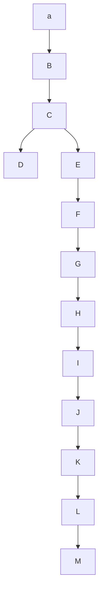
</details>

图10.9 树中原始代码的表示法

图 10.9 中的树只在树叶上有数据。每个字符通过从根节点开始以记录路径的方法表示出来，其中用 0 指示左分支，用 1 指示右分支。例如，s 通过从根向左走，然后向右，最后再向右而达到，于是它被编码成 011。这种数据结构有时叫作 trie 树 (trie)。如果字符  $c_{i}$  在深度  $d_{i}$  处并且出现  $f_{i}$  次，那么该字符代码的值 (cost of the code) 就等于  $\sum d_{i}f_{i}$ 。

一种比图10.9给出的代码更好的代码，可以利用换行符是一个仅有的儿子而得到。通过把换行符放到它的更高一层的父节点上，可得到图10.10所示的新的树。这棵新树的值是173，但该值仍然远没有达到最优。


<details>
<summary>flowchart</summary>

```mermaid
graph TD
  A[""] --> B[""]
  B --> C[""]
  C --> D[""]
  D --> E["nl"]
  C --> F["i"]
  F --> G["s"]
  G --> H["t"]
  H --> I["sp"]
```
</details>

图10.10 稍微好一些的树

注意，图 10.10 中的树是一棵满树(full tree):所有的节点要么是树叶，要么有两个儿子。一种最优的编码将总具有这个性质，因为否则，正如我们已经看到的，具有一个儿子的节点可以向上移动一层。

如果字符都只放在树叶上，那么任何比特序列总能够被毫不含糊地译码。例如，设编码串是0100111100010110001000111。0不是字符代码，01也不是字符代码，但010是i，于是第一个字符是i。然后跟着的是011，它是字符s。其后的11是个换行符。剩下的代码分别是a，空格，t, i, e，换行符。因此，这些字符代码的长度是否不同并不重要，只要没有字符代码是别的字符代码的前缀就行。这样一种编码叫作前缀码(prefix code)。相反，如果一个字符放在非树叶节点上，那就不再能够保证译码没有二义性了。

综上所述，我们看到，基本的问题在于找出(如上定义的)总值最小的满二叉树，其中所有的字符都位于树叶上。图10.11中的树显示该例样本字母表的最优树。从图10.12可以看到，这种编码只用了146个比特。


<details>
<summary>flowchart</summary>

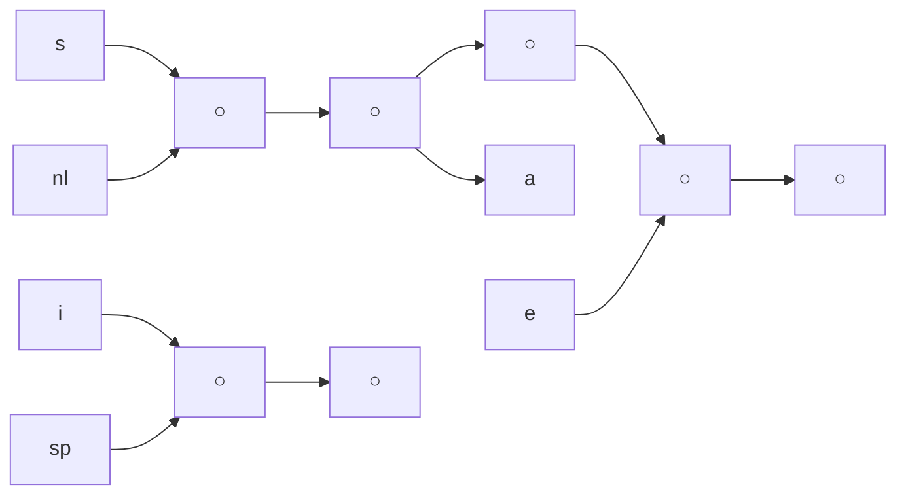
</details>

图10.11 最优前缀码

| 字符 | 代码 | 频率 | 总比特数 |
| --- | --- | --- | --- |
| a | 001 | 10 | 30 |
| e | 01 | 15 | 30 |
| i | 10 | 12 | 24 |
| s | 00000 | 3 | 15 |
| t | 0001 | 4 | 16 |
| 空格 | 11 | 13 | 26 |
| 换行符 | 00001 | 1 | 5 |
| 总计 |  |  | 146 |

图10.12 最优前缀码

注意，存在许多的最优编码。这些编码可以通过交换编码树中的子节点得到。此时，主要的未解决的问题是如何构造编码树。1952年Huffman给出一个算法解决了这个问题。因此，这种编码系统通常称为哈夫曼编码(Hufman code)。

## 哈夫曼算法

本小节将假设字符的个数为 $C$ 。哈夫曼算法(Huffman's algorithm)可以描述如下:算法对由树组成的森林进行。一棵树的权(weight of a tree)等于它的树叶出现的频率的和。任意选取最小权的两棵树 $T_{1}$ 和 $T_{2}$，并任意形成以 $T_{1}$ 和 $T_{2}$ 为子树的新树，将这样的过程进行 $C - 1$ 次。在算法的开始，存在 $C$ 棵单节点树——每个字符一棵。在算法结束时得到一棵树，这棵树就是最优哈夫曼编码树。

我们通过一个具体例子来搞清算法的操作。图10.13表示的是初始的森林，每棵树的权在根处以小号数字标出。将两棵权最低的树合并到一起，由此建立了图10.14中的森林。我们将新的根命名为 $T_{1}$，这样使得进一步的合并可以确切无误地表述。图中我们令s是左儿子，这里，令其为左儿子还是右儿子是任意的；注意可以使用哈夫曼算法描述中的两个任意性。新树的总的权正是两棵老树的权的和，因而也就很容易计算。由于建立新树只需得出一个新节点，建立左指针和右指针并把权记录下来，因此创建新树还是很简单的。


<details>
<summary>text_image</summary>

a 10 e 15 i 12 s 3 t 4 sp 13 nl 1
</details>

图10.13 哈夫曼算法的初始阶段


<details>
<summary>text_image</summary>

a 10
e 15
i 12
t 4
sp 13
T1 4
s
nl
</details>

图 10.14 第一次合并后的哈夫曼算法

现在有 6 棵树，我们再任意选取两棵权最小的树。这两棵树恰好就是 T1 和 t，然后将它们合并成一棵新树，树根在 T2，树的权是 8，见图 10.15。第三步将 T2 和 a 合并建立 T3，其权为  $10 + 8 = 18$ 。图 10.16 所示为这次操作的结果。


<details>
<summary>flowchart</summary>

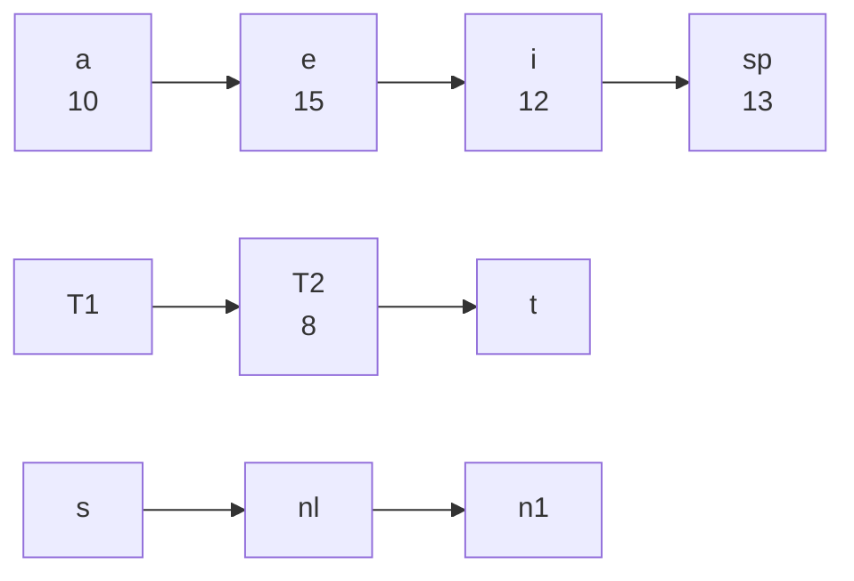
</details>

图 10.15 第二次合并后的哈夫曼算法


<details>
<summary>flowchart</summary>

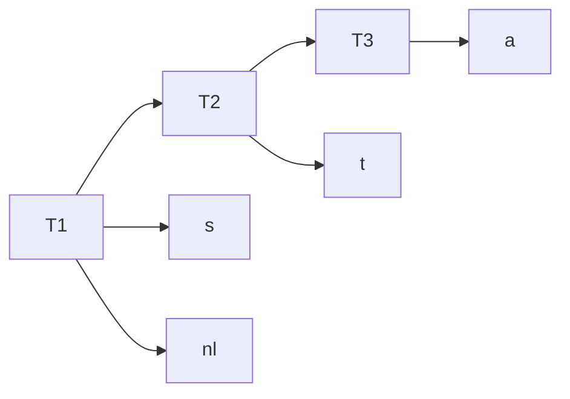
</details>

图 10.16 第三次合并后的哈夫曼算法

在第三次合并完成后，最低权的两棵树是代表 i 和空格的两个单节点树。图 10.17 所示为这两棵树是如何合并成根在 T4 的新树的。第五步是合并根为 e 和 T3 的两棵树，因为这两棵树的权最小。该步结果如图 10.18 所示。


<details>
<summary>flowchart</summary>

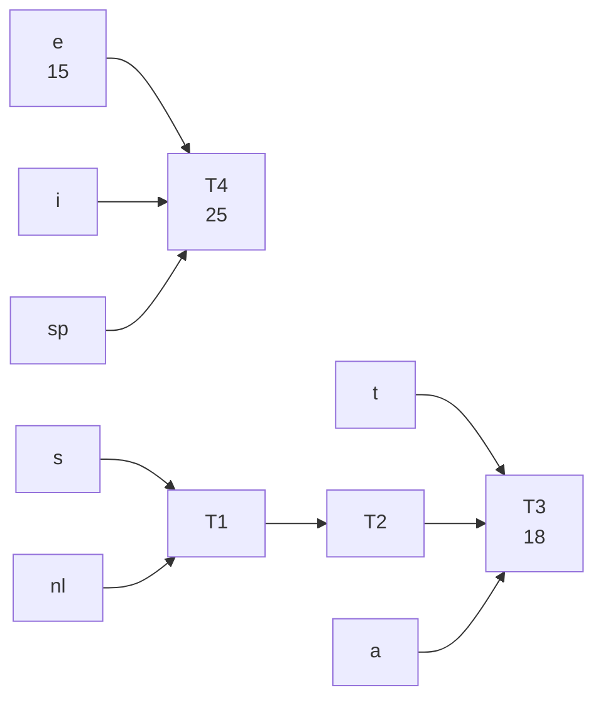
</details>

图 10.17 第四次合并后的哈夫曼算法


<details>
<summary>flowchart</summary>

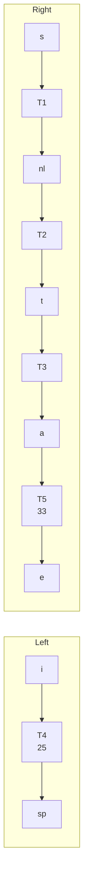
</details>

图 10.18 第五次合并后的哈夫曼算法

最后，将仅有的两棵剩下的树合并得到图 10.11 所示的最优树。图 10.19 画出了这棵最优树，其根在 T6。


<details>
<summary>flowchart</summary>

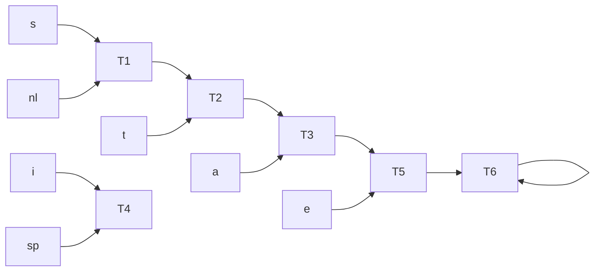
</details>

图 10.19 最后一次合并后的哈夫曼算法

我们将概述哈夫曼算法产生最优代码的证明思路，详细的细节将留作练习。首先，由反证法不难证明树必然是满的，因为我们已经看到一棵不满的树是如何改进成满树的。

其次，我们必须证明两个频率最小的字符 $\alpha$ 和 $\beta$ 必然是两个最深的节点(不过，其他节点也有可能同样的深)。这通过反证法同样容易证明，因为如果 $\alpha$ 或 $\beta$ 不是最深的节点，那么必然存在某个 $\gamma$ 是最深的节点(记住树是满的)。如果 $\alpha$ 的频率小于 $\gamma$ ，那么可以通过交换它们在树中的位置而改进权的值。

然后我们可以论证，在相同深度上任意两个节点处的字符可以交换而不影响最优性。这说明，总可以找到一棵最优树，它含有两个最不经常出现的符号作为兄弟，因此第一步没有错，是成立的。

证明可以通过归纳法论证完成。当树被合并时，我们认为新的字符集是在根上的那些字符。于是，在我们的例子中，经过 4 次合并以后，我们可以把字符集看成由 e 与元字符 (metacharacters) T3 和 T4 组成。这恐怕是证明最巧妙的部分，我们要求读者补足所有的细节。

该算法是贪婪算法的原因在于，在每一阶段我们都进行一次合并而没有进行全局的考虑。我们只是选择两棵最小的树。

如果我们依权排序将这些树保存在一个优先队列中，那么，由于在绝不会有超过 $C$ 个元素的优先队列上将进行一次 buildHeap，2C-2 次 deleteMin，和 $C-2$ 次 insert，因此运行时间为 $O(C \log C)$。若使用一个链表简单实现该队列，则将给出一个 $O(C^2)$ 算法。优先队列实现方法的选择取决于 $C$ 有多大。在 ASCII 字符集的典型情况下，$C$ 是足够小的，这使得二次的运行时间是可以接受的。在这样的应用中，实际上所有的运行时间都将耗费在读进输入文件和写出压缩文件所需要的磁盘 I/O 上。

有两个细节必须要考虑。首先，在压缩文件的开头必须要传送编码信息，因为否则将不可能译码。做这件事有几种方法，见练习 10.4。对于一些小文件，传送编码信息表的开销将超过压缩中任何可能的节省，最后的结果很可能是文件扩大。当然，这可以检测到且原文件可原样保留。对于大型文件，信息表的大小是无关紧要的。

第二个问题正如所描述的，该算法是一个两趟扫描算法。第一趟搜集频率数据，第二趟进行编码。显然，对于处理大型文件的程序来说，这个性质不是我们所希望的。某些另外的做法在参考文献中作了介绍。

## 10.1.3 近似装箱问题

在这一节，我们将考虑某些解决装箱问题(bin packing problem)的算法。这些算法将运行得很快，但未必产生最优解。然而，我们将证明所产生的解距最优解不太远。

设给定 N 项物品，大小为  $s_{1}, s_{2}, \cdots, s_{N}$ ，所有的大小都满足  $0 < s_{i} \leqslant 1$ 。问题是要把这些物品装到最小数目的箱子中去，已知每个箱子的容量是 1 个单位。作为例子，图 10.20 所示为把大小为 0.2, 0.5, 0.4, 0.7, 0.1, 0.3, 0.8 的一列物品最优装箱的方法。

有两种类型的装箱问题。第一种是联机装箱问题(online bin packing problem)。在这种问题中，每一件物品必须放入一个箱子之后才处理下一件物品。第二种是脱机装箱问题(offline bin packing problem)。在一个脱机算法中，我们做任何事都需要等到所有的输入数据全被读入之后才进行。联机算法和脱机算法之间的区别在8.2节讨论过。


<details>
<summary>bar_stacked</summary>

| Category | Value |
| --- | --- |
| B1 | 0.8 |
| B1 | 0.2 |
| B2 | 0.3 |
| B2 | 0.7 |
| B3 | 0.5 |
| B3 | 0.1 |
| B3 | 0.4 |
</details>

图 10.20 对 0.2, 0.5, 0.4, 0.7, 0.1, 0.3, 0.8 的最优装箱

## 联机算法

需要考虑的第一个问题是，一个联机算法即使在允许无限制计算的情况下是否实际上总能给出最优的解答。我们知道，即使允许无限制的计算，联机算法也必须先放入一项物品然后才能处理下一件物品，并且不能改变决定。

为了证明联机算法不总能够给出最优解，我们将给它一组特别难的数据来处理。考虑由大小为 $\frac{1}{2} -\varepsilon$ 的 $M$ 个小项和其后大小为 $\frac{1}{2} +\varepsilon$ 的 $M$ 个大项构成的序列 $I_{1}$ ，其中 $0 <   \varepsilon <  0.01$ 。显然，如果在每个箱子中放一个小项再放一个大项，那么这些项物品可以放入到 $M$ 个箱子中去。假设存在一个最优联机算法A可以进行这项装箱工作。考虑算法A对序列 $I_{2}$ 的操作，该序列只由大小为 $\frac{1}{2} -\varepsilon$ 的 $M$ 个小项组成。 $I_{2}$ 是可以装入 $\lceil M / 2\rceil$ 个箱子中的。然而，由于A对序列 $I_{2}$ 的处理结果必然和对 $I_{1}$ 的前半部分处理结果相同，而 $I_{1}$ 前半部分的输入又跟 $I_{2}$ 的输入完全相同，因此算法A将把每一项物品放到一个单独的箱子内。这说明A将使用 $I_{2}$ 最优解的两倍多的箱子。这样我们就证明了，对于联机装箱问题不存在最优算法。

上面的论述指出，联机算法从不知道输入何时会结束，因此它提供的任何性能保证必须在整个算法的每一瞬时成立。如果我们遵循上述策略，则可以证明下列定理。

## 定理 10.1

存在使得任意联机装箱算法至少使用 $\frac{4}{3}$ 最优箱子数的输入。

## 证明:

假设情况相反，为简单起见设 $M$ 是偶数。考虑任一运行在上面输入序列 $I_{1}$ 上的联机算法A。我们知道，该序列由 $M$ 个小项后接 $M$ 个大项组成。让我们考虑该算法在处理第 $M$ 项后都做了什么。设算法A已经用了 $b$ 个箱子。在算法的这一时刻，箱子的最优个数是 $M / 2$ ，因为我们可以在每个箱子里放入两件物品。于是我们知道，根据我们的好于 $\frac{4}{3}$ 的性能保证的假设，$2b / M < \frac{4}{3}$ 。

现在考虑在所有的物品都被装箱后算法A的性能。在第 $b$ 个箱子之后开辟的所有箱子每箱恰好包含一项物品，因为所有小物品都被放在了前 $b$ 个箱子中，而两个大项物品又装不进一个箱子中去。由于前 $b$ 个箱子每箱最多能有两项物品，而其余的箱子每箱都有一项物品，

因此我们看到，将 $2M$ 项物品装箱将至少需要 $2M - b$ 个箱子。但 $2M$ 项物品可以用 $M$ 个箱子最优装箱，因此我们的性能保障保证得到 $(2M - b) / M < \frac{4}{3}$ 。

第一个不等式意味着 $b / M < \frac{2}{3}$，而第二个不等式意味着 $b / M > \frac{2}{3}$，这是矛盾的。因此，没有联机算法能够保证使用小于 $\frac{4}{3}$ 的最优装箱数完成装箱。

有 3 种简单算法保证所用的箱子数不多于 2 倍的最优装箱数。也有颇多更为复杂的算法能够得到更好的结果。

## 下项适合算法

大概最简单的算法就属下项适合算法(next fit)了。当处理任何一项物品时，我们检查看它是否还能装进刚刚装进物品的同一个箱子中去。如果能够装进去，那么就把它放入该箱中；否则，就开辟一个新的箱子。这个算法实现起来出奇地简单，而且还以线性时间运行。图10.21显示对于与图10.20相同的输入所得到的装箱过程。

下项适合算法不仅编程简单，而且它的最坏情形的行为也容易分析。


<details>
<summary>bar_stacked</summary>

| Category | Segment 1 | Segment 2 | Segment 3 |
| --- | --- | --- | --- |
| B1 | 0.2 | 0.5 | 空 |
| B2 | 0.4 | 空 | — |
| B3 | — | 0.7 | 空 |
| B4 | — | 0.3 | 空 |
| B5 | — | — | 空 |
</details>

图10.21 对 $0.2, 0.5, 0.4, 0.7, 0.1, 0.3, 0.8$ 的下项适合算法

## 定理10.2

令 $M$ 是将一列物品 $I$ 装箱所需的最优装箱数，则下项适合算法所用箱子数绝不超过 $2M$。存在一些顺序使得下项适合算法用箱 $2M - 2$ 个。

## 证明:

考虑任何相邻的两个箱子 $B_{j}$ 和 $B_{j + 1}$ 。 $B_{j}$ 和 $B_{j + 1}$ 中所有物品的大小之和必然大于1，因为否则所有这些物品就会全部放入 $B_{j}$ 中。如果将该结果用于所有相邻的两个箱子，那么我们看到，顶多有一半的空间闲置。因此，下项适合算法最多使用2倍的最优箱子数。

为说明这个比率2是精确的，设 $N$ 项物品大小当 $i$ 是奇数时 $s_i = 0.5$ 而当 $i$ 是偶数时 $s_i = 2 / N$ 设 $N$ 可被4整除。图10.22所示的最优装箱由每个含有2件大小为0.5的物品的 $N / 4$ 个箱子，和一个含有 $N / 2$ 件大小为 $2 / N$ 的物品的箱子组成，总数为 $(N / 4) + 1$ 。图10.23表示下项适合算法使用 $N / 2$ 个箱子。因此，下项适合算法可以用到几乎2倍于最优装箱数的箱子。

## 首次适合算法

虽然下项适合算法有一个合理的性能保证，但是，它的效果在实践中却很差，因为在不需要开辟新箱子的时候它开辟了新箱子。在前面样例的运作中，本可以把大小为0.3的物品放入 $B_{1}$ 或 $B_{2}$ 而不是开辟一个新箱子。


<details>
<summary>text_image</summary>

0.5
0.5
B₁
0.5
B₂
...
0.5
Bₙ/₄
0.5
Bₙ/₄₊₁
2/N
2/N
2/N
...
2/N
2/N
2/N
空
空
2/N
0.5
0.5
B₁
B₂
...
空
2/N
0.5
Bₙ/₂
</details>

图 10.22 对 0.5, 2/N, 0.5, 2/N, 0.5, 2/N…的最优装箱方法

图 10.23 对 0.5, 2/N, 0.5, 2/N, 0.5, 2/N…的下项适合装箱法

首次适合算法(first fit)的策略是依序扫描这些箱子,并把新的一项物品放入足能盛下它的第一个箱子中。因此,只有当前面那些放置物品的箱子都容不下当前物品的时候,我们才开辟一个新箱子。图10.24显示对我们的标准输入进行首次适合算法的装箱结果。

实现首次适合算法的一个简单方法，是通过顺序扫描箱子序列处理每一项物品，这将花费  $O(N^{2})$  时间。有可能以  $O(N \log N)$  运行来实现首次适合算法，我们把它留作练习。

略加思索读者即可明白，在任一时刻最多有一个箱子其空出的部分大于箱子的一半，因为若有第二个这样的也空一半的箱子，则它的内容物就会装到第一个这样的箱子中了。因此我们可以立即断言:首次适合算法保证其解最多包含2倍的最优装箱数。

另一方面，我们在证明下项适合算法性能的界时所用到的最坏情况对首次适合算法不适用。因此，人们可能要问:是否能够证明更好的界呢？答案是肯定的，不过证明很复杂。

## 定理 10.3

令 $M$ 是将一列物品 $I$ 装箱所需要的最优箱子数，则首次适合算法使用的箱子数绝不多于 $\frac{17}{10} M + \frac{7}{10}$ 。存在使得首次适合算法使用 $\frac{17}{10}(M - 1)$ 个箱子的序列。

证明:

参阅本章末尾的参考文献。

一个由首次适合算法算出的例子如图 10.25 所示, 其结果和上面定理指出的结果几乎一样的差。图中的输入由 $6M$ 个大小为 $\frac{1}{7} + \varepsilon$ 的项, 后跟 $6M$ 个大小为 $\frac{1}{3} + \varepsilon$ 的项, 以及接续其后的 $6M$ 个大小为 $\frac{1}{2} + \varepsilon$ 的项组成。一种简单的装箱办法是将每种大小的各一项物品装到一个箱子中, 总共需要 $6M$ 个箱子。如用首次适合算法, 则需要 $10M$ 个箱子。


<details>
<summary>text_image</summary>

空
0.1
0.5
0.2
B₁
空
0.3
0.4
B₂
空
0.7
B₃
空
0.8
B₄
空
1/7+ε
1/7+ε
1/7+ε
1/7+ε
1/7+ε
B₁→BM
...
空
1/3+ε
1/3+ε
...
BM+1→BM
...
空
1/2+ε
B₄M+1→BM
</details>

图 10.24 对 0.2, 0.5, 0.4, 0.7, 0.1, 0.3, 0.8 的首次适合算法

图10.25 首次适合算法使用 $10M$ 个而不是 $6M$ 个箱子的情形

当首次适合算法对大量其大小均匀分布在 0 和 1 之间的物品进行运作时，经验结果指出，首次适合算法用到大约比最优装箱方法多 2% 的箱子。在许多情况下，这是完全可以接受的。

## 最佳适合算法

我们将要考查的第三种联机策略是最佳适合算法(best fit)。该法不是把一项新物品放入所发现的第一个能够容纳它的箱子，而是放到所有箱子中能够容纳它的最满的箱子中。典型的装箱方法如图10.26所示。

注意，大小为0.3的项不是放在 $B_{2}$ 而是放在了 $B_{3}$，此时它正好把 $B_{3}$ 填满。由于我们现在对箱子进行更细致的选择，因此人们可能认为算法性能保障会有所改善。但是情况并非如此，因为一般的坏情形是相同的。最佳适合算法绝不会超过最优算法的大约1.7倍，而且存在一些输入，对于这些输入该算法(几乎)达到这个界。不过，最佳适合算法编程还是简单的，特别是当需要 $O(N\log N)$ 算法的时候，而且该算法对随机的输入确实表现得更好。

## 脱机算法

如果能够通过观察全部物品以后再算出答案，那么我们应该会做得更好。事实也确实如此，由于通过彻底的搜索能够最终找到最优装箱方法，因此我们对联机情形已经有了理论上的改进。

所有联机算法的主要问题在于将大项物品装箱困难，特别是当它们在输入的后期出现时。围绕这个问题的自然方法是将各项物品排序，把最大的物品放在最先。此时可以应用首次适合算法或最佳适合算法，分别得到首次适合递减算法(first fit decreasing)和最佳适合递减算法(best fit decreasing)。图10.27指出在我们的例子中这会产生最优解(尽管在一般的情形下当然未必会如此)。


<details>
<summary>bar_stacked</summary>

| Block | Value |
| --- | --- |
| B1 (Top) | 0.1 |
| B1 (Bottom) | 0.5 |
| B1 (Bottom) | 0.2 |
| B2 (Top) | 空 |
| B2 (Bottom) | 0.4 |
| B3 (Top) | 0.3 |
| B3 (Bottom) | 0.7 |
| B4 (Top) | 空 |
| B4 (Bottom) | 0.8 |
</details>

图 10.26 对 0.2, 0.5, 0.4, 0.7, 0.1, 0.3, 0.8 的最佳适合算法


<details>
<summary>bar_stacked</summary>

| Category | Value |
| --- | --- |
| B1 | 0.2 |
| B1 | 0.8 |
| B2 | 0.3 |
| B2 | 0.7 |
| B3 | 0.1 |
| B3 | 0.4 |
| B3 | 0.5 |
</details>

图 10.27 对 0.8, 0.7, 0.5, 0.4, 0.3,
0.2, 0.1 的首次适合算法

本小节我们将处理首次适合递减算法。对于最佳适合递减算法，结果几乎是一样的。由于存在物品大小不是互异的可能，因此有些作者更愿意把首次适合递减算法叫作首次适合非增算法(first fit nonincreasing)。我们将沿用原始的名称。不失一般性，我们还要假设输入数据的大小已经被排序。

我们能够做的第一个评注是，首次适合算法使用 $10M$ 个而不是 $6M$ 个箱子的坏情形，对物品的各项被排序时不再适用。我们将证明，如果一种最优装箱法使用 $M$ 个箱子，那么首次适合递减算法使用的箱子数绝不超过 $(4M + 1)/3$。

这个结论依赖于两个观察结果。首先，所有权重大于 $\frac{1}{3}$ 的项将被放入前 $M$ 个箱子内。这意味着，在这 $M$ 个箱子之外附加的箱子中所有各项的权重最多是 $\frac{1}{3}$ 。第二个结果是，在附加箱子中物品的项数最多可以是 $M - 1$ 。把这两个结果结合起来我们发现，附加的箱子最多可能需要 $\lceil (M - 1) / 3 \rceil$ 个。现在我们证明这两个观察结果。

## 引理10.1

令 N 项物品的输入大小 (以递减顺序排序) 分别为  $s_{1}, s_{2}, \cdots, s_{N}$ ，并设最优装箱方法使用 M 个箱子。那么，首次适合递减算法放到 M 个箱子之外的附加箱子中的每件物品的大小最多为  $\frac{1}{3}$ 。

## 证明:

设第 $i$ 项物品是放入第 $M + 1$ 个箱子中的第一项。需要证明 $s_i \leqslant \frac{1}{3}$ 。我们将使用反证法证明这个结论。假设 $s_i > \frac{1}{3}$ 。

由于这些物品的大小是以排好序的顺序排列的，因此， $S_{1}, S_{2}, \cdots, S_{i-1} > \frac{1}{3}$ 。由此得知，所有的箱子 $B_{1}, B_{2}, \cdots, B_{M}$ 每个最多只有两项物品。

考虑在第 $i - 1$ 项物品被放入一个箱子后但第 $i$ 项物品尚未放入时系统的状态。现在我们想要证明(在 $s_i > \frac{1}{3}$ 的假设下)前 $M$ 个箱子排列如下:首先是有些箱子内恰好有一项物品，然后剩下的箱子内有两项物品。

设有两个箱子 $B_{x}$ 和 $B_{y}$ 使得 $1 \leqslant x < y \leqslant M$，其中 $B_{x}$ 有两项而 $B_{y}$ 有一项。令 $x_{1}$ 和 $x_{2}$ 是 $B_{x}$ 中的两项物品，并令 $y_{1}$ 是 $B_{y}$ 中的那一项物品。$x_{1} \geqslant y_{1}$，因为 $x_{1}$ 被放在较前的箱子中。根据类似的推理 $x_{2} \geqslant s_{i}$。因此，$x_{1} + x_{2} \geqslant y_{1} + s_{i}$。这意味着 $s_{i}$ 是应该可以放在 $B_{y}$ 中的。根据我们的假设，这是不可能的。因此，如果 $s_{i} > \frac{1}{3}$，那么在试图处理 $s_{i}$ 时，我们安排前 $M$ 个箱子使得前 $j$ 个箱子各装一项物品，而后 $M - j$ 个箱子各放两项物品。

为了证明该引理，我们将证明不存在将所有物品装入 $M$ 个箱子的方法，这和引理的假设矛盾。

显然，在 $s_1, s_2, \cdots, s_j$ 中使用任何算法都没有两项可以放入一个箱子中，因为如果能放，那么首次适合算法也能放。我们还知道，首次适合算法尚未把大小为 $s_{j+1}, s_{j+2}, \cdots, s_i$ 中的任一项放入前 $j$ 个箱子中，因此它们都不能再往前 $j$ 个箱子中放。这样，在任何装箱方法中，特别是最优装箱方法中，必然存在 $j$ 个箱子不包含这些项。由此可知，大小为 $s_{j+1}, s_{j+2}, \cdots, s_{i-1}$ 的项必然包含在其后的 $M-j$ 个箱子的某个集合中，考虑到前面的讨论，于是这些项的总数为 $2(M-j)$ 。①

注意, 如果 $s_i > \frac{1}{3}$, 那么只要证明 $s_i$ 没有办法放入这 $M$ 个箱子当中的任一个中去, 该引理的证明也就完成了。事实上, 显然它不能放入前 $j$ 个箱子中去, 因为假如能放入, 那么首次适合算法也能够这么做。为把它放入剩下的 $M - j$ 个箱子之一中, 需要把 $2(M - j) + 1$ 项物品分发到这 $M - j$ 个箱子中。因此, 某个箱子就不得不装入 3 件物品, 而它们中的每一件又都大于 $\frac{1}{3}$, 很明显, 这是不可能的。

<small><span class="docvortex-page-footnote" data-block-type="page_footnote" style="color:#6b7280">① 回忆首次适合算法把这些项物品装入 $M - j$ 个箱子并在每个箱子中放入两项物品，因此有 $2(M - j)$ 项。</span></small>

这与所有大小的物品都能够装入 $M$ 个箱子的事实矛盾，因此开始的假设肯定是不正确的，从而 $s_i \leqslant \frac{1}{3}$。

## 引理 10.2

放入附加箱子中的物品的个数最多是 $M - 1$。

证明:

假设放入附加箱子中的物品至少有 $M$ 个。我们知道 $\sum_{i=1}^{N} s_i \leqslant M$，因为所有的物品都可装入 $M$ 个箱子。设对于 $1 \leqslant j \leqslant M$，箱子 $B_j$ 装填的总量为 $W_j$。设前 $M$ 个附加箱子中的物品大小为 $x_1, x_2, \dots, x_M$。此时，由于前 $M$ 个箱子中的项加上前 $M$ 个附加箱子中的项是所有的项的一个子集，于是

$$
\sum_ {i = 1} ^ {N} s _ {i} \geqslant \sum_ {j = 1} ^ {M} W _ {j} + \sum_ {j = 1} ^ {M} x _ {j} = \sum_ {j = 1} ^ {M} (W _ {j} + x _ {j})
$$

现在 $W_{j} + x_{j} > 1$ ，因为否则对应于 $x_{j}$ 的项就已经放入 $B_{j}$ 中。因此

$$
\sum_ {i = 1} ^ {N} s _ {i} > \sum_ {j = 1} ^ {M} 1 > M
$$

若这 $N$ 项物品能被装入 $M$ 个箱子中，则上式不可能成立。因此，最多只能有 $M - 1$ 项放入附加箱子的物品。

## 定理10.4

令 $M$ 是将物品集 $I$ 装箱所需的最优箱子数, 则首次适合递减算法所用箱子数绝不超过 $(4M + 1)/3$。

证明:

最多存在 $M - 1$ 项附加箱子的物品，其每件的大小至多为 $\frac{1}{3}$ 。因此，最多可能存在 $\lceil (M - 1) / 3 \rceil$ 个其余的箱子。从而，由首次适合递减算法使用的箱子总数最多为 $\lceil (4M - 1) / 3 \rceil \leqslant (4M + 1) / 3$ 。

对于首次适合递减算法和下项适合递减算法都能够证明一个紧得多的界。

## 定理 10.5

令 $M$ 是将物品集 $I$ 装箱所需的最优箱子数，则首次适合递减算法所用箱子数绝不超过 $\frac{11}{9} M + \frac{6}{9}$ 。此外，存在使得首次适合递减算法用到 $\frac{11}{9} M + \frac{6}{9}$ 个箱子的序列。

证明:

上界需要非常复杂的分析。下界可以通过下述序列展示:先是大小为 $\frac{1}{2} +\varepsilon$ 的 $6k + 4$ 项，其后是大小为 $\frac{1}{4} +2\varepsilon$ 的 $6k + 4$ 项，接着是 $\frac{1}{4} +\varepsilon$ 的 $6k + 4$ 项，最后是大小为 $\frac{1}{4} -2\varepsilon$ 的 $12k + 8$ 项物品。图10.28指出最优装箱需要 $9k + 6$ 个箱子，但首次适合递减算法却用到 $12k + 8$ 个箱子。置 $M = 9k + 6$ ，由此得到定理的结果。

在实践中，首次适合递减算法的效果非常理想。如果物品大小在单位区间均匀选择，那么附加箱子的期望个数为 $\Theta (\sqrt{M})$ 。装箱算法是简单贪婪试探算法能够给出好结果的一个理想的实例。


<details>
<summary>text_image</summary>

最优装箱
1/4 - 2ε
1/4 + ε
1/2 + ε
B₁→B₆k+4
1/4 - 2ε
1/4 - 2ε
1/4 + 2ε
1/4 + 2ε
B₆k+5 → B₉k+6
空
1/4 + 2ε
1/2 + ε
B₁→B₆k+4
空
1/4 + ε
1/4 + ε
1/4 + ε
B₆k+5 → B₈k+5
空
1/4 - 2ε
1/4 - 2ε
B₈k+6
1/4 - 2ε
1/4 - 2ε
B₈k+7 → B₁₁k+7
空
1/4 - 2ε
B₁₁k+8
</details>

图10.28 首次适合递减算法使用 $11k + 8$ 个箱子，但只有 $9k + 6$ 个箱子就足够完成装箱的例子

## 10.2 分治算法

用于设计算法的另一种常用技巧为分治算法(divide and conquer)。分治算法由两部分组成:

分(divide): 递归解决较小的问题(当然, 基准情况除外)。

治(conquer): 然后, 从子问题的解构建原问题的解。

传统上，在其代码中至少含有两个递归调用的例程叫作分治算法，而代码中只含一个递归调用的例程不是分治算法。我们一般坚持子问题是不相交的(即基本上不重叠)。让我们回顾前文涉及到的某些递归算法。

我们已经看到几个分治算法。在2.4.3节，我们见过最大子序列和问题的一个 $O(N\log N)$ 解法。在第4章，我们看到一些线性时间的树的遍历方法。在第7章，我们见过分治算法的经典例子，即归并排序和快速排序，它们分别有 $O(N\log N)$ 的最坏情形以及平均情形的时间界。

我们还看到了一些递归算法的若干例子，在分类上它们很可能不算作分治算法，而只是化简到一个更简单的情况。在1.3节，我们看到过打印一个数的简单例程。在第2章，我们使用递归执行有效的取幂运算。在第4章，我们考察了二叉查找树一些简单的搜索例程。在6.6节，我们见过用于合并左式堆的简单的递归。在7.7节给出了一个花费线性平均时间解决选择问题的算法。第8章递归地写出了不相交集的find操作。第9章指出以Dijkstra算法重新找出最短路径的一些例程，以及对图进行深度优先搜索的其他过程。这些算法实际上都不是分治算法，因为只进行了一个递归调用。

我们在 2.4 节还看到计算斐波那契数的很差的递归例程。它倒是可以称为分治算法，但效率太低了，因为问题实际上根本没有被分割。

在这一节，我们将看到分治算法范例更多的实例。我们的第一个应用是计算几何(computational geometry)中的问题。给定平面上的 $N$ 个点，我们将证明最近的一对点可以在 $O(N \log N)$ 时间找到。本章后面的一些练习描述了计算几何中的另外一些问题，它们可以用分治算法求解。本节其余部分介绍极其有趣但主要是理论上的一些结果。我们提供一个算法以 $O(N)$ 最坏情形时间解决选择问题。我们还要证明，可以用 $o(N^2)$ 次操作将 2 个 $N$ 比特位的数相乘，并以 $o(N^3)$ 次操作将两个 $N \times N$ 矩阵相乘。遗憾的是，尽管这些算法比传统算法有着更好的最坏情形时间界，但除了对于非常庞大的输入外它们都并不实用。

## 10.2.1 分治算法的运行时间

我们将要看到的所有有效的分治算法都是把问题分成一些子问题，每个子问题都是原问题的一部分，然后进行某些附加的工作以算出最后的答案。作为一个例子，我们已经看到归并排序对两个问题进行运算，每个问题均为原问题大小的一半，然后用到 $O(N)$ 的附加工作。由此得到运行时间方程(带有适当的初始条件):

$$
T (N) = 2 T (N / 2) + O (N)
$$

我们在第 7 章看到，该方程的解为  $O(N \log N)$ 。下面的定理可以用来确定大部分分治算法的运行时间。

定理 10.6

方程 $T(N) = aT(N / b) + \Theta (N^k)$ 的解为

$$
T (N) = \left\{ \begin{array}{l l} O (N ^ {\log_ {b} a}) & \text {若} a > b ^ {k} \\ O (N ^ {k} \log N) & \text {若} a = b ^ {k} \\ O (N ^ {k}) & \text {若} a <   b ^ {k} \end{array} \right.
$$

其中 $a \geqslant 1$ 以及 $b > 1$。

证明:

根据第7章归并排序的分析，我们将假设 $N$ 是 $b$ 的幂。于是，可令 $N = b^{m}$ 。此时 $N / b = b^{m - 1}$ 及 $N^{k} = (b^{m})^{k} = b^{mk} = b^{km} = (b^{k})^{m}$ 。让我们假设 $T(1) = 1$ ，并忽略 $\Theta(N^k)$ 中的常数因子，则有

$$
T (b ^ {m}) = a T (b ^ {m - 1}) + (b ^ {k}) ^ {m}
$$

如果用 $a^m$ 除两边，则得到方程:

$$
\frac {T (b ^ {m})}{a ^ {m}} = \frac {T (b ^ {m - 1})}{a ^ {m - 1}} + \left\{\frac {b ^ {k}}{a} \right\} ^ {m} \tag {10.3}
$$

可以对 $m$ 的其他值应用该方程，得到

$$
\frac {T (b ^ {m} - 1)}{a ^ {m - 1}} = \frac {T (b ^ {m - 2})}{a ^ {m - 2}} + \left\{\frac {b ^ {k}}{a} \right\} ^ {m - 1} \tag {10.4}
$$

$$
\frac {T (b ^ {m} - 2)}{a ^ {m - 2}} = \frac {T (b ^ {m - 3})}{a ^ {m - 3}} + \left\{\frac {b ^ {k}}{a} \right\} ^ {m - 2} \tag {10.5}
$$

: : :

$$
\frac {T (b ^ {1})}{a ^ {1}} = \frac {T (b ^ {0})}{a ^ {0}} + \left\{\frac {b ^ {k}}{a} \right\} ^ {1} \tag {10.6}
$$

我们使用将式(10.3)～式(10.6)叠缩方程两边分别加起来的标准技巧，等号左边的所有项实际上与等号右边的前一项相消，由此得到

$$
\frac {T (b ^ {m})}{a ^ {m}} = 1 + \sum_ {i = 1} ^ {m} \left\{\frac {b ^ {k}}{a} \right\} ^ {i} \tag {10.7}
$$

$$
= \sum_ {i = 0} ^ {m} \left\{\frac {b ^ {k}}{a} \right\} ^ {i} \tag {10.8}
$$

因此

$$
T (N) = T (b ^ {m}) = a ^ {m} \sum_ {i = 0} ^ {m} \left\{\frac {b ^ {k}}{a} \right\} ^ {i} \tag {10.9}
$$

如果 $a > b^{k}$, 那么和就是一个公比小于 1 的几何级数。由于无穷级数的和收敛于一个常数, 因此该有限和也以一个常数为界, 从而式 (10.10) 成立:

$$
T (N) = O \left(a ^ {m}\right) = O \left(a ^ {\log_ {b} N}\right) = O \left(N ^ {\log_ {b} a}\right) \tag {10.10}
$$

如果 $a = b^{k}$，那么和中的每一项均为1。由于和含有 $1 + \log_b N$ 项而 $a = b^k$ 意味着 $\log_b a = k$，于是

$$
\begin{array}{l} T (N) = O \left(a ^ {m} \log_ {b} N\right) = O \left(N ^ {\log_ {b} a} \log_ {b} N\right) = O \left(N ^ {k} \log_ {b} N\right) \tag {10.11} \\ = O (N ^ {k} \log N) \\ \end{array}
$$

最后，如果 $a < b^{k}$，那么该几何级数中的项都大于1，且1.2.3节中的第二个公式成立。我们得到

$$
T (N) = a ^ {m} \frac {(b ^ {k} / a) ^ {m + 1} - 1}{(b ^ {k} / a) - 1} = O (a ^ {m} (b ^ {k} / a) ^ {m}) = O ((b ^ {k}) ^ {m}) = O (N ^ {k}) \tag {10.12}
$$

定理的最后一种情形得证。

例如，归并排序有 $a = b = 2$ 且 $k = 1$ 。第二种情形成立，因此答案为 $O(N\log N)$ 。如果我们求解3个问题，每个问题都是原始大小的一半，使用 $O(N)$ 的附加工作将各解联合起来，则 $a = 3, b = 2$ 而 $k = 1$ 。此处情形1成立，于是得到界 $O(N^{\log_23}) = O(N^{1.59})$ 。求解3个一半大小的问题但需要 $O(N^2)$ 工作以合并解的算法，其运行时间将是 $O(N^2)$，因为此时第三种情形成立。

有两个重要的情形定理 10.6 没有包括。我们再叙述两个定理，但把证明留作练习。定理 10.7 推广了前面的定理。

定理 10.7

方程 $T(N) = aT(N / b) + \Theta (N^k\log^p N)$ 的解为

$$
T (N) = \left\{ \begin{array}{l l} O (N ^ {\log_ {b} a}) & \text {若} a > b ^ {k} \\ O (N ^ {k} \log^ {p + 1} N) & \text {若} a = b ^ {k} \\ O (N ^ {k} \log^ {p} N) & \text {若} a <   b ^ {k} \end{array} \right.
$$

其中  $a \geqslant 1$ ，b > 1 且  $p \geqslant 0$ 。

定理 10.8

如果 $\sum_{i=1}^{k} \alpha_i < 1$，则方程 $T(N) = \sum_{i=1}^{k} T(\alpha_i N) + O(N)$ 的解为 $T(N) = O(N)$。

## 10.2.2 最近点问题

这里，第一个问题的输入是平面上的点集 $P$ 。如果 $p_1 = (x_1, y_1)$ 和 $p_2 = (x_2, y_2)$，那么 $p_1$ 和 $p_2$ 间的欧几里得距离为 $\left[(x_1 - x_2)^2 + (y_1 - y_2)^2\right]^{1/2}$ 。我们需要找出一对最近的点。有可能两个点位于相同的位置。在这种情形下这两个点就是最近的，它们的距离为零。

如果存在 $N$ 个点，那么就存在 $N(N - 1) / 2$ 对点间的距离。我们可以检查所有这些距离，得到一个很短的程序，不过这是一个花费 $O(N^2)$ 的算法。由于这种方法就是一种穷举搜索的方法，因此我们应该期望能够做得更好一些。

假设平面上这些点已经按照 x 的坐标排过序，这只不过顶多在最后的时间界上仅多加了  $O(N \log N)$  而已。由于将证明整个算法的  $O(N \log N)$  界，因此从复杂度的观点来看，该排序基本上没增加运行时间消耗的级别。

图 10.29 画出一个小的样本点集 P。既然这些点已按 x 坐标排序，那么我们就可以画一条想象的垂线，把点集分成两半: $P_{L}$  和  $P_{R}$ 。这做起来当然简单。现在得到的情形几乎和我们在 2.4.3 节的最大子序列和问题中见过的情形完全相同。最近的一对点或者都在  $P_{L}$  中，或者都在  $P_{R}$  中，或者一个点在  $P_{L}$  中而另一个在  $P_{R}$  中。让我们


<details>
<summary>natural_image</summary>

Abstract pattern of scattered circles on white background (no text or symbols)
</details>

图10.29 一个小规模的点集

把这3个距离分别叫作 $d_{L}$ 、 $d_R$ 和 $d_{C}$ 。图10.30显示出点集的划分和这3个距离。

我们可以递归地计算 $d_{L}$ 和 $d_{R}$ 。然后，问题就是计算 $d_{C}$ 。由于想要一个 $O(N\log N)$ 的解，因此必须能够只用 $O(N)$ 的附加工作计算出 $d_{C}$ 。我们已经看到，如果一个过程由两个一半大小的递归调用和附加的 $O(N)$ 工作组成，那么总的时间将是 $O(N\log N)$ 。

令 $\delta = \min (d_L, d_R)$ 。我们的第一个观察结果是，如果 $d_C$ 对 $\delta$ 有所改进，那么只需计算 $d_C$。如果 $d_C$ 是这样的一个距离，则决定 $d_C$ 的两个点必然在分割线的 $\delta$ 距离之内。我们将把这个条形区域叫作带 (strip)。如图 10.31 所示，这个观察结果消减了需要考虑的点的个数（此例中的 $\delta = d_R$）。


<details>
<summary>text_image</summary>

dL
dC
dR
</details>

图 10.30 被分成  $P_{L}$  和  $P_{R}$  的点集 P；图中显示了最短的距离


<details>
<summary>text_image</summary>

dL
p1 o p2
p3 o p4
dR
p5
p6 p7
δ δ
</details>

图 10.31 双道带区域，包含对于  $d_{C}$  带所考虑的全部点

有两种方法可以用来计算 $d_{C}$ 。对于均匀分布的大型点集，预计位于该带中的点的个数是非常少的。事实上，容易论证，平均只有 $O(\sqrt{N})$ 个点在这个带中。因此，我们可以以 $O(N)$ 时间对这些点进行蛮力计算。图10.32中的伪代码实现了该想法，其中按照 $\mathbf{C}++$ 语言的约定，点的下标从0开始。

<div class="docvortex-algorithm" style="white-space: pre-wrap; font-family:monospace;">
// 代码中涉及的点均位于上述带状区域内
for( i = 0; i &lt; numPointsInStrip; i++ )
    for( j = i + 1; j &lt; numPointsInStrip; j++ )
        if( dist(pi, pj) &lt; δ )
            δ = dist(pi, pj);
</div>

图 10.32 min ( $\delta, d_{C}$ ) 的蛮力计算

在最坏情形下，所有的点可能都在这条带状区域内，因此这种方法不总能以线性时间运行。我们可以用下列的观察结果改进这个算法:确定 $d_{C}$ 的两个点的 $y$ 坐标之间相差最多是 $\delta$ 否则就会有 $d_{C} > \delta$ 。设带中的点按照它们的 $y$ 坐标排序。因此，如果 $p_i$ 和 $p_j$ 的 $y$ 坐标相差大于 $\delta$ ，则可以再去继续处理 $p_{i+1}$ 。图10.33实现了这个简单的修改。

// 代码中涉及的点均位于上述带状区域内，并且按坐标 y 排序

<div class="docvortex-algorithm" style="white-space: pre-wrap; font-family:monospace;">
for( i = 0; i &lt; numPointsInStrip; i++ )
    for( j = i + 1; j &lt; numPointsInStrip; j++ )
        if( p_i and p_j's y-coordinates differ by more than δ )
            break;          // 转向下一个 p_i.
        else
        if( dist(p_i, p_j) &lt; δ )
            δ = dist(p_i, p_j);
</div>

图 10.33  $\min(\delta, d_{C})$  的精化计算

这样的附加测试对运行时间有着显著的影响，因为对于每一个 $p_i$ ，在 $p_i$ 和 $p_j$ 的 $y$ 坐标相差大于 $\delta$ 并被迫退出内层for循环以前，只有少数的 $p_j$ 点被考查。例如，图10.34显示对于点 $p_3$ 只有两个点 $p_4$ 和 $p_5$ 落在垂直距离 $\delta$ 之内的带状区域中。

对于任意的点 $p_i$，在最坏的情形下最多有7个 $p_j$ 点被考虑。这是因为这些点必定落在该带状区域左半部分的 $\delta \times \delta$ 方块内或者落在该带状区域右半部分的 $\delta \times \delta$ 方块内。另一方面，在每个 $\delta \times \delta$ 方块内的所有这些点至少远离 $\delta$。在最坏的情形下，每个方块包含4个点，每个角上一个点。这些点中有一个是 $p_i$，最多还剩下7个点要考虑。最坏情形的状况如图10.35所示。注意，即使 $p_{L2}$ 和 $p_{R1}$ 有相同的坐标，但它们还可能是不同的点。对于具体的分析来说，唯一重要的是 $\lambda \times 2\lambda$ 的矩形区域中的点的个数为 $O(1)$，显然这很清楚。


<details>
<summary>text_image</summary>

p₁
p₂
p₃
p₄
dR
δ
p₅
p₆
p₇
δ
δ
</details>

图10.34 在第二个for循环内只有 $p_4$ 和 $p_5$ 被考虑

因为对于每个 $p_i$ 最多有7个点要考虑，所以计算比 $\delta$ 好的 $d_C$ 的时间是 $O(N)$ 。因此，基于两个一半大小的递归调用，外加联合两个结果的线性附加工作，看来我们似乎对最近点问题有一个 $O(N\log N)$ 解。然而，现在还没有真正得到 $O(N\log N)$ 的解。