位置的值被存储了，那么一个位置在第二次出现时就不必再重新计算，它基本上变成了一个终端位置。记录这些信息的数据结构叫作置换表(transposition table)，它几乎总可通过散列来实现。在许多场合，这可以节省大量的计算。例如，在一盘棋的残局阶段，此时相对来说只有很少的棋子，时间的节省使得一步搜索可以进行到更深的若干层。

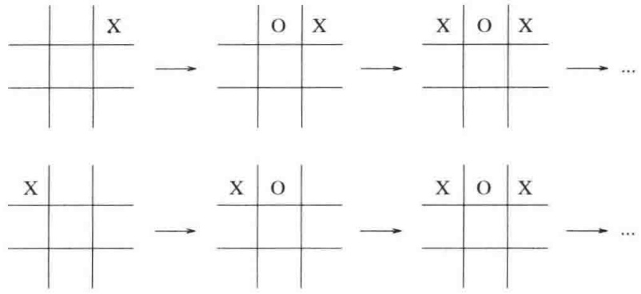

<details>
<summary>text_image</summary>

X
O X
X O X
...
X
O
X O X
...
</details>

图 10.69 到达同一位置的两种搜索

## $\alpha - \beta$ 裁剪

对于可能取得的最显著的改进一般称为 $\alpha -\beta$ 裁剪（ $\alpha -\beta$ pruning）。图10.70显示在一盘假想的棋局中用于给某个假设的位置求值的一些递归调用的踪迹。通常称之为博弈树（game tree）。（到现在为止我们一直回避使用这个术语，因为它多少有些误导:算法实际上并不构造任何的树。博弈树只是一个抽象的概念。）这棵博弈树的值为44。

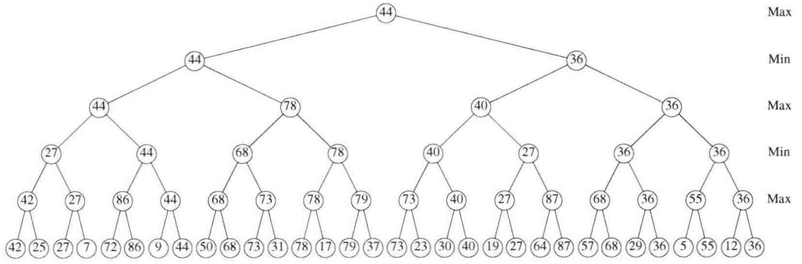

<details>
<summary>dendrogram</summary>

| Node ID | Value |
| --- | --- |
| 42 | 42 |
| 42 | 25 |
| 42 | 7 |
| 42 | 72 |
| 42 | 86 |
| 42 | 9 |
| 42 | 44 |
| 42 | 50 |
| 42 | 68 |
| 42 | 73 |
| 42 | 31 |
| 42 | 78 |
| 42 | 17 |
| 42 | 79 |
| 42 | 37 |
| 42 | 73 |
| 42 | 23 |
| 42 | 30 |
| 42 | 40 |
| 42 | 19 |
| 42 | 27 |
| 42 | 64 |
| 42 | 87 |
| 42 | 57 |
| 42 | 68 |
| 42 | 29 |
| 42 | 36 |
| 42 | 5 |
| 42 | 55 |
| 42 | 12 |
| 42 | 36 |
| 27 | 27 |
| 27 | 27 |
| 27 | 86 |
| 27 | 44 |
| 27 | 68 |
| 27 | 73 |
| 27 | 78 |
| 27 | 79 |
| 27 | 73 |
| 27 | 40 |
| 27 | 27 |
| 27 | 87 |
| 27 | 68 |
| 27 | 36 |
| 27 | 55 |
| 27 | 36 |
| 44 | 44 |
| 44 | 78 |
| 44 | 78 |
| 44 | 40 |
| 44 | 36 |
| Max (Top) | 44 |
| Max (Middle) | 36 |
| Max (Bottom) | Max (Top) |
</details>

图 10.70 一棵假想的博弈树

图10.71显示同一棵博弈树的求值，它有一些(但不是所有可能的)未求值的节点。几乎有一半的终端节点尚未被检验。我们证明对它们的值的计算将不会改变树根的值。

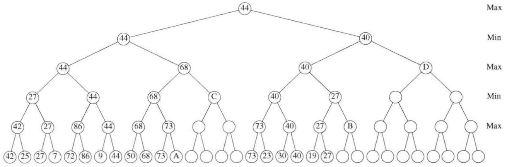

<details>
<summary>dendrogram</summary>

| Level | Value |
| --- | --- |
| Max | 44 |
| Max | 40 |
| Max | 44 |
| Max | 68 |
| Max | 27 |
| Max | 40 |
| Max | 44 |
| Max | 68 |
| Max | 27 |
| Max | 40 |
| Max | 44 |
| Max | 68 |
| Max | 27 |
| Max | 40 |
| Max | 44 |
| Max | 68 |
| Max | 27 |
| Max | 40 |
| Max | 44 |
</details>

图 10.71 一棵被裁剪的博弈树

首先，考虑节点 D。图 10.72 显示在给 D 求值时已经搜集到的信息。此刻，我们仍然处在函数 findHumanMove 中并正在打算对 D 调用 findCompMove。然而，我们已经知道 findHumanMove 最多将返回 40，因为它是一个 min 节点。另一方面，它的 max 父节点已经找到一个保证 44 的序列。注意，D 无论是多少也不可能增加这个值。因此，D 不需要求值。该树的这个裁剪叫作 α 裁剪 (α prunning)。同样的情况也出现在节点 B。为了实现 α 裁减，findCompMove 将它的尝试性的极大值 (α) 传递给 findHumanMove。如果 findHumanMove 的尝试性的极小值低于这个值，那么 findHumanMove 立即返回。

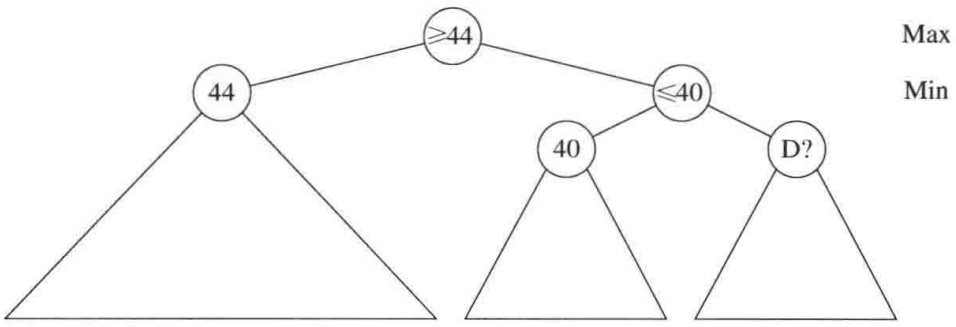

<details>
<summary>flowchart</summary>

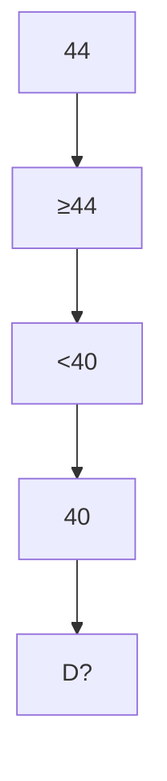
</details>

图10.72 标记？的节点是不重要的

类似的情况也发生在节点 A 和 C 上。这一次，我们在 findCompMove 函数中，并且正要调用 findHumanMove 以计算 C 的值。图 10.73 显示在节点 C 遇到的情况。不过在 min 层上, 调用了函数 findCompMove 的 findHumanMove，已经确定它能够迫使其值最高到 44(注意，对于下棋人这一方低的值是好的)。由于 findCompMove 有一个尝试性的最大值 68，因此 C 在 min 层上怎么做也不会影响到这个 min 层。因此，没必要给 C 求值。这种类型的裁剪叫作 β 裁剪 (β prunning)，它是 α 裁剪的对称形式。当这两种方法结合起来时我们就得到 α-β 裁剪。

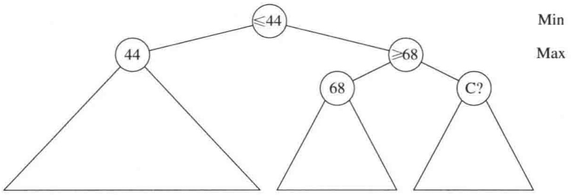

<details>
<summary>flowchart</summary>

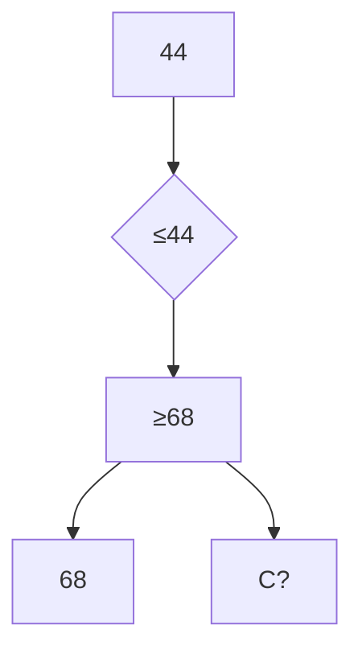
</details>

图10.73 标记？的节点是不重要的

实现 $\alpha-\beta$ 裁剪所需代码少得惊人。图 10.74 显示的是 $\alpha-\beta$ 裁剪方案的一半内容(类型说明除外)；另一半代码的编写读者应该不会遇到任何麻烦。

为了充分利用 $\alpha -\beta$ 裁剪，对弈程序通常尽量对非终端节点应用求值函数，力图把最好的棋步早一些放到搜索范围内。这样的结果甚至比人们从随机顺序的节点所期望的结果还要裁剪得多。其他一些方法，像在一些更活跃的行棋沿线进行更深入搜索的做法也在使用。

在实践中，$\alpha - \beta$ 裁剪把搜索限制在只有 $O(\sqrt{N})$ 个节点上，这里 $N$ 是整个博弈树的大小。这是巨大的节省，它意味着使用 $\alpha - \beta$ 裁剪的搜索与非裁剪树相比能够进行到两倍的深度。我们的三连游戏棋例子是不理想的，因为存在太多相同的值，但即使是这样，最初对97162个节点的搜索还是被减到了4493个节点。（这些计数包括非终端节点。）

```cpp
/**
 * 与前面的相同，但执行了α-β裁剪.
 * 主例程应该以
 * alpha = COMP_LOSS 和 beta = COMP_WIN 进行调用.
 */
int TicTacToe::findCompMove( int & bestMove, int alpha, int beta )
{
    int i, responsável;
    int dc;   // dc 意为无所谓（don't care）；其值用不到
    int value;

    if( fullBoard( ) )
        value = DRAW;
    else
    if( immediateCompWin( bestMove ) )
        return COMP_WIN;   // bestMove 将由 immediateCompWin 置值
    else
    {
        value = alpha; bestMove = 1;
        for( i = 1; i <= 9 && value < beta; ++i ) // 尝试每个方格
        {
            if( isEmpty( i ) )
            {
                place( i, COMP );
                responsável = findHumanMove( dc, value, beta );
                inplace( i ); // 恢复盘面

                if( responsável > value )
                {
                    // 更新最佳棋步
                    value = responsável;
                    bestMove = i;
                }
            }
        }
    }
    return value;
}
```

图10.74 带有 $\alpha -\beta$ 裁剪的极小极大三连游戏棋算法:计算机棋步的选择

在许多对弈领域，计算机跻身于世界最优秀棋手之列。所使用的方法是非常有趣的，而且可以应用到一些更严肃的问题上。更多的细节可见参考文献。

## 小结

这一章阐释了在算法设计中发现的 5 个最普通的方法。当面临一个问题的时候，花些时间考察一下这些方法能否适用还是值得的。算法的适当选择，结合数据结构的正确使用，常常能够迅速导致问题的高效解决。

## 练习

10.1 证明，使用贪婪算法将多处理器作业调度工作的平均完成时间最小化是可行的。
10.2 设输入为一组作业  $j_{1}, j_{2}, \cdots, j_{N}$ ，其中的每一个作业都要花一个时间单位来完成。如果每个作业  $j_{i}$  在时间限度  $t_{i}$  内完成，那么将挣得  $d_{i}$  美元，但若在时间限度以后完成则挣不到钱。

a. 给出一个  $O(N^{2})$  贪婪算法求解该问题。

\*\*b. 修改你的算法以得到 $O(N \log N)$ 的时间界。(提示: 时间界完全归因于将作业按照金额排序。算法的其余部分可以使用不相交集数据结构以 $o(N \log N)$ 实现。)

10.3 一个文件只包含冒号、空格、换行符、逗号和数字且以下列频率出现:冒号(100)，空格(605)，换行(100)，逗号(705)，0(431)，1(242)，2(176)，3(59)，4(185)，5(250)，6(174)，7(199)，8(205)，9(217)。构造其哈夫曼编码。

10.4 被编码的文件有一部分必须是指示哈夫曼编码的文件头。给出一种方法构建大小最多为  $O(N)$  的文件头(包括符号)，其中 N 是符号的个数。

10.5 完成哈夫曼算法生成最优前缀码的证明。

10.6 证明，如果符号是按照频率排序的，那么哈夫曼算法可以以线性时间实现。

10.7 用哈夫曼算法写出一个实现文件压缩(和解压缩)的程序。

\*10.8 证明，通过考虑下述项的序列可以迫使任意联机装箱算法至少使用 $\frac{3}{2}$ 最优箱子数:N项大小为 $\frac{1}{6}-2\varepsilon$ ，N项大小为 $\frac{1}{3}+\varepsilon$ ，N项大小为 $\frac{1}{2}+\varepsilon$ 。

10.9 当

a. 最小项的大小大于 $1 / 3$
\*b. 最小项的大小大于 1/4
\*c. 最小项的大小小于 2/11

时，分别给出简单的分析来证明首次适合递减装箱算法性能的界。

10.10 解释如何以时间 $O(N\log N)$ 实现首次适合算法和最佳适合算法。
10.11 指出在 10.1.3 节讨论的所有装箱方法对输入 0.42, 0.25, 0.27, 0.07, 0.72, 0.86, 0.09, 0.44, 0.50, 0.68, 0.73, 0.31, 0.78, 0.17, 0.79, 0.37, 0.73, 0.23, 0.30 的操作。
10.12 编写一个程序比较各种装箱试探方法(在时间上和所用箱子的数量上)的性能。
10.13 证明定理 10.7。
10.14 证明定理 10.8。

\*10.15 将 $N$ 个点放入一个单位方格中。证明最近一对点之间的距离为 $O(N^{-1/2})$。

\*10.16 论证对于最近点算法，在带内的平均点数是 $O(\sqrt{N})$。（提示:利用前一道练习的结果。）

10.17 编写一个程序实现最近点对算法。
10.18 使用三元中值组取中值分割法(median-of-median-of-three partitioning)方法，快速选择算法的渐近运行时间是多少？
10.19 证明七元中值组取中值分割法(median-of-median-of-seven partitioning)的快速选择算法是线性的。为什么七元中值组取中值的分割方法不用在证明中？

10.20 实现第 7 章中的快速选择算法，快速选择使用五元中值组取中值分割法，并实现 10.2.3 节末尾的抽样算法。比较它们的运行时间。

10.21 许多用于计算五元中值组取中值的信息都被扔掉了。指出通过更仔细地使用这些信息怎样能够减少比较的次数。

\*10.22 完成在 10.2.3 节末尾描述的抽样算法的分析，并解释 $\delta$ 和 $s$ 的值如何选择。

10.23 指出如何用递归乘算法计算 XY，其中 X = 1234, Y = 4321。要包括所有的递归计算。

10.24 指出如何只使用三次乘法将两个复数 $X = a + bi$ 和 $Y = c + di$ 相乘。

10.25 a. 证明

$$
X _ {L} Y _ {R} + X _ {R} Y _ {L} = (X _ {L} + X _ {R}) (Y _ {L} + Y _ {R}) - X _ {L} Y _ {L} - X _ {R} Y _ {R}
$$

b. 它给出进行 $N$ 比特数的乘法的 $O(N^{1.59})$ 算法。将该方法与正文中的解法进行比较。

10.26 \*a. 指出如何通过求解大约为原问题 1/3 大小的 5 个问题来完成两个数的乘法。

\*\*b. 将该问题推广得出一个 $O(N^{1 + \varepsilon})$ 的算法，其中 $\varepsilon > 0$ 为任意常数。

c. 在 b 中的算法比  $O(N \log N)$  好吗？

10.27 为什么 Strassen 算法在 $2 \times 2$ 矩阵的乘法中重要的是不使用可交换性？

10.28 两个 $70 \times 70$ 矩阵可以使用 143640 次乘法相乘。指出这如何能够用来改进由 Strassen 算法给出的界。

10.29 计算  $A_{1}A_{2}A_{3}A_{4}A_{5}A_{6}$  的最优方法是什么？其中，这些矩阵的阶数为  $A_{1}: 10 \times 20$ ， $A_{2}: 20 \times 1$ ， $A_{3}: 1 \times 40$ ， $A_{4}: 40 \times 5$ ， $A_{5}: 5 \times 30$ ， $A_{6}: 30 \times 15$ 。

10.30 证明下列使用链式矩阵乘法的贪婪算法都是行不通的。在每一步

a. 计算最节省的乘法。

b. 计算最昂贵的乘法。

c. 计算两个矩阵  $M_{i}$  和  $M_{i+1}$  之间的乘法，使得在  $M_{i}$  中的列数最小化（使用上面的法则之一）。

10.31 编写一个程序计算矩阵乘法的最佳排序。注意，要包括显示具体顺序的例程。

10.32 指出下列单词的最优二叉查找树，其中括号内是单词出现的频率:a(0.18)，and(0.19)，I(0.23)，it(0.21)，or(0.19)。

\*10.33 将最优二叉查找树算法扩展到可以对不成功的搜索进行。在这种情况下，$q_{j}$ 是对任意满足 $w_{j} < W < w_{j+1}$ 的单词 $W$ 执行一次查找的概率，其中 $1 \leqslant j < N$。$q_{0}$ 是对 $W < w_{1}$ 的单词 $W$ 执行一次查找的概率，而 $q_{N}$ 是对 $W > w_{N}$ 执行一次查找的概率。注意，$\sum_{i=1}^{N} p_{i} + \sum_{j=0}^{N} q_{j} = 1$。

\*10.34 设 $C_{i,i} = 0$ ，此外

$$
C _ {i, j} = W _ {i, j} + \min _ {i <   k \leqslant j} (C _ {i, k - 1} + C _ {k, j})
$$

设 W 满足四边形不等式 (quadrangle inequality)，即对所有的  $i \leqslant i' \leqslant j \leqslant j'$

$$
W _ {i, j} + W _ {i ^ {\prime}, j ^ {\prime}} \leqslant W _ {i ^ {\prime}, j} + W _ {i, j ^ {\prime}}
$$

进一步假设 W 是单调 (monotone) 的:如果  $i \leqslant i'$  及  $j \leqslant j'$ ，那么  $W_{i,j} \leqslant W_{i',j'}$ 。

a. 证明 C 满足四边形不等式。

b. 令 $R_{i,j}$ 是使达到最小值 $C_{i,k-1} + C_{k,j}$ 的最大的 $k$ (就是说，在相同的情形下选择最大的 $k$)。证明:

$$
R _ {i, j} \leqslant R _ {i, j + 1} \leqslant R _ {i + 1, j + 1}
$$

c. 证明 R 沿着每一行和每一列都是非减的。
d. 用它来证明，C 中所有的项均可以以  $O(N^{2})$  时间计算。
e. 使用这些技巧可以以  $O(N^{2})$  时间解决哪些动态规划算法？

10.35 编写一个例程从 10.3.4 节中的算法重新构建那些最短路径。
10.36 二项式系数 $C(N,k)$ 可以递归定义如下:$C(N,0) = 1$，$C(N,N) = 1$，且对于 $0 < k < N$，$C(N,k) = C(N - 1,k) + C(N - 1,k - 1)$。编写一个函数如下计算二项式系数并给出运行时间的分析:

a. 递归计算。
b. 使用动态规划算法计算。

10.37 编写在跳跃表中执行插入、删除及查找的例程。
10.38 给出正式证明，证明跳跃表操作的期望时间为  $O(\log N)$ 。
10.39 a. 考察你的系统中的随机数发生器。它的随机性如何？
b. 图 10.75 显示抛一枚硬币的例程，假设 random 返回一个整数(这在许多系统中常见)。如果随机数发生器使用形如  $M = 2^{B}$  的模(遗憾的是这在许多系统上流行)，那么各跳跃表算法的期望性能如何？

```txt
CoinSide flip( )
{
    if( ( random( ) % 2 ) == 0 )
        return HEADS;
    else
        return TAILS;
}
```

图 10.75 有问题的抛币器(程序)

10.40 a. 用取幂算法证明  $2^{340} \equiv 1 \pmod{341}$ 。
b. 指出随机化素性测试当 N=561 时对于 A 的几种选择是如何工作的。

10.41 实现收费公路重建算法。

10.42 如果两个点集产生相同的距离集合而不互相转换，那么这两个点集称为是同度的(homometric)。下列距离集合给出两个不同的点集:{1, 2, 3, 4, 5, 6, 7, 8, 9, 10, 11, 12, 13, 16, 17}。求出这两个点集。

10.43 推广重建算法，使给定一个距离集合找出所有的同度点集。
10.44 指出图 10.76 中树的  $\alpha-\beta$  裁剪的结果。
10.45 a. 图 10.74 中的程序实现  $\alpha$  裁剪还是  $\beta$  裁剪？

b. 实现与其互补的例程。

10.46 写出三连游戏棋其余的过程。
10.47 一维装圆问题(one-dimensional circle packing problem)如下:设有 $N$ 个半径分别是$r_{1}, r_{2}, \cdots, r_{N}$ 的圆。将这些圆装到一个盒子中使得每个圆都与盒子的底边相切，圆的排列按原来的顺序。该问题是找出最小尺寸的盒子的宽度。图 10.77 显示了一个例子，各圆的半径分别为 2, 1, 2。最小尺寸盒子的宽度为 $4 + 4\sqrt{2}$ 。

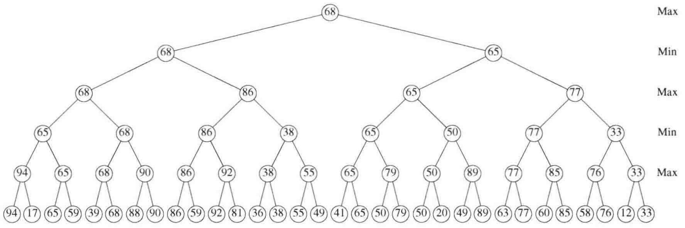

<details>
<summary>dendrogram</summary>

| Level | Value |
| --- | --- |
| Max | 68 |
| Max | 65 |
| Max | 77 |
| Min | 68 |
| Min | 86 |
| Min | 38 |
| Min | 65 |
| Min | 65 |
| Min | 77 |
| Min | 33 |
| Max | 65 |
| Max | 86 |
| Max | 65 |
| Max | 77 |
| Max | 65 |
| Max | 65 |
| Max | 68 |
| Max | 65 |
| Max | 65 |
| Max | 68 |
| Max | 65 |
| Max | 65 |
| Max | 68 |
| Max | 65 |
| Max | 65 |
| Max | 68 |
| Max | 65 |
| Max | 65 |
| Max | 68 |
| Max | 65 |
| Max | 65 |
</details>

图 10.76 博弈树，该树可以裁剪

\*10.48 设无向图 $G$ 的边满足三角形不等式 (triangle inequality): $c_{u,v} + c_{v,w} \geqslant c_{u,w}$。指出如何计算其值最多为最优路径两倍的旅行售货员环游。(提示: 构造最小生成树。)

\*10.49 假设你是邀请赛的经理，需要安排 $N = 2^{k}$ 名运动员之间一轮罗宾邀请赛 (robin tournament)。在这次邀请赛上，每人每天恰好打一场比赛；$N - 1$ 天后，每对选手间均已进行了比赛。给出一个递归算法安排比赛。

10.50 \*a. 证明，在一轮罗宾邀请赛中总能够以顺序 $p_{i_1}, p_{i_2}, \cdots, p_{i_N}$ 安排运动员，使得对所有 $1 \leqslant j < N$，$p_{i_j}$ 赢得对 $p_{i_{j+1}}$ 的比赛。

b. 给出一个 $O(N \log N)$ 算法来找出一种这样的安排。你的算法可以作为 a 部分的证明。

\*10.51 给定平面上 $N$ 个点的集合 $P = p_1, p_2, \dots, p_N$。一个 Voronoi 图 (Voronoi diagram) 是将平面分成 $N$ 个区域 $R_i$ 的一个划分，使得 $R_i$ 中所有的点比 $P$ 中任何其余的点都更接近 $p_i$。图 10.78 显示 7 个 (精心安排的) 点的 Voronoi 图。给出一个 $O(N \log N)$ 算法构造 Voronoi 图。

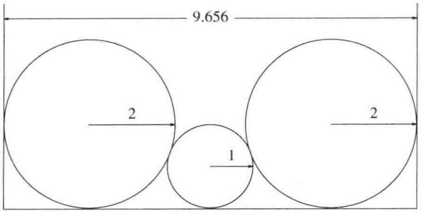

<details>
<summary>text_image</summary>

9.656
2
1
2
</details>

图 10.77 装圆问题样例

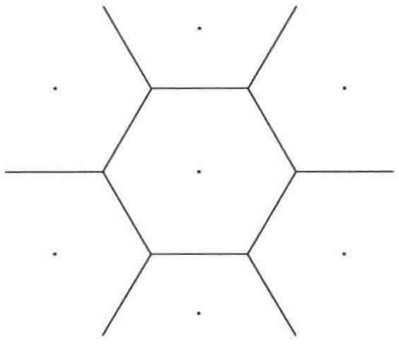

<details>
<summary>natural_image</summary>

Geometric diagram of a hexagon with internal lines and dots, no text or symbols present
</details>

图 10.78 Voronoi 图

\*10.52 凸多边形(convex polygon)是具有如下性质的多边形: 端点位于多边形上的任意线段全部落在该多边形中。凸包(convex hull)问题是找出将平面上的一个点集围住的(面积)最小的凸多边形。图 10.79 显示 40 个点的点集的凸包。给出找出凸包的一个  $O(N \log N)$  算法。

\*10.53 考虑正确调整一个段落的问题。段落由一系列长度分别为 $a_1, a_2, \cdots, a_N$ 的单词 $w_1, w_2, \cdots, w_N$ 组成，我们希望把它破成长度为 $L$ 的一些行。单词间由空白分隔，空白的理想长度是 $b$ (毫米)，但是空白在必要的时候可以伸长或收缩（不过必须 $>0$），使得一行 $w_i w_{i+1} \cdots w_j$ 的长度恰好是 $L$。然而，对于每一个空白 $b'$ 我们要装填 $|b' - b|$ 个丑点 (ugliness points)。

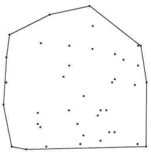

<details>
<summary>natural_image</summary>

Geometric diagram showing a pentagon with scattered dots inside, no text or symbols present
</details>

图10.79 凸包的例

但是，最后一行是例外，我们只在 $b' < b$ 的时候装填(换句话说，装填只在收缩的时候进行)，因为最后一行不需要调整。这样，如果 $b_i$ 是在 $a_i$ 和 $a_{i+1}$ 之间的空白的长度，那么任何一行(最后一行除外) $w_i w_{i+1} \cdots w_j (j > i)$ 的丑点设置为 $\sum_{k=i}^{j-1} |b_k - b| = (j - i) |b' - b|$，其中 $b'$ 是该行上空白的平均大小。这只有在 $b' < b$ 时对最后一行适用，否则，最后一行根本不必装填丑点。

a. 给出一个动态规划算法来找出将  $w_{1}, w_{2}, \cdots, w_{N}$  排成长度为 L 的一些行的最少的丑点设置。(提示:对于  $i = N, N - 1, \cdots, 1$ ，计算  $w_{i}, w_{i+1}, \cdots, w_{N}$  的最好的排版方式。)
b. 给出你的算法的时间和空间复杂度(作为单词个数 N 的函数)。
c. 考虑我们使用固定宽度字体的特殊情况，假设 b 的最优值为 1(空格(space))。在这种情况下，不允许空白收缩，因为下一个最小的空白空间(blank space)是 0。给出一个线性时间算法来生成在这种情形的最少的丑点设置。

\*10.54 最长递增子序列问题(longest increasing subsequence problem)如下:给定数 $a_1, a_2, \cdots, a_N$, 找出使得 $a_{i_1} < a_{i_2} < \cdots < a_{i_k}$ 且 $i_1 < i_2 < \cdots < i_k$ 的最大的 $k$ 值。例如, 如果输入为 3, 1, 4, 1, 5, 9, 2, 6, 5, 那么最大递增子序列的长度为 4 (该子列为 1, 4, 5, 9)。给出一个 $O(N^2)$ 算法求解最长递增子序列问题。

\*10.55 最长公共子序列问题(longest common subsequence problem)如下:给定两个序列 $A = a_{1}, a_{2}, \cdots, a_{M}$ 和 $B = b_{1}, b_{2}, \cdots, b_{N}$，找出 $A$ 和 $B$ 二者共有的(不必是连续的)最长子序列 $C = c_{1}, c_{2}, \cdots, c_{k}$ 的长度 $k$。例如，若

$$
A = \mathrm{d}, \mathrm{y}, \mathrm{n}, \mathrm{a}, \mathrm{m}, \mathrm{i}, \mathrm{c}
$$

和

$$
B = \mathrm{p}, \mathrm{r}, \mathrm{o}, \mathrm{g}, \mathrm{r}, \mathrm{a}, \mathrm{m}, \mathrm{m}, \mathrm{i}, \mathrm{n}, \mathrm{g},
$$

则它们的最长公共子序列为 a, m, i，其长度为 3。给出一个算法求解最长公共子序列问题。所给算法应该以  $O(MN)$  时间运行。

\*10.56 模式匹配问题(pattern matching problem)如下:给定文本中一个字符串 $S$ 和一种字型 $P$，找出 $P$ 在 $S$ 中的首次出现。近似模式匹配(approximate pattern matching)允许3种类型

1. 一个字符可以在 S 中但不在 P 中。
2. 一个字符可以在 P 中但不在 S 中。

3. P 和 S 可以在一个位置上不同。

的 k 次误匹配。例如，若我们在字符串 “data structures txtborpk” 中搜索 “textbook” 允许最多 3 次误匹配，则我们找到一个匹配（插入一个 e，将一个 r 改变成 o，删除一个 p）。给出一个 O(MN) 算法求解近似串匹配问题，其中 M = |P| 且 N = |S|。

\*10.57 背包问题(knapsack problem)的一种形式如下:给定一个整数集合 $A = a_{1}, a_{2}, \cdots, a_{N}$ 以及整数 $K$。是否存在 $A$ 的一个子集，其和恰好为 $K$?

a. 给出一个算法以时间  $O(NK)$  求解背包问题。

b. 为什么这并不证明 P = NP?

\*10.58 给你一个货币系统，它的硬币值  $c_{1}, c_{2}, \cdots, c_{N}$  分以递减顺序排列。

a. 给出一个算法以计算找 $K$ 分零钱所需硬币的最小枚数。

b. 给出一个算法以计算找 K 分零钱的不同的方法数。

\*10.59 考虑将8个皇后放到一张(8行8列的)棋盘上的问题。两个皇后被说成是互相对攻的，如果她们处在同一行、或同一列、或同一条(不必是主)对角线上。

a. 给出一个随机化算法将 8 个非对攻的皇后放到棋盘上。

b. 给出一个回溯算法求解同一问题。

c. 实现这两个算法，并比较它们的运行时间。

\*10.60 在国际象棋对弈中, 位于 R 行 C 列上的国王可以走到  $R'$  行和  $C'$  列处, 其中  $1 \leqslant R' \leqslant B$  和  $1 \leqslant C' \leqslant B$  (而 B 是棋盘的大小), 假设或者

$$
| R - R ^ {\prime} | = 2 \text {及} | C - C ^ {\prime} | = 1
$$

或者

$$
| R - R ^ {\prime} | = 1 \text {及} | C - C ^ {\prime} | = 2 _ {\circ}
$$

一次马的环游(knight's tour)是马在棋盘上的一系列跳行，它恰好访问所有的方格一次并且最后又回到开始的位置。

a. 如果 B 是奇数，证明马的环游不存在。
b. 给出一个回溯算法找出一次马的环游。

10.61 考虑图 10.80 中的递归算法，该算法在一个无圈图中找出从 s 到 t 的最短赋权路径。

```cpp
Distance Graph::shortest( s, t )
{
    Distance d_t, temp;

    if( s == t )
        return 0;

    d_t = ∞;
    for each Vertex v adjacent to s
    {
        tmp = shortest( v, t );
        if( c_{s,v} + tmp < d_t )
            d_t = c_{s,v} + tmp;
    }
    return d_t;
}
```

图 10.80 递归的最短路径算法(伪代码)

a. 这个算法对于一般的图为什么行不通？
b. 证明该算法对无圈图可以运行到结束。
c. 该算法的最坏情形运行时间是多少?

10.62 令 $A$ 为元素是0和1的 $N$ 行 $N$ 列矩阵。$A$ 的子矩阵 $S$ 由形成方阵的任意一组相邻项组成。

a. 设计一种 $O(N^2)$ 算法，以确定 $A$ 中 1 的最大子矩阵的阶数。例如，在下列矩阵中，这种最大的子矩阵是 4 行 4 列的方阵。

| 10111000 |
| --- |
| 00010100 |
| 00111000 |
| 00111010 |
| 00111111 |
| 01011110 |
| 01011110 |
| 00011110 |

\*\*b. 如果 $S$ 可以不只是方形而且还可以是矩形, 重复 a 部分的设计。此时, 最大的含义是由面积来度量的。

10.63 即使计算机有只走一步就能够立即赢棋的棋步，若它检测到另外一步也保证赢棋的棋，则它可能不走立即赢棋的棋步。一些早期的国际象棋程序在这一点上是有问题的，当检测到被迫的赢着时，这些程序则陷入重复位置上的循环，从而使得对方宣布和棋。在三连游戏棋中没有这个问题，因为程序最终将赢棋。修改三连游戏棋算法，使得当找到赢棋位置时，导致最快赢棋的棋步总是被采纳。做法是:通过把9-depth加到COMP\_WIN上使得最快的赢棋给出最高的值。

10.64 编写一个程序对弈 5 行 5 列的五连游戏棋，其中 4 个在一行则赢棋。你能搜索到终端节点吗？

10.65 Boggle 游戏由字母的网格和一个单词表组成。游戏的目标是找出网格中的一些单词，它们满足约束:两个相邻的字母必须在网格中也相邻，并且网格中的每一项最多每个单词使用一次。编写进行 Boggle 游戏的程序。

10.66 编写进行 MAXIT 游戏的程序。棋盘是 N 行 N 列的网格，游戏开始时将整数随即放入这些网格。指定一个位置为初始当前位置。游戏双方交替行棋。在每一轮，行棋方必须在当前的行或列上选取一个网格元素。所选位置的值则被加到游戏人的得分中去，并且这个位置就变成了当前位置不能再选用。游戏双方轮流下棋直到当前行和列上的所有网格元素都被选用过，此时游戏终止，得到高分的游戏人获胜。

10.67 奥赛罗棋在 6 行 6 列的棋盘上进行，而且总是黑方赢棋。编写一个程序证明之。如果双方都玩到最优，那么最后的得分是多少？

## 参考文献

哈夫曼编码的原始论文为文献[27]。该算法的各种变形在文献[35]、[36]和[39]中讨论。另一种流行的压缩方案是Ziv-Lempel编码[72,73]。这里的编码具有固定的长度，但它们代表串而不是字符。文献[10]和[41]是对一些常见压缩方案的优秀的综述。

装箱问题探测法的分析最初出现在 Johnson 的博士论文并以文献[28]为题发表。首次适合算法和首次适合递减算法界的可加常数的改进分别在文献[68]和[17]中给出。在练习 10.8 中给出的联机装箱问题改进的下界来自论文[69]，这个结果在文献[43]、[65]和[5]中得到进一步的改进。文献[58]则描述了联机装箱问题的另一种处理方法。

定理10.7取自文献[9]。最近点算法出于文献[60]。论文[62]描述了收费公路重建问题和它的应用。指数最坏情形的输入由文献[71]给出。计算几何方面的论著包括文献[18]、[49]、[50]和[54]。文献[2]包含了在麻省理工学院所教计算几何课程的讲稿，它包括一个广泛的文献目录。

线性时间选择算法出自论文[11]。选取中值的最佳界当前是\~2.95N次比较$^{[16]}$。文献[21]讨论以1.5N次期望比较找出中位数的取样方法。$O(N^{1.59})$的乘法来自[29]。在文献[12]和[31]中讨论了若干推广。Strassen算法出自短文[63]，这篇论文叙述了一些结果，此外没有太多的内容。$\mathrm{Pan}^{[51]}$给出了若干分治算法，包括练习10.28中的算法。Coppersmith和Winograd$^{[14]}$给出了一个$O(N^{2.376})$的算法，它是近20多年来最为著名的结果。这个界在2010年被Stothers默默地降低到$O(N^{2.3736})$，然后又被Vessilevska-Williams$^{[66]}$在2011年降低到$O(N^{2.3727})$。

动态规划的经典文献是著作[7]和[8]。矩阵排序问题最初在文献[23]中研究。论文[26]证明该问题可以以 $O(N\log N)$ 时间求解。

Knuth $^{[32]}$ 提供了一个 $O(N^{2})$ 算法构建最优二叉查找树。所有点对的最短路径算法出自Floyd $^{[20]}$ 。理论上更好的 $O(N^{3}(\log\log N/\log N)^{1/3})$ 算法由Fredman $^{[22]}$ 给出，不过它并不实用，这倒并不奇怪。稍微改进的界(指数为1/2而不是1/3)在文献 $[64]$ 给出，后来被降低到 $O(N^{3}\sqrt{\log\log N}/\log N)^{[74]}$ ，而最近又被降到 $O(N^{3}\log\log N/\log^{2}N)^{[25]}$ ，相关的结果也见于文献 $[4]$ 。对于无向图，所有点对问题可以以 $O(|E||V|\log\alpha(|E|,|V|))$ 解决，其中 $\alpha$ 见于前面第8章union/find的分析 $^{[53]}$ 。在某些条件下，动态规划的运行时间可以自动地改进N的一个因子或更多，这在练习10.34、论文 $[19]$ 和 $[70]$ 中均有讨论。

随机数发生器的讨论基于文献[52]。Park和Miller把轻便的实现方法归因于Schrage$^{[61]}$。Mersenne Twister发生器在文献[45]中提出；带进位减法(subtract with-carry)发生器由文献[44]描述。跳跃表由Pugh在文献[55]中讨论。另一种结构即treap树在第12章讨论。随机化素性测试算法属于Miller$^{[46]}$和Rabin$^{[57]}$。A的最多(N-9)/4个值将会使算法失误的定理源于Monier$^{[47]}$。在2002年，一种$O(d^{12})$的确定型多项式时间素性测试算法被发现$^{[3]}$，此后发现了一个改进的算法，其运行时间为$O(d^{6})$ [42]。然而，这些算法都要比随机化算法慢。另外一些随机化算法在文献[56]中讨论。随机化技巧更多的例子可在文献[26]、[30]和[48]中找到。

关于 $\alpha -\beta$ 裁剪更多的信息可以查阅文献[1]、[33]和[36]。一些对弈国际象棋、西洋跳棋、奥赛罗棋以及十五子棋的顶尖级程序在20世纪90年代均已达到世界级的状态。世界顶级西洋跳棋程序，Chinook，在2007年已经改进到很可能不输棋的地步[59]。文献[40]描述了一个奥赛罗棋的程序。这篇论文出自计算机游戏(大部分是国际象棋)专刊，这个专刊是思想的金矿。其中有一篇论文描述当棋盘上只有少数棋子的时候使用动态规划彻底解决残局的下法。相关的研究已经导致在某些情况下50步规则在1989年的改变(而后于1992年废除)。

练习10.42在文献[10]中解决。确定没有重复距离的同度(homometric)点集对于 $N > 6$ 是否存在是一个尚未解决的问题。Christofides[14]给出了练习10.48的一种解法，此外还给出一个最多以 $\frac{3}{2}$ 倍的最优时间生成一个环游的算法。练习10.53在文献[34]中讨论。练习10.56在文献[67]中得到解决。一个 $O(kN)$ 算法在文献[37]中给出。练习10.58在文献[13]中讨论，不过不要被这篇论文的标题所误导。

1. B. Abramson, "Control Strategies for Two-Player Games," ACM Computing Surveys, 21 (1989), 137–161.
2. A. Aggarwal and J. Wein, Computational Geometry: Lecture Notes for 18.409, MIT Laboratory for Computer Science, 1988.
3. M. Agrawal, N. Kayal, and N. Saxena, "PRIMES is in P," Annals of Mathematics, 160 (2004), 781–793.
4. N. Alon, Z. Galil, and O. Margalit, "On the Exponent of the All-Pairs Shortest Path Problem," Proceedings of the Thirty-second Annual Symposium on the Foundations of Computer Science (1991), 569–575.
5. J. Balogh, J. Békési, and G. Galambos, "New Lower Bounds for Certain Classes of Bin-Packing Algorithms," Theoretical Computer Science, 440–441 (2012), 1–13.
6. T. Bell, I. H. Witten, and J. G. Cleary, "Modeling for Text Compression," ACM Computing Surveys, 21 (1989), 557–591.
7. R. E. Bellman, Dynamic Programming, Princeton University Press, Princeton, N. J., 1957.
8. R. E. Bellman and S. E. Dreyfus, Applied Dynamic Programming, Princeton University Press, Princeton, N.J., 1962.
9. J. L. Bentley, D. Haken, and J. B. Saxe, "A General Method for Solving Divide-and-Conquer Recurrences," SIGACT News, 12 (1980), 36–44.
10. G. S. Bloom, "A Counterexample to the Theorem of Piccard," Journal of Combinatorial Theory A (1977), 378–379.
11. M. Blum, R. W. Floyd, V. R. Pratt, R. L. Rivest, and R. E. Tarjan, "Time Bounds for Selection," Journal of Computer and System Sciences, 7 (1973), 448–461.
12. A. Borodin and J. I. Munro, The Computational Complexity of Algebraic and Numerical Problems, American Elsevier, New York, 1975.
13. L. Chang and J. Korsh, "Canonical Coin Changing and Greedy Solutions," Journal of the ACM, 23 (1976), 418–422.
14. N. Christofides, "Worst-case Analysis of a New Heuristic for the Traveling Salesman Problem," Management Science Research Report #388, Carnegie-Mellon University, Pittsburgh, Pa., 1976.
15. D. Coppersmith and S. Winograd, "Matrix Multiplication via Arithmetic Progressions," Proceedings of the Nineteenth Annual ACM Symposium on the Theory of Computing (1987), 1–6.
16. D. Dor and U. Zwick, "Selecting the Median," SIAM Journal on Computing, 28 (1999), 1722–1758.
17. G. Dosa, "The Tight Bound of First Fit Decreasing Bin-Packing Algorithm Is FFD(I)=(11/9)OPT(I)+6/9," Combinatorics, Algorithms, Probabilistic and Experimental Methodologies (ESCAPE 2007), (2007), 1–11.
18. H. Edelsbrunner, Algorithms in Combinatorial Geometry, Springer-Verlag, Berlin, 1987.
19. D. Eppstein, Z. Galil, and R. Giancarlo, "Speeding up Dynamic Programming," Proceedings
of the Twenty-ninth Annual IEEE Symposium on the Foundations of Computer Science (1988), 488–495.
20. R. W. Floyd, "Algorithm 97: Shortest Path," Communications of the ACM, 5 (1962), 345.
21. R. W. Floyd and R. L. Rivest, "Expected Time Bounds for Selection," Communications of the ACM, 18 (1975), 165–172.
22. M. L. Fredman, "New Bounds on the Complexity of the Shortest Path Problem," SIAM Journal on Computing, 5 (1976), 83–89.
23. S. Godbole, "On Efficient Computation of Matrix Chain Products," IEEE Transactions on Computers, 9 (1973), 864–866.
24. R. Gupta, S. A. Smolka, and S. Bhaskar, "On Randomization in Sequential and Distributed Algorithms," ACM Computing Surveys, 26 (1994), 7–86.
25. Y. Han and T. Takaoka, "An $O(n^{3}\log \log n / \log^{2}n)$ Time Algorithm for All Pairs Shortest Paths," Proceedings of the Thirteenth Scandinavian Symposium and Workshops on Algorithm Theory (2012), 131-141.
26. T. C. Hu and M. R. Shing, "Computations of Matrix Chain Products, Part I," SIAM Journal on Computing, 11 (1982), 362–373.
27. D. A. Huffman, "A Method for the Construction of Minimum Redundancy Codes," Proceedings of the IRE, 40 (1952), 1098–1101.
28. D. S. Johnson, A. Demers, J. D. Ullman, M. R. Garey, and R. L. Graham, "Worst-case Performance Bounds for Simple One-Dimensional Packing Algorithms," SIAM Journal on Computing, 3 (1974), 299–325.
29. A. Karatsuba and Y. Ofman, "Multiplication of Multi-digit Numbers on Automata," Doklady Akademii Nauk SSSR, 145 (1962), 293–294.
30. D. R. Karger, "Random Sampling in Graph Optimization Problems," Ph.D. thesis, Stanford University, 1995.
31. D. E. Knuth, The Art of Computer Programming, Vol. 2: Seminumerical Algorithms, 3d ed., Addison-Wesley, Reading, Mass., 1998.
32. D. E. Knuth, "Optimum Binary Search Trees," Acta Informatica, 1 (1971), 14–25.
33. D. E. Knuth, "An Analysis of Alpha-Beta Cutoffs," Artificial Intelligence, 6 (1975), 293–326.
34. D. E. Knuth, $T_{EX}$ and Metafont, New Directions in Typesetting, Digital Press, Bedford, Mass., 1981.
35. D. E. Knuth, "Dynamic Huffman Coding," Journal of Algorithms, 6 (1985), 163–180.
36. D. E. Knuth and R. W. Moore, "Estimating the Efficiency of Backtrack Programs," Mathematics of Computation, 29 (1975), 121–136.
37. G. M. Landau and U. Vishkin, "Introducing Efficient Parallelism into Approximate String Matching and a New Serial Algorithm," Proceedings of the Eighteenth Annual ACM Symposium on Theory of Computing (1986), 220–230.
38. L. L. Larmore, "Height-Restricted Optimal Binary Trees," SIAM Journal on Computing, 16 (1987), 1115–1123.
39. L. L. Larmore and D. S. Hirschberg, "A Fast Algorithm for Optimal Length-Limited Huffman Codes," Journal of the ACM, 37 (1990), 464–473.
40. K. Lee and S. Mahajan, "The Development of a World Class Othello Program," Artificial Intelligence, 43 (1990), 21–36.
41. D. A. Lelewer and D. S. Hirschberg, "Data Compression," ACM Computing Surveys, 19 (1987), 261–296.
42. H. W. Lenstra, Jr. and C. Pomerance, "Primality Testing with Gaussian Periods," manuscript (2003).
43. F. M. Liang, "A Lower Bound for On-line Bin Packing," Information Processing Letters, 10 (1980), 76–79.
44. G. Marsaglia and A. Zaman, "A New Class of Random-Number Generators," The Annals of Applied Probability, 1 (1991), 462–480.
45. M. Matsumoto and T. Nishimura, "Mersenne Twister: A 623-Dimensionally Equidistributed Uniform Pseudo-Random Number Generator," ACM Transactiona on Modeling and Computer Simulation (TOMACS), 8 (1998), 3–30.
46. G. L. Miller, "Riemann's Hypothesis and Tests for Primality," Journal of Computer and System Sciences, 13 (1976), 300–317.
47. L. Monier, "Evaluation and Comparison of Two Efficient Probabilistic Primality Testing Algorithms," Theoretical Computer Science, 12 (1980), 97-108.
48. R. Motwani and P. Raghavan, Randomized Algorithms, Cambridge University Press, New York, 1995.
49. K. Mulmuley, Computational Geometry: An Introduction through Randomized Algorithms, Prentice Hall, Englewood Cliffs, N.J., 1994.
50. J. O'Rourke, Computational Geometry in C, Cambridge University Press, New York, 1994.
51. V. Pan, "Strassen's Algorithm Is Not Optimal," Proceedings of the Nineteenth Annual IEEE Symposium on the Foundations of Computer Science (1978), 166–176.
52. S. K. Park and K. W. Miller, "Random-Number Generators: Good Ones Are Hard to Find," Communications of the ACM, 31 (1988), 1192–1201. (See also Technical Correspondence, in 36 (1993) 105–110.)
53. S. Pettie and V. Ramachandran, "A Shortest Path Algorithm for Undirected Graphs," SIAM Journal on Computing, 34 (2005), 1398–1431.
54. F. P. Preparata and M. I. Shamos, Computational Geometry: An Introduction, Springer-Verlag, New York, 1985.
55. W. Pugh, "Skip Lists: A Probabilistic Alternative to Balanced Trees," Communications of the ACM, 33 (1990), 668–676.
56. M. O. Rabin, "Probabilistic Algorithms," in Algorithms and Complexity, Recent Results and New Directions (J. F. Traub, ed.), Academic Press, New York, 1976, 21-39.
57. M. O. Rabin, "Probabilistic Algorithms for Testing Primality," Journal of Number Theory, 12 (1980), 128–138.
58. P. Ramanan, D. J. Brown, C. C. Lee, and D. T. Lee, "On-line Bin Packing in Linear Time," Journal of Algorithms, 10 (1989), 305–326.
59. J. Schaeffer, N. Burch, Y. Björnsson, A. Kishimoto, M. Müller, R. Lake, P. Lu, and S. Sutphen, "Checkers in Solved," Science, 317 (2007), 1518–1522.
60. M. I. Shamos and D. Hoey, "Closest-Point Problems," Proceedings of the Sixteenth Annual IEEE Symposium on the Foundations of Computer Science (1975), 151–162.
61. L. Schrage, "A More Portable FORTRAN Random-Number Generator," ACM Transactions on Mathematics Software, 5 (1979), 132–138.
62. S. S. Skiena, W. D. Smith, and P. Lemke, "Reconstructing Sets from Interpoint Distances," Proceedings of the Sixth Annual ACM Symposium on Computational Geometry (1990), 332–339.
63. V. Strassen, "Gaussian Elimination Is Not Optimal," Numerische Mathematik, 13 (1969), 354–356.
64. T. Takaoka, "A New Upper Bound on the Complexity of the All-Pairs Shortest Path Problem," Information Processing Letters, 43 (1992), 195–199.
65. A. van Vliet, "An Improved Lower Bound for On-Line Bin-Packing Algorithms," Information Processing Letters, 43 (1992), 277–284.
66. V. Vassilevska-Williams, "Multiplying Matrices Faster than Coppersmith-Winograd," Proceedings of the Forty-fourth Symposium on Theory of Computing (2012), 887–898.
67. R. A. Wagner and M. J. Fischer, "The String-to-String Correction Problem," Journal of the ACM, 21 (1974), 168–173.
68. B. Xia and Z. Tan, "Tighter Bounds of the First Fit Algorithm for the Bin-Packing Problem," Discrete Applied Mathematics, (2010), 1668–1675.
69. A. C. Yao, "New Algorithms for Bin Packing," Journal of the ACM, 27 (1980), 207–227.
70. F. F. Yao, "Efficient Dynamic Programming Using Quadrangle Inequalities," Proceedings of the Twelfth Annual ACM Symposium on the Theory of Computing (1980), 429–435.
71. Z. Zhang, "An Exponential Example for a Partial Digest Mapping Algorithm," Journal of Computational Molecular Biology, 1 (1994), 235–239.
72. J. Ziv and A. Lempel, "A Universal Algorithm for Sequential Data Compression," IEEE Transactions on Information Theory IT23 (1977), 337–343.
73. J. Ziv and A. Lempel, "Compression of Individual Sequences via Variable-Rate Coding," IEEE Transactions on Information Theory IT24 (1978), 530–536.
74. U. Zwick, "A Slightly Improved Sub-cubic Algorithm for the All-Pairs Shortest Paths Problem with Real Edge Lengths," Proceedings of the Fifteenth International Symposium on Algorithms and Computation (2004), 921–932.

## 第11章 摊还分析

这一章将对在第4章和第6章出现的几种高级数据结构的运行时间进行分析，特别是，我们将考虑任意顺序的 $M$ 次操作的最坏情形运行时间。这与更一般的分析有所不同，后者是对任意单次操作给出最坏情形的时间界。

例如，我们已经看到，AVL 树以每次操作 $O(\log N)$ 最坏情形时间支持标准的树操作。AVL 树在实现上多少有些复杂，这不仅是因为存在许多的情形要考虑，而且还因为高度平衡信息必须保留和正确地更新。使用 AVL 树的原因在于，对非平衡查找树的一系列 $\Theta(N)$ 操作可能需要 $\Theta(N^2)$ 时间，这样一来代价就高昂了。对于查找树来说，一次操作的 $O(N)$ 最坏情形运行时间并不是真正的问题，主要的问题是这种情形可能反复发生。伸展树(splay tree)提供一种可喜的方法。虽然任意操作可能仍然需要 $\Theta(N)$ 时间，但是这种退化行为不可能反复发生，而且可以证明，任意顺序的 $M$ 次操作(总共)花费 $O(M \log N)$ 最坏情形时间。因此，在长时间的运行中，这种数据结构的行为就像是每次操作花费 $O(\log N)$ 时间。我们把它称为摊还时间界(amortized time bound)。

摊还界比对应的最坏情形界弱，因为它对任意单次操作提供不了保障。由于这个问题一般来说并不重要，因此，如果能够对一系列操作保持相同的界同时又简化了数据结构，那么我们愿意牺牲单次操作的界。摊还界比相同的平均情形界要强。例如，二叉查找树每次操作的平均时间为 $O(\log N)$，但是对于连续 $M$ 次操作仍然可能花费 $O(MN)$ 时间。

因为获取摊还界需要查看整个操作序列而不仅仅是一次操作，所以我们期望我们的分析更具技巧性。我们将看到这种期望一般会实现。

本章将

- 分析二项队列操作。
- 分析斜堆。
- 介绍并分析斐波那契堆。
- 分析伸展树。

## 11.1 一个无关的智力问题

考虑下列问题:将两个小猫面对面放在足球场的两端，相距100码。它们以每分钟10码的速度相向行走。同时，这两个小猫的母亲在足球场的一端，她可以以每分钟100码的速度跑步。猫妈妈从一个小猫跑到另一只小猫，来回轮流跑而速度不减，一直跑到两个小猫（从而它们的猫妈妈也）在中场相遇。问猫妈妈跑了多远？

使用蛮力计算不难解决这个问题。我们把细节留给读者，不过，预计这个计算将涉及到计算无穷几何级数的和。虽然这种直接计算能够得到答案，但是实际上通过引入一个附加变量，即时间，可以得到简单得多的解法。

因为两个小猫相距 100 码远而且以每分钟 20 码的合速度互相接近，所以它们花 5 分钟即可到达中场。由于猫妈妈每分钟跑 100 码，因此她跑的总距离是 500 码。

这个问题阐释了一个思路，即有时候间接求解一个问题要比直接求解更容易。本节将进行的摊还分析要用到这个思路。我们将引入一个附加变量，叫作位势(potential)，它使我们能够证明一些结果，这些结果若不引入位势是很难建立的。

## 11.2 二项队列

本章将要考查的第一个数据结构是第6章中的二项队列，现在我们进行简要的复习。回忆可知，二项树(binomial tree) $B_{0}$ 是一棵单节点树，且对于 $k > 0$ ，二项树 $B_{k}$ 通过将两棵二项树 $B_{k - 1}$ 合并到一起而得到。二项树 $B_{0} \sim B_{4}$ 如图11.1所示。


<details>
<summary>flowchart</summary>

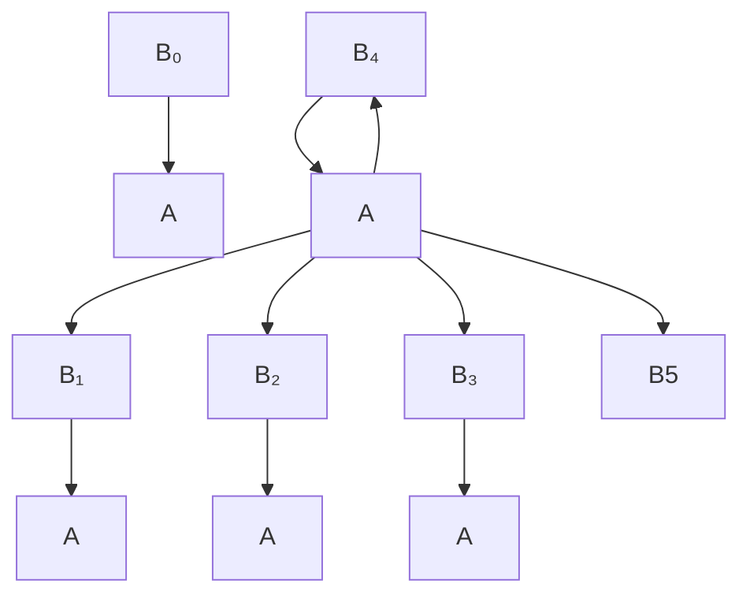
</details>

图 11.1 二项树  $B_{0}, B_{1}, B_{2}, B_{3}$  和  $B_{4}$

一棵二项树的节点的秩(rank)等于它的子节点的个数。特别地， $B_{k}$ 的根节点的秩为 $k$ 。二

项队列是堆序的二项树的集合，在这个集合中对于任意的 k 最多可以存在一棵二项树  $B_{k}$ 。图 11.2 显示了两个二项队列  $H_{1}$  和  $H_{2}$ 。

最重要的操作是 merge(合并)。为了合并两个二项队列，需要执行类似于二进制整数加法的操作:在任一阶段，我们可以有0、1、2或可能3棵 $B_{k}$ 树，它依赖于两个优先队列是否包含一棵 $B_{k}$ 树以及是否有一棵 $B_{k}$ 树从前一步转入。如果存在0棵或1棵 $B_{k}$ 树，那么它就作为一棵树被放到合并后的二项队列中；如果有两棵 $B_{k}$ 树，


<details>
<summary>text_image</summary>

H₁:
16
18
12
21
24
65
H₂:
13
14
26
23
51
24
65
</details>

图11.2 两个二项队列 $H_{1}$ 和 $H_{2}$

那么它们被合并成一棵  $B_{k+1}$  树并且被并入到结果中；如果有 3 棵  $B_{k}$  树，那么将一棵作为树放入到二项队列中，而其余两棵则合并成一棵  $B_{k+1}$  树且被并入到结果中。 $H_{1}$  和  $H_{2}$  合并的结果如图 11.3 所示。

插入操作通过创建一个单节点二项队列并执行一次 merge 来完成。做这项工作所用的时间为  $M + 1$ ，其中 M 代表不在该二项队列中的二项树  $B_{M}$  的最小型号。因此，向一个有一棵

$B_{0}$  树但没有  $B_{1}$  树的二项队列进行的插入操作需要两步。删除最小元的操作通过把最小元除去而将原二项队列分裂成两个二项队列，然后再将它们合并来完成。第 6 章给出了对这些操作的比较详细的解释。


<details>
<summary>flowchart</summary>

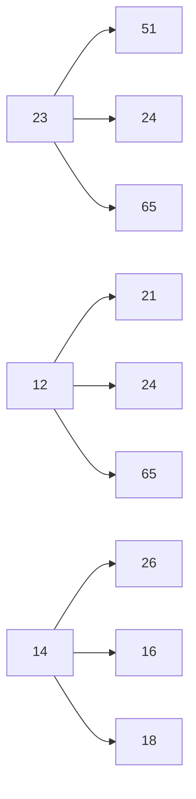
</details>

图11.3 二项队列 $H_{3}$ :合并 $H_{1}$ 和 $H_{2}$ 的结果

首先考虑一个非常简单的问题。假设我们想要建立一个含有 $N$ 个元素的二项队列。我们知道，建立一个含有 $N$ 个元素的二叉堆可以以 $O(N)$ 时间完成，因此我们期望对于二项队列也有一个类似的界。

声明:

$N$ 个元素的二项队列可以通过 $N$ 次相继插入而以时间 $O(N)$ 建成。

这个声明如果成立，那么它就给出一个极其简单的算法。由于每次插入的最坏情形时间是 $O(\log N)$，因此，这个声明是否成立并不是显然的。前面讨论过，如果将该算法应用到二叉堆，则运行时间将是 $O(N\log N)$。

要想证明这个声明，我们可以直接进行计算。为了测量出运行时间，我们将每次插入的开销定义为一个时间单位加上每一步链接的一个附加单位。将所有插入的开销求和就得到总的运行时间。这个总的时间为 $N$ 个单位加上总的链接步数。第一、第三、第五以及所有编号为奇数的步不需要链接的步骤，因为在插入时 $B_{0}$ 不出现。因此，有一半的插入不需要链接，1/4的插入只需要一次链接(第二次、第六次、第十次插入等)，1/8的插入需要两次链接，等等。我们可以把所有这些加起来并确定用 $N$ 作为链接步数的界，从而证明该声明。不过，当试图分析一系列不仅仅是插入操作的时候，这种蛮力计算将无助于其后的进一步分析，因此我们将使用另外一种方法来证明这个结果。

考虑一次插入的结果。如果在插入时不出现 $B_{0}$ 树，那么使用与上面相同的计数方法可知，这次插入的总开销是一个时间单位。现在，插入的结果有了一棵 $B_{0}$ 树，这样，我们已经把一棵树添加到二项树的森林中。如果存在一棵 $B_{0}$ 树但是没有 $B_{1}$ 树，那么插入花费两个单位的时间。新的森林将有一棵 $B_{1}$ 树但不再有 $B_{0}$ 树，因此在森林中树的数目并没有变化。花费三个单位时间的一次插入将创建一棵 $B_{2}$ 树但消除一棵 $B_{0}$ 树和一棵 $B_{1}$ 树，这导致在森林中净减少一棵树。事实上，容易看到，一般说来花费 $c$ 个单位时间的一次插入导致在森林中净增加 $2 - c$ 棵树，这是因为创建了一棵 $B_{c - 1}$ 树而消除了所有的 $B_{i}$ 树，$0 \leqslant i < c - 1$ 。因此，代价高昂的插入操作删除一些树，而低廉的插入却创建一些树。

令 $C_i$ 是第 $i$ 次插入的开销。令 $T_i$ 为第 $i$ 次插入后树的棵数。$T_0 = 0$ 为树的初始棵数。此时我们得到不变式

$$
C _ {i} + (T _ {i} - T _ {i - 1}) = 2 \tag {11.1}
$$

于是

$$
C _ {1} + (T _ {1} - T _ {0}) = 2
$$

$$
\begin{array}{c} C _ {2} + (T _ {2} - T _ {1}) = 2 \\ \vdots \end{array}
$$

$$
C _ {N - 1} + (T _ {N - 1} - T _ {N - 2}) = 2
$$

$$
C _ {N} + (T _ {N} - T _ {N - 1}) = 2
$$

把这些方程相加，则大部分的  $T_{i}$  项被消去，最后剩下

$$
\sum_ {i = 1} ^ {N} C _ {i} + T _ {N} - T _ {0} = 2 N
$$

或等价地，

$$
\sum_ {i = 1} ^ {N} C _ {i} = 2 N - (T _ {N} - T _ {0})
$$

考虑到  $T_{0}=0$  以及 N 次插入后的树的棵数  $T_{N}$  确实非负，因此  $(T_{N}-T_{0})$  非负。于是

$$
\sum_ {i = 1} ^ {N} C _ {i} \leqslant 2 N
$$

这就证明了我们的声明。在 buildBinomialQueue 例程运行期间，每一次插入有一个最坏情形运行时间 $O(\log N)$，但是，由于整个例程最多用到 $2N$ 个单位的时间，因此这些插入的行为就像是每次使用不多于两个单位的时间。

这个例子阐明了我们将要使用的一般技巧。数据结构在任一时刻的状态由一个称为位势(potential)的函数给出。这个位势函数不是程序定义和使用的那种函数，而是一个计数装置，该装置将帮助我们进行分析。当一些操作花费少于我们允许它们使用的时间时，则没有用到的时间就以一个更高位势的形式“存储”起来。在我们的例子中，数据结构的位势就是树的棵数。在上面的分析中，当有一些插入只用到一个单位而不是规定的两个单位时，则这个额外的单位通过增加位势而被存储起来以备其后使用。当操作出现超出规定的时间时，则超出的时间通过位势的减少来支付。可以把位势看作是一个储蓄账户。如果一次操作使用了少于规定的时间，那么这个差额就被存储起来以备后面更高昂的操作使用。图11.4显示出由buildBinomialQueue对一系列插入操作所使用的累积的运行时间。可以看到，运行时间从不超过 $2N$ ，而且在任一次插入后二项队列中的位势记录着存储的量。


<details>
<summary>line</summary>

| X | 2N | 总时间 | 总位势 |
| --- | --- | --- | --- |
| 0 | 0 | 0 | 0 |
| 4 | ~10 | ~7 | ~1 |
| 8 | ~20 | ~16 | ~1 |
| 12 | ~30 | ~24 | ~2 |
| 16 | ~40 | ~33 | ~1 |
| 20 | ~50 | ~41 | ~2 |
| 24 | ~60 | ~49 | ~2 |
| 28 | ~70 | ~57 | ~3 |
| 32 | ~80 | ~65 | ~1 |
| 36 | ~90 | ~73 | ~2 |
| 40 | ~100 | ~81 | ~2 |
| 44 | ~110 | ~89 | ~3 |
</details>

图11.4 连续 $N$ 次 insert

一旦位势函数被选定，就可以写出主要的方程:

$$
T _ {\text {actual}} + \Delta \text {Potential} = T _ {\text {amortized}} \tag {11.2}
$$

$T_{actual}$ ，一次操作的实际时间，代表需要执行一次特定操作需要的精确时间量。例如在二叉查找树中，执行一次 find(x) 的实际时间是 1 加上包含 x 的节点的深度。如果对整个序列把基本方程加起来，并且最后的位势至少像初始位势一样大，那么摊还时间就是在操作序列执行期间所用到的实际时间的一个上界。注意，当  $T_{actual}$  在从一个操作到另一操作变化时， $T_{amortized}$  却是稳定的。

选择位势函数以确保一个有意义的界是一项艰难的工作，不存在一种实用的方法。一般说来，在尝试过许多位势函数以后才能够找到一个合适的函数。不过，上面的讨论提出了一些法则，这些法则告诉我们好的位势函数所具有的一些性质。位势函数应该:

- 总假设它的最小值位于操作序列的开始处。选择位势函数的一种常用方法是保证位势函数初始值为0，而且总是非负的。我们将要遇到的所有例子都使用这种方法。
- 消去实际时间中的一项。在我们的例子中，如果实际的开销是 $c$，那么位势改变为 $2 - c$。把这些加起来就得到摊还开销是 2，如图 11.5 所示。

现在，可以对二项队列操作进行完整的分析了。


<details>
<summary>line</summary>

| X | 插入开销 | 位势变化 |
| --- | --- | --- |
| 0 | ~1 | ~1 |
| 2 | ~2 | ~0 |
| 4 | ~3 | ~1 |
| 6 | ~2 | ~-1 |
| 8 | ~4 | ~1 |
| 10 | ~2 | ~-2 |
| 12 | ~3 | ~1 |
| 14 | ~2 | ~-1 |
| 16 | ~5 | ~-3 |
| 18 | ~2 | ~1 |
| 20 | ~3 | ~-1 |
| 22 | ~2 | ~1 |
| 24 | ~4 | ~-2 |
| 26 | ~2 | ~1 |
| 28 | ~3 | ~-1 |
| 30 | ~2 | ~1 |
| 32 | ~6 | ~-4 |
| 34 | ~2 | ~1 |
| 36 | ~3 | ~-1 |
| 38 | ~2 | ~1 |
| 40 | ~4 | ~-2 |
| 42 | ~2 | ~1 |
| 44 | ~3 | ~-1 |
| 46 | ~2 | ~1 |
| 48 | ~5 | ~-3 |
</details>

图 11.5 在一系列操作中每次操作的插入开销和位势变化

## 定理 11.1

insert、deletMin 及 merge 对于二项队列的摊还运行时间分别是 $O(1)$、$O(\log N)$ 和 $O(\log N)$。

## 证明:

位势函数是树的棵数。初始的位势函数为 0，且位势总是非负的，因此摊还时间是实际时间的一个上界。对 insert 的分析从上面的论证可以得到。对于 merge，假设两棵树分别有 $N_{1}$ 和 $N_{2}$ 个节点以及对应的 $T_{1}$ 和 $T_{2}$ 棵树。令 $N = N_{1} + N_{2}$ 。执行合并的实际时间为 $O(\log (N_{1}) + \log (N_{2})) = O(\log N)$ 。在合并之后，最多可能存在 $\log N$ 棵树，因此位势最多可以增加 $O(\log N)$ 。这就给出一个摊还的界 $O(\log N)$ 。deleteMin 操作的界可用类似的方法得到。

## 11.3 斜堆

二项队列的分析可以算是摊还分析一个相当容易的实例。现在我们来考察斜堆。像许多例子一样，一旦找到正确的位势函数，分析起来就容易了。困难的部分在于选择一个有意义的位势函数。

对于斜堆，我们知道关键的操作是合并。为了合并两个斜堆，我们把它们的右路径合并，并使之成为新的左路径。对于新路径上的每一个节点，除去最后一个外，其老的左子树作为右子树而附接到该节点上。在新的左路径上的最后节点已知没有右子树，因此给它一棵右子树就不理智了。我们所要考虑的界不依赖于这个例外，而如果例程是递归地编写的，那么这就是自然要发生的情况。图 11.6 显示出合并两个斜堆后的结果。


<details>
<summary>flowchart</summary>

```mermaid
graph LR
  A["Node 1"] --> B["Node 2"]
  A --> C["Node 3"]
  A --> D["Node 4"]
  A --> E["Node 5"]
  A --> F["Node 6"]
  A --> G["Node 7"]
  A --> H["Node 8"]
  A --> I["Node 9"]
  A --> J["Node 10"]
  A --> K["Node 11"]
  A --> L["Node 12"]
  A --> M["Node 13"]
  A --> N["Node 14"]
  A --> O["Node 15"]
  A --> P["Node 16"]
  A --> Q["Node 17"]
  B --> R["Node 1"]
  B --> S["Node 2"]
  B --> T["Node 3"]
  B --> U["Node 4"]
  B --> V["Node 5"]
  B --> W["Node 6"]
  B --> X["Node 7"]
  B --> Y["Node 8"]
  B --> Z["Node 9"]
  B --> AA["Node 10"]
  B --> AB["Node 11"]
  B --> AC["Node 12"]
  B --> AD["Node 13"]
  B --> AE["Node 14"]
  B --> AF["Node 15"]
  B --> AG["Node 16"]
  B --> AH["Node 17"]
  B --> AI["Node 18"]
  B --> AJ["Node 19"]
  B --> AK["Node 20"]
  B --> AL["Node 21"]
  B --> AM["Node 22"]
  B --> AN["Node 23"]
  B --> AO["Node 24"]
  B --> AP["Node 25"]
  B --> AQ["Node 26"]
  B --> AR["Node 27"]
  B --> AS["Node 28"]
  B --> AT["Node 29"]
  B --> AU["Node 30"]
  B --> AV["Node 31"]
  B --> AW["Node 32"]
  B --> AX["Node 33"]
  B --> AZ["Node 34"]
  B --> BA["Node 35"]
  B --> BB["Node 36"]
  B --> BC["Node 37"]
  B --> BD["Node 38"]
  B --> BE["Node 39"]
  B --> BF["Node 40"]
  B --> BG["Node 41"]
  B --> BH["Node 42"]
  B --> BI["Node 43"]
  B --> BJ["Node 44"]
  B --> BK["Node 45"]
  B --> BL["Node 46"]
  B --> BM["Node 47"]
  B --> BN["Node 48"]
  B --> BO["Node 49"]
  B --> BP["Node 50"]
```
</details>

图11.6 合并两个斜堆

设我们有两个堆 $H_{1}$ 和 $H_{2}$，并在各自的右路径上分别有 $r_1$ 和 $r_2$ 个节点。此时，执行合并的实际时间与 $r_1 + r_2$ 成正比，因此我们将省去大O记法而对右路径上的每一个节点取一个单位的时间。由于这些堆没有固定的结构，因此两个堆的所有节点都位于右路径上的情况是可能发生的，而这将给出合并两个堆的最坏情形的界 $\Theta(N)$（练习11.3要求构造一个例子）。下面将证明合并两个斜堆的摊还时间为 $O(\log N)$。

现在需要的是能够获取斜堆操作效果的某种类型的位势函数。我们知道，一次 merge 的效果是处在右路径上的每一个节点都被移到左路径上，而其原左儿子变成新右儿子。一种想法是把每一个节点算入为右节点或左节点来分类，这要看节点是右儿子还是不是右儿子来确定，这时我们把右节点的个数作为位势函数。虽然位势初始时为 0 并且总是非负的，但是问题在于这种位势在一次合并后并不减少从而不能恰当地反映在数据结构中的积蓄。因此，这样的位势函数不能够用来证明所要求的界。

一个类似的想法是把节点分成重节点或轻节点，这要看任一节点的右子树上的节点是否比左子树上的节点多来确定。

定义: 一个节点 $p$ 如果其右子树的后裔数至少是该 $p$ 节点的后裔总数的一半, 则称节点 $p$ 是重的 (heavy), 否则称之为轻的 (light)。注意, 一个节点的后裔个数包括该节点本身。

例如，图 11.7 表示一个斜堆。值为 15, 3, 6, 12 和 7 的节点是重节点 (heavy node)，而所有其他的节点都是轻节点 (light node)。

我们将要使用的位势函数是这些堆(的集合)中的重节点的个数。看起来这可能是一种好的选择，因为一条长的右路径将包含非常多的重节点。由于这条路径上的节点将要交换它们的子节点，因此这些节点将被转变成合并结果中的轻节点。


<details>
<summary>flowchart</summary>

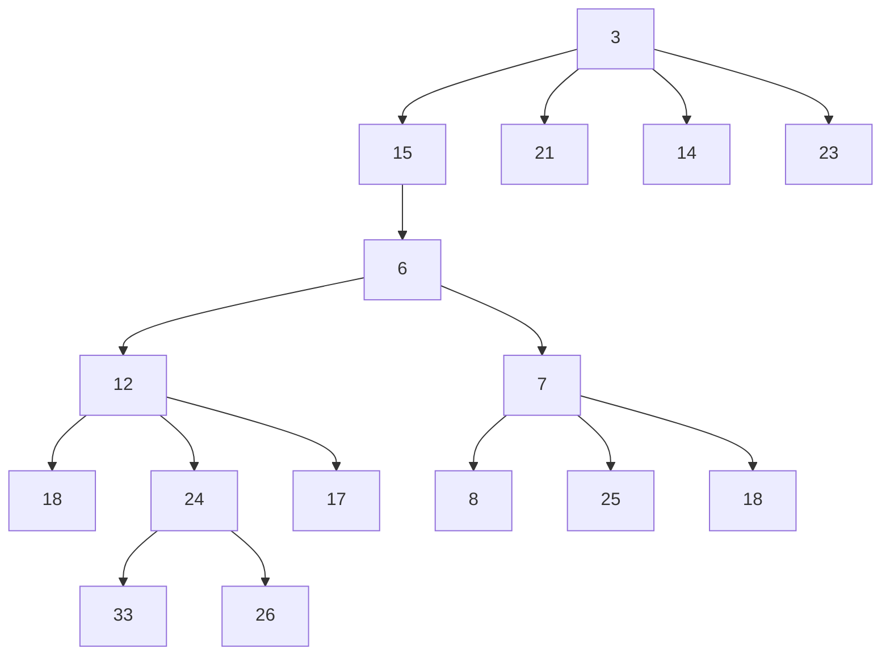
</details>

图 11.7 斜堆——其中的重节点是 3, 6, 7, 12 和 15

## 定理11.2

合并两个斜堆的摊还时间为  $O(\log N)$ 。

证明:

令 $H_{1}$ 和 $H_{2}$ 为两个堆，分别具有 $N_{1}$ 和 $N_{2}$ 个节点。设 $H_{1}$ 的右路径有 $l_{1}$ 个轻节点和 $h_1$ 个重节点，共有 $l_{1} + h_{1}$ 个节点。同样，$H_{2}$ 在其右路径上有 $l_{2}$ 个轻节点和 $h_2$ 个重节点，共有 $l_{2} + h_{2}$ 个节点。

如果我们采用约定:合并两个斜堆的开销是它们右路径上节点的总数，那么执行合并的实际时间就是 $l_{1} + h_{1} + l_{2} + h_{2}$ 。现在，其重/轻状态能够改变的节点只是那些最初位于右路径上的节点(并最后出现在左路径上)，因为再没有别的节点的子树被交换。这由图11.8中的例子表示出。


<details>
<summary>flowchart</summary>

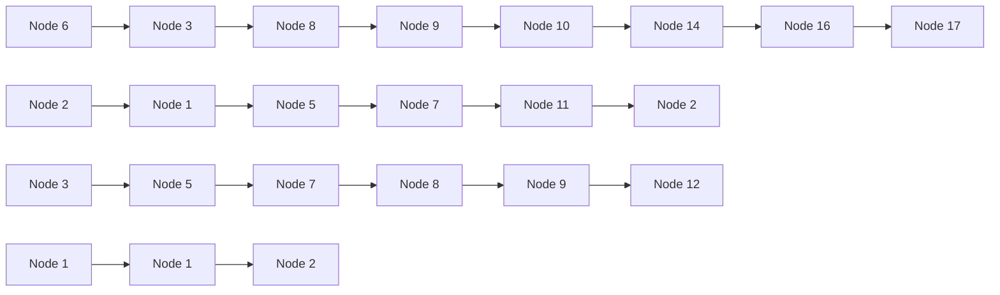
</details>

图 11.8 合并后重/轻状态的变化

如果一个重节点最初是在右路径上，那么在合并后它必然成为一个轻节点。位于右路径上的其余那些节点是轻节点，它们可能变成也可能不变成重节点，但是由于我们要证明一个上界，因此必须假设最坏的情况，即它们都变成了重节点并使得位势增加。此时，重节点个数的净变化最多为 $l_{1} + l_{2} - h_{1} - h_{2}$ 。把实际时间和位势的变化(方程(11.2))加起来则得到一个摊还界 $2(l_{1} + l_{2})$ 。

现在必须证明 $l_{1} + l_{2} = O(\log N)$ 。由于 $l_{1}$ 和 $l_{2}$ 是原右路径上轻节点的个数，而一个轻节点的右子树小于以该轻节点为根的树的大小的一半，由此直接推出右路径上轻节点的个数最多为 $\log N_{1} + \log N_{2}$，这就是 $O(\log N)$。

注意到初始的位势为 0 而且位势总是非负的，我们的证明也就完成了。验证这一点很重要，因为否则摊还时间就不能成为实际时间的界，那也就没有意义了。

由于 insert 和 deleteMin 操作基本上就是一些 merge, 因此它们的摊还界也是  $O(\log N)$ 。

## 11.4 斐波那契堆

在9.3.2节，我们指出如何使用优先队列来改进Dijkstra最短路径算法粗略的运行时间$O(|V|^2)$。重要的观察结果是，运行时间被 $|E|$ 次decreaseKey操作和 $|V|$ 次insert和deleteMin操作所控制。这些操作发生在大小最多为 $|V|$ 的集合上。通过使用二叉堆，所有这些操作均花费 $O(\log |V|)$ 时间，因此Dijkstra算法最后的界可以减到 $O(|E|\log |V|)$ 。

为了降低这个时间界，必须改进执行 decreaseKey 操作所需要的时间。我们在 6.5 节所描述的 $d$ 堆 $(d$-heap) 给出对于 decreaseKey 操作以及 insert 操作的 $O(\log_d |V)$ 时间界，但对 deleteMin 的界则是 $O(d \log_d |V)$。通过选择 $d$ 来平衡带有 $|V|$ 次 deleteMin 操作的 $|E|$ 次 decreaseKey 操作的开销，并考虑到 $d$ 必须总是至少为 2，于是我们看到，$d$ 的一个好的选择是

$$
d = \max (2, \lfloor | E | / | V | \rfloor)
$$

它把Dijkstra算法的时间界改进到

$$
O (| E | \log_ {(2 + \lfloor | E | / | V | \rfloor)} | V |)
$$

斐波那契堆(Fibonacci heap)是以 $O(1)$ 摊还时间支持所有基本的堆操作的一种数据结构，但 deleteMin 和 remove 除外，它们花费 $O(\log N)$ 的摊还时间。我们立即得出，在 Dijkstra 算法中的那些堆操作将总共需要 $O(|E| + |V|\log |V|)$ 的时间。

斐波那契堆(Fibonacci heap) $^{①}$ 通过添加两个新观念推广了二项队列:

decreaseKey 的一种不同的实现方法:我们以前看到的那种方法是把元素朝向根节点上滤。对于这种方法似乎没有理由期望  $O(1)$  的摊还时间界，因此需要一种新的方法。

懒惰合并(lazy merging): 只有当两个堆需要合并时才进行合并。这类似于懒惰删除。对于懒惰合并, merge 的开销很少, 但是因为懒惰合并并不实际把树结合在一起, 所以 deleteMin 操作可能会遇到许多的树, 从而使这种操作的代价高昂。任何一次 deleteMin 都可能花费线性时间, 但是它总能够把时间消耗归咎到前面的一些 merge 操作中去。特别地, 一次昂贵的 deleteMin 必须在其前面要有大量的非常低廉的 merge 操作, 它们能够存储额外的位势。

## 11.4.1 切除左式堆中的节点

在二叉堆中，decreaseKey 操作是通过降低一个节点的值然后将其朝着根上滤直到建成堆序来实现的。在最坏的情形下，这可能花费 $O(\log N)$ 时间，它是平衡树中通向根的最长路径的长。

如果代表优先队列的树不具有 $O(\log N)$ 的深度，那么这种方法不适用。例如，若将这种方法用于左式堆，则 decreaseKey 操作可能花费 $\Theta(N)$ 时间，如图 11.9 中的例子所示。

我们看到，对于左式堆来说 decreaseKey 操作需要另外的方法。我们的例子为图 11.10 中的左式堆。现在假设想要将值为 9 的关键字减低到 0。若对该堆做出改动，则必将引起堆序的破坏，这种破坏在图 11.11 中用虚线标示。

<small><span class="docvortex-page-footnote" data-block-type="page_footnote" style="color:#6b7280">① 这个名字来自于这种数据结构的一个性质，后面要在本节证明它。</span></small>


<details>
<summary>flowchart</summary>

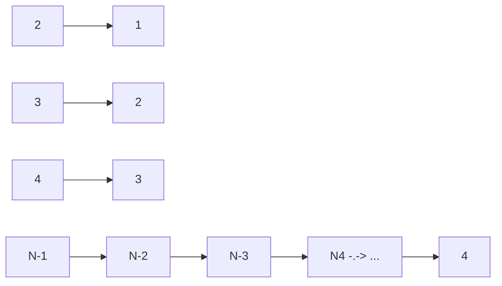
</details>

图 11.9 通过上滤将 N-1 递减到 0 花费  $\Theta(N)$  时间


<details>
<summary>flowchart</summary>

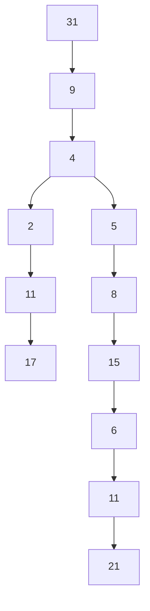
</details>

图 11.10 样例左式堆 H


<details>
<summary>flowchart</summary>

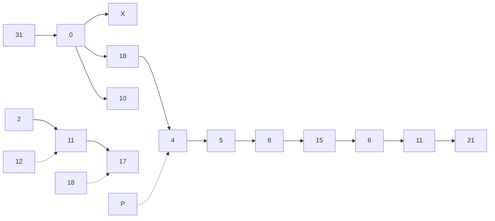
</details>

图 11.11 将 9 降到 0 引起堆序的破坏

我们不想把 0 上滤到根，因为正如我们已经看到的，存在一些情形使得这样做代价太大。解决的办法是把堆沿着虚线切开，如此得到两棵树，然后再把这两棵树合并成一棵。令 X 为要执行 decreaseKey 操作的节点，令 P 为它的父节点。在切断以后我们得到两棵树，即根为 X 的  $H_{1}$ ，以及  $T_{2}$ ，它是原来的树除去  $H_{1}$  后得到的树。具体情况如图 11.12 所示。


图 11.12 切断之后得到的两棵树

如果这两棵树都是左式堆，那么它们可以以时间 $O(\log N)$ 合并，整个操作也就完成了。容易看出，$H_{1}$ 是左式堆，因为没有节点的后裔发生变化。由于它的所有节点原本就满足左式堆的性质，因此现在仍必然满足。

可是，这种方案似乎还是行不通，因为 $T_{2}$ 未必是左式堆。不过，容易恢复左式堆的性质，这要用到下列两个观察到的结果:

\- 只有从 $P$ 到 $T_{2}$ 的根的路径上的节点可能破坏左式堆的性质，它们可以通过交换子节点来调整。

\- 由于最大右路径长最多有$\lfloor \log (N+1) \rfloor$个节点，因此我们只需检查从 $P$ 到 $T_2$ 的根的路径上的前$\lfloor \log (N+1) \rfloor$个节点。图 11.13 显示 $H_1$ 和将 $T_2$ 转变成左式堆后的 $H_2$。


<details>
<summary>flowchart</summary>

```mermaid
graph LR
  subgraph H1["H1"]
  A["31"] --> B["18"]
  B --> C["0"]
  C --> D["10"]
  end

  subgraph H2["H2"]
  E["12"] --> F["11"]
  F --> G["2"]
  G --> H["4"]
  I["17"] --> J["18"]
  J --> K["5"]
  L["8"] --> M["6"]
  N["15"] --> O["21"]
  P["11"] --> Q["6"]
  end
```
</details>

图 11.13 将  $T_{2}$  转变成左式堆  $H_{2}$  后的情形

因为我们能够以 $O(\log N)$ 步将 $T_{2}$ 转变成左式堆 $H_{2}$，然后合并 $H_{1}$ 和 $H_{2}$，所以我们得到一个在左式堆中执行 decreaseKey 的 $O(\log N)$ 算法。图 11.14 显示的堆是该例的最后结果。


<details>
<summary>flowchart</summary>

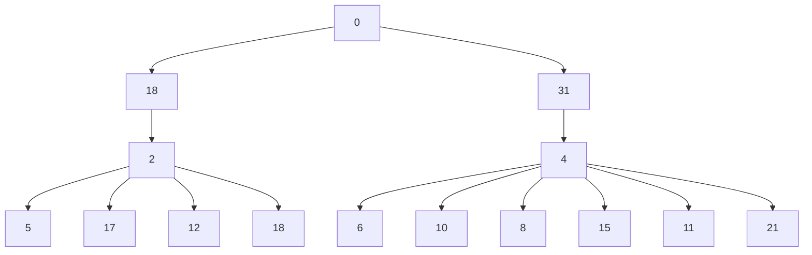
</details>

图11.14 通过合并 $H_{1}$ 和 $H_{2}$ 而完成操作decreaseKey $(X,9)$

## 11.4.2 二项队列的懒惰合并

斐波那契堆所使用的第二个想法是懒惰合并(lazy merging)。我们将把这个想法用于二项队列，并证明执行一次 merge操作(还有插入操作，它是一种特殊情形)的摊还时间为 $O(1)$ 。对于deleteMin，其摊还时间仍然是 $O(\log N)$ 。

这个想法如下:为了合并两个二项队列，只要把二项树的两个表连在一起，结果得到一个新的二项队列。这个新的队列可能含有相同大小的多棵树，因此破坏了二项队列的性质。为了保持一致性，我们将把它叫作懒惰二项队列(lazy binomial queue)。这是一种快速操作，该操作总是花费常数(最坏情形)时间。和前面一样，一次插入通过创建一个单节点二项队列并将其合并而完成，区别在于此处的 merge 是懒惰的。

deleteMin 操作要麻烦得多, 因为此处需要我们最终把懒惰二项队列转变回到标准的二项队列, 不过, 正如我们将要证明的, 它仍然花费 $O(\log N)$ 的摊还时间——但不像以前是 $O(\log N)$ 最坏情形时间。为了执行 deleteMin, 我们找出 (并最终返回) 最小元素。如前所述, 将它从队列中删除, 使得它的每一个儿子都成为一棵新的树。然后通过合并两棵相等大小的树直至不再可能合并为止而把所有的树合并成一个二项队列。

例如，图 11.15 表示一个懒惰二项队列。在一个懒惰二项队列中，可能有多于一棵的树有相同的大小。为了执行 deleteMin，我们照以前那样把最小的元素删除，并得到图 11.16 所示的树。


<details>
<summary>flowchart</summary>

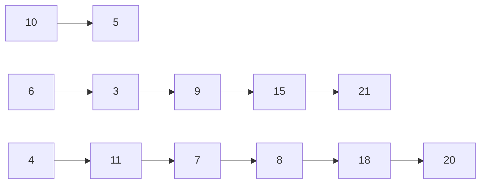
</details>

图11.15 懒惰二项队列


<details>
<summary>flowchart</summary>

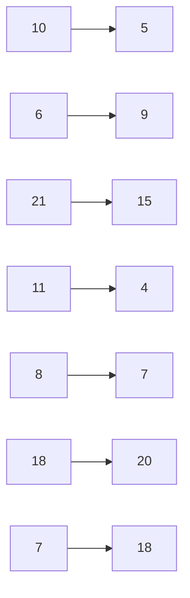
</details>

图11.16 在删除最小元素(3)后的懒惰二项队列

现在我们必须将所有的树合并而得到一个标准的二项队列。一个标准的二项队列每个秩(rank)上最多有一棵树。为了有效地进行这项工作,我们必须能够以正比于出现的树的棵数(T)的时间(或  $\log N$ ，哪个大用哪个)完成 merge。为此，构造表的一个数组: $L_{0}, L_{1}, \cdots, L_{R_{\max} + 1}$ ，其中  $R_{max}$  是最大的树的秩。每个表  $L_{R}$  包含秩为 R 的所有的树。然后应用图 11.17 中的过程。

```txt
for( R = 0; R <= ⌊log N⌋; ++R )
    while( |LR| >= 2 )
    {
        Remove two trees from LR;
        Merge the two trees into a new tree;
        Add the new tree to LR+1;
    }
```

图11.17 恢复二项队列的过程

每通过一次过程中从第4行到第6行的循环，树的总棵数都要减1。这意味着，每次执行都花费常数时间的这部分代码只能够执行 $T - 1$ 次，其中 $T$ 是树的棵数。这里的for循环计数和while循环末尾的检测共花费 $O(\log N)$ 时间，这使得运行时间成为所要求的 $O(T + \log N)$ 。图11.18显示该算法对前面二项树集合的执行情况。

## 懒惰二项队列的摊还分析

为了进行懒惰二项队列的摊还分析，我们将用到与标准二项队列所使用的相同的位势函数。因此，懒惰二项队列的位势就是树的棵数。


<details>
<summary>flowchart</summary>

This image displays a network graph structure diagram, showing relationships between numbered nodes and their associated values.
</details>

图11.18 把一些二项树合并成一个二项队列

## 定理 11.3

对于懒惰二项队列，merge 和 insert 的摊还运行时间均为  $O(1)$ ，deleteMin 的摊还运行时间为  $O(\log N)$ 。

## 证明:

这里的位势函数为二项队列的集合中树的棵数。初始的位势为 0，而且位势总是非负的。因此，经过一系列的操作之后，总的摊还时间是总的运行时间的一个上界。

对于 merge 操作，实际时间为常数，而二项队列的集合中树的棵数是不变的，因此，由方程(11.2)可知摊还时间为  $O(1)$ 。

对于 insert 操作，其实际时间是常数，而树的棵数最多增加 1，因此摊还时间为  $O(1)$ 。

deleteMin 操作比较复杂。令 $R$ 为包含最小元素的树的秩，而令 $T$ 是树的棵数。于是，在 deleteMin 操作开始时的位势为 $T$ 。为执行一次 deleteMin，最小节点的各子节点被分离开而成为一棵一棵的树。这就产生了 $T + R$ 棵树，这些树必须要合并成一个标准的二项队列。如果忽略大 O 记法中的常数，那么根据上面的论述可知，执行该操作的实际时间为 $T + R + \log N$ 。①另一方面，一旦做完这些，剩下的最多可能还有 $\log N$ 棵树，因此位势函数最多可能增加 $(\log N) - T$ 。把实际时间和位势的变化加起来得到摊还时间界为 $2\log N + R$ 。由于所有的树都是二项树，因此 $R \leqslant \log N$ 。这样，我们得到 deleteMin 操作的摊还时间界 $O(\log N)$ 。

## 11.4.3 斐波那契堆操作

正如我们前面提到的，斐波那契堆将左式堆 decreaseKey 操作与懒惰二项队列的 merge 操作结合起来。遗憾的是，我们不能一点修改也不做而使用这两种操作。问题在于，如果在这些二项树中进行随意切割，那么结果得到的森林将不再是二项树的集合。因此，每一棵树的秩最多为 $\lfloor\log N\rfloor$ 的结论将不再成立。由于在懒惰二项队列中 deleteMin 的摊还时间界已被证明是 $2\log N+R$，因此，为使 deleteMin 的界成立我们需要 $R=O(\log N)$。

<small><span class="docvortex-page-footnote" data-block-type="page_footnote" style="color:#6b7280">① 我们能够这么做是因为可以把大O记号所蕴涵的常数放在位势函数中并仍可消去这些项，这在该证明中是需要的。</span></small>

为了保证 $R = O(\log N)$，我们对所有的非根节点应用下述法则:

- 将第一次(因为切除而)失去一个儿子的(非根)节点做上标记。
- 如果被标记的节点又失去另外一个子节点，那么将它从它的父节点切除。这个节点现在变成了一棵分离的树的根并且不再被标记。这叫作一次级联切除(cascading cut)，因为在一次 decreaseKey 操作中可能出现多次这种切除。

图 11.19 显示在 decreaseKey 操作之前斐波那契堆中的一棵树。当关键字为 39 的节点变成 12 的时候，堆序被破坏。因此，该节点从它的父节点中切除，变成了一棵新树的根。由于包含 33 的节点已被做了标记，而这是它的第二个失去的子节点，从而它也被从它的父节点 (10) 中切除。现在，10 也失去了它的第二个儿子，于是它又从 5 中切除。这个过程到这里结束，因为 5 是未做标记的。现在把节点 5 做上标记，结果如图 11.20 所示。


<details>
<summary>flowchart</summary>

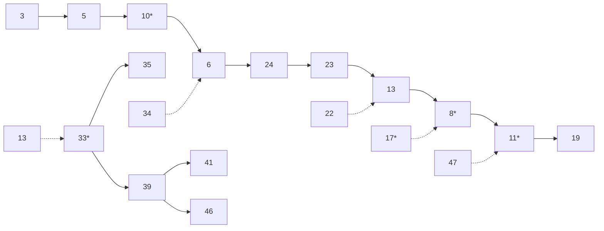
</details>

图 11.19 将 39 减到 12 之前斐波那契堆中的一棵树


<details>
<summary>flowchart</summary>

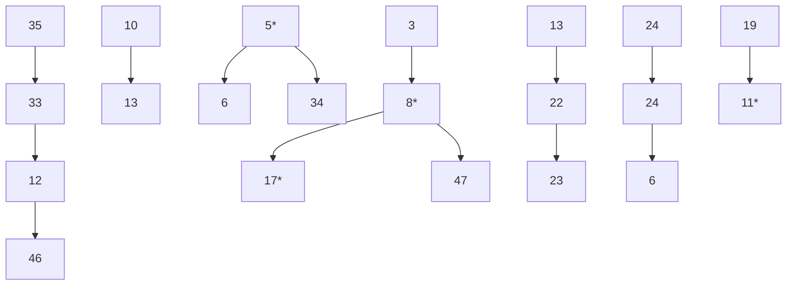
</details>

图 11.20 在 decreaseKey 操作之后斐波那契堆中得到的结果

注意，过去被做过标记的节点 10 和 33 不再被标记，因为现在它们都是根节点。这对于我们在时间界的证明中是极其重要的。

## 11.4.4 时间界的证明

我们知道，标记节点的原因是我们需要给任一节点的秩 $R$ （子节点的个数）确定一个界。现在我们证明具有 $N$ 个后裔的任意节点的秩为 $O(\log N)$ 。

## 引理11.1

令 $X$ 是斐波那契堆中的任一节点，令 $c_{i}$ 为 $X$ 的第 $i$ 个最年长的儿子，则 $c_{i}$ 的秩至少是 $i - 2$。

证明:

在 $c_{i}$ 被链接到 $X$ 上的时候, $X$ 已经有(年长的)儿子 $c_{1}, c_{2}, \cdots, c_{i-1}$ 。于是, 当链接到 $c_{i}$ 时 $X$ 至少有 $i-1$ 个儿子了。由于节点只有当它们有相同的秩的时候才链接, 由此可知, 在 $c_{i}$ 被链接到 $X$ 上的时候 $c_{i}$ 至少也有 $i-1$ 个儿子。从这个时候起, 它可能已经至多失去一个儿子, 否则它就已经被从 $X$ 切除。因此, $c_{i}$ 至少有 $i-2$ 个儿子。

从引理11.1容易证明，秩为 $R$ 的任意节点必然有许多后裔。

引理 11.2

令 $F_{k}$ 是由 $F_{0} = 1, F_{1} = 1$，以及 $F_{k} = F_{k - 1} + F_{k - 2}$ 定义的斐波那契数（见1.2节），则秩为 $R \geqslant 1$ 的任意节点至少有 $F_{R + 1}$ 个后裔（包括它自己）。

证明:

令 $S_{R}$ 是秩为 $R$ 的最小的树。显然，$S_{0} = 1$ 和 $S_{1} = 2$ 。根据引理11.1，秩为 $R$ 的一棵树必然含有秩至少为 $R - 2, R - 3, \dots, 1$ 和0的子树，再加上另一棵至少有一个节点的子树。连同 $S_{R}$ 的根本身一起，这就给出 $S_{R > 1}$ 的一个最小值 $S_{R} = 2 + \sum_{i=0}^{R-2} S_{i}$ 。容易证明，$S_{R} = F_{R+1}$ （练习1.11(a))。□

众所周知，因为斐波那契数是以指数增长的，所以直接推出具有 $s$ 个后裔的任意节点的秩最多为 $O(\log s)$ 。于是，我们有

引理11.3

斐波那契堆中任意节点的秩为 $O(\log N)$。

证明:

直接从上面的讨论得出。

假如我们所关心的只是 merge、insert 以及 deleteMin 等操作的时间界，那么现在就可以停止并证明所要的摊还时间界了。当然，斐波那契堆的全部意义在于还要得到一个对于 decreaseKey 的 O(1) 时间界。

对于一次 decreaseKey 操作所需要的实际时间是 1 加上在该操作期间所执行的级联切除的次数。由于级联切除的次数可能会比 $O(1)$ 多很多，为此我们需要用位势的损失来作为补偿。从图 11.20 看到，树的棵数实际上是随着每次级联切除而增加的，因此我们必须增强位势函数，使它包含某种在级联切除期间能够递减的成分。注意，我们不能从位势函数中抛开树的棵数，因为这样就不能够证明 merge 操作的时间界了。再次观察图 11.20 可以看到，级联切除引起被标记节点的个数的减少，因为每个被级联切除分出的节点都变成了未标记的根。由于每次级联切除均花费 1 个单元的实际时间并将树的位势增加 1，因此我们将每个标记的节点算作 2 个位势单位。利用这种方法，我们就获得一种抵消级联切除次数的机会。

定理11.4

斐波那契堆对于 insert、merge 和 decreaseKey 的摊还时间界均为 $O(1)$，而对于 deleteMin 则是 $O(\log N)$。

证明:

位势是斐波那契堆的集合中树的棵数加上两倍的标记节点数。像通常一样，初始的位势为 0 并且总是非负的。于是，经过一系列操作之后，总的摊还时间则是总的实际时间的一个上界。

对于 merge 操作，实际时间为常数，而树和标记节点的数目是不变的，因此根据方程 (11.2)，摊还时间为  $O(1)$ 。

对于 insert 操作，实际时间是常数，树的棵数增加 1，而标记节点的个数不变。因此，位势最多增加 1，所以摊还时间也是 $O(1)$ 。

对于 deleteMin 操作, 令 $R$ 为包含最小元素的树的秩, 并令 $T$ 是操作前树的棵数。为执行一次 deleteMin, 我们再一次将树的儿子分离, 得到另外 $R$ 棵新的树。注意, 虽然这 (通过使它们成为未标记的根) 可以除去一些标记的节点, 但却不能创建另外的标记节点。这 $R$ 棵新树, 和其余 $T$ 棵树一起, 现在必须合并, 根据引理 11.3 其开销为 $T + R + \log N = T + O(\log N)$ 。由于最多可能有 $O(\log N)$ 棵树, 而标记节点的个数又不可能增加, 因此位势的变化最多是 $O(\log N) - T$ 。将实际时间和位势的变化相加则得到 deleteMin 的 $O(\log N)$ 摊还时间界。

最后考虑 decreaseKey 操作。令 $C$ 为级联切除的次数。decreaseKey 的实际开销为 $C + 1$，它是所执行的切除的总数。第一次 (非级联) 切除创建一棵新树从而使位势增 1。每次级联切除都建立一棵新树，但却把一个标记节点转变成未标记的 (根) 节点，合计每次级联切除有一个单位的净损失。最后一次切除还可能把一个未标记节点 (在图 11.20 中这个节点为 5) 转变成标记节点，这就使得位势增加 2。因此，位势总的变化最多是 $3 - C$。把实际时间和位势变化加起来则得到总和为 4，即 $O(1)$。

## 11.5 伸展树

作为最后一个例子，我们来分析伸展树(splay tree)的运行时间。由第4章得知，在对某项 $X$ 进行访问之后，一步展开(splaying)通过下述3种一系列的树操作将 $X$ 移至根处:单旋转(zig)、之字形旋转(zig-zag)和一字形旋转(zig-zig)。树的这些旋转如图11.21所示。我们约定:如果在节点 $X$ 执行一次树的旋转，那么旋转前 $P$ 是它的父节点，(若 $X$ 不是根的儿子) $G$ 是它的祖父节点。


<details>
<summary>text_image</summary>

Mathematical diagram showing tree structures with labeled nodes (A, B, C, P, G) and directional arrows indicating transformation or comparison.
</details>

图11.21 单旋转、之字形旋转和一字形旋转操作，每个都有一个对称的情形(未示出)

我们知道，对节点 $X$ 任意的树操作所需的时间正比于从根到 $X$ 的路径上节点的个数。如果我们把每个单旋转操作计为一次旋转，把每个之字形操作或一字形操作计为两次旋转，那么任何访问的开销等于1加上旋转的次数。

为了证明展开操作的 $O(\log N)$ 摊还时间界，我们需要一个位势函数，该函数对整个展开操作最多能够增加 $O(\log N)$，而且还将消去在该步操作期间所执行的旋转的次数。找出满足这些原则的位势函数绝非一件容易的事情。首先容易猜到的位势函数或许就是树上所有节点的深度的和。但是，这个猜测行不通，因为位势在一次访问期间可能增加 $\Theta(N)$ 。当一些元素以有序的顺序插入时就会有这样的典型例子发生。

一个确实有效的位势函数 $\Phi$ 定义为

$$
\Phi (T) = \sum_ {i \in T} \log S (i)
$$

其中， $S(i)$ 代表 $i$ 的后裔的个数(包括 $i$ 自身)。这个位势函数是对树 $T$ 所有节点 $i$ 所取的 $S(i)$ 的对数和。

为简化记号，我们定义

$$
R (i) = \log S (i)
$$

这使得

$$
\Phi (T) = \sum_ {i \in T} R (i)
$$

$R(i)$ 代表节点 i 的秩(rank)。这个术语类似于我们在不相交集算法、二项队列和斐波那契堆的分析中所使用的术语。在所有这些数据结构中，秩(rank)的含义多少有些不同，然而，秩一般来说是指树大小的对数的阶(幅度——magnitude)。对于具有 N 个节点的一棵树 T，根的秩就是  $R(T)=\log N$ 。用秩的和作为位势函数，类似于使用高度的和作为位势函数。重要的差别在于，当一次旋转可以改变树中许多节点的高度时，却只有 X、P 和 G 的秩发生变化。

在证明主要的定理之前，我们需要下列的引理。

引理 11.4

如果 $a + b \leqslant c$，且 $a$ 和 $b$ 均为正整数，那么

$$
\log a + \log b \leqslant 2 \log c - 2
$$

证明:

根据算术-几何平均不等式:

$$
\sqrt {a b} \leqslant (a + b) / 2
$$

于是

$$
\sqrt {a b} \leqslant c / 2
$$

两边平方得到

$$
a b \leqslant c ^ {2} / 4
$$

两边再取对数则定理得证。

我们现在就来证明主要定理，证明过程中要注意所用到的一些预备知识。

定理 11.5

在节点 $X$ 展开一棵根为 $T$ 的树的摊还时间最多为 $3(R(T) - R(X)) + 1 = O(\log N)$。

证明:

位势函数取为 T 中节点的秩的和。

如果 $X$ 是 $T$ 的根, 那么不存在旋转, 因此位势没有变化。访问该节点的实际时间是 1 。于是, 摊还时间为 1 , 定理成立。因此, 我们可以假设至少有一次旋转。

对于任意一步展开操作，令 $R_{i}(X)$ 和 $S_{i}(X)$ 是在这步操作前 $X$ 的秩和大小，并令 $R_{f}(X)$ 和 $S_{f}(X)$ 是紧接在这步展开操作后 $X$ 的秩和大小。我们将证明对一次单旋转所需要的摊还时间最多为 $3(R_{f}(X) - R_{i}(X)) + 1$ ，而对一次之字形旋转或一字形旋转的摊还时间最多为 $3(R_{f}(X) - R_{i}(X))$ 。我们还将证明，当对所有各步展开求和时，所得到的和就是想要的时间界。

一步单旋转: 对于单旋转, 一次旋转的实际时间为 1 , 而位势变化为 $R_{f}(X) + R_{f}(P) - R_{i}(X) - R_{i}(P)$ 。注意, 位势变化容易计算, 因为只有 $X$ 的树和 $P$ 的树大小有变化。于是, 用 AT 表示摊还时间, 则

$$
\mathrm{AT} _ {\mathrm{zig}} = 1 + R _ {f} (X) + R _ {f} (\mathrm{P}) - R _ {i} (X) - R _ {i} (P)
$$

从图11.21我们看到 $S_{i}(P)\geqslant S_{f}(P)$ ，因此得到 $R_{i}(P)\geqslant R_{f}(\mathbf{P})$ 。这样，

$$
\mathrm{AT} _ {\mathrm{zig}} \leqslant 1 + R _ {f} (X) - R _ {i} (X)
$$

由于 $S_{f}(X) \geqslant S_{i}(X)$，于是 $R_{f}(X) - R_{i}(X) \geqslant 0$，因此可以增大右边，得到

$$
\mathrm{AT} _ {\mathrm{zig}} \leqslant 1 + 3 (R _ {f} (X) - R _ {i} (X))
$$

一步之字形旋转:对于这种情况，实际的开销是2，而位势变化为 $R_{f}(X) + R_{f}(P) + R_{f}(G) - R_{i}(X) - R_{i}(P) - R_{i}(G)$ 。这就给出一个摊还时间界:

$$
\mathrm{AT} _ {\text {zig-zag}} = 2 + R _ {f} (X) + R _ {f} (P) + R _ {f} (G) - R _ {i} (X) - R _ {i} (P) - R _ {i} (G)
$$

从图11.21我们看到， $S_{f}(X) = S_{i}(G)$ ，于是它们的秩必然相等。因此得到

$$
\mathrm{AT} _ {\text {zig-zag}} = 2 + R _ {f} (P) + R _ {f} (G) - R _ {i} (X) - R _ {i} (P)
$$

我们还看到 $S_{i}(P)\geqslant S_{i}(X)$ 。因而 $R_{i}(X)\leqslant R_{i}(P)$ 。代入右边得到

$$
\mathrm{AT} _ {\text {zig-zag}} \leqslant 2 + R _ {f} (P) + R _ {f} (G) - 2 R _ {i} (X)
$$

从图11.21我们看到 $S_{f}(P) + S_{f}(G)\leqslant S_{f}(X)$ 。如果应用引理11.4，则得到

$$
\log S _ {f} (P) + \log S _ {f} (G) \leqslant 2 \log S _ {f} (X) - 2
$$

由秩的定义可知，它变成

$$
R _ {f} (P) + R _ {f} (G) \leqslant 2 R _ {f} (X) - 2
$$

我们将其代入，则得

$$
\begin{array}{l} \mathrm{AT} _ {\text {zig - zag}} \leqslant 2 R _ {f} (X) - 2 R _ {i} (X) \\ \leqslant 2 \left(R _ {f} (X) - R _ {i} (X)\right) \\ \end{array}
$$

由于 $R_{f}(X)\geqslant R_{i}(X)$ ，因此得到

$$
\mathrm{AT} _ {\mathrm{zig-zag}} \leqslant 3 (R _ {f} (X) - R _ {i} (X))
$$

一步一字形旋转:第三种情况就是一字形旋转。这种情形的证明非常类似于之字形的情