形。重要的不等式是 $R_{f}(X) = R_{i}(G), R_{f}(X) \geqslant R_{f}(P), R_{i}(X) \leqslant R_{i}(P)$，以及 $S_{i}(X) + S_{f}(G) \leqslant S_{f}(X)$。我们把具体细节留作练习11.8。

整个展开的摊还开销是各步展开的摊还开销的和。图11.22显示在节点2的一次展开中所执行的各步展开的过程。令 $R_{1}(2)$ 、 $R_{2}(2)$ 、 $R_{3}(2)$ 和 $R_{4}(2)$ 是这4棵树每棵在节点2的秩。第一步是之字形旋转，其开销最多为 $3(R_{2}(2) - R_{1}(2))$ 。第二步是一字形旋转，其开销为 $3(R_{3}(2) - R_{2}(2))$ 。最后一步是单旋转，开销不超过 $3(R_{4}(2) - R_{3}(2)) + 1$ 。因此总的开销是 $3(R_{4}(2) - R_{1}(2)) + 1$ 。

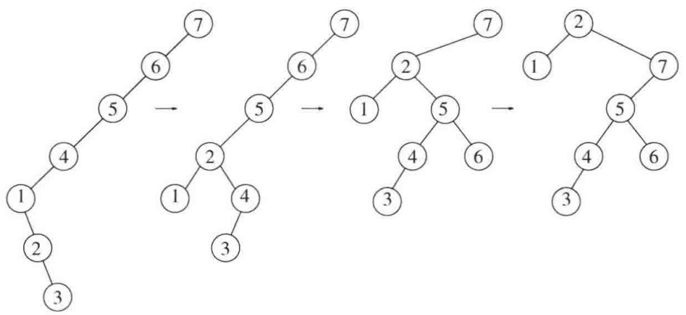

<details>
<summary>flowchart</summary>

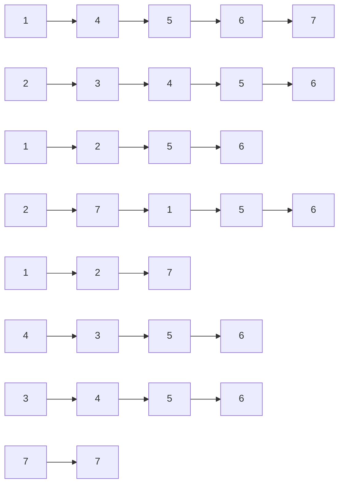
</details>

图 11.22 在节点 2 展开中所涉及到的各步展开

一般来说，通过把所有旋转——其中最多有一次旋转可能是单旋转——的摊还时间加起来，我们看到，在节点 $X$ 展开的总的摊还开销最多为 $3(R_{f}(X) - R_{i}(X)) + 1$ ，其中 $R_{i}(X)$ 是 $X$ 在第一步展开前的秩，而 $R_{f}(X)$ 是 $X$ 在最后一步展开后的秩。由于最后一步展开把 $X$ 留在根处，因此我们得到 $3(R_{f}(T) - R_{i}(X)) + 1$ 的摊还界，这个界为 $O(\log N)$ 。

因为对一棵伸展树的每次操作都需要一次展开，因此任一操作的摊还开销是在一步展开的摊还时间的一个常数倍数之内。因此，所有伸展树的访问操作均花费 $O(\log N)$ 摊还时间。为了证明插入和删除均花费 $O(\log N)$ 的摊还时间，应该对发生在一步展开之前或之后的位势变化做出进一步说明。

在插入的情况下，假设我们正在对一棵 N-1 个节点的树进行插入操作。于是，在插入之后我们得到一颗 N 个节点的树，且展开的界适用。然而，在叶节点的插入将把展开之前的位势加到从叶节点到根节点的路径上的每一个节点上。令  $n_{1}, n_{2}, \cdots, n_{k}$  为叶节点插入前的路径上的那些节点 ( $n_{k}$  是根节点)，并设它们的大小为  $s_{1}, s_{2}, \cdots, s_{k}$ 。在插入之后，大小变成了  $s_{1} + 1, s_{2} + 1, \cdots, s_{k} + 1$ 。(该叶对位势的影响为 0，所以可以忽略。) 注意， $s_{j} + 1 \leqslant s_{j+1}$ （不包括根节点），于是， $n_{j}$  的新的秩不超过  $n_{j+1}$  的老秩。因此，秩的增长，即从添加一个新叶节点得到的位势增长的最大值，不会超过根的新秩  $O(\log N)$ 。

删除是由将一棵树连接到另一棵树完成的，它不属于展开。删除不增加节点的秩，但是却受限于 $\log N$ （并由一个节点被删除而得以补偿，而这个节点当时是树的根）。因此，展开的开销准确地表达了删除开销的界。

通过使用更一般的位势函数，能够证明展开树具有若干显著的性质。更多的细节将在练习中讨论。

## 小结

在这一章，我们看到摊还分析如何能够用来在一些操作之间分摊负荷。为了进行分析，我们构造一个虚构的位势函数，这个位势函数度量系统的状态。高位势的数据结构具有挥发的特性，它建立在相对低廉的操作之上。当昂贵的开销来自一次操作的时候，它会由前面一些操作节省下的积蓄来支付。可以把位势看成是对付灾难的潜能，因为非常昂贵的操作只有在数据结构具有一个高的位势，并且已经使用了比规定的显著少的时间时才可能发生。

数据结构中的低位势意味着，每次操作的开销大致等于指定给它的消耗量。负位势意味着欠债；花费的时间多于规定的时间，因此分配(或摊还)的时间不是一个有意义的界。

正如方程(11.2)所表达的, 一次操作的摊还时间等于实际时间和位势变化的和。整个操作序列的摊还时间等于总的序列操作时间加上位势的净变化。只要这个净变化是正的, 那么摊还界就提供了实际时间花费的一个上界, 从而这个摊还界是有意义的。

选择位势函数的关键在于保证最小的位势要出现在算法的开始，并使得位势对低廉的操作增加而对高昂的操作减少。重要的是，超额或节省的时间要由位势中相反的变化来度量。遗憾的是，这有时候说着容易，但做起来颇为犯难。

## 练习

11.1 什么时候向一个二项队列进行连续 M 次插入花费少于 2M 个单位的时间？
11.2 设建有 $N = 2^{k} - 1$ 个元素的一个二项队列。交替进行 $M$ 对 insert 和 deleteMin 操作。显然，每次操作花费 $O(\log N)$ 时间。为什么这与插入的 $O(1)$ 摊还时间界不矛盾？
\*11.3 通过给出导致一次 merge 需要 $\Theta(N)$ 时间的一系列操作, 证明对于正文中描述的斜堆操作的 $O(\log N)$ 摊还界不能转换成最坏情形界。
\*11.4 指出如何进行一趟自顶向下的操作合并两个斜堆，并将 merge 的开销减到 $O(1)$ 摊还时间。
11.5 扩展斜堆以支持具有  $O(\log N)$  摊还时间的 decreaseKey 操作。
11.6 实现斐波那契堆，并比较在用于 Dijkstra 算法时它与二叉堆的性能。
11.7 斐波那契堆的标准实现方法需要每个节点 4 个链(父亲、儿子以及两个兄弟)。指出如何减少链的数量而使其最多花费运行时间的一个常数倍。
11.8 证明一次一字形展开的摊还时间最多为 $3(R_{f}(\mathbf{X}) - R_{i}(X))$。
11.9 通过改变位势函数能够证明展开操作的不同的界。令权函数(weight function) $W(i)$ 为某个指定给树中每个节点的函数，令 $S(i)$ 为以i为根的子树上所有节点(包括节点i本身)的权的和。对于所有的节点均为 $W(i)=1$ 的特殊情况对应着用于展开界的证明中的权函数。令N为树中节点的个数，并令M为访问的次数。证明下列两个定理:
a. 总的访问时间是  $O(M + (M + N) \log N)$ 。
\*b. 如果 $q_{i}$ 为项 $i$ 被访问的次数，而对所有的 $i, q_{i} > 0$ ，那么总的访问时间为

$$
O \Bigg (M + \sum_ {i = 1} ^ {N} q _ {i} \log (M / q _ {i}) \Bigg)
$$

11.10 a. 指出如何实现对伸展树的 merge 操作，使得从 N 个单元素树开始的任意 N-1 次 merge 操作序列花费  $O(N \log^{2} N)$  时间。

\*b. 将这个界改进为  $O(N \log N)$ 。

11.11 我们在第 5 章描述了再散列(rehashing): 当一个表的表元素超过容量一半的时候, 则构造一个两倍大的新表, 且整个的老表要被再散列。使用位势函数给出一个正式的摊还分析来证明一次插入操作的摊还开销仍为 $O(1)$ 。

11.12 斐波那契堆的最大深度是多少？

11.13 具有堆序的双端队列(deque)是由一些项的表组成的数据结构，可以对其进行下列操作:

push(x): 将项 x 插入到双端队列的前端。

pop():从双端队列中除去前端项并将它返回。

inject(x): 把项 x 插入到双端队列的尾端。

eject(): 从双端队列中除去尾端项并将它返回。

findMin(): 返回双端队列的最小项。

a. 描述如何以每个操作常数摊还时间支持这些操作。

\*\*b. 描述如何以每个操作常数最坏情形时间支持这些操作。

11.14 证明二项队列实际上以 $O(1)$ 摊还时间支持合并操作。定义二项队列的位势为树的棵数加上最大树的秩。

11.15 设为了打算节省时间，我们把展开对每隔一次树操作进行。此时的摊还开销还是对数的吗？

11.16 在伸展树的界的证明中使用位势函数, 伸展树的最大位势和最小位势是多少? 在一次展开中, 位势函数可以减少多少? 在一次展开中, 位势函数可以增加多少? 可以给出大 O 解答。

11.17 作为展开的结果，在访问路径上的大部分节点都朝根的方向移动，而该路径上的少数几个节点却向下移动一层。这就提出使用一个和来作为位势函数的想法，而该和是对所有节点的深度的对数相加而得。

a. 该位势函数的最大值是多少？

b. 该位势函数的最小值是多少?

c. a 问和 b 问的答案的差给出某种提示，即该位势函数不是太好。证明，一次展开操作可能使位势增加 $\Theta(N/\log N)$ 。

## 参考文献

论文[10]提供了对摊还分析极好的综述。

下面的参考文献中有许多和前几章的引文重复，我们再次引用它们是为了方便和完善。二项队列首先在文献[11]中阐述并在文献[1]中分析。练习11.3和练习11.4的解法见于论文[9]。

斐波那契堆在文献[3]中描述。练习11.9(a)指出，在最佳静态查找树的一个常数因子范围之内伸展树是最优的。练习11.9(b)则指出，伸展树在最佳最优查找树的一个常数因子之内是最优的。这些以及另外两个强结果在原始的伸展树论文[7]中均有证明。

摊还概念在文献[2]中使用，以有效地合并平衡查找树。伸展树的 merge 操作在文献[6]中描述。练习 11.13 的一种解法可在文献[4]中找到。练习 11.14 取自文献[5]。

在文献[8]中使用摊还分析设计一种联机算法，该算法处理一系列查询，其所花费的时间比同类问题的脱机算法只多出一个常数因子。

1. M. R. Brown, "Implementation and Analysis of Binomial Queue Algorithms," SIAM Journal on Computing, 7 (1978), 298–319.
2. M. R. Brown and R. E. Tarjan, "Design and Analysis of a Data Structure for Representing Sorted Lists," SIAM Journal on Computing, 9 (1980), 594–614.
3. M. L. Fredman and R. E. Tarjan, "Fibonacci Heaps and Their Uses in Improved Network Optimization Algorithms," Journal of the ACM, 34 (1987), 596–615.
4. H. Gajewska and R. E. Tarjan, "Deques with Heap Order," Information Processing Letters, 22 (1986), 197–200.
5. C. M. Khoong and H. W. Leong, "Double-Ended Binomial Queues," Proceedings of the Fourth Annual International Symposium on Algorithms and Computation (1993), 128–137.
6. G. Port and A. Moffat, "A Fast Algorithm for Melding Splay Trees," Proceedings of First Workshop on Algorithms and Data Structures (1989), 450–459.
7. D. D. Sleator and R. E. Tarjan, "Self-adjusting Binary Search Trees," Journal of the ACM, 32 (1985), 652–686.
8. D. D. Sleator and R. E. Tarjan, "Amortized Efficiency of List Update and Paging Rules," Communications of the ACM, 28 (1985), 202–208.
9. D. D. Sleator and R. E. Tarjan, "Self-adjusting Heaps," SIAM Journal on Computing, 15 (1986), 52–69.
10. R. E. Tarjan, "Amortized Computational Complexity," SIAM Journal on Algebraic and Discrete Methods, 6 (1985), 306–318.
11. J. Vuillemin, "A Data Structure for Manipulating Priority Queues," Communications of the ACM, 21 (1978), 309–314.

## 第12章 高级数据结构及其实现

本章讨论 6 种重点在于实用的数据结构。首先考查第 4 章讨论过的 AVL 树的一些变种，包括优化的伸展树，红黑树，以及 treap 树。我们还要考察后缀树 (suffix tree)，它能够在大文本中对一个模式 (pattern) 进行搜索。

然后，我们考查一种可以用于多维数据的数据结构。在这种情况下，每一项均可有多个关键字。k-d树对任何相关的关键字都能够进行查找。

最后，我们考查配对堆(pairing heap)，它似乎是对斐波那契堆一种最实用的变种。

复议的论题包括:

- 在适当的时候，非递归的自顶向下(而不是自底向上)查找树的一些实现方法。
- 此外，主要就是一些利用标记节点的程序实现。

## 12.1 自顶向下伸展树

在第 4 章，我们讨论了基本的伸展树操作。当一项 X 作为树叶被插入时，一系列的树旋转使得 X 成为树的新根，我们称这一系列的树旋转为展开(splay)。展开操作也在查找期间执行，而且如果一项没有找到，那么就要对访问路径上最后的节点实施一次展开。在第 11 章我们证明了，一次展开树操作的摊还时间为  $O(\log N)$ 。

这种策略的直接实现需要从根沿树向下的一次遍历，以及而后从底向上的一次遍历以实现展开的步骤。这或者可以通过保存一些父链来完成，或者通过将访问路径存储到一个栈中来完成。但遗憾的是，这两种方法均需要大量的系统开销，而且二者都必须处理许多特殊的情形。在这一节，我们指出如何对初始访问路径施行一些旋转，结果得到在实践中更快的过程，它只用到 $O(1)$ 的附加空间，但却保持了 $O(\log N)$ 的摊还时间界。

图 12.1 列出单旋转、一字形旋转和之字形旋转这三种情形旋转。(按照惯例，这里忽略 3 种对称的旋转。)在访问的任一时刻，我们都有一个当前节点 X，它是其子树的根，在我们的图中它被表示成“中间”的树。 $^{①}$  树 L 存储那些在树 T 中，但不在 X 子树中的小于 X 的节点；类似地，树 R 存储那些在树 T 中，但不在 X 子树中的大于 X 的节点。初始时 X 为 T 的根，而 L 和 R 是空树。

如果旋转是一次单旋转，那么根在 $Y$ 的树变成中间树的新根。$X$ 和子树 $B$ 作为 $R$ 中最小项的左儿子而附接到 $R$ 上；$X$ 的左儿子逻辑上成为 nullptr。② 结果，$X$ 成为 $R$ 中新的最小项。特别要注意，为使单旋转情形适用，$Y$ 不一定必须是树叶。如果查找小于 $Y$ 的一项，而 $Y$ 没有左儿子(但确有一个右儿子)，那么这种单旋转情形将是适用的。

<small><span class="docvortex-page-footnote" data-block-type="page_footnote" style="color:#6b7280">① 为简单起见，我们不区分一个“节点”和该节点中的项。<br>② 在程序中，R 的最小节点没有 nullptr 左链，因为没有必要。这意味着，printTree(r) 将包含某些项，这些项逻辑上不在 R 中。</span></small>

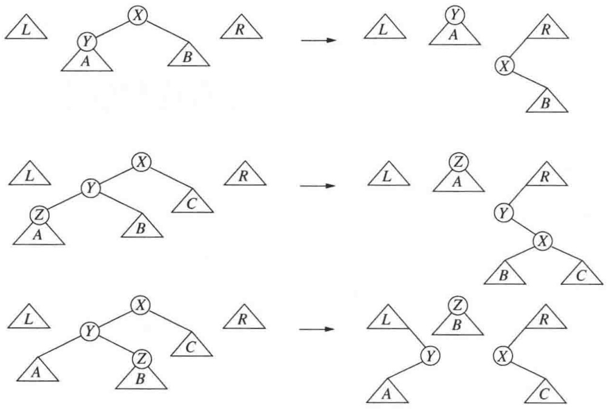

<details>
<summary>flowchart</summary>

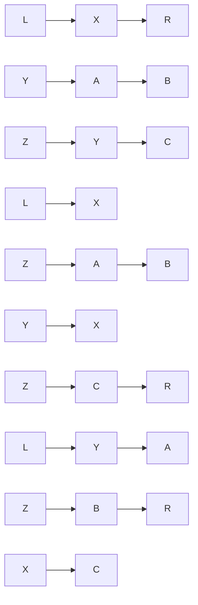
</details>

图 12.1 自顶向下展开旋转:单旋转、一字形旋转及之字形旋转

对于一字形情形，我们有类似的剖析。关键是要在 $X$ 和 $Y$ 之间施行一次旋转。之字形情形的旋转把底部节点 $Z$ 带到中间树的顶部，并把子树 $X$ 和 $Y$ 分别附接到 $R$ 和 $L$ 上。注意，$Y$ 被附接后从而成为 $L$ 中的最大项。

之字形旋转这一步多少可以得到简化，因为没有旋转要执行，我们不再让 $Z$ 成为中间树的根，而是让 $Y$ 成为其根，如图12.2所示。因为之字形情形的动作变成与单旋转情形相同，所以编程得到简化。看起来这是有利的，因为对大量情形的测试是要耗时的。其缺点在于，为了仅仅降低一层，我们在展开过程中却要进行更多的迭代。

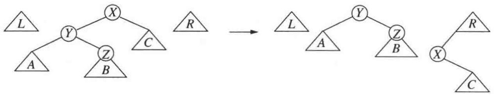

<details>
<summary>flowchart</summary>

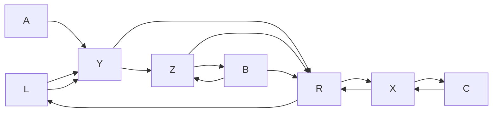
</details>

图 12.2 简化的自顶向下的之字形旋转

图 12.3 指出，一旦执行完最后一步展开，我们将如何处理 L、R 和中间树以形成单一的一棵树。特别要注意，这里的结果不同于从底部向上的展开。关键的问题在于，它保持了  $O(\log N)$  的摊还界（练习 12.1）。

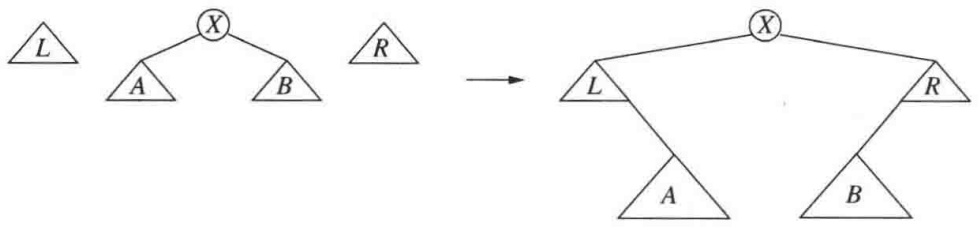

<details>
<summary>flowchart</summary>

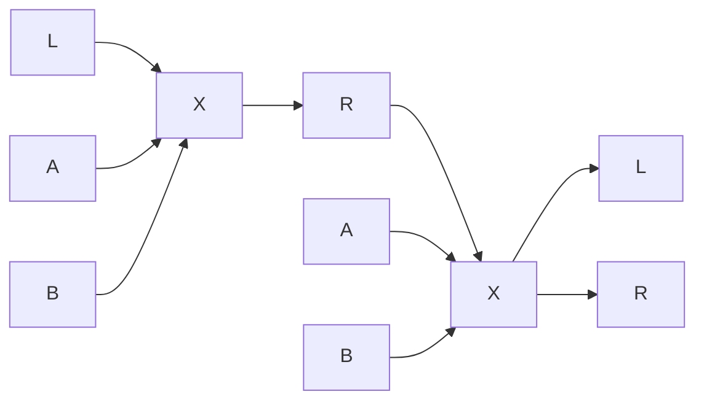
</details>

图 12.3 自顶向下展开的最后整理

顶部向下展开算法的一个例子如图 12.4 所示。我们想要访问树中的 19。第一步是一个之字形旋转。根据图 12.2(的对称形式)，我们把根在 25 的子树带到中间树的根处，并把 12 和它的左子树接到 L 上。

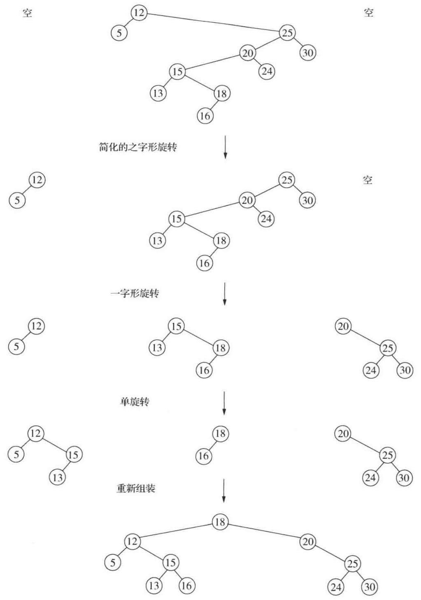

<details>
<summary>flowchart</summary>

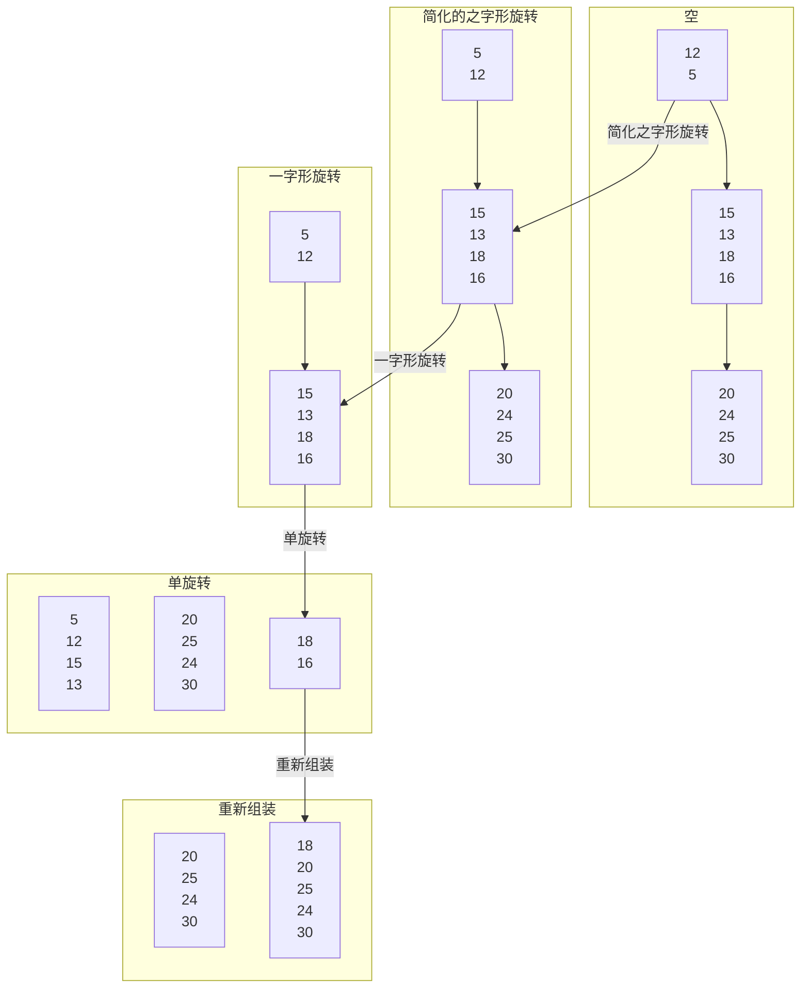
</details>

图 12.4 （访问上面树中的 19）自顶向下展开中的各步

下一步是一字形旋转:15 被提升到中间树的根处，并在 20 和 25 之间进行一次旋转，所得到的子树被附接到 R 上。此时查找 19 导致最后的单旋转。中间树的新根为 18，而 15 和它的左子树作为 L 的最大节点的右儿子被接到 L 上。根据图 12.3 重新组装则结束该步展开。

我们将使用带有左链和右链的一个头节点最终包含左树的根和右树的根。由于这两棵树初始为空，因此使用一个头节点分别对应初始状态右树或左树的最小节点或最大节点。这种方法可以使得程序避免检测空树。左树第一次变成非空时，右指针将被初始化并在以后保持不变。这样，在自顶向下查找的最后它将包含左树的根。类似地，左指针最终将包含右树的根。

SplayTree 类接口连同一个构造函数和一个析构函数如图 12.5 所示。构造函数用到 nullNode 标记。我们使用标记 nullNode 逻辑上表示一个 nullptr 指针；在调用makeEmpty 之后, 析构函数再将其 delete(删)掉。我们将反复使用这种技术来简化代码(因而使得程序多少要快一些)。图 12.6 给出展开过程的代码。这里的 header 节点使我们肯定能够把 $X$ 附接到 $R$ 的最大节点上, 而不必担心 $R$ 可能为空(对于处理 $L$ 的对称的情形可类似地进行)。

```cpp
template <typename Comparable>
class SplayTree
{
    public:
        SplayTree( )
        {
            nullNode = new BinaryNode;
            nullNode->left = nullNode->right = nullNode;
            root = nullNode;
        }

        ~SplayTree( )
        {
            makeEmpty( );
            delete nullNode;
        }

        // 一些与 BinarySearchTree 相同的方法（省略）
        SplayTree( const SplayTree & rhs );
        SplayTree( SplayTree && rhs );
        SplayTree & operator=( const SplayTree & rhs );
        SplayTree & operator=( SplayTree && rhs )

    private:
        struct BinaryNode
        { /* 二叉查找树节点通常的代码 */ };

        BinaryNode *root;
        BinaryNode *nullNode;

        // 一些与 BinarySearchTree 相同的方法（省略）

        // 树操作
        void rotateWithLeftChild( BinaryNode * & k2 );
        void rotateWithRightChild( BinaryNode * & k1 );
        void splay( const Comparable & x, BinaryNode * & t );
};
```

图 12.5 伸展树:类接口、构造函数和析构函数

正如上面提到的，在展开到最后的重新组装之前，header.left 和 header.right 分别指向 R 和 L 的根(这不是一个排印错误——而是遵守链的指向)。除了这个细节之外，该程序是相对简单的。

图 12.7 显示将一项插入到树中的方法。分配一个新的节点(如果需要)，且如果树是空的，那么就建立一棵单节点树。否则，我们围绕被插入的值 x 展开 root。若新根上的数据等于 x，则有一个重复元；我们不是再次插入 x，而是为将来的插入保留 newNode 并立即返回。如果新根包含的值大于 x，那么新根和它的右子树变成 newNode 的一棵右子树，而 root 的左子树则成为 newNode 的左子树。如果 root 的新根包含的值小于 x，那么类似的做法仍然适用。在这两种情况下，newNode 均成为新的根。

```c
/**
 * 执行自顶向下展开的内部方法.
 * 最后访问的节点成为新的根.
 * 为了使用不同的展开算法，可以覆盖这个方法
 * 不过，展开树代码依赖于所访问的
 * 通向根的项.
 * x 是要在其展开的目标项.
 * t 是要展开的子树的根.
 */
void splay( const Comparable & x, BinaryNode * & t )
{
    BinaryNode *leftTreeMax, *rightTreeMin;
    static BinaryNode header;

    header.left = header.right = nullNode;
    leftTreeMax = rightTreeMin = &header;

    nullNode->element = x;   // 保证比较时匹配

    for( ; ; )
        if( x < t->element )
        {
            if( x < t->left->element )
                rotateWithLeftChild( t );
            if( t->left == nullNode )
                break;
            // 链接右侧
            rightTreeMin->left = t;
            rightTreeMin = t;
            t = t->left;
        }
        else if( t->element < x )
        {
            if( t->right->element < x )
                rotateWithRightChild( t );
            if( t->right == nullNode )
                break;
            // 链接左侧
            leftTreeMax->right = t;
            leftTreeMax = t;
            t = t->right;
        }
        else
            break;

        leftTreeMax->right = t->left;
        rightTreeMin->left = t->right;
        t->left = header.right;
        t->right = header.left;
}
```

图 12.6 自顶向下展开方法

```c
void insert( const Comparable & x )
{
    static BinaryNode *newNode = nullptr;

    if( newNode == nullptr )
        newNode = new BinaryNode;
    newNode->element = x;

    if( root == nullNode )
    {
        newNode->left = newNode->right = nullNode;
        root = newNode;
    }
    else
    {
        splay( x, root );
        if( x < root->element )
        {
            newNode->left = root->left;
            newNode->right = root;
            root->left = nullNode;
            root = newNode;
        }
        else
        if( root->element < x )
        {
            newNode->right = root->right;
            newNode->left = root;
            root->right = nullNode;
            root = newNode;
        }
        else
            return;
    }
    newNode = nullptr;   // 故下一次插入将调用 new
}
```

图12.7 自顶向下伸展树的insert函数

在第 4 章，我们证明了伸展树中的删除是容易的，因为一次展开将把删除目标置于根处。最后我们列出图 12.8 中的删除例程。删除过程比对应的插入过程还要短，确实罕见。图 12.8 还展示了 makeEmpty。简单递归的后序遍历回收树节点是不安全的，因为伸展树很可能是不平衡的，即使它给出良好的性能。在这种情况下，递归可能会用尽栈空间。我们使用一种简单的替代方法，它耗时仍然还是 $O(N)$（不过就远没有那么显然了）。对于 operator=需要类似的考虑。

```c
void remove( const Comparable & x )
{
    if( !contains( x ) )
        return;  // 没找到项 x; 什么也不做
```

图 12.8 自顶向下的删除过程和 makeEmpty

```txt
// 如果找到 x，则将通过 contains 向根处展开
        BinaryNode *newTree;

        if( root->left == nullNode )
            newTree = root->right;
        else
        {
            // 找到左子树的最大值
            // 向根节点展开；然后附接上右儿子
            newTree = root->left;
            splay( x, newTree );
            newTree->right = root->right;
        }
        delete root;
        root = newTree;
    }
```

图 12.8(续) 自顶向下的删除过程和 makeEmpty

## 12.2 红黑树

从历史上看，对 AVL 树另一种流行的选择是红黑树(red black tree)。对红黑树的操作在最坏情形下花费  $O(\log N)$  时间，而且我们将看到，(对于插入操作的)一种审慎的非递归实现（与 AVL 树相比）可以相对容易地完成。

红黑树是具有下列着色性质的二叉查找树:

1. 每一个节点或者着成红色，或者着成黑色。
2. 根是黑色的。
3. 如果一个节点是红色的，那么它的子节点必须是黑色的。
4. 从一个节点到一个 null 指针的每一条路径必须包含相同数目的黑色节点。

着色法则的一个结论是，红黑树的高最多是  $2 \log (N + 1)$ 。因此，查找操作保证是一种对数的操作。图 12.9 显示了一棵红黑树，其中的红色节点用双圆圈表示。

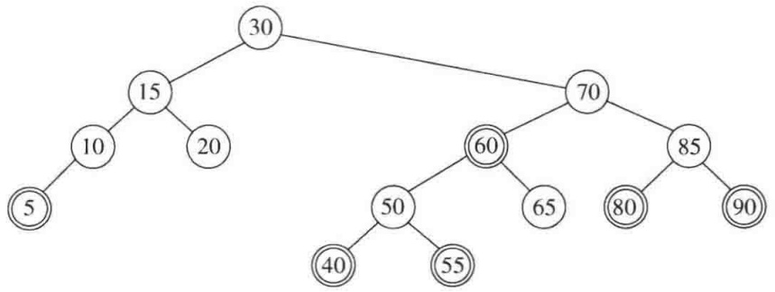

<details>
<summary>flowchart</summary>

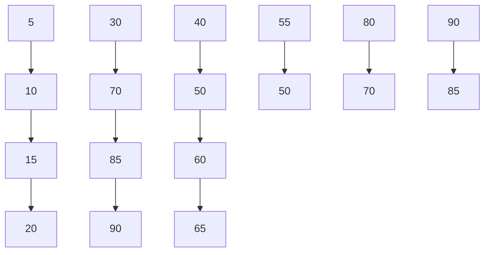
</details>

图 12.9 红黑树的例子(插入序列为:10,85,15,70,20,60,30,50,65,80,90,40,5,55)

和通常一样，困难在于将一个新项插入到树中。通常把新项作为树叶放到树中。如果我们把该项涂成黑色，则肯定违反条件4，因为那将会建立一条更长的黑节点的路径。因此，这一项必须涂成红色。如果它的父节点是黑的，则插入完成。如果它的父节点已经是红色的，

则得到连续红色的节点，这就违反了条件3。在这种情况下，我们必须调整该树以确保条件3满足(且又不引起条件4被破坏)。用于完成这项任务的基本操作是颜色的改变和树的旋转。

## 12.2.1 自底向上的插入

我们已经提到，如果新插入的项的父节点是黑色的，那么插入完成。因此，将 25 插入到图 12.9 的树中是简单的操作。

如果父节点是红色的，那么有几种情形(每种都有一个镜像对称)需要考虑。首先，假设这个父节点的兄弟是黑的(我们采纳约定:null 节点都是黑色的)。这种情形对于插入 3 或 8 是适用的，但对插入 99 不适用。令 $X$ 是新添加的树叶，$P$ 是它的父节点，$S$ 是该父节点的兄弟(若存在)，$G$ 是祖父节点。在这种情形只有 $X$ 和 $P$ 是红的；$G$ 是黑的，因为否则就会在插入前有两个相连的红色节点，违反了红黑树的法则。采用伸展树的术语，$X$、$P$ 和 $G$ 可以形成一个一字形链或之字形链(两个方向中的任一个方向)。图 12.10 指出当 $P$ 是一个左儿子时(注意有一个对称情形)我们如何旋转该树。即使 $X$ 是一片树叶，我们还是画出更一般的情形，使得 $X$ 在树的中间。后面我们将用到这个更一般的旋转。

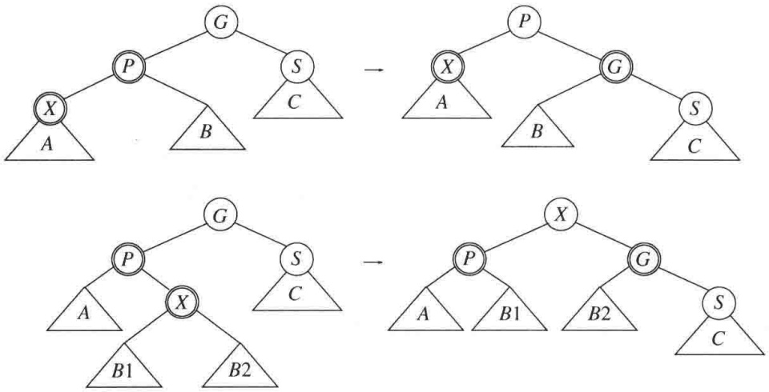

<details>
<summary>flowchart</summary>

This image displays a hierarchical tree structure diagram (a type of flowchart) showing the relationships between nodes labeled with letters and numbers, likely representing a system or data processing workflow.
</details>

图12.10 如果 $S$ 是黑的，则单旋转和之字形旋转有效

第一种情形对应 $P$ 和 $G$ 之间的单旋转，而第二种情形对应双旋转，该双旋转首先在 $X$ 和 $P$ 间进行，然后在 $X$ 和 $G$ 之间进行。当编写程序的时候，我们必须记录父节点、祖父节点，以及为了重新连接还要记录曾祖节点。

在这两种情形下，子树的新根均被涂成黑色，因此，即使原来的曾祖是红的，我们也排除了两个相邻红色节点的可能性。同样重要的是，这些旋转的结果是通向 $A$ 、 $B$ 和 $C$ 诸路径上黑色节点的个数仍然保持不变。

到现在为止一切顺利。但是，正如我们企图将79插入到图12.9树中的情况那样，如果 $S$ 是红色的，那么会发生什么情况呢？在这种情况下，初始时从子树的根到 $C$ 的路径上有一个黑色节点。在旋转之后，一定仍然还是只有一个黑色节点。但在这两种情况下，在通向 $C$ 的路径上都有3个节点(新的根、 $G$ 和 $S$ )。由于只有一个可能是黑的，又由于不能有连续的红色节点，于是我们必须把 $S$ 和子树的新根都涂成红色，而把 $G$ (以及第四个节点)涂成黑色。这很好，可是，如果曾祖节点也是红色的那么又会怎样呢？此时，我们可以将这个过程朝着根的方向上滤(percolate)，就像对B树和二叉堆所做的那样，直到我们不再有两个相连的红色节点，或者到达根(它将被重新涂成黑色)处为止。

## 12.2.2 自顶向下红黑树

上滤的实现需要用一个栈或用一些父链保存路径。我们看到，如果使用一个自顶向下的过程，则伸展树会更有效，事实上我们可以对红黑树应用自顶向下的过程而保证 $S$ 将不会是红色的。

这个过程从概念上讲是容易的。在向下的过程中，当我们看到一个节点 $X$ 有两个红儿子的时候，我们让 $X$ 呈红色而让它的两个儿子是黑的。（如果 $X$ 是根，则在颜色翻转后它将是红的，但是为恢复性质2可以直接着成黑色。）图12.11给出了这种颜色翻转的现象，只有当 $X$ 的父节点 $P$ 也是红的时候这种翻转将破坏红黑的法则。但是此时我们可以应用图12.10中适当的旋转。如果 $X$ 的父节点的兄弟是红的会如何呢？这种可能已经被从顶向下过程中的行动所排除，因此 $X$ 的父节点的兄弟不可能是红的。特别地，如果在沿树向下的过程中我们看到一个节点 $Y$ 有两个红儿子，那么我们知道 $Y$ 的孙子必然是黑的，由于 $Y$ 的儿子也要变成黑的，甚至在可能发生的旋转之后，因此我们将不会看到两层上另外的红节点。这样，当我们看到 $X$ 若 $X$ 的父节点是红的，则 $X$ 的父节点的兄弟不可能也是红色的。

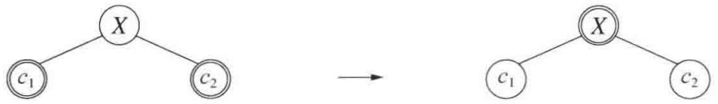

<details>
<summary>flowchart</summary>

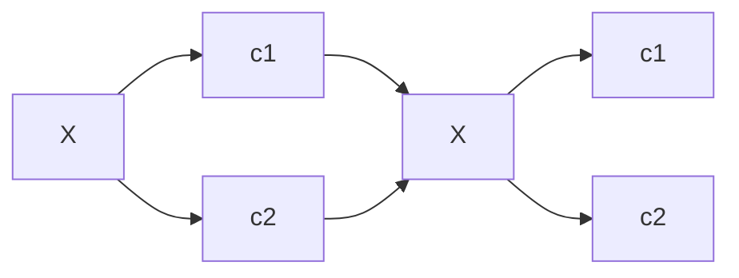
</details>

图12.11 颜色翻转:只有当 $X$ 的父节点是红的时候我们才继续执行一次旋转

例如，假设我们要将 45 插入到图 12.9 所示的树中。在沿树向下的过程中，我们看到节点 50 有两个红儿子。因此，我们执行一次颜色翻转，使 50 为红的，40 和 55 是黑的。现在 50 和 60 都是红的。我们在 60 和 70 之间执行单旋转，使得 60 是 30 的右子树的黑根，而 70 和 50 都是红的。如果我们在路径上看到另外的含有两个红儿子的节点，则继续，执行同样的操作。当我们到达树叶时，把 45 作为红节点插入，由于父节点是黑的，因此插入完成。最后得到的树如图 12.12 所示。

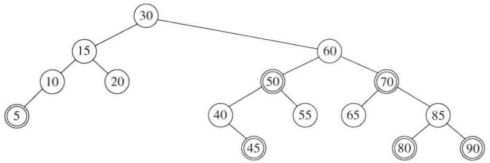

<details>
<summary>flowchart</summary>

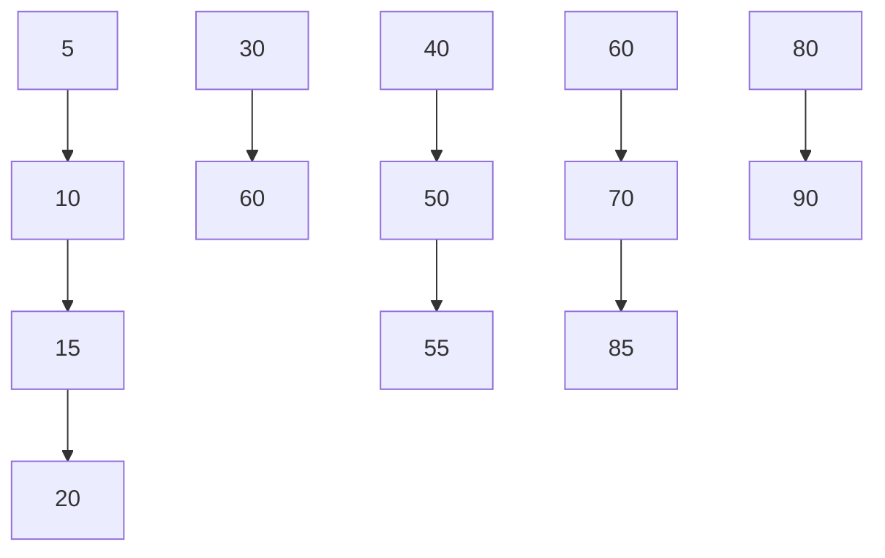
</details>

图12.12 将45插入到图12.9中

如图12.12所示，所得到的红黑树常常平衡得很好。经验指出，平均红黑树大约与平均AVL树一样深，从而查找时间一般接近最优。红黑树的优点是执行插入所需要的开销相对较低，再有就是实践中发生的旋转相对较少。

红黑树的具体实现是很复杂的，这不仅因为有大量可能的旋转，而且还因为一些子树可能是空的(如10的右子树)，以及处理根的特殊的情况(尤其是根没有父亲)。因此，我们使用两个标记节点(sentinel node): 一个是对根的，一个是 nullNode，其作用像在伸展树中那样是指示一个 nullptr 指针。根标记将存储关键字-∞和一个指向真正的根的右链。正因为如此，查找和输出过程均需要调整。递归的例程都很巧妙。图 12.13 指出如何重新编写中序遍历。printTree 诸例程都很简单。测试 t!=t->left 可以写成 t!=nullNode。然而，在一个执行深度拷贝的类似例程中存在一个陷阱。这也显示在图 12.13 中。此处的拷贝构造函数 (copy constructor) 在其他初始化完成之后调用 clone。但在 clone 中，测试 t==nullNode 并不可行，因为 nullNode 是目标的 nullNode，而不是源 (即不是 rhs) 的。因此，我们使用一个更复杂的测试。

```cpp
void printTree( ) const
{
    if( header->right == nullNode )
        cout << "Empty tree" << endl;
    else
        printTree( header->right );
}

void printTree( RedBlackNode *t ) const
{
    if( t != t->left )
    {
        printTree( t->left );
        cout << t->element << endl;
        printTree( t->right );
    }
}

RedBlackTree( const RedBlackTree & rhs )
{
    nullNode      = new RedBlackNode;
    nullNode->left = nullNode->right = nullNode;

    header       = new RedBlackNode{ rhs.header->element };
    header->left  = nullNode;
    header->right  = clone( rhs.header->right );
}

RedBlackNode * clone( RedBlackNode * t ) const
{
    if( t == t->left )  // 不能对 nullNode 测试 !!!
        return nullNode;
    else
        return new RedBlackNode{ t->element, clone( t->left ),
                          clone( t->right ), t->color };
}
```

图 12.13 使用两个警戒标记对树的遍历:printTree 和拷贝构造函数

图 12.14 显示 RedBlackTree 架构以及构造函数。

另外, 图 12.15 显示执行一次单旋转的例程。因为所得到的树必须要附接到一个父节点上, 所以 rotate 把父节点作为一个参数。我们不是在沿树下行时记录旋转的类型, 而是把 item作为一个参数传递。由于我们期望在插入过程中进行很少的旋转，因此，使用这种方式实际上不仅更简单，而且还更快。rotate 直接返回执行一次适当单旋转的结果。

```cpp
template <typename Comparable>
class RedBlackTree
{
    public:
        explicit RedBlackTree( const Comparable & negInf );
        RedBlackTree( const RedBlackTree & rhs );
        RedBlackTree( RedBlackTree && rhs );
        ~RedBlackTree( );

        const Comparable & findMin( ) const;
        const Comparable & findMax( ) const;
        bool contains( const Comparable & x ) const;
        bool isEmpty( ) const;
        void printTree( ) const;

        void makeEmpty( );
        void insert( const Comparable & x );
        void remove( const Comparable & x );

        enum { RED, BLACK };

        RedBlackTree & operator=( const RedBlackTree & rhs );
        RedBlackTree & operator=( RedBlackTree && rhs );

private:
    struct RedBlackNode
    {
        Comparable element;
        RedBlackNode *left;
        RedBlackNode *right;
        int color;

        RedBlackNode( const Comparable & theElement = Comparable{ },
            RedBlackNode *lt = nullptr, RedBlackNode *rt = nullptr,
            int c = BLACK )
        : element{ theElement }, left{ lt }, right{ rt }, color{ c } { }

        RedBlackNode( Comparable && theElement, RedBlackNode *lt = nullptr,
            RedBlackNode *rt = nullptr, int c = BLACK )
        : element{ std::move( theElement ) }, left{ lt }, right{ rt }, color{ c } { }
    };

    RedBlackNode *header; // 树的头节点 (包含 negInf )
    RedBlackNode *nullNode;

    // 用于 insert例程及其辅助对象 (逻辑上是 static型的)
    RedBlackNode *current;
    RedBlackNode *parent;
    RedBlackNode *grand;
    RedBlackNode *great;
```

图 12.14 类接口和构造函数

```c
// 通常是递归的过程
    void reclaimMemory( RedBlackNode *t );
    void printTree( RedBlackNode *t ) const;

    RedBlackNode * clone( RedBlackNode * t ) const;

    // 红黑树操作
    void handleReorient( const Comparable & item );
    RedBlackNode * rotate( const Comparable & item, RedBlackNode *theParent );
    void rotateWithLeftChild( RedBlackNode * & k2 );
    void rotateWithRightChild( RedBlackNode * & k1 );
};

    /**
     * 树的构建 .
     * negInf 是小于或等于所有其余项的一个值.
     */
    explicit RedBlackTree( const Comparable & negInf )
    {
        nullNode = new RedBlackNode;
        nullNode->left = nullNode->right = nullNode;

        header = new RedBlackNode{ negInf };
        header->left = header->right = nullNode;
    }
```

图 12.14(续) 类接口和构造函数

```cs
/**
 * 执行单旋转或双旋转的内部例程.
 * 因为结果被附接到父节点上，所以有四种情形.
 * 通过 handleReorient 而被调用.
 * item 是 handleReorient中的 item.
 * theParent 为所旋转子树的根的父节点.
 * 返回旋转子树的根.
 */
RedBlackNode * rotate( const Comparable & item, RedBlackNode *theParent )
{
    if( item < theParent->element )
    {
        item < theParent->left->element ?
            rotateWithLeftChild( theParent->left ) : // LL
            rotateWithRightChild( theParent->left ); // LR
        return theParent->left;
    }
    else
    {
        item < theParent->right->element ?
            rotateWithLeftChild( theParent->right ) : // RL
            rotateWithRightChild( theParent->right ); // RR
        return theParent->right;
    }
}
```

图 12.15 rotate 方法

最后，我们在图 12.16 中给出插入过程。例程 handleReorient 当我们遇到带有两个红儿子的节点时被调用，在插入一片树叶时它也被调用。最为复杂的部分是，一个双旋转实际上是两个单旋转，而且只有当通向 X 的分支(在 insert 方法中由 current 表示)取相反方向时才进行。正如我们在较早的讨论中提到的，当沿树向下进行的时候，insert 必须记录父亲、祖父和曾祖。由于这些量要由 handleReorient 共享，因此我们让它们是类的成员。注意，在一次旋转之后，存储在祖父和曾祖节点中的值将不再正确。不过，我们肯定到下一次需要它们的时候它们将被修复。

```c
/**
 * 内部例程。如果一个节点有两个红儿子，那么该例程在插入期
 * 间被调用。执行颜色翻转和旋转，item是要被插入的项。
 */
void handleReorient( const Comparable & item )
{
    // 进行颜色翻转
    current->color = RED;
    current->left->color = BLACK;
    current->right->color = BLACK;

    if( parent->color == RED )  // 必须旋转
    {
        grand->color = RED;
        if( item < grand->element != item < parent->element )
            parent = rotate( item, grand ); // 开始双旋转
        current = rotate( item, great );
        current->color = BLACK;
    }
    header->right->color = BLACK; // 使根呈黑色
}

void insert( const Comparable & x )
{
    current = parent = grand = header;
    nullNode->element = x;

    while( current->element != x )
    {
        great = grand; grand = parent; parent = current;
        current = x < current->element ? current->left : current->right;

        // 检测是否两个红儿子；若是，则调整之
        if( current->left->color == RED && current->right->color == RED )
            handleReorient( x );
    }

    // 如果已经存在，则插入失败
    if( current != nullNode )
        return;
    current = new RedBlackNode{ x, nullNode, nullNode };

    // 附接到父节点上
    if( x < parent->element )
```

图12.16 插入过程

```txt
parent->left = current;
        else
            parent->right = current;
        handleReorient( x );
}
```

图 12.16(续) 插入过程

## 12.2.3 自顶向下删除

红黑树中的删除也可以自顶向下进行。每一件工作都归结于能够删除一片树叶。这是因为，要删除一个带有两个儿子的节点，我们先用右子树上的最小节点替换它。此时待删节点必然最多有一个儿子，然后将待删节点删除。只有一个右儿子的节点可以用相同的方式删除，而只有一个左儿子的节点通过用其左子树上最大节点替换，然后再将该节点删除。注意，对于红黑树，我们不要使用绕开带有一个儿子的节点的情形的办法，因为这可能在树的中部连接两个红色节点，增加红黑条件实现的困难。

当然，红色树叶的删除很简单。然而，如果树叶是黑的，那么删除操作会复杂得多，因为黑色节点的删除将破坏红黑树的条件4。解决方法是保证从上到下删除期间树叶是红的。

在整个讨论中，令 X 为当前节点，T 是它的兄弟，而 P 是它们的父亲。开始时我们把树的根标记节点涂成红色。当沿树向下遍历时，设法保证 X 是红色的。当到达一个新的节点时，我们要确保 P 是红的（归纳地，通过我们试图保持的这种不变性），并且 X 和 T 是黑的（因为我们不能有两个相连的红色节点）。有两种主要的情形要考虑。

首先，设 X 有两个黑儿子。此时有 3 种子情况，如图 12.17 所示。如果 T 也有两个黑儿子，那么我们可以翻转 X、T 和 P 的颜色以保持这种不变性。否则，T 的儿子之一是红的。根据这个子节点是哪一个， $^{①}$  我们可以应用图 12.17 所示的第二种和第三种情形表示的旋转。特别要注意，这种情形对于树叶将是适用的，因为 nullNode 被认为是黑的。

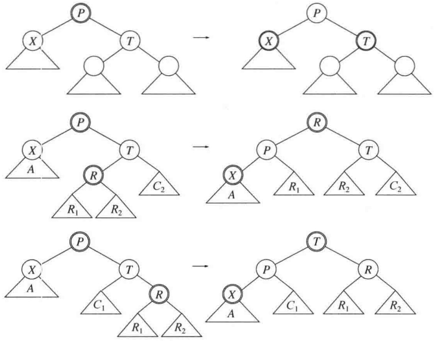

<details>
<summary>flowchart</summary>

This image displays a hierarchical tree structure diagram (a type of flowchart) showing the relationships and branching paths between nodes labeled with letters such as P, T, R, A, C1, R2, and R1.
</details>

图 12.17 当 X 是一个左儿子并有两个黑儿子时的 3 种情形

<small><span class="docvortex-page-footnote" data-block-type="page_footnote" style="color:#6b7280">① 如果两个儿子都是红的，那么我们可以应用两种旋转中的任一种。通常，在 $X$ 是一个右儿子的情形下存在一些对称的旋转，不过这里没有表示出来。</span></small>

其次，设 $X$ 的儿子之一是红的。在这种情形下，我们落到下一层上，得到新的 $X 、 T$ 和 $P$ 。如果幸运，$X$ 落在红儿子上，则我们可以继续向前进行。如果不是这样，那么我们知道 $T$ 将是红的，而 $X$ 和 $P$ 将是黑的。我们可以旋转 $T$ 和 $P$ ，使得 $X$ 的新父亲是红的。当然，$X$ 和它的祖父将是黑的。此时我们可以回到第一种主情形。

## 12.3 treap 树

最后一种类型的二叉查找树可能是最简单的一种，叫作 treap 树 (treap)。它像跳跃表一样使用随机数，并且对任意的输入给出的是  $O(\log N)$  期望时间的性能。查找时间等同于非平衡二叉查找树（从而比平衡查找树要慢），而插入时间只比递归非平衡二叉查找树的实现稍慢。虽然删除操作要慢得多，但仍然是  $O(\log N)$  的期望时间。

treap 树是如此简单，以至我们不用画图就可描述它。树中的每个节点存储一项，一个左指针和一个右指针，以及一个优先级，这个优先级是建立节点时随机指定的。一个 treap 树就是一棵二叉查找树，但其节点优先级满足堆序性质:任意节点的优先级必须至少和它父节点的优先级一样大。

其每一项都有不同优先级的不同项的集合只能由一棵 treap 树表示。这很容易由归纳法推导，因为具有最低优先级的节点必然是根。因此，树是根据优先级的 N! 种可能的排列而不是根据项的 N! 种排序形成的。节点的声明很简单，只要求添加 priority 数据成员。标记 nullNode 的优先级为  $\infty$ ，如图 12.18 所示。

```cpp
template <typename Comparable>
class Treap
{
    public:
        Treap( )
        {
            nullNode = new TreapNode;
            nullNode->left = nullNode->right = nullNode;
            nullNode->priority = INT_MAX;
            root = nullNode;
        }

        Treap( const Treap & rhs );
        Treap( Treap && rhs );
        ~Trep( );
        Treap & operator=( const Treap & rhs );
        Treap & operator=( Treap && rhs );

        // 另外一些 public 型的成员函数（未示出）

private:
    struct TreapNode
    {
        Comparable element;
        TreapNode *left;
```

图 12.18 Treap 类接口和构造函数

```cpp
TleapNode *right;
int     priority;

TleapNode( ) : left{ nullptr }, right{ nullptr }, priority{ INT_MAX }
    { }

TleapNode( const Comparable & e, TreapNode *lt, TreapNode *rt, int pr )
    : element{ e }, left{ lt }, right{ rt }, priority{ pr }
    { }

TleapNode( Comparable && e, TreapNode *lt, TreapNode *rt, int pr )
    : element{ std::move( e ) }, left{ lt }, right{ rt }, priority{ pr }
    { }
};

TleapNode *root;
TreapNode *nullNode;
UniformRandom randomNums;

// 另外一些 private 型的成员函数（未示出）
};
```

图 12.18(续) Treap 类接口和构造函数

到 treap 树的插入操作也简单:在一项作为树叶被添加之后，我们将它沿着该 treap 树向上旋转，直到它的优先级满足堆序为止。可以证明，旋转的期望次数小于 2。在要被删除的项找到以后，通过把它的优先级增加到  $\infty$  并沿着低优先级子节点的路径向下旋转而可将其删除。一旦它成为树叶，就可以把它除去。图 12.19 和图 12.20 中的例程利用递归实现这些做法。一种非递归的实现方法留给读者作为练习（练习 12.14）。对于删除，注意当节点逻辑上是树叶时，它仍然有 nullNode 作为它的左儿子和右儿子。因此，它与右儿子旋转。在旋转后，t 为 nullNode，而左儿子可以释放，因为它现在存储的是要被删除的项。还要注意我们的实现是假设没有重复元；如果这个假设不成立，那么 remove 可能失败（为什么？）。

```c
/**
 * 向一棵子树进行插入的内部方法.
 * x 是要被插入的项.
 * t 为该树的根节点.
 * 建立该子树的新根.
 * (randomNums 是 UniformRandom 类的对象, 是 Treap 类的数据成员.)
 */
void insert( const Comparable & x, TreapNode* & t )
{
    if( t == nullNode )
        t = new TreapNode{ x, nullNode, nullNode, randomNums.nextInt( ) };
    else if( x < t->element )
    {
        insert( x, t->left );
        if( t->left->priority < t->priority )
            rotateWithLeftChild( t );
```

图 12.19 treap 树:插入例程

```txt
}
    else if( t->element < x )
    {
        insert( x, t->right );
        if( t->right->priority < t->priority )
            rotateRightChild( t );
    }
    // 否则是重复元，什么也不做
}
```

图 12.19(续) treap 树:插入例程

```cpp
/**
 * 从子树进行删除的内部方法.
 * x 是要被删除的项.
 * t 是该树的根节点.
 * 建立子树新的根.
 */
void remove( const Comparable & x, TreapNode * & t )
{
    if( t != nullNode )
    {
        if( x < t->element )
            remove( x, t->left );
        else if( t->element < x )
            remove( x, t->right );
        else
        {
            // 找到匹配
            if( t->left->priority < t->right->priority )
                rotateWithLeftChild( t );
            else
                rotateWithRightChild( t );

            if( t != nullNode )      // 继续下行
                remove( x, t );
            else
            {
                delete t->left;
                t->left = nullNode;  // 在叶节点上
            }
        }
    }
}
```

图 12.20 treap 树:删除过程

treap 树的实现绝对不必担心调整 priority 数据成员。平衡树处理方法的困难之一是很难查出由于未能更新操作过程中的信息而导致的错误。从合理的插入和删除包的全部程序行来看，treap 树，特别是非递归的实现，似乎才是不费力的赢家。

## 12.4 后缀数组和后缀树

数据处理中最基本的问题之一是找出模式(pattern) $P$ 在文本 $T$ 中的位置。例如，我们可能对回答下述这样一些问题有兴趣:

- 是否存在 $T$ 的子串与 $P$ 匹配？
- 模式 $P$ 在 $T$ 中出现多少次？
- 在 $T$ 中 $P$ 全都出现在哪些地方？

设 $P$ 的大小小于(并且通常要显著地小于) $T$, 此时, 我们有理由期望, 对于所给定的 $P$ 和 $T$, 求解该类问题所用的时间至少是 $T$ 的长度的线性量, 而事实上也确实存在若干 $O(|T|)$ 的算法。

然而，我们的兴趣是在更常见的问题上，其中，T 是固定的，而对于不同的 P 的查询是经常发生的。例如，T 可能是 email 信息的巨型文档，我们的兴趣是要反复搜索不同模式的 email 信息。在这种情况下，我们愿意把 T 预处理成理想的形式，使得每一次的搜索更加高效，花费的时间显著小于 T 大小的线性量——或者是 T 大小的对数，或者甚至更好，与 T 无关而只依赖于 P 的长度。

这样一种数据结构就是后缀数组 (suffix array) 和后缀树 (suffix tree) (听起来像是两种数据结构，不过我们将会看到，它们基本上是等价的，并且可以进行时空交换)。

## 12.4.1 后缀数组

文本 $T$ 的后缀数组就是 $T$ 的依序排列的所有后缀的数组。例如，假设我们的文本(字符)串是banana，则banana的后缀数组如图12.21所示。

后缀数组显式地存储这些后缀，看似需要二次的空间，因为它存储着从1到 $N$ 每个长度的字符串(其中 $N$ 是 $T$ 的长度)。但在 $\mathrm{C}++$ 中这么说并不完全准确，因为在 $\mathrm{C}++$ 中，我们可以使用以null作为字符串结束符的原始的字符数组表示方法，在这种情况下，后缀由指向子(字符)串第一个字符的char\*指针指定。于是，相同的字符数组是共享的，而附加的内存需求只是新子串的一个char\*指针。不过，char\*的使用是与C和 $\mathrm{C}++$ 高度相关的。这样，在具体实现时通常只存储后缀数组中各个后缀的起始下标，从而紧密依赖于语言。图12.22所示为需要存储的下标。

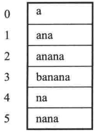

<details>
<summary>text_image</summary>

0
a
1
ana
2
anana
3
banana
4
na
5
nana
</details>

图 12.21 “banana” 的各个后缀

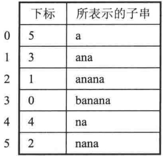

<details>
<summary>text_image</summary>

下标
所表示的子串
0 5 a
1 3 ana
2 1 anana
3 0 banana
4 4 na
5 2 nana
</details>

图12.22 只存储下标的后缀数组(显示全部子串以便于参考)

后缀数组本身功能极为强大。例如，如果模式 $P$ 在文本中出现，那么，它必然是某个后缀的一个前缀。对这个后缀数组的折半查找足以确定模式 $P$ 是否存在于文本中:折半查找或者落在 $P$ 上, 或者 $P$ 在两个值之间, 其中一个小于 $P$, 而另一个大于 $P$ 。如果 $P$ 是某个子串的一个前缀, 那么它就是折半查找终止时发现的较大值的一个前缀。这立刻将查询时间缩减到 $O(|P|\log|T|)$, 其中, $\log|T|$ 是折半查找的开销, 而 $|P|$ 是在每一步比较的开销。

我们也可以使用后缀数组来找出 $P$ 出现的次数:这些 $P$ 将被顺序地存储在后缀数组中，这样，两次折半查找足以找出这些后缀的范围，它们将保证都是从 $P$ 开始的后缀。加速这种查找的一种方法是计算每对相邻子串的最长公共前缀(longest common prefix, LCP)。如果这种计算在后缀数组建立时完成，那么寻找 $P$ 出现次数的每次查询都能够被加速到 $O(|P| + \log |T|)$，不过这个结果不是那么明显。图12.23显示对每个子串相对于前面子串所算出的LCP。

最长公共前缀还提供了关于文本中出现两次的最长模式的信息:查找最大的 LCP 值，并提取对应子串该值这么多的字符。在图 12.23 中，这个值是 3，而最长的重复模式为 ana。

图 12.24 显示出对任意字符串计算后缀数组和最长公共前缀信息的简单代码。第 26 行从 str 得到一个原始(char\*)串，第 28～31 行利用指针运算(第 31 行)通过计算并存储这些指针而得到各个后缀。第 33

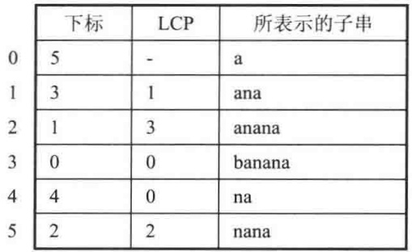

<details>
<summary>text_image</summary>

下标
LCP
所表示的子串
0 5
- a
1 3
1 1
ana
2 1
3 3
anana
3 0
0 banana
4 4
0 na
5 2
2 nana
</details>

图 12.23 关于 “banana” 的后缀数

行和第 34 行将后缀排序；第 34 行上的代码代表 C++11 的 lambda 特性 (lambda feature)，其中，两个 char\* 类型所需要的“小于”函数作为 sort 的第 3 个参数被传递过来，此时不需要编写一个命名的函数。第 36 行和第 37 行使用指针运算计算后缀的起始下标，而第 39～41 行通过调用第 4～12 行所编写的 computeLCP 例程计算相邻项的最长公共前缀。

```c
/*
 * 返回任意两个字符串的 LCP
 */
int computeLCP( const string & s1, const string & s2 )
{
    int i = 0;

    while( i < s1.length( ) && i < s2.length( ) && s1[ i ] == s2[ i ] )
        ++i;

    return i;
}

/*
 * 填入String str的后缀数组和LCP信息
 * str 为输入的 String 类的对象
 * SA 是一个已存在的数组，将放置后缀数组
 * LCP 是一个已存在的将要放置LCP信息的数组
 */
void createSuffixArraySlow( const string & str, vector<int> & SA, vector<int> & LCP )
{
    if( SA.size( ) != str.length( ) || LCP.size( ) != str.length( ) )
        throw invalid_argument{ "Mismatched vector sizes" };
```

图 12.24 创建后缀数组和 LCP 数组的简单算法

```cpp
size_t N = str.length( );
const char *cstr = str.c_str( );

vector<const char *> suffixes( N );

for( int i = 0; i < N; ++i )
    suffixes[ i ] = cstr + i;

std::sort( begin( suffixes ), end( suffixes ),
    [] ( const char *s1, const char *s2 ) { return strcmp( s1, s2 ) < 0; } );

for( int i = 0; i < N; ++i )
    SA[ i ] = suffixes[ i ] - cstr;

LCP[ 0 ] = 0;
for( int i = 1; i < N; ++i )
    LCP[ i ] = computeLCP( suffixes[ i - 1 ], suffixes[ i ] );
}
```

图 12.24(续) 创建后缀数组和 LCP 数组的简单算法

计算后缀数组的运行时间受排序操作控制，后者用到 $O(\mathrm{M}\log N)$ 次比较。在许多场合这个性能都是可以接受的。例如，一本3000000字符的英语小说的一个后缀数组用几秒就可以建成。然而，这个基于比较次数的 $O(\mathrm{M}\log N)$ 的开销隐藏了如下的事实:在s1和s2之间的一次String类的比较花费的时间依赖于LCP(s1,s2)。因此，虽然当对自然语言处理中所发现的后缀运行时，几乎所有这些比较结束都很快，但是，在存在许多长的公共子串的应用中这些比较还是代价高昂的。如在DNA的模式搜索中就有这样的一个例子出现，其字母表由4个字符(A,C,G,T)组成，但它们的字符串可以非常巨大。例如，人的染色体22的DNA字符串大致有3500万个字符，其最大LCP大约为200000而平均LCP差不多为2000。甚至JDK1.3的HTML/Java分布(比当前的分布小得多)几乎达到7000万个字符，其LCP的最大值大致为37000，而平均LCP约为14000。在只包含一个字符但重复 $N$ 次的String类对象的退化情形，容易看到，每次比较花费 $O(N)$ 时间，而总的开销为 $O(N^{2}\log N)$ 。

在 12.4.3 节，我们将讨论构建后缀数组的一个线性时间算法。

## 12.4.2 后缀树

后缀数组通过折半查找可以很容易搜索，但是，折半查找本身就意味着 $\log T$ 的开销。我们想要做的是更有效地找出匹配的后缀。一个想法是把后缀都存储到一棵 trie 树中。二叉 trie 树 (trie tree) 见于本书 10.1.2 节关于哈夫曼代码的讨论。

trie 树的基本想法是将后缀都存储到一棵树中。在根处，对于每个可能的首字符，我们不是让它有两个分支，而是让它有一个分支。然后在下一层上，对于下一个字符还是有一个分支，如此等等。在每一层上我们都做出多路分支，很像是基数排序(radix sort)，这样，我们可以以只依赖于匹配长度的时间找到一个匹配。

在图 12.25 中, 我们在左边看到存储字符串 deed 的后缀的一棵基本 trie 树。这些后缀是 d、deed、ed 和 eed，其中，内部分支节点画成圆圈，而达到的后缀被画入矩形。每个分支用所选择的字符标示，但在建成的后缀前面的分支无任何标示。

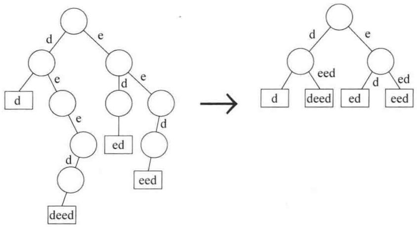

<details>
<summary>flowchart</summary>

This diagram illustrates a transformation process where an initial state with multiple nodes (d, e, ed) is transformed into a final state with three nodes (deed, deed, eed), showing the flow of data from these nodes to the final output.
</details>

图12.25 左:deed后缀的trie树表示:{d，deed，ed，eed}；右:压缩trie树，它将单节点分支叠缩

如果存在许多只有一个子节点的节点，那么这种表示方法可能会明显地浪费空间。于是，在图 12.25 中我们看到右边一个等价的表示结果，叫作压缩 trie 树 (compressed trie)。这里，单分支节点叠缩成一个节点。注意，虽然现在这些分支有了多字符的标示，但是任何给定节点其各分支上所有的标示都必然有唯一的首字符。于是，选择采用哪个分支还是和以前一样容易。这样，我们可以看到，模式 P 的查找只依赖模式 P 的长度，这正是我们所希望的。（我们假设，字母表的字母都用数字 1, 2, …表示。此时，每个节点存储一个数组，表示每个可能的分支，而且我们能够以常数时间确定合适的分支。空边的标示可以用 0 来表示。）

如果原始字符串长度为 $N$，则总的分支数小于 $2N$。然而，这本身并不意味着压缩的 trie 树使用线性的空间量:树的边上的标示也要占用空间。在图 12.25 所示压缩 trie 树上的所有标示的总长度恰好比图 12.25 中的原始 trie 树内部节点个数少 1。当然，将所有的后缀记在树叶上可能占用二次空间。因此，如果原 trie 树使用二次空间，那么压缩 trie 树也使用二次空间。所幸的是，我们可以使用线性的空间量简化 trie 树的表示，做法如下:

1. 在叶节点上，使用后缀开始处的下标(就像后缀数组中那样)。
2. 在内部节点上，存储从根直到该内部节点所匹配的公共字符数。这个数字代表字母深度(letter depth)。

图 12.26 显示如何存储 banana 后缀的压缩 trie 树。树叶就是每个后缀起始点的下标。字母深度为 1 的内部节点表示其下方所有节点的共同的串 “a”。

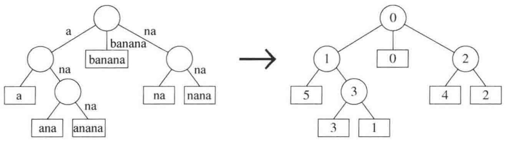

<details>
<summary>flowchart</summary>

This image displays a hierarchical tree structure comparing two different data processing or model configurations, showing how nodes are merged into intermediate nodes before branching into specific sub-classes.
</details>

图 12.26 表示 banana 后缀 {a, ana, anana, banana, na, nana} 的压缩 trie 树。左:显式表示；右:隐式表示，对每个节点它只存储一个整数 (外加节点的分支)

字母深度为 3 的内部节点表示其下方所有节点的共同的串 “ana”。而字母深度为 2 的内部节点表示其下方所有节点的共同的串 “na”。实际上，这个分析明确了后缀树等价于后缀数组再加上一个 LCP 数组。

如果我们有一棵后缀树，那么就可以通过执行对树的一次中序遍历而计算出后缀数组和LCP数组(将图12.23和图12.26中的后缀树进行比较)。这时可以计算LCP如下:如果后缀节点的值加上其父节点的字母深度等于 $N$ ，那么使用其祖父节点的字母深度作为LCP；否则使用其父节点的字母深度作为LCP。在图12.26中，如果进行中序遍历，那么就得到我们的后缀和LCP的值

后缀=5，相应 LCP=0（祖父节点的字母深度），因为  $5+1$  等于 6

后缀=3，相应 LCP=1(祖父节点的字母深度)，因为  $3+3$  等于 6

后缀=1，相应 LCP=3（父节点的字母深度），因为  $1+3$  不等于 6

后缀=0，相应 LCP=0（父节点的字母深度），因为  $0+0$  不等于 6

后缀=4，相应 LCP=0(祖父节点的字母深度)，因为  $4+2$  等于 6

后缀=2，相应 LCP=2（父节点的字母深度），因为  $2+2$  不等于 6

这个变换显然可以以线性时间完成。

后缀数组和 LCP 数组也唯一确定了后缀树。首先，用字母深度 0 建立一个根节点。然后，搜索 LCP 数组（忽略位置 0, LCP 对它并无定义）找出发现的所有最小值（在这个阶段它们将是些 0）。一旦这些最小值被找到，则数组将被它们分割（把 LCP 看作位于相邻元素之间）。例如，在我们的例子里，LCP 中存在两个 0，这两个 0 把后缀数组分成 3 部分:一部分包含后缀  $\{5, 3, 1\}$ ，另一部分包含后缀  $\{0\}$ ，而第 3 部分包含后缀  $\{4, 2\}$ 。这 3 部分的内部节点可以递归地建立，然后，后缀叶节点可以通过一次中序遍历都被附接到树上。虽然并不明显，但仔细观察还是能够看出，后缀树可以以线性时间由后缀数组和 LCP 数组生成。

后缀树能够有效地解决许多的问题。特别是当我们增强每个内部节点，让它们也保留存储在其下方后缀的个数的情况。兹列举后缀树一小部分应用如下:

1. 找出 T 中最长重复子串:遍历该树，找出具有最大字母深度的内部节点，它表示最大的 LCP。运行时间为  $O(|T|)$ 。这可以推广到至少重复 k 次的最长子串。
2. 在两个字符串 $T_{1}$ 和 $T_{2}$ 中找出最长公共子串: 构建一个字符串 $T_{1} \# T_{2}$, 其中 $\#$ 为在这两个字符串中都没有的一个字符。然后, 建立这个新字符串的后缀树, 并找出这样的最深的内部节点: 它至少有一个后缀是在 $\#$ 前开始, 一个后缀在 $\#$ 后开始。这可以以正比于这两个字符串总长度的时间完成, 并可推广到总长为 $N$ 的 $k$ 个字符串的 $O(kN)$ 算法。
3. 找出模式 P 的出现次数:设后缀树强化到让每个节点都记录其下方的后缀的个数，直接沿着树向下的路径行进，作为 P 的前缀的第一个内部节点则给出问题的答案；如果不存在这样的节点，那么答案不是 0 就是 1，并通过检测搜索终止处的后缀来确定。所花费的时间正比于模式 P 的长度，而与  $|T|$  的大小无关。
4. 找出指定公共长度 L>1 的最长子串:返回字母深度至少为 L 的那些节点中具有最大大小的内部节点。这要花费  $O(T)$  时间。

## 12.4.3 后缀数组和后缀树的线性时间构建

我们在 12.4.1 节讨论了构建后缀数组和 LCP 数组的最简单的算法，但是，这个算法对 N 个字符的字符串最坏情形运行时间为  $O(N^{2}\log N)$ ，并且可能发生在字符串的一些后缀具有长的公共前缀的情况。本小节描述一个计算后缀数组的  $O(N)$  最坏情形时间的算法，这个算法还可以强化到以线性时间计算 LCP 数组，不过，还有一个从后缀数组来计算 LCP 数组的非常简单的线性时间算法（见练习 12.9，并完成图 12.49 中的程序）。不管使用哪种方法，我们都可以以线性时间建立后缀树。

这个算法利用到分治策略，其基本想法如下:

1. 从后缀中选出一个样本 A。
2. 通过递归将样本 A 排序。
3. 通过使用此时已排序的后缀样本 A，将其余的后缀 B 排序。
4. 合并 A 与 B。

为了获得直觉, 理解第 3 步可能是怎样进行的, 假设后缀的样本 A 是所有在奇数下标开始的后缀。此时, 其余的后缀 B 则是那些以偶数下标开始的后缀。假设我们已经计算完后缀 A 的排序的集合。为了计算后缀 B 的排序集合, 我们实际上需要将所有从偶数下标开始的后缀排序。但是, 这些后缀每个都由在偶数位置上的单个首字符, 以及后接从第 2 个字符 (从而必然是一个奇数位置) 开始的字符串组成。这样, 从第 2 个字符开始的字符串恰好是 A 中的字符串。因此, 要想将所有的后缀 B 排序, 我们可以做类似于基数排序 (radix sort) 的某些工作: 首先将 B 中从第 2 个字符开始的那些字符串排序。这应该花费线性时间, 因为 A 的排序顺序已经知道。然后, 再平稳地按照 B 中字符串的首字符排序。这样, 在 A 被递归地排序以后, B 可以以线性时间排序。如果 A 和 B 此时能够以线性时间合并, 那么我们就得到一个线性时间算法。我们要展示的这个算法用到的取样步骤稍有不同, 它能够以简单的线性时间进行合并。

在描述这个算法的时候，我们还将演示该算法如何计算字符串 ABRACADABRA 的后缀数组。后面采用如下约定:

$$
\begin{array}{l} S [ i ] \quad \text {表示字符串} S \text {的第} i \text {个字符} \\ S | i \rightarrow | \quad \text {表示} S \text {的从下标} i \text {开始的后缀} \\ <   > \quad \text {表示一个数组} \\ \end{array}
$$

第 1 步:将原字符串中的字符排序，从 1 开始顺序地给这些字符分配数字。此后，对算法的其余部分使用这些数字。注意，所分配的数字是依赖于文本的。因此，如果文本只包含 DNA 字符 A、C、G 和 T，那么只有 4 个数字。此时，用三个 0 填充数组以避免出界的情形。若假设字母表有固定大小，则排序花费某个常数的时间量。

例:

在我们的例子中，上述映射为 A=1，B=2，C=3，D=4，而 R=5，该变换可在图 12.27 中直观地看到。

| 输入的字符串S | A | B | R | A | C | A | D | A | B | R | A |  |  |  |
| --- | --- | --- | --- | --- | --- | --- | --- | --- | --- | --- | --- | --- | --- | --- |
| 新的问题 | 1 | 2 | 5 | 1 | 3 | 1 | 4 | 1 | 2 | 5 | 1 | 0 | 0 | 0 |
| 下标 | 0 | 1 | 2 | 3 | 4 | 5 | 6 | 7 | 8 | 9 | 10 | 11 | 12 | 13 |

图 12.27 字符串中字符到整数数组的映射

第 2 步:把文本分成 3 组:

$$
\begin{array}{l} S _ {0} = <   S [ 3 i ] S [ 3 i + 1 ] S [ 3 i + 2 ], \quad i = 0, 1, 2, \dots > \\ S _ {1} = <   S [ 3 i + 1 ] S [ 3 i + 2 ] S [ 3 i + 3 ], \quad i = 0, 1, 2, \dots > \\ S _ {2} = <   S [ 3 i + 2 ] S [ 3 i + 3 ] S [ 3 i + 4 ], \quad i = 0, 1, 2, \dots > \\ \end{array}
$$

其想法是， $S_{0}$ 、 $S_{1}$ 、 $S_{2}$ 中的每一个都大约包含N/3个符号，但是，这些符号不再属于原来的字母表，而是每个新符号均为从原始字母表中得到的某3个符号构成。我们把它们叫作三元字符(tri-characters)。最重要的是，我们要把 $S_{0}$ 、 $S_{1}$ 、 $S_{2}$ 的这些后缀联合以形成S的后缀。于是，一个想法是递归地计算 $S_{0}$ 、 $S_{1}$ 、 $S_{2}$ 的后缀(根据定义，它们隐式地表示排序后的那些字符串)，然后以线性时间将计算结果合并。可是，由于这是对1/3原始大小的问题的3次递归调用，这样会导致 $O(M\log N)$ 的算法。因此，我们的想法是要避免3次递归调用中的1次调用，做法是递归地计算这三组后缀中的两组，并利用这两组的信息再计算第3个后缀组。

例:

本例中，如果查看原始字符集，并用\$表示填充的字符，则得到

$$
\begin{array}{l} S _ {0} = [ \mathrm{ABR} ], [ \mathrm{ACA} ], [ \mathrm{DAB} ], [ \mathrm{RA} \mathbb {S} ] \\ S _ {1} = [ \text {BRA} ], [ \text {CAD} ], [ \text {ABR} ], [ \mathrm{A} \\ S _ {2} = [ \mathrm{RAC} ], [ \mathrm{ADA} ], [ \mathrm{BRA} ] \\ \end{array}
$$

可以看出，在 $S_0$、$S_1$、$S_2$ 中，每个三元字符都是原始字母表中字符的三元组。使用这个新的字母表，$S_0$ 和 $S_1$ 都是长度为 4 的数组，而 $S_2$ 是一个长度为 3 的数组。于是，$S_0$、$S_1$ 和 $S_2$ 分别有 4 个、4 个和 3 个后缀。$S_0$ 的后缀是 [ABR][ACA][DAB][RA\$]、[ACA][DAB][RA\$]、[DAB][RA\$]、[RA\$]，显然它们对应原始字符串 $S$ 中的后缀 ABRACADABRA、ACADABRA、DABRA 和 RA。在原始字符串 $S$ 中，这些后缀分别位于下标 0, 3, 6, 9 处，于是，观察所有 3 个 $S_0$、$S_1$ 和 $S_2$，我们可以看到，每个 $S_i$ 代表那些位于 $S$ 中下标 $i \bmod 3$ 处的后缀。

第3步:把 $S_{1}$ 和 $S_{2}$ 连接起来并递归地计算后缀数组。为了计算这个后缀数组，我们将需要把三元字符的新字母表排序。这可以通过三趟基数排序以线性时间完成，因为那些老字符都在第1步排过序了。如果新字母表中的所有三元字符都是唯一的，那么我们甚至不需要考虑递归调用。进行三趟基数排序需要花费线性时间。若 $T(N)$ 为后缀数组构建算法的运行时间，则递归调用花费 $T(2N / 3)$ 的时间。

例:

在我们的例子中，

$$
S _ {1} S _ {2} = [ \text {BRA} ], [ \text {CAD} ], [ \text {ABR} ], [ \mathrm{A} \$\$ ], [ \text {RAC} ], [ \text {ADA} ], [ \text {BRA} ]
$$

将被递归算出的那些排序后的后缀代表一些三元字符串，如图 12.28 所示。

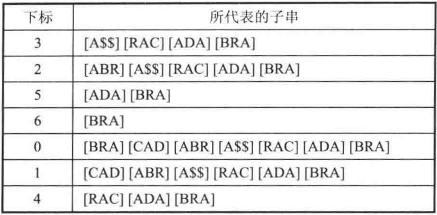

<details>
<summary>flowchart</summary>

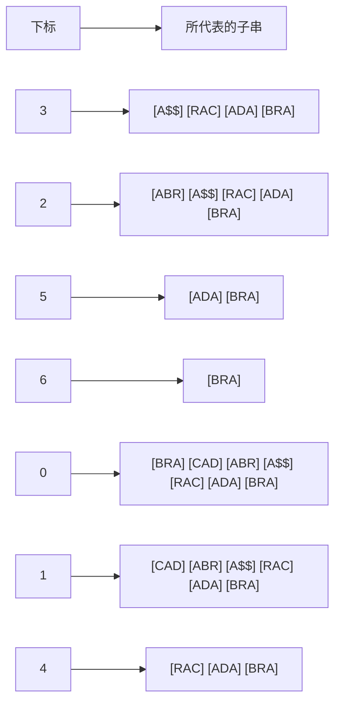
</details>

图12.28 $S_{1}S_{2}$ 以三元字符集表示的后缀数组

注意,这些字符串不完全与 $S$ 中对应的那些后缀相同;可是,要是去除那些在第一个\$处开始的字符,则我们确实得到与原始后缀匹配的后缀。还要注意,递归调用所返回的下标并不直接对应 $S$ 中的下标,不过把它们映射回去也很简单。因此,为了看出算法如何具体形成递归调用,我们细心观察,三趟基数排序将对字母表进行下述赋值:$[A\$\$] = 1, [ABR] = 2, [ADA] = 3, [BRA] = 4, [CAD] = 5, [RAC] = 6$。图 12.29 显示三元字符的映射,由 $S_1$、$S_2$ 形成的数组,以及递归计算得到的后缀数组。

| S1S2 | [BRA] | [CAD] | [ABR] | [A$$] | [RAC] | [ADA] | [BRA] |  |  |  |
| --- | --- | --- | --- | --- | --- | --- | --- | --- | --- | --- |
| 整数 | 4 | 5 | 2 | 1 | 6 | 3 | 4 | 0 | 0 | 0 |
| SA[S1S2] | 3 | 2 | 5 | 6 | 0 | 1 | 4 | 0 | 0 | 0 |
| 下标 | 0 | 1 | 2 | 3 | 4 | 5 | 6 | 7 | 8 | 9 |

图 12.29 三元字符的映射，由  $S_{1}$ 、 $S_{2}$  形成的数组，以及递归计算得到的后缀数组

第4步:

计算 $S_{0}$ 的后缀数组。这做起来很容易，因为

$$
\begin{array}{l} S _ {0} [ i \rightarrow ] = S [ 3 i \rightarrow ] \\ = S [ 3 i ] S [ 3 i + 1 \rightarrow ] \\ = S [ 3 i ] S _ {1} [ i \rightarrow ] \\ = S _ {0} [ i ] S _ {1} [ i \rightarrow ] \\ \end{array}
$$

由于递归调用已经将所有的 $S_{1}[i\rightarrow ]$ 排了序，因此可以直接用两趟基数排序完成第4步:第1趟是对 $S_{1}[i\to ]$ 进行，而第2趟则对 $S_0[i]$ 进行。

例:

在我们的例子中，

$$
S _ {0} = [ \mathrm{ABR} ], [ \mathrm{ACA} ], [ \mathrm{DAB} ], [ \mathrm{RA}
$$

由第3步的递归调用，我们可以给 $S_{1}$ 和 $S_{2}$ 中的后缀排名次(rank)。图12.30显示原始字符串中的下标如何能够被递归算出的后缀数组引用，并显示图12.29中的后缀数组怎样解决 $S_{1} + S_{2}$ 中后缀的排名。倒数第2行上的各项容易从前面的两行得到。在最后一行上，第 $i$ 项由在标记为 $\mathrm{SA}[S_1S_2]$ 的行上 $i$ 的位置给出。

<table><tr><td></td><td colspan="4"> $S_1$ </td><td colspan="3"> $S_2$ </td></tr><tr><td></td><td>[BRA]</td><td>[CAD]</td><td>[ABR]</td><td>[A$$]</td><td>[RAC]</td><td>[ADA]</td><td>[BRA]</td></tr><tr><td>S中的下标</td><td>1</td><td>4</td><td>7</td><td>10</td><td>2</td><td>5</td><td>8</td></tr><tr><td>SA[ $S_1S_2$ ]</td><td>3</td><td>2</td><td>5</td><td>6</td><td>0</td><td>1</td><td>4</td></tr><tr><td>使用S的下标的SA</td><td>10</td><td>7</td><td>5</td><td>8</td><td>1</td><td>4</td><td>2</td></tr><tr><td>组中的排名</td><td>5</td><td>6</td><td>2</td><td>1</td><td>7</td><td>3</td><td>4</td></tr></table>

图12.30 基于图12.29所示后缀数组的后缀排名

在 $S_{1}$ 中建立的排名可以直接用在 $S_{0}$ 的第1趟基数排序上。然后，对 $S$ 中单个字符的第2趟排序，使用前面的基数排序以处理字符匹配的情形。注意，如果 $S_{1}$ 的元素个数恰好与 $S_{0}$ 的元素个数相同，那么操作是很方便的。图12.31指出如何计算 $S_{0}$ 的后缀数组。

<table><tr><td></td><td colspan="4"> $S_0$ </td></tr><tr><td></td><td>[ABR]</td><td>[ACA]</td><td>[DAB]</td><td>[RA$]</td></tr><tr><td>下标</td><td>0</td><td>3</td><td>6</td><td>9</td></tr><tr><td>第2个元素的下标</td><td>1</td><td>4</td><td>7</td><td>10</td></tr><tr><td>第1趟基数排序</td><td>5</td><td>6</td><td>2</td><td>1</td></tr><tr><td>第2趟基数排序</td><td>1</td><td>2</td><td>3</td><td>4</td></tr><tr><td>组中名次</td><td>1</td><td>2</td><td>3</td><td>4</td></tr><tr><td>使用S的下标表示的SA</td><td>0</td><td>3</td><td>6</td><td>9</td></tr></table>

图12.31 计算 $S_0$ 的后缀数组

上一行各下标加1

图12.30的最后一行

首字符的稳定的基数排序

使用前面一行的结果

使用前面一行的结果

这时，我们现在有了 $S_0$ 的后缀数组，以及组合 $S_{1}$ 和 $S_{2}$ 的后缀数组。由于这是一个两趟的基数排序，因此这一步花费时间 $O(N)$ 。

第 5 步:使用合并两个排序的表的标准算法合并两个后缀数组。这里唯一的问题在于，我们必须能够以常数时间比较每一对后缀。存在如下两种情形。

情形1:将 $S_{0}$ 的一个元素与 $S_{1}$ 的一个元素进行比较:比较第1个字母；若它们不匹配，则比较完成；否则，将 $S_{0}$ 的其余元素(它们为 $S_{1}$ 的一个后缀)与 $S_{1}$ 的其余元素(它们为 $S_{2}$ 的一个后缀)进行比较；它们都已经被排序，因此比较完成。

情形 2: 将 $S_{0}$ 的一个元素与 $S_{2}$ 的一个元素进行比较: 最多比较前两个字母; 若仍然匹配, 则此时将 $S_{0}$ 的其余元素 (在跳过这两个字母后它们就成了 $S_{2}$ 的一个后缀) 与 $S_{2}$ 的其余元素 (在跳过两个字母后它们就成了 $S_{1}$ 的一个后缀) 进行比较; 如同情形 1, 这些后缀已经由 SA12 排序, 于是比较完成。

例:

本例中，我们必须将

|  | A | A | D | R |
| --- | --- | --- | --- | --- |
| S0的SA | 0 | 3 | 6 | 9 |

与

|  | A | A | A | B | B | C | R |
| --- | --- | --- | --- | --- | --- | --- | --- |
| S1和S2的SA | 10 | 7 | 5 | 8 | 1 | 4 | 2 |

合并。第 1 次比较是在下标 0 (一个 A) 与下标 10 (也是一个 A) 之间进行, 其中, 0 是一个 $S_{0}$ 元素, 而 10 是一个 $S_{1}$ 元素。由于它们均对应 A, 因此现在我们必须再比较下标 1 和下标 11。通常这已经被计算过了, 因为下标 1 在 $S_{1}$ 中, 而下标 11 在 $S_{2}$ 中。可是, 这里有些特殊, 因为下标 11 已经越过该字符串的终点。因此, 它总是以字典序代表较前的后缀, 从而最终的后缀数组中第 1 个元素是 10 。我们在第 2 组中向前推进, 推进结果如下。

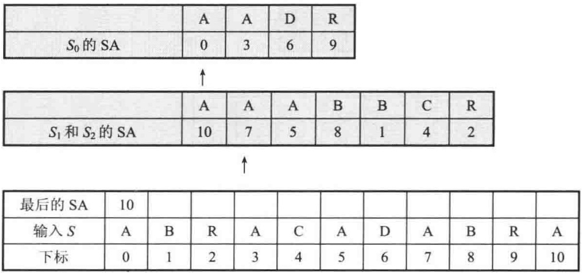

<details>
<summary>text_image</summary>

A	A	D	R
S₀的SA	0	3	6	9
↑
A	A	A	B	B	C	R
S₁和S₂的SA	10	7	5	8	1	4	2
↑
最后的SA	10														<nl>输入S	A	B	R	A	C	A	D	A	B	R	A
下标	0	1	2	3	4	5	6	7	8	9	10
</details>

两个首字符还是匹配，因此，我们比较下标 1 和下标 8，而这已经算过了，下标 8 对应的字符串更小。这意味着，现在 7 进入到最终的后缀数组，而我们继续向前推进第 2 组，得到

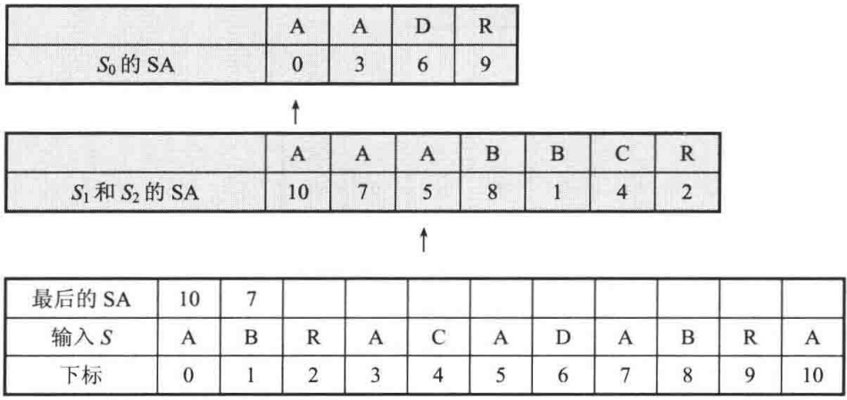

<details>
<summary>text_image</summary>

A	A	D	R
S₀的SA	0	3	6	9
↑
A	A	A	B	B	C	R
S₁和S₂的SA	10	7	5	8	1	4	2
↑
最后的SA	10	7	
输入S	A	B	R	A	C	A	D	A	B	R	A
下标	0	1	2	3	4	5	6	7	8	9	10
</details>

两个首字符又是匹配的，因此现在必须比较下标1和下标6。由于这是 $S_{1}$ 的一个元素和 $S_{0}$ 一个元素之间的一次比较，因此我们不能查阅结果。这样，我们必须直接比较字符。下标1包含B，下标6包含的是D，所以下标1胜出。于是，0进入到最终的后缀数组，我们向前推进第1个数组。

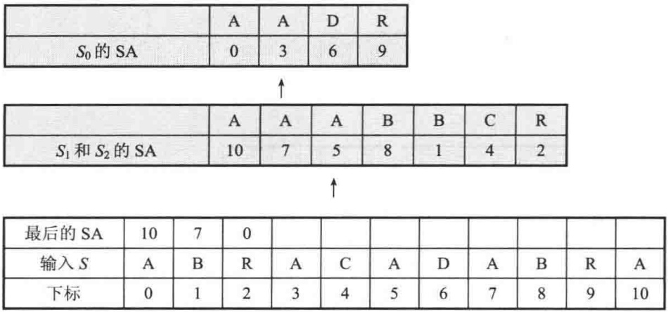

<details>
<summary>text_image</summary>

A	A	D	R
S₀的SA	0	3	6	9
↑
A	A	A	B	B	C	R
S₁和S₂的SA	10	7	5	8	1	4	2
↑
最后的SA	10	7	0	
输入S	A	B	R	A	C	A	D	A	B	R	A
下标	0	1	2	3	4	5	6	7	8	9	10
</details>

下一次比较发生同样的情况, 又是在一对 A 之间进行; 第 2 次比较是在 4(一个 C) 和下标 6(一个 D) 之间进行, 因此, 第 1 组的元素向前推进。

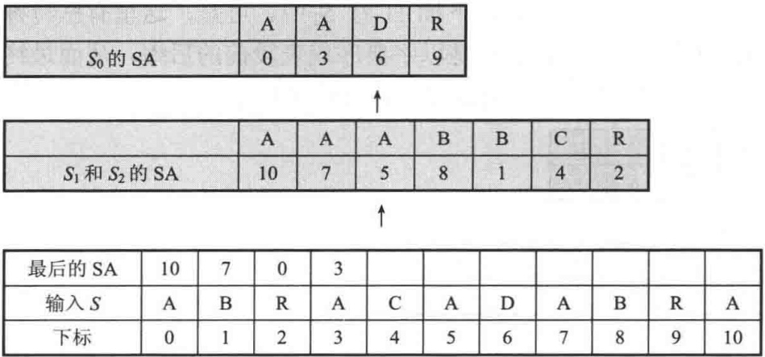

<details>
<summary>text_image</summary>

A	A	D	R
S₀的SA	0	3	6	9
↑
A	A	A	B	B	C	R
S₁和S₂的SA	10	7	5	8	1	4	2
↑
最后的SA	10	7	0	3	
输入S	A	B	R	A	C	A	D	A	B	R	A
下标	0	1	2	3	4	5	6	7	8	9	10
</details>

这一刻不存在相同的情形，于是我们很快推进到每组的最后一个字符:

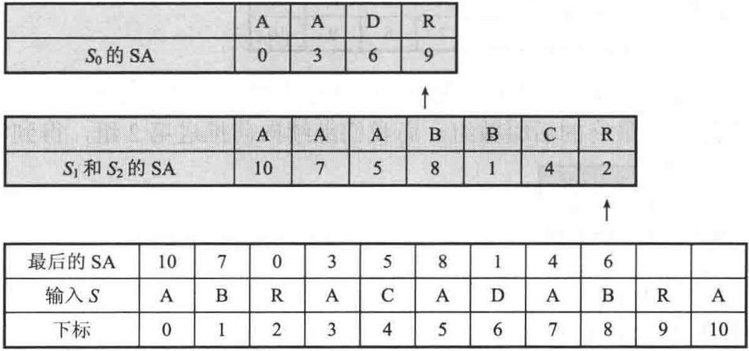

<details>
<summary>text_image</summary>

A	A	D	R
S₀的SA	0	3	6	9
↑
A	A	A	B	B	C	R
S₁和S₂的SA	10	7	5	8	1	4	2
↑
最后的SA	10	7	0	3	5	8	1	4	6	
输入S	A	B	R	A	C	A	D	A	B	R	A
下标	0	1	2	3	4	5	6	7	8	9	10
</details>

最后，我们到达终点。两个 R 之间的比较要求我们比较其下一字符，它们位于下标 10 和下标 3。由于这次比较是在一个 $S_{1}$ 元素和一个 $S_{0}$ 元素之间进行，我们前面看到，此时不能通过查看结果决定，而必须直接进行比较。情况还是一样，因此我们必须比较下标 11 和下标 4，于是 11 自动胜出（因为它越过了字符串的终点）。这样，下标为 9 处的 R 向前推进，此时合并结束。注意，假如我们不是处在字符串的终点，那么就会面对在一个 $S_{2}$ 元素和一个 $S_{1}$ 元素之间进行比较的现实，而这意味着，我们的排序可从 $S_{1}+S_{2}$ 的后缀数组得到。

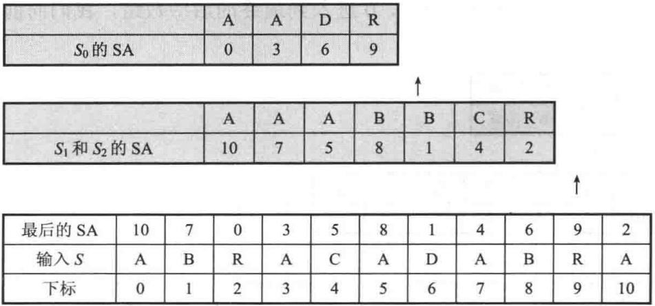

<details>
<summary>text_image</summary>

A	A	D	R
S₀的SA	0	3	6	9
↑
A	A	A	B	B	C	R
S₁和S₂的SA	10	7	5	8	1	4	2
最后的SA	10	7	0	3	5	8	1	4	6	9	2
输入S	A	B	R	A	C	A	D	A	B	R	A
下标	0	1	2	3	4	5	6	7	8	9	10
</details>

由于这是一种标准的合并，每对后缀最多进行两次比较，因此这一步花费线性时间。这样，整个算法满足 $T(N) = T(2N / 3) + O(N)$，从而花费线性时间。虽然我们只计算了后缀数组，