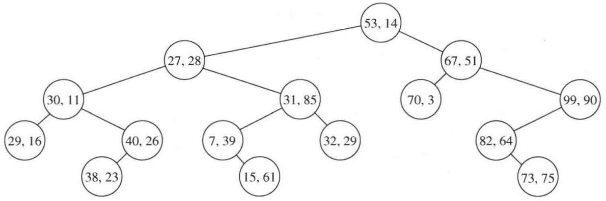
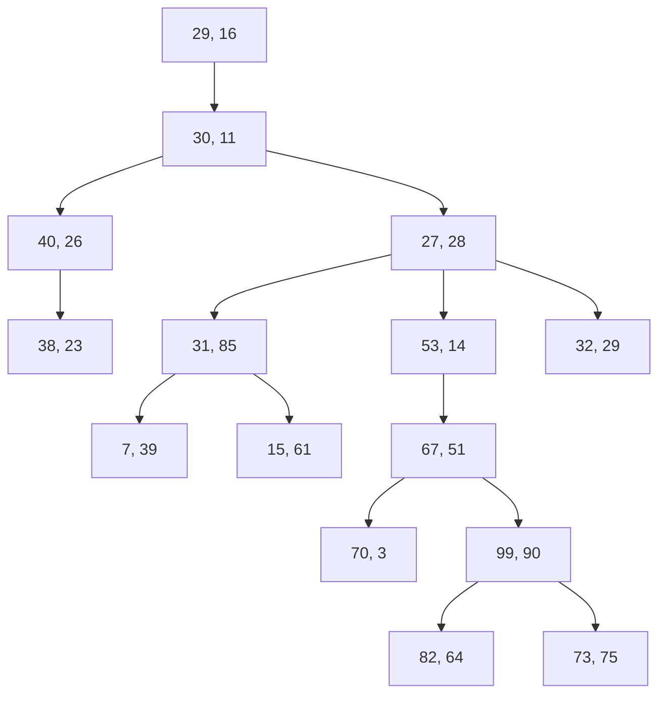
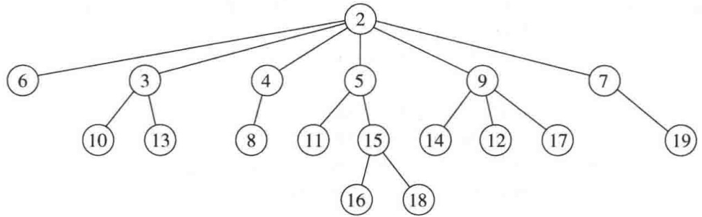
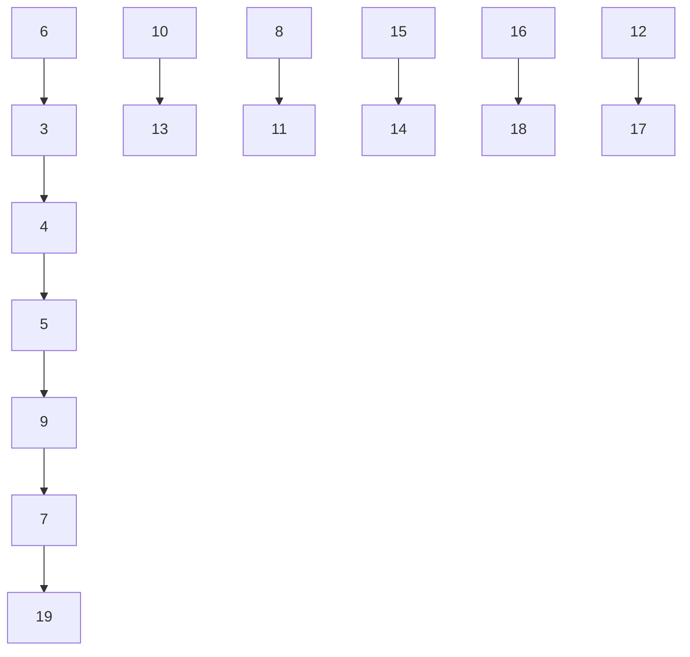
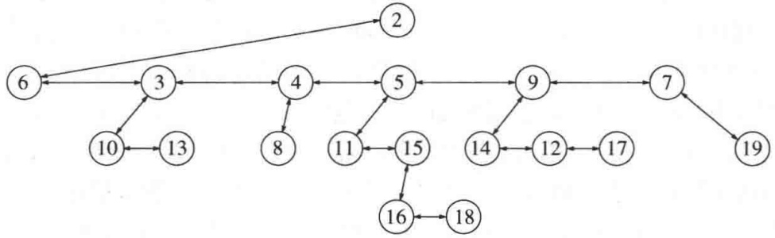
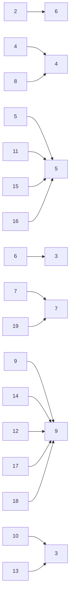
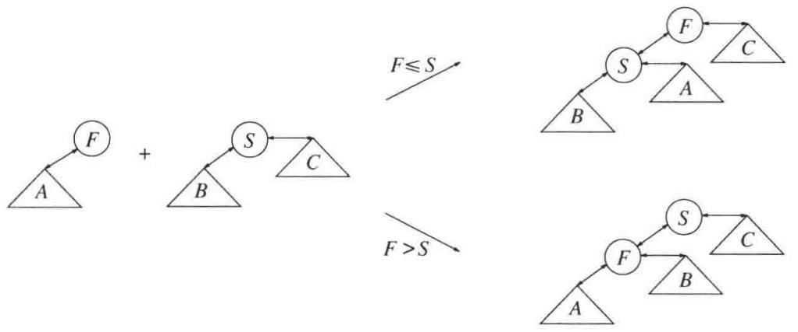
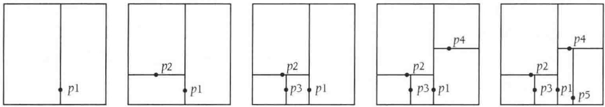
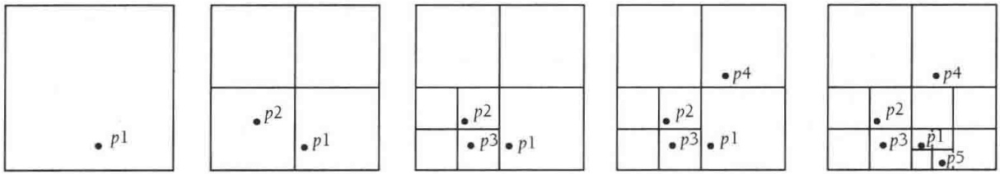

但是LCP信息也可以在算法运行时算出，不过，这里涉及到一些复杂的细节，而LCP信息常常通过另外的线性时间算法去计算。

下面通过提供一个计算后缀数组实用的实现方法结束本小节。我们并不全面实现第1步对原始字符的排序，而是假设只有一小部分(其值在1～255之间的)ASCⅡI字符出现在字符串中。在图12.32中，我们建立具有3个附加填充槽的数组，并调用函数makeSuffixArray，它是基本的线性时间算法。

```c
/*
 * 填入 String str 的后缀数组信息
 * str 为输入的 String 类对象
 * sa 是一个已存在的数组，将要放置后缀数组
 * LCP 是一个已存在的数组，将要放置 LCP 的信息
 */
void createSuffixArray( const string & str, vector<int> & sa, vector<int> & LCP )
{
    if( sa.size( ) != str.length( ) || LCP.size( ) != str.length( ) )
        throw invalid_argument{ "Mismatched vector sizes" };

    int N = str.length( );

    vector<int> s( N + 3 );
    vector<int> SA( N + 3 );

    for( int i = 0; i < N; ++i )
        s[ i ] = str[ i ];

    makeSuffixArray( s, SA, N, 250 );

    for( int i = 0; i < N; ++i )
        sa[ i ] = SA[ i ];

    makeLCPArray( s, sa, LCP );
}
```

图12.32 建立首次调用makeSuffixArray的代码；创建大小适宜的数组；为使事情简化，只使用256个ASCII字符编码

图12.33显示了makeSuffixArray函数。在第11\~15行，它分配了所有需要的数组，并确保 $S _ { 0 }$ 和 $S_{1}$ 有相同个数的元素(第16\~21行)；然后，把工作转移到assignNames、computeSl2、computes0和merge。

图12.34所示的assignName开始时执行三趟基数排序。然后，如果当前项与前一项具有不同的字符三元组(我们回忆，三元字符已经由三趟基数排序完成排序，还要记住， $S_{0}$ 和 $S_{1}$大小相同，因此，在第32行上把n0加到 $S_{1}$ 的元素个数上)，那么，它将顺序使用下一现有数字指派名字(即数字)。我们可以使用第7章的基本计数基数排序(counting radix sort)以得到一个线性时间排序。这个程序如图12.35所示。其中数组in表示进入s的那些下标；基数排序的结果在于，这些下标的排序使得s中的字符在这些下标上是排序的(这里的下标是所指定的offset)。

```c
// 找出{1..K}^n 中 s[0..n-1] 的后缀数组SA
// 要求 s[n]=s[n+1]=s[n+2]=0, n>=2
void makeSuffixArray( const vector<int> & s, vector<int> & SA, int n, int K )
{
    int n0 = ( n + 2 ) / 3;
    int n1 = ( n + 1 ) / 3;
    int n2 = n / 3;
    int t = n0 - n1; // 1 当且仅当 n%3 == 1
    int n12 = n1 + n2 + t;

    vector<int> s12( n12 + 3 );
    vector<int> SA12( n12 + 3 );
    vector<int> s0( n0 );
    vector<int> SA0( n0 );

    // 为 s12 的项生成 s 中的位置
    // 若 n%3 == 1, 则 "+t" 加上一个取 mod 1 的哑值后缀
    // 此刻, s12 的大小为 n12
    for( int i = 0, j = 0; i < n + t; ++i )
        if( i % 3 != 0 )
            s12[ j++ ] = i;

    int K12 = assignNames( s, s12, SA12, n0, n12, K );

    computeS12( s12, SA12, n12, K12 );
    computeSO( s, s0, SA0, SA12, n0, n12, K );
    merge( s, s12, SA, SA0, SA12, n, n0, n12, t );
}
```

图12.33 以线性时间构建后缀数组的主例程

```c
// 分配一些新的超字符名
// 在程序的最后，SA 将以排序的顺序持有 s 的下标
// 而s12将取得成员新的字符名
// 返回所分配名字的个数；注意，如果
// 该值与n12相同，则SA 是s12的一个后缀数组
int assignNames( const vector<int> & s, vector<int> & s12, vector<int> & SA12,
                    int n0, int n12, int K )
{
    // 对新的字符三元组进行基数排序
    radixPass( s12 , SA12, s, 2, n12, K );
    radixPass( SA12, s12 , s, 1, n12, K );
    radixPass( s12 , SA12, s, 0, n12, K );

    // 找出各三元组的字典序名字
    int name = 0;
    int c0 = -1, c1 = -1, c2 = -1;

    for( int i = 0; i < n12; ++i )
    {
```

图12.34 计算并分派三元字符名字的例程

```lisp
if( s[ SA12[ i ] ] != c0 || s[ SA12[ i ] + 1 ] != c1
                                      || s[ SA12[ i ] + 2 ] != c2 )
{
    ++name;
    c0 = s[ SA12[ i ] ];
    c1 = s[ SA12[ i ] + 1 ];
    c2 = s[ SA12[ i ] + 2 ];
}

if( SA12[ i ] % 3 == 1 )
    s12[ SA12[ i ] / 3 ]      = name;   // S1
else
    s12[ SA12[ i ] / 3 + n0 ] = name;   // S2
}

return name;
}
```

图12.34(续) 计算并分派三元字符名字的例程

```txt
// 对 in[0..n-1]进行稳定排序，下标在其关键字位于 0..K 间的 s 中
// 结果放入out[0..n-1]；排序是相对于进入s 的offset的
// 使用计数基数排序
void radixPass( const vector<int> & in, vector<int> & out,
                    const vector<int> & s, int offset, int n, int K )
{
    vector<int> count( K + 2 );          // 计数器数组

    for( int i = 0; i < n; ++i )
        ++count[ s[ in[ i ] + offset ] + 1 ];   // 计算出现次数

    for( int i = 1; i <= K + 1; ++i )         // 计算独有的和
        count[ i ] += count[ i - 1 ];

    for( int i = 0; i < n; ++i )
        out[ count[ s[ in[ i ] + offset ] ]++ ] = in[ i ];     // 排序
}

// 对in[0..n-1]进行稳定排序，下标在其关键字位于0..K间的s中
// 结果放入out[0..n-1]
// 使用计数基数排序
void radixPass( const vector<int> & in, vector<int> & out,
                    const vector<int> & s, int n, int K )
{
    radixPass( in, out, s, 0, n, K );
}
```

图12.35后缀数组的计数基数排序(counting radix sort)

图12.36包括计算s12的后缀数组、然后计算s0的后缀数组的两个例程。

最后，merge例程如图12.37所示，一些支撑例程放在图12.38中。这里的合并例程和图7.12中见到的标准合并算法外观和感觉基本相同。

```txt
// 计算s12的后缀数组, 把结果放到SA12中
void computeS12( vector<int> & s12, vector<int> & SA12,
                    int n12, int K12 )
{
    if( K12 == n12 ) // 若名字都是唯一的, 则不需要递归
        for( int i = 0; i < n12; ++i )
            SA12[ s12[i] - 1 ] = i;
    else
    {
        makeSuffixArray( s12, SA12, n12, K12 );
        // 使用后缀数组将这些唯一的名字存入s12中
        for( int i = 0; i < n12; ++i )
            s12[ SA12[ i ] ] = i + 1;
    }
}

void computeS0( const vector<int> & s, vector<int> & s0,
                   vector<int> & SA0, const vector<int> & SA12,
                   int n0, int n12, int K )
{
    for( int i = 0, j = 0; i < n12; ++i )
        if( SA12[ i ] < n0 )
            s0[ j++ ] = 3 * SA12[ i ];

    radixPass( s0, SA0, s, n0, K );
}
```

图12.36 计算s12的后缀数组(可能是递归地)和 s0的后缀数组

```cpp
// 将已排序的SAO 的后缀与已排序的 SA12 的后缀合并
void merge( const vector<int> & s, const vector<int> & s12,
              vector<int> & SA, const vector<int> & SA0, const vector<int> & SA12,
              int n, int n0, int n12, int t )
{
    int p = 0, k = 0;

    while( t != n12 && p != n0 )
    {
        int i = getIndexIntoS( SA12, t, n0 ); // S12
        int j = SA0[ p ];                  // S0

        if( suffix12IsSmaller( s, s12, SA12, n0, i, j, t ) )
        {
            SA[ k++ ] = i;
            ++t;
        }
        else
        {
            SA[ k++ ] = j;
            ++p;
        }
```

图 12.37 合并后缀数组SA0 和 SA12

```txt
}

    while( p < n0 )
        SA[ k++ ] = SAO[ p++ ];
    while( t < n12 )
        SA[ k++ ] = getIndexIntoS( SA12, t++, n0 );
}
```

图12.37(续) 合并后缀数组 SA0和SA12

```txt
int getIndexIntoS( const vector<int> & SA12, int t, int n0 )
{
    if( SA12[ t ] < n0 )
        return SA12[ t ] * 3 + 1;
    else
        return ( SA12[ t ] - n0 ) * 3 + 2;
}

// 若[a1 a2] <= [b1 b2]则为True
bool leq( int a1, int a2, int b1, int b2 )
{ return a1 < b1 || a1 == b1 && a2 <= b2; }

// 若[a1 a2] <= [b1 b2 b3]则为True
bool leq( int a1, int a2, int a3, int b1, int b2, int b3 )
{ return a1 < b1 || a1 == b1 && leq( a2, a3, b2, b3 ); }

bool suffix12IsSmaller( const vector<int> & s, const vector<int> & s12,
                    const vector<int> & SA12, int n0, int i, int j, int t )
{
    if( SA12[ t ] < n0 ) // s1 对s0; 在一个字符之后可能打破平衡
        return leq( s[ i ], s12[ SA12[ t ] + n0 ],
            s[ j ], s12[ j / 3 ] );
    else
        return leq( s[ i ], s[ i + 1 ], s12[ SA12[ t ] - n0 + 1 ],
            s[ j ], s[ j + 1 ], s12[ j / 3 + n0 ] );
}
```

图12.38 合并后缀数组 SA0 和 SA12的几个支撑例程

## 12.5 k-d 树

设一广告公司拥有一个数据库并需要为某些客户生成邮寄标签。典型的要求可能是需要散发邮件给那些年龄在34到49之间且年收入在\$100000和\$150000之间的人们。这个问题叫作二维范围查询(two-dimensional range query)。在一维情况下，该问题可以借助于简单的递归算法通过遍历预先构造的二叉查找树以O(M+logN)平均时间解决。这里，M是由查询所报告的匹配的个数。我们希望对二维或更高维的情况得到类似的界。

二维查找树(two-dimensionalsearchtree)具有简单的性质:在奇数层上按照第一个关键字进行分支，而在偶数层上的分支按照第二个关键字进行。根是任意选取的，位于奇数层。图12.39表示一棵2-d树。向一棵2-d树进行的插入操作是向一棵二叉查找树插入操作的简单扩展:在沿树下行时，我们需要保留当前的层。为保持程序代码简单，假设基本项是两个元素的数组。此时我们需要把层限制在0和1之间切换。图12.40显示的是执行一次插入的程序。在这一节我们使用递归。用于实践中的非递归实现思路简单，我们把它留作练习12.17。特别是由于若干项在一个关键字上可能相同，因此困难之一是重复元问题。我们的程序允许重复元，并且总是把它们放在右分支上。显然，如果有太多的重复元，那么这可能就是一个问题。



<details>
<summary>flowchart</summary>


</details>

图 12.39 2-d 树示例

```cpp
public:
    void insert( const vector<Comparable> & x )
    {
        insert( x, root, 0 );
    }

private:
    void insert( const vector<Comparable> & x, KdNode * & t, int level )
    {
        if( t == nullptr )
            t = new KdNode{ x };
        else if( x[ level ] < t->data[ level ] )
            insert( x, t->left, 1 - level );
        else
            insert( x, t->right, 1 - level );
    }
```

图 12.40 对 2-d 树的插入

稍加思索便可确信，一棵随机构造的2-d树与一棵随机二叉查找树具有相同的结构性质:高度平均为O(logN)，但最坏情形则是O(N)。

不像二叉查找树有精巧的O(logN)最坏情形的变种存在，这里没有已知的方案能够保证一棵平衡的2-d树。问题在于，这样一种方案很可能基于树的旋转，而树旋转在2-d树中是行不通的。我们能够做的最好的选择是通过重新构造子树来定期地对树进行平衡，具体描述可见练习。类似地，也不存在超越明显的懒惰删除方法的删除算法。如果在需要处理查询之前所有的项都已得到，那么我们就能够以O(N logN)时间构造一棵理想平衡2-d树(perfectly balanced 2-d tree)，这就是练习 12.15(c)。

有几种类型的查询可以在2-d树上进行。我们可以要求精确的匹配，或者基于两个关键字中一个关键字的匹配，后者的查询类型称为部分匹配查询(partialmatchquery)。这两种都是(正交)范围查询(range query)的特殊情形。

正交范围查询(orthogonalrangequery)给出其第一个关键字在一个特殊的值集合之间且第二个关键字在另一个特殊的值集合之间的所有项。这正是我们在本节介绍中所描述的问题。如图12.41所示，范围查询容易通过一次递归的树遍历解出。通过在递归调用之前进行测试，可以避免对所有节点的不必要的访问。

```cpp
public:
    /**
     * 打印满足
     * low[ 0 ] <= x[ 0 ] <= high[ 0 ] 和
     * low[ 1 ] <= x[ 1 ] <= high[ 1 ] 的项
     */
    void printRange( const vector<Comparable> & low,
                          const vector<Comparable> & high ) const
    {
        printRange( low, high, root, 0 );
    }

private:
    void printRange( const vector<Comparable> & low,
                          const vector<Comparable> & high,
                          KdNode *t, int level ) const
    {
        if( t != nullptr )
        {
            if( low[ 0 ] <= t->data[ 0 ] && high[ 0 ] >= t->data[ 0 ] &&
                low[ 1 ] <= t->data[ 1 ] && high[ 1 ] >= t->data[ 1 ] )
                cout << "(" << t->data[ 0 ] << ","
                    << t->data[ 1 ] << ")" << endl;

            if( low[ level ] <= t->data[ level ] )
                printRange( low, high, t->left, 1 - level );
            if( high[ level ] >= t->data[ level ] )
                printRange( low, high, t->right, 1 - level );
        }
    }
```

图12.41 2-d树:范围查找

为找出特定的项，我们可以令low等于high等于我们要查找的项。为了执行一次部分匹配查询，我们让在这次匹配中涉及不到的关键字的范围为-∞到∞，而另一个的范围则设置为使低点和高点等于匹配中所涉及到的关键字的值。

在2-d树中的插入或准确匹配查找花费的时间正比于树的深度，即平均为O(1ogN)，而在最坏情形下为O(N)。一次范围查找的运行时间依赖于如何将树平衡，是否要求部分匹配，以及实际上有多少项被找到。我们提出3个结果，它们已经得到证明。

对于理想平衡树(perfectly balanced tree)，一次范围查询在最坏情形下可能花费O(M+√N)时间报告M次匹配。在任一节点，我们可能必须要访问4个孙子中的两个，这导致方程T(N)= 2T(N/4)+O(1)成立。然而在实践中，这些搜索趋向于非常有效，甚至最坏情形都不是那么差，因为对于典型的N，在√N和logN之间的差被隐藏于大O记号中更小的常数所补偿。

对于随机构造的树，部分匹配查询的平均运行时间为 $O(M + N^{\alpha})$ ，其中 $\alpha = ( - 3 + \sqrt{17} ) / 2$ (见下面)。最近的结果是，它基本上描述了随机2-d树的一次范围查找的平均运行时间，多少有些令人震惊。

对于k维的情况，同样的算法仍然成立，我们通过每层上的那些关键字进行循环。不过，在实践中平衡开始变得越来越差，因为重复元和非随机输入的影响一般变得更为明显。我们把编程的细节留给读者作为练习而这里只叙述解析结果:对于理想平衡树，一次范围查询的最坏情形运行时间为 $O(M + kN^{1 - 1/k})$ 。在随机构造的 $k - d$ 树中，涉及 $k$ 个关键字中 $p$ 个的部分匹配查询花费 $O\left(M+N^{\alpha}\right)$ ，其中 $\alpha _ { 1 }$ 是方程

$$
(2 + \alpha) ^ {p} (1 + \alpha) ^ {k - p} = 2 ^ {k}
$$

的(唯一)正根。对各种p和k，我们将 $\alpha$ 的计算留作练习。 $k = 2$ 和 $p = 1$ 的值反映在上面对于随机2-d树的部分匹配所叙述的结果中。

虽然有几种新奇的结构支持范围搜索，但k-d树恐怕是达到可接受的运行时间最简单的结构。

## 12.6 配对堆

我们考查的最后一个数据结构是配对堆(pairingheap)。对配对堆的分析仍然未解决，不过，当需要decreaseKey操作的时候，它似乎胜过其他的堆结构。其高效率的最可能的原因是它的简单性。配对堆被表示成堆序树。图12.42显示了一个配对堆示例。



<details>
<summary>flowchart</summary>


</details>

图12.42 配对堆示例:抽象表示法

配对堆的具体实现用到第4章中所讨论的左儿子、右兄弟表示方法。我们将看到，decreaseKey操作要求每个节点包含一个附加的链。作为最左儿子的节点含有一个指向其父亲的链；若不在最左，则子节点就是一个右兄弟，并含有一个指向它的左兄弟的链。我们将把这个数据成员叫作 $\mathsf { P } \mathsf { T } \mathsf { e } \mathsf { V } \circ$ 为了简洁我们省去类架构和配对堆节点声明，它们完全是直观的。图12.43指出图12.42中配对堆的具体表示。



<details>
<summary>flowchart</summary>


</details>

图 12.43图12.42 中配对堆的具体表示

我们以概述基本操作开始。为了合并两个配对堆，我们使具有较大根的堆成为具有较小根的堆的左儿子。当然，插入是合并的特殊情形。为执行一次decreaseKey，我们降低相应的节点的值。因为对于所有的节点都不保存父指针，所以我们不知道这是否会破坏堆序。于是，我们将调整后的节点从它的父节点切除，并通过合并所得到的两个堆而完成decreaseKey操作。为了执行deleteMin，我们将根除去，得到堆的一个集合。如果根有c个儿子，那么对合并过程进行c-1次调用将重建该堆。这里，最重要的细节就是用于执行合并的方法以及如何应用c-1次合并。

图12.44显示如何将两个子堆合并。这个过程可被推广到允许第二个子堆有兄弟的情形。我们早先提到过，可以让具有较大根的子堆成为另一个子堆的最左的儿子。程序很简单，如图12.45所示。注意，我们有几个例子，在这些例子中，一个节点的指针被赋予prev数据成员之前要测试它是否是nullptr。这使我们想到，有一个nullNode警戒标记或许会是有用的，它习惯上放在这一章查找树的实现中。



<details>
<summary>flowchart</summary>

```mermaid
graph LR
  Start[""] --> Path1["F"]
  Path1 --> End1[""]
  Path2[""] --> Path3["S"]
  Path3 --> End2[""]
  Path4[""] --> Path5["F"]
  Path5 --> End3[""]
  Path6[""] --> Path7["S"]
  Path7 --> End4[""]
  Path7 --> End5[""]
  Path8[""] --> End6[""]
```
</details>

图12.44 compareAndLink 合并两个子堆

```c
/**
 * 保持序的基本操作的内部方法.
 * 将first和second链接在一起以满足堆序.
 * first 是树1 的根，它可以不是nullptr.
 * first->nextSibling 在接入时必须是 nullptr.
 * second 是树2 的根，它可以是nullptr.
 * first 成为树合并的结果.
 */
void compareAndLink( PairNode * & first, PairNode *second )
{
    if( second == nullptr )
        return;

    if( second->element < first->element )
    {
        // 将first作为second 最左的儿子附接上
        second->prev = first->prev;
        first->prev = second;
        first->nextSibling = second->leftChild;
        if( first->nextSibling != nullptr )
```

图12.45配对堆:合并两个子堆的例程

```txt
first->nextSibling->prev = first;
        second->leftChild = first;
        first = second;
    }
else
{
    // 将second 作为first 最左的儿子附接上
    second->prev = first;
    first->nextSibling = second->nextSibling;
    if( first->nextSibling != nullptr )
        first->nextSibling->prev = first;
    second->nextSibling = first->leftChild;
    if( second->nextSibling != nullptr )
        second->nextSibling->prev = second;
    first->leftChild = second;
}
}
```

图12.45(续) 配对堆:合并两个子堆的例程

此时，insert操作和decreaseKey操作是抽象描述的简单实现。decreaseKey需要一个position对象，它就是PairNode\*型指针。由于这是当一项首次被插入时所确定的(不可改变)，因此，insert返回指向PairNode的指针，并被指派给调用者。程序如图12.46所示。如果新的值不小于老值，那么这个decreaseKey例程将抛出一个异常；否则，所得到的结构可能不遵守堆序。基本的deleteMin过程直接由抽象描述得到，如图12.47所示。

```c
struct PairNode;
typedef PairNode * Position;

/**
 * 将 x 插入到优先队列中，保持堆序。
 * 返回含有新项的 Position 型对象（指向该节点的指针）.
 */
Position insert( const Comparable & x )
{
    PairNode *newNode = new PairNode{ x };

    if( root == nullptr )
        root = newNode;
    else
        compareAndLink( root, newNode );
    return newNode;
}

/**
 * 改变存储在配对堆中的项的值.
 * 如果 newVal 大于当前存储的值
 * 则抛出 invalid_argument 异常.
 * p 是由 insert 返回的一个 Position 型对象.
 * newVal 是新值，它必须小于
```

图12.46 配对堆:insert 和decreaseKey

```c
* 当前存储的值.
*/
void decreaseKey( Position p, const Comparable & newVal )
{
    if( p->element < newVal )
        throw invalid_argument{ "newVal too large" };
    p->element = newVal;
    if( p != root )
    {
        if( p->nextSibling != nullptr )
            p->nextSibling->prev = p->prev;
        if( p->prev->leftChild == p )
            p->prev->leftChild = p->nextSibling;
        else
            p->prev->nextSibling = p->nextSibling;

        p->nextSibling = nullptr;
        compareAndLink( root, p );
    }
}
```

图12.46(续) 配对堆:insert和decreaseKey

```txt
void deleteMin{ }
{
    if( isEmpty( ) )
        throw UnderflowException{ };

    PairNode *oldRoot = root;

    if( root->leftChild == nullptr )
        root = nullptr;
    else
        root = combineSiblings( root->leftChild );

    delete oldRoot;
}
```

图12.47 配对堆deletMin

当然，麻烦在于一些细节上:combineSiblings如何实现？已经提出几种方案，但是都不能证明它们能够提供如斐波那契堆那样相同的摊还界。最近已经证明，事实上几乎所有提出的方法在理论上都不如斐波那契堆有效。即使这样，对于涉及大量decreaseKey操作的一般图论应用来说，图12.48中编码的方法似乎总是和其他堆结构一样运行甚至比它们(包括二叉堆)还好。

这种方法是已经提出的许多方法中最简单和最实际的方法，我们称之为两趟合并法(two-passmerging)。首先，我们从左到右扫描，合并诸子节点对。①在第一次扫描之后，我们还有一半数量的树要合并。然后执行第二趟扫描，从右到左进行。在每一步，我们将第一次扫描剩下的最右边的树和当前合并的结果合并。例如，如果有8个儿子 $c _ { 1 } { { \sim } } c _ { 8 }$ ，那么第一次扫描执行 $c _ { 1 }$ 和 $c _ { 2 }$ $c _ { 3 }$ 和 $c _ { 4 }$ $c _ { 5 }$ 和 $c_{6}$ $c _ { 7 }$ 和 $c _ { 8 }$ 的合并。结果得到 $d_{1}$ $d_{2}.$ $d _ { 3 }$ 和 $d_{4}$ 。我们通过合并 $d _ { 3 }$ 和 $d_{4}$ 执行第二趟扫描；然后 $d _ { 2 }$ 和这个结果合并，最后 $d_{1}$ 再和前面合并的结果合并。

<small><span class="docvortex-page-footnote" data-block-type="page_footnote" style="color:#6b7280">①如果有奇数个儿子，那么我们必须仔细。此时，将最后一个儿子与最右边的合并结果合并以完成第一趟扫描。</span></small>

```txt
/**
 * 实现两趟合并的内部方法.
 * firstSibling 合并后的树的根，并假设不是 nullptr.
 */
PairNode * combineSiblings( PairNode *firstSibling )
{
    if( firstSibling->nextSibling == nullptr )
        return firstSibling;

    // 配置数组
    static vector<PairNode *> treeArray( 5 );

    // 将各子树存储在一个数组中
    int numSiblings = 0;
    for( ; firstSibling != nullptr; ++numSiblings )
    {
        if( numSiblings == treeArray.size( ) )
            treeArray.resize( numSiblings * 2 );
        treeArray[ numSiblings ] = firstSibling;
        firstSibling->prev->nextSibling = nullptr;  // 断开链接
        firstSibling = firstSibling->nextSibling;
    }
    if( numSiblings == treeArray.size( ) )
        treeArray.resize( numSiblings + 1 );
        treeArray[ numSiblings ] = nullptr;

        // 从左到右，一次合并两棵子树
    int i = 0;
    for( ; i + 1 < numSiblings; i += 2 )
        compareAndLink( treeArray[ i ], treeArray[ i + 1 ] );

    int j = i - 2;

    // j 有最新 compareAndLink 的结果。
    // 如果是奇数棵树，则获取最后一棵。
    if( j == numSiblings - 3 )
        compareAndLink( treeArray[ j ], treeArray[ j + 2 ] );

    // 现在从右到左，将最后一棵树与
    // 倒数第二棵合并。结果成为新的最终的树。
    for( ; j >= 2; j -= 2 )
        compareAndLink( treeArray[ j - 2 ], treeArray[ j ] );
    return treeArray[ 0 ];
}
```

图12.48配对堆:两趟合并法

这里的实现方法要求一个数组存储各子树。在最坏情形下，可能有N-1项都是根的子节点，但是在combineSiblings函数的内部声明一个大小为N的(非static型)数组将给出一个O(N)算法。因此，我们用一个扩大的数组来代替。因为它是static的，所以在每次调用中被重用，从而避免了重新初始化的开销。

其他一些合并思路在练习中讨论。唯一简单但容易看出不足的合并策略是从左到右单趟合并(练习12.29)。配对堆是“简单即更好”的一个好例子，似乎是要求decreaseKey或merge操作的一些重大应用所首选的方法。

## 小结

在这一章，我们看到二叉查找树的几种有效的变种。自顶向下伸展树提供了O(logN)的摊还性能，treap树给出O(logN)随机化的性能，而红黑树则给出对于一些基本操作的O(logN)最坏情形性能。在各种结构之间的权衡涉及代码复杂性、删除的简易性以及不同的查找和插入的开销。很难说哪种结构是明显的赢家。复现的论题包括树的旋转以及警戒节点的使用，以消除对nul1ptr许多恼人的测试，若不是用警戒节点则这些测试原本是必不可少的。后缀数组和后缀树是强大的数据结构，它们能够对固定的文本进行快速重复的搜索。即使理论的界不是最优的，k-d树还是提供了执行范围查找的实际方法。

最后，我们描述配对堆并将配对堆进行编程实现，它似乎是最实际的可合并的优先队列，特别是当需要decreaseKey操作的时候。然而，在理论上它的效率却不如斐波那契堆。

## 练习

12.1 证明自顶向下展开的摊还时间为O(logN)。
\*\*12.2 证明，对于自底向上展开存在每次访问需要21ogN次旋转的访问序列。证明，类似的结果对于自顶向下的展开也成立。
12.3 修改伸展树以支持对第k个最小项的查询。
12.4 从经验上将简化的自顶向下展开和原始描述的自顶向下展开进行比较。
12.5编写关于红黑树的删除过程。
12.6证明红黑树的高最多为2logN，并证明这个界实质上不能再降低。
12.7 证明每一棵AVL树都可以被涂成红黑树。所有的红黑树都是AVL树吗?
12.8画出后缀树，并指出下列输入字符串的后缀数组和LCP数组。

a. ABCABCABC
b. MISSISSIPPI

12.9一旦构建了后缀数组，图12.49所示的短例程则可被图12.32的程序调用，以创建最长公共前缀数组。

a. 在程序中，renk[i]表示什么？
b. 设LCP[rank[i]]=h,证明LCP[rank[i+1]]≥h-1。
c. 证明:图12.49中的算法正确地算出LCP数组。
d. 证明图12.49中的算法以线性时间运行。

12.10 设在后缀数组的线性时间构建算法中，我们不构造3组三元字符组，而是使用k=0，1，2，3，4，5，6构建7组如下:

$$
S _ {k} = <   S [ 7 i + k ] S [ 7 i + k + 1 ] S [ 7 i + k + 2 ] \dots S [ 7 i + k + 6 ], i = 0, 1, 2, \dots >
$$

a. 证明:通过对 $S_{3}S_{5}S_{6}$ 的递归调用，我们有足够的信息将其余4组 $S_{0} 、 S_{1} 、 S_{2}$ $S_{4}$ 排序。
b. 证明:这种划分将导致线性时间算法。

```txt
/*
 * 由后缀数组创建 LCP 数组
 * s 为输入数组, 数组元素从 0..N-1 填充, 其位置 N 也是可用的
 * sa 是一个已经算出的后缀数组 0..N-1
 * LCP 是最后得到的 LCP 数组 0..N-1
 */
void makeLCPArray( vector<int> & s, const vector<int> & sa, vector<int> & LCP )
{
    int N = sa.size( );
    vector<int> rank( N );

    s[ N ] = -1;
    for( int i = 0; i < N; ++i )
        rank[ sa[ i ] ] = i;

    int h = 0;
    for( int i = 0; i < N; ++i )
        if( rank[ i ] > 0 )
        {
            int j = sa[ rank[ i ] - 1 ];


            while( s[ i + h ] == s[ j + h ] )
                ++h;

            LCP[ rank[ i ] ] = h;
            if( h > 0 )
                --h;
        }
}
```

图 12.49从后缀数组构建LCP数组

12.11 通过保留一个栈来非递归地实现treap树的插入例程。此种尝试是否值得？
12.12我们可以使treap树成为自调整的，办法是使用访问次数作为优先级，并在每次访问后必要时执行树的旋转。将这种方法与随机化方法进行比较。或者这样，每次在一项X被访问时生成一个随机数。如果这个数小于X的当前优先级，那么就用它作为X的新的优先级(执行适当的旋转)。

\*\*12.13证明:如果各项已经被排序，那么treap树能够以线性时间构建，即使优先级是无序的也不受影响。

12.14 不用nul1Node警戒标记实现某些树结构。使用标记可以节省多少编程工作?
12.15假设对于每个节点我们存储它的子树中的nullptr链的个数，称之为节点的权(node's weight)。采用如下做法:如果左子树和右子树的权彼此相差超出因子2，那么彻底重建根在该节点的子树。证明下列结论:

a. 能够以O(S)重建一个节点，其中S是该节点的权。
b. 该算法每次插入操作的摊还时间为 $O \left( \log N \right)$ C
c. 我们能够以 O(S logS)时间在 k-d树中重建一个节点，其中S是该节点的权。
d. 我们可以将该算法用于k-d树，其每次插入的开销为 $O \left( \log ^ { 2 } N \right)$

12.16假设我们对任意一棵2-d树调用rotateWithLeftChild。详细解释其结果不再是一棵可用的2-d树的全部原因。
12.17实现对于k-d树的插入和范围查询。不要使用递归。
12.18 对于对应于k=3,4,5的p的值，确定部分匹配查询的时间。
12.19对于一棵理想平衡k-d树，求出正文中引用的一次范围查询(见p473)的最坏情形运行时间。
12.202-d堆(2-d heap)是允许每一项拥有两个单独关键字的一种数据结构。deleteMin可以对于这两个关键字中的任一个执行。2-d堆是具有下述序性质的完全二叉树(cpmplete binary tree):对于偶数深度上的任一节点 X，存储在 X上的项拥有它的子树上最小的1号关键字，而对于奇数深度上的任一节点X，存储在X上的项具有它的子树上最小的2号关键字。

a. 画出关于(1,10),(2,9),(3,8),(4,7),(5,6)诸项的一个可能的2-d堆。
b. 如何找出具有最小1号关键字的项？
c. 如何找出具有最小2号关键字的项？
d. 给出一个将一新的项插入到2-d堆中的算法。
e. 给出一个对于任一关键字执行deleteMin操作的算法。
f.给出一个以线性时间实施buildHeap的算法。

12.21 将前面的练习推广以得出一个k-d堆(k-d heap)，在这个堆中每一项都可有k个单独的关键字。你应该能够得到下列的界:以O(logN)实施insert，以 $O \left( 2 ^ { k } \log N \right)$实施deleteMin，以及以O(kN)完成 buildHeap。
12.22 证明k-d堆可以用于实现双端优先队列。
12.23 抽象地推广k-d堆，使得只有那些按照1号关键字分支的层有两个儿子(所有其他层都有一个儿子)。

a. 我们需要指针吗？
b. 显然，那些基本算法仍然有效。它们新的时间界是多少？

12.24 使用k-d树实现deleteMin。对于随机树，你期望其平均运行时间是多少?
12.25 使用k-d堆实现双端队列，该队列也支持deleteMin操作。
12.26使用nullNode警戒标记实现配对堆。

\*\*12.27证明:对于正文中的配对堆算法，每次操作的摊还开销为O(1ogN)。

12.28combineSiblings的另一种方法是把所有的兄弟都放到一个队列中，并反复dequeue及合并队列中的前两项，把结果放到队尾。实现这种方法。
12.29在前面的练习中不用队列而改用栈是个坏主意，通过给出一个序列导致每次操作花费Ω(N)来给出论证。这就是从左到右单趟合并(left-to-right single-pass merge)。
12.30 不用decreaseKey，我们也可以除去父链。使用斜堆的结果会如何？

12.31 设下列每一问都可以表示成一棵具有儿子指针和父亲指针的树。解释如何实现decreaseKey操作。

a. 二叉堆
b. 伸展树

12.32当用图形观察时，2-d树上的每个节点都把平面划分成一些区域。例如，图12.50显示对图12.39中的2-d树的前5次插入。第一次插入p1把平面分成左右两部分。第二次插入p2又将左部分分成上下两部分，等等。

a. 给定N项，它们插入的顺序是否影响最后的划分?
b. 如果两个不同的插入序列得到相同的树，那么对应的划分是否相同？
c. 给出经过N次插入之后所划分的区域个数的公式。
d. 指出图12.39 中 2-d树的最终的划分。



图12.50 由2-d树在插入p1=(53,14),p2=(27,28),p3 =(30,11),p4=(67,51),p5=(70,3)后所划分的平面

12.332-d树的一种变化是四叉树(quadtree)。图12-51 显示平面是如何被一棵四叉树划分的。开始时我们有一个区域(它常常是一个方块，但不是必需的)。每个区域可存储一个点。如果将第2个点插入到区域中，那么区域就被划分成4块相等大小的象限(右上，右下，左下，左上)。如果能够把点放在不同的象限中(如在p2插入时的情形)，那么插入完成；否则，我们继续递归地分裂区域(就像插入p5时所做的那样)。

a. 给定N项，插入的顺序是否影响最终的划分？
b. 如果把在图12.39的2-d树中那些相同的元素插入到四叉树中，指出最终的划分。



图 12.51 由四叉树在插入p1=(53,14),p2=(27,28),p3 =(30,11),p4=(67,51),p5=(70,3)后所划分的平面

12.34 树数据结构可以存储四叉树。我们保留原始区域的边界。树的根代表原来的区域。每个节点或者是一片树叶，存放一个插入项，或者刚好有4个儿子，代表4个象限。为了进行查找，我们从根处开始并反复分支到相应的象限，直到到达一片树叶(或是 $\mathtt { n u l l p t r } )$ 为止。

a. 画出对应图12.51的四叉树。
b. 哪些因素影响(四叉)树的深度?
c. 描述一种在四叉树中执行一次正交范围查寻(orthogonal range query)的算法。

## 参考文献

自顶向下伸展树在原始伸展树论文[36]中做了描述。类似的方法被描述于文献[38]中，但没有使用至关重要的旋转。自顶向下红黑树算法取自文献[18]，更易于理解的描述可以见于文献[35]。自顶向下红黑树一种不用警戒节点的实现在文献[15]中给出，它提供了nul1Node实用性令人信服的论证。Treaps树[3]是基于文献[40]中描述的笛卡儿树(Cartesian tree)。相关的数据结构是优先查找树(priority search tree)[21]。

后缀树首先由Weiner在文献[41]中作为位置树(position tree)被描述，他提供了一种线性时间构建算法，该算法被McCreight[28]所简化，此后又被Ukkonen[39]简化，后者提供了第1个在线时间算法。Farach提供了另一个算法[13]，该算法是许多后缀数组线性时间构建算法的基础。后缀树的大量应用可以在Gusfield的书[19]中找到。

后缀数组首先由Manber和Myers描述[25]，文中展示的算法属于Kärkkäinen和Myers[21];另一线性时间算法属于Ko和Aluru[23]。由练习12.9中后缀数组构建LCP数组的线性时间算法在文献[22]给出。后缀数组构建算法的综述可在文献[32]中找到。

文献[1]指出，任何通过后缀树可解的问题都可由后缀数组以等价的时间求解。因为实际应用的输入太大，所以空间很重要，从而最近的许多工作都集中在后缀数组和LCP数组的构建上。特别是，对于许多算法，在实践中稍微缓存友好(chache-friendly)些的非线性算法要比非缓存友好的线性算法更可取[33]。对于确实巨大的输入，在内存中构建上述数组不总是可行的。论文[6]是一个算法的例子，该算法可以一天内在RAM只有2GB的单台机器上生成12GB的DNA序列的后缀数组；关于外存后缀数组一些构建算法的综述还可参阅文献[5]。

k-d树首先出现于文献[7]。另外一些范围-查询算法在文献[8]中描述。平衡k-d树上范围查询的最坏情形在文献[24]中得到，而本书中引用的平均情形结果取自文献[14]和[10]。

配对堆及在练习中提出的一些变化在文献[17]中描述。论文[20]提出伸展树是在不需要decreaseKey操作时选择的优先队列。另外一篇论文[37]提出配对堆达到与斐波那契堆相同的渐近界，但在实践中性能更好。然而，一篇使用优先队列实现最小生成树算法的相关研究论文[29]提出，decreaseKey的摊还开销不是O(1)。M. Fredman[16]通过证明存在使decreaseKey操作的摊还开销为次最优(事实上最少为Ω(loglogN))的序列而解决了最优性问题。不过，他还证明了，当用来实现Prim最小生成树算法时，如果图稍微稠密(即图中边的条数为 $O \left( N^{(1 + \varepsilon)} \right)$ ，其中 $\varepsilon > 0$ 是任意的)，那么配对堆则是最优的。Petty[32]已经证明decreaseKey的一个上界 $O(2^{2\sqrt{\log\log N}})$ 。然而，配对堆的完整的分析仍然尚未解决。

大部分练习的解可以在原始参考文献中找到。练习12.15代表多少有些流行的一种“懒惰”平衡方法。文献[26]、[4]、[11]和[9]描述了一些特殊的方法；文献[2]指出在一种框架内如何实现所有这些方法。满足练习12.15中性质的树是加权平衡(weight-balanced)的。这些树也可通过旋转保持其特性[30]。该练习的(d)部分取自文献[31]。练习12.20\~练习12.22的解可以在文献[12]中找到。对四叉树的描述见于文献[34]。

1. M. I. Abouelhoda, S. Kurtz, and E. Ohlebush, "Replacing Suffix Trees with Suffix Arrays,' Journal of Discrete Algorithms, 2 (2004), 53–86.
2. A. Andersson, "General Balanced Trees," Journal of Algorithms, 30 (1991), 1–28
3. C. Aragon and R. Seidel, "Randomized Search Trees," Proceedings of the Thirtieth Annual Symposium on Foundations of Computer Science (1989), 540–545.
4. J. L. Baer and B. Schwab, "A Comparison of Tree-Balancing Algorithms," Communications of the ACM, 20 (1977), 322–330.
5. M. Barsky, U. Stege, and A. Thomo, “A Survey of Practical Algorithms for Suffix Tree Construction in External Memory," Software: Practice and Experience, 40 (2010) 965–988.
6. M. Barsky, U. Stege, A. Thomo, and C. Upton, "Suffix Trees for Very Large Genomic Sequences," Proceedings of theEighteenth ACM Conference on Information and Knowledge Management (2009), 1417–1420.
7. J. L. Bentley, "Multidimensional Binary Search Trees Used for Associative Searching, Communications of the ACM, 18(1975), 509–517.
8. J. L. Bentley and J. H. Friedman, “Data Structures for Range Searching,” Computing Surveys, 11 (1979), 397–409.
9. H. Chang and S. S. Iyengar, “Efficient Algorithms to Globally Balance a Binary Search Tree," Communications ofthe ACM,27 (1984), 695–702.
10. P. Chanzy, “Range Search and Nearest Neighbor Search," Master's Thesis, McGill University, 1993.
11. A. C. Day, "Balancing a Binary Tree," Computer Journal, 19 (1976), 360–361
12. Y. Ding and M. A. Weiss, “The k-d Heap: An Efficient Multi-Dimensional Priority Queue," Proceedings of the Third Workshop on Algorithms and Data Structures (1993), 302–313.
13. M. Farach, "Optimal Suffix Tree Construction with Large Alphabets," Proceedings of the Thirty-eighth Annual IEEE Symposium on Foundations of Computer Science (1997), 137–143.
14. P. Flajolet and C. Puech, "Partial Match Retrieval of Multidimensional Data," Journal of the ACM, 33 (1986), 371–407.
15. B. Flamig, Practical Data Structures in C++, John Wiley, New York, 1994.
16. M. Fredman, "Information Theoretic Implications for Pairing Heaps," Proceedings of the Thirtieth Annual ACM Symposium on theTheory of Computing (1998), 319–326.
17. M. L Fredman, R. Sedgewick, D. D. Sleator, and R. E. Tarjan, "The Pairing Heap: A New Form of Self-AdjustingHeap," Algorithmica, 1 (1986), 111–129.
18. L. J. Guibas and R. Sedgewick, “A Dichromatic Framework for Balanced Trees," Proceedings of the Nineteenth Annual Symposium on Foundations of Computer Science (1978), 8–21.
19. D. Gusfield, Algorithms on Strings, Trees and Sequences: Computer Science and Computational Biology, Cambridge University Press, Cambridge, U.K., 1997.
20. D. W. Jones, "An Empirical Comparison of Priority-Queue and Event-Set Implementations," Communications of the ACM, 29 (1986), 300–311.
21. J. Kärkkäinen and P. Sanders, "Simple Linear Work Suffix Array Construction," Proceedings of the Thirtieth International Colloquium on Automata, Languages and Programming (2003), 943-955.
22. T. Kasai, G. Lee, H. Arimura, S. Arikawa, and K. Park, "Linear-Time Longest Common-Prefix Computation in Suffix Arrays and Its Applications,"Proceedings of the Twelfth Annual Symposium on Combinatorial Pattern Matching (2001), 181–192.
23. P. Ko and S. Aluru, "Space Efficient Linear Time Construction of Suffix Arrays,"Proceedings of the Fourteenth Annual Symposium on Combinatorial Pattern Matching (2003), 203-210.
24. D. T. Lee and C. K. Wong,"Worst-Case Analysis for Region and Partial Region Searches in Multidimensional Binary Search Trees and Balanced Quad Trees," Acta Informatica, 9 (1977), 23-29.
25. U. Manber and G. Myers, "Suffix Arrays: A New Method for On-Line String Searches,"SIAM Journal on Computing, 22(1993), 935–948.
26. W. A. Martin and D. N. Ness, “Optimizing Binary Trees Grown with a Sorting Algorithm,’ Communications of the ACM, 15 (1972), 88–93.
27. E. McCreight, "Priority Search Trees," SIAM Journal of Computing, 14 (1985), 257–276.
28. E. M. McCreight, “A Space-Economical Suffix Tree Construction Algorithm," Journal of the ACM, 23 (1976), 262–272.
29. B. M. E. Moret and H. D. Shapiro, “An Empirical Analysis of Algorithms for Constructing a Minimum Spanning Tree," Proceedings of the Second Workshop on Algorithms and Data Structures (1991), 400–411.
30. J. Nievergelt and E. M. Reingold, “Binary Search Trees of Bounded Balance,"SIAM Journal on Computing, 2 (1973), 33–43.
31. M. H. Overmars and J. van Leeuwen, "Dynamic Multidimensional Data Structures Based on Quad and K-D Trees," Acta Informatica, 17 (1982), 267–285.
32. S. Pettie, "Towards a Final Analysis of Pairing Heaps," Proceedings of the Forty-sixth Annual IEEE Symposium on Foundations of Computer Science (2005), 174–183.
33. S. J. Puglisi, W. F Smyth, and A. Turpin, “A Taxonomy of Suffix Array Construction Algorithms,"ACM Computing Surveys, 39 (2007), 1–31.
34. A. H. Samet, “The Quadtree and Related Hierarchical Data Structures," Computing Surveys, 16 (1984), 187–260.
35. R. Sedgewick and K. Wayne, Algorithms, 4th ed., Addison-Wesley Professional, Boston, Mass, 2011.
36. D. D. Sleator and R. E. Tarjan, “Self-Adjusting Binary Search Trees," Journal of the ACM, 32 (1985), 652–686.
37. J. T. Stasko and J. S. Vitter, "Pairing Heaps: Experiments and Analysis," Communications of the ACM, 30 (1987), 234–249.
38. C. J. Stephenson, “A Method for Constructing Binary Search Trees by Making Insertions at the Root," International Journal of Computer and Information Science, 9 (1980), 15–29.
39. E. Ukkonen, "On-Line Construction of Suffix Trees," Algorithmica, 14 (1995), 249–260.
40. J. Vuillemin, “A Unifying Look at Data Structures,"Communications of the ACM, 23 (1980), 229-239.
41. P. Weiner, "Linear Pattern Matching Algorithm," Proceedings of the Fourteenth AnnualIEEE Symposium on Switching and AutomataTheory, (1973), 1-11.

## 附录A 类模板的分离式编译

如果完全在声明中实现类模板，那么正如我们已经看到的，几乎用不到多少语法。事实上，许多类模板就是用这种方式实现的，因为编译器对模板分离式编译的支持从历史上看一直是微弱的，而且是针对特殊的平台的。因此，在许多情况下，整个类及其实现常被放在单独的头文件中。标准库(StandardLibrary)的流行做法也是遵循这种方式来实现类模板的。

图A.1显示的是MemoryCel1类模板的声明。当然，这部分非常简单，因为它只是我们已经看到的整个类模板的一个子集。

```c
#ifndef MEMORY_CELL_H
#define MEMORY_CELL_H

/**
 * 模拟内存单元的类.
 */
template <typename Object>
class MemoryCell
{
    public:
        explicit MemoryCell( const Object & initialValue = Object{ } );
        const Object & read( ) const;
        void write( const Object & x );

    private:
        Object storedValue;
};

#endif
```

图 A.1 MemoryCell 类模板接口

对于它的实现，我们有一组函数模板。这意味着，每个函数必须包含模板声明，并且在使用范围操作符时，其前面的类名必须用模板实参(template argument)实例化。于是，在图A.2中，类名写成MemoryCell&lt;Object&gt;。虽然语法看起来没有问题，但是却可能变得相当烦琐。例如，在规范中定义operator=需要语言精练。然而在实现中，我们却会有如下生硬的代码①:

```cpp
template <typename Object>
const MemoryCell<Object> &
MemoryCell<Object>::operator= ( const MemoryCell<Object> & rhs )
{
    if( this != &rhs )
        storedValue = rhs.storedProcedure;
    return *this;
}
```

<small><span class="docvortex-page-footnote" data-block-type="page_footnote" style="color:#6b7280">①注意，MemoryCell&lt;Object&gt;有些(在::后的)出现可以忽略，编译器将把MemoryCell解释成MemoryCell&lt;Object&gt;。</span></small>

即使是这样，但现在问题变成如何组织类模板声明及各成员函数模板的定义了。主要问题在于，图A.2中实现的并不是具体的函数，它们就是一些有待展开的模板。但是，这些模板甚至在MemoryCel1类模板实例化时都不会展开。每个成员函数模板只有当它们被调用的时候才会展开。

## A.1 全部放入头文件

第1种做法是把声明和实现均放入头文件中。但这样并不能使类正常工作，因为如果多个不同的源文件都有处理该头文件的include指令，那么我们就会得到一些重复定义的函数，不过，由于这里每一处都是一个模板，而不是具体的类，所以此时问题并不存在。

使用这种方法，直接让头文件发出include指令(在#endif之前)来自动读入实现文件可能阅读起来更容易些。不过，使用这种方法，存储模板的那些.cpp文件将不会被直接编译。

## A.2 显式实例化

如果使用显式实例化，那么在某些编译器下我们可以获得分离式编译的许多长处。在这种情形下，正如通常对类所做的那样，我们建立.h文件和.cpp文件。这样，图A.1和图A.2恰如当前所示。头文件将不再让include指令去读类的实现。主例程将只有一个头文件的包含指令。图A.3显示一个典型的测试程序。如果同时编译两个.cpp文件，那么我们发现，找不到那些实例化的成员函数。我们通过创建一个分离文件来修正这个程序，其中，该分离文件包含我们所用类型的MemoryCel1的显式实例化。显式实例化的例如图A.4所示。这个文件作为项目的一部分被编译，而模板的实现文件(图A.2)并不作为项目的一部分被编译。我们已经对几种老的编译器使用这种技术获得了成功。不足之处在于，所有的模板展开必须由程序员列出，且当类模板用到其他类模板的时候，那些类模板有时也必须列出。优点在于，若MemoryCel1中成员函数的实现发生改变，则只需对MemoryCellExpand.cpp重新编译即可。

```cpp
#include "MemoryCell.h"

/**
 * 用 initialValue 构造 MemoryCell 对象.
 */
template <typename Object>
MemoryCell<Object>::MemoryCell( const Object & initialValue )
: storedValue{ initialValue }
{
}

/**
 * 返回所存储的值.
 */
template <typename Object>
const Object & MemoryCell<Object>::read( ) const
{
```

图 A.2 MemoryCell 类模板的实现

```cpp
return storedValue;
}

/**
 * 存储 x.
 */
template <typename Object>
void MemoryCell<Object>::write( const Object & x )
{
    storedValue = x;
}
```

图 A.2(续) MemoryCell 类模板的实现

```cpp
#include "MemoryCell.h"
#include <iostream>
using namespace std;

int main( )
{
    MemoryCell<int>    m1;
    MemoryCell<double> m2{ 3.14 };

    m1.setValue( 37 );
    m2.setValue( m2.getValue( ) * 2 );

    cout << m1.getValue( ) << endl;
    cout << m2.getValue( ) << endl;

    return 0;
}
```

图 A.3 使用 MemoryCell 类模板

```cpp
#include "MemoryCell.cpp"

template class MemoryCell<int>;
template class MemoryCell<double>;
```

图 A.4 实例化文件 MemoryCellExpand.cpp

## 索引

α - β裁剪(α - β pruning), 403

α裁减(α prunning), 404

(max)堆((max)heap),239

(min)堆((min)heap),203

2-d 堆(2-d heap),481

3-参数排序(three-parameter sort)234

3路比较(thiree-way commparisons),275

3-路合并(three-way merging),271

3路原位划分(three-way in-place partition), 275

Ackermann 函数(Ackermann function), 300

AVL树(AVL tree), 118,418

B\*树(B\*-tree),151

B-树(B-tree),137

Boggle 游戏(the game of Boggle), 412

Carmichael数(Carmichael number), 394

Carter-Wegman技巧(Carter-Wegmantrick),186,193

Catalan 数, 380

Dijkstra算法(Dijkstras algorithm), 312

d-堆(d-heap),208

friend 声明(friend declaration),81

gcd 算法(gcd algorithm), 58

Hibbard 增量(Hibbard's increments)238

hk排序的(hk-sorted),236

Horner法则(Horner's rule), 60

Josephus 问题(Josephus problem), 97

k-d 堆 (k-d heap),481

Kevin Bacon 游戏(Kevin Bacon Game), 349

Kruskal 算法(Kruskal's algorithm), 329

k 阶斐波那契数(kth order Fibonacci number, 272

k 阶节点(level k node), 392

k-可着色(k-colorable),348

k-路合并(k-way merge),270

k-通用的(k-universal),184

lambda 特性(lambda feature),457

LIFO(后进先出)表(Last in，First out list),86

Marcov 不等式(Markov's Inequality), 192

Mersenne 素数(Mersenne prime), 186

M 叉查找树(M-ary search tree), 136

M-路比较(M-way comparison),265

next 链(next link), 65

NP-完全问题(NP-complete problems),340,342

Prim 算法(Prim's algorithm), 327

RPM(每分钟转数——Revolutions PerMinute), 136

Stirling公式(Stirling's formula) 276

STL(标准模板库 -Standard Template Library), 16

Strassen 算法(Strassen's algorithm) 376

treap树(treap),453

trie 树(trie), 356, 458

Voronoi 图(Voronoi diagram),409

按大小求并(union by size), 286

按高度求并(union-by-height),287

按秩求并(union by rank), 289

棒球卡收藏家问题(baseball card collector problem), 349

背包问题(knapsack problem), 344, 410

背向边(back edge), 331

边(edge),100,303

编译时错误(compile-time error),31

标记节点(sentinel node),76,447

标准库(Standard Library),37,147,169,486

标准模板库(Standard Template Library--STL),67

表(list), 64

表 ADT (List ADT), 64,67

表达式树(expression tree),105

表的尾端(high end of the list), 65

别名(alias),20

博弈树(game tree),403

不可判定问题(undecidable problem), 341

不相交(disjoint),282

不相交集合的union/find算法(disjointsetunion/find slgorithm), 282

部分查找(partial find), 291

部分路径压缩(partial path compression),291,301

部分匹配查询(partial match query),472

裁剪(pruning), 396

残余边(residual edge), 323

残余图(residual graph), 323

操作符，运算符(operator),105

操作数(operand),105

层(ply),402

层序(level-order),151

层序遍历(level order traversal),135

插入排序(insertion sort),233

常态性(const-ness),13,21

成员(members),10

成员函数(member function),10

乘法逆元(multiplicative inverse),5

重复关键字(duplicate keys),188

冲突(collision),155，157

抽象数据类型(abstract data type), 64

稠密(dense),304

丑点(ugliness points),410

出度(outdegree),347

初始化表列(initializationlist),12

传常量引用返回(return-by-constant-reference),23

传常量引用调用(call-by-constant reference),22

传对常量引用的调用(call-by-reference-to-a-constant),22

传引用返回(return-by-reference),24

传引用调用(call-by-reference),22，109

传右值引用调用(call-by-rvalue-reference),22

传值调用(call-by-value),21

传值返回(return-by-value),23

传左值引用调用(call-by-lvalue-reference),22

词梯(word ladders.), 320

磁盘区块(disk blocks),103

次最优(suboptimal),276，381

从左到右单趟合并(left-to-right single-pass merge),481

大O标记法(Big-Oh notation),42

代表(representative),144，316

代码的值(cost of the code), 356

代码膨胀(code bloat), 31

带(strip),369

单调(monotone),407

单旋转(single rotation), 119

单旋转(zig),432

单源最短路径问题(Single-Source Shortest-Path Problem), 308,384

等号操作符(equality operator),158

等价关系(equivalence relation),281

等价类(equivalence class), 282

滴答(tick),207

笛卡儿树(Cartesian tree),483

递归(recursion),7,39

递归不可判定的(recursively undecidable),341

第一类类型(first-class type),72

电气连通性(electrical connectivity),281

迭代对数(iterated algorithm),290

迭代器(iterator),68

叠缩(telescoping),246

顶点(vertex),303

顶点覆盖问题(vertex cover problem),349

定常性(const-ness),39,70

动态规划(dynamic programming), 377

动态完美散列(dynamic perfect hashing), 172

动作节点图(activity-node graph),318

杜鹃散列(cuckoo hashing), 172

堆(heap),197

堆(pile), 92

堆垒数论(additive number theory), 238

堆排序(heapsort),206,239

堆序的树(heap-ordered tree),204，216

堆序性质(heap-order property), 198

队列(queue),93

队头(front),93

队尾(rear),93

对手论证(adversary argument),262

对手下界(adversary lower bounds), 262

对数(logarithm),2

对象(object),10

多项式归约(polynomially reduced), 342

多重图(multigraph),347

多路合并(multyway merge)270

多项合并(polyphase merge)271

厄拉多塞筛(Sieve of Erastothenes), 61

儿子(child),100

二叉 trie 树(trie tree),458

二叉查找树(binary search tree),100,105

二叉堆(binary heap),197

二叉树(binary tree),105

二次聚集(secondary clustering),166,181

二分匹配问题(bipartite matching problem), 345

二分图(bipartite graph), 345

二路比较(two-way comparison),62

二维查找树(two-dimensional search tree),471

二维范围查询(two-dimensional range query),471

二项队列(binomialqueue),216

二项树(binomial tree),216,419

二项树中节点的秩(rank of a node in a binomial tree), 419

发点(source), 322

反向迭代器(reverse iterator),98

反证法证明(proof by contradiction),6

泛型算法(generic algorithm), 31

范围 for循环(range for loop)17,143

范围查询(range query), 472

方法(method),10

访问函数(accessor),13

非确定型多项式时间(nondeterministicpolynomialtime), 341

非确定型机器(nondeterministic machine), 341

非预占调度(nonpreemptive scheduling),354

斐波那契数(Fibonacci numbers),5,118,272

斐波那契堆(Fibonacci heap),230,317,425

费马(Fermat),394

费马小定理(Fermat's Lesser Theorem), 394

分离链接法(separate chaining), 157

分析树(parse tree),147

分支系数(branching factor), 187

分治(divide-and-conquer),51,243

分治算法(divide-and-conquer algorithm),54,366

符号表(symbol table),189

父链(parent link), 283

父亲(parent),100

负值圈(negative-cost cycle), 308

赋权路径长(weighted path length), 308

高(height), 101

割点(articulation point), 332

根(root),100

构造函数(constructor),10

关键路径(critical path),320

关键路径分析法(critical path analysis), 318

关键字(key),155

关系(relation),281

广度优先生成树(breadth-first spanning tree),347

广度优先搜索(breadth-first search),310,347

归并排序(mergesort),242

归纳法(induction),5

归纳假设(inductive hypothesis),5

过期(stale),98

哈夫曼编码(Hufman code),357

哈夫曼算法(Huffman's algorithm),357

哈密尔顿圈问题(Hamiltonian cycle problem), 338,349

函数对象(function object),35

函数模板(function template),31

函数调用操作符(function call operator),36

毫滴答(millitick),207

合并(merge),208

合成效益法则(compound interest rule),10

红黑树(red black tree), 445

后继位置(successor position),400

后台类型转换(behind-the-scenes type conversions), 12

后序遍历(postorder traversal),103,106,135

后裔(descendant),101

后缀表达式(postfix expression),87

后缀记法(postfix notation),88

后缀式(postfix),89

后缀树(suffix tree),458

后缀数组(suffix array),456

弧(arc),303

互递归(mutually recursive), 176

环(loop), 303

缓存友好(cache-friendly),174

换行符(newline),356

回溯算法(backtracking algorithm), 396

活动记录(activation record),92

基础图(underlying graph),303

接口(interface),13

基数排序(radix sort),265,458

计数基数排序(counting radix sort), 266, 467

基于比较的排序(comparison-based sorting),232

基准情形(base case), 5,7

级联切除(cascading cut), 430

级数(series), 3

极小极大策略(minimax strategy),400

集合(collection),67

几何级数(geometric series),3

计算几何(computational geometry), 366

继承(inheritance),77,80

加权平衡(weight-balanced),483

简单路径(simple path), 303

简单圈(simple cycle), 303

交叉边(cross edge), 339

节点(node),100,258

节点的深度(depth of a node) 101

节点的权(node'sweight),480

节点的高(height of a node) 101

截止点(cutoff point), 371

截止范围(cutoff range),252

近似模式匹配(approximate pattern matching),410

镜像对称(mirror image symmetry), 119

矩阵(matrix),37

决策树(decision tree), 258

均匀散列(uniform hashing),193

卡片排序(card sort), 265

开放定址散列法(open addressing hashing),167

开关语句(switch statement),191

拷贝赋值运算符(copy assignment operator), 26

拷贝构造函数(copy constructor),26,68,448

拷贝和交换格式(copy-and-swap idiom),29

可扩散列(extendible hashing),186

可满足性问题(satisfiability problem), 343

可索引(indexable),67

空表(empty list),64

空格(blank space), 356

空链(null link),101

空穴(hole),199,276

空终止符(null-terminator),30

快速查找算法(quick-find algorithm),288

快速排序(quicksort),247

快速选择(quickselect),257

快速选择算法(quickselect algorithm),371

懒惰二项队列(lazy binomial queue),427

懒惰合并(lazy merging),425,427

懒惰删除(lazy deletion),98,114

类(class),10

类(collection)282

类模板(class template) 32

类模板的分离式编译(separate compilation of class template) 486

类型无关(type independent),31

理想二叉树(perfect binary tree), 136,205

理想平衡(perfectly balanced),149

理想平衡 2-d树(perfectly balanced 2-d tree),472

理想平衡二叉查找树(perfectly balancedbinary search tree), 150

理想平衡树(perfectly balanced tree), 118,227,473

连通的(connected),303

联合散列(coalesced hashing),193

联机(on-line),87,282

联机算法(on-line algorithm), 54

联机装箱问题(online bin packing problem), 360

链(link),65

链表(linked list), 65,392

两趟合并法(two-pass merging),477

邻接(adjacent),303

邻接表(adjacency list),304

邻接矩阵(adjacent matrix), 304

零路径长(nullpath length),209

流图(flow graph),323

路径(path),101,303

路径的长(length of a path), 101,303

路径名(pathname),102

路径平分(path halving),301,303

路径压缩(path compression),288

罗宾邀请赛(robintournament),409

马的环游(knight's tour), 411

满节点(full node),148

满树(full tree), 357

冒泡排序法(bubble sort), 1

迷板(puzzle board),2

模板(template),31

模板实参(template argument),486

模式(pattern),439,456

模式串(pattern string), 191

模式匹配问题(patternmatching problem),410

模运算(modoperation),186

模运算(modular arithmetic),4

默认参数(default parameter),11

目录(directory),187

内部路径长(internal path length), 115

内存漏洞(memory leak),19

内存片(piece of memory), 18

内联(inline),247,254

内置C++数组(build-in C++ array),16

内置C 风格数组类型(build-in C-style array type) 30

内置 C 风格字符串(build-in C-style string) 30

逆波兰记法(reverse Polish notation), 88

逆序(inversion),235

欧几里得算法(Euclid's algorithm) 56

欧拉常数(Euler's constant),4,256

欧拉环游(Euler tour), 336

欧拉回路(Euler circuit), 336

欧拉路径(Euler path), 336

排队论(queueing theory), 96

排名次(rank),463

配对堆(pairing heap),230,316,474

平方消解函数(quatratic resolution function),165

平衡(balance),117

平衡条件(balance condition),118

平面图(planar graph), 347

期望阶(expected rank), 374

期望运行时间(expected running time), 386

七元中值组取中值分割法(median-of-median-of seven partitioning) 406

前向边(forward edge),339

前缀(prefix),106

前缀码(prefix code), 357

浅拷贝(shallow copy), 27

强类型化(strong typing),12

强连通的(strongly connected), 303

轻节点(light node),423

球-箱问题(balls and bins problem), 170

取地址操作符(address-of operator),19

圈(cycle),303

权(weight),303

权函数(weight function), 436

全序的(totally ordered), 206

全周期(full period),388

容器(container),67

入边(incoming edges),306

入度(indegree),306,347

弱连通的(weakly connected), 303

三角形不等式(triangle inequality),409

三连游戏棋(tic-tac-toe),400

三数中值分割法(Median-of-Three Partitioning),250

三元字符(tri-characters),462

三元中值組取中值分割法(median-of-median-ofthree partitioning) 406

散列(hashing),155

散列表(hash table),155

散列表(hash table)ADT, 155

散列函数(hash function),155

森林(forest),216

上界(upper bound), 43

上滤(percolate up), 199

设计法则(design rule), 9

伸展树(splay tree), 118,128,418,432

深度优先生成森林(depth-first spanning forest), 332

深度优先生成树(depth-first spanning tree),331

深度优先搜索(depth-first search),330

深拷贝(deep copy), 27

事件节点图(event-node graph),318

视窗包(windowing packege),348

收点(sink),322,348

收费公路重建问题(turnpike reconstruction problem),396

首次适合递减算法(first fit decreasing),363

首次适合非增算法(first fit nonincreasing),363

首次适合算法(first fit), 362

枢纽元(pivot),247,371

树(tree),100

树的高(height of a tree),101

树的权(weight of a tree), 357

树的深度(depth of a tree), 101

树叶(leaf),100

数组下标操作符(array-indexing operator),37

双端队列(deque),99,437

双端优先队列(double-ended priority queues),230

双连通(biconnected),332

双连通分支(biconnected components),346

双连通性算法(biconnectivity algorithm),346

双散列(double hashing),166

双向链表(doubly linked list), 66

双旋转(double rotation), 121

双选威力(power of two choices),172

顺串(run),269

死区(dead space), 272

四边形不等式(quadrangle inequality),407

四叉树(quad tree), 482

松弛时间(slack time), 319

松堆(relaxed heaps),230

算术级数(arithmetic series),4

随机化算法(randomized algorithm), 386

孙子(grandchild),101

缩减增量排序(diminishing increment sort), 236

贪婪算法(greedy algorithm),312,353

摊还开销(amortized cost), 215

摊还时间界(amortized time bound),418

摊还运行时间(amortized running time), 128

探测散列表(probing hash table),161

特征(signature),13,15,71

替换选择(replacement selection),272

调和和(harmonic sum),4

调和数(harmonic number),4

跳房子散列法(hopscotch hashing),181

停机问题(halting problem), 341

通用散列(universal hashing),184

通用散列函数(universal hash functions), 184

同度的(homometric),408

同构(isomorphic),151

同余(congruent), 4

桶(bucket),265

桶式排序(bucket sort), 265

头结点(header node), 76

凸包(convex hull), 409

凸多边形(convex polygon), 409

图(graph), 105,303

图灵机(Turing machine),344

途中策略(middle-of-the-road strategy),168

图的着色问题(graph coloring) 344

团(clique), 145

团问题(clique problem),344,349

脱机(offline),282

脱机装箱问题(offline bin packing problem), 360,363

拓扑排序(topological sort), 305

外部排序(external sorting),232,269

完美二叉树(perfect binary tree), 226

完美散列(perfect hashing),170,171

完全 M-叉树(completeM-ary tree), 136

完全二叉树(complete binary tree), 136,197

完全树(complete tree),205

完全图(complete graph), 303

伪随机数(pseudorandom number),387

尾递归(tail recursion), 92

尾节点(tail node), 76

位模式(bit pattern), 188

位势(potential),419,421

位域(bit field),98

位置(position),65

位置树(position tree), 483

文件服务器(file server), 95

文件压缩(file compression), 355

稳定排序算法(stable sorting algorithms), 275

无圈的(acyclic),303

无权路径长(unweighted path length), 308

无向图(undirected graph), 303

无序映射(unorered map), 147

五大函数(big-five),26

五元中值组取中值分割法(median-of-median-of-five partitioning), 372

希尔排序(Shellsort),236

析构函数(destructor),26

稀疏的(sparse),304

稀疏多项式(sparse polynomial), 190

下标操作符(indexing operator), 16

下界(lower bound), 43

下滤(percolate down), 201

下项适合算法(next fit),361

先序编号(preorder number), 332

先序遍历(preorder traversal),103,106,135

线索(thread),152

线索树(threaded tree),142,152

线性函数(linear function),44

线性同余数发生器(linear congruential generator),387

相对增长率(relative rates of growth), 42

相似(similar),151

斜堆(skew heap), 215

信息-理论下界(information-theoretic lower bound),260

信息隐藏(information hiding),10

兄弟(siblings),101

修改函数(mutator),13

序偶(ordered pair), 235

旋转(rotation),118

选择问题(selection problem), 1, 206, 256, 371

巡回售货员问题(traveling salesman problem),343

循环链表(circularlinked list), 99

循环数组(circular array), 94,99

压缩 trie 树(compressed trie), 459

哑边(dummy edge), 319

哑节点(dummy node), 319

哑顺串(dummy runs), 272

亚二次(subquadratic),236

亚二次时间(subquadratic time),374

亚立方时间(subcubic time),374

严紧的(tight),260

严紧的界(tight bound),290, 301

严紧的下界(tight lower bounds),260

要有进展(making progress), 8

一次聚集(primary clustering),161

一目减运算符(unary minus operator), 105

一维装园问题(one-dimensional circle packing problem), 408

一字形,一字形旋转(zig-zig),130,432

移动赋值运算符(move assignment operator), 26

移动构造函数(move constructor),26

引用类型(reference type),19

隐式类型转换(implicit type conversion),13

映射(map), 141

优先查找树(priority search tree), 483

优先队列(priority queue),196

有偏删除算法(biased deletion algorithm), 153

有向的(directed),303

有向图(digraph),303

有向无圈图(DAG--directed acyclic graph), 303

右值(rvalue),19

右值引用(rvalue reference),19,20

语法负担(syntax baggage),33

元字符(metacharacters),359

原始数组(primitive array), 72

运算符重载(operator overloading), 33

再散列(rehashing),167,393,437

增量序列(increment sequence),236

增长通路(augmenting path), 323

展开(splay),439

展开(splaying),130,432

栈(stack),86

栈顶(top),86

栈帧(stack frame),92

长(length), 101

折半查找(binary search),55

真后裔(proper descendant), 101

真祖先(proper ancestor),101

正交范围查询(orthogonal range query),473,482

正值圈(positive-cost cycle),319

之字形,之字形旋转(zig-zag),130,432

值(cost), 303

指数(exponent),2

指针(pointer),18

指针变量(pointer variable),18

秩(rank),116,289,419,428,430,433

置换表(transposition table),189,403

中位数，中值(median),206,250,260,372

中序遍历(inorder traversal)，106,135

中序后继元(inorder successor),152

中序前驱元(inorder predecessor), 152

中值的样本(sample of medians), 372

中缀表达式(infix expression),106

中缀式，中缀(infix),89

终端标记(endmarker),68,76,232

终端位置(terminal position),400

种子(seed),387

重复关键字(duplicate keys),188

重节点(heavy node),423

主元素(majority element),62

装填因子(load factor),160

装箱问题(bin packing problem),344, 359

状态(state),258

子层(sublevel),152

自动变量(automatic variable),19

自调整(self-adjusting),118

自调整(self-adjustment),299

自调整表(self-adjusting list),99

字谜(word puzzle),1

字谜游戏问题(word puzzle problem), 39

字面值(literal),20

字母深度(letter depth),459

祖父(grandparent),101

祖先(ancestor),101

最大堆(max-heap),224

最大公因数(gcd--greatest common divisor),56

最大流问题(maximum-flow problem),322

最大生成树(maximum spanning tree), 346

最大子序列和问题(maximum subsequencesum problem) 45,49

最佳适合递减算法(best fit decreasing), 363

最佳适合算法(best fit),363

最简可能(the simplest possible),272

最近点问题(closest-point problem), 369

最小堆(min-heap),203

最小生成树(minimum spanning tree),326

最小值流(min-cost flow),326

最小-最大堆(min-max heap),226,229

最长递增子序列问题(longest increasingsubsequence problem), 410

最长公共前缀(LCP--longest common prefix),457

最长公共子序列问题(longest common subsequence problem), 410

最长简单路径问题(longest-simple-path problem),340

左式堆(leftist heap),209

左值(lvalue),19

左值引用(lvalue reference),20

作用域解析运算符(scope resolution operator),15

Document generated by Anna’s Archive around 2023-2024 as part of the DuXiu collection (https://annas-blog.org/duxiu-exclusive.html).

Images have been losslessly embedded. Information about the original file can be found in PDF attachments. Some stats (more in the PDF attachments):

```json
{
"before_pdg2pic_conversion": {
"filename": "5pWw5o2u57uT5p6E5LiO566X5rOV5YiG5p6QQysr6K+t6KiA5o+P6L+w77yl56ysNOeJiO+8ie+8nURBVEEgU1RSVUN
UVVJFUyBBTkQgQUxHT1JJVEhNIEFOQUxZU0ITIEIOIEMrKyBGT1VSVEggRURJVEIPTI8xNDEwOTQyMC56aXA="",
"filename_decoded":
"\u6570\u636e\u7ed3\u6784\u4e0e\u7b97\u6cd5\u5206\u6790C++\u8bed\u8a00\u63cf\u8ff0\uff08\u7b2c4\u7248\uff09\uff1dDATA
STRUCTURES AND ALGORITHM ANALYSIS IN C++ FOURTH EDITION_14109420.zip",
"filesize": 108809887,
"md5": "a6424e66eb8329da8c1ce96039cedb49",
"header_md5": "9058fc8702ce0a8e7f45f16798e94b58",
"sha1": "c6758c980b2c51c7b0f9263b4ee5648e5a4d4d1c",
"sha256": "1b8473d39cc283261dc5e4331fa0fcddb023abf2410497a44b078aff0c2e7c3f",
"crc32": 3786401502,
"zip_password": "",
"uncompressed_size": 120646112,
"pdg_dir_name":
"\u6570\u636e\u7ed3\u6784\u4e0e\u7b97\u6cd5\u5206\u6790C++\u8bed\u8a00\u63cf\u8ff0\uff08\u7b2c4\u7248\uff09\uff1dDATA
STRUCTURES AND ALGORITHM ANALYSIS IN C++Fourth EDITION_14109420",
"pdg_main_pages_found": 496,
"pdg_main_pages_max": 496,
"total_pages": 510,
"total_pixels": 87346560
},
"after_pdg2pic_conversion": {
"filename": "5pWw5o2u57uT5p6E5LiO566X5rOV5YiG5p6QQysr6K+t6KiA5o+P6L+w77yl56ysNOeJiO+8ie+8nURBVEEgU1RSVUN
UVVJFUyBBTkQgQUxXT1JJVEhNIEFOQUxZU0ITIEIOIEMrKyBGT1VSVEggRURJVEIPTI8xNDEwOTQyMC56aXA="",
"filename_decoded":
"\u6570\u636e\u7ed3\u6784\u4e0e\u7b97\u6cd5\u5206\u6790C++\ u8bed\u8a00\u63cf\u8ff0\uff08\u7b2c4\u7248\uff09\uff1dDATA
STRUCTURES AND ALGORITHM ANALYSIS IN C++Fourth EDITION_14109420.zip",
"filesize": 99030444,
"md5": "62359d54ac10c05f7459c72e1c09362f",
"header_md5": "aa76b20d3115cd6f2d440f82005b0d09",
"sha1": "d27d813d9a073e69ebd0a9b371d6a57dc72c33c1",
"sha256": "3c08be09a6a012275a44c1a92e24b60fc4159b9d4877a857b297e90c23443f27",
"crc32": 1000660032,
"zip_password": "",
"uncompressed_size": 120581667,
"pdg_dir_name": "",
"pdg_main_pages_found": 496,
"pdg_main_pages_max": 496,
"total_pages": 510,
"total_pixels": 3169808000
},
"pdf_generation_missing_pages": false
}
```