# Grundgebiete der Informatik 1 – Folien

MinerU 4.0.12 Advanced；FULL 视图保留页眉、页脚、页码和边栏。

# Grundgebiete der Informatik 1

## Programmierung, Algorithmen und Datenstrukturen

Prof. Dr.-Ing. Tobias Gemmeke

Integrierte Digitale Systeme und Schaltungsentwurf (IDS)

gemmeke@ids.rwth-aachen.de


<details>
<summary>natural_image</summary>

Abstract logo design with orange circle and blue curved lines forming a stylized 'S' shape (no text or symbols)
</details>

Chair of Integrated Digital Systems and Circuit Design

RWTHAACHEN UNIVERSITY

WS 2026/2027

© T. Gemmeke, IDS, RWTH; R. Leupers, SSS

---

Inhalt

## 1. Einleitung

<u>1.1 Thematische Einordnung</u> 16
<u>1.2 Hardware und Software</u> 19
<u>1.3 Programmiersprachen</u> 22
<u>1.4 Algorithmen und Programme</u> 26

## 2. Einführendes Beispiel

<u>2.1 Temperaturumrechnung</u> 31
<u>2.2 Analyse des Beispiels</u> 35
<u>2.3 Ausführung und Fehlersuche</u> 42

## 3. Elementare Datentypen und Anweisungen

<u>3.1 Einführung</u> 47
<u>3.2 Variablen und Konstanten</u> 53
<u>3.3 Arithmetische und logische Operationen und Zuweisungen</u> 74
<u>3.4 Kontrollanweisungen</u> 81
<u>3.5 Zeiger</u> 59

2

---

## Inhalt

## 4. Funktionen und Programmaufbau

<u>4.1 Funktionen</u> 97
<u>4.2 Parameterübergabe</u> 107
<u>4.3 Polymorphie</u> 112
<u>4.4 Templates</u> 116
<u>4.5 Lambda Funktionen</u> 118
<u>4.6 Module und Programme</u> 120

## 5. Datentypen

<u>5.1 Arrays</u> 123
<u>5.2 Strukturen</u> 133
<u>5.3 Abstrakte Datentypen</u> 137
<u>5.4 Klassen</u> 139

<u>(De)Konstruktor</u> 141
<u>Public vs. private</u> 143
<u>Vererbung</u> 146
<u>Abstrakte Klassen</u> 150
<u>Überladen von Operatoren</u> 152

3

---

Inhalt

## 6. Analyse von Algorithmen

<u>6.1 Laufzeitanalyse</u> 159
6.2 O-Notation für Wachstumsordnungen 165
6.3 Beispiel: Exponentialfunktion 175
6.4 Beispiel: Suchen in Arrays 180

## 7. Sortieralgorithmen

7.1 Einfache Verfahren (Selection/Insertion/Bubblesort) 189
7.2 Quicksort 205
<u>7.3 Heapsort</u> 215

## 8. Lineare Datentypen

8.1 Listen 229
8.2 Stacks 242
<u>8.3 Queues</u> 251

## 9. Bäume

9.1 Definition und Darstellung 261
9.2 Baumdurchläufe 265
<u>9.3 Suchbäume</u> 269

4

---

Inhalt

## 10. Graphen

<u>10.1 Definition und Grapheigenschaften</u> 277
<u>10.2 Berechnung kürzester Pfade</u> 283
<u>10.3 Datenstrukturen zur Graphrepräsentation</u> 294
<u>10.4 Graphdurchläufe</u> 300
<u>10.5 Spannbäume</u> 308

## 11. Techniken zum Algorithmenentwurf

<u>11.1 Rekursion und Iteration</u> 316
<u>11.2 Backtracking</u> 323
<u>11.3 Kombinatorische Optimierung</u> 330
<u>11.4 Schwierige Probleme und Heuristiken</u> 335
<u>11.5 Dynamische Programmierung</u> 341
<u>11.6 Branch and Bound</u> 346

5

---

RWTH-Studiengänge

• B.Sc. Elektrotechnik und Informationstechnik
• B.Sc. Computer Engineering
B.Sc. Wirtschaftsingenieurwesen EET

6

© T. Gemmeke, IDS, RWTH; R. Leupers, SSS

---

Übungsbetrieb

• **Koordination / Fachstudienbetreuung**

– Dipl.-Inform. Tatjana Eiden

• **Gemeinsame Globalübung**

– Do 12:15-13:15
– Vor allem: c/C++-Programmierkurs
– Michael Gansen


<details>
<summary>natural_image</summary>

Portrait of a smiling woman with short blonde hair and glasses, wearing a dark blazer (no text or symbols visible)
</details>


<details>
<summary>natural_image</summary>

Portrait of a man with short hair wearing a gray collared shirt (no text or symbols visible)
</details>

• **Kleingruppenübungen:**

– Interaktive Vertiefung und Ergänzung des Vorlesungsstoffes
– Tutoren: studentische Hilfskräfte
– Ca. 16 wöchentliche Termine zur Auswahl
– Vorauss. ab 2. Vorlesungswoche (siehe RWTHonline)

7

© T. Gemmeke, IDS, RWTH; R. Leupers, SSS

---

Kleingruppenübungen

• Teilnahme nicht obligatorisch aber dringend empfohlen
• Anmeldungsinfo: **siehe RWTHonline**
• Anmeldeschluss beachten!
• **Gruppeneinteilung**: Benachrichtigung per email
• **Übungsaufgaben**: jeweils am Fr online über Moodle
Vorbereitungsaufgaben, Präsenzaufgaben und Nachbereitungsaufgaben

**Alle** Studierende mit 100 von 200 Punkten in den Hausübungen **haben** in 21/22 **bestanden.**

Teilnahme an der **Probeklausur** führte in 21/22 zu folgender **Verbesserung:**


8

© T. Gemmeke, IDS, RWTH; R. Leupers, SSS

---

Organisatorisches

## • Klausur

– 1. Versuch: siehe RWTHonline
– 2. Versuch: siehe RWTHonline

## • Fragestunde GGI1 bei Fr. Eiden

– Di 12:15-13:45 (UMIC, ab 20.10.)
– Do 13:15-14:00 (H02, ab 15.10.) im Anschluss an die Globalübung
– sowie nach vorheriger Absprache per E-Mail

## • Aktuelle Nachrichten

– Siehe RWTHonline
– Sprechstunden bei Prof. Gemmeke n.V. per Email:
info@ids.rwth-aachen.de

9

© T. Gemmeke, IDS, RWTH; R. Leupers, SSS

---

Literatur

B.W. Kernighan, D.M. Ritchie: Programmieren in C, 2. Auflage, Hanser, 1990, ISBN 3-446-15497-3
R. Sedgewick: Algorithmen in C++, Addison-Wesley, 2002, ISBN 3-8273-7026-4
• In der Lehrbuchsammlung
• Kommentierte Vorlesungsfolien
Grundsätzlich auch andere Einführungen in die Programmierung als Hilfsmittel geeignet


10

© T. Gemmeke, IDS, RWTH; R. Leupers, SSS

---

## Über das IDS (www.ids.rwth-aachen.de)

Lehrstuhl für Integrierte Digitale Systeme und Schaltungsentwurf (IDS)
• Schwerpunkte:

– Entwurfsmethodik integrierte digitale Schaltungen
– Beschleuniger für verschiedene Anwendungen:

• Simulation biologischer neuronaler Netzwerke
Inferenz in künstlichen neuronalen Netzen
• Kryptographie
• • • •

– Testmethoden

• Standort: UMIC Gebäude
– Mies-van-der-Rohe Str. 15, RWTH Hörn Campus


<details>
<summary>natural_image</summary>

Modern multi-story office building with glass windows and striped panels, surrounded by green lawn and trees under a partly cloudy sky (no signage or text visible)
</details>


<details>
<summary>text_image</summary>

en
7
cost
A
model
cost B
</details>

11

© T. Gemmeke, IDS, RWTH; R. Leupers, SSS

---

Forschungsgebiete am Lehrstuhl IDS


<details>
<summary>flowchart</summary>

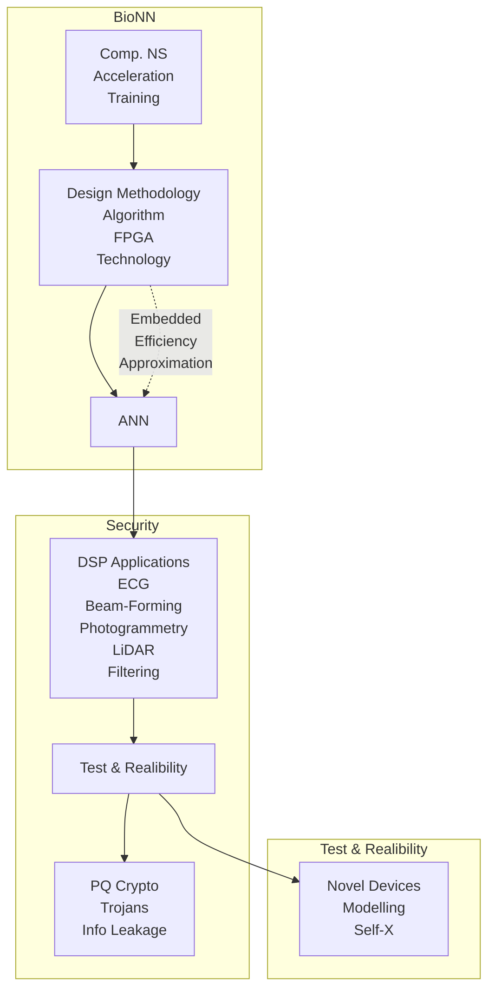
</details>

12

© T. Gemmeke, IDS, RWTH; R. Leupers, SSS

---

Entwurfsablauf

Chip-Entwurf


<details>
<summary>flowchart</summary>

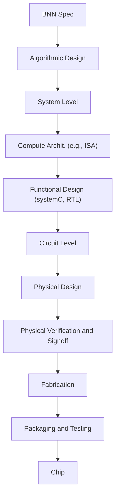
</details>

vom Layout zum Bring-Up


<details>
<summary>flowchart</summary>

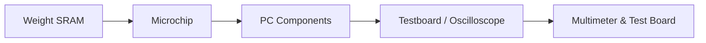
</details>

13

© T. Gemmeke, IDS, RWTH; R. Leupers, SSS

---

## Kooperationsprojekte (Auswahl)

## Advanced

## Computing


<details>
<summary>natural_image</summary>

Abstract digital illustration of a globe with four labeled technology icons (labeled 1–5) against a cosmic background, no readable text or symbols present.
</details>

Architectures (ACA)

ACA


<details>
<summary>natural_image</summary>

Abstract illustration of a human brain with colorful polyhedra and a grid-patterned brain model (no text or symbols)
</details>

Neuro Sys

I&II

towards multi-scale natural-density

Neuromorphic Computing


<details>
<summary>text_image</summary>

neuroAIx
</details>


<details>
<summary>natural_image</summary>

Digital illustration of a glowing blue brain inside a transparent dome, surrounded by abstract geometric structures (no text or symbols)
</details>


<details>
<summary>natural_image</summary>

3D architectural rendering of a modern multi-story building with visible internal structures and a logo labeled 'active 3D' (no text on the structure itself)
</details>

14

© T. Gemmeke, IDS, RWTH; R. Leupers, SSS

---

IDS-Lehrveranstaltungen

\* Mehrere Lehrstühle tragen zur Durchführung der Veranstaltung bei

## • Bachelor:

– Grundgebiete der Informatik 1 (GGI1) 1. Sem
– \*Projekt PETIT ("MATLAB meets LEGO Mindstorms„) 1. Sem
\*Praktikum Informatik 2 Teile
– VLSI Schaltungen & Architekturen (VLSI-CA) 4. Sem Pflicht CE bzw. 6. Sem Wahl ET&IT
– \*Grundlagen Integrierter Schaltungen und Systeme (GISS) 5. Sem Wahl ME
Institutsprojekt „Anwendung von künstlichen neuronalen Netzen zur Linienverfolgung mit Braitenberg-Vehikeln“ 4. Sem
– \*Praktikum Mikroelektronik 5. Sem Pflicht in ME
– Bachelor-Arbeiten zu aktuellen Forschungsthemen

## • Master

– VLSI Design for Digital Signal Processing – Fundamentals (VLSI-DF)
– VLSI Design for Digital Signal Processing – Architecturs (VLSI-DA)
– Computer Arithmetic – Fundamentals (CAR-F)
– Computer Arithmetic – Advanced Topics (CAR-A)
– Laboratory: VLSI Design
– Laboratory: FPGA Design
– Master-Arbeiten zu aktuellen Forschungsthemen

15

© T. Gemmeke, IDS, RWTH; R. Leupers, SSS

---

## 1. Einleitung

**1.1 Thematische Einordnung**
1.2 Hardware und Software
1.3 Programmiersprachen
1.4 Algorithmen und Programme

16

© T. Gemmeke, IDS, RWTH; R. Leupers, SSS

---

Was ist Informatik?

**Informatik** (Computer Science) ist die **Wissenschaft**, die sich mit der Entwicklung und Nutzung von Computersystemen beschäftigt
• Wurzeln in der **Mathematik** und **Elektrotechnik**
**Informatikkenntnisse** (speziell: Programmierkenntnisse) gehören heute zum Handwerkszeug jedes Ingenieurs
Einteilung in drei große **Teilgebiete**:

1. <u>Theoretische Informatik</u>: Computermodelle, Sprachen, Boolesche Funktionen, Komplexitätsanalyse, ...
2. <u>Praktische Informatik</u>: Programmiersprachen, Compiler, Betriebssysteme, SW Engineering, Datenbanken, ...
3. <u>Technische Informatik</u>: Aufbau von Computer-Hardware, Chip-Entwurf, Netzwerke, Mobilfunk, ...

17

© T. Gemmeke, IDS, RWTH; R. Leupers, SSS

---

## Einordnung GGI1

**GGI1** ist in erster Linie in der **praktischen Informatik** angesiedelt
**GGI2**: Technische Informatik: Prinzipien des Digitalrechners
**Automaten, Sprachen, Komplexität** (CE): Theoretische Informatik
**GGI3**: Praktische und Technische Informatik: Optimierung, Modellierung und Parallelität
**SUSP:** Praktische Informatik: System-SW und systemnahe Program.
• **GGI4:** Prakt. Inf.: Betriebssysteme
• Daneben: **Projekte** und **Praktika**
Grundlagen für weitere **Spezialisierung** ab 5. Semester


<details>
<summary>flowchart</summary>

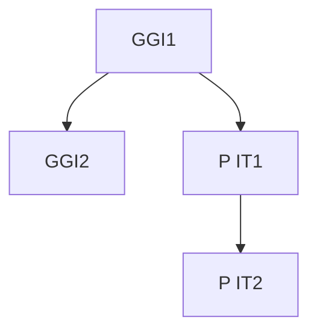
</details>

CE:


<details>
<summary>flowchart</summary>

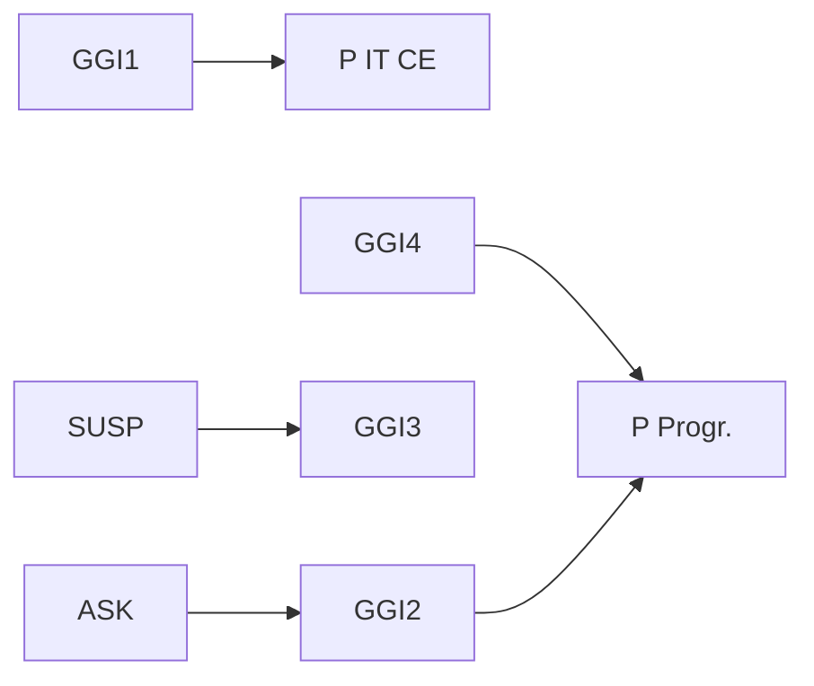
</details>

18

© T. Gemmeke, IDS, RWTH; R. Leupers, SSS

---

## 1. Einleitung

1.1 Thematische Einordnung
**1.2 Hardware und Software**
1.3 Programmiersprachen
1.4 Algorithmen und Programme

19

© T. Gemmeke, IDS, RWTH; R. Leupers, SSS

---

Hardware und Software

HW = Physikalisch existierender, programmierbarer Rechner (Computer)

→ Modifikation aufwendig

SW = Auf HW ausführbares Programm (Textdatei) für gegebene Anwendung

→ Modifikation einfach

In GGI1 wird die HW als **Black Box** betrachtet, die Programmcode ausführen kann
Innerer HW-Aufbau: siehe Vorlesung **GGI2**

## User


<details>
<summary>natural_image</summary>

Woman smiling while using a laptop (no visible text or symbols)
</details>


## SW

```c
void rgb2ycc1(
    signed char r, signed char g, signed char b,
    signed char *y, signed char *cb, signed char *cr)
{
    *y = ( 77*r + 150*g +  29*b          ) >> 8;
    *cb = (-43*r -  85*g + 128*b + 32768) >> 8;
    *cr = (128*r - 107*g -  21*b + 32768) >> 8;
}
void rgb2ycc(int NP, signed char *RGB, signed char *YCC)
{
    int i;
    for (i = 0; i < 3 * NP; i += 3) {
        rgb2ycc(RGB[i], RGB[i+1], RGB[i+2], &YCC[i], &YCC[i+1], &YCC[i+2]);
    }
}
```

## HW


<details>
<summary>natural_image</summary>

Illustration of a desktop computer tower with a yellow downward arrow indicating compression or loading (no text or symbols present)
</details>

© T. Gemmeke, IDS, RWTH; R. Leupers, SSS

20

---

Abbildung von SW auf HW

SW wird meist in höheren **Programmiersprachen** entwickelt
Programmiersprachen als **Schnittstelle** sind sowohl für Menschen als auch für Computer verständlich
**Compiler** übersetzt Hochsprachen-Programm in **Assemblerprogramm**, bestehend aus einzelnen (noch lesbaren) Prozessorbefehlen
• Übersetzung von **Quellcode** in **Zielcode**
Auch die direkte Entwicklung von **Assemblerprogrammen** ist möglich
Assembler übersetzt Assemblerprogramm in binären **Maschinencode**, der direkt auf der HW ausgeführt werden kann


<details>
<summary>flowchart</summary>

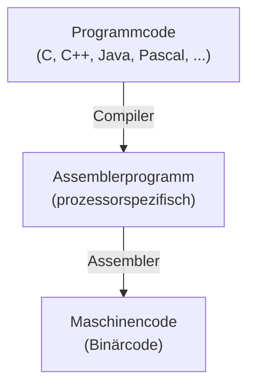
</details>

21

© T. Gemmeke, IDS, RWTH; R. Leupers, SSS

---

## 1. Einleitung

1.1 Thematische Einordnung
1.2 Hardware und Software
**1.3 Programmiersprachen**
1.4 Algorithmen und Programme

22

© T. Gemmeke, IDS, RWTH; R. Leupers, SSS

---

## Programmiersprachen

Computer wurden zu Anfang direkt in **Maschinencode** programmiert
Später Übergang zu **symbolischem** Maschinencode (Assembler)
Dann Einführung von (höheren) **Programmiersprachen**
• **Vorteile**:

– lesbar und wartbar (bei gutem Programmierstil)
– portierbar (nicht unbedingt zu 100%)

• „Evolution“ der Sprachen setzt sich ständig fort

– Zukünftig: für parallele **Multiprozessorsysteme**

Eine neue Sprache alleine ist praktisch wertlos, man benötigt

– **Programmierwerkzeuge**, z.B. Compiler
– **Akzeptanz** bei den Benutzern (u.a. wegen legacy code)


<details>
<summary>natural_image</summary>

Silhouette illustration of a person in various stages of life progression, including walking, running, and sitting (no text or symbols)
</details>

23

© T. Gemmeke, IDS, RWTH; R. Leupers, SSS

---

Wahl der Programmiersprache

## Einteilung:

– **Imperative Sprachen**: konkrete Beschreibung eines Algorithmus als Folge von Anweisungen (Beispiel: C, Pascal)
**Deklarative Sprachen**: Beschreibung des erwünschten Programmverhaltens, konkrete Umsetzung erfolgt teilweise durch den Compiler und Laufzeitsystem (Beispiel: LISP, Prolog)
– **Objektorientierte Sprachen**: Zusammenfassung von Algorithmen und Daten zu Objekten, dadurch einfachere Programmwartung (Beispiel: C++, Java)
– Einteilung nicht disjunkt, z.B. C ⊂ C++

• Für GGI1: **C und C++** aufgrund großer praktischer Relevanz
• Nicht alle **Sprachdetails** werden vorgestellt
• Programmieren lernt man nur durch **Übung**!

24

© T. Gemmeke, IDS, RWTH; R. Leupers, SSS

---

Software Life Cycle

• GGI1 stellt elementare Grundlagen der SW-Entwicklung bereit
• Typischer SW Life Cycle:


<details>
<summary>flowchart</summary>

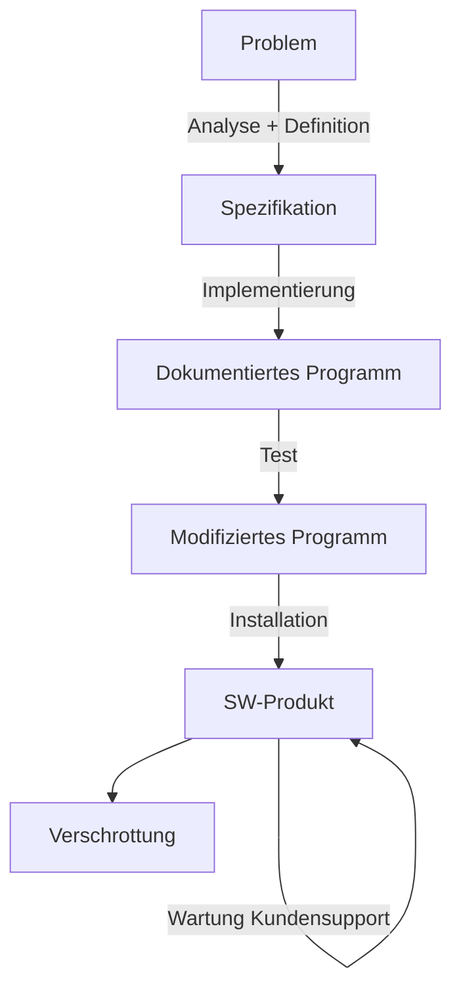
</details>

25

© T. Gemmeke, IDS, RWTH; R. Leupers, SSS

---

## 1. Einleitung

1.1 Thematische Einordnung
1.2 Hardware und Software
1.3 Programmiersprachen
**1.4 Algorithmen und Programme**

26

© T. Gemmeke, IDS, RWTH; R. Leupers, SSS

---

Grundbegriffe aus GGI1

## • Algorithmus:

– Abstrakte Handlungsanweisung, um ein Problem zu lösen
– Ausgabe als Funktion der Eingabe
– In endlicher Zeit, eindeutig und deterministisch
– Kann in natürlicher Sprache formuliert sein

## • Programm:

– Codierung eines Algorithmus in Programmiersprache

## • Datenstruktur:

– Mathematisches Objekt zur Speicherung von Daten
– Auf bestimmte Weise angeordnet und zusammengefasst
– Sinnvoll nur im Zusammenhang mit Operationen auf den Daten
– Beispiele: Arrays, Listen, Stacks, Bäume, Graphen, ...

27

© T. Gemmeke, IDS, RWTH; R. Leupers, SSS

---

Vom Problem zum Programm

Für jedes (per Computer lösbare) Problem gibt es **unendlich viele** Algorithmen
Für jeden Algorithmus existieren **unendlich viele** Implementierungen in einer Programmiersprache
**Anforderung:** Finde den besten Algorithmus und die beste Implementierung hierfür; Kriterien:
– Korrektheit
– Effizienz (Laufzeit und/oder Speicherverbrauch)
– Eleganz, Programmierstil
Korrektheit eines Algorithmus lässt sich (mathematisch) beweisen, Korrektheit eines Programms oft nicht
Zur Bewertung der Effizienz von Algorithmen dient die **Komplexitätsanalyse**
• Guter **Programmierstil** muss praktisch erlernt werden

28

© T. Gemmeke, IDS, RWTH; R. Leupers, SSS

---

Grenzen der Programmierung

• Wann ist ein Problem per Computer lösbar?

– Problemlösung muss **mathematisch exakt** als Algorithmus beschreibbar sein
– Bsp.: Sortiere eine Menge von Namen in lexikographischer Reihenfolge

• Jedoch: Viele wichtige Probleme sind **prinzipiell lösbar**, aber in der Praxis zu komplex

– Bsp.: Primfaktorzerlegung sehr großer Zahlen
– Bsp.: Optimale Routenplanung für Spediteure (**Traveling Salesman Problem**)
– Auch schnellere Rechner helfen **nicht** weiter

• Andere Probleme sind **prinzipiell unlösbar**

Bsp.: Bestimme, ob ein Programm nach endlicher Zeit auf gegebener Eingabe anhält (**Halteproblem**)

29

© T. Gemmeke, IDS, RWTH; R. Leupers, SSS

---

Inhalt der Vorlesung

1. Einleitung
2. Einführendes Beispiel
3. Elementare Datentypen und Anweisungen
4. Funktionen und Programmaufbau
5. Datentypen
6. Analyse von Algorithmen
7. Sortieralgorithmen
8. Lineare Datentypen
9. Bäume
10. Graphen
11. Techniken zum Algorithmenentwurf

30

© T. Gemmeke, IDS, RWTH; R. Leupers, SSS

---

## 2. Einführendes Beispiel

**2.1 Temperaturumrechnung**
2.2 Analyse des Beispiels
2.3 Ausführung und Fehlersuche

31

© T. Gemmeke, IDS, RWTH; R. Leupers, SSS

---

Einführendes C-Programmbeispiel

• Umwandlung von Grad Fahrenheit in Grad Celsius
•𝑦𝑦℃ = (5/9) ×𝑥𝑥℉ – 32

```c
#include <stdio.h>

/* Umwandlung von Fahrenheit in Celsius
    fuer fahr = 0, 20, ..., 300   */
int main()
{
    int fahr, celsius;
    int lower, upper, step;

    lower = 0; // untere Grenze der Temperaturtabelle
    upper = 300; // obere Grenze
    step  = 20; // Schrittweite

    fahr  = lower;
    while (fahr <= upper)  {
        celsius = 5  *  (fahr-32) / 9;
        printf("%d\t%d\n", fahr, celsius);
        fahr = fahr + step;
    }

    return 0;
}
```


<details>
<summary>natural_image</summary>

Medical thermometer with digital display showing 36.2°C (no text or symbols on device body)
</details>


<details>
<summary>line</summary>

| \({}^{\circ}F\) | \({}^{\circ}C\) |
| --- | --- |
| 0 | ~-1.5 |
| ~1.5 | 0 |
| ~3.0 | ~1.5 |
| ~4.5 | ~3.0 |
| ~6.0 | ~4.5 |
| ~7.5 | ~6.0 |
| ~9.0 | ~7.5 |
</details>

32

© T. Gemmeke, IDS, RWTH; R. Leupers, SSS

---

Libraries

Von vielen Programmen häufig wiederverwendeter Code wird in Bibliotheken (Libraries) abgelegt
Library-Code wird nur einmal compiliert und kann dann von allen Programmen eingebunden werden
• Dies erfolgt nach der Assemblierung durch den Linker
C besitzt insges. 29 Standard-Libraries, z.B.:
– stdio: Ein- und Ausgabe
– math: Mathematische Funktionen
– string: String-Manipulation
Durch Einbinden einer Header-Datei (z.B. „stdio.h“) werden die Library-Funktionen dem benutzenden Programm bekannt gemacht
Programmierer können (und sollten) auch eigene, benutzerspezifische Libraries anlegen

33

© T. Gemmeke, IDS, RWTH; R. Leupers, SSS

---

Standardbibliothek C++ - Beispiele

C++

• **Zeichenketten und Streams**

– string, iomanip, iostream, cstdio

• **Abtrakte Datentypen / Container**

– vector, array, (forward\_)list, queue, stack
– (unordered\_)set, (unordered\_) map
– iteratoren

• **Smart Pointer**

– unique\_prt
– shared\_prt
– weak\_ptr

• **Algorithmen**

– for\_each, sort, copy, find & search, transform

• **Funktoren**

– multiplies, negate, …

34

© T. Gemmeke, IDS, RWTH; R. Leupers, SSS

---

## 2. Einführendes Beispiel

2.1 Temperaturumrechnung
**2.2 Analyse des Beispiels**
2.3 Ausführung und Fehlersuche

35

© T. Gemmeke, IDS, RWTH; R. Leupers, SSS

---

Analyse des C-Programms

• **Einbinden** der Standard-Library zur Ein/Ausgabe

– #include &lt;stdio.h&gt;
– Ermöglicht Kommunikation des Programms mit der Außenwelt (z.B. Benutzer)
– Siehe C-Präprozessor

• **Kommentare**

– /\* Umwandlung … \*/
– // untere Grenze …
– Erläuterung der Programmfunktion für Entwickler
– Text innerhalb /\* … \*/ und in einer Zeile nach // wird vom Compiler ignoriert

• **Hauptfunktion** main

– int main() { … }
– Alle Anweisungen innerhalb { … } gehören zu main
– main wird nach Programmstart immer direkt aufgerufen
– Im Allg. ruft main dann weitere Funktionen auf

36

© T. Gemmeke, IDS, RWTH; R. Leupers, SSS

---

Analyse des C-Programms

## • Variablen-Vereinbarungen

– int fahr, celsius;
– Variablen sind benannte Speicherplätze für Werte
– Können lesend und schreibend zugegriffen werden
– Variablen müssen vor Verwendung vereinbart werden
– Hier: Verwendung von ganzzahligen (integer) Variablen

## • Zuweisungen

– lower = 0;
– upper = 300;
– Schreiben von Werten in die Variablen

## • Schleife

– while (fahr <= upper) { /\* ... \*/ }
– while ist (wie auch int) ein **C-Schlüsselwort**
– Code innerhalb { … } wird solange wiederholt, bis Bedingung nicht mehr erfüllt

37

© T. Gemmeke, IDS, RWTH; R. Leupers, SSS

---

Analyse des C-Programms

## • Umrechnung

– celsius = 5 \* (fahr-32) / 9;
– Rechenoperationen auf Variablen

## • Ausgabe

– printf("%d\t%d\n", fahr, celsius);
– Formatierte Ausgabe:

• fahr als Integer-Zahl (erstes %d als Platzhalter)
• Tabulator \t
• celsius als Integer-Zahl (zweites %d als Platzhalter)
• Zeilenumbruch \n

## • Vorbereitung des nächsten Schleifendurchlaufs

– fahr = fahr + step;
– fahr wird um step erhöht, bis upper überschritten

38

© T. Gemmeke, IDS, RWTH; R. Leupers, SSS

---

Ausgabe

C++

## • Formatierte Ausgabe

Classic C++

```cpp
#include <iostream>  // std::cout, std::right, std::endl
#include <iomanip>   // std::setw

int main() {
    int val = 65;

    std::cout << "Formatted output using C++" << std::endl;
    std::cout << "-start-" << std::endl;
    std::cout << std::right;  // right-adjusted (manipulator)
    std::cout << ''' << std::setw(10) << val << ''' << std::endl;
    std::cout << "-end-" << std::endl;

    return 0;
}
```

C++11 oder c

```c
#include <cstdio> // printf; for c library: <stdio.h>, no "using ..."
using namespace std;

int main() {
    int val = 65;

    printf("Now using C++11:\n");
    printf("-start-\n'%10d'\n-end-\n", val);

    return 0;
}
```

39

© T. Gemmeke, IDS, RWTH

---

Libraries

C++

• Using und namespace

```cpp
#include <string>
#include <iostream>

int main( void ) {

    std::string msg = "Hello world!";

    std::cout << msg << std::endl;

    return 0;
}
```

```cpp
#include <string>
#include <iostream>

using std::cout, std::endl, std::string;
// using namespace std;

int main( void ) {

    string msg = "Hello world!";

    cout << msg << endl;

    return 0;
}
```

std::cout ⭢ cout

40

© T. Gemmeke, IDS, RWTH

---

C-Präprozessor

C-Präprozessor (cpp) läuft **vor dem Compiler** über den Quellcode (C-nach-C-Übersetzung)
• cpp-Anweisungen beginnen mit Zeichen #
• cpp-Verwendung erhöht **Lesbarkeit** der Programme
• Vor allem folgende Anwendungen:

– **Symbolische Definitionen** (Konvention: Großbuchstaben)

• #define UPPER 300
• Alle Vorkommen von UPPER werden durch 300 ersetzt

– **Makros**

• #define $\mathsf { M A X ( a , b ) ~ ( a > b ) ~ ? ~ a : b }$
• Alle Vorkommen von $\operatorname { M A X } ( \ldots , \ldots )$ werden ersetzt

**Einbinden** von Standard-Libraries (und allgemein Header-Dateien mit Deklarationen)

• #include &lt;stdio.h&gt;
• Datei stdio.h wird an dieser Stelle ins Programm eingefügt

41

© T. Gemmeke, IDS, RWTH; R. Leupers, SSS

---

## 2. Einführendes Beispiel

2.1 Temperaturumrechnung
2.2 Analyse des Beispiels
**2.3 Ausführung und Fehlersuche**

42

© T. Gemmeke, IDS, RWTH; R. Leupers, SSS

---

Übersetzung und Ausgabe

Programm in **Textdatei** „temp.c“gespeichert
Aufruf des **C-Compilers** (z.B. aus Linux shell)

– cc temp.c (je nach Compiler)
– **Präprozessor** und **Assembler** werden implizit aufgerufen
– **Zielprogramm** „a.out“ wird erzeugt
– **Ausführung** von „a.out“generiert die gezeigte Ausgabe

Ausgabe

| 0 | -17 |
| --- | --- |
| 20 | -6 |
| 40 | 4 |
| 60 | 15 |
| 80 | 26 |
| 100 | 37 |
| 120 | 48 |
| 140 | 60 |
| 160 | 71 |
| 180 | 82 |
| 200 | 93 |
| 220 | 104 |
| 240 | 115 |
| 260 | 126 |
| 280 | 137 |
| 300 | 148 |

43

© T. Gemmeke, IDS, RWTH; R. Leupers, SSS

---

Fehlerhafte Programme

• **Möglichkeit 1**: Programm entspricht nicht dem C-Standard
Derartige Fehler werden vom Compiler (oder auch Linker) bemerkt und dem Programmierer mitgeteilt


<details>
<summary>flowchart</summary>

```mermaid
graph TD
  #include <stdio.h>

  /* Umwandlung von Fahrenheit in Celsius
    fuer fahr = 0, 20, ..., 300 */
  int mein()
  {
    int fahr /* , celsius */;
    int lower, upper, step;

    lower = 0; // untere Grenze der Temperaturtabelle
    upper = 300; // obere Grenze
    step = 20; // Schrittweite

    fahr = lower
    while (fahr <= upper) {
      celsius = 5 * (fahr-32) ** 9;
      printf("%d\t%d\n", fahr, celsius);
      fahr = fahr + step;
    }

    return 0;
  }
  FehlendeMainFunktion["Fehlende main-Funktion"] --> VariableNichtDeklariert["Variable nicht deklariert"]
  UnbekannterOperator["Unbekannter Operator"] --> SemikolonVergessen["Semikolon vergessen"]
```
</details>

44

© T. Gemmeke, IDS, RWTH; R. Leupers, SSS

---

Fehlerhafte Programme

**Möglichkeit 2**: Programm ist gültig (d.h. compilierbar), führt aber nicht die gewünschte Funktion aus (es hat „Bugs“)
• Wesentlich schwieriger zu finden und zu beheben!

```c
#include <stdio.h>

/* Umwandlung von Fahrenheit in Celsius
    fuer fahr = 0, 20, ..., 300   */
int main()
{
    int fahr, celsius;
    int lower, upper, step;

    lower = 0; // untere Grenze der Temperaturtabelle
    upper = 300; // obere Grenze
    step  = 20; // Schrittweite

    fahr = lower;
    while (fahr <= upper) {
        celsius = 5 * (fahr+32) / 9;
        printf("%d\t%d\n", fahr, celsius);
        fahr = fahr + step;
    }

    return 0;
}
```

45

© T. Gemmeke, IDS, RWTH; R. Leupers, SSS

---

## Fehlerhafte Programme

Programm unter Kontrolle eines **Debuggers** ausführen
Ermöglicht **Einzelschrittmodus**, Beobachtung von **Variablen** u.v.m.
Hilfreich vor allem bei **Endlosschleifen** und **Programmabstürzen**
Debugger kann Programmverhalten beeinflussen („**Heisenbugs**“)


<details>
<summary>text_image</summary>

File Edit View Program Commands Status Source Data Help
(): upper1
Lookup Find-Break Watch Print Display Plot Hide-Potise Set Undisp
1: celsius -6 5: step 20 2: fahr 40 3: lower 0 4: upper 300
Ausgabefenster
/* Umwandlung von Fahrenheit in Celsius
    fuer fahr = 0, 20, ., 300 */
main()
{
    int fahr, celsius;
    int lower, upper, step;

    lower = 0; /* untere Grenze der Temperaturtabelle */
    upper = 300; /* obere Grenze */
    step = 20; /* Schrittweite */

    fahr = lower;
    while (fahr <= upper) {
        celsius = 5 * (fahr-32) / 9;
        printf("%d\t%d\n", fahr, celsius);
        fahr = fahr + step;
    }
}
Quellcode
DDD Run Interrupt Step Stepi Next Nexti Until Finish Cont Kill Up Down Undo Redo Edit Make
(gdb) graph display celsius
(gdb) cont
0 -17
Kommandofenster
Breakpoint 1, main () at celsius.c:16
(gdb) graph display fahr
(gdb) graph display lower
(gdb) graph display upper
(gdb) graph display step
(gdb) cont
20 -6
Breakpoint 1, main () at celsius.c:16
(gdb)
</details>

46

© T. Gemmeke, IDS, RWTH; R. Leupers, SSS

---

## 3. Elementare Datentypen und Anweisungen

## 3.1 Einführung

3.2 Variablen und Konstanten
3.3 Zeiger
3.4 Arithmetische und logische Operationen und Zuweisungen
3.5 Kontrollanweisungen

47

© T. Gemmeke, IDS, RWTH; R. Leupers, SSS

---

Datentypen - Einführung

**Def**.: Ein **Datentyp** (**DT**) ist eine Menge von Werten und eine <u>Sammlung von Operationen auf diesen Werten.</u>

Beispiel: **natürliche Zahlen** 1, 2, 3, ...
– Operationen: $+ , - , * , / , \ldots$
• Beispiel: **Zeichenketten** (Strings) über Alphabet A-Z – Operationen:

• Bestimme Stringlänge
• Ordne Strings alphabetisch an
•...

Beispiel: Menge von **Personen-Stammdaten** (Name, Geburtsdatum, Adresse, ...)

– Operationen:

• Finde Teilmenge aller Personen älter als 50 Jahre
• Finde Teilmenge aller Personen, die in Aachen wohnen
•...

48

© T. Gemmeke, IDS, RWTH; R. Leupers, SSS

---

Datentypen - Einführung

## Def.: Ein abstrakter Datentyp (ADT) ist ein Datentyp der nur über eine Schnittstelle zugänglich ist.

Funktion vs. Implementierung des Datentyps
Nur Funktion nach außen von Interesse
Implementierung kann sich evtl. ändern

Beispiel: DT „Punkt“ in C
Koordinaten:
struct point { float x; float y; }
• Operation „Euklidischer Abstand“:

```lisp
float dist(struct point a, struct point b)
{
    float dx, dy;
    dx = a.x - b.x;
    dy = a.y - b.y;
    return sqrt(dx*dx + dy*dy);
}
```


<details>
<summary>text_image</summary>

y
a
dist(a,b)
b
x
</details>

49

© T. Gemmeke, IDS, RWTH; R. Leupers, SSS

---

Datentypen - Einführung

In der C-Version sind Daten (point) und Operationen (dist) **getrennt**
Programme könnten (und i.d.R.: werden) ohne „dist“ auch **direkt** auf die x- und y-Koordinaten zugreifen
Ändert sich die interne Implementierung von point, so wäre evtl. ein Großteil des **übrigen Programmcodes** betroffen
• **ADT-Version** in C++: (siehe Kapitel 5)

```txt
class point {
    private:      // interne Repräsentation nicht nach außen sichtbar
        float x, y; // oder andere interne Repräsentation
    public:      // Schnittstelle für Benutzer von „point“
        float dist(point);
        /* ... */
};
```

Daten und Operationen per Konstruktion (class) **vereinigt**
• Interne Daten nur über Schnittstelle verfügbar!

50

© T. Gemmeke, IDS, RWTH; R. Leupers, SSS

---

Objekte in C

Variablen, Konstanten und Programmcode (Funktionen) werden im **Speicher** abgelegt
Ein **Objekt** ist ein benannter Speicherbereich
Auf Objekte wird direkt (per **Namen**) oder indirekt (per **Zeiger**) zugegriffen; Zeiger (symbolische Adressen) sind selbst Objekte
Der **benötigte Speicherplatz** eines Objektes sowie die darauf **zulässigen Operationen** hängen vom Typ ab
Im Speicher befinden sich nur **Binärzahlen**; Interpretation ist den Operationen überlassen

Vereinfachtes Speichermodell


<details>
<summary>flowchart</summary>

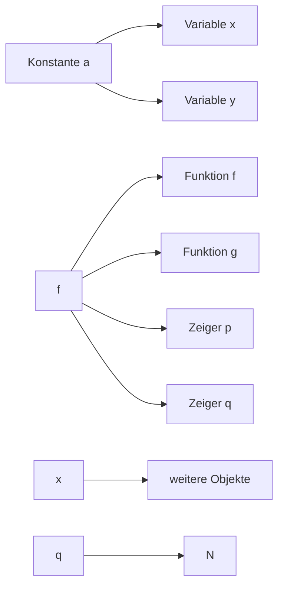
</details>

51

© T. Gemmeke, IDS, RWTH; R. Leupers, SSS

---

Basis-Datentypen in C

• char: **Zeichen** (character) = 1 Byte (8 Bits)
• int: **ganze Zahl** (integer)

– short int: kleinerer Wertebereich (mind. 16 Bit)
– long int: größerer Wertebereich (mind. 32 Bit)

• float: **Fließkommazahl** (floating point)

– Aufteilung in Exponenten und Mantisse
$12.3 \times 10^{10} = 12.34 \times 10^{10}$
– double: größerer Wertebereich
– long double: noch größerer Wertebereich

char und ganze Zahlen können **vorzeichenbehaftet** (Standardfall) oder **vorzeichenlos** sein:

– signed short int $\in [ - 2 ^ { 1 6 - 1 } , 2 ^ { 1 6 - 1 } - 1 ] \: = \: [ - 3 2 7 6 8 , 3 2 7 6 7 ]$
– unsigned short int $\in [ 0 , 2 ^ { 1 6 } - 1 ] \qquad \quad = \quad [ 0 , 6 5 5 3 5 ]$

52

© T. Gemmeke, IDS, RWTH; R. Leupers, SSS

---

## 3. Elementare Datentypen und Anweisungen

3.1 Einführung
**3.2 Variablen und Konstanten**
3.3 Zeiger
3.4 Arithmetische und logische Operationen und Zuweisungen
3.5 Kontrollanweisungen

53

© T. Gemmeke, IDS, RWTH; R. Leupers, SSS

---

Variablen

## • Variablen

– speichern Werte eines bestimmten **Datentyps**
– müssen vor Verwendung **vereinbart** werden

• z.B. float a, b; char x, y; double e, f;

– besitzen einen eindeutigen **Namen**
– Name sollte über **Verwendung** Aufschluss geben!

• z.B. int counter; ist besser als int c;

• **Schlüsselwörter** sind als Namen nicht erlaubt

– z.B. for, while, goto, int, float, ... sind in C/C++ reserviert

• Je nach Compiler:

– Es sind nur die ersten 31 Zeichen **signifikant**
– z.B. int einLangerVariablenName1234567890, einLangerVariablenName1234567891 gelten als gleich

54

© T. Gemmeke, IDS, RWTH; R. Leupers, SSS

---

Variablen

• Aufbau von Variablennamen (Identifier-Syntax)
• Kompakte Beschreibung mit **regulären Ausdrücken**

– letter = "a"|"b"|…|"z"|"A"|"B"|…|"Z"|"\_"

• **letter** = ein Buchstabe oder „\_“

– digit = "0"|…|"9"

• **digit** = eine Dezimalziffer

– identifier = letter { letter | digit }

• **identifier** = ein letter, gefolgt von beliebig vielen Elementen (auch 0) letter oder digit

• Z.B. zulässig:
– int x, XX, y\_, a\_42;
• Z.B. unzulässig:
– int 0Z, 1234\_x, return;

55

© T. Gemmeke, IDS, RWTH; R. Leupers, SSS

---

Variablen-Vereinbarung

• Vereinbarung vor erster Verwendung der Variable

– Deklaration ermöglicht **Korrektheitsprüfungen** durch Compiler
– Definition allokiert benötigten **Speicherplatz**

• **Allgemeine Form** der Vereinbarung:

– Typ ID (, ID)\* ;
– Typ darf sein:

Basis-DT (Schlüsselwort): char, int, float, ...
Zusammengesetzter DT (Zeiger, Array, Struct, ...)
Benutzerdefinierter DT

```c
int main(void)
{
    /* Variablen-
        Vereinbarungen */

    /* ... */

    /* Anweisungen mit
        Variablen-
        Verwendung */

    return 0;
}
```

– typedef unsigned long int UL;
– Macht UL als Abkürzung für unsigned long int bekannt
– Hilfreich vor allem bei zusammengesetzten DT

56

© T. Gemmeke, IDS, RWTH; R. Leupers, SSS

---

Konstanten

Falls Werte sich innerhalb eines Programms nie ändern, so werden diese als **Konstanten** statt Variablen dargestellt
Bessere **Lesbarkeit**, mehr **Optimierungsmöglichkeiten**
Konstanten benötigen keine explizite Definition, da ihr **Typ implizit** ist; Beispiele:

12345: ganze Zahl (int)

12345U: vorzeichenlose ganze Zahl (unsigned int)

0xAFFE: ganze Zahl in Hexcode (int)

123.45: Fließkommazahl (double)

123E-2: Fließkommazahl (double)

'a': Zeichen (char)

"String": Zeichenkette (Array aus char, s. später) int-Konstante als regulärer Ausdruck: "0" | ( [ "-" ], dnz, { d } )

57

© T. Gemmeke, IDS, RWTH; R. Leupers, SSS

---

Weitere Formen von Konstanten

• **Symbolische Konstanten** im Präprozessor

– #define MAXCOUNT 1000
– Alle Vorkommen von MAXCOUNT im Programm werden durch 1000 ersetzt
– Bessere Lesbarkeit und Wartbarkeit des Codes

• **Konstante Ausdrücke**

– MAXCOUNT + 1, MAXCOUNT \* 2, ...
– Werden vom Compiler vorab ausgerechnet, nicht zur Programm-Laufzeit (compile time-Konstante)

• **Konstante Variablen**

– const int a = 100; (const ist ein type qualifier)
– Variable a darf kein neuer Wert zugewiesen werden
– Effekt: Ablage von a im read only-Speicher (ROM)

58

© T. Gemmeke, IDS, RWTH; R. Leupers, SSS

---

## 3. Elementare Datentypen und Anweisungen

3.1 Einführung
3.2 Variablen und Konstanten
**3.3 Zeiger**
3.4 Arithmetische und logische Operationen und Zuweisungen
3.5 Kontrollanweisungen

Aachen

59

© T. Gemmeke, IDS, RWTH; R. Leupers, SSS

---

Zeiger

**Def**.: Ein **Zeiger** (engl. pointer) ist eine Variable, die die <u>Speicheradresse einer Variablen enthält.</u>

Zeiger gehören zu den **wichtigsten Konzepten** in C/C++ zur Definition komplexer und effizienter Datentypen
Zeiger gehören (leider) auch zu den **häufigsten Fehlerquellen** bei der Programmierung
• Bsp.:
– Der spezielle Zeigerwert NULL (0) wird oft verwendet, um einen „leeren“ Zeiger anzuzeigen (#define NULL 0)
– Der Versuch, einen Wert an Adresse 0 zu schreiben, führt in aller Regel zum **Programmabsturz**
– Enthält ein Zeiger einen sonstigen illegalen Wert, so kann sogar der **Programmcode** selbst überschrieben werden

60

© T. Gemmeke, IDS, RWTH; R. Leupers, SSS

---

Zeiger

Alle **Programm-Objekte** liegen im Speicher (s.o.)
Jedes Objekt besitzt eine **Adresse** im Speicher (wie eine Hausnummer)
Häufig werden Objekte **per Namen** zugegriffen (z.B. Variable ${ { \bf \Pi } _ { v } } \times { { \bf \Pi } ^ { \prime \prime } } )$
Oft ist auch der **indirekte Zugriff** auf ein Objekt über seine Adresse sinnvoll
Objekt-Adressen werden in **Zeigern** gespeichert
Zeiger sind selbst Objekte mit Adressen, daher sind auch **Zeiger auf Zeiger** möglich


<details>
<summary>flowchart</summary>

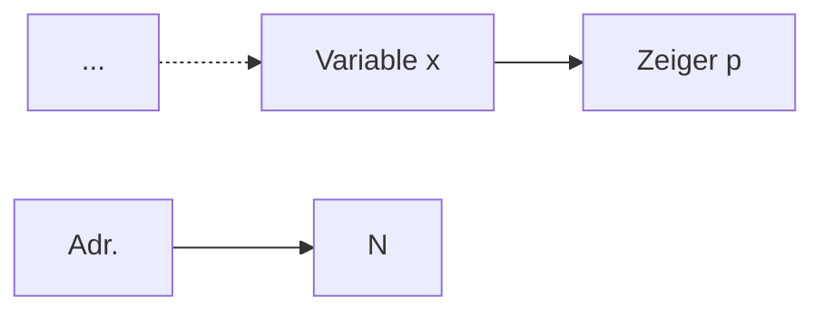
</details>

61

© T. Gemmeke, IDS, RWTH; R. Leupers, SSS

---

Zeigervereinbarung und -operationen

• Zeiger werden mittels \* deklariert
Typ \* ID; vereinbart einen Zeiger auf ein Objekt vom Typ Typ
Bsp.: int \* p; int \*\* q;
Symbol \* gehört syntaktisch zu ID, nicht zum Typ, z.B.

int \* p, q; vereinbart einen int-Zeiger p und eine int-Variable q, aber int \*p,\*q; vereinbart zwei int-Zeiger

• Äquivalent wäre: typedef int\* intptr; intptr p, q;


<details>
<summary>flowchart</summary>

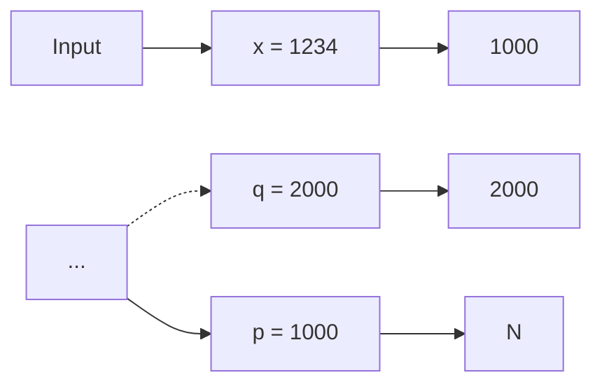
</details>

62

© T. Gemmeke, IDS, RWTH; R. Leupers, SSS

---

Zeigerdeklaration und -operationen

**Annahme**: Adresse von Objekt x in Zeiger p gespeichert
• Wie erfolgt der Zugriff auf x?

– \*-Operator
– Ausdruck \*pointer liefert Objekt x

• **Beispiel**:

\*p liefert den Wert 1234 (int)
\*q liefert den Wert 1000 (intptr)

• **Schreibzugriff** per \*:

\*p = 4321; überschreibt x mit 4321
\*\*q = 5678; überschreibt x mit 5678

Vergleiche Syntax der **Vereinbarung**

– int \*p;
– **implizite** Deklaration von p als Zeiger


<details>
<summary>flowchart</summary>

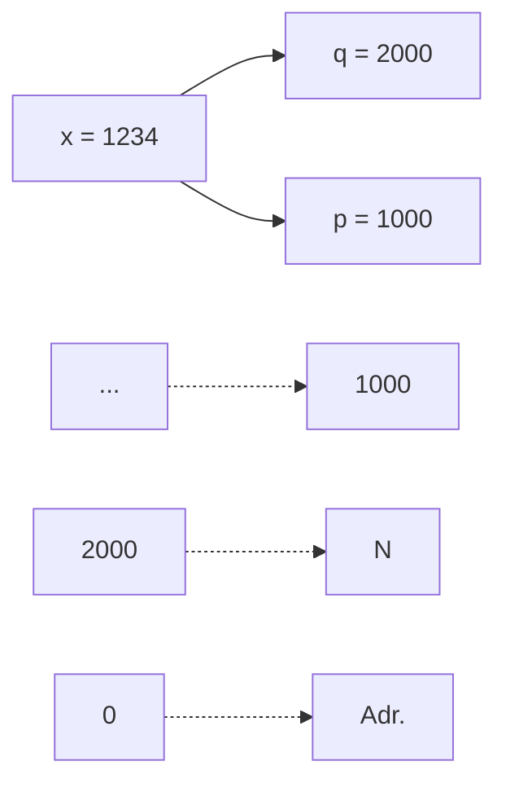
</details>

63

© T. Gemmeke, IDS, RWTH; R. Leupers, SSS

---

## Adressoperator

Zeiger auf x wird auch als **Referenz** auf x bezeichnet
\*-Operator heißt auch **Dereferenzierung** (indirection)
Erzeugung von Referenzen durch den **Adressoperator** &
– An p wird die Adresse von x zugewiesen (p „zeigt“ dann auf x)
– An q wird die Adresse von p zugewiesen
& und \* sind invers zueinander:
• & nur auf **Objekte** anzuwenden, \* nur auf **Zeiger**

$$
\mathrm{p} = \& \mathrm{x};
$$

$$
q = \& p;
$$

$$
- ^ {*} (\& \mathrm{x}) = \mathrm{x}
$$


<details>
<summary>flowchart</summary>

```mermaid
graph LR
  A[""] --> B["x = 1234"]
  B --> C[""]
  D[""] --> E[""]
  F[""] --> G["q = 2000"]
  G --> H["p = 1000"]
  H --> I[""]
  J[""] --> K[""]
  L[""] --> M[""]
  N[""] --> O[""]
```
</details>

64

© T. Gemmeke, IDS, RWTH; R. Leupers, SSS

---

Type cast mit Zeigern

Zeiger sind im Prinzip **identisch** mit (positiven) Integer-Zahlen
Daher können Zeiger und int ineinander **umgewandelt** werden

$$
\begin{array}{l} p = (i n t ^ {*}) x; \\ x = ^ {*} p; \\ \end{array}
$$

– lädt x mit dem Inhalt von Speicherstelle 1234

$$
\mathsf {x} = (\text {int}) \mathsf {q};
$$

– lädt x mit 2000

Diese Eigenschaft von C/C++ bringt große **Flexibilität**, birgt jedoch auch **Gefahren**, z.B. möglicher Zugriff auf geschützte Speicherbereiche


<details>
<summary>flowchart</summary>


</details>

65

© T. Gemmeke, IDS, RWTH; R. Leupers, SSS

---

Wozu dienen Zeiger?

Allgemein: falls mittels eines **einzigen Objektes** (Zeiger) im Programmverlauf auf **verschiedene andere Objekte** zugegriffen werden soll
Oder falls (in der maschinennahen Programmierung) Zugriffe auf **vorgegebene feste Speicherstellen** notwendig sind
Vor allem sind Zeiger sinnvoll bei **dynamischen** (d.h. zur Laufzeit erzeugten) Datenstrukturen
Datenobjekte, deren Größe während der Programmentwicklung noch nicht feststeht und die daher **nicht statisch deklariert** werden können
Hierfür kann dynamisch (d.h. während der Programmlaufzeit) Speicher angefordert und wieder freigegeben werden
Der Speicherbereich hierfür heißt **Heap** (Halde, Haufen)

66

© T. Gemmeke, IDS, RWTH; R. Leupers, SSS

---

Heap-Speicher

Programmcode und Variablen im **statischen** Speicherbereich
• Zugriff auf den **Heap** wie folgt:
Anforderung von Heap-Speicher mittels Funktion malloc (memory allocation)
– p zeigt dann auf Anfang von freiem 1000-Byte Heap-Block
– Adresse eines freien Blockes wird von malloc **automatisch** ermittelt (z.B. 5000)

$$
\text {int} ^ {*} \mathrm{p} = (\text {int} ^ {*}) \text {malloc(1000)};
$$

Adr.


<details>
<summary>bar_stacked</summary>

| Category | Label |
| --- | --- |
| Top (Yellow) | 0 |
| Middle (Yellow) | p = 5000 |
| Bottom (Green) | ... |
| Bottom (Blue) | H |
| Bottom (Blue) | E |
| Bottom (Blue) | A |
| Bottom (Blue) | P |
</details>

67

© T. Gemmeke, IDS, RWTH; R. Leupers, SSS

---

Heap-Speicher

• Adressen **5000-5999** durch malloc reserviert $p = 1234$ ;
weist 1234 an erste Speicherzelle im Block zu

Da die an malloc übergebene **Blockgröße** variabel ist, kann Heap-Speicher immer **passend** angefordert werden
Nach Verwendung sollte der Heap-Block auch wieder **freigegeben** werden, um den Speicherplatz für andere Zwecke wiederverwenden zu können:

free(p); // Block 5000-5999 freigeben


<details>
<summary>bar_stacked</summary>

| Stage | Value |
| --- | --- |
| Initial State | 0 |
| Step 1 | p = 5000 |
| Step 2 | ... |
| Step 3 | 1234 |
| Step 4 | 5000 |
| Step 5 | 6000 |
| Final State | N |
</details>

68

© T. Gemmeke, IDS, RWTH; R. Leupers, SSS

---

C++

Dynamische Speicherallokierung

```c
#include <stdlib.h>
#include <stdio.h>

int main( void ) {
    int* p;
    printf("Any memory          @ %p: %d_%d_%d\n", p, p[0], p[1], p[2]);
    p = (int*) malloc(1000);
    printf("Allocated memory   @ %p: %d_%d_%d\n", p, p[0], p[1], p[2]);
    p[0] = 4;
    p[1] = 7;
    p[2] = 11;
    printf("Initialized memory @ %p: %d_%d_%d\n", p, p[0], p[1], p[2]);
    free(p);
    printf("Deallocated memory @ %p: %d_%d_%d\n", p, p[0], p[1], p[2]);

    return 0;
}
```

```cpp
#include <cstdio>
#include <memory>
using namespace std;
int main( void ) {
    int* p;
    printf("Any memory          @ %p: %d_%d_%d\n", p, p[0], p[1], p[2]);
    p = new int[250];
    printf("Allocated memory   @ %p: %d_%d_%d\n", p, p[0], p[1], p[2]);
    p[0] = 4;
    p[1] = 7;
    p[2] = 11;
    printf("Initialized memory @ %p: %d_%d_%d\n", p, p[0], p[1], p[2]);
    delete [] p;
    printf("Deallocated memory @ %p: %d_%d_%d\n", p, p[0], p[1], p[2]);

    return 0;
}
```

69

© T. Gemmeke, IDS, RWTH

---

Smart Pointer

C++

• Motivation

```cpp
#include <iostream>
#include <memory>
#include <sys/resource.h>
using namespace std;

// get memory footprint
long get_mem() {
    struct rusage is;
    getrusage(RUSAGE_SELF, &is);
    return is.ru_maxrss; // in KB
}

void subA() {
    int a; int* pa = &a;
}

void subB() {
    int* pa = new int;
    // delete pa; // free memory space, no automatic deallocation
}

void subC() { unique_ptr<int> pa = make_unique<int>(); }

int main( void ) {
    long mem_base = get_mem();
    cout << "Memory base usage: " << mem_base << endl;

    for( long i=0; i<10000000; i++ ) {
        subA();
        if( i%1000000 == 0) cout << "Addt'l allocation: " << get_mem() - mem_base << endl;
    }
    return 0;
}
```

70

© T. Gemmeke, IDS, RWTH

---

Smart Pointer

C++

## • Unique Pointer


<details>
<summary>flowchart</summary>

This image displays a code editor for creating an 'unique pointer' in a context, showing the syntax and conditional logic for handling unique pointers.
</details>

71

© T. Gemmeke, IDS, RWTH

---

Smart Pointer

C++

• Shared Pointer

```cpp
#include <iostream>
#include <memory>
using namespace std;

void show( shared_ptr<string>& p0, shared_ptr<string>& p1 ) {
    if( p0 != nullptr ) cout << "Shared pointer p0: '" << *p0 << ''' << endl;
    if( p1 != nullptr ) cout << "Shared pointer p1: '" << *p1 << ''' << endl;
    cout << " Ptr of p0 use count: " << p0.use_count() << endl;
    cout << " Ptr of p1 use count: " << p1.use_count() << endl << endl;
}

int main( void )
{
    shared_ptr<string> ptr0 = make_shared<string>("shared");
    shared_ptr<string> ptr1;
    show(ptr0, ptr1);

    cout << "Duplicating reference to object ..." << endl;
    ptr1 = ptr0;
    show(ptr0, ptr1);

    ptr0 = make_shared<string>("something new");
    show(ptr0, ptr1);

    return 0;
}
```

72

© T. Gemmeke, IDS, RWTH

---

Smart Pointer

C++

## • Weak Pointer

Einen weak pointer zu de-referenzieren ist etwas ~~kompliziert. Es benötigt eine temporäre Kopie der Re~~ferenz. <u>Diese wird durch die Methode lock() erreicht.</u>

```cpp
#include <iostream>
#include <memory>
using namespace std;

void show( shared_ptr<string>& p0, weak_ptr<string>& p1 ) {
    if( p0 != nullptr ) cout << "Shared pointer p0: '" << *p0 << "''' << endl;
    if( !p1.expired() ) cout << "Weak pointer p1: '" << *(p1.lock()) << "''' << endl;
    cout << " Ptr of p0 use count: " << p0.use_count() << endl;
    cout << " Ptr of p1 use count: " << p1.use_count() << endl << endl;
}

int main( void )
{
    shared_ptr<string> ptr0 = make_shared<string>("shared");
    weak_ptr<string> ptr1;
    show(ptr0, ptr1);

    cout << "Duplicating reference to object ..." << endl;
    ptr1 = ptr0;
    show(ptr0, ptr1);

    ptr0 = make_shared<string>("something new");
    show(ptr0, ptr1);

    return 0;
}
```


<details>
<summary>flowchart</summary>

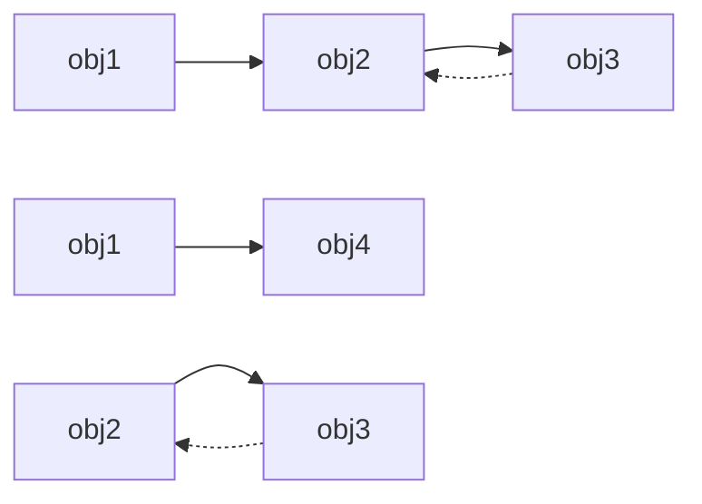
</details>

73

© T. Gemmeke, IDS, RWTH

---

## 3. Elementare Datentypen und Anweisungen

3.1 Einführung
3.2 Variablen und Konstanten
3.3 Zeiger
**3.4 Arithmetische und logische Operationen und Zuweisungen**
3.5 Kontrollanweisungen

74

© T. Gemmeke, IDS, RWTH; R. Leupers, SSS

---

Arithmetische und logische Operationen

Auf Variablen und Konstanten können verschiedene **Rechenoperationen** angewendet werden

$$
- +, -, *, /
$$

– % (modulo, nicht bei float-Werten)

• Multiplikative Operationen haben **Vorrang**

– Der **Ausdruck** $a \pi b + c / d$ entspricht $( a \div b ) + ( c / d )$

Diese primitiven Rechenoperationen sind in der Programmiersprache „eingebaut“

Komplexere Operationen sind in **Libraries** verfügbar oder werden vom **Programmierer definiert**

• Z.B. Standard-Library math.h

– sin, cos, tan, pow (power), sqrt (square root), ...

**Ergebnisse** der Operationen haben einen bestimmten DT, der sich aus dem Operator und den Argumenttypen ergibt

75

© T. Gemmeke, IDS, RWTH; R. Leupers, SSS

---

Zuweisungen

## • Allgemeine Form:

– Ziel = Ausdruck
– = ist der Zuweisungsoperator
– Ausdruck wird berechnet, Wert wird in Ziel gespeichert

## • Kurzformen:

– ++, --: Increment, Decrement

$$
x + + \text {entspricht} x = x + 1
$$

$$
- + = , \quad * = , \dots
$$

$$
\mathrm{x} + = \mathrm{y} \text {entspricht} \mathrm{x} = \mathrm{x} + \mathrm{y}
$$

```c
int main()
{
    int a,b;
    int c,d;

    a = 1;
    b = 2;

    c = a+b;
    d = c+1;
    d = d+1;
    printf("%d", d);

    return 0;      #def
}                     #def
```

```c
#define a 1
#define b 2

int main()
{
    int c,d;

    c = a+b;
    d = c+1;
    d++;
    printf("%d", d);

    return 0;
}
```

76

© T. Gemmeke, IDS, RWTH; R. Leupers, SSS

---

Arithmetische und logische Operationen

• **Vergleichsoperationen**

$$
\begin{array}{l} >, > = , <  , <   = \\ = = (\text {Gleichheit}),! = (\text {Ungleichheit}) \\ \end{array}
$$

Ergebnis einer Vergleichsoperation ist stets ein **Boolescher Wert** (true oder false)
• Boolescher DT in C: \_Bool

– Äquivalenzen aus stdbool.h:

• bool ∶= \_Bool
• false ∶= 0
• true ∶= 1

• **Schiebeoperationen** (shift)

>> Rechtsshift
<< Linksshift

77

© T. Gemmeke, IDS, RWTH; R. Leupers, SSS

---

Arithmetische und logische Operationen

• Shift-Operationen nützlich für

– Zugriff auf einzelne Bits eines Wertes
– Vereinfachung von Rechenoperationen, z.B.

• x >> 1 entspricht $x / 2$
• x << 2 entspricht $X ^ { \star } 4$

Rechtsshift abhängig vom DT des ersten Arguments:

– **Logisches** Shift: Auffüllen links mit 0
– **Arithmetisches** Shift: Auffüllen links mit Vorzeichen

• Beispiel: unsigned char $a = 1 2 8$ ; signed char b = -128;

**Binärdarstellung von a und b**

| 1 | 0 | 0 | 0 | 0 | 0 | 0 | 0 |
| --- | --- | --- | --- | --- | --- | --- | --- |


**Vorzeichen bei b**

a: logisches Shift


b: arithmetisches Shift

| 0 | 1 | 0 | 0 | 0 | 0 | 0 | 0 |
| --- | --- | --- | --- | --- | --- | --- | --- |

| 1 | 1 | 0 | 0 | 0 | 0 | 0 | 0 |
| --- | --- | --- | --- | --- | --- | --- | --- |

78

© T. Gemmeke, IDS, RWTH; R. Leupers, SSS

---

Arithmetische und logische Operationen

• &: bitweise **UND-Verknüpfung**
• |: bitweise **ODER-Verknüpfung**
• ^: bitweise **Exklusiv-ODER-Verknüpfung** (XOR, „entweder...oder“)
• Prüfen, Setzen oder Löschen **einzelner Bits** von Werten
Bsp.:

– signed char a = -64, b = 0xFF; // oder b = -1;

<strong><u>1 1 0 0 0 0 0 0</u></strong>a:

<strong><u>1 1 1 1 1 1 1 1</u></strong>b:

<strong><u>1 1 0 0 0 0 0 0</u></strong>

a & b

<strong><u>1 1 0 0 0 0 0 0</u></strong>

<strong><u>1 1 1 1 1 1 1 1</u></strong>

<strong><u>1 1 1 1 1 1 1 1</u></strong>

a | b

<strong><u>1 1 0 0 0 0 0 0</u></strong>

<strong><u>1 1 1 1 1 1 1 1</u></strong>

<strong><u>0 0 1 1 1 1 1 1</u></strong>

a ^ b

79

© T. Gemmeke, IDS, RWTH; R. Leupers, SSS

---

## Typumwandlung (type cast)

## Beispiel:

– int a = 10, b; float pi = 3.14;
– b = pi + a;

## Welche Typen werden verwendet?

– a wird in intern in float umgewandelt (10.0 = 1E1)
– pi + a ergibt float-Resultat (13.14)
– Resultat wird in int zurückverwandelt (13)

In C/C++ gibt es umfangreiche **type cast-Regeln** für alle Kombinationen der primitiven DT

Viele Einzelheiten der Typumwandlung sind jedoch **compilerabhängig** (und damit eine „beliebte“ Fehlerquelle) !

**Expliziter** type cast durch Programmierer:

– Ziel = (Typ) Ausdruck;

80

© T. Gemmeke, IDS, RWTH; R. Leupers, SSS

---

## 3. Elementare Datentypen und Anweisungen

3.1 Einführung
3.2 Variablen und Konstanten
3.3 Zeiger
3.4 Arithmetische und logische Operationen und Zuweisungen
**3.5 Kontrollanweisungen**

81

© T. Gemmeke, IDS, RWTH; R. Leupers, SSS

---

Kontrollanweisungen

Bisher: Alle Anweisungen (statements) werden **sequentiell** abgearbeitet
• Kontrollanweisungen ermöglichen

– **bedingte Ausführung** von Code mittels Verzweigungen
– **wiederholte Ausführung** von Code mittels Schleifen


<details>
<summary>flowchart</summary>

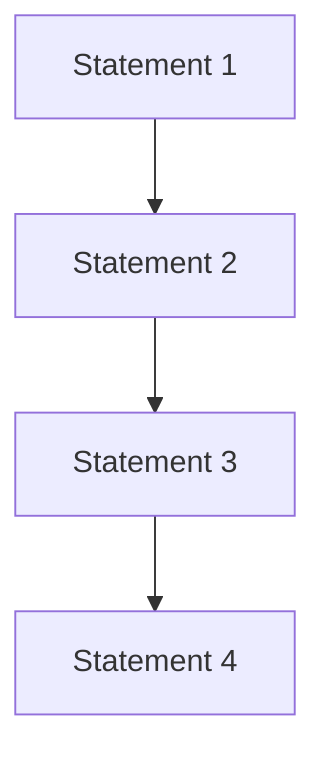
</details>


<details>
<summary>flowchart</summary>

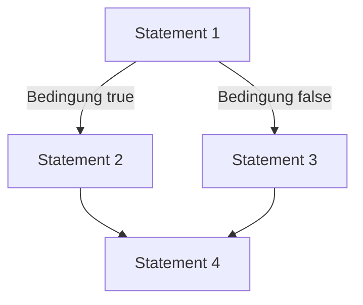
</details>


<details>
<summary>flowchart</summary>

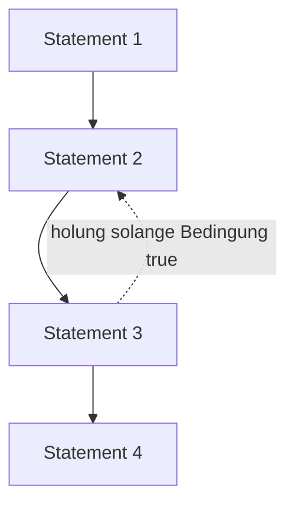
</details>

82

© T. Gemmeke, IDS, RWTH; R. Leupers, SSS

---

Verzweigungen: if-then-else

• Beispiel: Maximumsberechnung
• Allgemeine Formen:

```txt
- if ( expression ) {
    statement*
}
- if ( expression ) {
    statement*
} else { statement*
}
```

Bedingung muss true oder false ergeben (0 ≙ false)

„Beliebter“ Fehler bei Gleichheitstest:

```javascript
- if (a = b) statt if (a == b)
```

```c
#include <stdio.h>

int main(void)
{
    int a, b, max;

    // Einlesen von a und b
    scanf("%d %d", &a, &b);

    if (a > b) {
        max = a;
    } else // d.h. a <= b
        max = b;
    }

    printf("max = %d", max);

    return 0;
}
```

83

© T. Gemmeke, IDS, RWTH; R. Leupers, SSS

---

## Verzweigungen: if-then-else

Komplexere Bedingungen können durch **logische Verknüpfungen** geprüft werden

– ODER-Operator ||: **mindestens eine** der Teilbedingungen muss true sein
– UND-Operator &&: **alle** Teilbedingungen müssen true sein

```c
int a, b, c, x, y;
/* ... */
if (a > 10) {
    if (b >= 20) {
        if (c == 30) {
            x++;
        }
    }
}

if (a < 40) {
    y--;
} else if (b <= 50) {
    y--;
} else if (c != 60) {
    y--;
}
```

```c
int a, b, c, x, y;
/* ... */
if ((a > 10) && (b >= 20) && (c == 30)) {
    x++;
}

if ((a < 40) || (b <= 50) || (c != 60)) {
    y--;
}
```

84

© T. Gemmeke, IDS, RWTH; R. Leupers, SSS

---

Dangling else-Problem

• Betrachte folgenden Code:

if (a > 100) if (b > 50) x++; else x--;

• **Zwei Möglichkeiten** der Interpretation:

– Wird x-- ausgeführt, falls (a <= 100) ?

(1) if (a > 100) if (b > 50) x++; <u>else</u> x--;

– Oder falls (a > 100) && (b <= 50) ?

(2) if (a > 100) if (b > 50) x++; <u>else</u> x--;

**Konvention**: else gehört immer zum innersten freien if, d.h. Version (2) ist richtig

**Besser**: Vermeidung von Fehlern durch expliziten Gebrauch der **Blockstruktur** { statement\* } in der Programmierung

– if (a > 100) { if (b > 50) x++; else x--; }

85

© T. Gemmeke, IDS, RWTH; R. Leupers, SSS

---

Verzweigungen: goto

Verzweigung auch über **Labels** und goto**-Statements** möglich
Ein Label ist eine symbolische **Sprungmarke** im Code
• Syntax:

– ID: statement (ID ist Bezeichner des Labels)
– goto ID; (Sprung nach Position ID)

• Labels und gotos

– beeinträchtigen die **Lesbarkeit** des Programms
– sind ein „historisches Relikt“ in Programmiersprachen
– sind nicht notwendig und sollten nur bei **zwingenden Gründen** eingesetzt werden

```txt
if (a > 10) {
        goto L1;
    }

L2: if (b < 40) {
        goto L3;
    }

L4: goto L5;

L1: x++;
        goto L2;

L3: y--;
        goto L4;

L5: ;
```

86

© T. Gemmeke, IDS, RWTH; R. Leupers, SSS

---

Verzweigungen: switch

Häufiger Fall: **Fallunterscheidung** über eine bestimmte Variable mit jeweils konstantem Vergleichswert
• Normale Implementierung: **Kette** von if-then-else Statements
• Gültig, aber umständlich
Bsp.: Umrechung von römischen Ziffern:

```txt
char digit, int value;

/* ... */

if (digit == 'I') value = 1;
else if (digit == 'V') value = 5;
else if (digit == 'X') value = 10;
else if (digit == 'L') value = 50;
else if (digit == 'C') value = 100;
else if (digit == 'D') value = 500;
else if (digit == 'M') value = 1000;
else printf("Keine gültige Ziffer!");
```

87

© T. Gemmeke, IDS, RWTH; R. Leupers, SSS

---

Verzweigungen: switch

• **Kompaktere** Implementierung:

switch-Statement

• Allgemeine Form:

```txt
switch (Ausdruck)
{
    case Konstante₁:
        statement*
    /* ... */
    case Konstanteₙ:
        statement*
    default: statement*
}
```

```txt
char digit, int value;

/* ... */

switch (digit)
{
    case 'I': value = 1;     break;
    case 'V': value = 5;     break;
    case 'X': value = 10;     break;
    case 'L': value = 50;     break;
    case 'C': value = 100;   break;
    case 'D': value = 500;   break;
    case 'M': value = 1000; break;
    default:
        printf("Keine gültige ziffer!");
        break;
}
```

• break: sofortiges Verlassen des ganzen switch-Statements
• default: Code im „sonst“-Fall (optional)

88

© T. Gemmeke, IDS, RWTH; R. Leupers, SSS

---

Schleifen

• Wiederholte Ausführung einer Anweisungsfolge
• Bsp.: Berechnung der Fakultätsfunktion

$$
n! := 1 \times 2 \times \dots \times n
$$

• Ohne Schleife: Code muss bei Änderung von 𝑛𝑛 modifiziert werden

```c
#define N 10
    /* ... */
    int fact, count;

    count = 0;
    fact = 1;

    count++;
    fact *= count;

    /* ... N-fache wiederholung */

    count++;
    fact *= count;
    printf("factorial(%d) = %d", N, fact);
```

89

© T. Gemmeke, IDS, RWTH; R. Leupers, SSS

---

Schleifen

• Flexiblere Variante
• Code zwischen L1 und L2 wird wiederholt bis Zähler größer als N
• Umdefinieren von N (#define) reicht aus
• Jedoch: **schlechter Programmierstil**

(gotos sollten nicht verwendet werden!)

```c
#define N 10
    /* ... */

    int fact, count;

    count = 0;
    fact = 1;

L1: if (count >= N) goto L2;
    count++;
    fact *= count;
    goto L1;

L2: printf("factorial(%d) = %d",
        N, fact);
```

• C/C++ bietet drei Formen von **strukturierten Schleifen** – for, while, do

90

© T. Gemmeke, IDS, RWTH; R. Leupers, SSS

---

for-Schleifen

• Allgemeine Form:

for (expr1; expr2; expr3) { statement\* }

• expr1:

– Wird vor Schleifenbeginn einmal ausgeführt → Initialisierung

```c
#define N 10

    /* ... */

    int fact, count;

    fact = 1;
    for (count = 1; count <= N; count++) {
        fact *= count;
    }
    printf("factorial(%d) = %d", N, fact);
```

• expr2:

– Bedingung für jeden Durchlauf (jede Iteration)

• expr3:

– Wird nach statement\* ausgeführt

• Nach expr3 wird an den Schleifenanfang **zurückgesprungen**

91

© T. Gemmeke, IDS, RWTH; R. Leupers, SSS

---

for-Schleifen

• Warum ist count = 1 ein **Ausdruck**?

– In C sind auch Zuweisungen Ausdrücke
– Das Ergebnis von $\_ ZieI = A u s d r u c k ^ { \prime \prime }$ ist per Definition $\nu ^ { \angle } I e ^ { I ^ { \prime \prime } }$

Der Wert von expr1 wird bei for-Schleifen jedoch verworfen, nur der **Seiteneffekt** einer Zuweisung ist relevant

• Zwei spezielle Statements für Ausnahmefälle in Schleifen erlaubt

– break: verlässt Schleife komplett
– continue: verlässt aktuelle Iteration

• Wie goto mit Vorsicht zu gebrauchen!


<details>
<summary>flowchart</summary>

```mermaid
graph TD
  A["for (...; ...; ...) {<br>  B[&quot;"] --> A
  C[""] --> A
```
</details>

92

© T. Gemmeke, IDS, RWTH; R. Leupers, SSS

---

while-Schleifen

for-Schleifen werden vor allem für eine **feste Anzahl** von Iterationen verwendet
Soll die Schleife ausgeführt werden, <u>solange</u> eine bestimmte **Bedingung** gilt, so ist eine while-Schleife besser
• Allgemeine Form:

```groovy
while (expression) {
    statement*
}
```

• expression wird ausgewertet

– Falls nicht null, so wird die Schleife betreten
– Nach statement\* wird an den Anfang zurückgesprungen, und expression wird erneut geprüft

93

```c
#define N 10

    /* ... */

    int fact, count;

    fact = 1; count = 1;

    while(count <= N) {
        fact *= count;
        count++;
    }

    printf("factorial(%d) = %d",
        N, fact);
```

© T. Gemmeke, IDS, RWTH; R. Leupers, SSS

---

do-Schleifen

Ebenfalls für Schleifen mit **unbekannter Anzahl** von Iterationen
**Unterschied** zu while: Mindestens eine Iteration findet statt
• Allgemeine Form: do { statement\* } while (expression)
statement\* wird ausgeführt, und expression wird ausgewertet
Falls true, so wird an den Anfang zurückgesprungen
Bsp.: **Mindestens eine** Benutzereingabe wird erwartet
break, continue können bei while- und do-Schleifen ebenfalls verwendet werden

```txt
char c;
/* ... */

do {
    scanf("%c",&c);
    /* Berechnung auf c */
} while (c != 'q'); // quit?
```

94

© T. Gemmeke, IDS, RWTH; R. Leupers, SSS

---

Äquivalenz von for, while, do

• for würde als **einziges** Schleifenkonstrukt ausreichen
• Jede Schleifenform lässt sich in die anderen **umsetzen**, z.B.

while (Ausdruck) { statement\* } entspricht

for (;Ausdruck;) { statement\* }

for (expr1; expr2; expr3) { statement\* } entspricht

expr1;

while (expr2) { statement\* expr3; }

Jedoch ist aus Gründen der **Programm-Lesbarkeit** die jeweils am besten geeignete Variante zu bevorzugen
Der Einsatz von **strukturierten Schleifen** (for, while, do) und der **Verzicht auf Sprünge** (goto) führt beim Übersetzen auch oft zu besserem Maschinencode

95

© T. Gemmeke, IDS, RWTH; R. Leupers, SSS

---

Endlosschleifen

Falls die Abbruchbedingung einer Schleife nie erfüllt ist, **terminiert** das Programm nicht
Compiler kann dies i.A. **nicht bemerken**
Bei Ausführung: Ab einem gewissen Zeitpunkt **kein Programmfortschritt** mehr zu beobachten
• **Abhilfe**:

– Programmabbruch
– Erneutes Starten unter Debugger-Kontrolle

```txt
while ((a > 10) || (b > 20)) {
    if ( /* ... */ ) {
        /* ... */
        a = 100;
        /* ... */
    } else {
        /* ... */
        b = 30;
        /* ... */
    }
    /* danach Bedingung
        stets erfüllt */
}
```

96

© T. Gemmeke, IDS, RWTH; R. Leupers, SSS

---

## 4. Funktionen und Programmaufbau

## 4.1 Funktionen

4.2 Parameterübergabe
4.3 Polymorhpie
4.4 Templates
4.5 Lambda Funktionen
4.6 Module und Programme

97

© T. Gemmeke, IDS, RWTH; R. Leupers, SSS

---

Funktionen und Programmaufbau

**Def**.: Das **kartesische Produkt** 𝐴𝐴 × 𝐵𝐵 zweier Mengen 𝐴𝐴 und 𝐵𝐵 ist definiert durch

$$
A \times B = \{(a, b) \mid a \in A, b \in B \}
$$

**Def**.: Eine (binäre) **Relation** 𝑅𝑅 ist eine Teilmenge des kartesischen Produktes zweier Mengen: $R \subseteq A \times B$

**Def**.: Eine **Funktion** 𝐹𝐹 ∶ 𝐴𝐴 → 𝐵𝐵 ist eine rechtseindeutige Relation, <u>d.h. jedem a ∈ 𝐴𝐴 ist höchstens ein</u> $b \in B$ <u>zugeordnet.</u>

In **Programmiersprachen**: Eine Funktion (oder: Prozedur, Subroutine) ist ein abgegrenztes **Teilprogramm**, welches aus einer Menge von **Eingabeparametern** eine fest definierte **Ausgabe** erzeugt
**Verwendung**: Einkapselung von häufig benötigten Teilprogrammen, Aufruf aus anderen Teilprogrammen

98

© T. Gemmeke, IDS, RWTH; R. Leupers, SSS

---

Modell der Funktionsabarbeitung

**Zu jedem Zeitpunkt** befindet sich das Programm innerhalb einer bestimmten Funktion f
Zu Beginn ist dies die Funktion main (s.o.)
Ausführung von f kann durch **Aufruf** einer anderen Funktion g jederzeit **unterbrochen** werden
• f übergibt **Parameter** an g
• g berechnet einen **Funktionswert** und springt an **Aufrufstelle** in f zurück

Funktion f

Funktion g


<details>
<summary>flowchart</summary>

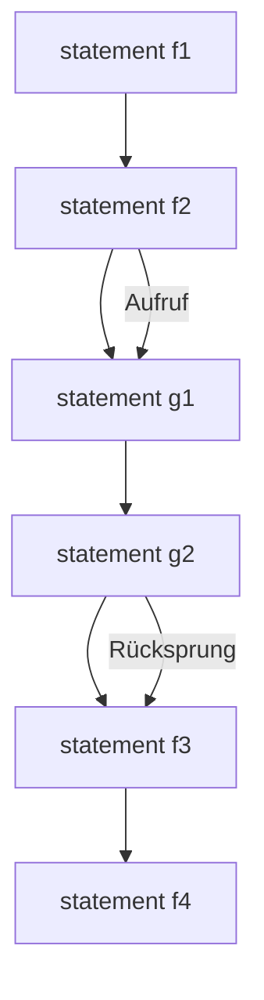
</details>

**Zeit**

99

© T. Gemmeke, IDS, RWTH; R. Leupers, SSS

---

Modell der Funktionsabarbeitung

Während der Ausführung kann g ihrerseits **weitere Funktionen** aufrufen (verschachtelte Funktionsaufrufe)
Ebenso können nach Ausführung von f auch **andere Funktionen** auf g zurückgreifen
**Vorteil**: Programmcode für mehrfach verwendete Routinen muss nur einmal vorhanden sein

– bessere **Wartbarkeit**
– geringere **Codegröße**


<details>
<summary>flowchart</summary>

```mermaid
graph TD
  A["Funktion f"] --> B["Funktion g"]
  C["Funktion i"] --> B
  B --> D["Funktion h"]
  D --> E["ruft auf"]
```
</details>

100

© T. Gemmeke, IDS, RWTH; R. Leupers, SSS

---

Funktionen

• Funktionen besitzen eine **Deklaration** und eine **Definition**
**Deklaration**: Name, Definitionsbereich, Wertebereich (d.h. **Interface** der Funktion nach außen)
**Definition**: Programmcode zur **Implementierung** der gewünschten Funktionalität
Erfolgt die Definition vor der ersten Verwendung einer Funktion, so darf die Deklaration **entfallen**
• **Allgemeine Form der Deklaration**:
– Typ ID (Parameter-Deklaration\*);
– Parameter-Deklaration syntaktisch wie Variablendeklaration
– Jedoch: Parameter-ID kann auch entfallen
– float max(float x, float y); oder
float max(float, float);
– Deklariert Funktion max: float × float → float

101

© T. Gemmeke, IDS, RWTH; R. Leupers, SSS

---

Funktionsdefinitionen

• **Allgemeine Form**:

– Typ ID (Parameter-Deklaration\*) { statement\* }

Interface-Definition **muss** vorheriger Deklaration entsprechen (falls vorhanden)
Funktionsrumpf innerhalb $f / \dot { r } \ldots \dot { r } / f$ kann beliebige Statements enthalten
• Verlassen einer Funktion durch return**-Statement**

– return Ausdruck;
– Typ von Ausdruck muss dem **Wertebereich** der Funktion entsprechen (falls nötig: type cast)
– Funktionen können **nicht** per goto verlassen werden (Labels nur gültig **innerhalb** einer Funktion)

102

© T. Gemmeke, IDS, RWTH; R. Leupers, SSS

---

Funktionsaufrufe

Kommunikation zwischen **aufrufender** (caller) und **aufgerufener** (callee) Funktion:

```c
void f(void) { int x; /* ... ruft g auf */ };
int g(int a, int b) { return a+b; }
```

• a und b sind die **formalen Parameter** der Funktion g gemäß Deklaration
Aufruf von g durch f per Namen und Übergabe **der aktuellen Parameter**, z.B.

$$
- x = g (1, 2);
$$

– In g werden die „Platzhalter“ a und b durch 1 bzw. 2 ersetzt, g wird ausgeführt und per return beendet
– Der Ausdruck g(1,2) liefert dann den **Rückgabewert** 3; dieser kann z.B. an eine Variable (hier: x) zur Weiterverarbeitung zugewiesen werden

103

© T. Gemmeke, IDS, RWTH; R. Leupers, SSS

---

Lokale und globale Variablen

• Zwei Arten von Variablen:

**Globale Variablen** sind im gesamten Programm **gültig** (d.h. können zugegriffen werden)
**Lokale Variablen** sind nur in einer bestimmten Funktion gültig (ebenso wie **formale Funktionsparameter**)
– Lokale Variablen können globale Variablen gleichen Namens **verdecken**

Globale Variablen sollten zur besseren Programm-Wartbarkeit **möglichst selten** verwendet werden (sonst Gefahr von unerwünschten Seiteneffekten)

```c
int a=2, b=2, i=10;
int f(int a, int b)
{
    int i;
    i = a+b;
    return i;
}
int main(void)
{
    /* ... */
    i -= f(a, b);
    return 0;
}
```

104

© T. Gemmeke, IDS, RWTH; R. Leupers, SSS

---

Funktionen auf einen Blick


<details>
<summary>flowchart</summary>

```mermaid
graph TD
  A["int sum;"] --> B["Globale Variable"]
  C["int f(int, int);"] --> D["Deklaration von f"]
  E["int main(void)"] --> F["Definition der Hauptfunktion"]
  G["{ sum += f(1, 2); printf(&quot;%d&quot;, sum); return 0;}"] --> H["Aufruf von f mit akt. Parametern"]
  I["{ int f(int a, int b) { int sum; sum = a+b; return sum;}"] --> J["Lokale Variable von f"]
  K["{ Rückgabe des Funktionswertes }"] --> L["Definition von f"]
```
</details>

105

© T. Gemmeke, IDS, RWTH; R. Leupers, SSS

---

## Beispiel

Berechnung einer **Kreisfläche** als Funktion des Radius

$$
A = \pi * r ^ {2}
$$

• Definition von π als **Konstante**
**Einkapselung** der Flächenberechnung in Funktion area
Hauptfunktion main: Rückgabetyp immer int hier keine Eingangsparameter: void
Fortlaufende Ein/Ausgabe von Radius und Fläche

#define PI 3.1415926

```c
float area(float r)
{
    float a;
    a = PI * r * r;
    return a;
}

int main(void)
{
    float rad, A;
    while (1) {
        scanf("%f", &rad);
        A = area(rad);
        printf("%f \n", A);
    }
    return 0;
}
```

106

© T. Gemmeke, IDS, RWTH; R. Leupers, SSS

---

## 4. Funktionen und Programmaufbau

4.1 Funktionen
**4.2 Parameterübergabe**
4.3 Polymorhpie
4.4 Templates
4.5 Lambda Funktionen
4.6 Module und Programme

107

© T. Gemmeke, IDS, RWTH; R. Leupers, SSS

---

Wert- und Referenzparameter

Bei Übergabe eines Wertes w an eine Funktion f wird dem formalen Parameter von f eine **lokale Kopie** von w zugewiesen (call by value)
f arbeitet nur mit der Kopie, kann w **nicht modifizieren**
Falls Modifikation von w erwünscht: Übergabe als **Referenzparameter** (call by reference)

– in C nur call-by-value (f1)
– in C++: Operator & (f2)C++
– **Nachbildung** in C: call by value mit Zeiger auf w (f3)

```c
void f1(int a) { a++; }
void f2(int& a) { a++; }
void f3(int* a) { (*a)++; }

int main(void)
{
    int a;
    a = 1;
    f1(a);  // a = 1
    f2(a);  // a = 2
    f3(&a); // a = 3
    return 0;
}
```

108

© T. Gemmeke, IDS, RWTH; R. Leupers, SSS

---

Wert- und Referenzparameter


<details>
<summary>flowchart</summary>

```mermaid
graph TD
  A["main"] --> B["0"]
  B --> C["1"]
  C --> D["1"]
  D --> E["1"]
  E --> F["1"]
  F --> G["100"]
  G --> H["Adresse von a_main"]
  H --> I["f3"]
  I --> J["af3 := 100\n(*af3)++"]
  J --> K["Kopie von a_main\n(später verworfen)"]
  K --> L["1"]
  L --> M["af1 := 1\naf1++"]
  M --> N["1"]
  N --> O["1"]
```
</details>

```c
void f1(int a) { a++; }
void f2(int& a) { a++; }
void f3(int* a) { (*a)++; }

int main(void)
{
    int a;
    a = 1;
    f1(a);  // a = 1
    f2(a);  // a = 2
    f3(&a); // a = 3
    return 0;
}
```

109

© T. Gemmeke, IDS, RWTH; R. Leupers, SSS

---

Funktionen mit mehreren Rückgabewerten

• **Beispiel**: komplexe Zahlen

$$
\mathrm{c} = (\mathrm{a}, \mathrm{b})
$$

Realteil a, Imaginärteil b

• **Produkt** zweier komplexer

Zahlen $c _ { 1 } = ( a _ { 1 } , b _ { 1 } ) , c _ { 2 } = ( a _ { 2 } , b _ { 2 } )$

$$
c _ {3} = (a _ {1} * a _ {2} - b _ {1} * b _ {2},
$$

$$
\mathrm{a} _ {1} * \mathrm{b} _ {2} + \mathrm{a} _ {2} * \mathrm{b} _ {1})
$$

• Komplexe Zahlen sind **kein**

**Basis-Datentyp** in C

• **Naive Lösung**: zwei Funktionen

für Real- und Imaginärteil

```c
float prd_real(float a1, float a2,
        float b1, float b2)
{
    return a1*a2-b1*b2;
}

float prd_imag(float a1, float a2,
        float b1, float b2)
{
    return a1*b2+a2*b1;
}

int main(void)
{
    float c_real, c_imag;
    c_real = prd_real( /* ... */ );
    c_imag = prd_imag( /* ... */ );
    return 0;
}
```

110

© T. Gemmeke, IDS, RWTH; R. Leupers, SSS

---

Funktionen mit mehreren Rückgabewerten

Definition des Datentyps complex als struct
• structs werden als **Wertparameter** übergeben
D.h. evtl. **kopieren** großer Speicherblöcke (langsam)
Übergabe als **Referenzparameter** (per Zeiger) evtl. besser
**Arrays** (s.u.) werden immer als Referenzparameter übergeben
• Arrays als **Rückgabewert** unzulässig (warum?)

```c
typedef struct c {
    float a, b; } complex;

complex prod(complex c1, complex c2)
{
    complex c3;
    c3.a = c1.a*c2.a-c1.b*c2.b;
    c3.b = c1.a*c2.b+c2.a*c1.b;
    return c3;
}

int main(void)
{
    complex c1, c2, c3;
    c3 = prod(c1, c2);
    return 0;
}
```

111

© T. Gemmeke, IDS, RWTH; R. Leupers, SSS

---

## 4. Funktionen und Programmaufbau

4.1 Funktionen
4.2 Parameterübergabe
**4.3 Polymorhpie**
4.4 Templates
4.5 Lambda Funktionen
4.6 Module und Programme

112

© T. Gemmeke, IDS, RWTH; R. Leupers, SSS

---

Polymorphie

C++

## • Auswahl der Funktionsdefinition in Abhängigkeit der Operanden


<details>
<summary>flowchart</summary>

```mermaid
graph TD
  #include <stdio.h>
  #include <math.h>

  // most of the time we compute square root
    float root(float x) {
      return pow(x,1/2.0);
    }

  // ... but we can do any root
    float root(float x, float y) {
      return pow(x,1/y);
    }

  int main( void )
  {
    float x1 = 4, x2 = 27;
    printf("Square root of %.1f = %.3f\n", x1, root(x1));
    printf("Cubic root of %.1f = %.3f\n", x2, root(x2,3));

    return 0;
  }

  in c++:
  ... Program finished with exit code 0

  Statische Polymorphie (compile-time polymorphism)
  Auswahl der Methode während Kompilierung
  Hier: entscheidendes Merkmal - Anzahl der Operanden
```
</details>

113

(Zur Vereinfachung sind hier ‘stdio.h’ und ‘math.h’ eingebunden. In C++ sollten die Bibliotheken ‘cstdio’ und ‘cmath’ verwendet werden.)

© T. Gemmeke, IDS, RWTH; R. Leupers, SSS

---

Polymorphie

C++

• Auswahl der Funktionsdefinition in Abhängigkeit der Operanden

```c
#include <stdio.h>

    #define TEST_INT
    #define TEST_FLOAT

#ifdef TEST_INT
int mult(int a, int b) {
    printf("Integer: %d x %d = %d\n", a, b, a*b);
    return a*b;
}
#endif

#ifdef TEST_FLOAT
float mult(float a, float b) {
    printf("Float: %.2f x %.2f = %.2f\n", a, b, a*b);
    return a*b;
}
#endif

int main( void )
{
    int i_a = 3, i_b = 4;
    float f_a = 3.1, f_b = 4.5;
```

## Statische Polymorphie (compile-time polymorphism)

Auswahl der Methode während Kompilierung

Hier: entscheidendes Merkmal - **Typ**

114

(dynamische Polymorphie folgt später ...)

© T. Gemmeke, IDS, RWTH; R. Leupers, SSS

---

Funktionen als Parameter

Funktionen sind keine Variablen, besitzen aber eine **Speicheradresse**
Daher gibt es **Zeiger auf Funktionen**, diese können als **Parameter** übergeben und „aufgerufen“ werden
Sinnvoll, falls **Aufrufstruktur** der Funktionen nicht statisch festliegen soll
Bsp.:

```txt
- Funktion f:
    int f(float, float);
- Zeiger auf f:
    int (*p)(float,float);
    p = &f;
```

```c
#include <stdio.h>
int add(int a, int b)
{
    return a+b;
}

int sub(int a, int b)
{
    return a-b;
}

int op(int (*f)(int,int), int a, int b)
{
    return f(a, b);
}

int main(void)
{
    char c;
    int result;
    scanf("%c", &c);
    if (c == 'a')
        result = op(add, 1, 2);
    else if (c == 's')
        result = op(sub, 1, 2);
    printf("%d\n", result);
    return 0;
}
```

115

© T. Gemmeke, IDS, RWTH; R. Leupers, SSS

---

## 4. Funktionen und Programmaufbau

4.1 Funktionen
4.2 Parameterübergabe
4.3 Polymorhpie
**4.4 Templates**
4.5 Lambda Funktionen
4.6 Module und Programme

116

© T. Gemmeke, IDS, RWTH; R. Leupers, SSS

---

Template

C++

• Typ als Variable

```cpp
#include <cstdio>
#include <iostream>

template <typename T>
T mult(T a, T b) {
    std::string tname;
    switch( typeid(a).name()[0] ) {
        case 'i': tname = "Integer"; break;
        case 'f': tname = "Float"; break;
    }
    std::cout << tname << ": " << a << " x " << b << " = " << a*b << std::endl;
    return a*b;
}

int main( void )
{
    int i_a = 3, i_b = 4;
    float f_a = 3.1, f_b = 4.5;

    mult<int>(i_a,i_b);
    mult<float>(f_a,f_b);

    return 0;
}
```

```txt
Bisher:
int mult(int a, int b) {
    printf("Integer: %d x %d = %d\n", a, b, a*b);
    return a*b;

float mult(float a, float b) {
    printf("Float: %.2f x %.2f = %.2f\n", a, b, a*b);
    return a*b;
}
```

Entsprechend können auch template-Klassen vereinbart werden.

117

© T. Gemmeke, IDS, RWTH

---

## 4. Funktionen und Programmaufbau

4.1 Funktionen
4.2 Parameterübergabe
4.3 Polymorhpie
4.4 Templates
**4.5 Lambda Funktionen**
4.6 Module und Programme

118

© T. Gemmeke, IDS, RWTH; R. Leupers, SSS

---

Lambda Funktion

C++

```cpp
#include <iostream>
#include <string>
using namespace std;

// Regular Function
void report_age1(int val) {
    cout << "My age is " << val << endl;
}

int main( void )
{
    int age = 23;

    // Lambda Function
    auto report_age2 = [](int val) -> string { return "My age is " + to_string(val); };
    auto report_age3 = [age]() -> string { return "My age is " + to_string(age); };

    report_age1(19);
    cout << report_age2(21) << endl;
    cout << report_age3() << endl;

    return 0;
}
```

119

© T. Gemmeke, IDS, RWTH

---

## 4. Funktionen und Programmaufbau

4.1 Funktionen
4.2 Parameterübergabe
4.3 Polymorhpie
4.4 Templates
4.5 Lambda Funktionen
**4.6 Module und Programme**

120

© T. Gemmeke, IDS, RWTH; R. Leupers, SSS

---

Module und Programme

C-Compiler übersetzt immer **ein einzelnes** C-Modul
**Modul** = globale Variablen und Funktionen
Entwicklung von Modulen kann **parallel** erfolgen
Modul (z.B. Library) muss nicht unbedingt **main-Funktion** enthalten
Komplettes **C-Programm** wird aus einzelnen Modulen zusammengesetzt (durch den Linker)
C-Programm muss **genau eine** main-Funktion enthalten
**Globale Variablen** und **Funktionen** gleichen Namens dürfen nur einmal vorkommen


<details>
<summary>flowchart</summary>

```mermaid
graph TD
  A["C-Modul 1"] --> B["Compiler"]
  C["C-Modul n"] --> D["Compiler"]
  B --> E["Code 1"]
  D --> F["Code n"]
  E --> G["Linker"]
  F --> G
  G --> H["a.out"]
```
</details>

121

© T. Gemmeke, IDS, RWTH; R. Leupers, SSS

---

Module und Programme

Zweckmäßig: **Trennung** von Deklarationen und Definitionen in zwei Dateien (meist: \*.h und \*.c)
• Deklarationen im **Header File**
Header File kann von allen C-Modulen **eingebunden** werden

```c
#include "lib.h"    main.c
int main(void)
{
    /* ... */
    a = sqrt( /* ... */ );
    b = sin( /* ... */ );
    c = cos( /* ... */ );
    return 0;
}
```

```txt
/* Library lib.h
  mit math. Funktionen */
float sqrt( /* ... */ );
float sin( /* ... */ );
float cos( /* ... */ );
```

```txt
/* Implementierung lib.c
  der math. Funktionen */
float sqrt( /* ... */ )
    { /* ... */ }
float sin( /* ... */ )
    { /* ... */ }
float cos( /* ... */ )
    { /* ... */ }
```

122

© T. Gemmeke, IDS, RWTH; R. Leupers, SSS

---

## 5. Datentypen

**5.1 Arrays**
5.2 Strukturen
5.3 Abstrakte Datentypen
5.4 Klassen

123

© T. Gemmeke, IDS, RWTH; R. Leupers, SSS

---

Arrays

**Arrays** (oder: Felder, Vektoren) definieren zusammengesetzte Datentypen, deren Elemente durch einen **Index** zugegriffen werden
• Vektor (**mathematisch**):

$V   =   \left( v _ { 1 } , \ldots , v _ { n } \right)$ $v _ { i }$ bezeichnet 𝑖𝑖-tes Element von 𝑉𝑉

Vektor/Array-Deklaration in $C / C + +$

– Typ ID [int-Konstante];
– Z.B. int v[10];

• deklariert 10-elementigen Vektor 𝑉𝑉
• Komponenten sind vom Typ int
• Zugriff auf 𝑖𝑖-tes Element mittels Operator [...], z.B. v[3]
Der Ausdruck 3 ist der **Index** des Elementes
• **Index-Numerierung beginnt immer bei 0**


<details>
<summary>text_image</summary>

v:= 
v[0] v[1] ... v[8] v[9]
</details>

124

© T. Gemmeke, IDS, RWTH; R. Leupers, SSS

---

Arrays und Zeiger

Benachbarte Arrayelemente befinden sich stets auch **benachbart** im Speicher
• Daher bei v[i]:

– Index i bezeichnet den Abstand (offset) des 𝑖𝑖-ten Elementes von der **Basisadresse** $v ( = \theta v [ 0 ] )$

– Operator $v [ \ldots ] ^ { n }$ entspricht **Addition** von Array-Basisadresse und Index

$$
- \mathrm{v} [ \mathrm{i} ] = * (\mathrm{v} + \mathrm{i}) = * (\mathrm{i} + \mathrm{v}) = \mathrm{i} [ \mathrm{v} ]
$$

– p = &v[0]; oder p = v; lässt p auf Anfang von v zeigen
– Die folgenden 3 Ausdrücke sind äquivalent:

$$
\mathrm{v} [ 3 ] = 1 2 3; \mathrm{p} [ 3 ] = 1 2 3; \text {und} * (\mathrm{p} + 3) = 1 2 3;
$$


<details>
<summary>text_image</summary>

p
v:= 
+3
123
v[0] v[1]
...
v[8] v[9]
</details>

125

© T. Gemmeke, IDS, RWTH; R. Leupers, SSS

---

Arrays und Schleifen

Vorteil von Arrays: **Menge „gleichartiger“ Objekte** kann mit einem Namen und variablem Index zugegriffen werden

**Meist**: in Schleifen, damit Vermeidung von Code-Duplizierung
Beispielprogramme zur Initialisierung von Array A sind äquivalent
• **Post-Inkrement:**

$$
^ {*} p + + = \dots ;
$$

ist zu lesen wie

$$
^ {*} p = \dots ; p + + ;
$$

```txt
int i, a[10];

for(i=0; i<10; i++) {
    a[i] = i;
}
```

```c
int *p, i, a[10];

p = &a[0];
for(i=0; i<10; i++) {
    *p++ = i;
}
```

126

© T. Gemmeke, IDS, RWTH; R. Leupers, SSS

---

Arrays und Schleifen

• **Array-Basisadressen** verhalten sich wie Zeiger (auf das erste Array-Element)
Nach Deklaration int a[10]; ist der Ausdruck a **identisch** mit dem Ausdruck &a[0]
• Grund: $a = a + 0 = \theta(\pi(a + 0)) = \theta a[0]$
Achtung: Arrays können **nicht** mit einem einzigen Befehl kopiert werden

```txt
int a[10], b[10], i;
// unzulässig:
a = b;      // entspricht &a[0] = &b[0]
// stattdessen:
for (i=0; i<10; i++) {  // elementweises Kopieren
    a[i] = b[i];
}
```

127

© T. Gemmeke, IDS, RWTH; R. Leupers, SSS

---

Beispiel: Ermittlung einer Stringlänge

• String = Array mit char-Elementen
Element-Wert 0 (oder '\0' als char-Konstante) kennzeichnet **String-Ende**
Daher: char-Arrays immer **ein Byte länger** als „Nutzlast“-String
Beginnend bei 0: Zähler **inkrementieren**, bis '\0' -Zeichen erreicht
• Bsp.: char $s [ 6 ] = \mathrm { { \sf { K e t t e } } }$ 1

s

<table><tr><td>K</td><td>e</td><td>t</td><td>t</td><td>e</td><td>&#x27;\0&#x27;</td></tr><tr><td colspan="5">s[0]</td><td>s[5]</td></tr></table>

```c
#define STR "teststring"

int main(void)
{
    char* s = STR;
    int i, count = 0;

    for(i=0; s[i] != 0; i++) {
        count++;
    }

    printf("Länge = %d", count);
}
```

```javascript
/* ... */

count = 0;
while (s[count]) {
    count++;
}

/* ... */
```

128

© T. Gemmeke, IDS, RWTH; R. Leupers, SSS

---

Schleifen in C++ mit Iteratoren

C++

```cpp
#include <iostream>
#include <algorithm>
#include <vector>
#include <string>
using namespace std;

void show(vector<int> c, string str) {cout<<str<<": "; for(auto e: c) cout<<e<<' ';cout<<endl<<endl;}

int main( void )
{
    vector<int> v = {1, 2, 2, 5, 6, 7};
    show(v,"Ausgangslage");

    // 1. Loop: using a copy of the value
    for(auto elm : v) { elm++; }
    show(v,"1. Loop");
    // 2. Loop: using the reference
    for(auto& elm : v) { elm++; }
    show(v,"2. Loop");
    // 3. Loop: using the reference and const
    // for(const auto& elm : v) { elm++; }
    // -> error: increment of read-only reference 'elm'
    // 4. Loop: using for_each
    for_each(v.begin(), v.end(), [](int elm) { elm++; });
    show(v,"4. Loop");
    // 5. Loop: using classic for-loop and an iterator of a container
    for(auto it = v.begin(); it != v.end(); ++it) { (*it)++; };
    show(v,"5. Loop");

    return 0;
}
```

for\_each benötigt ein unary function object

auto sucht den passen Typ automatisch aus. Hier ist es: std::vector&lt;int&gt;::iterator

129

© T. Gemmeke, IDS, RWTH

---

Mehrdimensionale Arrays

| Stunde | Mo | Di | Mi | Do | Fr |
| --- | --- | --- | --- | --- | --- |
| 1 | Mathe | Politik | Bio | Mathe | Politik |
| 2 | Mathe | Kunst | Deutsch | Mathe | Kunst |
| 3 | Deutsch | Informatik | Sport | Deutsch | Informatik |
| 4 | Englisch | Informatik | Sport | Englisch | Informatik |
| 5 | Sport | Mathe | Physik | Sport | Mathe |
| 6 | Sport | Mathe | Physik | Sport | Mathe |

Beispiel: Stundenplan
• 2-dimensionales Array (**Matrix**) als Datenstruktur
• Elemente vom Typ String
• I ndizes:

– Stunden (int)
– Wochentage Mo-Fr (?)
– enum tag\_typ {Mo, Di, Mi, Do, Fr}
– **Aufzählungstyp**: deklariert Mo, ..., Fr als symbolische Konstanten
– **Intern**: Mo = 0, Di = 1, ..., Fr = 4

130

© T. Gemmeke, IDS, RWTH; R. Leupers, SSS

---

Mehrdimensionale Arrays

```c
#define STUNDEN 6
#define TAGE 5

#define MA "Mathe"
#define DE "Deutsch"
#define SP "Sport"
/* ... */

enum tag_typ {Mo, Di, Mi, Do, Fr};

int main (void)
{
    char* plan[STUNDEN][TAGE];
    int tag, stunde;

    /* ... */
```

```c
/* ... */
plan[0][Mo] = MA;
/* ... */
plan[5][Mo] = SP;
/* ... */
plan[5][Fr] = MA;

printf("Stundenplanabfrage:\n");
scanf("%d",&tag);
scanf("%d",&stunde);

if ((tag > Fr) || (stunde > STUNDEN))
    printf("Ungültig");
else
    printf("Fach = %s", plan[stunde-1][tag];

return 0;
}
```

| Stunde | Mo | Di | Mi | Do | Fr |
| --- | --- | --- | --- | --- | --- |
| 1 | Mathe | Politik | Bio | Mathe | Politik |
| 2 | Mathe | Kunst | Deutsch | Mathe | Kunst |
| 3 | Deutsch | Informatik | Sport | Deutsch | Informatik |
| 4 | Englisch | Informatik | Sport | Englisch | Informatik |
| 5 | Sport | Mathe | Physik | Sport | Mathe |
| 6 | Sport | Mathe | Physik | Sport | Mathe |

Stundenplanabfrage:

> 2

> 4

Fach = Sport

131

© T. Gemmeke, IDS, RWTH; R. Leupers, SSS

---

Beispiel: Matrixmultiplikation

• (𝑁𝑁 × 𝑁𝑁)-Matrizen:
• **Produkt** $C ~ = ~ ( c _ { i j } )$ ergibt sich aus:

$$
A = (a _ {i j}), B = (b _ {i j})
$$

$$
c _ {i j} = \sum_ {k = 1} ^ {N} a _ {i k} \cdot b _ {k j}
$$

• **Geschachtelte** Schleifen

– Iteration über Zeilen 𝑖𝑖 = 1 … 𝑁𝑁
– Für jedes 𝑖𝑖: Iteration über Spalten = 1 … 𝑁𝑁
– Für jedes (𝑖𝑖, ): Bilde Skalarprodukt von 𝐴𝐴-Zeile 𝑖𝑖 und 𝐵𝐵-Spalte

C/C++ gestattet eine beliebige Anzahl von **Dimensionen** für Arrays

Elemente liegen stets benachbart im Speicher


<details>
<summary>natural_image</summary>

Three horizontal bars in blue and light green shades, no text or symbols present
</details>


<details>
<summary>natural_image</summary>

Four solid blue vertical bars arranged horizontally (no text or symbols)
</details>

𝐵𝐵


<details>
<summary>natural_image</summary>

Grid of 12 squares in blue and light green, no text or symbols present
</details>

```txt
typedef int matrix[N][N];
matrix a, b, c;
for (i=0; i<N; i++)
    for (j=0; j<N; j++) {
        c[i][j] = 0;
        for (k=0; k<N; k++)
            c[i][j] += a[i][k]*b[k][j];
    }
```

132

© T. Gemmeke, IDS, RWTH; R. Leupers, SSS

---

## 5. Datentypen

5.1 Arrays
**5.2 Strukturen**
5.3 Abstrakte Datentypen
5.4 Klassen

133

© T. Gemmeke, IDS, RWTH; R. Leupers, SSS

---

Strukturen

• **Struktur** (oder: struct, record): Zusammenfassung einer Gruppe von Variablen zu einer **Einheit**
**Unterschied** zum Array: Adressierung innerhalb einer Struktur per Namen, nicht per Index
Bsp. (s.o.): geometrischer Punkt struct point { float x, y; };
Allgemeine Form einer struct-Deklaration: – struct ID { Variablendeklaration\* } – Beliebige Variablendeklarationen (auch structs) – ID heißt structure tag
• struct-Deklaration oft in Verbindung mit typedef:
struct point { float x, y; } p1,p2; oder typedef struct point { float x, y; } Point; Point p1, p2;

134

© T. Gemmeke, IDS, RWTH; R. Leupers, SSS

---

Operationen auf Strukturen

```javascript
typedef struct person
    { char name[100], vorname[100];
        struct datum { int tag,monat,jahr; } gebdatum;
    } Person;
```

Person p1, p2, \*p\_ptr;

• **Kopieren:**
p1 = p2; /\* kopiert alle Komponenten auf einmal \*/

• **Adressberechnung:**

p\_ptr = &p1;

• **Komponentenzugriff direkt** (Operator „.“):

p2.gebdatum.jahr = 1950;

• **Komponentenzugriff per Zeiger** (Operator „->“):

p\_ptr->gebdatum.monat = 12; // "p->" entspricht "(\*p)."

135

© T. Gemmeke, IDS, RWTH; R. Leupers, SSS

---

Array von structs

Mit Arrays und structs lassen sich beliebige **komplexe Datenstrukturen** aufbauen
• Bsp.: **Bundesliga-Tabelle**
• **Übung**: Neuberechnung nach Spieltag-Ergebniseingabe

<table><tr><td colspan="2"></td><td>SP</td><td>S</td><td>U</td><td>N</td><td>T</td><td>DIFF</td><td>PKT</td></tr><tr><td>1</td><td>Bayern München</td><td>3</td><td>3</td><td>0</td><td>0</td><td>10:0</td><td>10</td><td>9</td></tr><tr><td>2</td><td>Arminia Bielefeld</td><td>3</td><td>2</td><td>1</td><td>0</td><td>7:3</td><td>4</td><td>7</td></tr><tr><td>3</td><td>VfL Bochum</td><td>3</td><td>2</td><td>1</td><td>0</td><td>6:4</td><td>2</td><td>7</td></tr><tr><td>4</td><td>Eintracht Frankfurt</td><td>3</td><td>2</td><td>1</td><td>0</td><td>4:2</td><td>2</td><td>7</td></tr><tr><td>5</td><td>Hamburger SV</td><td>3</td><td>2</td><td>0</td><td>1</td><td>3:2</td><td>1</td><td>6</td></tr><tr><td>6</td><td>FC Schalke 04</td><td>3</td><td>1</td><td>2</td><td>0</td><td>7:4</td><td>3</td><td>5</td></tr><tr><td>7</td><td>Bayer Leverkusen</td><td>3</td><td>1</td><td>1</td><td>1</td><td>3:1</td><td>2</td><td>4</td></tr><tr><td>8</td><td>VfL Wolfsburg</td><td>3</td><td>1</td><td>1</td><td>1</td><td>5:5</td><td>0</td><td>4</td></tr><tr><td>9</td><td>VfB Stuttgart</td><td>3</td><td>1</td><td>1</td><td>1</td><td>4:5</td><td>-1</td><td>4</td></tr><tr><td>10</td><td>Werder Bremen</td><td>3</td><td>1</td><td>1</td><td>1</td><td>3:6</td><td>-3</td><td>4</td></tr><tr><td>11</td><td>MSV Duisburg</td><td>3</td><td>1</td><td>0</td><td>2</td><td>4:5</td><td>-1</td><td>3</td></tr><tr><td>12</td><td>Hertha BSC</td><td>3</td><td>1</td><td>0</td><td>2</td><td>3:4</td><td>-1</td><td>3</td></tr><tr><td>13</td><td>Borussia Dortmund</td><td>3</td><td>1</td><td>0</td><td>2</td><td>5:7</td><td>-2</td><td>3</td></tr><tr><td>14</td><td>Karlsruher SC</td><td>3</td><td>1</td><td>0</td><td>2</td><td>3:5</td><td>-2</td><td>3</td></tr><tr><td>15</td><td>1. FC Nürnberg</td><td>3</td><td>1</td><td>0</td><td>2</td><td>2:4</td><td>-2</td><td>3</td></tr><tr><td>16</td><td>Hannover 96</td><td>3</td><td>1</td><td>0</td><td>2</td><td>2:5</td><td>-3</td><td>3</td></tr><tr><td>17</td><td>Energie Cottbus</td><td>3</td><td>0</td><td>1</td><td>2</td><td>1:5</td><td>-4</td><td>1</td></tr><tr><td>18</td><td>Hansa Rostock</td><td>3</td><td>0</td><td>0</td><td>3</td><td>1:6</td><td>-5</td><td>0</td></tr></table>

```txt
typedef struct team {
    char *name;
    int SP,S,U,N,T1,T2,DIFF,PKT;
} Team;

Team liga[18]; /* 0...17 */
/* ... */
liga[5].name = "FC Schalke 04";
liga[13].DIFF = liga[13].T1-liga[13].T2;
/* ... */
```

136

© T. Gemmeke, IDS, RWTH; R. Leupers, SSS

---

## 5. Datentypen

5.1 Arrays
5.2 Strukturen
**5.3 Abstrakte Datentypen**
5.4 Klassen

137

© T. Gemmeke, IDS, RWTH; R. Leupers, SSS

---

Abstrakte Datentypen

C++

**Def**.: Ein **abstrakter Datentyp** (**ADT**) ist ein Datentyp (eine Menge von Werten und eine Sammlung von Operationen auf diesen Werten), der nur über eine Schnittstelle zugänglich ist.

[Sedgewick, Algorithmen in C++]

• Menge set

```cpp
#include <iostream>
#include <set>
#include <algorithm> // required for set_union
using namespace std;

int main( void )
{
    set<int> s = {1, 2, 2};
    set<int> t = {7, 2, 4, 1};

    set<int> r;
    set_union(s.begin(), s.end(), t.begin(), t

    // print the contents of the sets
    cout << "s: "; for(auto elm : s) cout << e
    cout << "t: "; for(auto elm : t) cout << e
    cout << "r: "; for(auto elm : r) cout << e

    return 0;
}
```

Weitere Methoden in dieser Gruppe:

• insert
erase
• merge
• set\_difference (C++20)
• set\_intersection (C++20)

138

© T. Gemmeke, IDS, RWTH

---

## 5. Datentypen

5.1 Arrays
5.2 Strukturen
5.3 Abstrakte Datentypen
**5.4 Klassen**

i (De)Konstruktor
ii Public vs. private
iii Vererbung
iv Abstrakte Klassen
v Überladen von Operatoren

139

© T. Gemmeke, IDS, RWTH; R. Leupers, SSS

---

Abstrakte Datentypen

C++

## • Klassen und Methoden

```cpp
#include <string>
#include <iostream>
using namespace std;

class Member {
    public:
        string status = "public";
};

int main( void ) {

    Member someone;

    cout << someone.status << endl;

    return 0;
}
```

140

© T. Gemmeke, IDS, RWTH

---

## 5. Datentypen

5.1 Arrays
5.2 Strukturen
5.3 Abstrakte Datentypen
**5.4 Klassen**
**i (De)Konstruktor**
ii Public vs. private
iii Vererbung
iv Abstrakte Klassen
v Überladen von Operatoren

141

© T. Gemmeke, IDS, RWTH; R. Leupers, SSS

---

Klassen

C++

• (De)Constructor

```cpp
#include <string>
#include <iostream>
using namespace std;

class Member {
    public:
        string status;
        // constructor
        Member() { status = "starter"; }
        Member( string val ) : status(val) {}
        // (de)constructor
        ~Member() { cout << "... a member left the pack." << endl; }
        void show_status( void ) {
            cout << "Membership status: " << status << endl;
        }
};
void sub( void ) {
    cout << "> Entering function 'sub'" << endl;
    Member pers("gold");
    pers.show_status();
    cout << "> About to leave 'sub'" << endl;
}
int main( void ) {
    cout << "> Starting in 'main'" << endl;
    Member someone;
    someone.show_status();
    sub();
    cout << "> About to leave 'main'" << endl;
    return 0;
}
```

142

© T. Gemmeke, IDS, RWTH

---

## 5. Datentypen

5.1 Arrays
5.2 Strukturen
5.3 Abstrakte Datentypen
**5.4 Klassen**

i (De)Konstruktor

**ii Public vs. private**

iii Vererbung

iv Abstrakte Klassen

v Überladen von Operatoren

143

© T. Gemmeke, IDS, RWTH; R. Leupers, SSS

---

Klassen

C++

## • Klassenelemente: public vs. private

```cpp
#include <string>
#include <iostream>
using namespace std;

class Member {
    public:
        string statusA = "public"; // public variable
    private:
        string statusB = "secret"; // private variable
};

int main( void ) {

    Member someone;

    cout << someone.statusA << endl;
    cout << someone.statusB << endl;

    return 0;
}
```

~~error: ‘std::string Member::statusB’ is private within thi~~s context

144

© T. Gemmeke, IDS, RWTH

---

Klassen

C++

• Klassenelemente: public vs. private

```cpp
#include <string>
#include <iostream>
using namespace std;

class Member {
    private:
        string status = "unknown"; // Private Variable

    public:
        // public methods
        void show_status( void ) {
            cout << "Status: " << status << endl;
        }
        void update_status( string new_status ) {
            status = new_status;
        }
};
int main( void ) {

    Member someone;

    someone.show_status();
    someone.update_status("gold");
    someone.show_status();

    return 0;
}
```

Private Variablen werden mit sogenannten get und set Methoden verarbeitet.

145

© T. Gemmeke, IDS, RWTH

---

## 5. Datentypen

5.1 Arrays
5.2 Strukturen
5.3 Abstrakte Datentypen
**5.4 Klassen**

i (De)Konstruktor ii Public vs. private

**iii Vererbung**

iv Abstrakte Klassen v Überladen von Operatoren

146

© T. Gemmeke, IDS, RWTH; R. Leupers, SSS

---

Klassen

C++

## • Vererbung

Weiterführung des Beispiels:

Die Funktion main auf der vorrangegangen Folie wird durch den Code auf dieser Folie ersetzt.

```cpp
class Student : public Member {
    public:
        Student() { // constructor
            Member::update_status("Student");
        }
};

int main( void ) {
    Member someone;
    Student pers;

    someone.show_status();
    pers.show_status();

    return 0;
}
```

147

© T. Gemmeke, IDS, RWTH

---

Klassen

C++

## • Vererbung

... und noch einen Schritt ...

```cpp
class Prof : public Member {
    public:
        Prof() { // constructor
            Member::update_status("Professor");
        }
};
int main( void ) {
    Member someone;
    Student persA;
    Prof persB;

    someone.show_status();
    persA.show_status();
    persB.show_status();

    return 0;
}
```

148

© T. Gemmeke, IDS, RWTH

---

Polymorphie

C++

## • Dynamische Auswahl der Methode

```cpp
#include <string>
#include <iostream>
using namespace std;

class Being {
    public:
        string name;
        Being() {}
        Being( string str ) { name = str; }
        virtual void show( void ) { cout << ''' << name << '' is an unknown being." << endl << endl; }
};

class Insect : public Being {
    public:
        Insect( string str ) { name = str; }
        void show( void ) override { cout << "The '" << name << "' is an insect." << endl << endl; }
};

class Mammal : public Being {
    public:
        Mammal( string str ) { name = str; }
        void show( void ) override { cout << "The '" << name << "' is a mammal." << endl << endl; }
};

int main( void )
{
    Being* b; // pointer to the base class
    string in;

    while( 1 ) {
        cout << "Enter the type of being (i: insect, m: mammal): ";
        cin >> in;
        cout << endl;

        if( in[0] == 'i' ) b = new Insect("ant");
        else if( in[0] == 'm' ) b = new Mammal("cat");
        else b = new Being(in);

        b->show(); // method show is dynamically selected
    }
    return 0;
}
```

## ~~Dynamische Polymorphie (run-time poly~~morphism)

Auswahl der Methode während der Ausführung.

Hier: entscheidendes Merkmal:

<strong><u>Zugehörigkeit zu einer (Sub)Klasse</u></strong>

149

© T. Gemmeke, IDS, RWTH

---

## 5. Datentypen

5.1 Arrays
5.2 Strukturen
5.3 Abstrakte Datentypen
**5.4 Klassen**

i (De)Konstruktor
ii Public vs. private
iii Vererbung

**iv Abstrakte Klassen**

v Überladen von Operatoren

150

© T. Gemmeke, IDS, RWTH; R. Leupers, SSS

---

Abstrakte Klassen

C++

• Beispiel: Schnittstellendefinition

```cpp
#include <string>
#include <iostream>
using namespace std;

class Being {
    public:
        string name;
        Being() {}
        Being( string str ) { name = str; }
        virtual void show() = 0; // Definition einer rein virtuellen Methode
};

class Insect : public Being {
    public:
        Insect( string str ) { name = str; }
        void show() { cout << "The '" << name << "' is an insect." << endl << endl; }
};

class Mammal : public Being {
    public:
        Mammal( string str ) { name = str; }
        void show() { cout << "The '" << name << "' is a mammal." << endl << endl; }
};

int main( void )
{
    Being* b; // pointer to the base class
    string in;

    while( 1 ) {
        cout << "Enter the type of being (i: insect, m: mammal): ";
        cin >> in;
        cout << endl;

        if( in[0] == 'i' ) b = new Insect("ant");
        else b = new Mammal(in);

        b->show();
    }
    return 0;
}
```

<u>Welcher Programmierfehler ist hier versteckt?</u>

151

© T. Gemmeke, IDS, RWTH

---

## 5. Datentypen

5.1 Arrays
5.2 Strukturen
5.3 Abstrakte Datentypen
**5.4 Klassen**

i (De)Konstruktor
ii Public vs. private
iii Vererbung
iv Abstrakte Klassen
**v Überladen von Operatoren**

152

© T. Gemmeke, IDS, RWTH; R. Leupers, SSS

---

Überladen von Operatoren

C++

• 1 + 1 = …?!

```cpp
#include <iostream>
#include <vector>
using namespace std;

class myInt {
    public:
        int x;
        myInt() { x = 0; };
        myInt( int val ) : x(val){};
        myInt& operator+(const myInt& val) {
            myInt* o = new myInt(this->x + val.x + 1);
            return *o;
        }
        myInt& operator=(const myInt& rhs) {
            x = rhs.x;
            return *this;
        }
        friend ostream& operator<<(ostream& os, const myInt& val) {
            os << val.x;
            return os;
        }
};

int main( void )
{
    myInt a = 1, b = 1;

    cout << "a = " << a << "; b = " << b << " => a+b = " << a+b <<
    return 0;
}
```

Quiz: Was ist das Ergebnis von 1+1? 0, 1, 2, oder 3?

153

© T. Gemmeke, IDS, RWTH

---

Überladen von Operatoren

C++

Vereinigungsmenge (‚union‘) zweier Vektoren mit dem ‘+’-Operator

```cpp
#include <iostream>
#include <vector>
#include <algorithm>
using namespace std;

vector<int>& operator+(const vector<int>& a, const vector<int>& b) {
    vector<int>* res = new vector<int>();
    res->insert(res->begin(), a.begin(), a.end());
    res->insert(res->end(), b.begin(), b.end());
    // Let's have the vector sorted
    sort(res->begin(), res->end());
    // ... and remove all duplicate.
    // Note: the vector has to be sorted for unique to work
    // Note: unique does not shrink the vector length, so we add a call to erase
    res->erase( unique( res->begin(), res->end() ), res->end() );
    return *res;
}

int main( void )
{
    vector<int> s = {1, 2, 2};
    vector<int> t = {4, 5, 6};

    vector<int> r = s+t;

    // fancy: for(const auto& elm : ...
    for(auto elm : r) cout << elm << ' ';
    cout << endl;

    return 0;
}
```

<u>Anmerkung: der ADT set bietet diese Funktionalitä</u>t ...

154

© T. Gemmeke, IDS, RWTH

---

Überladen von Operatoren

C++

## • Stream

```cpp
#include <string>
#include <iostream>
using namespace std;

class Graphic {
    public:
        string name;
        Graphic() { name = "generic object"; }
};

ostream& operator<<(ostream& os, const Graphic& gr) {
        os << gr.name;
        return os;
}

int main( void ) {

    Graphic a;

    cout << "This is a '" << a << '"." << endl;

    return 0;
}
```

155

© T. Gemmeke, IDS, RWTH

---

Überladen von Operatoren

C++

• Stream

```cpp
class Point : public Graphic {
    public:
        int x0, y0;
        Point( int a, int b ) : x0(a), y0(b) { name = "Point"; }
};
class Line : public Graphic {
    public:
        int x0, y0, x1, y1;
        Line( int a, int b, int c, int d) : x0(a), y0(b), x1(c), y1(d) { name = "Line"; }
};

ostream& operator<<(ostream& os, const Point& gr) {
        os << gr.name << " at ( " << gr.x0 << ", " << gr.y0 << ")";
        return os;
}
ostream& operator<<(ostream& os, const Line& gr) {
        os << gr.name << " from ( " << gr.x0 << ", " << gr.y0 << ")";
        os << " -> ( " << gr.x1 << ", " << gr.y1 << ")";
        return os;
}

int main( void ) {
    Graphic a;
    Point b(1,2);
    Line c(3,4,5,6);

    cout << "This is a '" << a <<的目的" << endl;
    cout << "This is a '" << b <<的目的" << endl;
    cout << "This is a '" << c <<的目的" << endl;

    return 0;
}
```

156

© T. Gemmeke, IDS, RWTH

---

Überladen von Operatoren

C++

• Functor

```cpp
#include <iostream>
using namespace std;

class Modulo {
    private:
        long mod;
    public:
        Modulo(long val) : mod(val) {}

        long operator()(long x) {
            return x%mod;
        }

        friend ostream& operator<<(ostream& os, const Modulo& x) {
            os << x.mod;
            return os;
        }
};

int main( void )
{
    Modulo m(5);
    cout << "129 mod " << m << " = " << m(129) << endl;
    cout << "127 mod " << m << " = " << m(127) << endl;

    return 0;
}
```

<u>Funktoren werden häufig in der Methode transform</u> genutzt. Diese wendet den Funktor auf alle Elemente aus einem vorgegebenen Bereich an.

157

© T. Gemmeke, IDS, RWTH

---

Überladen von Operatoren

C++

• Beispiel: Functor translate

```cpp
#include <iostream>
#include <algorithm>
#include <string>
#include <vector>
using namespace std;

class translate {
    private:
        vector<string> ge = {"eins","zwei","drei","vier"};
        vector<string> en = {"one","two","three","four"};
        vector<string> fr = {"un","deux","trois","quatre"};
        vector<string>* source;
        vector<string>* target;
    public:
        translate(string str) { // constructor
            switch( str[0] ) {
                case 'G': source = &ge; break;
                case 'E': source = &en; break;
                case 'F': source = &fr; break;
            }
            switch( str[2] ) {
                case 'G': target = &ge; break;
                case 'E': target = &en; break;
                case 'F': target = &fr; break;
            }
        }
        string operator() (string word) { // overloading of function call operator ()
            string res = word;
            auto it = find(source->begin(), source->end(), word);
            size_t i = distance(source->begin(), it);
            if( i<source->size() && i<target->size() ) res = (*target)[i];
            return res;
        }
};

int main( void ) {
    vector<string> number = {"vier", "eins", "zwei", "four", "trois"};
    for( auto elm : number ) cout << ' ' << elm; cout << endl;

    transform(number.begin(), number.end(), number.begin(), translate("GeEn"));
    for( auto elm : number ) cout << ' ' << elm; cout << endl;

    return 0;
}
```

**Functors** hat die besondere Eigenschaft <u>zustandsorientiert (‚stateful‘) zu sein.</u>

find ersetzt klassische Suche im ADT array:

size\_t i=0;

while( i&lt;source-&gt;size() && word != (\*source)[i] ) i++;

158

© T. Gemmeke, IDS, RWTH

---

## 6. Analyse von Algorithmen

## 6.1 Laufzeitanalyse

6.2 𝒪𝒪-Notation für Wachstumsordnungen
6.3 Beispiel: Exponentialfunktion
6.4 Beispiel: Suchen in Arrays

159

© T. Gemmeke, IDS, RWTH; R. Leupers, SSS

---

## Analyse von Algorithmen

Für jedes Problem gibt es **viele mögliche** Algorithmen und Implementierungen
Häufig gesucht: **effizienteste/schnellste** Implementierung
• Wie wird diese bestimmt?

– Algorithmenentwicklung ist ein **kreativer** Prozess
– **Analyse** eines gegebenen Algorithmus mittels **Wachstumsordnungen**

• Bsp.: Fakultätsfunktion

Factorial: $\textstyle n ! \; = \; 1   \cdot   2 \cdot \ldots \cdot n = \prod _ { i = 1 } ^ { n } i$

```c
#define n 10

/* ... */

    int fact, count;

    fact = 1;

    for (count = 1; count <= n; count++) {
        fact *= count;
    }

    printf("factorial(%d) = %d", n, fact);
```

160

© T. Gemmeke, IDS, RWTH; R. Leupers, SSS

---

Analyse von Algorithmen

• Beispiel-Ablauf für 𝑛𝑛 = 5
• Welche **Laufzeit** ergibt sich?
– 19 Einzelschritte (= Statements)
• **Probleme**:
– Welche Laufzeit hat ein Schritt?
– Z.B. ist „++“ teurer als „\*=“ ?
– **Rechnerabhängig**!
• Daher: **abstrakte** Analyse
– Wie viele Einzelschritte werden ausgeführt?
– Unabhängig von Rechnergeschwindigkeit (MIPS) und Kosten der Einzelschritte

## count

1

fact = 1
count = 1
count <= n?
fact \*= count
count++
count <= n?
fact \*= count
count++
count <= n?
fact \*= count
count++
count <= n?
fact \*= count
count++
count <= n?
fact \*= count
count++
count <= n?
printf(...)

2

3

4

5

6

161

© T. Gemmeke, IDS, RWTH; R. Leupers, SSS

---

Analyse von Algorithmen

• Einzelschritte bei Funktion fact:

– **Initialisierung** von fact und count: 2 Schritte
– Pro **Schleifeniteration**: 3 Schritte $\left( <=, \ddot{ } =, ++ \right)$
– **Schleifenende**: 1 Schritt

• Für beliebiges 𝑛𝑛:

$$
\begin{array}{l} T _ {\mathrm{fact}} (n) = 2 + 3 \cdot n + 1 \\ = 3 n + 3 \\ \end{array}
$$

**Lineare Laufzeit** in Abhängigkeit der Eingabegröße 𝑛𝑛


<details>
<summary>line</summary>

| n | T fact |
| --- | --- |
| 0 | ~3 |
| 2 | ~9 |
| 4 | ~15 |
| 6 | ~21 |
| 8 | ~27 |
| 10 | ~33 |
| 12 | ~40 |
</details>

162

© T. Gemmeke, IDS, RWTH; R. Leupers, SSS

---

Analyse von Algorithmen

**Annahme**: ein anderer Algorithmus fact2 hat Laufzeit

$$
T _ {\mathrm{fact2}} (n) = n ^ {2} + 1
$$

$$
n \leq 3
$$

• fact2 ist schneller für
• Ab $n \; = \; 4$ benötigt fact2 stets höhere Laufzeit
Differenz steigt mit 𝑛𝑛
**Ergebnis**: fact2 ist für fast alle 𝑛𝑛 langsamer als fact (d.h. die **asymptotische** Laufzeit von fact2 ist größer als von fact)


<details>
<summary>line</summary>

| n | T_fact | T_fact2 |
| --- | --- | --- |
| 0 | ~3 | ~1 |
| 2 | ~9 | ~5 |
| 4 | ~15 | ~15 |
| 6 | ~21 | ~35 |
| 8 | ~27 | — |
| 10 | ~33 | — |
| 12 | ~40 | — |
</details>

163

© T. Gemmeke, IDS, RWTH; R. Leupers, SSS

---

Analyse von Algorithmen

Konstante Faktoren und **Konstanten** vernachlässigen!
Analyse unabhängig von **Rechnerdetails**
Frage: wie **wächst die Laufzeit** bei Erhöhung der Eingabegröße 𝑛𝑛?
• **Näherung**:
Beeinflusst den **Vergleich** der Algorithmen nur unwesentlich

$$
T _ {\mathrm{fact}} (n) \approx n
$$

$$
T _ {\mathrm{fact2}} (n) \approx n ^ {2}
$$


<details>
<summary>line</summary>

| n | T_fact | T_fact2 | n |
| --- | --- | --- | --- |
| 0 | ~3 | ~1 | 0 |
| 2 | ~9 | ~5 | ~2 |
| 4 | ~15 | ~15 | ~4 |
| 6 | ~21 | ~35 | ~6 |
| 8 | ~27 | — | ~8 |
| 10 | ~33 | — | ~10 |
| 12 | ~40 | — | ~12 |
| 14 | — | — | ~14 |
</details>

164

© T. Gemmeke, IDS, RWTH; R. Leupers, SSS

---

## 6. Analyse von Algorithmen

6.1 Laufzeitanalyse
**6.2** 𝓞𝓞**-Notation für Wachstumsordnungen**
6.3 Beispiel: Exponentialfunktion
6.4 Beispiel: Suchen in Arrays

165

© T. Gemmeke, IDS, RWTH; R. Leupers, SSS

---

𝓞𝓞-Notation

𝒪𝒪-Notation $( \mathcal { O } = o r d e r )$ ist das gebräuchlichste Hilfsmittel zur **Wachstumsanalyse** von Algorithmen
• ℕ und ℝ seien die Menge der natürlichen bzw. reellen Zahlen

**Def**.: Sind $f : \mathbb { N } \to \mathbb { N }$ und $g : \mathbb { N } \; \rightarrow \; \mathbb { N }$ zwei Funktionen, so ist

$$
f \in \mathcal {O} (g), \text {falls}
$$

$$
\exists n _ {0} \in \mathbb {N}, \exists c \in \mathbb {R}, \text {so dass}
$$

$$
\forall n \geq n _ {0} \colon f (n) \leq c \cdot g (n)
$$

$f \in { \mathcal { O } } ( g )$ heißt:
$\nu ^ { f }$ wächst nicht schneller als $\mathfrak { g } ^ { \prime \prime }$
𝒪𝒪-Notation **eliminiert Konstanten** aus der Laufzeitberechnung
• $\mathrm { Z . B . : }   f ( n ) =   1 0 n ^ { 3 }   +   2 0 n ^ { 2 }   +   1 6 \in \mathcal { O } ( n ^ { 3 } )$ da $f ( n ) \; \leq \; 1 1 n ^ { 3 }   ( \mathrm { d . h . } \; c \; = \; 1   1 )$ sicherlich für alle $n   \geq   3 0$

| n | f(n) | c·g(n) |
| --- | --- | --- |
| 0 | 16 | 0 |
| 10 | 12016 | 11000 |
| 20 | 88016 | 88000 |
| 30 | 288016 | 297000 |
| 40 | 672016 | 704000 |
| 50 | 1300016 | 1375000 |
| 60 | 2232016 | 2376000 |
| 70 | 3528016 | 3773000 |
| 80 | 5248016 | 5632000 |
| 90 | 7452016 | 8019000 |
| 100 | 10200016 | 11000000 |

166

© T. Gemmeke, IDS, RWTH; R. Leupers, SSS

---

𝓞𝓞-Notation

• 𝓞𝓞-Notation gibt Wachstumsordnung nur **näherungsweise** an
• Nach **Definition** gilt z.B. auch

$$
1 0 ^ {2 0} n ^ {2} \in \mathcal {O} (1 / 1 0 0 \cdot n ^ {3})
$$

• Jedoch gilt $1 0 ^ { 2 0 }   n ^ { 2 }   \leq   1 / 1 0 0   n ^ { 3 }$ erst ab $n _ { 0 } \; = \; 1 0 ^ { 2 2 }$
Eingabegröße von $1 0 ^ { 2 2 }$ **unrealistisch**, daher wäre die obige Wachstumsordnung wenig sinnvoll
In der Praxis kommen jedoch eher **kleine konstante** Faktoren vor, daher ermöglicht die O-Notation

– Die ungefähre **Abschätzung** der Laufzeit eines Algorithmus
– Den näherungsweisen **Vergleich** der Laufzeit verschiedener Algorithmen

• Vor allem: sinnvoll **vor** der detaillierten Implementierung

167

© T. Gemmeke, IDS, RWTH; R. Leupers, SSS

---

𝓞𝓞-Notation

Mittels 𝒪𝒪-Notation können auch **andere Maße** für die Qualität eines Algorithmus im Vergleich zu anderen abgeschätzt werden, z.B. **Speicherbedarf**
Außerdem kann die 𝒪𝒪-Notation aussagen, ob sich die Suche nach einem **besseren Algorithmus** für ein Problem lohnt:

– Für viele praktisch relevante Probleme ist bekannt, dass ihre optimale Lösung **mindestens Zeit** 𝓞𝓞(𝟐𝟐<sup>𝒏𝒏</sup>) benötigt
– Daher ist die Suche nach einem effizienten Algorithmus **Zeitverschwendung**
– Für andere Probleme sind bessere **untere Schranken** bekannt
– Z.B. 𝒪𝒪(𝑛𝑛 log 𝑛𝑛) für das **Sortieren** von 𝑛𝑛 Zahlen
– Solche Algorithmen **wurden bereits gefunden**, daher lohnt die Suche nach besseren Verfahren kaum

168

© T. Gemmeke, IDS, RWTH; R. Leupers, SSS

---

Rechnen mit 𝓞𝓞-Notationen

Häufig wird die **Gesamtlaufzeit** eines Algorithmus als mathematischer Ausdruck der **Laufzeiten von Teilalgorithmen** bestimmt
• **Rechenregeln**:

$\mathcal { N } ^ { \prime \prime }$ im Ausdruck vernachlässigen
– Umformen des Ausdrucks wie gewohnt
– Nur den führenden Term (höchster Exponent) behalten

• Z.B. $g ( n ) =   2 n \cdot \mathcal { O } ( n ) \in \mathcal { O } ( n ^ { 2 } )$
$\mathcal { O } ( n )$ repräsentiert alle Funktionen f mit **linearem Wachstum**, d.h.

$$
f (n) = c _ {1} n + c _ {2} \text {mit} c _ {1}, c _ {2} \in \mathbb {R}
$$

$$
g (n) = 2 n \cdot (c _ {1} n + c _ {2}) = 2 c _ {1} n ^ {2} + 2 c _ {2} n
$$

$$
c _ {3} := 2 c _ {1}
$$

$$
c _ {4} := 2 c _ {2}
$$

$$
\begin{array}{l} \Longleftrightarrow c _ {3} n ^ {2} + c _ {4} n \quad \text {mit} \mathrm{c} _ {3}, \mathrm{c} _ {4} \in \mathbb {R} \\ \in \mathcal {O} (n ^ {2}) + \mathcal {O} (n) \in \mathcal {O} (n ^ {2}) \text {gemäß Definition} \\ \end{array}
$$

169

© T. Gemmeke, IDS, RWTH; R. Leupers, SSS

---

Rechnen mit 𝓞𝓞-Notationen

• Komplexeres Beispiel:

$$
\begin{array}{l} \big (\boldsymbol {n} + \mathcal {O} (\boldsymbol {1}) \big) \big (\boldsymbol {n} + \mathcal {O} (\log \boldsymbol {n}) + \mathcal {O} (\boldsymbol {1}) \big) \\ = n ^ {2} + n \cdot \mathcal {O} (\log n) + n \cdot \mathcal {O} (1) + \\ \mathcal {O} (1) \cdot n + \mathcal {O} (1) \cdot \mathcal {O} (\log n) + \mathcal {O} (1) \cdot \mathcal {O} (1) \\ = n ^ {2} + \mathcal {O} (n \log n) + \mathcal {O} (n \cdot 1) + \mathcal {O} (1 \cdot n) + \mathcal {O} (1 \cdot \log n) + \mathcal {O} (1 \cdot 1) \\ = \mathcal {O} (n ^ {2}) + \mathcal {O} (n \log n) + \mathcal {O} (n) + \mathcal {O} (n) + \mathcal {O} (\log n) + \mathcal {O} (1) \\ = \mathcal {O} (n ^ {2}) + \mathcal {O} (n \log n) + \mathcal {O} (2 \cdot n) + \mathcal {O} (\log n) + \mathcal {O} (1) \\ = \mathcal {O} (n ^ {2}) + \mathcal {O} (n \log n) + \mathcal {O} (n) + \mathcal {O} (\log n) + \mathcal {O} (1) \\ = \mathcal {O} (n ^ {2} + n \log n + n + \log n + 1) \\ = \mathcal {O} (n ^ {2}) \\ \end{array}
$$

170

© T. Gemmeke, IDS, RWTH; R. Leupers, SSS

---

Wichtige Wachstumsordnungen


<details>
<summary>line</summary>

| Eingabegröße (n) | O(n) | \(O(\sqrt{n})\) | \(O(log_{2} n)\) | O(1) |
| --- | --- | --- | --- | --- |
| 0 | 0 | 0 | — | 1 |
| 2 | ~2.5 | ~1.3 | ~1.1 | 1 |
| 4 | ~5.0 | ~2.0 | ~2.0 | 1 |
| 6 | ~7.5 | ~2.6 | ~2.6 | 1 |
| 8 | ~9.5 | ~3.1 | ~3.1 | 1 |
| 10 | >10 | ~3.5 | ~3.5 | 1 |
| 12 | N/A | ~3.8 | ~3.8 | 1 |
| 14 | N/A | ~4.0 | ~4.0 | 1 |
| 16 | N/A | ~4.2 | ~4.2 | 1 |
| 18 | N/A | ~4.3 | ~4.3 | 1 |
| 20 | N/A | ~4.4 | ~4.4 | 1 |
</details>

171

© T. Gemmeke, IDS, RWTH; R. Leupers, SSS

---

Wichtige Wachstumsordnungen


<details>
<summary>line</summary>

| n | O(2^n) | O(n^3) | O(n^2) | O(n log_2 n) |
|---|---|---|---|---|
| 0 | 0 | 0 | 0 | 0 |
| 2 | ~10 | ~10 | ~5 | ~2 |
| 4 | ~60 | ~60 | ~15 | ~4 |
| 6 | ~250 | ~250 | ~30 | ~6 |
| 8 | ~700 | ~700 | ~50 | ~8 |
| 10 | ~1400 | ~1400 | ~70 | ~10 |
| 12 | >2000 | >2000 | ~90 | ~12 |
| 14 | N/A | N/A | ~120 | ~14 |
| 16 | N/A | N/A | ~160 | ~16 |
| 18 | N/A | N/A | ~220 | ~18 |
| 20 | N/A | N/A | ~300 | ~20 |
</details>

172

© T. Gemmeke, IDS, RWTH; R. Leupers, SSS

---

## Wichtige Wachstumsordnungen

• Annahme: Rechner kann **1000 Operationen pro Sekunde** ausführen
• Welche **Eingabegröße** kann in Zeit t bearbeitet werden ?
Kleine konstante Faktoren spielen nur **geringe Rolle**!

| T(n) | t = 1sec (1000 Op) | t = 1 min (60.000 Op) | t = 1h (3.600.000 Op) |
| --- | --- | --- | --- |
| log2 n | 21000 | 260.000 | 23.600.000 |
| $\sqrt{n}$ | 1.000.000 | 3.600.000.000 | 12.960.000.000.000 |
| n | 1000 | 60.000 | 3.600.000 |
| n log2 n | 140 | 4.895 | 204.094 |
| n2 | 31 | 244 | 1.897 |
| n3 | 10 | 39 | 153 |
| 2n | 9 | 15 | 21 |

173

---

Wichtige Wachstumsordnungen

• Was ändert sich, wenn der Rechner **10x schneller** wird?
Betrachte max. Eingabegröße 𝑚𝑚, die in vorgegebener Zeit bearbeitet werden kann
Bei exponentieller Laufzeit $\mathcal { O } ( 2 ^ { n } )$ lässt auch eine **Vertausendfachung** der Rechenleistung die max. Eingabegröße nur um $\approx 1 0$ wachsen (da $\log _ { 2 } 1 0 0 0 \approx 1 0 )$

| T(n) | vorher | nachher |
| --- | --- | --- |
| $\log_2 n$ | m | $m^{10}$ |
| $\sqrt{n}$ | m | 100 m |
| n | m | 10 m |
| $n \log_2 n$ | m | $\approx 8 \, m$ |
| $n^2$ | m | 3,16 m |
| $n^3$ | m | 2,15 m |
| $2^n$ | m | m + 3,3 |

$$
\log m ^ {1 0} = 1 0 \log m
$$

$$
1 0 = \sqrt {1 0 0}
$$

Faktor hängt von 𝑚𝑚 ab

$$
1 0 \approx 3, 1 6 ^ {2}
$$

$$
1 0 \approx 2, 1 5 ^ {3}
$$

$$
1 0 \approx 2 ^ {3, 3}
$$

174

---

## 6. Analyse von Algorithmen

6.1 Laufzeitanalyse
6.2 𝒪𝒪-Notation für Wachstumsordnungen
**6.3 Beispiel: Exponentialfunktion**
6.4 Beispiel: Suchen in Arrays

175

© T. Gemmeke, IDS, RWTH; R. Leupers, SSS

---

Beispiel: Exponentialfunktion

• Berechne $b ^ { n }$ für $b \in \mathbb { R }$ und $n \in \mathbb { N }$
Es gilt:

– 𝑏𝑏<sup>0</sup> = 1, und für 𝑛𝑛 > 0:
– 𝑏𝑏<sup>𝑛𝑛</sup> = 𝑏𝑏 ⋅ 𝑏𝑏<sup>𝑛𝑛−1</sup>

• **Rekursiver** Algorithmus (d.h.

Algorithmus ruft sich selbst auf)

• Z.B. pow(10,5)

$$
\begin{array}{l} = 1 0 ^ {*} \text {pow} (1 0, 4) \\ = 1 0 * 1 0 * \text {pow} (1 0, 3) \\ = 1 0 * 1 0 * 1 0 * \text {pow} (1 0, 2) \\ = 1 0 * 1 0 * 1 0 * 1 0 * \text {pow} (1 0, 1) \\ = 1 0 * 1 0 * 1 0 * 1 0 * 1 0 * \text {pow} (1 0, 0) \\ = 1 0 * 1 0 * 1 0 * 1 0 * 1 0 * 1 \\ = 1 0 0. 0 0 0 \\ \end{array}
$$

```c
float pow(float b, int n)
{
    if (n == 0) {
        return 1;
    } else {
        return b * pow(b, n-1);
    }
}

int main(void)
{
    float b, int n;
    scanf("%f,%d", &b, &n);
    printf("%f", pow(b, n));

    return 0;
}
```

176

© T. Gemmeke, IDS, RWTH; R. Leupers, SSS

---

Beispiel: Exponentialfunktion

## • Laufzeitanalyse:

– Funktion pow wird aufgerufen für n, n−1, n−2, …, 1, 0, d.h. (𝑛𝑛 + 1)-mal und unabhängig von Eingabe b
– Schritte innerhalb jedes pow-Aufrufs:

• 2 Schritte (falls n = 0) oder
• 5 Schritte

– Gesamt:

$$
5 n + 2 = \mathcal {O} (n) + \mathcal {O} (1) = \mathcal {O} (n)
$$

• **Lineare** Laufzeit in 𝑛𝑛

• Geht es auch schneller?

177

```c
float pow(float b, int n)
{
    if (n == 0) {
        return 1;
    } else {
        return b * pow(b, n-1);
    }
}

int main(void)
{
    float b, int n;
    scanf("%f,%d", &b, &n);
    printf("%f", pow(b, n));

    return 0;
}
```

© T. Gemmeke, IDS, RWTH; R. Leupers, SSS

---

Beispiel: Exponentialfunktion

• n **gerade**: b<sup>n</sup> = (bn/2)2
• n **ungerade**: b<sup>n</sup> = b \* b<sup>n-1</sup>
fastpow(10,5)
• Asymptotisch schneller als pow?

$$
= 1 0 ^ {*} \text {fastpow} (1 0, 4)
$$

$$
= 1 0 * \text {fastpow} (1 0, 2) ^ {2}
$$

$$
= 1 0 ^ {*} (\text {fastpow} (1 0, 1) ^ {2}) ^ {2}
$$

$$
= 1 0 ^ {*} \left(\left(1 0 ^ {*} \text {fastpow} (1 0, 0)\right) ^ {2}\right) ^ {2}
$$

$$
= 1 0 ^ {*} ((1 0 ^ {*} 1) ^ {2}) ^ {2}
$$

$$
= 1 0 ^ {*} (1 0 ^ {2}) ^ {2}
$$

$$
= 10*100^2
$$

$$
= 1 0 0. 0 0 0
$$

```lisp
float sqr(float x)
{
    return x*x;
}
float fastpow(float b, int n)
{
    if (n == 0) {
        return 1;
    } else if (n % 2 == 0) {
        // gerade!
        return sqr(fastpow(b, n/2));
    } else { // n ungerade
        return b * fastpow(b,n-1);
    }
}
```

178

© T. Gemmeke, IDS, RWTH; R. Leupers, SSS

---

Beispiel: Exponentialfunktion

Jeder Aufruf von fastpow benötigt 𝓞𝓞(𝟏𝟏) Schritte

– n = 0: sofortiges return
– n gerade: „/“ und \*“ „
– n ungerade: „\*“ und „-“

• Anzahl Aufrufe von fastpow:

n gerade: n wird halbiert, danach gerade oder ungerade
– n **ungerade**: n-1 ist gerade

**Spätestens** alle 2 Aufrufe wird n **halbiert**

• Max. 2 ⋅ 𝒪𝒪(log 𝑛𝑛) Aufrufe

• **Gesamtlaufzeit**:

$$
\begin{array}{c} \mathcal {O} (1) \cdot \mathcal {O} (\log n) = \mathcal {O} (\log n) \\ (\text {hier:} \log = \log_ {2}) \end{array}
$$

```lisp
float fastpow(float b, int n)
{
    if (n == 0) {
        return 1;
    } else if (n % 2 == 0) {
        // gerade!
        return sqr(fastpow(b, n/2));
    } else { // n ungerade
        return b * fastpow(b,n-1);
    }
}
```

179

© T. Gemmeke, IDS, RWTH; R. Leupers, SSS

---

## 6. Analyse von Algorithmen

6.1 Laufzeitanalyse
6.2 𝒪𝒪-Notation für Wachstumsordnungen
6.3 Beispiel: Exponentialfunktion
**6.4 Beispiel: Suchen in Arrays**

180

© T. Gemmeke, IDS, RWTH; R. Leupers, SSS

---

Beispiel

## • Problemstellung:

Kreditkartenunternehmen möchte prüfen, ob Transaktionen mit gestohlenen Karten durchgeführt wurden

## • Modell:

– 𝑁𝑁 „verdächtige“ Kartennummern sind gespeichert
– 𝑀𝑀 Transaktionen sind zu prüfen, jede bezieht sich auf eine bestimmte Kartennummer

$$
\begin{array}{l} - N \approx 10^6 \\ - M \approx 10^9 \\ \end{array}
$$

• Anwendung ist **zeitkritisch**!


<details>
<summary>text_image</summary>

GLOBAL BANK
4321 1234 0000 1234
MAX MUSTERMANN
1234567890
Karteninhaber
12/22
gültig bis
</details>


<details>
<summary>text_image</summary>

12348574845749282
58390217827532753
01829495275838688
...
Liste von M
Transaktionen
</details>


<details>
<summary>flowchart</summary>

```mermaid
graph TD
  A["8372004822348545\n2285449902572639\n4820567396929388\n...\nDatenbank mit N verdächtigen Nummern"] --> B["Output"]
  B --> C["vorhanden?"]
```
</details>

181

© T. Gemmeke, IDS, RWTH; R. Leupers, SSS

---

Lineare Suche

Verdächtige Nummern in **Array** A in beliebiger Reihenfolge gespeichert
Für jede Transaktionsnummer m: prüfe ob **Suchschlüssel** (key) m in Array A enthalten ist
– **Ja**: Index zurückgeben
– **Nein**: Speziellen Wert zurückgeben (NOT\_FOUND)
– Aufruf aus main: search(A,m,0,N-1);

```c
#define NOT_FOUND -1
int search(int A[], int key, int l, int r)
{
    int i;
    for (i = l; i <= r; i++) {
        if (key == A[i]) return i;
    }
    return NOT_FOUND;
}
```

182

© T. Gemmeke, IDS, RWTH; R. Leupers, SSS

---

Laufzeitanalyse

• **Bester** Fall: k $( \mathsf { e } \mathsf { y } = 4 5$ , sofort gefunden, 𝒪𝒪 1 Schritte
Durchschnittlicher Fall: z.B. k $\mathrm{e}y = 76,   \mathcal{O}(N/2)$ Schritte
• **Schlechtester** Fall: z.B. $\mathrm{Key} = 99, \mathcal{O}(N)$ Schritte

Wegen $\mathcal { O } \big ( N / 2 \big ) = \frac { 1 } { 2 } \cdot \mathcal { O } \big ( N \big ) = \mathcal { O } \big ( N \big ) ;$

Laufzeit schlimmstenfalls **linear**, aber auch im Durchschnitt

• **Gesamtlaufzeit** für alle Transaktionen: $\mathcal { O } ( N \cdot M )$


<details>
<summary>funnel</summary>

| Stage | Start Value | End Value |
| --- | --- | --- |
| A | 0 | N-1 |
| Bester Fall | 45 | — |
| Durchschnittlicher Fall | 12 | — |
| Schlechtester Fall | 77 | — |
</details>

183

© T. Gemmeke, IDS, RWTH; R. Leupers, SSS

---

Binäre Suche

• Annahme: Array A ist **aufsteigend sortiert**
Schnelle Prüfung, ob key (falls vorhanden) in **linker** oder **rechter** Hälfte des Arrays liegen müsste:

– Sei $k   =   N / 2   -   1$ falls 𝑁𝑁 gerade, sonst $( N - 1 ) / 2$
– Betrachte „**mittleres**“ Arrayelement $\mathbb { A } \left[ \mathbb { k } \right]$
– key <= A[k]: key in **linker** Hälfte $\to \mathsf { A } ^ { \intercal } : = \mathsf { A } [ 0 \dots \mathsf { k } ]$
– key > A[k]: key in **rechter** Hälfte $\to \mathsf { A } ^ { \mathsf { H } } \mathrel { \mathop : } = \mathsf { A } \left[ \mathsf { k } \mathord { + } \mathsf { 1 } \mathbin { \ldots } \mathbin { \mathsf { N } } \mathord { - } \mathsf { 1 } \right]$

Dann: suche key in Array **halber Größe** $( \mathsf { A } ^ { \textsf { I } }$ oder $\mathsf { A } ^ { \top } \Big )$

• Z.B. key = 83, k = 8/2-1 = 3:

– key > A[3] = 45, also key in $\mathsf { A } ^ { \textsf { H } }$ suchen


<details>
<summary>heatmap</summary>

| Segment | Value |
| --- | --- |
| Left (0) | 11 |
| Left (k) | 12 |
| Left (k) | 23 |
| Center | 45 |
| Right (N-1) | 66 |
| Right (N-1) | 76 |
| Right (N-1) | 77 |
| Right (N-1) | 83 |
</details>

184

© T. Gemmeke, IDS, RWTH; R. Leupers, SSS

---

Binäre Suche

• **Vorheriges** Teilarray $\textsf { A } ^ { \intercal }$ nicht mehr relevant
• Ausnutzen, dass Array $\mathsf { A } ^ { \textsf { H } }$ **ebenfalls sortiert** ist
• Setze $\mathrm { A } = \mathrm { A } ^ { \mathfrak { n } }$ , wende o.g. Verfahren **erneut** an
• $k = 4/2 - 1 = 1$
• $\mathrm{key} > \mathrm{A[k]} = 76$ , daher in $\mathsf { A } ^ { \textsf { m } }$ (neu) weitersuchen
• **Fortsetzen**, bis key gefunden, oder Array nicht weiter teilbar


185

© T. Gemmeke, IDS, RWTH; R. Leupers, SSS

---

Binäre Suche

Implementierung: Array A nicht tatsächlich in A' und A" teilen, sondern nur Index-Zeiger l und r umsetzen
• Aufruf: binsearch(A,m,0,N-1);

```c
#define NOT_FOUND -1
int binsearch(int A[], int key, int l, int r)
{
    int k;
    while (r >= l) {
        k = (l+r)/2;
        if (key == A[k]) return k;
        if (key < A[k]) r = k-1;
        else l = k+1;
    }
    return NOT_FOUND;
}
```

186

© T. Gemmeke, IDS, RWTH; R. Leupers, SSS

---

Beispiel

• Suche nach key = 23:


<details>
<summary>treemap</summary>

| Category | Schritt 1 | Schritt 2 | Schritt 3 | Erfolglose Suche, z.B. key = 25 |
| --- | --- | --- | --- | --- |
| A | 11 | 11 | 11 | 11 |
| k | — | k | k | r |
| r | 12 | 12 | 12 | 12 |
| 23 | 23 | 23 | 23 | 23 |
| 45 | 45 | 45 | 45 | 45 |
| 66 | 66 | 66 | 66 | 66 |
| 76 | 76 | 76 | 76 | 76 |
| 77 | 77 | 77 | 77 | 77 |
| 83 | 83 | 83 | 83 | 83 |
</details>

187

© T. Gemmeke, IDS, RWTH; R. Leupers, SSS

---

Laufzeitanalyse

• **Bester** Fall: key == A[k] im 1. Schritt: 𝒪𝒪 1
• **Schlechtester** Fall: key erst nach 𝑡𝑡 Teilungsschritten gefunden bzw. gar nicht gefunden

– Wie oft kann 𝑁𝑁-elementiges Array halbiert werden?
– 𝒪𝒪 log 𝑁𝑁 mal (vgl. Bsp. Exponentialfunktion)

• **Durchschnittlicher** Fall: Ebenfalls 𝒪𝒪 log 𝑁𝑁

• Gesamtlaufzeit für 𝑀𝑀 Transaktionen: 𝒪𝒪 𝑀𝑀 ⋅ log 𝑁𝑁

• Abschätzung der **absoluten** Laufzeit:

– Annahme: Rechner mit 10<sup>9</sup> Operationen pro Sekunde
– 𝒪𝒪 𝑀𝑀 ⋅ 𝑁𝑁 ≈ 1015/109 sec ≈ 278 h ≈ 12 Tage
– 𝒪𝒪 𝑀𝑀 ⋅ log 𝑁𝑁 ≈ 109 ⋅ 109 20 sec = 20 sec
– **Zusatzaufwand**: Sortierung des Arrays A, jedoch hierdurch keine signifikante Zunahme der Laufzeit (< 1 sec)

188

© T. Gemmeke, IDS, RWTH; R. Leupers, SSS

---

## 7. Sortieralgorithmen

**7.1 Einfache Verfahren (Selection/Insertion/Bubblesort)**
7.2 Quicksort
7.3 Heapsort

189

© T. Gemmeke, IDS, RWTH; R. Leupers, SSS

---

## Warum Betrachtung von Sortieralgorithmen?

Sortierung von Datensätzen wird als **Subroutine** in sehr vielen Anwendungen benötigt (s. Beispiel „Suchen in Arrays“)
Einfachster Fall: Sortieren eines **Arrays von Zahlen** (z.B. int)
• Allg. Fall: Sortieren eines **Arrays von Datensätzen** vom Typ struct
Beispiel:

typedef struct person {char name[100], vorname[100]; struct datum { int tag, monat, jahr; } gebdatum;} Person;

• Sortierung nach Namen, Vornamen oder Geburtsdatum?
Erfordert Definition eines **Schlüssels** (key), d.h. struct-Komponente, gemäß der sortiert werden soll
Unterschiedliche Vergleichsfunktionen erforderlich

190

© T. Gemmeke, IDS, RWTH; R. Leupers, SSS

---

Definition des Sortierproblems

• **Gegeben**: Folge $S \; = \; ( s _ { 1 } , \ldots , s _ { N } )$ von **Datensätzen** (struct)
Jeder Datensatz $s _ { i }$ besitzt einen Eintrag 𝑘𝑘𝑘𝑘𝑘𝑘 eines mittels einer Ordnungsrelation **linear geordneten Datentyps**
Z.B. Zahlen: $\omega ^ { \mathrm { { '' } } } \mathrm { { - } } \mathsf { { R e l a t i o n } }$ , Buchstaben: alphabetische Reihenfolge, **Geburtsdatum**: 3-stufiger Vergleich Jahr, Monat, Tag
Gesucht: **Permutation** (Anordnung) $S ^ { \prime } = ( s _ { 1 } ^ { \prime } , \dots , s _ { N } ^ { \prime } )$ der Elemente von $S _ { \perp }$ so dass

$$
s _ {1} ^ {\prime}. k e y \leq s _ {2} ^ {\prime}. k e y \leq \dots \leq s _ {N} ^ {\prime}. k e y
$$

• Gleiche Schlüssel dürfen auch **mehrfach** vorkommen
Ein Sortieralgorithmus, der die ursprüngliche Reihenfolge bei gleichem Schlüssel beibehält, heißt **stabil**
• Sprachelemente in c:

Definition der Folge als Array: Person $s [ N ]$ Auslesen des Schlüssels von Datensatz 𝑖𝑖: s[i].key

191

© T. Gemmeke, IDS, RWTH; R. Leupers, SSS

---

Analyse von Sortieralgorithmen

Wie üblich: Verwendung der 𝓞𝓞**-Notation** zur Abstraktion von konstanten Faktoren und Rechnerdetails
• Elementare Operationen von Sortieralgorithmen:

– **Vergleich** zweier Schlüssel
– **Vertauschen** von Daten in Folge S (Array oder File)

• Daher Abschätzung der **Laufzeit** in diesen Größen
• **Reale Laufzeit**: abhängig von der Komplexität dieser Operationen
Bsp.: Sortieren eines **Bücherregals**, Vergleich der Autorennamen aufwendiger als Vertauschen
Bsp.: Sortieren einer **Datenbank** mit großen Datensätzen in einem File, Umkopieren auf Festplatte oder Magnetband aufwendiger als Key-Vergleich
• Hier: nur Betrachtung der **Vergleichsoperationen**

192

© T. Gemmeke, IDS, RWTH; R. Leupers, SSS

---

## Sortieren durch Auswählen (Selection Sort)

Manuelles **alphabetisches Sortieren** eines Bücherregals mit 𝑁𝑁 Büchern:

– **Schlüssel**: Autorenname
– Durchlaufen der Bücher von links nach rechts
**Merken** des jeweils „kleinsten“bisher gefundenen Buches und dessen **Position** 𝑝𝑝 im Regal
– Zum Schluss: „Kleinstes“ Buch **ganz links** hinstellen, dort bisher stehendes Buch (vorläufig) an Position 𝑝𝑝 stellen
– Verfahren **fortsetzen** mit 𝑝𝑝 = 2


<details>
<summary>wireframe</summary>

| Position | Hesse | Goethe |
| --- | --- | --- |
| Top | High | Low |
| Bottom | Low | High |
</details>

193

© T. Gemmeke, IDS, RWTH; R. Leupers, SSS

---

Algorithmus im Detail

**Vereinfachung**: Sortieren von Arrays vom Typ int, d.h. Vergleichsoperation auf Zahlen, z.B. A[i] < A[j]

**Real**: Hilfsfunktion „less“ auf Sortierschlüsseln, jeweils Vergleich less(A[i].key, A[j].key)

```txt
void selection_sort(int A[], int l, int r)
{
    int i, j, min;
    for (i = l; i < r; i++) {
        min = i;
        for (j = i+1; j <= r; j++) {
            if (A[j] < A[min]) min = j;
        }
        exchange(A[i], A[min]); // vertauschen
    }
}
```

194

© T. Gemmeke, IDS, RWTH; R. Leupers, SSS

---

Beispiel

| 45 | 12 | 77 | 23 | 76 | 11 | 83 | 66 |
| --- | --- | --- | --- | --- | --- | --- | --- |
| 11 | 12 | 77 | 23 | 76 | 45 | 83 | 66 |
| 11 | 12 | 77 | 23 | 76 | 45 | 83 | 66 |
| 11 | 12 | 23 | 77 | 76 | 45 | 83 | 66 |
| 11 | 12 | 23 | 45 | 76 | 77 | 83 | 66 |
| 11 | 12 | 23 | 45 | 66 | 77 | 83 | 76 |
| 11 | 12 | 23 | 45 | 66 | 76 | 83 | 77 |
| 11 | 12 | 23 | 45 | 66 | 76 | 77 | 83 |

Ergebnis

| 11 | 12 | 23 | 45 | 66 | 76 | 77 | 83 |
| --- | --- | --- | --- | --- | --- | --- | --- |

**noch unsortiert**

**aktuell min. Schlüssel**

**vertauscht**

**bereits sortiert**

195

© T. Gemmeke, IDS, RWTH; R. Leupers, SSS

---

Laufzeitanalyse


<details>
<summary>flowchart</summary>

```mermaid
graph TD
  A["&quot;void selection_sort(int A["], int l, int r)\n{"] --> B["N-1 Iterationen"]
  C["int i, j, min;\nfor (i = l; i < r; i++) {"] --> B
  D["min = i;\nfor (j = i+1; j <= r; j++) {"] --> E["N-1, N-2, ..., 1 Iterationen\nO(1) Operationen"]
  F["&quot;if (A[j"] < A["min"]) min = j;\n}"] --> G["O(1) Operationen"]
  H["&quot;exchange(A[i"], A["min"]);"] --> I["O(1) Operationen"]
  J["}"] --> K["}"]
```
</details>

• Aufruf: selection\_sort(A,0,N-1);

$$
\begin{array}{l} (\mathbf {1} + \mathbf {2} + \dots + N - \mathbf {2} + N - \mathbf {1}) \cdot \mathcal {O} (1) + (N - 1) \cdot \mathcal {O} (1) \\ = \boldsymbol {N} \cdot (\boldsymbol {N} - \boldsymbol {1}) / \boldsymbol {2} \cdot \mathcal {O} (1) + \mathcal {O} (N) = \mathcal {O} (N ^ {2}) + \mathcal {O} (N) = \mathcal {O} (N ^ {2}) \\ \end{array}
$$

196

© T. Gemmeke, IDS, RWTH; R. Leupers, SSS

---

## Sortieren durch Einfügen (Insertion Sort)

Manuelles **alphabetisches Sortieren** eines Bücherregals mit 𝑁𝑁 Büchern:

– **Schlüssel**: Autorenname
– Durchlaufen der Bücher von links nach rechts (𝑖𝑖 = 1 … 𝑁𝑁)
– Betrachtung des Buchs an Position 𝒑𝒑 = 𝒊𝒊
– Buch Nr. 𝑖𝑖 **entnehmen**
Bücher **links** von 𝑝𝑝 = 𝑖𝑖 (d.h. 𝑝𝑝 < 𝑖𝑖) nach rechts rücken, bis korrekte **Einfügeposition** für Buch 𝑖𝑖 gefunden
– Verfahren **fortsetzen** mit 𝑖𝑖 = 𝑖𝑖 + 1


<details>
<summary>bar</summary>

| Category | Value |
| --- | --- |
| Hesse | ~100 |
| Goethe | ~100 |
</details>

197

© T. Gemmeke, IDS, RWTH; R. Leupers, SSS

---

Algorithmus im Detail

• Betrachtung aller Bücher von links nach rechts
**Erstes Buch** braucht nicht betrachtet zu werden, da kein linker Nachbar (d.h. zu Beginn i = l+1)

```lisp
void insertion_sort(int A[], int l, int r)
{
    int i, j, v;
    for (i = l+1; i <= r; i++) {
        v = A[i];
        for (j = i-1; j >= l; j--) {
            if (v < A[j]) A[j+1] = A[j];
            else break;
        }
        A[j+1] = v;
    }
}
```

198

© T. Gemmeke, IDS, RWTH; R. Leupers, SSS

---

Beispiel

| 45 | 12 | 77 | 23 | 76 | 11 | 83 | 66 |
| --- | --- | --- | --- | --- | --- | --- | --- |
| 12 | 45 | 77 | 23 | 76 | 11 | 83 | 66 |
| 12 | 45 | 77 | 23 | 76 | 11 | 83 | 66 |
| 12 | 23 | 45 | 77 | 76 | 11 | 83 | 66 |
| 12 | 23 | 45 | 76 | 77 | 11 | 83 | 66 |
| 11 | 12 | 23 | 45 | 76 | 77 | 83 | 66 |
| 11 | 12 | 23 | 45 | 76 | 77 | 83 | 66 |
| 11 | 12 | 23 | 45 | 66 | 76 | 77 | 83 |

**noch unsortiert**

**aktuelles Element**

**bereits sortiert, aber zu verschieben**

**bereits sortiert**

199

© T. Gemmeke, IDS, RWTH; R. Leupers, SSS

---

Laufzeitanalyse


<details>
<summary>flowchart</summary>

```mermaid
graph TD
  A["&quot;void insertion_sort(int A["], int l, int r)\n{"] --> B["&quot;for (i = l+1; i <= r; i++) \n    v = A[i"];\n    for (j = i-1; j >= l; j--) \n        if (v < A["j"]) A["j+1"] = A["j"];\n        else break;\n    }"]
  B --> C["N-1 Iterationen"]
  C --> D["Max. 1,2,...,N-2,N-1 Iterationen"]
  D --> E["O(1) Operationen"]
  E --> F["O(1) Operationen"]
  F --> G["&quot;A[j+1"] = v;\n\n}
```
</details>

• Aufruf: insertion\_sort(A,0,N-1);

$$
\begin{array}{l} (\mathbf {1} + \mathbf {2} + \dots + N - \mathbf {2} + N - \mathbf {1}) \cdot \mathcal {O} (1) + (N - 1) \cdot \mathcal {O} (1) \\ = \boldsymbol {N} \cdot (\boldsymbol {N} - \boldsymbol {1}) / \boldsymbol {2} \cdot \mathcal {O} (1) + \mathcal {O} (N) = \mathcal {O} (N ^ {2}) + \mathcal {O} (N) = \mathcal {O} (N ^ {2}) \\ \end{array}
$$

200

© T. Gemmeke, IDS, RWTH; R. Leupers, SSS

---

Bubblesort

Idee: Elemente mit kleinem Schlüssel sind „**leicht**“ und steigen wie Blasen im Array auf (d.h. wandern nach links)
Aufsteigen durch fortgesetztes **paarweises Vertauschen** der Elemente von rechts nach links implementiert


<details>
<summary>natural_image</summary>

Close-up of bubbles floating in a blue water surface (no text or symbols visible)
</details>

```txt
void bubble_sort(int A[], int l, int r)
{
    int i, j;
    for (i = l; i < r; i++) {
        for (j = r; j > i; j--) {
            if (A[j-1] > A[j])
                exchange(A[j-1],A[j]);
        }
    }
}
```

201

© T. Gemmeke, IDS, RWTH; R. Leupers, SSS

---

## Beispiel (1. Durchlauf der äußeren Schleife)

| 45 | 12 | 77 | 23 | 76 | 11 | 83 | 66 |
| --- | --- | --- | --- | --- | --- | --- | --- |
| 45 | 12 | 77 | 23 | 76 | 11 | 66 | 83 |
| 45 | 12 | 77 | 23 | 11 | 76 | 66 | 83 |
| 45 | 12 | 77 | 11 | 23 | 76 | 66 | 83 |
| 45 | 12 | 11 | 77 | 23 | 76 | 66 | 83 |
| 45 | 11 | 12 | 77 | 23 | 76 | 66 | 83 |
| 11 | 45 | 12 | 77 | 23 | 76 | 66 | 83 |

**noch unsortiert**

**aktuelle linke Grenze**

**zu vertauschen**

**bereits sortiert**

Kleinstes Element (11) am Ende des 1. Durchlaufs an der linken Position
Andere relativ „leichte“ Elemente (z.B. 66) sind bereits teilweise nach links gerückt, schwere nach rechts (45, 77)

202

© T. Gemmeke, IDS, RWTH; R. Leupers, SSS

---

## Beispiel (2. und 3. Durchlauf der äußeren Schleife)

| 11 | 45 | 12 | 77 | 23 | 76 | 66 | 83 |
| --- | --- | --- | --- | --- | --- | --- | --- |
| 11 | 45 | 12 | 77 | 23 | 66 | 76 | 83 |
| 11 | 45 | 12 | 23 | 77 | 66 | 76 | 83 |
| 11 | 12 | 45 | 23 | 77 | 66 | 76 | 83 |
| 11 | 12 | 45 | 23 | 77 | 66 | 76 | 83 |
| 11 | 12 | 45 | 23 | 66 | 77 | 76 | 83 |
| 11 | 12 | 23 | 45 | 66 | 77 | 76 | 83 |
| 11 | 12 | 23 | 45 | 66 | 77 | 76 | 83 |

| noch unsortiert |
| --- |
| aktuelle linke Grenze |
| zu vertauschen |
| bereits sortiert |

**Eigenschaft**: nach 𝑖𝑖-tem Durchlauf ist 𝑖𝑖-tes kleinstes Element an seiner endgültigen Position
• Andere Elemente wurden weiter **vorsortiert**

203

© T. Gemmeke, IDS, RWTH; R. Leupers, SSS

---

Laufzeitanalyse


<details>
<summary>flowchart</summary>

```mermaid
graph TD
  A["&quot;void bubble_sort(int A["], int l, int r)\n{"] --> B{"for (i = l; i < r; i++) \n    for (j = r; j > i; j--) \n        if (A["j-1"] > A["j"])\n            exchange(A["j-1"],A["j"]);\n    }"]
  B --> C{"N - 1 Iterationen"}
  C --> D{"N - 1, N - 2, ..., 1 Iterationen"}
  D --> E{"O(1) Operationen"}
  E --> C
```
</details>

$$
\begin{array}{l} (1 + 2 + \dots + N - 2 + N - 1) \cdot \mathcal {O} (1) \\ = N \cdot (N - 1) / 2 \cdot \mathcal {O} (1) = \mathcal {O} (N ^ {2}) \\ \end{array}
$$

Selection Sort, Insertion Sort und Bubblesort haben asymptotisch alle **quadratische Laufzeit** in der **Eingabegröße** 𝑁𝑁 und sind (bis auf konstante Faktoren) gleichwertig

204

© T. Gemmeke, IDS, RWTH; R. Leupers, SSS

---

## 7. Sortieralgorithmen

7.1 Einfache Verfahren (Selection/Insertion/Bubblesort)
**7.2 Quicksort**
7.3 Heapsort

205

© T. Gemmeke, IDS, RWTH; R. Leupers, SSS

---

Divide-and-conquer

• „Divide et impera“, „Teile und herrsche“
• Verbreitetes Prinzip beim **Algorithmenentwurf**
D.h. selbst kein Algorithmus, nur ein „**Kochrezept**“ bei der Entwicklung
• Divide-and-conquer-Idee:

– Mehrere kleine Probleme sind insgesamt **leichter zu lösen** als ein großes
**Teile** großes Problem in mehrere kleine, löse diese, und berechne daraus die **Gesamtlösung**

• Hier:

– Zerlege zu sortierendes Array A in zwei Teile A' und A", die **unabhängig voneinander** sortiert werden können

– Sortiere A' und A" getrennt

– Zusammenfügen (**Konkatenation**) der sortierten Arrays A' und A" ergibt sortiertes Gesamtarray A

206

© T. Gemmeke, IDS, RWTH; R. Leupers, SSS

---

Quicksort-Algorithmus

• Für Array $\mathsf { A } [ \mathsf { T } \dots , \mathsf { r } ]$ wähle ein **bestimmtes** $\mathbf { A } [ k ]$ aus
$\mathbb { A } [ \mathbb { k } ]$ ist das **Trennelement**
• Ordne Array so um, dass:

$- \mathbf { A } ^ { \mathsf { T } } = \mathbf { A } [ 1 \ldots k - 1 ]$ hat nur Elemente $\leq \mathbf { A } [ \mathbf { k } ]$
$- \mathbf { A } ^ { n } = \mathbf { A } [ k + 1 \ldots , r ]$ hat nur Elemente $\geq \mathbf { A } [ \mathbf { k } ]$

Dies wird realisiert, indem bzgl. des Trennelementes $, \mathrm { f a l s c h e } ^ { \prime \prime }$ Elemente in $\textsf { A } ^ { \intercal }$ und $\mathsf { A } ^ { \textsf { I I } }$ **paarweise vertauscht** werden
• Achtung: Arrays $\mathbb { A } ^ { \dagger } , \mathbb { A } ^ { \dagger }$ sind danach i.a. **immer noch unsortiert**
Sortiere die Teilarrays $\textsf { A } ^ { \intercal }$ und $\mathsf { A } ^ { \textsf { H } }$ mittels erneutem Aufruf des Quicksort-Algorithmus (**Rekursion**)
Anschließend ist $\mathbf { A } = \mathbf { A } ^ { \mathsf { T } } \mathbf { A } [ \mathbf { k } ] \mathbf { A } ^ { \mathsf { T } }$ ein sortiertes Gesamtarray

207

© T. Gemmeke, IDS, RWTH; R. Leupers, SSS

---

Algorithmus im Detail

```c
void quick_sort(int A[], int l, int r)
{
    int k;
    if (r <= l) return;
    k = partition(A,l,r);
    quick_sort(A,l,k-1);
    quick_sort(A,k+1,r);
}
```


<details>
<summary>heatmap</summary>

| Category | Bar 1 | Bar 2 | Bar 3 | Bar 4 | Bar 5 | Bar 6 |
| --- | --- | --- | --- | --- | --- | --- |
| Row 1 | Light Blue | Light Blue | Light Green | Dark Blue | Light Green | Light Blue |
| Row 2 | Light Green | Light Green | Light Green | Dark Blue | Light Blue | Light Blue |
| Row 3 | Dark Blue | Dark Blue | Dark Blue | Dark Blue | Light Blue | Light Blue |
| Row 4 | Dark Blue | Dark Blue | Dark Blue | Dark Blue | Dark Blue | Dark Blue |
</details>

$$
>= A [ k ]
$$

$$
\Leftarrow \mathrm{A[k]}
$$

**fertig sortiert**

208

© T. Gemmeke, IDS, RWTH; R. Leupers, SSS

---

Algorithmus im Detail

```txt
int partition(int A[], int l, int r)
{
    int i, j, k, v;
    k = r; v = A[k]; // willkürliches Trennelement
    i = l; // starte am linken Rand
    j = r-1; // starte am rechten Rand - 1
    while (1) { // durchlaufen bis Abbruch
        while (i < r && A[i] <= v) i++;
        while (j >= l && A[j] >= v) j--;
        if (i >= j) // aneinander vorbeigelaufen ?
            break; // Abbruch der while-Schleife
        else
            exchange(A[i],A[j]);
    }
    exchange(A[i],A[k]);
    return i;
}
```

209

© T. Gemmeke, IDS, RWTH; R. Leupers, SSS

---

## Beispiel (1. Durchlauf von partition)


<details>
<summary>treemap</summary>

| Row | Column 1 | Column 2 | Column 3 | Column 4 | Column 5 | Column 6 |
| --- | --- | --- | --- | --- | --- | --- |
| Top | 45 | 12 | 77 | 23 | 76 | 11 |
| Middle-Top | — | — | — | — | j | — |
| Middle-Bottom | 45 | 12 | 77 | 23 | 76 | 11 |
| Bottom | — | — | — | — | j | i |
| Bottom-Right | 45 | 12 | 11 | 23 | 76 | 77 |
| Bottom-Right (Blue) | — | — | — | 66 | 77 | 83 |
| Bottom-Right (Yellow) | — | — | — | — | — | 76 |
</details>

Trennelement ist 66
• 11 und 77 werden vertauscht
• i und j laufen dann aneinander vorbei
• 66 und 76 werden vertauscht
• Anschließend Sortieren von $\textsf { A } ^ { \intercal }$ und $\mathsf { A } ^ { \textsf { m } }$

**Trennelement**

$$
>= A [ k ]
$$

$$
\Leftarrow \mathrm{A} [ \mathrm{k} ]
$$

**fertig sortiert**

210

© T. Gemmeke, IDS, RWTH; R. Leupers, SSS

---

## Beispiel (Forts.)

| 45 | 12 | 11 | 23 | 66 | 77 | 83 | 76 |
| --- | --- | --- | --- | --- | --- | --- | --- |

| 11 | 12 | 45 | 23 | 66 | 77 | 83 | 76 |
| --- | --- | --- | --- | --- | --- | --- | --- |

| 11 | 12 | 23 | 45 | 66 | 77 | 83 | 76 |
| --- | --- | --- | --- | --- | --- | --- | --- |

| 11 | 12 | 23 | 45 | 66 | 77 | 83 | 76 |
| --- | --- | --- | --- | --- | --- | --- | --- |

| 11 | 12 | 23 | 45 | 66 | 77 | 83 | 76 |
| --- | --- | --- | --- | --- | --- | --- | --- |

| 11 | 12 | 23 | 45 | 66 | 77 | 83 | 76 |
| --- | --- | --- | --- | --- | --- | --- | --- |

| 11 | 12 | 23 | 45 | 66 | 77 | 83 | 76 |
| --- | --- | --- | --- | --- | --- | --- | --- |

| 11 | 12 | 23 | 45 | 66 | 76 | 77 | 83 |
| --- | --- | --- | --- | --- | --- | --- | --- |

**Trennelement**

$$
>= \mathsf {A} [ \mathsf {k} ]
$$

$$
\leqslant = \mathsf {A} [ \mathsf {k} ]
$$

**fertig sortiert**

**noch nicht betrachtet**

211

© T. Gemmeke, IDS, RWTH; R. Leupers, SSS

---

Laufzeitanalyse

**Schlechtester Fall**: zufällig gewähltes Trennelement ist das **Maximum** des Arrays
• Z.B. bei **vorsortiertem** Array
• i durchläuft N-1 Elemente, d.h. 𝓞𝓞(𝑵𝑵 − 𝟏𝟏) **Vergleiche**
Jeder Teilungsschritt **spaltet genau ein Element** ab und hinterlässt ein um ein Element kleineres Teilarray $\textsf { A } ^ { \intercal }$
Ist A' ebenfalls schon sortiert, so **wiederholt** sich dieser Effekt – Trennelement ist Maximum von A' – i durchläuft N-2 Elemente – usw.
• **Analoger Effekt** bei Trennelement ganz links und Array-Min.


<details>
<summary>text_image</summary>

i
max
</details>

212

© T. Gemmeke, IDS, RWTH; R. Leupers, SSS

---

Laufzeitanalyse

• Anzahl Vergleiche im **worst case**:

$$
\mathcal {O} (N - 1) + \mathcal {O} (N - 2) + \dots + 1 = \mathcal {O} (N ^ {2})
$$

• Jedoch wesentlich besser im **best case**:

$T _ { N } : = \mathbb { Z }$ eit, um Array der Länge 𝑁𝑁 zu sortieren
– Pro Teilungsschritt durchlaufen 𝑖𝑖 und nicht mehr als 𝑁𝑁 Elemente, d.h. es gibt $\mathcal { O } ( N )$ Vergleiche
– Im besten Fall entstehen **jeweils 2 Teilarrays gleicher Größe**

$$
\begin{array}{l} T _ {N} = 2 \cdot T _ {N / 2} + \mathcal {O} (N) \\ = 2 \cdot \left(2 \cdot T _ {N / 4} + \mathcal {O} (N / 2)\right) + \mathcal {O} (N) \\ = 4 \cdot T _ {N / 4} + 2 \cdot \mathcal {O} (N / 2) + \mathcal {O} (N) \\ = 4 \cdot T _ {N / 4} + \mathcal {O} (N) + \mathcal {O} (N) \quad \log N \text {Teilungsschritte,} T _ {1} = \mathcal {O} (1) \\ = \dots = \mathcal {O} (N) + \dots + \mathcal {O} (N) \quad \log N \text {mal} \\ = \log N \cdot \mathcal {O} (N) \\ = \mathcal {O} (N \log N) \\ \end{array}
$$

213

© T. Gemmeke, IDS, RWTH; R. Leupers, SSS

---

Laufzeitanalyse

Durch **einfache Techniken** kann man den worst case meist ausschließen
• Z.B. **Median von 3 Elementen** als Trennelement verwenden
Man kann zeigen: Quicksort hat auch im **durchschnittlichen Fall** (average case) eine Laufzeit von 𝓞𝓞 𝑵𝑵 𝒍𝒍𝒍𝒍𝒍𝒍 𝑵𝑵
D.h. Quicksort ist fast immer **effizient** und darüber hinaus recht **einfach** zu implementieren
• Z.B. N = 1.000.000, 10<sup>9</sup> Operationen pro sec
– 𝒪𝒪 𝑁𝑁 log 𝑁𝑁 : Laufzeit < 1 sec
$- \; \mathcal { O } ( N ^ { 2 } )$ Laufzeit ≈ 17 min
Daher: Quicksort ist das Sortierverfahren mit der **größten Verbreitung**
• Z.B. Bestandteil jeder C-Standard-Library (**qsort-Funktion**)

214

© T. Gemmeke, IDS, RWTH; R. Leupers, SSS

---

## 7. Sortieralgorithmen

7.1 Einfache Verfahren (Selection/Insertion/Bubblesort)
7.2 Quicksort
**7.3 Heapsort**

215

© T. Gemmeke, IDS, RWTH; R. Leupers, SSS

---

Heapsort

• **Selection Sort**: Sortierung durch fortgesetzte Minimumsauswahl $( s . 0 . )$
• 𝑁𝑁 Minima sind auszuwählen, jede Auswahl kostet im Mittel $\mathcal { O } \big ( N / 2 \big ) = \mathcal { O } \big ( N \big )$ Schritte, daher **Gesamtlaufzeit** $\mathcal { O } \big ( N ^ { 2 } \big )$
• Idee bei Heapsort: **Beschleunigung** der Minimumsauswahl
Betrachte folgende Anordnung der Array-Elemente (Array-Indizes **laufen hier von** 𝟏𝟏 … 𝑵𝑵 statt $0 \dots N - 1 )$

| 1 | 2 | 3 | 4 | 5 | 6 | 7 | 8 |
| --- | --- | --- | --- | --- | --- | --- | --- |
| 11 | 12 | 23 | 77 | 45 | 76 | 66 | 83 |

• „Unsortiert“, aber folgende **Eigenschaft** für jedes A[i]:

$$
\begin{array}{l} - A [ i ] \leq A [ 2 i ], \quad \text {falls} 2 i \leq N \\ - A [ i ] \leq A [ 2 i + 1 ], \text {falls} 2 i + 1 \leq N \\ \end{array}
$$

216

© T. Gemmeke, IDS, RWTH; R. Leupers, SSS

---

Veranschaulichung als Baumstruktur

| 1 | 2 | 3 | 4 | 5 | 6 | 7 | 8 |
| --- | --- | --- | --- | --- | --- | --- | --- |
| 11 | 12 | 23 | 77 | 45 | 76 | 66 | 83 |


<details>
<summary>flowchart</summary>

```mermaid
graph TD
  A["11"] --> B["12"]
  A --> C["23"]
  B --> D["77"]
  B --> E["45"]
  C --> F["76"]
  C --> G["66"]
  D --> H["83"]
```
</details>

• Jedes Baumelement A[i] besitzt 0, 1, oder 2 „**Kinder**“
• Kinder besitzen Arrayindex 2i **bzw.** 2i+1
• 12, 23 sind Kinder von 11; 77, 45 sind Kinder von 12 usw.

**Def**.: Gelten im Array $\mathsf { A } [ 1  { \mathrm { ~ \textrm ~ { ~   ~ } ~ } } \mathsf { N } ]$ für jedes $\mathsf { A } [ \mathsf { i } ]$ die Eigenschaften

$\mathsf { A } [ \mathsf { i } ] \leq \mathsf { A } [ 2 \mathsf { i } ]$ (falls 2i ≤ N) und $\mathsf { A } [ \mathsf { i } ] \leq \mathsf { A } [ 2 \mathsf { i } + 1 ]$ (falls

$2 i + 1 \leq N )$ , so ist A ein **(Minimums-)Heap**.

217

© T. Gemmeke, IDS, RWTH; R. Leupers, SSS

---

Heapsort-Prinzip

**Heap-Eigenschaft**: Das (globale) **Array-Minimum** befindet sich stets ganz oben im Heap (der sog. **Wurzel**)
**Folgerung**: Entnahme des Minimums aus einem Heap ist trivial (immer in A[1], d.h. Laufzeit 𝒪𝒪 1 )
• **Ablauf von Heapsort**:

1. Verwandeln des unsortierten Arrays A[1...N] in einen Heap, danach ist Wurzel A[1] das Minimum
2. Vertausche Wurzel und A[N]
3. Min. befindet sich danach an der richtigen Stelle N (hier: **absteigende** Sortierreihenfolge!)
4. A[2...N-1] ist noch korrekter Heap, jedoch neues Element A[1] evtl. falsch
5. Wiederherstellen der Heap-Eigenschaft von A[1...N-1]
6. Fortsetzen ab Schritt 2 mit nächstem Element N-1 und neuer Wurzel

218

© T. Gemmeke, IDS, RWTH; R. Leupers, SSS

---

Heapsort-Prinzip

## min i := i-tes kleinstes Element im Array

**Unsortiertes Array**

**Verwandeln in Heap**

**min1 an Position 1**

**Vertauschen mit** A[N]

**Heap reparieren, min2 an Pos. 1**

**Vertauschen mit** A[N-1]

**Heap reparieren, min3 an Pos. 1**

**Fertig sortiert**


<details>
<summary>text_image</summary>

min1
min2
min3
</details>

| min8 | min7 | min6 | min5 | min4 | min3 | min2 | min1 |
| --- | --- | --- | --- | --- | --- | --- | --- |

219

© T. Gemmeke, IDS, RWTH; R. Leupers, SSS

---

## Reparatur des Heaps


<details>
<summary>flowchart</summary>

```mermaid
graph LR
  A["Situation nach erster Vertauschung"] --> B["83"]
  B --> C["12"]
  B --> D["23"]
  C --> E["77"]
  C --> F["45"]
  C --> G["76"]
  D --> H["66"]
  D --> I["77"]
  I --> J["83"]
  J --> K["11"]
  K --> L["12"]
  L --> M["45"]
  L --> N["76"]
  L --> O["23"]
  O --> P["66"]
```
</details>

„Einsinken lassen“ der Wurzel: Vertausche Wurzel mit kleinerem der beiden Kinder


<details>
<summary>flowchart</summary>

```mermaid
graph TD
  A["12"] --> B["83"]
  A --> C["23"]
  B --> D["77"]
  B --> E["45"]
  C --> F["76"]
  C --> G["66"]
  D --> H["11"]
```
</details>

220

© T. Gemmeke, IDS, RWTH; R. Leupers, SSS

---

Reparatur des Heaps

• **Fortsetzen abwärts im Baum**, bis keine kleineren Kinder mehr vorhanden
• Vernachlässige **bereits sortierten Bereich** am Ende von A
**Heap-Eigenschaft** des unsortierten Bereichs von A wieder hergestellt


<details>
<summary>flowchart</summary>

```mermaid
graph TD
  A["12"] --> B["83"]
  A --> C["23"]
  B --> D["77"]
  B --> E["45"]
  C --> F["76"]
  C --> G["66"]
  D --> H["11"]
  E --> I["45"]
  F --> J["76"]
  G --> K["66"]
  I --> L["77"]
  I --> M["45"]
  J --> N["83"]
  J --> O["76"]
  K --> P["66"]
  L --> Q["11"]
  M --> R["45"]
  M --> S["23"]
  N --> T["77"]
  N --> U["83"]
  O --> V["76"]
  O --> W["66"]
```
</details>

221

© T. Gemmeke, IDS, RWTH; R. Leupers, SSS

---

Heap-Reparatur (Einsinken lassen der Wurzel)

```txt
void sink(int A[], int k, int N) // A[0] nicht benutzt
{
    int child; // speichert kleinstes Kind falls vorhanden
    while (1) { // durchlaufen bis Abbruch
        if (2*k > N) break;  // Knoten k hat kein Kind
        if (2*k+1 <= N) {      // Knoten k hat 2 Kinder
            if (A[2*k] < A[2*k+1]) child = 2*k;
            else child = 2*k+1;
        } else child = 2*k;     // 2k <= N, Knoten k hat 1 Kind
        if (A[k] > A[child]) { // Vertauschen notwendig?
            exchange(A[k], A[child]);
            k = child;     // Knoten k evtl. weiter sinken lassen
        } else break; // sonst: richtige Pos. für k gefunden
    }
}
```

222

© T. Gemmeke, IDS, RWTH; R. Leupers, SSS

---

Heapsort-Algorithmus

Verwendung der Funktion **sink** auch zum einmaligen Heap-Aufbau zu Beginn
• Elemente mit Index > N/2 haben **keine Kinder**
• Dann **Vertauschen** und **Einsinken lassen** wie oben gezeigt

```txt
void heap_sort(int A[], int N) // A[0] nicht benutzt
{
    int i;
    for (i = N/2; i > 0; i--) { // Heap aufbauen
        sink(A,i,N);
    }
    for (i = N; i > 1; i--) {
        exchange(A[1], A[i]); // Min. ans akt. Heap-Ende setzen
        sink(A,1,i-1);          // Heap reparieren
    }
}
```

223

© T. Gemmeke, IDS, RWTH; R. Leupers, SSS

---

Laufzeitanalyse

```txt
void heap_sort(int A[], int N)
{
    int i;
    for (i = N/2; i > 0; i--) {
        sink(A,i,N); // Heap aufbauen
    }
    for (i = N; i > 1; i--) {
        exchange(A[1],A[i]);
        sink(A,1,i-1);
    }
}
```

<u>𝓞𝓞 𝑵𝑵</u> <strong><u>Iterationen</u></strong>

<u>𝓞𝓞 𝑵𝑵</u> <strong><u>Iterationen</u></strong>

𝓞𝓞 𝟏𝟏

Betrachtung der **worst case** Laufzeit
• 1. Schleife: 𝒪𝒪 𝑁𝑁 Aufrufe von sink
• 2. Schleife: $\mathcal { O } ( N )$ Aufrufe von sink + 𝒪𝒪 𝑁𝑁
• Gesamt: $\mathcal { O } ( N ) \cdot T _ { \mathrm { s i n k } } + \mathcal { O } ( N )$

224

© T. Gemmeke, IDS, RWTH; R. Leupers, SSS

---

Laufzeitanalyse für 𝑻𝑻<sub>𝐬𝐬𝐬𝐬𝐬𝐬𝐬𝐬</sub>

```txt
void sink(int A[], int k, int N)
{
    int child;
    while (1) {
        if (2*k > N) break;
        if (2*k+1 <= N) {
            if (A[2*k] < A[2*k+1])
                child = 2*k;
            else child = 2*k+1;
        } else child = 2*k;
        if (A[k] > A[child]) {
            exchange(A[k],A[child]);
            k = child;
        } else break;
    }
}
```

𝓞𝓞 ? ? ? Iterationen

Alle Operationen jeweils 𝓞𝓞 𝟏𝟏 , also auch insgesamt 𝓞𝓞 𝟏𝟏

225

© T. Gemmeke, IDS, RWTH; R. Leupers, SSS

---

Laufzeitanalyse

In jedem Durchlauf der while-Schleife wird k mindestens **verdoppelt** (child = 2k bzw. 2k+1; k = child; )
• Z.B. k = 1, 2, 4, 8, 16, 32, ...
• 32 nach 5 (= log 32) Schritten erreicht
**Allgemein**: k kann höchstens (𝐥𝐥𝐥𝐥𝐥𝐥 𝑵𝑵**)-mal verdoppelt** werden, bis Arraygrenze N erreicht wurde und sink terminiert
• **Gesamtlaufzeit**:

$$
\begin{array}{l} \mathcal {O} (N) \cdot T _ {\mathrm{sink}} + \mathcal {O} (N) \\ = \mathcal {O} (N) \cdot \left(\log N \cdot \mathcal {O} (1)\right) + \mathcal {O} (N) \\ = \mathcal {O} (N) \cdot \mathcal {O} (\log N) + \mathcal {O} (N) \\ = \mathcal {O} (N \log N) + \mathcal {O} (N) \\ = \mathcal {O} (N \log N) \\ \end{array}
$$

• Heapsort braucht auch im **worst case** nur 𝒪𝒪 𝑁𝑁 log 𝑁𝑁 Schritte

226

© T. Gemmeke, IDS, RWTH; R. Leupers, SSS

---

Fazit zu Sortierverfahren

**Man kann zeigen**: Jeder allgemeine Sortieralgorithmus benötigt im worst case **mindestens Laufzeit** 𝓞𝓞 𝑵𝑵 𝐥𝐥𝐥𝐥𝐥𝐥 𝑵𝑵
D.h. Heapsort ist der „**bestmögliche**“ Sortieralgorithmus bis auf nichtsignifikante Terme + Konstanten
In der **Praxis** können jedoch andere Verfahren (z.B. Quicksort und sogar Bubblesort für kleine 𝑁𝑁) durchaus **schneller** sein
In **Spezialfällen** kann man noch schneller sortieren
Sortierverfahren mit Verwendung zusätzlicher Zwischenspeicher – Bucket Sort, Radix Sort, Counting Sort (nächste Folie)


<details>
<summary>flowchart</summary>

```mermaid
graph TD
  A["set"] --> B["x ≤ 20"]
  B --> C["10 ≤ x < 20"]
  C --> D["20 ≤ x"]
```
</details>

𝑚𝑚-Buckets ⭢ 𝒪𝒪 𝑚𝑚


Stabile Sortierung je Radix (Buchstabe, Ziffer, …) Key ⭢ [K][e][y]

$$
m \times \text {Sortieren von Radix} r \rightarrow \mathcal {O} (m) \cdot \mathcal {O} (f (r))
$$

227

© T. Gemmeke, IDS, RWTH; R. Leupers, SSS

---

Schlüsselindiziertes Zählen

Lineare Komplexität in der Laufzeit

• Idee: „Schlüsselindiziertes Zählen“
• 𝑚𝑚 ≔ Anzahl möglicher Schlüssel
Beispiele

• $\mathtt { P L Z } ; m _ { \mathrm { P L Z } } < 1 0 ^ { 5 }$

Name (20 Buchstaben): $m _ { \mathrm { n a m e } } = 2 6 ^ { 2 0 } < 2 ^ { 5 ^ { 2 0 } } = 2 ^ { 1 0 0 } \approx 1 0 ^ { 3 0 }$

Beispiel: $\mathsf { A } [ \mathsf { \beta } ] : = \{ \mathsf { { ^ { t } a ^ { t } } } , \mathsf { { ^ { t } b ^ { t } } } , \mathsf { { ^ { t } a ^ { t } } } , \mathsf { { ^ { t } c ^ { t } } } , \mathsf { { ^ { t } a ^ { t } } } , \mathsf { { ^ { t } e ^ { t } } } , \mathsf { { ^ { t } f ^ { t } } } , \mathsf { { ^ { t } a ^ { t } } } \}$

$$
\begin{array}{l} \mathrm{C} [ \mathrm{m} ] \quad \mathrm{C} [ 0 ] := 0 \\ \text {a} ^ {\prime}: \mathrm{C} [ 1 ] = \quad \mathrm{C} [ 1 ] + = \mathrm{C} [ 0 ] = \\ \text {‘b’: C[2] = C[2] + = C[1] =} \\ \mathrm{C} ^ {\prime}: \mathrm{C} [ 3 ] = \quad \mathrm{C} [ 3 ] + = \mathrm{C} [ 2 ] = \\ \mathrm{d} ^ {\prime}: \mathrm{C} [ 4 ] = \quad \mathrm{C} [ 4 ] + = \mathrm{C} [ 3 ] = \\ \text {'e':} C [ 5 ] = C [ 5 ] + = C [ 4 ] = \\ \text {f}: \mathrm{C} [ 6 ] = \\ \end{array}
$$

$$
\mathrm{C} [ \mathrm{A} [ \mathrm{i} ] - ^ {\prime} \mathrm{a} ^ {\prime} + 1 ] + +;
$$

$$
\mathrm{C} [ \mathrm{i} ] + = \mathrm{C} [ \mathrm{i} - 1 ];
$$

$$
\mathrm{B} [ \mathrm{C} [ \mathrm{A} [ \mathrm{i} ] - ^ {\prime} \mathrm{a} ^ {\prime} ] + + ] = \mathrm{A} [ \mathrm{i} ];
$$

$$
\rightarrow \mathrm{B} [ ]: \{\text {‘a', ‘a', ‘a', ‘a', ‘b', ‘c', ‘e', ‘f'} \}\}
$$

228

© T. Gemmeke, IDS, RWTH

---

## 8. Lineare Datentypen

**8.1 Listen**
8.2 Stacks
8.3 Queues

229

© T. Gemmeke, IDS, RWTH; R. Leupers, SSS

---

## Mengendarstellung

• **Problemstellung**: Verwaltung einer Menge von Objekten $A   =   \{ a _ { 1 } , \ldots , a _ { n } \}$ vom Typ T

• Gewünschte **Operationen**:

– Suchen, Einfügen und Entfernen von Elementen
– Vereinigung und Durchschnitt zweier Mengen 𝐴𝐴 und 𝐵𝐵

• Prinzipiell wäre ein **Array** als Datenstruktur geeignet
• Jedoch zwei Probleme:

– **Einfügen** eines neuen Elementes an einer bestimmten Position erfordert aufwendige **Umordnung**
– **Größe** der Menge muss **statisch** feststehen (Bspw. Deklaration: T A[100]; erlaubt max. 100 Elemente)


<details>
<summary>flowchart</summary>

```mermaid
graph LR
  Input["Input"] -->|"Verschieben"| Output["Output"]
```
</details>

230

© T. Gemmeke, IDS, RWTH; R. Leupers, SSS

---

Verkettete Listen

**Def**.: Eine **(verkettete) Liste** ist entweder leer oder besteht aus einer Referenz auf einen **Knoten**, der ein Element und eine Referenz auf eine verkettete Liste enthält.

• Verwendung von **Zeigern** (siehe Kap. 3)
• Modellierung eines **Knotens** für ein Element vom Typ T:
typedef struct node {T\* data; struct node\* next; } \*nodeptr;
• data ist Zeiger auf Listenelement vom Typ T
next ist Zeiger auf Nachfolgerknoten


<details>
<summary>flowchart</summary>

```mermaid
graph LR
  A["nodeptr"] --> B["Next"]
  B --> C["Object vom Typ T"]
  C --> D["Data"]
  D --> E["Next"]
  E --> F["Rest-Liste"]
  F -.-> G["Final Output"]
```
</details>

231

© T. Gemmeke, IDS, RWTH; R. Leupers, SSS

---

Verkettete Listen

• Liste im **Speicher** (vgl. Kap. 3)
• Liste = 1. Element + Restliste
Darstellung einer leeren Liste: #define NULL 0
Zeigerwert NULL bedeutet, dass der Zeiger „nirgendwohin“ zeigt
Speicherzugriff per NULL-Zeiger ist **unzulässig**, führt i.A. zum Programmabsturz


<details>
<summary>flowchart</summary>

```mermaid
graph LR
  A["Input"] --> B["Block 1"]
  B --> C["Block 2"]
  C --> D["NULL"]
  D --> E["Final Output"]
```
</details>

Adr.


<details>
<summary>flowchart</summary>

```mermaid
graph TD
  A["Data"] --> B["Next"]
  B --> C["Data"]
  C --> D["Next"]
  D --> E["T"]
```
</details>

232

© T. Gemmeke, IDS, RWTH; R. Leupers, SSS

---

Listenoperationen

• Definition des Datentyps **Liste**, Elemente vom Typ T

```c
typedef struct node {
    T* data;
    struct node* next; } Node, *nodeptr;

typedef struct list {
    nodeptr first, last; } List, *listptr;
```


<details>
<summary>flowchart</summary>

```mermaid
graph LR
  A["L.first"] --> B["Step 1"]
  B --> C["Step 2"]
  C --> D["NULL"]
```
</details>

• Erzeugung einer **leeren Liste** und **Leerheitstest**

```c
List L;
void Init(listptr L)
{
    L->first = NULL; L->last = NULL;
}

int IsEmpty(List L)
{
    return (L.first == NULL && L.last == NULL);
}
```

233

© T. Gemmeke, IDS, RWTH; R. Leupers, SSS

---

Listenoperationen

• **Einfügen** eines neuen Listenelements vom Typ T am Listenanfang


<details>
<summary>flowchart</summary>

```mermaid
graph LR
  A["Input Block"] --> B["Output Block"]
  B --> C["Input Block"]
  C --> D["Output Block"]
  D --> E["Result Output"]
```
</details>

Funktion „malloc“ (siehe Kap. 3) stellt dynamisch Speicherplatz auf dem Heap bereit
Funktion „sizeof“ berechnet die erforderliche Anzahl von Bytes (hier z.B. insges. 8 Bytes bei 32-Bit-Zeigern)

```c
nodeptr newnode(T* item)
{
    nodeptr np;

    np = (nodeptr)malloc(sizeof(Node));
    np->data = item;
    np->next = NULL;

    return np;
}
```

234

© T. Gemmeke, IDS, RWTH; R. Leupers, SSS

---

Einfügen am Listenanfang

```txt
void AppendFirst(T* item, listptr L)
{
    nodeptr np = newnode(item);
    if (IsEmpty(*L)) {
        L->first = np; L->last = np;
    } else {
        np->next = L->first;
        L->first = np;
    }
}
```


235

© T. Gemmeke, IDS, RWTH; R. Leupers, SSS

---

Einfügen am Listenende

```txt
void AppendLast(T* item, listptr L)
{
    nodeptr np = newnode(item);
    if (IsEmpty(*L)) {
        L->first = np; L->last = np;
    } else {
        L->last->next = np;
        L->last = np;
    }
}
```


236

© T. Gemmeke, IDS, RWTH; R. Leupers, SSS

---

Prüfen ob Element in Liste enthalten

```cpp
int IsIn(T* item, List L)
{
    nodeptr np;
    if (IsEmpty(L)) return 0; // false
    np = L.first;
    while (np != NULL) {
        if (Equal(np->data, item)) return 1; // true
        np = np->next;
    }
    return 0; // false
}
```


<details>
<summary>flowchart</summary>

```mermaid
graph LR
  Input["Input"] --> Block1["Block 1"]
  Block1 --> Block2["Block 2"]
  Block2 --> Output["NULL"]
```
</details>

• **Laufzeit** bei N-elementiger Liste:

– Best case: O(1)
– Worst case: O(N)
– Average case: O(N/2) = O(N)

237

© T. Gemmeke, IDS, RWTH; R. Leupers, SSS

---

Einfügen hinter ein bestimmtes Listenelement

```c
// item2 hinter item1 einfügen
void InsertBehind(T* item1,
  T* item2, listptr L)
{
  nodeptr np, newnp;

  if (!IsIn(item1,*L)) {
    printf(„Fehler!“); return;
  }

  np = L->first;
  while (np != NULL) {
    if (Equal(np->data,item1)) {
      newnp = newnode(item2);
      newnp->next = np->next;
      np->next = newnp;
      if (np == L->last) {
        L->last = newnp;
      }
      break;
    }
    np = np->next;
  }
}
```


238

© T. Gemmeke, IDS, RWTH; R. Leupers, SSS

---

## Löschen eines Listenelementes

```c
void Delete(T* item, listptr L)
{
    nodeptr np1, np2;

    if (IsEmpty(*L)) return;
    np1 = L->first;
    if (Equal(np1->data,item)) {
        L->first = np1->next;
        if (L->first == NULL)
            L->last = NULL;
        free(np1);
        return;
    }
    np2 = np1->next;
    while (np2 != NULL) {
        if (Equal(np2->data,item)) {
            np1->next = np2->next;
            if (np2 == L->last)
                L->last = np1;
            free(np2);
            break;
        }
        np1 = np2;
        np2 = np2->next;
    }
}
```


<details>
<summary>flowchart</summary>

```mermaid
graph LR
  A["np1"] --> B["Block 1"]
  B --> C["np2"]
  C --> D["Block 2"]
  D --> E["NULL"]
```
</details>


<details>
<summary>flowchart</summary>

```mermaid
graph LR
  A["np1"] --> B["Block 1"]
  B --> C["np2"]
  C --> D["Block 2"]
  D --> E["NULL"]
```
</details>

239

© T. Gemmeke, IDS, RWTH; R. Leupers, SSS

---

Zusammenfügen zweier Listen

• Falls Liste als Mengendarstellung: entspricht **Vereinigung**
• Evtl. **Mehrfachvorkommen** von Elementen ausschließen

L1:


<details>
<summary>flowchart</summary>

```mermaid
graph LR
  A["Stage 1"] --> B["Stage 2"]
  B --> C["Stage 3"]
  C --> D["L2:"]
  D --> E["Stage 4"]
  E --> F["NULL"]
```
</details>

```c
listptr Union(listptr L1, listptr L2)
{
    if (IsEmpty(*L2)) return L1;
    if (IsEmpty(*L1)) return L2;

    L1->last->next = L2->first;
    L1->last = L2->last;

    return L1;
}
```

240

© T. Gemmeke, IDS, RWTH; R. Leupers, SSS

---

Schnittmengenberechnung mittels Listen

```c
listptr Intersect(listptr L1, listptr L2)
{
    nodeptr np;
    listptr L = (listptr)malloc(sizeof(List));
    Init(L);
    np = L1->first;
    while (np != NULL) {
        if (IsIn(np->data, *L2)) AppendLast(np->data, L);
        np = np->next;
    }
    return L;
}
```

L1:


<details>
<summary>flowchart</summary>

```mermaid
graph LR
  A["A"] --> B["B"]
  B --> C["C"]
  C --> D["D"]
  D --> E["E"]
  E --> NULL["NULL"]
```
</details>

L2:


<details>
<summary>flowchart</summary>

```mermaid
graph LR
  A["B"] --> B["D"]
  B --> C["E"]
  C --> D["G"]
  D --> E["NULL"]
```
</details>

L:


<details>
<summary>flowchart</summary>

```mermaid
graph LR
  A["B"] --> B["D"]
  B --> C["E"]
  C --> D["NULL"]
```
</details>

241

© T. Gemmeke, IDS, RWTH; R. Leupers, SSS

---

## 8. Lineare Datentypen

8.1 Listen
**8.2 Stacks**
8.3 Queues

242

© T. Gemmeke, IDS, RWTH; R. Leupers, SSS

---

Stacks

**Def**.: Ein **Stack** (Stapel) ist ein ADT, der folgende Grundoperationen unterstützt:

1. Einfügen eines neuen Elementes $( , \mathsf { P u s h } ^ { n } )$
2. Entfernen des zuletzt eingefügten Elementes $( , P o p ^ { n } )$

• Stacks sind eine **grundlegende Datenstruktur** in vielen Anwendungen

– Ablagesystem auf Professorenschreibtisch
– Compiler-Frontend (Analyse des Quellprogramms)
– Abarbeitung von C-Funktionsaufrufen

Aufgrund der Pop-Operation auch als **LIFO-Datenstruktur** bezeichnet (last in, first out)

Stack als ADT, d.h. **verschiedene Implementierungen** möglich (z.B. Listen und Arrays)

243

© T. Gemmeke, IDS, RWTH; R. Leupers, SSS

---

Push und Pop

push D

push EC

push B

push A

**stack**


244

© T. Gemmeke, IDS, RWTH; R. Leupers, SSS

---

Beispiel: Laufzeit-Stack für C-Funktionsaufrufe

• Siehe auch Kap. 5
Funktion f wird durch Aufruf von g **unterbrochen** und später **fortgesetzt**
g kann ihrerseits **weitere Funktionen** aufrufen
Umgebung zur Programmausführung muss einen **Stack noch aktiver Funktionen** verwalten
• **Funktionsaufruf** = Push
• **Funktionsende** = Pop


<details>
<summary>flowchart</summary>

```mermaid
graph TD
  A["Statement f₁"] --> B["Statement f₂"]
  B --> C["Aufruf"]
  C --> D["Statement g₁"]
  D --> E["Statement g₂"]
  E --> F["Statement f₃"]
  F --> G["Statement f₄"]
  E --> H["Rücksprung"]
```
</details>

**Zeit**

245

© T. Gemmeke, IDS, RWTH; R. Leupers, SSS

---

## Beispiel: Laufzeit-Stack für C-Funktionsaufrufe

```c
void f(void)
{
    g();
}

void g(void)
{
    h();
}

void h(void)
{
    i();
}

void i(void)
{
}

int main(void)
{
    f();
    g();
    h();

    return 0;
}
```

<strong><u>main</u></strong>

f <strong><u>main</u></strong>

g f <strong><u>main</u></strong>

h g f <strong><u>main</u></strong>

i h g f <strong><u>main</u></strong>

h g f <strong><u>main</u></strong>

g f <strong><u>main</u></strong>

f <strong><u>main</u></strong> <strong><u>main</u></strong>

g <strong><u>main</u></strong>

h g <strong><u>main</u></strong>

i h g <strong><u>main</u></strong>

h g <strong><u>main</u></strong>

g <strong><u>main</u></strong> <strong><u>main</u></strong>

h <strong><u>main</u></strong>

i h <strong><u>main</u></strong> <strong><u>main</u></strong>

246

© T. Gemmeke, IDS, RWTH; R. Leupers, SSS

---

Stack-Implementierung durch Listen

Elemente auf Stack = Listenelemente
• Push = Einfügen am Listenanfang
• Pop = Entfernen des ersten Elementes
• Stack für beliebigen Elementtyp T:

```c
List L;

void Push(T* item,listptr L)
{
    AppendFirst(item, L);
}

T* Pop(listptr L)
{
    T* item;
    if (IsEmpty(*L)) return NULL;

    item = L->first->data;
    Delete(item, L);
    return item;
}
```


<details>
<summary>flowchart</summary>

```mermaid
graph TD
  A["Stage 1"] --> B["Intermediate 1"]
  B --> C["Intermediate 2"]
  C --> D["Intermediate 3"]
  D --> E["Final Stage"]
```
</details>

247

© T. Gemmeke, IDS, RWTH; R. Leupers, SSS

---

Stack-Implementierung durch Arrays

• Vorgabe der **max. Stack-Größe** notwendig
Elemente auf Stack = Arrayelemente
„**top**“ verweist stets auf das nächste freie Element (top = „**Stack-Pointer**“)
Push = Einfügen und Erhöhen von top um 1
Pop = Entfernen und Erniedrigen von top um 1
Prüfen auf **Überlauf** (im Gegensatz zu Listen!)

```c
#define MAX 100
typedef struct stk
{ T* elems[MAX]; int top; } stack;

void Init(stack* s)
{ s->top = 0; }

int IsEmpty(stack s)
{ return (s.top == 0); }

void Push(T* item,stack* s)
{
    if (s->top == MAX)
        printf(„Stack voll!“);
    s->elems[s->top] = item;
    s->top++;
}

T* Pop(stack* s)
{
    if (IsEmpty(*s)) return NULL;
    s->top--;
    return s->elems[s->top];
}
```

248

© T. Gemmeke, IDS, RWTH; R. Leupers, SSS

---

Beispiel-Anwendung

• Auswertung geklammerter **arithmetischer Ausdrücke**
– z.B. (( 6 \* ( 4 \* 28)) + ( 9 - (( 12 / 4) \* 2)))

**Innere Ausdrücke** vor äußeren auszuwerten

• Speicherung von Zwischenergebnissen notwendig

• **Zwei Stacks**: Operanden- und Operatorstack

Abarbeitung eines Ausdrucks **von links nach rechts**:

$\mathcal { N } ^ { ( 1 ) } ;$ keine Aktion
– Operand: Push auf Operandenstack
– Operator: Push auf Operatorstack
– „)“: Pop des obersten Operators, Pop der obersten beiden Operanden, Ausdruck auswerten, Push Ergebnis auf Operandenstack

249

© T. Gemmeke, IDS, RWTH; R. Leupers, SSS

---

Beispiel

$$
((6 * (4 * 2 8)) + (9 - ((1 2 / 4) * 2)))
$$

Operandenstack

| 6 |
| --- |
| 6 4 |
| 6 4 28 |
| 6 112 |
| 672 |
| 672 9 |
| 672 9 12 |
| 672 9 12 4 |
| 672 9 3 |
| 672 9 3 2 |
| 672 9 6 |
| 672 3 |
| 675 |

Operatorstack

| * |
| --- |
| ** |
| * |
| (leer) |
| + |
| +- |
| +-/ |
| +- |
| +-* |
| +- |
| +(leer) |

250

© T. Gemmeke, IDS, RWTH; R. Leupers, SSS

---

## 8. Lineare Datentypen

8.1 Listen
8.2 Stacks
**8.3 Queues**

251

© T. Gemmeke, IDS, RWTH; R. Leupers, SSS

---

Queues

## Def.: Eine Queue (Warteschlange) ist ein ADT, der folgende Grundoperationen unterstützt:

1. Einfügen eines neuen Elementes $( , P u t ^ { n } )$
2. Entfernen des zuerst eingefügten Elementes $( \mathrm { { , } } \mathrm { { G e t } } ^ { n } )$

• Verbreitete Datenstruktur, z.B.
– Warteschlange von auszuführenden Prozessen
– Kommunikationspuffer z.B. für Druckaufträge
• **FIFO-Prinzip**: first in, first out („zuerst gekommen, zuerst bedient“)


<details>
<summary>text_image</summary>

DELZER
nach Originalrezept
Gelo!
E's
</details>

252

© T. Gemmeke, IDS, RWTH; R. Leupers, SSS

---

Put und Get

put D

put C

put B

put A


<details>
<summary>text_image</summary>

queue
D
C
B
A
</details>

get → A

253

© T. Gemmeke, IDS, RWTH; R. Leupers, SSS

---

Put und Get

**queue**


get → B

254

© T. Gemmeke, IDS, RWTH; R. Leupers, SSS

---

Put und Get


<details>
<summary>text_image</summary>

queue
D
C
</details>

get → C

255

© T. Gemmeke, IDS, RWTH; R. Leupers, SSS

---

Queue-Implementierung durch Listen

• Queue-Elemente = Listenelemente
• Put = Einfügen am Listenende
• Get = Entfernen des ersten Elementes
• Queue für beliebigen Elementtyp T:

```c
List L;

void Put(T* item,listptr L)
{
    AppendLast(item, L);
}

T* Get(listptr L)
{
    T* item;

    if (IsEmpty(*L)) return NULL;

    item = L->first->data;
    Delete(item, L);

    return item;
}
```


<details>
<summary>flowchart</summary>

```mermaid
graph TD
  A["Stage 1"] --> B["Intermediate 1"]
  B --> C["Intermediate 2"]
  C --> D["Intermediate 3"]
  D --> E["Final Stage"]
```
</details>

256

© T. Gemmeke, IDS, RWTH; R. Leupers, SSS

---

## Queue-Implementierung durch Arrays

Betrachte **Dynamik** von Queues im Vergleich zu Stacks in Array-Implementierung:


<details>
<summary>bar_stacked</summary>

| Category | Value 1 | Value 2 | Value 3 | Value 4 | Value 5 | Value 6 | Value 7 |
| --- | --- | --- | --- | --- | --- | --- | --- |
| Row 1 | Blue | Light Green | Light Green | Light Green | Light Green | Light Green | Light Green |
| Row 2 | Blue | Blue | Light Green | Light Green | Light Green | Light Green | Light Green |
| Row 3 | Blue | Light Green | Light Green | Light Green | Light Green | Light Green | Light Green |
| Row 4 | Blue | Blue | Blue | Light Green | Light Green | Light Green | Light Green |
| Row 5 | Blue | Blue | Light Green | Light Green | Light Green | Light Green | Light Green |
</details>

**Stack**: verwendet tendenziell immer den gleichen Speicherbereich


<details>
<summary>bar_stacked</summary>

| Category | Segment 1 (Dark Blue) | Segment 2 (Light Blue) |
| --- | --- | --- |
| Row 1 | ~30% | ~70% |
| Row 2 | ~35% | ~65% |
| Row 3 | ~40% | ~60% |
| Row 4 | ~45% | ~55% |
| Row 5 | ~50% | ~50% |
</details>

**Queue**: „wandert“tendenziell immer weiter nach rechts, daher schlechte Speicherausnutzung

257

© T. Gemmeke, IDS, RWTH; R. Leupers, SSS

---

Queue-Implementierung durch Arrays

• Lösung: **ringförmiges** Array bzw. **zyklische** Adressierung


<details>
<summary>donut</summary>

| Category | Value |
| --- | --- |
| 1 | Blue dot |
| 2 | Blue dot |
| 3 | Blue dot |
| 4 | Blue dot |
| 5 | Blue dot |
| 6 | Blue dot |
| 7 | Blue dot |
| 8 | Blue dot |
| 9 | Blue dot |
| 10 | Blue dot |
| 11 | Blue dot |
| 12 | Blue dot |
| 13 | Blue dot |
| 14 | Blue dot |
| 15 | Blue dot |
| 16 | Blue dot |
| 17 | Blue dot |
| 18 | Blue dot |
| 19 | Blue dot |
| 20 | Blue dot |
</details>

258

© T. Gemmeke, IDS, RWTH; R. Leupers, SSS

---

## Queue-Implementierung durch Arrays

Zwei **Zeiger** (Array-Indizes) first und last verweisen auf aktuellen Anfang (-1) und Ende (+1) der Queue
Verwendung des Modulo-Operators (%) zur **zyklischen Adressierung**
Prüfung auf **Über- und Unterlauf** (overflow, underflow) erforderlich

```c
#define MAX 100

typedef struct q
{ T* elems[MAX];
  int first, last; } queue;

void Init(queue* q)
{
  q->first = 0;
  q->last = 1;
}

void Put(T* item,queue* q)
{
  if (q->last == q->first) overflow();
  else {
    q->elems[q->last] = item;
    q->last = (q->last+1) % MAX;
  }
}

T* Get(queue* q)
{
  q->first = (q->first+1) % MAX;
  if (q->first == q->last) underflow();
  else return q->elems[q->first];
}
```

259

© T. Gemmeke, IDS, RWTH; R. Leupers, SSS

---

Beispiel-Ablauf


<details>
<summary>flowchart</summary>

```mermaid
graph TD
  A["Top Bar"] --> B["Second Bar"]
  B --> C["Third Bar"]
  C --> D["Fourth Bar"]
  D --> E["Bottom Bar"]
```
</details>


<details>
<summary>flowchart</summary>

```mermaid
graph TD
  A["first"] --> B["last"]
  B --> C["frei"]
  C --> D["verwendet"]
```
</details>

260

© T. Gemmeke, IDS, RWTH; R. Leupers, SSS

---

## 9. Bäume

**9.1 Definition und Darstellung**
9.2 Baumdurchläufe
9.3 Suchbäume

261

© T. Gemmeke, IDS, RWTH; R. Leupers, SSS

---

Bäume

**Def**.: Ein **Baum** besteht aus einem ausgezeichneten Knoten 𝑟𝑟 (**Wurzel**, root) und $k \; \geq \; 0$ disjunkten Bäumen $T _ { 1 } , \ldots , T _ { k }$

Bäume sind eine äußerst verbreitete Datenstruktur mit einer **Vielzahl von Anwendungen**
Z.B. Darstellung von **Hierarchien** (Firmen-Organigramm), Eltern-Kind-Beziehung (Stammbaum), Dateisysteme u.v.m.
• Siehe auch Baumdarstellung von Arrays in **Heapsort**


<details>
<summary>text_image</summary>

C:\inetpub\wwwroot\OPINION
Datei  Bearbeiten  Ansicht  Favoriten  Etras  2
Zurück →  Suchen  Ordner  Verlauf
Adesse C:\inetpub\wwwroot\OPINION
Wechseln zu
Ordner
Arbeitsplatz
3#Diskette (A:)
PLADE (C:)
_RESTORE
ADLSF
ATI
Eigene Datenien
EPUSBDRV
FA
Inetpub
issamples
scripts
webpub
wwwroot
construction
contactus
FORUM
IMAGES
innovation
innovation-alt
membership
OPINION
OPINION-2
OPINION-alt
philosophy
protected
Query
registration
SEARCH
unused pages
JBuilder4
KPCMS
LEXWARE
Name	Giöße	Typ
ARCHIVE	Dateordiner
ARTIKEL	Dateordiner
IMAGES	Dateordiner
feedback.html	15 KB	HTML Document
must_fields.html	3 KB	HTML Document
opinion_archive.html	9 KB	HTML Document
opinion_content.html	10 KB	HTML Document
opinion_topnav.asp	6 KB	ASP-Datei
survey.html	23 KB	HTML Document
thank_you.html	3 KB	HTML Document
10 Objekt(e) (Freier Speicherplatz: 14.3 GB)	64,7 KB	Arbeitsplatz
</details>

262

---

Binärbäume

• Spezialfall: Bäume mit max. **zwei Teilbäumen**

**Def**.: Ein **Binärbaum** $B \; = \; ( r , B _ { L } , B _ { R } )$ ist entweder leer oder besteht aus einer Wurzel 𝑟𝑟 sowie einem linken und rechten Teilbaum $B _ { L }$ bzw. $B _ { R }$

Z.B. Heap im Heapsort-Algorithmus: jeder Knoten besitzt max. zwei „Kinder“
• Z.B. geschachteltes if-then-else-Statement
Z.B. graphische Darstellung eines **Münzwurf-Prozesses**


<details>
<summary>flowchart</summary>

```mermaid
graph TD
  A["11"] --> B["12"]
  A --> C["23"]
  B --> D["77"]
  B --> E["45"]
  B --> F["76"]
  B --> G["66"]
  A --> H["83"]
  A --> I["2"]
  A --> J["2"]
  A --> K["2"]
  A --> L["2"]
  A --> M["2"]
  A --> N["2"]
  A --> O["2"]
```
</details>

263

© T. Gemmeke, IDS, RWTH; R. Leupers, SSS

---

Darstellung als C-Datentyp

```c
typedef struct tr {
    T* data;
    struct tr *left,*right;
} btree, *btreeptr;
```

Bäume als dynamische Datenstruktur, ähnlich zu Listen: Zeiger data auf **Nutzdaten** eines beliebigen Typs T
• Zeiger left und right verweisen auf **linken** und **rechten** Teilbaum
• NULL**-Zeiger**, falls Teilbaum leer


<details>
<summary>flowchart</summary>

```mermaid
graph LR
  A["btreeptr"] --> B["data"]
  B --> C["Objekt vom Typ T"]
  B --> D["left"]
  D --> E["NULL"]
  D --> F["RIGHT"]
  F --> G["NULL"]
```
</details>

264

© T. Gemmeke, IDS, RWTH; R. Leupers, SSS

---

## 9. Bäume

9.1 Definition und Darstellung
**9.2 Baumdurchläufe**
9.3 Suchbäume

265

© T. Gemmeke, IDS, RWTH; R. Leupers, SSS

---

Baumdurchläufe

Häufige Anwendung: **Durchlaufen** eines Baumes, d.h. Besuchen/Verarbeiten aller Knoten in bestimmter Reihenfolge
• Z.B. beim Kopieren von Dateisystemen
• Sei $B \; = \; ( r , B _ { L } , B _ { R } )$
• L bezeichnet Durchlauf des **linken** Teilbaums $B _ { L }$
R bezeichnet Durchlauf des **rechten** Teilbaums $B _ { R }$
• W bezeichnet Bearbeitung der **Wurzel** 𝑟𝑟
Drei prinzipielle Durchlaufschemata:
– **Inorder**: L W R
– **Preorder**: $W \mathsf { L R }$
– **Postorder**: L R W
• In/Pre/Post bzgl. des Zeitpunkts der Wurzel-Bearbeitung

266

© T. Gemmeke, IDS, RWTH; R. Leupers, SSS

---

Rekursive Implementierung der Durchläufe

```c
void visit(T* item)
{ // Verarbeitung von item
}

void preorder(btreeptr b)
{
    if (b == NULL) return;

    visit(b->data);
    preorder(b->left);
    preorder(b->right);
}

void inorder(btreeptr b)
{
    if (b == NULL) return;

    inorder(b->left);
    visit(b->data);
    inorder(b->right);
}
```

```c
void postorder(btreeptr b)
{
    if (b == NULL) return;

    postorder(b->left);
    postorder(b->right);
    visit(b->data);
}
```

• Laufzeit: 𝓞𝓞(# Knoten)
Interner Ablauf der Rekursion: **Laufzeit-Stack** für Funktionsaufrufe (vgl. Kap. 8)
**Übung**: nicht-rekursive Implementierung mittels expliziter Stack-Datenstruktur

267

© T. Gemmeke, IDS, RWTH; R. Leupers, SSS

---

Beispiel: Inorder-Durchlauf (L W R)


<details>
<summary>flowchart</summary>

```mermaid
graph TD
  A["A"] --> B["B"]
  A["A"] --> C["C"]
  B["B"] --> D["D"]
  B["B"] --> E["E"]
  C["C"] --> F["F"]
  C["C"] --> G["G"]
  E["E"] --> H["H"]
  E["E"] --> I["I"]
  G["G"] --> J["J"]
  G["G"] --> K["K"]
```
</details>

```c
void inorder(btreeptr b)
{
    if (b == NULL) return;
    inorder(b->left);
    visit(b->data);
    inorder(b->right);
}
```

• Inorder-Reihenfolge: D B H E I A F C J G K
• Preorder-Reihenfolge: A B D E H I C F G J K
Postorder-Reihenfolge: D H I E B F J K G C A

268

© T. Gemmeke, IDS, RWTH; R. Leupers, SSS

---

## 9. Bäume

9.1 Definition und Darstellung
9.2 Baumdurchläufe
**9.3 Suchbäume**

269

© T. Gemmeke, IDS, RWTH; R. Leupers, SSS

---

Mengendarstellung durch Binärbäume

**Mengenoperationen** (vgl. Listen, Kap. 8): Einfügen, Löschen, Suchen (gemäß **Suchschlüssel** oder key), Schnitt, Vereinigung
In vielen Anwendungen insbes. schnelle Implementierung von **Einfügen, Löschen, Suchen** erforderlich
Beispiel: **Symboltabelle** im C-Compiler

– Symboltabelle verwaltet **Informationen zu den Identifiern** (Variablen, Funktionen, etc.) eines Programms, z.B. Datentyp und Speicherbedarf
– **Variablendeklaration** für ID bewirkt **neuen Eintrag** in Symboltabelle mit Suchschlüssel ID
– **Variablenverwendung** bewirkt **Suchen** nach ID
– Variable **nicht mehr benötigt**: ID aus Symboltabelle **löschen**

270

© T. Gemmeke, IDS, RWTH; R. Leupers, SSS

---

Suchbäume

**Komplexität** der Mengenoperationen bei Listenimplementierung typischerweise $\mathcal { O } ( N )$ bei 𝑁𝑁 Elementen
$\mathbb { Z } \mathsf { U }$ **aufwendig** für häufigen Gebrauch
Sortiertes Array: Suchen in Zeit $\mathcal { O } ( \log N )$ per **binärer Suche**, jedoch Einfügen und Löschen aufwendig
Binäre Suche: Berechnung eines **Entscheidungsbaums**, d.h. in jedem Schritt Verzweigung in linkes oder rechtes Teilarray
**Idee bei binären Suchbäumen**: Entscheidungsbaum als explizite Datenstruktur

**Def**.: Sei $B \; = \; ( r , B _ { L } , B _ { R } )$ ein Binärbaum und bezeichne key(𝑛𝑛) den Suchschlüssel für jeden Knoten 𝑛𝑛. 𝐵𝐵 heißt **Suchbaum**, falls gilt:

1. Für alle $n \in B _ { L }$ : key(𝑛𝑛) < key(𝑟𝑟)
2. Für alle $n \in B _ { R }$ : key(𝑛𝑛) > key(𝑟𝑟)
3. $B _ { L }$ und $B _ { R }$ sind Suchbäume

271

© T. Gemmeke, IDS, RWTH; R. Leupers, SSS

---

Beispiel

Suchbaum für Monatsnamen, geordnet entsprechend der **lexikographischen** Reihenfolge:


<details>
<summary>flowchart</summary>

```mermaid
graph TD
  JAN["JAN"] --> FEB["FEB"]
  JAN --> MAR["MAR"]
  FEB --> APR["APR"]
  MAR --> MAI["MAI"]
  MAR --> SEP["SEP"]
  MAR --> MAI
  MAR --> OKT["OKT"]
  APR --> AUG["AUG"]
  AUG --> DEZ["DEZ"]
  MAI --> JUN["JUN"]
  JUN --> JUL["JUL"]
  OKT --> NOV["NOV"]
```
</details>

• **Übung**:

– Welcher Baum ergibt sich bei umgekehrter Reihenfolge?
– Wie kann man mittels Suchbäumen sortieren?

272

---

Einfügen eines Elementes

```c
btreeptr insert(T* item, btreeptr b)
{
    btreeptr n;

    if (b == NULL) {
        n = (btreeptr)malloc(sizeof(btree));
        n->data = item;
        n->left = NULL; n->right = NULL;
        return n;
    }

    if (key(item) < key(b->data))
        b->left = insert(item,b->left);

    if (key(item) > key(b->data))
        b->right = insert(item,b->right);

    return b;
}
```

• Beispiel: Einfügen von „DEZ“


<details>
<summary>flowchart</summary>

```mermaid
graph TD
  JAN["JAN"] --> FEB["FEB"]
  FEB --> APR["APR"]
  APR --> AUG["AUG"]
  AUG --> DEZ["DEZ"]
  MAR["MAR"] --> MAI["MAI"]
  MAR --> SEP["SEP"]
  MAI --> JUN["JUN"]
  SEP --> OKT["OKT"]
  JUN --> JUL["JUL"]
  OKT --> NOV["NOV"]
```
</details>

273

© T. Gemmeke, IDS, RWTH; R. Leupers, SSS

---

Suchen eines Elementes

```c
T* search(T* item, btreeptr b)
{
    if (b == NULL) return NULL;

    if (key(item) == key(b->data))
        return b->data;

    if (key(item) < key(b->data))
        return search(item,b->left);

    if (key(item) > key(b->data))
        return search(item,b->right);
}
```


<details>
<summary>flowchart</summary>

```mermaid
graph TD
  JAN["JAN"] --> MAR["MAR"]
  FEB["FEB"] --> APR["APR"]
  MAR["MAR"] --> MAI["MAI"]
  MAR["MAR"] --> SEP["SEP"]
  MAI["MAI"] --> JUN["JUN"]
  SEP["SEP"] --> OKT["OKT"]
  JUN["JUN"] --> JUL["JUL"]
  OKT["OKT"] --> NOV["NOV"]
  APR["APR"] --> AUG["AUG"]
  AUG["AUG"] --> DEZ["DEZ"]
```
</details>

• **Beispiel**: Suchen von „NOV“
**Aufwand**: Länge des Pfades von der Wurzel zum gesuchten Element (bzw. zu der Stelle, an der sich das Element befinden müsste)

274

© T. Gemmeke, IDS, RWTH; R. Leupers, SSS

---

Laufzeitanalyse für binäre Suchbäume

**Löschen eines Elementes**: gleiches Prinzip, jedoch etwas aufwendiger beim Löschen von inneren Baumknoten (Wiederherstellung der Baumstruktur notwendig)
Aufwand bestimmt durch **max. Pfadlänge** im Baum
Diese ist wiederum bestimmt durch die **Reihenfolge** der Einfügeoperationen (siehe Bsp. Monatsnamen)
Extremfälle:

**a) ausgeglichener Baum**: Höhe der Teilbäume unterscheidet sich max. um 1, auf jeder Ebene verdoppelt sich die Anzahl der Knoten, daher Suchzeit 𝒪𝒪(log 𝑛𝑛) bei n Knoten **b) entarteter Baum**: wie Liste, d.h. 𝒪𝒪(𝑛𝑛)


<details>
<summary>flowchart</summary>

```mermaid
graph TD
  A["Node 1"] --> B["Node 2"]
  A["Node 3"] --> C["Node 4"]
  B["Node 5"] --> D["Node 6"]
  B["Node 7"] --> E["Node 8"]
  C["Node 9"] --> F["Node 10"]
  D["Node 11"] --> G["Node 12"]
  E["Node 13"] --> H["Node 14"]
  F["Node 15"] --> I["Node 16"]
  G["Node 17"] --> J["Node 18"]
  H["Node 19"] --> K["Node 20"]
```
</details>


<details>
<summary>flowchart</summary>

```mermaid
graph LR
  A[""] --> B[""]
  B --> C[""]
  C --> D[""]
  D --> E[""]
```
</details>

275

© T. Gemmeke, IDS, RWTH; R. Leupers, SSS

---

Laufzeitanalyse für binäre Suchbäume

Man kann zeigen: Bei einem aus **zufälligen Schlüsseln** aufgebauten binären Suchbaum liegt die Suchzeit im average case bei 𝒪𝒪(log 𝑛𝑛)
• **Jedoch**: nicht garantiert, worst case ist stets 𝒪𝒪(𝑛𝑛)
Ausgeglichene binäre Suchbäume (**AVL-Bäume**): 𝒪𝒪(log 𝑛𝑛) worst case für Suchen, Einfügen, Löschen garantiert
Weitere Suchbaumstrukturen für **spezielle Anwendungen**
• Z.B. Verwaltung großer Mengen in **externen Dateien** (Files)
– **Zugriffszeit** = Zeit für Positionierung im File + Zeit für Übertragung der Daten in den Hauptspeicher
Daher Übertragung von großen **zusammenhängenden Datenblöcken** statt einzelner Knoten sinnvoll
– Datenstruktur: **B-Bäume**

276

© T. Gemmeke, IDS, RWTH; R. Leupers, SSS

---

## 10. Graphen

## 10.1 Definition und Grapheigenschaften

10.2 Berechnung kürzester Pfade
10.3 Datenstrukturen zur Graphrepräsentation
10.4 Graphdurchläufe
10.5 Spannbäume

277

© T. Gemmeke, IDS, RWTH; R. Leupers, SSS

---

Graphen

Graph: graphische Darstellung einer **Menge von Objekten und deren Beziehungen** (d.h. Relation)
• Bsp.: **topologische Information** einer Landkarte


278

© T. Gemmeke, IDS, RWTH; R. Leupers, SSS

---

Graphen

**Def**.: Eine (binäre) **Relation** 𝑅𝑅 ist eine Teilmenge des kartesischen Produktes zweier Mengen: $R \subseteq A   \times   B$

• Bei Graphen meist $R \subseteq A   \times   A$ für gegebene Menge 𝐴𝐴 (“**Knoten**”)
• $" aRb"$ als Schreibweise für $( a , b ) \in R ,$ , “**Kante**” zwischen 𝑎𝑎 und 𝑏𝑏 im Graphen
• Spezialfall symmetrische Relation: **aRb** ⇒ **bRa**

**Def**.: Ein **(gerichteter) Graph** $G \; = \; ( V , E )$ besteht aus einer Menge 𝑉𝑉 von **Knoten** (vertices) und einer Menge 𝐸𝐸 von **Kanten** (edges) mit $E \subseteq V \times V$

**Def**.: Gilt für alle Kanten $( u , v )$ eines Graphen $G \; = \; ( V , E )$ $( u , v ) \in E \Rightarrow ( v , u ) \in E$ so heißt 𝐺𝐺 **ungerichtet**. **Schreibweise**: $\{ u , v \} \in E$

279

© T. Gemmeke, IDS, RWTH; R. Leupers, SSS

---

Pfade in Graphen

**Def**.: Eine Folge $( v _ { 1 } , \ldots , v _ { n } )$ von Knoten eines Graphen $G \; = \; ( V , E )$ heißt **Pfad**, falls für alle $i \; = \; 1 \ldots n - 1 \colon \{ v _ { i } , v _ { i + 1 } \} \in E$

Bsp. Landkarte: Knoten = Bundesländer
**Ungerichteter Graph**, da Nachbarschafts-Beziehung symmetrisch
• **Pfad** = „Reiseweg“ von einem Land in ein anderes
Im folgenden: Betrachtung **ungerichteter** Graphen


<details>
<summary>flowchart</summary>

```mermaid
graph TD
  A["Schlesw."] --> B["Meckl."]
  C["HH"] --> D["Nieders."]
  E["HB"] --> F["NRW"]
  G["Rheinl."]
  H["Saarl."]
  I["Hessen"]
  J["Baden-W."]
  K["Sachsen-A."]
  L["Thür."]
  M["Bayern"]
  N["Brandenb."]
  O["B"] --> P["B"]
  Q["Sachsen"] --> R["Nieders."]
  S["Sachsen-A."]
  T["Sachsen"]
  U["Rheinl."]
  V["Saarl."]
  W["Baden-W."]
```
</details>

280

---

Zusammenhang und Zyklen

**Def**.: Ein Graph 𝐺𝐺 = (𝑉𝑉, 𝐸𝐸) heißt **zusammenhängend**, falls zwischen <u>zwei beliebigen Knoten</u> $u , v \in V$ <u>mindestens ein Pfad existiert.</u>

**Def**.: Ein Graph 𝐺𝐺 = (𝑉𝑉, 𝐸𝐸) heißt **zyklenfrei**, falls zwischen zwei beliebigen Knoten $u , v \in V$ höchstens ein Pfad existiert.

• Bsp. Landkarte:

– zusammenhängend
– nicht zyklenfrei


<details>
<summary>flowchart</summary>

```mermaid
graph TD
  Nieders["Nieders."] --> Schlesw["Schlesw."]
  Nieders --> Meckl["Meckl."]
  Nieders --> Brandenb["Brandenb."]
  Nieders --> SachsenA["Sachsen-A."]
  Nieders --> NRW["NRW"]
  Nieders --> Hessen["Hessen"]
  Nieders --> Sachsen["Sachsen"]
  Nieders --> Baden-W["Baden-W."]
  Nieders --> HB["HB"]
  Nieders --> Rheinl["Rheinl."]
  Nieders --> Saarl["Saarl."]
  Nieders --> Bayer["Bayern"]
  Meckl --> SachsenA
  Meckl --> SachsenB
  Meckl --> B
  SachsenA --> Sachsen
  SachsenA --> Thür["Thür."]
  SachsenA --> Sachsen
  SachsenA --> Bayer
  NRW --> Hessen
  Hessen --> BadenW["Baden-W"]
  BadenW --> Hessen
  BadenW --> SachsenB
  SachsenB --> B
```
</details>

281

© T. Gemmeke, IDS, RWTH; R. Leupers, SSS

---

Graphen und Bäume, Kantengewichte

**Def**.: Ein zusammenhängender, zyklenfreier Graph $G = ( V , E )$ heißt **Baum**.


Nicht zusammenhängend

Nicht zyklenfrei

Baum

**Def**.: Ein Graph $G = ( V , E , w )$ mit einer Abbildung 𝑤𝑤: 𝐸𝐸 → ℝ heißt **(kanten)gewichteter Graph**.


<details>
<summary>flowchart</summary>

```mermaid
graph TD
  A["Node 1"] --> B["Node 7"]
  B --> C["Node 9"]
  C --> D["Node 10"]
  B --> E["Node 11"]
  E --> F["Node 12"]
```
</details>

282

© T. Gemmeke, IDS, RWTH; R. Leupers, SSS

---

## 10. Graphen

10.1 Definition und Grapheigenschaften
**10.2 Berechnung kürzester Pfade**
10.3 Datenstrukturen zur Graphrepräsentation
10.4 Graphdurchläufe
10.5 Spannbäume

283

© T. Gemmeke, IDS, RWTH; R. Leupers, SSS

---

Beispiel-Anwendung: Navigationssystem


<details>
<summary>text_image</summary>

Ludwigsallee
Saarstr.
Wingertsberg
195 m
B 57
Monheimsallee
Pontviertel
Pointvir
Grotkalmstr
Markt
Kaimenstr.
Bucher
Adalbertstr
Kaiserplatz
Theatergy
Borg
Aureusstr
Walther
Bahnhurst
Hörd
Borg
Muhlenburg
Muhlenburg
Muhlenburg
Muhlenburg
Muhlenburg
Muhlenburg
Muhlenburg
Muhlenburg
Muhlenburg
Muhlenburg
Muhlenburg
Muhlenburg
Muhlenburg
Muhlenburg
Muhlenburg
Muhlenburg
Muhlenburg
Muhlenburg
Muhlenburg
Muhlenburg
Muhlenberg
Muhlenberg
Muhlenberg
Muhlenberg
Muhlenberg
Muhlenberg
Muhlenberg
Muhlenberg
Muhlenberg
Muhlenberg
Muhlenberg
Muhlenberg
Muhlenberg
Muhlenberg
Muhlenberg
Muhlenberg
Muhlenberg
Muhlenberg
Muhlenberg
Muhlenberg
Muhlenburg
Boxgraben
Aachen Schanz
Aachen Schanz
Jukkerstrat
Tumststr.
Bierstrat
Leuhrstrat
Dehauststr.
Mauerstr.
Mauerstr.
Lochnerstr.
Konigstr.
Johannesstr.
Jahoubstr.
Bendestri.
Amalsz.
Jesuternstr.
Kaimenstr.
Bergengor.
Bergengor.
Eichsenstreetsr.
Eichsenstreetsr.
Eichsenstreetsr.
Eichsenstreetsr.
Eichsenstreetsr.
Eichsenstreetsr.
Eichsenstreetsr.
Eichsenstreetsr.
Eichsenstreetsr.
Eichsenstreetsr.
Eichsenstreetsr.
Eichsenstreetsr.
Eichsenstreetsr.
Eichsenstreetsr.
Eichsenstreetsr.
B 1a
B 1a
</details>


<details>
<summary>text_image</summary>

GPS
11:5
1 mi
left
SW
GPS
</details>


<details>
<summary>natural_image</summary>

Diagram of a globe with red and black lines connecting global points, no text or symbols present
</details>

https://ndla.no/

• **Knoten** = Geographische Orte
• **Kanten** = Straßenverbindungen
• **Kantengewichte** = Länge bzw. Fahrtdauer
• **Gesucht**:

kürzester Pfad von 𝐴𝐴 nach 𝐵𝐵 gemäß Summe der Kantengewichte

284

© T. Gemmeke, IDS, RWTH; R. Leupers, SSS

---

Bestimmung kürzester Pfade

**Dijkstra-Algorithmus** (single source shortest path)
Bestimmung der kürzesten Pfade von einem Startknoten $v _ { 0 }$ aus zu allen anderen Graphknoten
• I dee:

– In jedem Schritt Betrachtung einer „**Nachbarschaft**“ 𝑁𝑁 von $v _ { 0 } ,$ innerhalb derer die kürzesten Pfade zu $v _ { 0 }$ bereits bekannt sind
– Schrittweise **Erweiterung von** 𝑵𝑵 um den jeweils am nächsten an 𝑁𝑁 liegenden Knoten


<details>
<summary>flowchart</summary>

```mermaid
graph LR
  A["Initial State Node"] --> B["Final State Node"]
  B --> C["Final State Node"]
```
</details>

285

© T. Gemmeke, IDS, RWTH; R. Leupers, SSS

---

Ablauf des Dijkstra-Algorithmus

**Bisher bekannter** min. Abstand dist(u,v) zwischen zwei Knoten kann durch neue Zwischenknoten **verkürzt** werden


**Def**.: Ist $G \; = \; ( V , E )$ ein Graph und $\{ u , v \} \in E ,$ so heißt 𝑣𝑣 **Nachfolger** von $u ,$ und 𝑢𝑢 heißt **Vorgänger** von 𝑣𝑣.


<details>
<summary>flowchart</summary>

This diagram illustrates a hierarchical or network-based process where multiple nodes (represented by blue and yellow circles) connect to a central node labeled v0, which branches into several outer nodes.
</details>

bereits betrachteter Bereich

Graph G


Alle Nachfolger bereits betrachtet


Nachfolger noch nicht betrachtet

Kürzeste Pfade von $v _ { 0 }$ aus

286

© T. Gemmeke, IDS, RWTH; R. Leupers, SSS

---

Dijkstra-Algorithmus

**Pseudo-Code**: abstrakter Code für Algorithmus, nicht direkt compilier- und ausführbar!
Vorauss.: Datenstruktur für **Graphen** (graph) und **Mengen** (set) verfügbar
• graph unterstützt Zugriff auf Knoten und Kanten (s. später)
• set unterstützt übliche Mengenoperationen
• Variablen:

– dist[v] bezeichnet den aktuell min. Abstand von Knoten 𝑣𝑣 zum Startknoten
– cost(u,v) bezeichnet Gewichtung der Kante {𝑢𝑢, 𝑣𝑣}
– Mengen **BLUE, GREEN und ORANGE** bezeichnen blaue und grüne Knoten sowie orangene Kanten

Orangene Kanten bilden stets einen **Baum von aktuell kürzesten Pfaden** vom Startknoten aus

287

© T. Gemmeke, IDS, RWTH; R. Leupers, SSS

---

Dijkstra-Algorithmus

```txt
void shortest_path(graph G = (V = {v0, ..., vn}, E))
{
    set BLUE = {}, GREEN = {v0}, ORANGE = {}; dist[v0] = 0;

    while (GREEN != {}) { // solange noch unbearbeitete Knoten
        v = MinDist(GREEN); // v ∈ GREEN mit min. dist-Wert
        Insert(v, BLUE);   // BLUE = BLUE ∪ {v}
        Delete(v, GREEN);   // GREEN = GREEN \ {v}

        for (u ∈ Succ(v)) { // für alle Nachfolger u von v
            if (!(u ∈ GREEN ∪ BLUE)) { // neuer Knoten erreicht
                Insert({u,v}, ORANGE);
                Insert(u, GREEN);
                dist[u] = dist[v] + cost(u,v);
            } else if (u ∈ GREEN) {      // u erneut erreicht
                if (dist[v] + cost(u,v) < dist[u]) {
                    Insert({u,v}, ORANGE);
                    e = PreviousEdge(u);   // vorher orangene Kante zu u
                    Delete(e, ORANGE);       // ORANGE = ORANGE \ {e}
                    dist[u] = dist[v] + cost(u,v);
                }
            }
        }
    }
}
```

288

© T. Gemmeke, IDS, RWTH; R. Leupers, SSS

---

Beispiel


289

© T. Gemmeke, IDS, RWTH; R. Leupers, SSS

---

## Beispiel (Fortsetzung)


290

© T. Gemmeke, IDS, RWTH; R. Leupers, SSS

---

## Beispiel (Fortsetzung)


291

© T. Gemmeke, IDS, RWTH; R. Leupers, SSS

---

## Beispiel (Fortsetzung)


292

© T. Gemmeke, IDS, RWTH; R. Leupers, SSS

---

Beispiel (Fortsetzung), Laufzeit


• In jedem Durchlauf der while**-Schleife** wird ein Knoten $\mathsf { { , } } \mathsf { { , } } \mathsf { { \mathsf { { b } } } } | \mathsf { { \mathsf { { a } } } } \mathsf { { \mathsf { { u } } } } ^ { \prime \prime }$
• Aufwand **für jeden Knoten**:

– Bestimmung des bzgl. dist min. „grünen“ Knotens: $\mathcal { O } ( | V | )$
– Behandlung aller $\mathcal { O } ( | V | )$ Nachfolger: jeweils 𝒪𝒪(1)

• Gesamt: $\mathcal { O } \big ( | V | ^ { 2 } \big )$
• **Geschicktere** Implementierung möglich: $\mathcal { O } ( | E | \log \lvert V \rvert )$ , d.h. besser im Fall $| E | \ll | V | ^ { 2 }   ( | E |$ stets beschränkt durch $| V | ^ { 2 } )$

293

© T. Gemmeke, IDS, RWTH; R. Leupers, SSS

---

## 10. Graphen

10.1 Definition und Grapheigenschaften
10.2 Berechnung kürzester Pfade
**10.3 Datenstrukturen zur Graphrepräsentation**
10.4 Graphdurchläufe
10.5 Spannbäume

294

© T. Gemmeke, IDS, RWTH; R. Leupers, SSS

---

Graphrepräsentation

Datenstrukturen zur **internen Speicherung** von Graphen
• Gebräuchlich vor allem: **Adjazenzmatrix** und **Adjazenzlisten**
Existiert zwischen zwei Graphknoten 𝑢𝑢 und 𝑣𝑣 eine Kante $e \; = \; \{ u , v \}$ , so heißen 𝑢𝑢 und 𝑣𝑣 **adjazent**

**Def**.: Ist $G \; = \; ( V , E )$ ein Graph mit Knotenmenge $V \; = \; \{ v _ { 1 } , \ldots , v _ { n } \} ,$ so heißt die (𝑛𝑛 × 𝑛𝑛)-Matrix $A   =   (a_{ij})$ mit

$$
a _ {i j} = 1, \text {falls} \{v _ {i}, v _ {j} \} \in E
$$

$$
a _ {i j} = 0, \text {sonst}
$$

**Adjazenzmatrix** zu $G$ .

• $a _ { i j } = 1$ zeigt an, dass zwischen zwei Knoten $v _ { i }$ und $v _ { j }$ **e**ine Kante existiert
• $a _ { i j } = 0$ zeigt an, dass **keine Kante** vorhanden ist
Knoten werden **implizit** gespeichert

295

© T. Gemmeke, IDS, RWTH; R. Leupers, SSS

---

Beispiel für Adjazenzmatrix


<details>
<summary>flowchart</summary>

```mermaid
graph LR
  1["1"] --> 3["3"]
  2["2"] --> n3["3"]
  n3 --> 4["4"]
  n3 --> 6["6"]
  n3 --> 8["8"]
  n3 --> 9["9"]
  n3 --> 10["10"]
  n3 --> 11["11"]
  n3 --> 12["12"]
  n3 --> 5["5"]
  n3 --> 7["7"]
  n6["6"] --> n10["10"]
  n6 --> n10
  n6 --> 13["13"]
```
</details>

|  | 1 | 2 | 3 | 4 | 5 | 6 | 7 | 8 | 9 | 10 | 11 | 12 | 13 |
| --- | --- | --- | --- | --- | --- | --- | --- | --- | --- | --- | --- | --- | --- |
| 1 | 0 | 1 | 1 | 0 | 0 | 0 | 0 | 0 | 0 | 0 | 0 | 0 | 0 |
| 2 | 1 | 0 | 1 | 0 | 0 | 0 | 0 | 0 | 0 | 0 | 0 | 0 | 0 |
| 3 | 1 | 1 | 0 | 1 | 0 | 1 | 0 | 0 | 1 | 1 | 0 | 0 | 0 |
| 4 | 0 | 0 | 1 | 0 | 0 | 1 | 0 | 0 | 0 | 0 | 0 | 0 | 0 |
| 5 | 0 | 0 | 0 | 0 | 0 | 1 | 1 | 0 | 0 | 0 | 0 | 0 | 0 |
| 6 | 0 | 0 | 1 | 1 | 1 | 0 | 1 | 0 | 0 | 1 | 0 | 0 | 0 |
| 7 | 0 | 0 | 0 | 0 | 1 | 1 | 0 | 0 | 0 | 0 | 0 | 0 | 0 |
| 8 | 0 | 0 | 0 | 0 | 0 | 0 | 0 | 0 | 1 | 0 | 1 | 0 | 0 |
| 9 | 0 | 0 | 1 | 0 | 0 | 0 | 0 | 1 | 0 | 0 | 0 | 1 | 0 |
| 10 | 0 | 0 | 1 | 0 | 0 | 1 | 0 | 0 | 0 | 0 | 0 | 1 | 1 |
| 11 | 0 | 0 | 0 | 0 | 0 | 0 | 0 | 1 | 0 | 0 | 0 | 1 | 0 |
| 12 | 0 | 0 | 0 | 0 | 0 | 0 | 0 | 0 | 1 | 1 | 1 | 0 | 0 |
| 13 | 0 | 0 | 0 | 0 | 0 | 0 | 0 | 0 | 0 | 1 | 0 | 0 | 0 |

• Bei **kantengewichteten** Graphen:

– Kantengewicht statt 0/1 in Matrix eintragen
– spezieller Wert (z.B. ∞), falls keine Kante vorhanden

296

© T. Gemmeke, IDS, RWTH; R. Leupers, SSS

---

## Eigenschaften und Implementierung

• **Vorteil**: Adjazenz zweier Knoten kann in Zeit 𝓞𝓞(𝟏𝟏) geprüft werden
• **Nachteil**: Hoher Platzbedarf $\langle \mathcal { O } ( | V | ^ { 2 } ) \rangle$ , unabhängig von $| E |$
• C-Implementierung:

```lisp
#define N 100
int adj_matrix[N][N];
int adjacent(int i, int j)
{
    return adj_matrix[i][j] == 1 ? 1 : 0;
}
```

• **Bedingter Ausdruck** in C:

Bedingung $p ^ { 2 ^ { n } }$ then-Ausdruck „:“ else-Ausdruck

Kürzere Schreibweise als if-then-else

297

© T. Gemmeke, IDS, RWTH; R. Leupers, SSS

---

Adjazenzlisten

• Für jeden Knoten **Liste seiner Nachbarn** speichern
• **Array** von verketteten **Listen**


<details>
<summary>flowchart</summary>

```mermaid
graph LR
  A["Knoten\nvi"] --> B["Nachbar 1\nvon vi"]
  B --> C["Nachbar 2\nvon vi"]
  C --> D["Nachbar 3\nvon vi"]
  D --> E["NULL"]
```
</details>


<details>
<summary>flowchart</summary>

```mermaid
graph LR
  1["1"] --> 3["3"]
  2["2"] --> n3["3"]
  n3 --> 4["4"]
  n3 --> 6["6"]
  n3 --> 8["8"]
  n3 --> 9["9"]
  n3 --> 10["10"]
  n4["4"] --> 5["5"]
  n6["6"] --> 7["7"]
  n6 --> n10["10"]
  n8["8"] --> 11["11"]
  n9["9"] --> 12["12"]
  n10 --> 13["13"]
```
</details>

**1: 2, 3**
**2: 1, 3**
**3: 1, 2, 4, 6, 9, 10**
**4: 3, 6**
**5: 6, 7**
**6: 3, 4, 5, 7, 10**
**7: 5, 6**
**8: 9, 11**
**9: 3, 8, 12**
**10: 3, 6, 12, 13**
**11: 8, 12**
**12: 9, 10, 11**
**13: 10**

298

© T. Gemmeke, IDS, RWTH; R. Leupers, SSS

---

Eigenschaften und Implementierung

• **Vorteil**: Speicherplatzbedarf nur $\mathcal { O } ( | V | + | E | )$
• **Nachteil**: Test auf Adjazenz erfordert im worst case $\mathcal { O } ( | V | )$

```c
#define N 100

List adj_list[N];

int adjacent(int i, int j)
{
    List L;

    L = adj_list[i];
    return IsIn(j, L);
}
```

Auch **Mischformen** und **alternative Graphrepräsentationen** möglich

Auswahl je nach **Häufigkeit** der gewünschten Graphoperationen

299

© T. Gemmeke, IDS, RWTH; R. Leupers, SSS

---

## 10. Graphen

10.1 Definition und Grapheigenschaften
10.2 Berechnung kürzester Pfade
10.3 Datenstrukturen zur Graphrepräsentation
**10.4 Graphdurchläufe**
10.5 Spannbäume

300

© T. Gemmeke, IDS, RWTH; R. Leupers, SSS

---

Graphdurchläufe

**Gesucht**: Algorithmus, der alle Knoten eines Graphen der Reihe nach „besucht“
• Anwendungen u.a.:

– Systematisches **Bearbeiten** aller Graphknoten
– Prüfen ob Graph **zusammenhängend** ist

• Beispiel: **garbage collection**
Aufsammeln und Freigabe von nicht mehr benötigtem dynamisch angeforderten Heap-Speicher (garbage)
• Als **Graph-Modell**:

– Speicherblöcke = Knoten
– Verweis (Zeiger) auf Speicherblock = Kante

**Idee**: Block von Programmvariablen aus nicht mehr erreichbar → Block nicht mehr benötigt, daher Freigabe

301

© T. Gemmeke, IDS, RWTH; R. Leupers, SSS

---

Entstehung von garbage

```c
void f(T* item)
{
    nodeptr p,q;

    p = newnode(item);
    q = newnode(item);
    p->next = q;
    p = newnode(item);
    q = newnode(item);
}
```


<details>
<summary>flowchart</summary>

```mermaid
graph LR
  A["Input p"] --> B["Intermediate Output"]
  C["Input q"] --> D["Output 2"]
  B --> D
  E["Input p"] --> F["Output 3"]
  D --> G["Output q"]
  F --> H["Output 3\nNULL"]
  G --> I["Output 4\nNULL"]
```
</details>

• Blöcke 1 und 2 anschließend **nicht mehr erreichbar**
Jedoch nicht als „frei“ markiert, da nicht mittels free explizit **freigegeben**
Falls malloc irgendwann im Programmverlauf **keinen freien Speicherplatz** mehr liefert, so muss eine garbage collection durchgeführt werden
• **Besserer Programmierstil**: immer Verwendung von free

© T. Gemmeke, IDS, RWTH; R. Leupers, SSS

---

Garbage collection

Im Programm deklarierte Zeigervariablen


<details>
<summary>flowchart</summary>

```mermaid
graph LR
  A["p"] --> B["1"]
  C["q"] --> D["2"]
  E["r"] --> F["3"]
  B --> G["1"]
  D --> H["2"]
  F --> I["3"]
  G --> J["4"]
  H --> K["5"]
  I --> L["6"]
  J --> M["7"]
  K --> N["8"]
  L --> O["9"]
  M --> P["10"]
  N --> Q["11"]
  O --> R["12"]
  P --> S["13"]
  Q --> T["14"]
  R --> U["15"]
  S --> V["16"]
  T --> W["17"]
  U --> X["18"]
  V --> Y["19"]
  W --> Z["20"]
```
</details>


<details>
<summary>flowchart</summary>

```mermaid
graph LR
  A["Start Node"] --> B["1"]
  A --> C["2"]
  A --> D["3"]
  B --> E["1"]
  C --> F["2"]
  D --> G["3"]
  E --> H["Central Node"]
  F --> H
  G --> H
  H --> I["1"]
  H --> J["2"]
  H --> K["3"]
  I --> L["End Node"]
  J --> M["End Node"]
  K --> N["End Node"]
```
</details>

Nicht erreichte Knoten freigeben

303

© T. Gemmeke, IDS, RWTH; R. Leupers, SSS

---

Graphdurchläufe

Prinzipiell zwei Möglichkeiten für Graphdurchlauf:

**Depth First Search** (DFS, **Tiefensuche**): ausgehend vom Startknoten möglichst lange Pfade verfolgen, oder
**Breadth First Search** (BFS, **Breitensuche**): ausgehend vom Startknoten weitere Knoten in der Reihenfolge wachsenden Abstands vom Startpunkt besuchen


<details>
<summary>flowchart</summary>

```mermaid
graph TD
  1["1"] --> 2["2"]
  1["1"] --> 3["3"]
  2["2"] --> 4["4"]
  3["3"] --> 5["5"]
  4["4"] --> 8["8"]
  5["5"] --> 6["6"]
  6["6"] --> 7["7"]
  7["7"] --> 8["8"]
  8["8"] --> 9["9"]
```
</details>

DFS 1 2 4 8 5 6 37


<details>
<summary>flowchart</summary>

```mermaid
graph TD
  1["1"] --> 2["2"]
  1["1"] --> 3["3"]
  2["2"] --> 4["4"]
  3["3"] --> 5["5"]
  4["4"] --> 8["8"]
  5["5"] --> 6["6"]
  6["6"] --> 7["7"]
  7["7"] --> 8["8"]
  8["8"] --> 9["9"]
```
</details>

6 78

304

© T. Gemmeke, IDS, RWTH; R. Leupers, SSS

---

DFS - Depth first search

• Algorithmus als **Pseudo-Code**
Vorauss.:

– Graphimplementierung verfügbar
– K<u>noten durch integer-Zahlen identifiziert</u>

```c
int visited[N]; // implizit mit 0 initialisiert

void dfs(int v) // DFS beginnend bei v
{ int w;
  visited[v] = 1; // markiere v als besucht
  process(v);      // Verarbeitung von v
  for ({v,w} ∈ E) // für alle Nachbarn w
  { // rekursiver Aufruf von dfs:
    if (!visited[w]) dfs(w);
  }
}

int main(void)
{
  int v;
  for (v = 0; v < N; v++)
    if (!visited[v]) dfs(v);

  return 0;
}
```

305

© T. Gemmeke, IDS, RWTH; R. Leupers, SSS

---

BFS – Breadth First Search

In BFS werden die Knoten „ebenenweise“besucht
• Verwendung einer **Queue** (Kap. 8)
Queue speichert **noch zu bearbeitende Knoten auf nächster Ebene**, während
„Geschwisterknoten“auf selber Ebene gerade bearbeitet werden

```c
int visited[N];

void bfs(int v) // BFS ab Knoten v
{
    int w; Queue Q;
    visited[v] = 1;
    process(v);
    Put(v,Q);
    while (!IsEmpty(Q)) {
        v = Get(Q);
        for ({v,w} ∈ E) {
            if (!visited[w]) {
                visited[w] = 1;
                process(w);
                Put(w,Q);
            }
        }
    }
}

void main()
{
    int v;
    for (v = 0; v < N; v++)
        if (!visited[v]) bfs(v);
}
```

306

© T. Gemmeke, IDS, RWTH; R. Leupers, SSS

---

Laufzeitanalyse

Annahme: Graphdarstellung als **Adjazenzlisten**
• **DFS**:

– Aufruf für alle Knoten aus main: 𝒪𝒪( 𝑉𝑉 )
– Einmalige Bearbeitung aller Kanten in for: 𝒪𝒪( 𝐸𝐸 )
– **Gesamt**: 𝒪𝒪( 𝑉𝑉 + 𝐸𝐸 )

• BFS

– Aufruf für alle Knoten aus main, jeder Knoten einmal in der Queue: 𝒪𝒪( 𝑉𝑉 )
– Einmalige Bearbeitung aller Kanten in for: 𝒪𝒪( 𝐸𝐸 )
– **Gesamt**: 𝒪𝒪(|𝑉𝑉| + 𝐸𝐸 )

```txt
void dfs(int v)
{
    int w;
    visited[v] = 1;
    process(v);
    for ({v,w} ∈ E) {
        if (!visited[w]) dfs(w);
    }
}
```

```txt
void bfs(int v)
{
    int w; Queue Q;
    visited[v] = 1;
    process(v);
    Put(v,Q);
    while (!IsEmpty(Q)) {
        v = Get(Q);
        for ({v,w} ∈ E) {
            if (!visited[w]) {
                visited[w] = 1;
                process(w);
                Put(w,Q);
            }
        }
    }
}
```

307

© T. Gemmeke, IDS, RWTH; R. Leupers, SSS

---

## 10. Graphen

10.1 Definition und Grapheigenschaften
10.2 Berechnung kürzester Pfade
10.3 Datenstrukturen zur Graphrepräsentation
10.4 Graphdurchläufe
**10.5 Spannbäume**

308

© T. Gemmeke, IDS, RWTH; R. Leupers, SSS

---

Spannbäume

Anwendung: z.B. **Leitungsplanung** zur Elektrifizierung entlegener Ortschaften
• **Graphmodellierung**:

– Ortschaften = Knoten
– Entfernungsmaß = Kantengewichte

Zur **Vernetzung** müssen nicht alle möglichen Leitungen realisiert werden, es müssen nur alle Knoten erreicht werden
• Mit **möglichst geringen** Gesamt-Leitungskosten


309

---

Minimale Spannbäume

**Def**.: Ein **Spannbaum** in einem ungerichteten, zusammenhängenden und kantengewichteten Graphen $G \; = \; ( V , E , w )$ ist ein zyklenfreier, zusammenhängender Teilgraph $G ^ { \prime } = ( V ^ { \prime } , E ^ { \prime } , w )$ mit $V ^ { \prime } = V$ und $E ^ { \prime } \subseteq E$

**Def**.: Ein **minimaler Spannbaum** in einem ungerichteten, zusammenhängenden und kantengewichteten Graphen $G = ( V , E , w )$ ist ein Spannbaum mit minimaler <u>Kantengewichtssumme unter allen Spannbäumen zu 𝐺𝐺.</u>


310

© T. Gemmeke, IDS, RWTH; R. Leupers, SSS

---

Kruskal-Algorithmus

## • Idee:

– fortgesetzte Auswahl von Kanten mit geringem Gewicht
dabei Zyklen vermeiden

1. Beginne mit **leerem** Spannbaum 𝑇𝑇
2. Bilde Liste 𝐿𝐿 der Graphkanten von 𝐺𝐺, **sortiert nach aufsteigendem Gewicht** (s. Sortieralgorithmen)
3. Betrachte jeweils **nächstgrößere** Kante in 𝐿𝐿
4. Falls Einfügen von in 𝑇𝑇 einen **Zyklus** verursachen würde: als ungültig betrachten und verwerfen
5. Sonst: in 𝑇𝑇 **einfügen**
6. Fortsetzen ab 3, bis 𝑇𝑇 insgesamt 𝒏𝒏 − 𝟏𝟏 **Kanten** enthält 𝑇𝑇 bildet dann einen **minimalen Spannbaum** zu 𝐺𝐺

311

© T. Gemmeke, IDS, RWTH; R. Leupers, SSS

---

Kruskal-Algorithmus

```txt
Graph MinSpanningTree(Graph G = (V,E))
{
    Graph T; List L; Edge e;
    T = {};
    L = Sort(E); // sortierte Kantenliste

    while (#Kanten in T < #Knoten in G - 1 && !IsEmpty(L)) {
        e = FirstElem(L); // nächst-günstigste Kante
        Delete(e,L);
        if (!Cycle(e,T)) { // kein Zyklus in T ∪ {e} ?
            T = T ∪ {e};
        }
    }

    if (#Kanten in T < #Knoten in G - 1) {
        /* keine verfügbaren Kanten mehr, d.h.
            G ist nicht zusammenhängend */
        printf("Fehler - kein Spannbaum möglich!");
    }
    return T;
}
```

312

© T. Gemmeke, IDS, RWTH; R. Leupers, SSS

---

Beispiel


$$
T = \{\}
$$

Sortierte Kantenliste:

$$
\begin{array}{l} L = \{\{1, 2 \}, \{4, 6 \}, \{5, 6 \}, \{9, 1 2 \}, \{1, 3 \}, \{3, 4 \}, \\ \{5, 7 \}, \{3, 1 0 \}, \{6, 1 0 \}, \{1 1, 1 2 \}, \{3, 6 \}, \\ \{8, 1 1 \}, \{1 0, 1 2 \}, \{6, 7 \}, \{8, 9 \}, \{1 0, 1 3 \}, \\ \{2, 3 \}, \{3, 9 \}\} \\ \end{array}
$$


$$
T = \{\{1, 2 \} \}
$$

$$
L = \{\{4, 6 \}, \{5, 6 \}, \{9, 1 2 \}, \{1, 3 \}, \{3, 4 \},
$$

$$
\{5, 7 \}, \{3, 1 0 \}, \{6, 1 0 \}, \{1 1, 1 2 \}, \{3, 6 \},
$$

$$
\{8, 1 1 \}, \{1 0, 1 2 \}, \{6, 7 \}, \{8, 9 \}, \{1 0, 1 3 \},
$$

$$
\{2, 3 \}, \{3, 9 \}\}
$$


313

© T. Gemmeke, IDS, RWTH; R. Leupers, SSS

---

Beispiel


$$
\begin{array}{l} T = \{\{1, 2 \}, \{4, 6 \} \} \\ L = \{\{5, 6 \}, \{9, 1 2 \}, \{1, 3 \}, \{3, 4 \}, \\ \{5, 7 \}, \{3, 1 0 \}, \{6, 1 0 \}, \{1 1, 1 2 \}, \{3, 6 \}, \\ \{8, 1 1 \}, \{1 0, 1 2 \}, \{6, 7 \}, \{8, 9 \}, \{1 0, 1 3 \}, \\ \{2, 3 \}, \{3, 9 \}\} \\ \end{array}
$$


{6,10}, {3,6}, {6,7}, {8,9} bilden Zyklen !

$$
\begin{array}{l} T = \{\{1, 2 \}, \{4, 6 \}, \{5, 6 \}, \{9, 1 2 \}, \{1, 3 \}, \{3, 4 \}, \\ \{5, 7 \}, \{3, 1 0 \}, \{1 1, 1 2 \}, \{8, 1 1 \}, \{1 0, 1 2 \}, \\ \{1 0, 1 3 \}\} \\ \end{array}
$$

$$
L = \{\{2, 3 \}, \{3, 9 \} \}
$$

314

© T. Gemmeke, IDS, RWTH; R. Leupers, SSS

---

Laufzeitanalyse

• **Sortieren**: 𝒪𝒪( 𝐸𝐸 log 𝐸𝐸 )
• while**-Schleife**:

– max. 𝐸𝐸 Durchläufe
– Entnahme und Löschen von : 𝒪𝒪(1)
– Test auf Zyklus: bei Verwendung spezieller Datenstruktur („**union/find**“) praktisch in 𝒪𝒪(1)

• **Gesamtlaufzeit**:

𝒪𝒪 𝐸𝐸 log 𝐸𝐸

```txt
Graph MinSpanningTree(Graph G = (V,E))
{
    Graph T; List L; Edge e;

    T = {};
    L = Sort(E);

    while (#Kanten in T < #Knoten in G - 1 &&
        !IsEmpty(L)) {
        e = FirstElem(L);
        Delete(e, L);
        if (!Cycle(e, T)) { T = T ∪ {e}; }
    }

    if (#Kanten in T < #Knoten in G - 1) {
        printf("Fehler - kein Spannbaum möglich!");
    }

    return T;
}
```

315

© T. Gemmeke, IDS, RWTH; R. Leupers, SSS

---

## 11. Techniken zum Algorithmenentwurf

## 11.1 Rekursion und Iteration

11.2 Backtracking
11.3 Kombinatorische Optimierung
11.4 Schwierige Probleme und Heuristiken
11.5 Dynamische Programmierung
11.6 Branch and Bound

316

© T. Gemmeke, IDS, RWTH; R. Leupers, SSS

---

Rekursion und Iteration

## • Rekursion: lat. recurrere (zurücklaufen)

– Definition einer Funktion f mittels f selbst
– Im Programm: Berechnung von f durch erneuten Aufruf von f (mit anderen Parametern)
– Häufig elegante und kompakte Funktionsdefinition
– Nachteile: Höherer Speicherbedarf durch Laufzeit-Stack sowie evtl. Gefahr von Endlosschleifen

## • Iteration: lat. iterare (wiederholen)

– Berechnung einer Funktion f durch einzelne Schritte auf bestimmter Datenstruktur
– Typischerweise als Schleife (z.B. for) realisiert
– Vor- und Nachteile komplementär zur Rekursion

317

© T. Gemmeke, IDS, RWTH; R. Leupers, SSS

---

Beispiel: Fakultätsfunktion

• Siehe auch Kap. 3
• 𝐟𝐟𝐟𝐟𝐟𝐟𝐟𝐟 𝒏𝒏 = 𝟏𝟏 × 𝟐𝟐 × … × 𝒏𝒏
Laufzeit für beide Algorithmen 𝓞𝓞(𝒏𝒏)
Rekursive Variante ist **kompakter**
Wird mittels **Laufzeit-Stack** abgearbeitet (s. Kap. 8)
D.h. **Zusatzaufwand** für Stack-Bereitstellung und „Aufräumen“
Daneben: Compiler können Schleifen oft gut **optimieren**
Iterative Variante daher praktisch meist **schneller**

Iterativ

```c
int factorial(int n)
{
    int i, fact;

    fact = 1;
    for (i = 2; i <= n; i++) {
        fact *= i;
    }

    return fact;
}
```

Rekursiv

```txt
int factorial(int n)
{
    if (n <= 1)
        return 1;
    else return
        n * factorial(n-1);
}
```

318

© T. Gemmeke, IDS, RWTH; R. Leupers, SSS

---

Beispiel: Fibonacci-Zahlen

$\mathbf { f i b } ( n ) = \left\{ \begin{aligned} { } & { { } n , } \\ { } & { { } \mathrm { f i b } ( n - 1 ) +   \mathrm { f i b } ( n - 2 ) , } \end{aligned} \right.$ für $n \leq 1$, für $n > 1$

(d.h. fib(0) = 0, fib(1) = 1)

• **Fibonacci-Folge**:

(0, 1, 1, 2, 3, 5, 8, 13, 21, 34, … )

Viele Anwendungen in der **Mathematik**
• Auch in der **Natur** zu beobachten
• Siehe http://www.youtube.com/watch?v=iPKUe-69PdA


<details>
<summary>natural_image</summary>

Close-up of a sunflower with yellow petals and a bee visible, no text or symbols present.
</details>

**„Naive“ Rekursion:**

```lisp
int fib(int n)
{
    if (n <= 1)
        return 1;
    else
        return fib(n-1) + fib(n-2);
}
```

319

© T. Gemmeke, IDS, RWTH; R. Leupers, SSS

---

Laufzeitanalyse

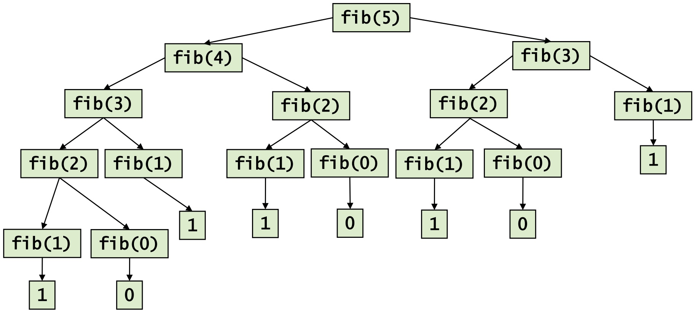

<details>
<summary>flowchart</summary>

```mermaid
graph TD
  fib(5) --> fib(4)
  fib(5) --> fib(3)
  fib(5) --> fib(2)
  fib(5) --> fib(1)
  fib(4) --> fib(3)
  fib(4) --> fib(2)
  fib(4) --> fib(1)
  fib(2) --> fib(1)
  fib(2) --> fib(0)
  fib(2) --> fib(0)
  fib(2) --> fib(1)
  fib(2) --> fib(0)
  fib(1) --> fib(2)
  fib(1) --> fib(1)
  fib(1) --> fib(0)
  fib(0) --> fib(2)
  fib(0) --> fib(1)
  fib(0) --> fib(0)
  fib(1) --> fib(1)
  fib(1) --> fib(0)
  fib(1) --> fib(1)
```
</details>

• Aufruf von fib erfordert i.a. **zwei rekursive Aufrufe** von fib
• Rekursionsbaum wächst **exponentiell**!
• Zeitbedarf für Aufruf fib(n):

– 𝒪𝒪(1) für $n \leq 1$

– Zeit für fib(n-1) + Zeit für fib(n-2) + 1 für Addition

320

© T. Gemmeke, IDS, RWTH; R. Leupers, SSS

---

Laufzeitanalyse

• 𝑻𝑻(𝒏𝒏) = 𝑻𝑻(𝒏𝒏 − 𝟏𝟏) + 𝑻𝑻(𝒏𝒏 − 𝟐𝟐) + 𝟏𝟏
• Grobe **Abschätzung**:

$$
\begin{array}{l} T (n) \geq \mathrm{fib} (n) = \mathrm{fib} (n - 1) + \mathrm{fib} (n - 2) \\ \geq 2 \times \mathrm{fib} (n - 2) \\ = 2 \times \left(\mathrm{fib} (n - 3) + \mathrm{fib} (n - 4)\right) \\ = 2 \times \operatorname{fib} (n - 3) + 2 \times \operatorname{fib} (n - 4) \\ \geq 4 \times \mathrm{fib} (n - 4) \\ \end{array}
$$

$$
\begin{array}{l} \geq 2 ^ {k - 1} \times \operatorname{fib} (n - 2 (k - 1)) [ \text {setze} n = 2 k ] \\ = 2 ^ {k - 1} \times \operatorname{fib} (n - 2 (^ {1 / 2} n - 1)) = 2 ^ {k - 1} \times \operatorname{fib} (2) \\ = 2^{k - 1} \\ = 2 ^ {n / 2 - 1} = 1 / 2 \times 2 ^ {n / 2} \\ \end{array}
$$

• Also $T ( n ) \; = \; { \mathcal { O } } ( 2 ^ { n } )$ (mindestens)
• Zusätzlicher Overhead für **Stackverwaltung** (konst. Faktor)

321

© T. Gemmeke, IDS, RWTH; R. Leupers, SSS

---

Iterative Berechnung der Fibonacci-Folge

**Problem** der rekursiven Version: Bei Berechnung von fib(𝑛𝑛) wird Teilfolge fib(𝑛𝑛 − 2) stets unnötig **doppelt** berechnet
• **Iterative** Version:

```c
int fib(int n)
{
    int f1, f2, f;
    if (n <= 1) return 1;

    f1 = 1;
    f2 = 0;
    for (i=2; i<=n; i++) {
        f = f1 + f2;
        f2 = f1;
        f1 = f;
    }

    return f;
}
```

• Laufzeit 𝓞𝓞(𝟏𝟏) für $n \leq 1$
• Laufzeit 𝓞𝓞(𝒏𝒏) sonst

322

© T. Gemmeke, IDS, RWTH; R. Leupers, SSS

---

## 11. Techniken zum Algorithmenentwurf

11.1 Rekursion und Iteration
**11.2 Backtracking**
11.3 Kombinatorische Optimierung
11.4 Schwierige Probleme und Heuristiken
11.5 Dynamische Programmierung
11.6 Branch and Bound

323

© T. Gemmeke, IDS, RWTH; R. Leupers, SSS

---

Backtracking

• „Rücksetzverfahren“
• **Grundprinzip**:

– Ausbau von Teillösung zu Gesamtlösung
– „Raten“, falls Weg zur Gesamtlösung nicht feststeht
– Rücknahme früherer Entscheidungen, falls keine Gesamtlösung erreichbar

• **Eigenschaften**:

– Existierende Lösung wird garantiert gefunden, indem notfalls alle Möglichkeiten ausprobiert werden
– Dieser Fall führt jedoch zu schlechtem Laufzeitverhalten

Analogie:

• DFS in Graphen
• TL = Teillösung


<details>
<summary>flowchart</summary>

```mermaid
graph TD
  TL1["TL1"] --> TL2["TL2"]
  TL1 --> TL3["TL3"]
  TL2 --> TL4["TL4"]
  TL2 --> TL5["TL5"]
  TL3 --> TL6["TL6"]
  TL3 --> TL7["TL7"]
```
</details>

324

© T. Gemmeke, IDS, RWTH; R. Leupers, SSS

---

## Beispiel aus der technischen Informatik

Schaltkreise für Boolesche Funktionen
• **Boolesche Funktion** ist eine Abbildung $f :   \{ 0 ,   1 \} ^ { 2 }   \to   \{ 0 ,   1 \}$
• **Schaltkreis** = Hardware-Implementierung einer Booleschen Funktion
Einfache Funktionen $\left( f : \left\{ 0 { , } 1 \right\} \times \left\{ 0 { , } 1 \right\} \rightarrow \left\{ 0 { , } 1 \right\} \right)$ werden durch **Logikgatter** realisiert, z.B. AND, OR, NOR
Komplexe Funktionen durch **Zusammensetzen** von Gattern


<details>
<summary>text_image</summary>

a
b
f
</details>


<details>
<summary>text_image</summary>

a
b
f
</details>


<details>
<summary>text_image</summary>

a
b
f
</details>

325

© T. Gemmeke, IDS, RWTH; R. Leupers, SSS

---

Testen von Schaltkreisen

Bei der Herstellung von **integrierten Schaltkreisen** (integrated circuit, IC) als Silizium-Chips können Fehler auftreten
**Fehlermodell**: eine beliebige Leitung im Schaltkreis ist (z.B. durch Kurzschluss) immer konstant 0 oder 1
Beispiel:


<details>
<summary>flowchart</summary>

```mermaid
graph LR
  A["A"] --> G["G"]
  B["B"] --> G
  C["C"] --> D["D"]
  D --> H["H"]
  H --> I["I"]
  E["E"] --> I
  I --> J["J"]
  J --> K["K"]
  K --> F["F"]
  F --> G
  G --> J
  J --> f["f(A, ..., F)"]
  style J fill:#fff,stroke:#333,stroke-width:2px
  style I fill:#fff,stroke:#333,stroke-width:2px
  style K fill:#fff,stroke:#333,stroke-width:2px
  style J fill:#fff,stroke:#333,stroke-width:2px
```
</details>

326

© T. Gemmeke, IDS, RWTH; R. Leupers, SSS

---

Testen von Schaltkreisen

Nur **Ein- und Ausgänge** der Schaltung können gesetzt bzw. gemessen werden, jedoch keine internen Leitungen
Wie kann $J = 1$ getestet werden?
Geeigneten binären Eingabevektor $( A - F )$ wählen, so dass im korrekten Fall 𝐽𝐽 = 0
• Beobachten der **Ausgabe** 𝐿𝐿


<details>
<summary>flowchart</summary>

```mermaid
graph LR
  A["A"] --> G["G"]
  B["B"] --> G
  C["C"] --> D["D"]
  D --> H["H"]
  H --> I["I"]
  I --> J["J"]
  J --> K["K"]
  K --> L["L"]
  L --> M["Chip"]
  N["E"] --> E["E"]
  O["F"] --> F["F"]
  F --> M
  M --> P["Ausgang"]
```
</details>

327

© T. Gemmeke, IDS, RWTH; R. Leupers, SSS

---

Bestimmung des Eingabevektors

Setze $J = \mathbf { 0 } ,$ , sonst Fehler nicht messbar
• 𝐽𝐽 = 𝐺𝐺 NOR 𝐼𝐼, also z.B. 𝐺𝐺 = 1, 𝐼𝐼 = 1
• 𝐺𝐺 = 𝐴𝐴 AND 𝐵𝐵, also $A = 1 , B = 1$
• 𝐼𝐼 = 𝐻𝐻 OR 𝐸𝐸, also z.B. 𝐻𝐻 = 1, 𝐸𝐸 = 0
$H = C \; \mathrm { A N D } \; D$ , also $C = 1 , D = 1$

• Dieser Vektor $A - E$ erzwingt $J = 0$ , **falls Schaltkreis korrekt**


<details>
<summary>flowchart</summary>

```mermaid
graph LR
  A["A"] -->|1| G["G"]
  B["B"] -->|1| G
  C["C"] -->|1| D["D"]
  D -->|1| E["E"]
  E -->|0| I["I"]
  I -->|1| J["J"]
  J -->|0| G
  G -->|1| H["H"]
  H -->|1| I
  I -->|0| K["K"]
  K -->|0| L["L"]
  L -->|0| K
  K --> F["F"]
```
</details>

328

© T. Gemmeke, IDS, RWTH; R. Leupers, SSS

---

Beobachtung der Ausgabe

$K = 1$ impliziert $L = 1$ , unabhängig von 𝐽𝐽
• Also 𝐾𝐾 = 0 zu setzen
$K = I   \mathrm { o n }   F ,$ , also 𝐹𝐹 = 0, 𝐼𝐼 = 0 (Widerspruch zu 𝐼𝐼 = 1)
• Backtracking:

$$
I = 0, H = 0, C = 0
$$

• Dann ist $L = 0 \Leftrightarrow \operatorname { \mathsf { F e h l e r } } J = \mathbf { 1 }$ **liegt nicht vor**


<details>
<summary>flowchart</summary>

```mermaid
graph LR
  A["A"] -->|1| G["G"]
  B["B"] -->|1| G
  C["C"] -->|1^0| D["D"]
  D["D"] -->|1| E["E"]
  E["E"] -->|0| H["H"]
  H["H"] -->|1^0| I["I"]
  I["I"] -->|0| J["J"]
  J["J"] -->|1| G
  K["K"] -->|0| L["L"]
  L["L"] -->|0| G
  F["F"] -->|0| K
  G["G"] -->|0| J
  I -->|0| K
  K -->|0| L
```
</details>

329

© T. Gemmeke, IDS, RWTH; R. Leupers, SSS

---

## 11. Techniken zum Algorithmenentwurf

11.1 Rekursion und Iteration
11.2 Backtracking
**11.3 Kombinatorische Optimierung**
11.4 Schwierige Probleme und Heuristiken
11.5 Dynamische Programmierung
11.6 Branch and Bound

330

© T. Gemmeke, IDS, RWTH; R. Leupers, SSS

---

Kombinatorische Optimierung

Konstruktion einer **Lösung eines Problems** durch Auswahl einer **Teilmenge** einer **Menge von diskreten Elementen**
Jede gültige Lösung muss einer Menge von **Randbedingungen** genügen
**Gesucht**: Lösung, die bzgl. einer **Zielfunktion** optimal ist (d.h. minimal oder maximal, je nach Problemstellung)
• **Beispiel**: minimaler Spannbaum in einem Graphen

– Menge der diskreten Elemente:
• alle Graphkanten
– Gültige Lösung:
• Alle Knoten werden genau einmal erfasst
• Zusammenhängend und keine Zyklen
– Zielfunktion:
• Summe der Kantengewichte → min

331

© T. Gemmeke, IDS, RWTH; R. Leupers, SSS

---

Optimierung durch Greedy-Algorithmen

• Greedy = gierig
Ausgehend von Teillösung wähle Fortsetzung, welche zum **aktuellen**

## Zeitpunkt den größten Gewinn verspricht

• Eigenschaften:

– Meist **geringe Laufzeit**
– Optimale Lösung evtl. **nicht gefunden**

Beispiel: **Kruskal-Algorithmus**

– Greedy: wähle stets nächstbilligste Kante
– Laufzeit 𝒪𝒪( 𝐸𝐸 log 𝐸𝐸 )
– Optimum garantiert gefunden

```txt
Graph MinSpanningTree(Graph G = (V,E))
{
    Graph T; List L; Edge e;

    T = {};
    L = Sort(E);

    while (#Kanten in T < #Knoten in G-1
        && !IsEmpty(L)) {
        e = FirstElem(L);
        Delete(e,L);
        if (!Cycle(e,T)) {
            T = T ∪ {e};
        }
    }
}
```

332

© T. Gemmeke, IDS, RWTH; R. Leupers, SSS

---

Beispiel: Münzwechselproblem

Landeswährung enthält Münzen zu $n _ { 1 } , \ldots , n _ { k }$ **Einheiten**
$n _ { 1 } > n _ { 2 }   \ldots   > n _ { k }$
Stets $n _ { k } = 1$ , sonst nicht alle Beträge wechselbar
• Z.B. **Euro/Cent**:

$$
n _ {1} = 2 0 0, n _ {2} = 1 0 0, n _ {3} = 5 0,
$$

$$
n _ {4} = 2 0, n _ {5} = 1 0, n _ {6} = 5,
$$

$$
n _ {7} = 2, n _ {8} = 1
$$

**Problem**: Auszahlung von Betrag 𝑁𝑁 mit verfügbaren Münzen
• **Diskrete Elemente**: Münzen
• **Gültige Lösung**:

Menge von Münzen mit Gesamtwert 𝑁𝑁

• **Zielfunktion**:

möglichst wenige Münzen verwenden


<details>
<summary>natural_image</summary>

Collection of various Euro-denominated coins scattered on a white surface (no text or symbols visible)
</details>

333

© T. Gemmeke, IDS, RWTH; R. Leupers, SSS

---

Greedy-Algorithmus

**Strategie**: immer möglichst viele „große“ Münzen wählen, bevor man zu „kleineren“ greift
„Untere Gaußklammerfunktion“: 𝐟𝐟 𝐟𝐟(𝒙𝒙) = größte ganze Zahl, die nicht größer ist als 𝑥𝑥
• Führt bei „guten“ Stückelungen immer zum **Optimum**
• **Schlechte Stückelung**: z.B. $n _ { 1 } = 2 n _ { 2 } + 1 , \quad n _ { 2 } > 1 , \quad n _ { 3 } = 1$

Greedy-Münzwechsel

```c
void change(int N)
{
    int W, i;

    W = N;
    for (i=1; i<=k; i++) {
        f = floor(w/n_i);
        wähle f Münzen
        der Einheit n_i;
        W -= n_i * f;
    }
}
```

Schlechter Fall, z.B. $N \; = \; 3 n _ { 2 }$

<div class="docvortex-algorithm" style="white-space: pre-wrap; font-family:monospace;">
z.B. $n_2 = 10$, $N = 30$, $n_1 = 21$
1 Münze zu Wert 21
dann $W = 30 - 21 = 9$
9 Münzen zu Wert 1
Zusammen 10 Münzen
Ausreichend wären 3 Münzen Wert 10
</div>

334

© T. Gemmeke, IDS, RWTH; R. Leupers, SSS

---

## 11. Techniken zum Algorithmenentwurf

11.1 Rekursion und Iteration
11.2 Backtracking
11.3 Kombinatorische Optimierung
**11.4 Schwierige Probleme und Heuristiken**
11.5 Dynamische Programmierung
11.6 Branch and Bound

335

© T. Gemmeke, IDS, RWTH; R. Leupers, SSS

---

## Komplexität von Optimierungsproblemen

Für viele wichtige kombinatorische Optimierungsprobleme ist bekannt, dass sie **nicht in akzeptabler Zeit optimal lösbar** sind, da ihre Laufzeit (höchstwahrscheinlich) mindestens in $\mathcal { O } ( 2 ^ { n } )$ liegt
• Sog. **NP-vollständige** Probleme
Rechenbeispiel: Problemgröße $n = 6 4$ , schneller Rechner führt $2 ^ { 3 2 }$ Operationen/sec aus
• **Rechenzeit**: $2 ^ { 3 2 }$ sec ≈ 136 Jahre
• **Prinzipielle Möglichkeiten**:

1. Optimale Lösung (brute force) für kleine Werte von n
2. Optimale Lösung, und dafür sorgen, dass worst case möglichst selten eintritt
3. Gute, aber nicht notwendig optimale Lösung berechnen

336

© T. Gemmeke, IDS, RWTH; R. Leupers, SSS

---

Beispiele NP-vollständiger Probleme

## • Traveling salesman problem:

– Modell: Graph mit Kantengewichten
Gesucht: Kürzester Rundweg (Zyklus), der alle Knoten genau einmal enthält

## • Graph-Färbung:

– Modell: ungerichteter Graph
Gesucht: Färbung der Knoten mit min. Anzahl Farben, so dass benachbarte Knoten unterschiedliche Farben haben

## Erfüllbarkeit Boolescher Funktionen:

– Gibt es für Funktion 𝑓𝑓 eine Eingabe 𝑥𝑥 mit 𝑓𝑓(𝑥𝑥) = 1?


<details>
<summary>text_image</summary>

DEN.
Baltic
Sea
54
Neuendorf
bei Wilster
Kiel
Rostock
Lübeck
Bremerhaven
Hamburg
Emden
Bremen
BENLIN
POL.
NETH.
Duisburg
Essen
Düsseldorf
Köln
Bonn
Frankfurt
am Main
Mannheim
Kansruhe
Stuttgart
München
Magdeburg
Leipzig
Presden
BEL.
CZECH
REPUBLIC
LUX.
FRANCE
AUSTRIA
Zugspitze
SWITZ.
LIECH.
12
0 50 100 km
0 50 100 mi
</details>

<sup>Kürzester</sup> Rundweg über die 15 größten Städte

Deutschlands (von > 43 \* 10<sup>9</sup> <sub>möglichen</sub>) [Wikipedia]

337

© T. Gemmeke, IDS, RWTH; R. Leupers, SSS

---

Komplexität von Optimierungsproblemen

• Zur Kategorie 3 gehören **heuristische Algorithmen**
• **Heuristik**:

– Kompromiss zwischen Rechenaufwand und Lösungsqualität
– Basierend auf **problemspezifischem Wissen** und „Daumenregeln“
– **Greedy-Algorithmen** sind oft Heuristiken
– Gewünscht: möglichst oft sehr gute Lösung
– **Nachteil**: Lösung kann auch beliebig schlecht sein

• Außerdem möglich: **Approximationsalgorithmen**

– Garantie, dass Lösungsqualität nicht um mehr als bestimmten Faktor vom Optimum abweicht
– Faktor = „**Güte**“ des Approximationsalgorithmus

338

© T. Gemmeke, IDS, RWTH; R. Leupers, SSS

---

Beispiel für Heuristik

• **Gegeben**: kantengewichteter **vollständiger**
Graph $G = ( V , E , w )$ , d.h. für alle Knoten 𝑢𝑢, 𝑣𝑣 gilt $\{ u , v \} \in E$

• **Gesucht**: Pfad $P \; = \; ( v _ { 1 } , \ldots , v _ { n } )$ in $G _ { j }$ , der

– jeden Knoten in 𝑉𝑉 genau einmal enthält und
– eine maximale Kantengewichtssumme besitzt

Vergleiche minimaler (bzw. maximaler) Spannbaum:


339

© T. Gemmeke, IDS, RWTH; R. Leupers, SSS

---

Maximal gewichteter Pfad

• Man kann zeigen: Problem ist **NP-vollständig**
• Ausnutzung der **Ähnlichkeit** zum Spannbaumproblem

– Pfad = „entarteter“ (d.h. linearer) Spannbaum
– Modifikation des **Kruskal-Algorithmus**: nächste Kante nur gültig, falls

• Kein Zyklus entsteht
• **Keine Verzweigungen** entstehen (d.h. kein „echter“ Baum)

– Erzeugt heuristisch **gute Lösungen** in kurzer Zeit


<details>
<summary>flowchart</summary>

```mermaid
graph LR
  A["Node 0"] --> B["Final Network Structure"]
  B --> C["Intermediate Node 1"]
  B --> D["Intermediate Node 2"]
  B --> E["Intermediate Node 3"]
  B --> F["Intermediate Node 4"]
  B --> G["Intermediate Node 5"]
```
</details>

340

© T. Gemmeke, IDS, RWTH; R. Leupers, SSS

---

## 11. Techniken zum Algorithmenentwurf

11.1 Rekursion und Iteration
11.2 Backtracking
11.3 Kombinatorische Optimierung
11.4 Schwierige Probleme und Heuristiken
**11.5 Dynamische Programmierung**
11.6 Branch and Bound

341

© T. Gemmeke, IDS, RWTH; R. Leupers, SSS

---

Dynamische Programmierung

**Effizientes exaktes Lösen** von Optimierungsproblemen mit folgender Eigenschaft:

Die optimale Lösung des Gesamtproblems kann effizient aus **optimalen Lösungen von Teilproblemen** berechnet werden

• Beispiel aus dem **Compilerbau**:

– Rechner besitzt elementare **Maschinenbefehle** (Assemblerbefehle, s. Kap. 1), z.B. Addition oder Multiplikation zweier Zahlen
– **Optimale Befehlsauswahl**: Wie kann ein komplexer arithmetischer Ausdruck in der Programmiersprache C am schnellsten mit den verfügbaren Assemblerbefehlen berechnet werden?

342

© T. Gemmeke, IDS, RWTH; R. Leupers, SSS

---

Beispiel: Befehlsauswahl

• Ausdruck: $( a \div b ) + ( c \div d )$
Befehle:

– Modell:

Rechner lädt Variablen (var) aus dem Speicher (load) und speichert Werte in Registern (r1, r2, r3)
• Jeder Befehl besitzt ein Kostenmaß (z.B. Zeit zur Ausführung)

– load: $r _ { 1 } = v a r _ { 1 }$ Kosten 1
– add: $r1 = + (r1, r2)$ Kosten 2
– mul: Kosten 2
– copy: Kosten 1
– muladd: $r1 = + ( \pi ( r1, r2 ), r3 )$ , Kosten 3


<details>
<summary>flowchart</summary>

```mermaid
graph TD
  A["var"] --> B["*"]
  C["var"] --> B
  D["var"] --> E["*"]
  F["var"] --> E
  B --> G["+"]
  E --> G
```
</details>

## Abstrakte

## Darstellung des

## Ausdrucks als

## Baum

343

© T. Gemmeke, IDS, RWTH; R. Leupers, SSS

---

Beispiel: Befehlsauswahl

## • Ansatz:

– Ausdrucksbaum mit möglichst „billiger“ Menge von Befehlen überdecken
Lösung für den gesamten Ausdrucksbaum aus optimalen Lösungen für seine Teilbäume bestimmen

## • Für jeden Teilbaum merken:

– Welcher Befehl an dessen Wurzel passt $( \mathsf { Z } . \mathsf { B } . , + ^ { \prime \prime }$ mittels „add“ zu überdecken, $v ^ { v ^ { 1 } } \theta ^ { 1 }$ mittels $, m u ] ^ { \prime \prime } )$
– In welchem Register das Ergebnis des Teilbaums gespeichert wird
– Welche Gesamtkosten hierbei entstehen


<details>
<summary>flowchart</summary>

This diagram illustrates a system process involving multiple parallel operations (var, add, mul) that converge to a central node marked with an asterisk.
</details>

var**-Knoten:**

**Überdeckung mit** $\boldsymbol { u } ^ { \intercal }$ oad“

**Ergebnis dann in Register** r1

**Kosten: 1**

**Überdeckung mit „**copy r1, $r 2 ^ { n }$

**Ergebnis dann in Register** r2

**Kosten: 2**

344

© T. Gemmeke, IDS, RWTH; R. Leupers, SSS

---

Beispiel: Befehlsauswahl

Überdeckung des Ausdrucksbaums


<details>
<summary>flowchart</summary>

```mermaid
graph TD
  A["load: r1,1\ncopy: r1,r2,2\ncopy: r3,r2,2"] --> B["mul: r1,r2,1+2+2=5\ncopy: r1,r2,5+1=6\ncopy: r1,r3,5+1=6"]
  C["load: r1,1\ncopy: r1,r2,2\ncopy: r1,r3,2"] --> B
  D["load: r1,1\ncopy: r1,r2,2\ncopy: r1,r3,2"] --> E["mul: r1,r2,1+2+2=5\ncopy: r2, 5+1=6\ncopy: r3, 5+1=6"]
  F["load: r1,1\ncopy: r1,r2,2\ncopy: r1,r3,2"] --> G["muladd: r1 +(*(r1,r2), r3)\nto Kosten 3"]
  H["add: r1, 5+6+1+2=14\nmuladd: r1, 1+2+6+3=12"] --> I["Billigste Lösung"]
  B --> I
  E --> I
  G --> I
```
</details>

Aus dieser Lösung kann die **optimale Assembler-Befehlsfolge** unmittelbar konstruiert werden
• **Laufzeit**: 𝒪𝒪(𝑛𝑛) bei n Baumknoten

## Befehle

## load:

r1 var

→ Kosten 1

## add:

r1 +(r1,r2)

→ Kosten 2

## mul:

r1 \*(r1,r2)

→ Kosten 2

## copy:

ri rj

Kosten 1

## muladd:

r1 +(\*(r1,r2), r3)

→ Kosten 3

345

© T. Gemmeke, IDS, RWTH; R. Leupers, SSS

---

## 11. Techniken zum Algorithmenentwurf

11.1 Rekursion und Iteration
11.2 Backtracking
11.3 Kombinatorische Optimierung
11.4 Schwierige Probleme und Heuristiken
11.5 Dynamische Programmierung
**11.6 Branch and Bound**

346

© T. Gemmeke, IDS, RWTH; R. Leupers, SSS

---

Branch and Bound

• „Verzweigung und Schranke“
**Exaktes Lösen** schwieriger (NP-vollständiger) Optimierungsprobleme

• **Idee**:

– Lösen eines „schwierigen“ kombinatorischen Optimierungsproblems entspricht Durchlauf eines **Entscheidungsbaumes**

– Entscheidungsbaum typischerweise **exponentiell groß**
– „**Beschneidung**“ des Baumes verringert Laufzeit ohne Verlust an Optimalität

Ähnliches Konzept auch bei **Spielbäumen** (TicTacToe, Dame, Schach, …)

• **Charakteristik**:

– Im worst case exponentielle Laufzeit
– Im average case wesentlich schneller

347

© T. Gemmeke, IDS, RWTH; R. Leupers, SSS

---

## Entscheidungsbaum

Annahme: Vektor $V = ( x _ { 1 } , \ldots , x _ { n } )$ von 0/1-Variablen so zu wählen, dass eine Kostenfunktion $f ( V )$ minimiert wird
**Entscheidungsbaum**: Festlegen jeweils einer Variable


<details>
<summary>flowchart</summary>

```mermaid
graph TD
  A["(x1, ..., xn)"] -->|"xi = 0"| B["(x1, ..., xi-1, 0, xi+1, ..., xn)"]
  A -->|"xi = 1"| C["(x1, ..., xi-1, 1, xi+1, ..., xn)"]
  B -->|"xi+1 = 0"| D["(x1, ..., xi-1, 0, 0, xi+2, ..., xn)"]
  B -->|"xi+1 = 1"| E["(x1, ..., xi-1, 0, 1, xi+2, ..., xn)"]
  D -->|"xi+2 = 0"| F["(x1, ..., xi-1, 0, 1, 0, xi+3, ..., xn)"]
  E -->|"xi+2 = 1"| G["((x1, ..., xi-1, 0, 1, 1, xi+3, ..., xn))"]
```
</details>

348

© T. Gemmeke, IDS, RWTH; R. Leupers, SSS

---

Schranken

Während der Verzweigung: Berechnung von **oberen** (upper bound, 𝑈𝑈) und **unteren Schranken** (lower bound, 𝐿𝐿) für die Kostenfunktion 𝑓𝑓 an jedem Knoten 𝐾𝐾, so dass im Teilbaum unterhalb von 𝐾𝐾

– in jedem Fall **mindestens Kosten** 𝑳𝑳 entstehen
– garantiert eine Lösung mit **Kosten höchstens** 𝑼𝑼 existiert

**Bound**: Besitzt Knoten 𝐾𝐾 eine **untere Schranke** 𝑳𝑳**, welche größer ist als das kleinste bisher bekannte U**, dann kann der Teilbaum unterhalb von 𝐾𝐾 von der Suche **ausgeschlossen** werden, ohne dass eine optimale Lösung verloren geht

• **Wichtig**:

– Schranken sind schnell zu berechnen (sonst zu aufwendig)
– Schranken sind „scharf“ (sonst kein effektives Bound)

349

© T. Gemmeke, IDS, RWTH; R. Leupers, SSS

---

Beispiel für Bound


<details>
<summary>flowchart</summary>

```mermaid
graph TD
  A["(x1, ..., xn)"] -->|"xi = 0"| B["(x1, ..., xi-1, 0, xi+1, ..., xn)"]
  A -->|"xi = 1"| C["(x1, ..., xi-1, 0, xi+1, ..., xn)"]
  B -->|"xi+1 = 0"| D["(x1, ..., xi-1, 0, xi+2, ..., xn)"]
  B -->|"xi+1 = 1"| E["(x1, ..., xi-1, 0, 1, xi+2, ..., xn)"]
  D -->|"xi+2 = 0"| F["(x1, ..., xi-1, 0, 0, xi+3, ..., xn)"]
  E -->|"xi+2 = 1"| G["((x1, ..., xi-1, 0, 1, 1, xi+3, ..., xn))"]
  F -->|"L = 25\nU = 30"| H["L = 25\nU = 30"]
  G -->|"L = 11\nU = 20"| I["L = 11\nU = 20"]
  C -->|"L = 30\nU = 40"| J["L = 30\nU = 40"]
```
</details>

350

© T. Gemmeke, IDS, RWTH; R. Leupers, SSS

---

## Beispiel: max. gewichteter Pfad in Graphen

**Branch**: bestimmte Kante wird in den Pfad aufgenommen (sofern gültig) oder aber explizit ausgeschlossen


<details>
<summary>flowchart</summary>

```mermaid
graph TD
  A["Node 1"] --> B["Node 2"]
  A --> C["Node 3"]
  A --> D["Node 4"]
  A --> E["Node 5"]
  A --> F["Node 6"]
  A --> G["Node 7"]
  A --> H["Node 8"]
  A --> I["Node 9"]
  A --> J["Node 10"]
  A --> K["Node 11"]
  A --> L["Node 12"]
  A --> M["Node 13"]
  A --> N["Node 14"]
  A --> O["Node 15"]
  A --> P["Node 16"]
  A --> Q["Node 17"]
  A --> R["Node 18"]
  A --> S["Node 19"]
  A --> T["Node 20"]
  A --> U["Node 21"]
  A --> V["Node 22"]
  A --> W["Node 23"]
  A --> X["Node 24"]
  A --> Y["Node 25"]
  A --> Z["Node 26"]
  A --> AA["Node 27"]
  A --> AB["Node 28"]
  A --> AC["Node 29"]
  A --> AD["Node 30"]
  A --> AE["Node 31"]
  A --> AF["Node 32"]
  A --> AG["Node 33"]
  A --> AH["Node 34"]
  A --> AI["Node 35"]
  A --> AJ["Node 36"]
  A --> AK["Node 37"]
  A --> AL["Node 38"]
  A --> AM["Node 39"]
  A --> AN["Node 40"]
  A --> AO["Node 41"]
  A --> AP["Node 42"]
  A --> AQ["Node 43"]
  A --> AR["Node 44"]
  A --> AS["Node 45"]
  A --> AT["Node 46"]
  A --> AU["Node 47"]
  A --> AV["Node 48"]
  A --> AW["Node 49"]
  A --> AX["Node 50"]
```
</details>

351

© T. Gemmeke, IDS, RWTH; R. Leupers, SSS

---

Beispiel: max. gewichteter Pfad in Graphen

Effiziente Berechnung der Schranken?
**Gegeben**: Graph mit 𝑛𝑛 Knoten und Teillösung mit 𝑘𝑘 bereits fest gewählten Kanten
• **Obere Schranke** 𝑼𝑼:

– Im besten Falle könnten noch die 𝑛𝑛 − 𝑘𝑘 − 1 „schwersten“unter den noch nicht betrachteten Kanten hinzugefügt werden
– Optimale Lösung kann höchstens schlechter sein

• **Untere Schranke** 𝑳𝑳:

– Setze Teillösung mittels Heuristik durch Hinzunahme von 𝑛𝑛 − 𝑘𝑘 − 1 Kanten zu Gesamtlösung fort
– Optimale Lösung kann höchstens besser werden

**Maximierungsproblem**: Falls für einen Knoten der Wert von 𝑈𝑈 kleiner ist als bisher bestes 𝐿𝐿, so kann der Teilbaum entfallen

352

© T. Gemmeke, IDS, RWTH; R. Leupers, SSS

---

Bildnachweise

#20 Petr Kratochvil , „frau-sitzt-mit-laptop “, publicdomainpictures.net „PC-CPU-Feld-Vektor-Bild“, publicdomainvectors.org
#23 Ldorfman - According to a work of Johanna Pung made for Wikimedia Deutschland – Own work, CC BY-SA 3.0, commons.wikimedia.org/w/index.php?curid=21837408
#32 Max Pixel, “Medical Cold Fever Thermometer Temperature Digital“, maxpixel.net
#143 Tim Reckmann, „Kreditkarte“, CC-BY 2.0, ccnull.de
#163 MartinStr, „blasen-wasser-sprudelnd-lufblasen-230014“, pixabay.com
#213 ACBahn, „Warteschlange Eisdiele“, commons.wikimedia.org, CC GNU 1.2
#245 „gps-navigation-garmin-gerät-304842“, pixabay.com openstreetmap.de, Open Database Licence (ODbL) 1.0
#270 „Grundsätzliche Informationen zum Netzausbau”, www.buergerdialog-stromnetz.de
#280 wirestock, „closeup-bee-sunflower-field-sunligh”, freepik.com
#294 „money\_coins\_loose\_change\_euro\_cent\_specie\_metal\_money\_finance”, pxhere.com

353

© T. Gemmeke, IDS, RWTH; R. Leupers, SSS

---

Literaturnachweise

B.W. Kernighan, D.M. Ritchie: Programmieren in C, 2. Auflage, Hanser, 1990, ISBN 3-446-15497-3
R. Sedgewick: Algorithmen in C++, Teil 1-4, Addison-Wesley, 2002, ISBN 3-8273-7026-4
K. Loudon: Mastering Algorithms with C, 1. Auflage, O‘Reilly, 1999, ISBN 978-1-56592-453-6

354

© T. Gemmeke, IDS, RWTH; R. Leupers, SSS

---

## Stichwortregister zu C++ Sprachelementen

• Abstrakte Datentypen 138
• Ausgabe 39
• Funktionen
– Lambda 119
– Overloading 153
• Klassen 140
– (De)Constructor 142
– Public vs. Private 144
– Inheritance 147
• Libraries 34
– Using & namespace 40
• Loops
– Iterators 129
• Polymorphie
– Statisch 113
– Dynamisch 149
• Smart Pointer 70
– Unique 71
– Shared 72
– Weak 73
• Streams ,39 155
• Template 117

355

© T. Gemmeke, IDS, RWTH
