# 1. Einleitung

原始 PDF 第 16–30 页。

## 1. Einleitung

**1.1 Thematische Einordnung**
1.2 Hardware und Software
1.3 Programmiersprachen
1.4 Algorithmen und Programme

16

© T. Gemmeke, IDS, RWTH; R. Leupers, SSS

---

Was ist Informatik?

**Informatik** (Computer Science) ist die **Wissenschaft**, die sich mit der Entwicklung und Nutzung von Computersystemen beschäftigt
• Wurzeln in der **Mathematik** und **Elektrotechnik**
**Informatikkenntnisse** (speziell: Programmierkenntnisse) gehören heute zum Handwerkszeug jedes Ingenieurs
Einteilung in drei große **Teilgebiete**:

1. <u>Theoretische Informatik</u>: Computermodelle, Sprachen, Boolesche Funktionen, Komplexitätsanalyse, ...
2. <u>Praktische Informatik</u>: Programmiersprachen, Compiler, Betriebssysteme, SW Engineering, Datenbanken, ...
3. <u>Technische Informatik</u>: Aufbau von Computer-Hardware, Chip-Entwurf, Netzwerke, Mobilfunk, ...

17

© T. Gemmeke, IDS, RWTH; R. Leupers, SSS

---

## Einordnung GGI1

**GGI1** ist in erster Linie in der **praktischen Informatik** angesiedelt
**GGI2**: Technische Informatik: Prinzipien des Digitalrechners
**Automaten, Sprachen, Komplexität** (CE): Theoretische Informatik
**GGI3**: Praktische und Technische Informatik: Optimierung, Modellierung und Parallelität
**SUSP:** Praktische Informatik: System-SW und systemnahe Program.
• **GGI4:** Prakt. Inf.: Betriebssysteme
• Daneben: **Projekte** und **Praktika**
Grundlagen für weitere **Spezialisierung** ab 5. Semester

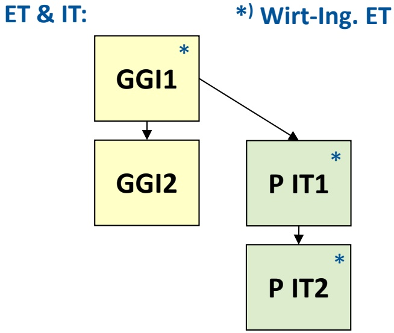

<details>
<summary>flowchart</summary>

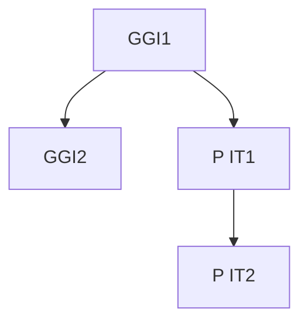
</details>

CE:

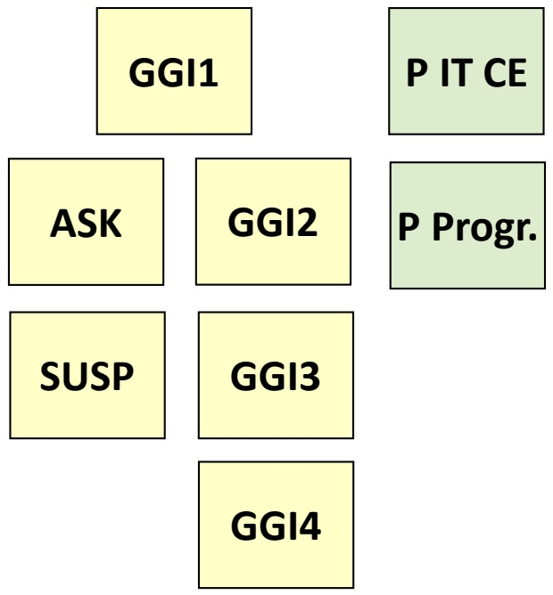

<details>
<summary>flowchart</summary>

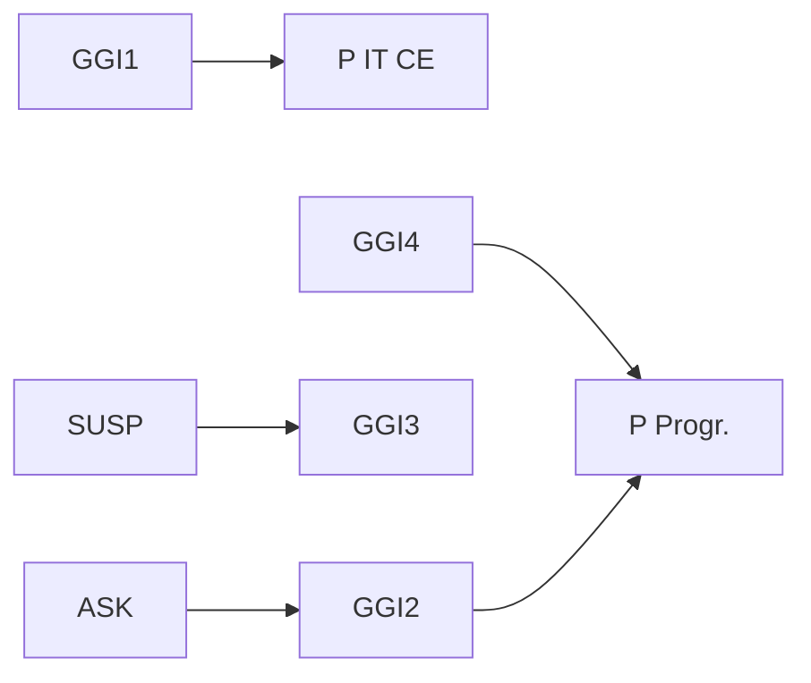
</details>

18

© T. Gemmeke, IDS, RWTH; R. Leupers, SSS

---

## 1. Einleitung

1.1 Thematische Einordnung
**1.2 Hardware und Software**
1.3 Programmiersprachen
1.4 Algorithmen und Programme

19

© T. Gemmeke, IDS, RWTH; R. Leupers, SSS

---

Hardware und Software

HW = Physikalisch existierender, programmierbarer Rechner (Computer)

→ Modifikation aufwendig

SW = Auf HW ausführbares Programm (Textdatei) für gegebene Anwendung

→ Modifikation einfach

In GGI1 wird die HW als **Black Box** betrachtet, die Programmcode ausführen kann
Innerer HW-Aufbau: siehe Vorlesung **GGI2**

## User


<details>
<summary>natural_image</summary>

Woman smiling while using a laptop (no visible text or symbols)
</details>

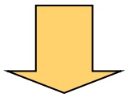

## SW

```c
void rgb2ycc1(
    signed char r, signed char g, signed char b,
    signed char *y, signed char *cb, signed char *cr)
{
    *y = ( 77*r + 150*g +  29*b          ) >> 8;
    *cb = (-43*r -  85*g + 128*b + 32768) >> 8;
    *cr = (128*r - 107*g -  21*b + 32768) >> 8;
}
void rgb2ycc(int NP, signed char *RGB, signed char *YCC)
{
    int i;
    for (i = 0; i < 3 * NP; i += 3) {
        rgb2ycc(RGB[i], RGB[i+1], RGB[i+2], &YCC[i], &YCC[i+1], &YCC[i+2]);
    }
}
```

## HW

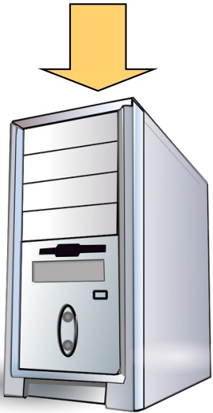

<details>
<summary>natural_image</summary>

Illustration of a desktop computer tower with a yellow downward arrow indicating compression or loading (no text or symbols present)
</details>

© T. Gemmeke, IDS, RWTH; R. Leupers, SSS

20

---

Abbildung von SW auf HW

SW wird meist in höheren **Programmiersprachen** entwickelt
Programmiersprachen als **Schnittstelle** sind sowohl für Menschen als auch für Computer verständlich
**Compiler** übersetzt Hochsprachen-Programm in **Assemblerprogramm**, bestehend aus einzelnen (noch lesbaren) Prozessorbefehlen
• Übersetzung von **Quellcode** in **Zielcode**
Auch die direkte Entwicklung von **Assemblerprogrammen** ist möglich
Assembler übersetzt Assemblerprogramm in binären **Maschinencode**, der direkt auf der HW ausgeführt werden kann

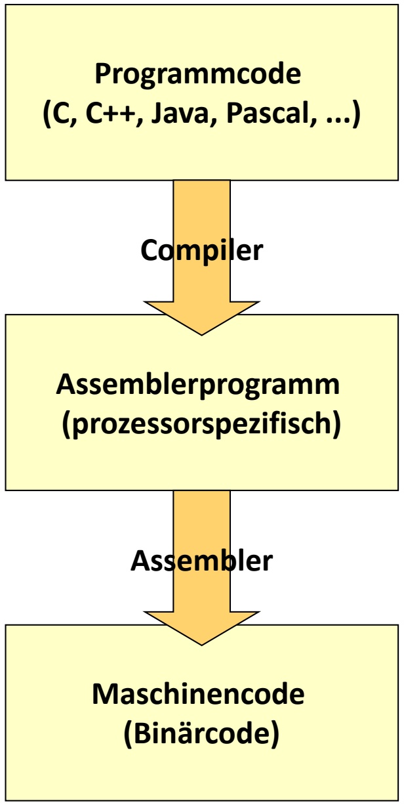

<details>
<summary>flowchart</summary>

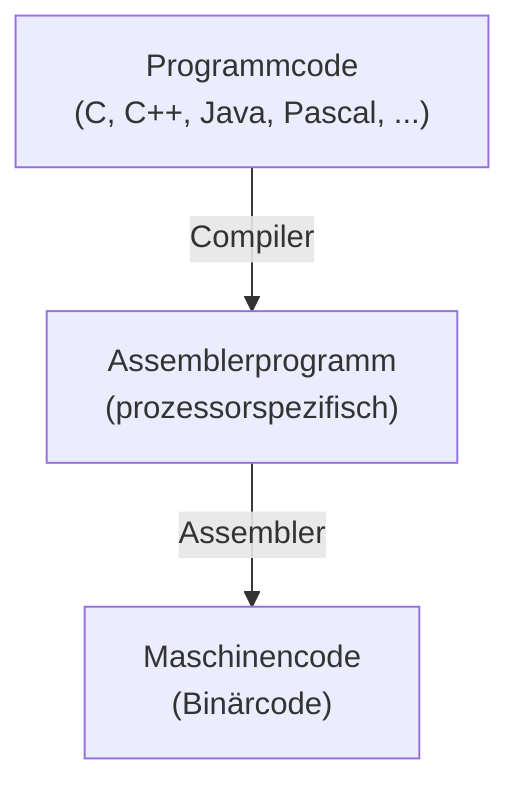
</details>

21

© T. Gemmeke, IDS, RWTH; R. Leupers, SSS

---

## 1. Einleitung

1.1 Thematische Einordnung
1.2 Hardware und Software
**1.3 Programmiersprachen**
1.4 Algorithmen und Programme

22

© T. Gemmeke, IDS, RWTH; R. Leupers, SSS

---

## Programmiersprachen

Computer wurden zu Anfang direkt in **Maschinencode** programmiert
Später Übergang zu **symbolischem** Maschinencode (Assembler)
Dann Einführung von (höheren) **Programmiersprachen**
• **Vorteile**:

– lesbar und wartbar (bei gutem Programmierstil)
– portierbar (nicht unbedingt zu 100%)

• „Evolution“ der Sprachen setzt sich ständig fort

– Zukünftig: für parallele **Multiprozessorsysteme**

Eine neue Sprache alleine ist praktisch wertlos, man benötigt

– **Programmierwerkzeuge**, z.B. Compiler
– **Akzeptanz** bei den Benutzern (u.a. wegen legacy code)

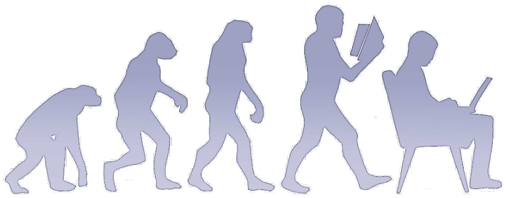

<details>
<summary>natural_image</summary>

Silhouette illustration of a person in various stages of life progression, including walking, running, and sitting (no text or symbols)
</details>

23

© T. Gemmeke, IDS, RWTH; R. Leupers, SSS

---

Wahl der Programmiersprache

## Einteilung:

– **Imperative Sprachen**: konkrete Beschreibung eines Algorithmus als Folge von Anweisungen (Beispiel: C, Pascal)
**Deklarative Sprachen**: Beschreibung des erwünschten Programmverhaltens, konkrete Umsetzung erfolgt teilweise durch den Compiler und Laufzeitsystem (Beispiel: LISP, Prolog)
– **Objektorientierte Sprachen**: Zusammenfassung von Algorithmen und Daten zu Objekten, dadurch einfachere Programmwartung (Beispiel: C++, Java)
– Einteilung nicht disjunkt, z.B. C ⊂ C++

• Für GGI1: **C und C++** aufgrund großer praktischer Relevanz
• Nicht alle **Sprachdetails** werden vorgestellt
• Programmieren lernt man nur durch **Übung**!

24

© T. Gemmeke, IDS, RWTH; R. Leupers, SSS

---

Software Life Cycle

• GGI1 stellt elementare Grundlagen der SW-Entwicklung bereit
• Typischer SW Life Cycle:

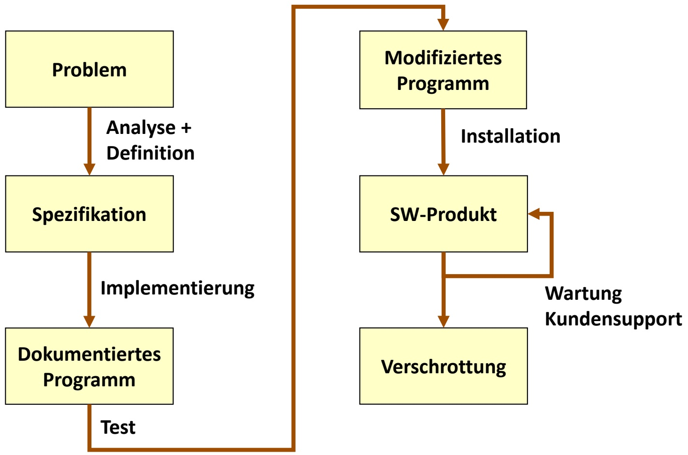

<details>
<summary>flowchart</summary>

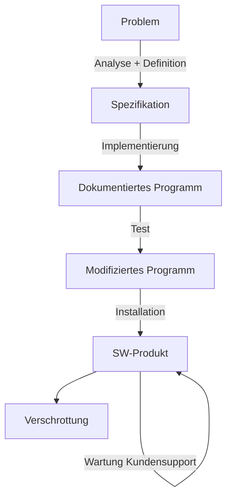
</details>

25

© T. Gemmeke, IDS, RWTH; R. Leupers, SSS

---

## 1. Einleitung

1.1 Thematische Einordnung
1.2 Hardware und Software
1.3 Programmiersprachen
**1.4 Algorithmen und Programme**

26

© T. Gemmeke, IDS, RWTH; R. Leupers, SSS

---

Grundbegriffe aus GGI1

## • Algorithmus:

– Abstrakte Handlungsanweisung, um ein Problem zu lösen
– Ausgabe als Funktion der Eingabe
– In endlicher Zeit, eindeutig und deterministisch
– Kann in natürlicher Sprache formuliert sein

## • Programm:

– Codierung eines Algorithmus in Programmiersprache

## • Datenstruktur:

– Mathematisches Objekt zur Speicherung von Daten
– Auf bestimmte Weise angeordnet und zusammengefasst
– Sinnvoll nur im Zusammenhang mit Operationen auf den Daten
– Beispiele: Arrays, Listen, Stacks, Bäume, Graphen, ...

27

© T. Gemmeke, IDS, RWTH; R. Leupers, SSS

---

Vom Problem zum Programm

Für jedes (per Computer lösbare) Problem gibt es **unendlich viele** Algorithmen
Für jeden Algorithmus existieren **unendlich viele** Implementierungen in einer Programmiersprache
**Anforderung:** Finde den besten Algorithmus und die beste Implementierung hierfür; Kriterien:
– Korrektheit
– Effizienz (Laufzeit und/oder Speicherverbrauch)
– Eleganz, Programmierstil
Korrektheit eines Algorithmus lässt sich (mathematisch) beweisen, Korrektheit eines Programms oft nicht
Zur Bewertung der Effizienz von Algorithmen dient die **Komplexitätsanalyse**
• Guter **Programmierstil** muss praktisch erlernt werden

28

© T. Gemmeke, IDS, RWTH; R. Leupers, SSS

---

Grenzen der Programmierung

• Wann ist ein Problem per Computer lösbar?

– Problemlösung muss **mathematisch exakt** als Algorithmus beschreibbar sein
– Bsp.: Sortiere eine Menge von Namen in lexikographischer Reihenfolge

• Jedoch: Viele wichtige Probleme sind **prinzipiell lösbar**, aber in der Praxis zu komplex

– Bsp.: Primfaktorzerlegung sehr großer Zahlen
– Bsp.: Optimale Routenplanung für Spediteure (**Traveling Salesman Problem**)
– Auch schnellere Rechner helfen **nicht** weiter

• Andere Probleme sind **prinzipiell unlösbar**

Bsp.: Bestimme, ob ein Programm nach endlicher Zeit auf gegebener Eingabe anhält (**Halteproblem**)

29

© T. Gemmeke, IDS, RWTH; R. Leupers, SSS

---

Inhalt der Vorlesung

1. Einleitung
2. Einführendes Beispiel
3. Elementare Datentypen und Anweisungen
4. Funktionen und Programmaufbau
5. Datentypen
6. Analyse von Algorithmen
7. Sortieralgorithmen
8. Lineare Datentypen
9. Bäume
10. Graphen
11. Techniken zum Algorithmenentwurf

30

© T. Gemmeke, IDS, RWTH; R. Leupers, SSS
