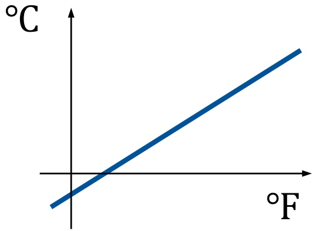
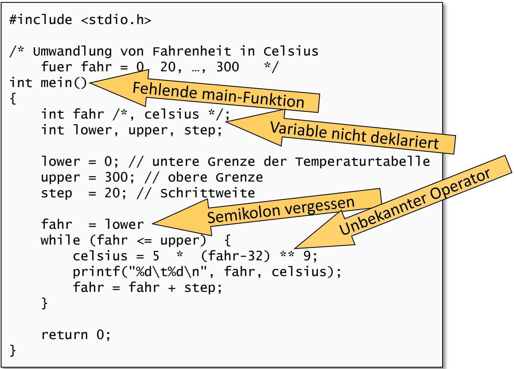
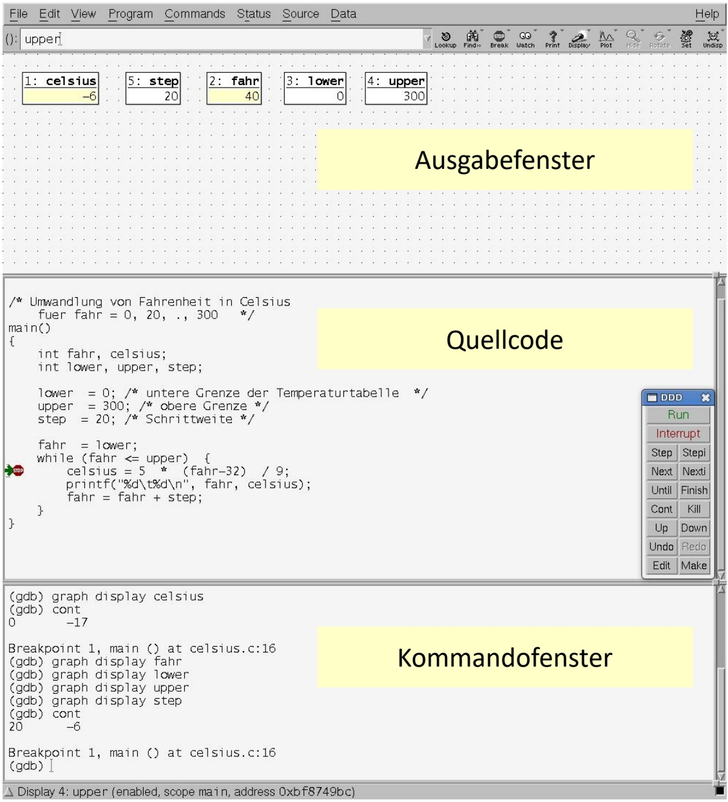

# 2. Einführendes Beispiel

原始 PDF 第 31–46 页。

## 2. Einführendes Beispiel

**2.1 Temperaturumrechnung**
2.2 Analyse des Beispiels
2.3 Ausführung und Fehlersuche

31

© T. Gemmeke, IDS, RWTH; R. Leupers, SSS

---

Einführendes C-Programmbeispiel

• Umwandlung von Grad Fahrenheit in Grad Celsius
•𝑦𝑦℃ = (5/9) ×𝑥𝑥℉ – 32

```c
#include <stdio.h>

/* Umwandlung von Fahrenheit in Celsius
    fuer fahr = 0, 20, ..., 300   */
int main()
{
    int fahr, celsius;
    int lower, upper, step;

    lower = 0; // untere Grenze der Temperaturtabelle
    upper = 300; // obere Grenze
    step  = 20; // Schrittweite

    fahr  = lower;
    while (fahr <= upper)  {
        celsius = 5  *  (fahr-32) / 9;
        printf("%d\t%d\n", fahr, celsius);
        fahr = fahr + step;
    }

    return 0;
}
```


<details>
<summary>natural_image</summary>

Medical thermometer with digital display showing 36.2°C (no text or symbols on device body)
</details>



<details>
<summary>line</summary>

| \({}^{\circ}F\) | \({}^{\circ}C\) |
| --- | --- |
| 0 | ~-1.5 |
| ~1.5 | 0 |
| ~3.0 | ~1.5 |
| ~4.5 | ~3.0 |
| ~6.0 | ~4.5 |
| ~7.5 | ~6.0 |
| ~9.0 | ~7.5 |
</details>

32

© T. Gemmeke, IDS, RWTH; R. Leupers, SSS

---

Libraries

Von vielen Programmen häufig wiederverwendeter Code wird in Bibliotheken (Libraries) abgelegt
Library-Code wird nur einmal compiliert und kann dann von allen Programmen eingebunden werden
• Dies erfolgt nach der Assemblierung durch den Linker
C besitzt insges. 29 Standard-Libraries, z.B.:
– stdio: Ein- und Ausgabe
– math: Mathematische Funktionen
– string: String-Manipulation
Durch Einbinden einer Header-Datei (z.B. „stdio.h“) werden die Library-Funktionen dem benutzenden Programm bekannt gemacht
Programmierer können (und sollten) auch eigene, benutzerspezifische Libraries anlegen

33

© T. Gemmeke, IDS, RWTH; R. Leupers, SSS

---

Standardbibliothek C++ - Beispiele

C++

• **Zeichenketten und Streams**

– string, iomanip, iostream, cstdio

• **Abtrakte Datentypen / Container**

– vector, array, (forward\_)list, queue, stack
– (unordered\_)set, (unordered\_) map
– iteratoren

• **Smart Pointer**

– unique\_prt
– shared\_prt
– weak\_ptr

• **Algorithmen**

– for\_each, sort, copy, find & search, transform

• **Funktoren**

– multiplies, negate, …

34

© T. Gemmeke, IDS, RWTH; R. Leupers, SSS

---

## 2. Einführendes Beispiel

2.1 Temperaturumrechnung
**2.2 Analyse des Beispiels**
2.3 Ausführung und Fehlersuche

35

© T. Gemmeke, IDS, RWTH; R. Leupers, SSS

---

Analyse des C-Programms

• **Einbinden** der Standard-Library zur Ein/Ausgabe

– #include &lt;stdio.h&gt;
– Ermöglicht Kommunikation des Programms mit der Außenwelt (z.B. Benutzer)
– Siehe C-Präprozessor

• **Kommentare**

– /\* Umwandlung … \*/
– // untere Grenze …
– Erläuterung der Programmfunktion für Entwickler
– Text innerhalb /\* … \*/ und in einer Zeile nach // wird vom Compiler ignoriert

• **Hauptfunktion** main

– int main() { … }
– Alle Anweisungen innerhalb { … } gehören zu main
– main wird nach Programmstart immer direkt aufgerufen
– Im Allg. ruft main dann weitere Funktionen auf

36

© T. Gemmeke, IDS, RWTH; R. Leupers, SSS

---

Analyse des C-Programms

## • Variablen-Vereinbarungen

– int fahr, celsius;
– Variablen sind benannte Speicherplätze für Werte
– Können lesend und schreibend zugegriffen werden
– Variablen müssen vor Verwendung vereinbart werden
– Hier: Verwendung von ganzzahligen (integer) Variablen

## • Zuweisungen

– lower = 0;
– upper = 300;
– Schreiben von Werten in die Variablen

## • Schleife

– while (fahr <= upper) { /\* ... \*/ }
– while ist (wie auch int) ein **C-Schlüsselwort**
– Code innerhalb { … } wird solange wiederholt, bis Bedingung nicht mehr erfüllt

37

© T. Gemmeke, IDS, RWTH; R. Leupers, SSS

---

Analyse des C-Programms

## • Umrechnung

– celsius = 5 \* (fahr-32) / 9;
– Rechenoperationen auf Variablen

## • Ausgabe

– printf("%d\t%d\n", fahr, celsius);
– Formatierte Ausgabe:

• fahr als Integer-Zahl (erstes %d als Platzhalter)
• Tabulator \t
• celsius als Integer-Zahl (zweites %d als Platzhalter)
• Zeilenumbruch \n

## • Vorbereitung des nächsten Schleifendurchlaufs

– fahr = fahr + step;
– fahr wird um step erhöht, bis upper überschritten

38

© T. Gemmeke, IDS, RWTH; R. Leupers, SSS

---

Ausgabe

C++

## • Formatierte Ausgabe

Classic C++

```cpp
#include <iostream>  // std::cout, std::right, std::endl
#include <iomanip>   // std::setw

int main() {
    int val = 65;

    std::cout << "Formatted output using C++" << std::endl;
    std::cout << "-start-" << std::endl;
    std::cout << std::right;  // right-adjusted (manipulator)
    std::cout << ''' << std::setw(10) << val << ''' << std::endl;
    std::cout << "-end-" << std::endl;

    return 0;
}
```

C++11 oder c

```c
#include <cstdio> // printf; for c library: <stdio.h>, no "using ..."
using namespace std;

int main() {
    int val = 65;

    printf("Now using C++11:\n");
    printf("-start-\n'%10d'\n-end-\n", val);

    return 0;
}
```

39

© T. Gemmeke, IDS, RWTH

---

Libraries

C++

• Using und namespace

```cpp
#include <string>
#include <iostream>

int main( void ) {

    std::string msg = "Hello world!";

    std::cout << msg << std::endl;

    return 0;
}
```

```cpp
#include <string>
#include <iostream>

using std::cout, std::endl, std::string;
// using namespace std;

int main( void ) {

    string msg = "Hello world!";

    cout << msg << endl;

    return 0;
}
```

std::cout ⭢ cout

40

© T. Gemmeke, IDS, RWTH

---

C-Präprozessor

C-Präprozessor (cpp) läuft **vor dem Compiler** über den Quellcode (C-nach-C-Übersetzung)
• cpp-Anweisungen beginnen mit Zeichen #
• cpp-Verwendung erhöht **Lesbarkeit** der Programme
• Vor allem folgende Anwendungen:

– **Symbolische Definitionen** (Konvention: Großbuchstaben)

• #define UPPER 300
• Alle Vorkommen von UPPER werden durch 300 ersetzt

– **Makros**

• #define $\mathsf { M A X ( a , b ) ~ ( a > b ) ~ ? ~ a : b }$
• Alle Vorkommen von $\operatorname { M A X } ( \ldots , \ldots )$ werden ersetzt

**Einbinden** von Standard-Libraries (und allgemein Header-Dateien mit Deklarationen)

• #include &lt;stdio.h&gt;
• Datei stdio.h wird an dieser Stelle ins Programm eingefügt

41

© T. Gemmeke, IDS, RWTH; R. Leupers, SSS

---

## 2. Einführendes Beispiel

2.1 Temperaturumrechnung
2.2 Analyse des Beispiels
**2.3 Ausführung und Fehlersuche**

42

© T. Gemmeke, IDS, RWTH; R. Leupers, SSS

---

Übersetzung und Ausgabe

Programm in **Textdatei** „temp.c“gespeichert
Aufruf des **C-Compilers** (z.B. aus Linux shell)

– cc temp.c (je nach Compiler)
– **Präprozessor** und **Assembler** werden implizit aufgerufen
– **Zielprogramm** „a.out“ wird erzeugt
– **Ausführung** von „a.out“generiert die gezeigte Ausgabe

Ausgabe

| 0 | -17 |
| --- | --- |
| 20 | -6 |
| 40 | 4 |
| 60 | 15 |
| 80 | 26 |
| 100 | 37 |
| 120 | 48 |
| 140 | 60 |
| 160 | 71 |
| 180 | 82 |
| 200 | 93 |
| 220 | 104 |
| 240 | 115 |
| 260 | 126 |
| 280 | 137 |
| 300 | 148 |

43

© T. Gemmeke, IDS, RWTH; R. Leupers, SSS

---

Fehlerhafte Programme

• **Möglichkeit 1**: Programm entspricht nicht dem C-Standard
Derartige Fehler werden vom Compiler (oder auch Linker) bemerkt und dem Programmierer mitgeteilt



<details>
<summary>flowchart</summary>

```mermaid
graph TD
  #include <stdio.h>

  /* Umwandlung von Fahrenheit in Celsius
    fuer fahr = 0, 20, ..., 300 */
  int mein()
  {
    int fahr /* , celsius */;
    int lower, upper, step;

    lower = 0; // untere Grenze der Temperaturtabelle
    upper = 300; // obere Grenze
    step = 20; // Schrittweite

    fahr = lower
    while (fahr <= upper) {
      celsius = 5 * (fahr-32) ** 9;
      printf("%d\t%d\n", fahr, celsius);
      fahr = fahr + step;
    }

    return 0;
  }
  FehlendeMainFunktion["Fehlende main-Funktion"] --> VariableNichtDeklariert["Variable nicht deklariert"]
  UnbekannterOperator["Unbekannter Operator"] --> SemikolonVergessen["Semikolon vergessen"]
```
</details>

44

© T. Gemmeke, IDS, RWTH; R. Leupers, SSS

---

Fehlerhafte Programme

**Möglichkeit 2**: Programm ist gültig (d.h. compilierbar), führt aber nicht die gewünschte Funktion aus (es hat „Bugs“)
• Wesentlich schwieriger zu finden und zu beheben!

```c
#include <stdio.h>

/* Umwandlung von Fahrenheit in Celsius
    fuer fahr = 0, 20, ..., 300   */
int main()
{
    int fahr, celsius;
    int lower, upper, step;

    lower = 0; // untere Grenze der Temperaturtabelle
    upper = 300; // obere Grenze
    step  = 20; // Schrittweite

    fahr = lower;
    while (fahr <= upper) {
        celsius = 5 * (fahr+32) / 9;
        printf("%d\t%d\n", fahr, celsius);
        fahr = fahr + step;
    }

    return 0;
}
```

45

© T. Gemmeke, IDS, RWTH; R. Leupers, SSS

---

## Fehlerhafte Programme

Programm unter Kontrolle eines **Debuggers** ausführen
Ermöglicht **Einzelschrittmodus**, Beobachtung von **Variablen** u.v.m.
Hilfreich vor allem bei **Endlosschleifen** und **Programmabstürzen**
Debugger kann Programmverhalten beeinflussen („**Heisenbugs**“)



<details>
<summary>text_image</summary>

File Edit View Program Commands Status Source Data Help
(): upper1
Lookup Find-Break Watch Print Display Plot Hide-Potise Set Undisp
1: celsius -6 5: step 20 2: fahr 40 3: lower 0 4: upper 300
Ausgabefenster
/* Umwandlung von Fahrenheit in Celsius
    fuer fahr = 0, 20, ., 300 */
main()
{
    int fahr, celsius;
    int lower, upper, step;

    lower = 0; /* untere Grenze der Temperaturtabelle */
    upper = 300; /* obere Grenze */
    step = 20; /* Schrittweite */

    fahr = lower;
    while (fahr <= upper) {
        celsius = 5 * (fahr-32) / 9;
        printf("%d\t%d\n", fahr, celsius);
        fahr = fahr + step;
    }
}
Quellcode
DDD Run Interrupt Step Stepi Next Nexti Until Finish Cont Kill Up Down Undo Redo Edit Make
(gdb) graph display celsius
(gdb) cont
0 -17
Kommandofenster
Breakpoint 1, main () at celsius.c:16
(gdb) graph display fahr
(gdb) graph display lower
(gdb) graph display upper
(gdb) graph display step
(gdb) cont
20 -6
Breakpoint 1, main () at celsius.c:16
(gdb)
</details>

46

© T. Gemmeke, IDS, RWTH; R. Leupers, SSS
