# 3. Elementare Datentypen und Anweisungen

原始 PDF 第 47–96 页。

## 3. Elementare Datentypen und Anweisungen

## 3.1 Einführung

3.2 Variablen und Konstanten
3.3 Zeiger
3.4 Arithmetische und logische Operationen und Zuweisungen
3.5 Kontrollanweisungen

47

© T. Gemmeke, IDS, RWTH; R. Leupers, SSS

---

Datentypen - Einführung

**Def**.: Ein **Datentyp** (**DT**) ist eine Menge von Werten und eine <u>Sammlung von Operationen auf diesen Werten.</u>

Beispiel: **natürliche Zahlen** 1, 2, 3, ...
– Operationen: $+ , - , * , / , \ldots$
• Beispiel: **Zeichenketten** (Strings) über Alphabet A-Z – Operationen:

• Bestimme Stringlänge
• Ordne Strings alphabetisch an
•...

Beispiel: Menge von **Personen-Stammdaten** (Name, Geburtsdatum, Adresse, ...)

– Operationen:

• Finde Teilmenge aller Personen älter als 50 Jahre
• Finde Teilmenge aller Personen, die in Aachen wohnen
•...

48

© T. Gemmeke, IDS, RWTH; R. Leupers, SSS

---

Datentypen - Einführung

## Def.: Ein abstrakter Datentyp (ADT) ist ein Datentyp der nur über eine Schnittstelle zugänglich ist.

Funktion vs. Implementierung des Datentyps
Nur Funktion nach außen von Interesse
Implementierung kann sich evtl. ändern

Beispiel: DT „Punkt“ in C
Koordinaten:
struct point { float x; float y; }
• Operation „Euklidischer Abstand“:

```lisp
float dist(struct point a, struct point b)
{
    float dx, dy;
    dx = a.x - b.x;
    dy = a.y - b.y;
    return sqrt(dx*dx + dy*dy);
}
```

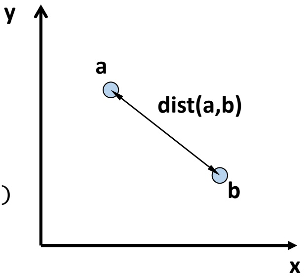

<details>
<summary>text_image</summary>

y
a
dist(a,b)
b
x
</details>

49

© T. Gemmeke, IDS, RWTH; R. Leupers, SSS

---

Datentypen - Einführung

In der C-Version sind Daten (point) und Operationen (dist) **getrennt**
Programme könnten (und i.d.R.: werden) ohne „dist“ auch **direkt** auf die x- und y-Koordinaten zugreifen
Ändert sich die interne Implementierung von point, so wäre evtl. ein Großteil des **übrigen Programmcodes** betroffen
• **ADT-Version** in C++: (siehe Kapitel 5)

```txt
class point {
    private:      // interne Repräsentation nicht nach außen sichtbar
        float x, y; // oder andere interne Repräsentation
    public:      // Schnittstelle für Benutzer von „point“
        float dist(point);
        /* ... */
};
```

Daten und Operationen per Konstruktion (class) **vereinigt**
• Interne Daten nur über Schnittstelle verfügbar!

50

© T. Gemmeke, IDS, RWTH; R. Leupers, SSS

---

Objekte in C

Variablen, Konstanten und Programmcode (Funktionen) werden im **Speicher** abgelegt
Ein **Objekt** ist ein benannter Speicherbereich
Auf Objekte wird direkt (per **Namen**) oder indirekt (per **Zeiger**) zugegriffen; Zeiger (symbolische Adressen) sind selbst Objekte
Der **benötigte Speicherplatz** eines Objektes sowie die darauf **zulässigen Operationen** hängen vom Typ ab
Im Speicher befinden sich nur **Binärzahlen**; Interpretation ist den Operationen überlassen

Vereinfachtes Speichermodell

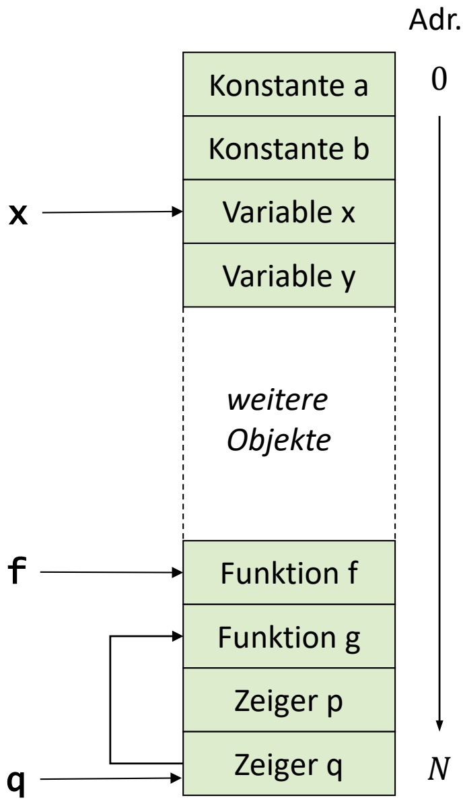

<details>
<summary>flowchart</summary>

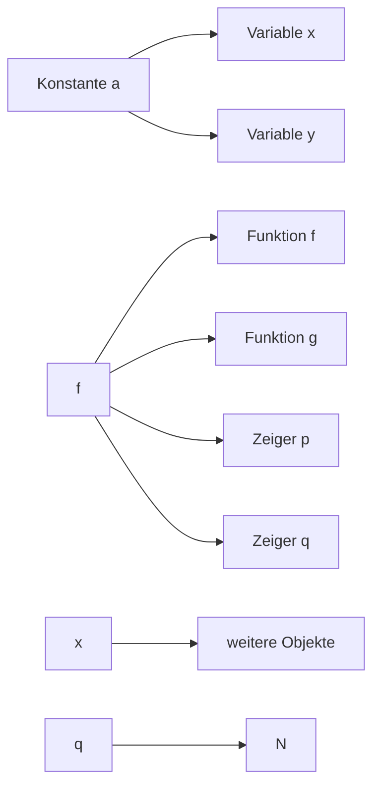
</details>

51

© T. Gemmeke, IDS, RWTH; R. Leupers, SSS

---

Basis-Datentypen in C

• char: **Zeichen** (character) = 1 Byte (8 Bits)
• int: **ganze Zahl** (integer)

– short int: kleinerer Wertebereich (mind. 16 Bit)
– long int: größerer Wertebereich (mind. 32 Bit)

• float: **Fließkommazahl** (floating point)

– Aufteilung in Exponenten und Mantisse
$12.3 \times 10^{10} = 12.34 \times 10^{10}$
– double: größerer Wertebereich
– long double: noch größerer Wertebereich

char und ganze Zahlen können **vorzeichenbehaftet** (Standardfall) oder **vorzeichenlos** sein:

– signed short int $\in [ - 2 ^ { 1 6 - 1 } , 2 ^ { 1 6 - 1 } - 1 ] \: = \: [ - 3 2 7 6 8 , 3 2 7 6 7 ]$
– unsigned short int $\in [ 0 , 2 ^ { 1 6 } - 1 ] \qquad \quad = \quad [ 0 , 6 5 5 3 5 ]$

52

© T. Gemmeke, IDS, RWTH; R. Leupers, SSS

---

## 3. Elementare Datentypen und Anweisungen

3.1 Einführung
**3.2 Variablen und Konstanten**
3.3 Zeiger
3.4 Arithmetische und logische Operationen und Zuweisungen
3.5 Kontrollanweisungen

53

© T. Gemmeke, IDS, RWTH; R. Leupers, SSS

---

Variablen

## • Variablen

– speichern Werte eines bestimmten **Datentyps**
– müssen vor Verwendung **vereinbart** werden

• z.B. float a, b; char x, y; double e, f;

– besitzen einen eindeutigen **Namen**
– Name sollte über **Verwendung** Aufschluss geben!

• z.B. int counter; ist besser als int c;

• **Schlüsselwörter** sind als Namen nicht erlaubt

– z.B. for, while, goto, int, float, ... sind in C/C++ reserviert

• Je nach Compiler:

– Es sind nur die ersten 31 Zeichen **signifikant**
– z.B. int einLangerVariablenName1234567890, einLangerVariablenName1234567891 gelten als gleich

54

© T. Gemmeke, IDS, RWTH; R. Leupers, SSS

---

Variablen

• Aufbau von Variablennamen (Identifier-Syntax)
• Kompakte Beschreibung mit **regulären Ausdrücken**

– letter = "a"|"b"|…|"z"|"A"|"B"|…|"Z"|"\_"

• **letter** = ein Buchstabe oder „\_“

– digit = "0"|…|"9"

• **digit** = eine Dezimalziffer

– identifier = letter { letter | digit }

• **identifier** = ein letter, gefolgt von beliebig vielen Elementen (auch 0) letter oder digit

• Z.B. zulässig:
– int x, XX, y\_, a\_42;
• Z.B. unzulässig:
– int 0Z, 1234\_x, return;

55

© T. Gemmeke, IDS, RWTH; R. Leupers, SSS

---

Variablen-Vereinbarung

• Vereinbarung vor erster Verwendung der Variable

– Deklaration ermöglicht **Korrektheitsprüfungen** durch Compiler
– Definition allokiert benötigten **Speicherplatz**

• **Allgemeine Form** der Vereinbarung:

– Typ ID (, ID)\* ;
– Typ darf sein:

Basis-DT (Schlüsselwort): char, int, float, ...
Zusammengesetzter DT (Zeiger, Array, Struct, ...)
Benutzerdefinierter DT

```c
int main(void)
{
    /* Variablen-
        Vereinbarungen */

    /* ... */

    /* Anweisungen mit
        Variablen-
        Verwendung */

    return 0;
}
```

– typedef unsigned long int UL;
– Macht UL als Abkürzung für unsigned long int bekannt
– Hilfreich vor allem bei zusammengesetzten DT

56

© T. Gemmeke, IDS, RWTH; R. Leupers, SSS

---

Konstanten

Falls Werte sich innerhalb eines Programms nie ändern, so werden diese als **Konstanten** statt Variablen dargestellt
Bessere **Lesbarkeit**, mehr **Optimierungsmöglichkeiten**
Konstanten benötigen keine explizite Definition, da ihr **Typ implizit** ist; Beispiele:

12345: ganze Zahl (int)

12345U: vorzeichenlose ganze Zahl (unsigned int)

0xAFFE: ganze Zahl in Hexcode (int)

123.45: Fließkommazahl (double)

123E-2: Fließkommazahl (double)

'a': Zeichen (char)

"String": Zeichenkette (Array aus char, s. später) int-Konstante als regulärer Ausdruck: "0" | ( [ "-" ], dnz, { d } )

57

© T. Gemmeke, IDS, RWTH; R. Leupers, SSS

---

Weitere Formen von Konstanten

• **Symbolische Konstanten** im Präprozessor

– #define MAXCOUNT 1000
– Alle Vorkommen von MAXCOUNT im Programm werden durch 1000 ersetzt
– Bessere Lesbarkeit und Wartbarkeit des Codes

• **Konstante Ausdrücke**

– MAXCOUNT + 1, MAXCOUNT \* 2, ...
– Werden vom Compiler vorab ausgerechnet, nicht zur Programm-Laufzeit (compile time-Konstante)

• **Konstante Variablen**

– const int a = 100; (const ist ein type qualifier)
– Variable a darf kein neuer Wert zugewiesen werden
– Effekt: Ablage von a im read only-Speicher (ROM)

58

© T. Gemmeke, IDS, RWTH; R. Leupers, SSS

---

## 3. Elementare Datentypen und Anweisungen

3.1 Einführung
3.2 Variablen und Konstanten
**3.3 Zeiger**
3.4 Arithmetische und logische Operationen und Zuweisungen
3.5 Kontrollanweisungen

Aachen

59

© T. Gemmeke, IDS, RWTH; R. Leupers, SSS

---

Zeiger

**Def**.: Ein **Zeiger** (engl. pointer) ist eine Variable, die die <u>Speicheradresse einer Variablen enthält.</u>

Zeiger gehören zu den **wichtigsten Konzepten** in C/C++ zur Definition komplexer und effizienter Datentypen
Zeiger gehören (leider) auch zu den **häufigsten Fehlerquellen** bei der Programmierung
• Bsp.:
– Der spezielle Zeigerwert NULL (0) wird oft verwendet, um einen „leeren“ Zeiger anzuzeigen (#define NULL 0)
– Der Versuch, einen Wert an Adresse 0 zu schreiben, führt in aller Regel zum **Programmabsturz**
– Enthält ein Zeiger einen sonstigen illegalen Wert, so kann sogar der **Programmcode** selbst überschrieben werden

60

© T. Gemmeke, IDS, RWTH; R. Leupers, SSS

---

Zeiger

Alle **Programm-Objekte** liegen im Speicher (s.o.)
Jedes Objekt besitzt eine **Adresse** im Speicher (wie eine Hausnummer)
Häufig werden Objekte **per Namen** zugegriffen (z.B. Variable ${ { \bf \Pi } _ { v } } \times { { \bf \Pi } ^ { \prime \prime } } )$
Oft ist auch der **indirekte Zugriff** auf ein Objekt über seine Adresse sinnvoll
Objekt-Adressen werden in **Zeigern** gespeichert
Zeiger sind selbst Objekte mit Adressen, daher sind auch **Zeiger auf Zeiger** möglich

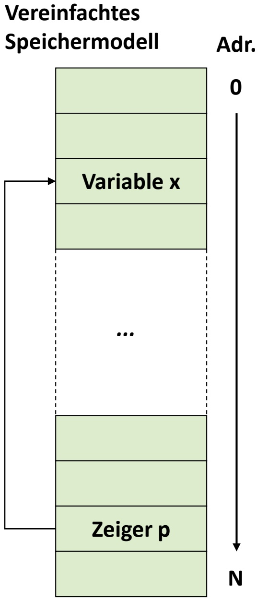

<details>
<summary>flowchart</summary>

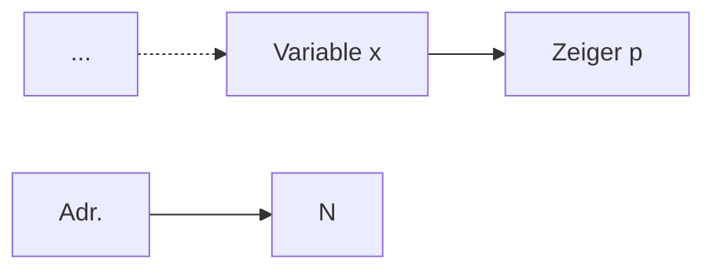
</details>

61

© T. Gemmeke, IDS, RWTH; R. Leupers, SSS

---

Zeigervereinbarung und -operationen

• Zeiger werden mittels \* deklariert
Typ \* ID; vereinbart einen Zeiger auf ein Objekt vom Typ Typ
Bsp.: int \* p; int \*\* q;
Symbol \* gehört syntaktisch zu ID, nicht zum Typ, z.B.

int \* p, q; vereinbart einen int-Zeiger p und eine int-Variable q, aber int \*p,\*q; vereinbart zwei int-Zeiger

• Äquivalent wäre: typedef int\* intptr; intptr p, q;

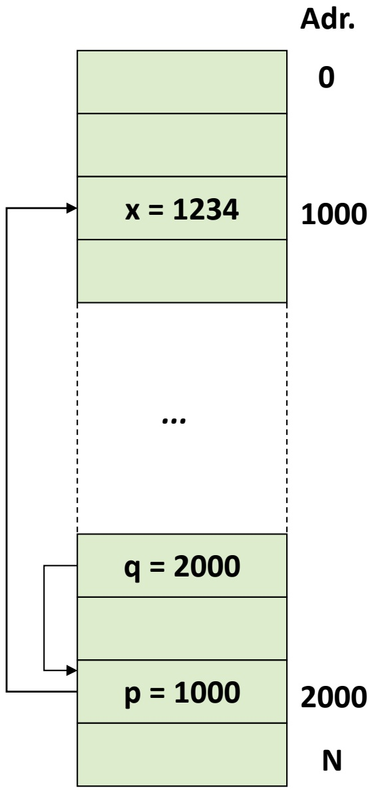

<details>
<summary>flowchart</summary>

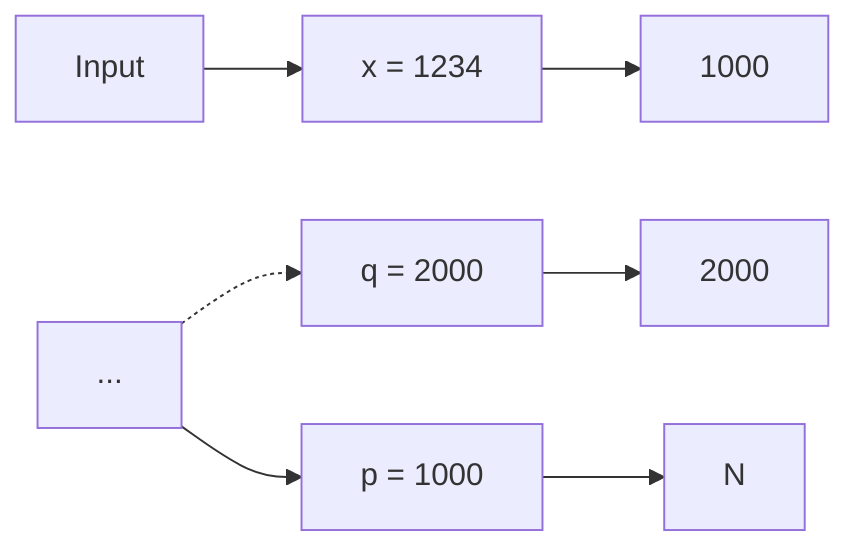
</details>

62

© T. Gemmeke, IDS, RWTH; R. Leupers, SSS

---

Zeigerdeklaration und -operationen

**Annahme**: Adresse von Objekt x in Zeiger p gespeichert
• Wie erfolgt der Zugriff auf x?

– \*-Operator
– Ausdruck \*pointer liefert Objekt x

• **Beispiel**:

\*p liefert den Wert 1234 (int)
\*q liefert den Wert 1000 (intptr)

• **Schreibzugriff** per \*:

\*p = 4321; überschreibt x mit 4321
\*\*q = 5678; überschreibt x mit 5678

Vergleiche Syntax der **Vereinbarung**

– int \*p;
– **implizite** Deklaration von p als Zeiger

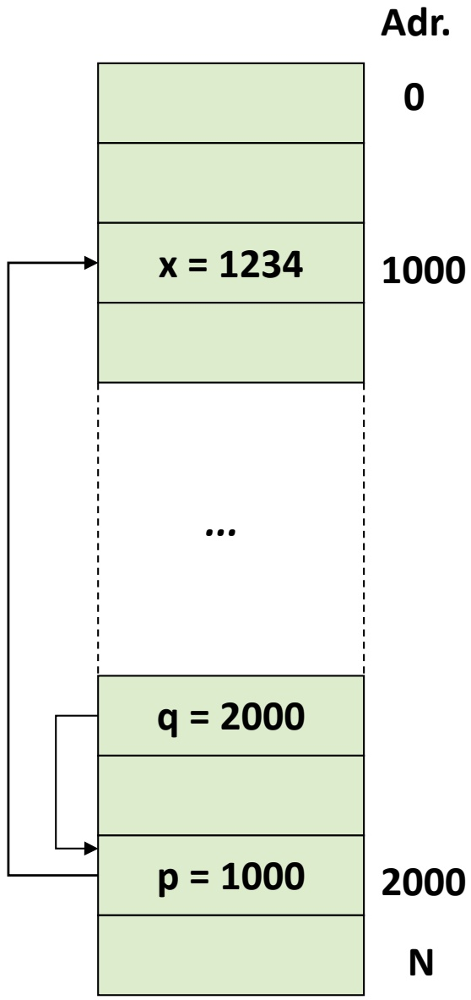

<details>
<summary>flowchart</summary>

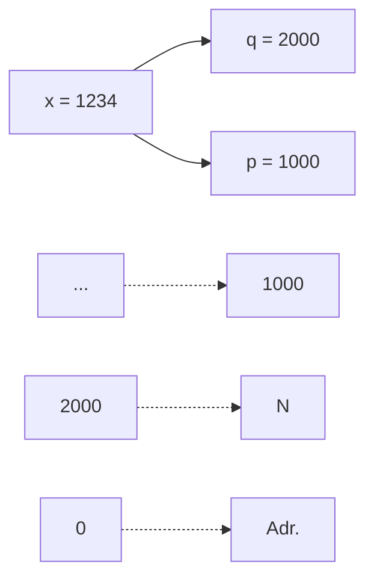
</details>

63

© T. Gemmeke, IDS, RWTH; R. Leupers, SSS

---

## Adressoperator

Zeiger auf x wird auch als **Referenz** auf x bezeichnet
\*-Operator heißt auch **Dereferenzierung** (indirection)
Erzeugung von Referenzen durch den **Adressoperator** &
– An p wird die Adresse von x zugewiesen (p „zeigt“ dann auf x)
– An q wird die Adresse von p zugewiesen
& und \* sind invers zueinander:
• & nur auf **Objekte** anzuwenden, \* nur auf **Zeiger**

$$
\mathrm{p} = \& \mathrm{x};
$$

$$
q = \& p;
$$

$$
- ^ {*} (\& \mathrm{x}) = \mathrm{x}
$$


<details>
<summary>flowchart</summary>

```mermaid
graph LR
  A[""] --> B["x = 1234"]
  B --> C[""]
  D[""] --> E[""]
  F[""] --> G["q = 2000"]
  G --> H["p = 1000"]
  H --> I[""]
  J[""] --> K[""]
  L[""] --> M[""]
  N[""] --> O[""]
```
</details>

64

© T. Gemmeke, IDS, RWTH; R. Leupers, SSS

---

Type cast mit Zeigern

Zeiger sind im Prinzip **identisch** mit (positiven) Integer-Zahlen
Daher können Zeiger und int ineinander **umgewandelt** werden

$$
\begin{array}{l} p = (i n t ^ {*}) x; \\ x = ^ {*} p; \\ \end{array}
$$

– lädt x mit dem Inhalt von Speicherstelle 1234

$$
\mathsf {x} = (\text {int}) \mathsf {q};
$$

– lädt x mit 2000

Diese Eigenschaft von C/C++ bringt große **Flexibilität**, birgt jedoch auch **Gefahren**, z.B. möglicher Zugriff auf geschützte Speicherbereiche


<details>
<summary>flowchart</summary>


</details>

65

© T. Gemmeke, IDS, RWTH; R. Leupers, SSS

---

Wozu dienen Zeiger?

Allgemein: falls mittels eines **einzigen Objektes** (Zeiger) im Programmverlauf auf **verschiedene andere Objekte** zugegriffen werden soll
Oder falls (in der maschinennahen Programmierung) Zugriffe auf **vorgegebene feste Speicherstellen** notwendig sind
Vor allem sind Zeiger sinnvoll bei **dynamischen** (d.h. zur Laufzeit erzeugten) Datenstrukturen
Datenobjekte, deren Größe während der Programmentwicklung noch nicht feststeht und die daher **nicht statisch deklariert** werden können
Hierfür kann dynamisch (d.h. während der Programmlaufzeit) Speicher angefordert und wieder freigegeben werden
Der Speicherbereich hierfür heißt **Heap** (Halde, Haufen)

66

© T. Gemmeke, IDS, RWTH; R. Leupers, SSS

---

Heap-Speicher

Programmcode und Variablen im **statischen** Speicherbereich
• Zugriff auf den **Heap** wie folgt:
Anforderung von Heap-Speicher mittels Funktion malloc (memory allocation)
– p zeigt dann auf Anfang von freiem 1000-Byte Heap-Block
– Adresse eines freien Blockes wird von malloc **automatisch** ermittelt (z.B. 5000)

$$
\text {int} ^ {*} \mathrm{p} = (\text {int} ^ {*}) \text {malloc(1000)};
$$

Adr.

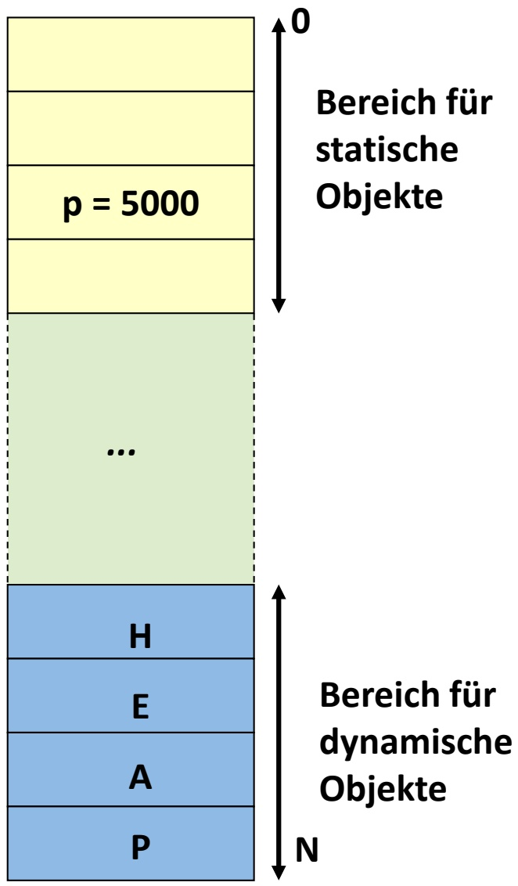

<details>
<summary>bar_stacked</summary>

| Category | Label |
| --- | --- |
| Top (Yellow) | 0 |
| Middle (Yellow) | p = 5000 |
| Bottom (Green) | ... |
| Bottom (Blue) | H |
| Bottom (Blue) | E |
| Bottom (Blue) | A |
| Bottom (Blue) | P |
</details>

67

© T. Gemmeke, IDS, RWTH; R. Leupers, SSS

---

Heap-Speicher

• Adressen **5000-5999** durch malloc reserviert $p = 1234$ ;
weist 1234 an erste Speicherzelle im Block zu

Da die an malloc übergebene **Blockgröße** variabel ist, kann Heap-Speicher immer **passend** angefordert werden
Nach Verwendung sollte der Heap-Block auch wieder **freigegeben** werden, um den Speicherplatz für andere Zwecke wiederverwenden zu können:

free(p); // Block 5000-5999 freigeben

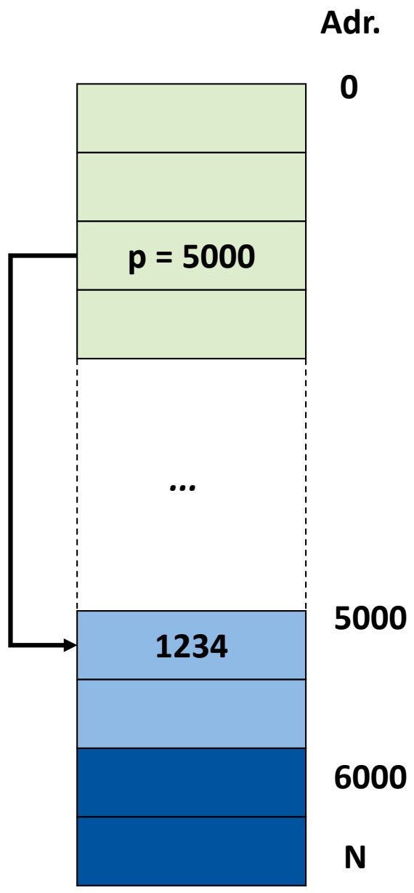

<details>
<summary>bar_stacked</summary>

| Stage | Value |
| --- | --- |
| Initial State | 0 |
| Step 1 | p = 5000 |
| Step 2 | ... |
| Step 3 | 1234 |
| Step 4 | 5000 |
| Step 5 | 6000 |
| Final State | N |
</details>

68

© T. Gemmeke, IDS, RWTH; R. Leupers, SSS

---

C++

Dynamische Speicherallokierung

```c
#include <stdlib.h>
#include <stdio.h>

int main( void ) {
    int* p;
    printf("Any memory          @ %p: %d_%d_%d\n", p, p[0], p[1], p[2]);
    p = (int*) malloc(1000);
    printf("Allocated memory   @ %p: %d_%d_%d\n", p, p[0], p[1], p[2]);
    p[0] = 4;
    p[1] = 7;
    p[2] = 11;
    printf("Initialized memory @ %p: %d_%d_%d\n", p, p[0], p[1], p[2]);
    free(p);
    printf("Deallocated memory @ %p: %d_%d_%d\n", p, p[0], p[1], p[2]);

    return 0;
}
```

```cpp
#include <cstdio>
#include <memory>
using namespace std;
int main( void ) {
    int* p;
    printf("Any memory          @ %p: %d_%d_%d\n", p, p[0], p[1], p[2]);
    p = new int[250];
    printf("Allocated memory   @ %p: %d_%d_%d\n", p, p[0], p[1], p[2]);
    p[0] = 4;
    p[1] = 7;
    p[2] = 11;
    printf("Initialized memory @ %p: %d_%d_%d\n", p, p[0], p[1], p[2]);
    delete [] p;
    printf("Deallocated memory @ %p: %d_%d_%d\n", p, p[0], p[1], p[2]);

    return 0;
}
```

69

© T. Gemmeke, IDS, RWTH

---

Smart Pointer

C++

• Motivation

```cpp
#include <iostream>
#include <memory>
#include <sys/resource.h>
using namespace std;

// get memory footprint
long get_mem() {
    struct rusage is;
    getrusage(RUSAGE_SELF, &is);
    return is.ru_maxrss; // in KB
}

void subA() {
    int a; int* pa = &a;
}

void subB() {
    int* pa = new int;
    // delete pa; // free memory space, no automatic deallocation
}

void subC() { unique_ptr<int> pa = make_unique<int>(); }

int main( void ) {
    long mem_base = get_mem();
    cout << "Memory base usage: " << mem_base << endl;

    for( long i=0; i<10000000; i++ ) {
        subA();
        if( i%1000000 == 0) cout << "Addt'l allocation: " << get_mem() - mem_base << endl;
    }
    return 0;
}
```

70

© T. Gemmeke, IDS, RWTH

---

Smart Pointer

C++

## • Unique Pointer

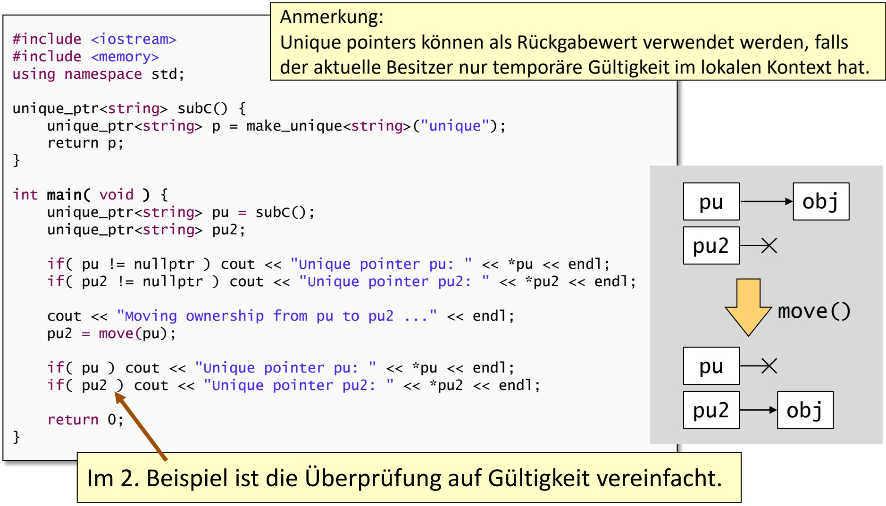

<details>
<summary>flowchart</summary>

This image displays a code editor for creating an 'unique pointer' in a context, showing the syntax and conditional logic for handling unique pointers.
</details>

71

© T. Gemmeke, IDS, RWTH

---

Smart Pointer

C++

• Shared Pointer

```cpp
#include <iostream>
#include <memory>
using namespace std;

void show( shared_ptr<string>& p0, shared_ptr<string>& p1 ) {
    if( p0 != nullptr ) cout << "Shared pointer p0: '" << *p0 << ''' << endl;
    if( p1 != nullptr ) cout << "Shared pointer p1: '" << *p1 << ''' << endl;
    cout << " Ptr of p0 use count: " << p0.use_count() << endl;
    cout << " Ptr of p1 use count: " << p1.use_count() << endl << endl;
}

int main( void )
{
    shared_ptr<string> ptr0 = make_shared<string>("shared");
    shared_ptr<string> ptr1;
    show(ptr0, ptr1);

    cout << "Duplicating reference to object ..." << endl;
    ptr1 = ptr0;
    show(ptr0, ptr1);

    ptr0 = make_shared<string>("something new");
    show(ptr0, ptr1);

    return 0;
}
```

72

© T. Gemmeke, IDS, RWTH

---

Smart Pointer

C++

## • Weak Pointer

Einen weak pointer zu de-referenzieren ist etwas ~~kompliziert. Es benötigt eine temporäre Kopie der Re~~ferenz. <u>Diese wird durch die Methode lock() erreicht.</u>

```cpp
#include <iostream>
#include <memory>
using namespace std;

void show( shared_ptr<string>& p0, weak_ptr<string>& p1 ) {
    if( p0 != nullptr ) cout << "Shared pointer p0: '" << *p0 << "''' << endl;
    if( !p1.expired() ) cout << "Weak pointer p1: '" << *(p1.lock()) << "''' << endl;
    cout << " Ptr of p0 use count: " << p0.use_count() << endl;
    cout << " Ptr of p1 use count: " << p1.use_count() << endl << endl;
}

int main( void )
{
    shared_ptr<string> ptr0 = make_shared<string>("shared");
    weak_ptr<string> ptr1;
    show(ptr0, ptr1);

    cout << "Duplicating reference to object ..." << endl;
    ptr1 = ptr0;
    show(ptr0, ptr1);

    ptr0 = make_shared<string>("something new");
    show(ptr0, ptr1);

    return 0;
}
```

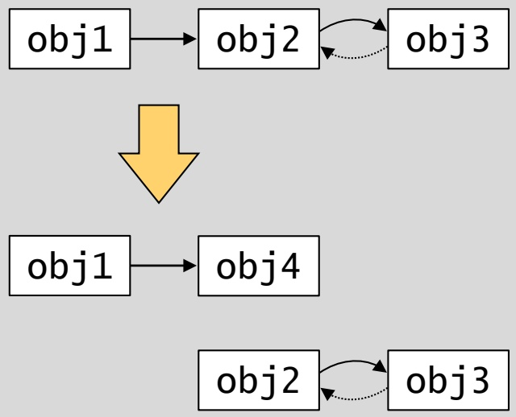

<details>
<summary>flowchart</summary>

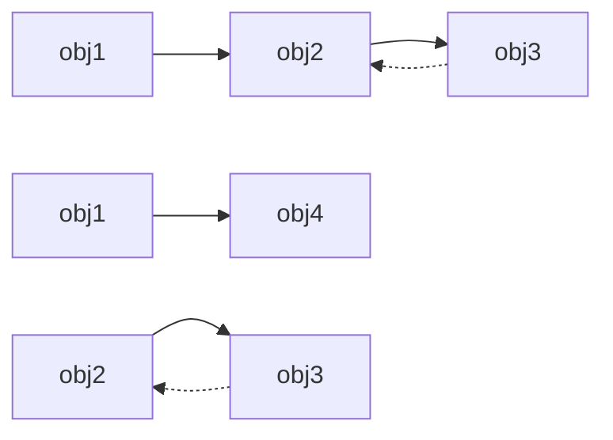
</details>

73

© T. Gemmeke, IDS, RWTH

---

## 3. Elementare Datentypen und Anweisungen

3.1 Einführung
3.2 Variablen und Konstanten
3.3 Zeiger
**3.4 Arithmetische und logische Operationen und Zuweisungen**
3.5 Kontrollanweisungen

74

© T. Gemmeke, IDS, RWTH; R. Leupers, SSS

---

Arithmetische und logische Operationen

Auf Variablen und Konstanten können verschiedene **Rechenoperationen** angewendet werden

$$
- +, -, *, /
$$

– % (modulo, nicht bei float-Werten)

• Multiplikative Operationen haben **Vorrang**

– Der **Ausdruck** $a \pi b + c / d$ entspricht $( a \div b ) + ( c / d )$

Diese primitiven Rechenoperationen sind in der Programmiersprache „eingebaut“

Komplexere Operationen sind in **Libraries** verfügbar oder werden vom **Programmierer definiert**

• Z.B. Standard-Library math.h

– sin, cos, tan, pow (power), sqrt (square root), ...

**Ergebnisse** der Operationen haben einen bestimmten DT, der sich aus dem Operator und den Argumenttypen ergibt

75

© T. Gemmeke, IDS, RWTH; R. Leupers, SSS

---

Zuweisungen

## • Allgemeine Form:

– Ziel = Ausdruck
– = ist der Zuweisungsoperator
– Ausdruck wird berechnet, Wert wird in Ziel gespeichert

## • Kurzformen:

– ++, --: Increment, Decrement

$$
x + + \text {entspricht} x = x + 1
$$

$$
- + = , \quad * = , \dots
$$

$$
\mathrm{x} + = \mathrm{y} \text {entspricht} \mathrm{x} = \mathrm{x} + \mathrm{y}
$$

```c
int main()
{
    int a,b;
    int c,d;

    a = 1;
    b = 2;

    c = a+b;
    d = c+1;
    d = d+1;
    printf("%d", d);

    return 0;      #def
}                     #def
```

```c
#define a 1
#define b 2

int main()
{
    int c,d;

    c = a+b;
    d = c+1;
    d++;
    printf("%d", d);

    return 0;
}
```

76

© T. Gemmeke, IDS, RWTH; R. Leupers, SSS

---

Arithmetische und logische Operationen

• **Vergleichsoperationen**

$$
\begin{array}{l} >, > = , <  , <   = \\ = = (\text {Gleichheit}),! = (\text {Ungleichheit}) \\ \end{array}
$$

Ergebnis einer Vergleichsoperation ist stets ein **Boolescher Wert** (true oder false)
• Boolescher DT in C: \_Bool

– Äquivalenzen aus stdbool.h:

• bool ∶= \_Bool
• false ∶= 0
• true ∶= 1

• **Schiebeoperationen** (shift)

>> Rechtsshift
<< Linksshift

77

© T. Gemmeke, IDS, RWTH; R. Leupers, SSS

---

Arithmetische und logische Operationen

• Shift-Operationen nützlich für

– Zugriff auf einzelne Bits eines Wertes
– Vereinfachung von Rechenoperationen, z.B.

• x >> 1 entspricht $x / 2$
• x << 2 entspricht $X ^ { \star } 4$

Rechtsshift abhängig vom DT des ersten Arguments:

– **Logisches** Shift: Auffüllen links mit 0
– **Arithmetisches** Shift: Auffüllen links mit Vorzeichen

• Beispiel: unsigned char $a = 1 2 8$ ; signed char b = -128;

**Binärdarstellung von a und b**

| 1 | 0 | 0 | 0 | 0 | 0 | 0 | 0 |
| --- | --- | --- | --- | --- | --- | --- | --- |


**Vorzeichen bei b**

a: logisches Shift

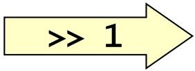

b: arithmetisches Shift

| 0 | 1 | 0 | 0 | 0 | 0 | 0 | 0 |
| --- | --- | --- | --- | --- | --- | --- | --- |

| 1 | 1 | 0 | 0 | 0 | 0 | 0 | 0 |
| --- | --- | --- | --- | --- | --- | --- | --- |

78

© T. Gemmeke, IDS, RWTH; R. Leupers, SSS

---

Arithmetische und logische Operationen

• &: bitweise **UND-Verknüpfung**
• |: bitweise **ODER-Verknüpfung**
• ^: bitweise **Exklusiv-ODER-Verknüpfung** (XOR, „entweder...oder“)
• Prüfen, Setzen oder Löschen **einzelner Bits** von Werten
Bsp.:

– signed char a = -64, b = 0xFF; // oder b = -1;

<strong><u>1 1 0 0 0 0 0 0</u></strong>a:

<strong><u>1 1 1 1 1 1 1 1</u></strong>b:

<strong><u>1 1 0 0 0 0 0 0</u></strong>

a & b

<strong><u>1 1 0 0 0 0 0 0</u></strong>

<strong><u>1 1 1 1 1 1 1 1</u></strong>

<strong><u>1 1 1 1 1 1 1 1</u></strong>

a | b

<strong><u>1 1 0 0 0 0 0 0</u></strong>

<strong><u>1 1 1 1 1 1 1 1</u></strong>

<strong><u>0 0 1 1 1 1 1 1</u></strong>

a ^ b

79

© T. Gemmeke, IDS, RWTH; R. Leupers, SSS

---

## Typumwandlung (type cast)

## Beispiel:

– int a = 10, b; float pi = 3.14;
– b = pi + a;

## Welche Typen werden verwendet?

– a wird in intern in float umgewandelt (10.0 = 1E1)
– pi + a ergibt float-Resultat (13.14)
– Resultat wird in int zurückverwandelt (13)

In C/C++ gibt es umfangreiche **type cast-Regeln** für alle Kombinationen der primitiven DT

Viele Einzelheiten der Typumwandlung sind jedoch **compilerabhängig** (und damit eine „beliebte“ Fehlerquelle) !

**Expliziter** type cast durch Programmierer:

– Ziel = (Typ) Ausdruck;

80

© T. Gemmeke, IDS, RWTH; R. Leupers, SSS

---

## 3. Elementare Datentypen und Anweisungen

3.1 Einführung
3.2 Variablen und Konstanten
3.3 Zeiger
3.4 Arithmetische und logische Operationen und Zuweisungen
**3.5 Kontrollanweisungen**

81

© T. Gemmeke, IDS, RWTH; R. Leupers, SSS

---

Kontrollanweisungen

Bisher: Alle Anweisungen (statements) werden **sequentiell** abgearbeitet
• Kontrollanweisungen ermöglichen

– **bedingte Ausführung** von Code mittels Verzweigungen
– **wiederholte Ausführung** von Code mittels Schleifen

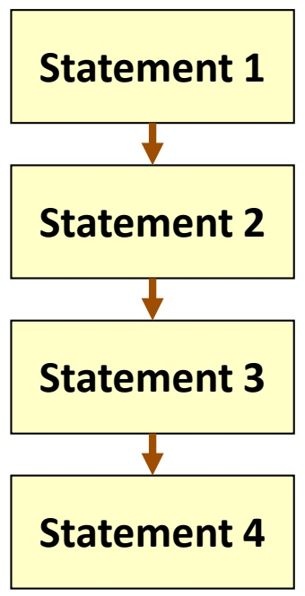

<details>
<summary>flowchart</summary>

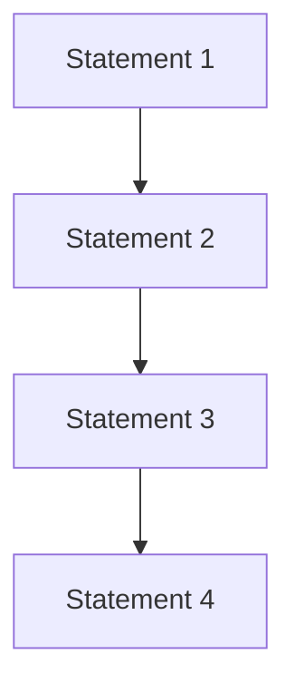
</details>

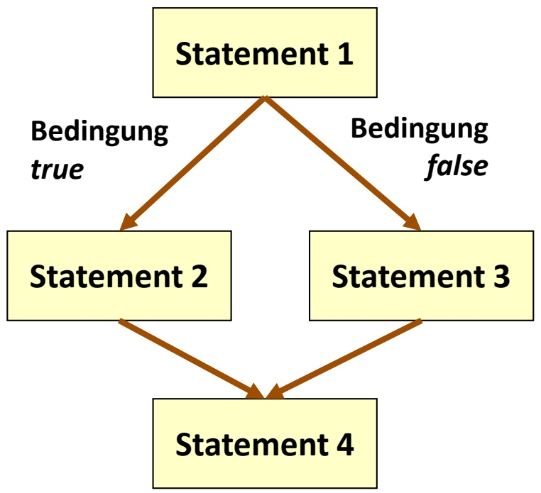

<details>
<summary>flowchart</summary>

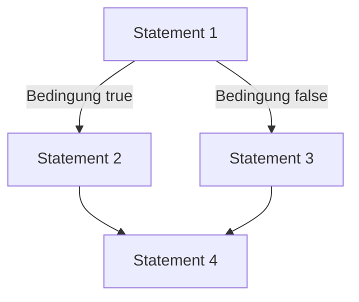
</details>

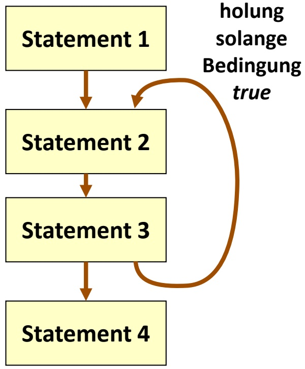

<details>
<summary>flowchart</summary>

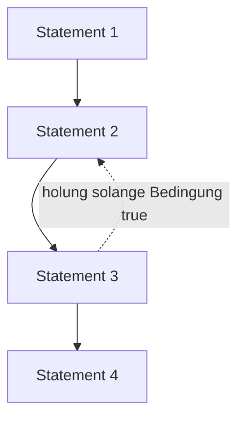
</details>

82

© T. Gemmeke, IDS, RWTH; R. Leupers, SSS

---

Verzweigungen: if-then-else

• Beispiel: Maximumsberechnung
• Allgemeine Formen:

```txt
- if ( expression ) {
    statement*
}
- if ( expression ) {
    statement*
} else { statement*
}
```

Bedingung muss true oder false ergeben (0 ≙ false)

„Beliebter“ Fehler bei Gleichheitstest:

```javascript
- if (a = b) statt if (a == b)
```

```c
#include <stdio.h>

int main(void)
{
    int a, b, max;

    // Einlesen von a und b
    scanf("%d %d", &a, &b);

    if (a > b) {
        max = a;
    } else // d.h. a <= b
        max = b;
    }

    printf("max = %d", max);

    return 0;
}
```

83

© T. Gemmeke, IDS, RWTH; R. Leupers, SSS

---

## Verzweigungen: if-then-else

Komplexere Bedingungen können durch **logische Verknüpfungen** geprüft werden

– ODER-Operator ||: **mindestens eine** der Teilbedingungen muss true sein
– UND-Operator &&: **alle** Teilbedingungen müssen true sein

```c
int a, b, c, x, y;
/* ... */
if (a > 10) {
    if (b >= 20) {
        if (c == 30) {
            x++;
        }
    }
}

if (a < 40) {
    y--;
} else if (b <= 50) {
    y--;
} else if (c != 60) {
    y--;
}
```

```c
int a, b, c, x, y;
/* ... */
if ((a > 10) && (b >= 20) && (c == 30)) {
    x++;
}

if ((a < 40) || (b <= 50) || (c != 60)) {
    y--;
}
```

84

© T. Gemmeke, IDS, RWTH; R. Leupers, SSS

---

Dangling else-Problem

• Betrachte folgenden Code:

if (a > 100) if (b > 50) x++; else x--;

• **Zwei Möglichkeiten** der Interpretation:

– Wird x-- ausgeführt, falls (a <= 100) ?

(1) if (a > 100) if (b > 50) x++; <u>else</u> x--;

– Oder falls (a > 100) && (b <= 50) ?

(2) if (a > 100) if (b > 50) x++; <u>else</u> x--;

**Konvention**: else gehört immer zum innersten freien if, d.h. Version (2) ist richtig

**Besser**: Vermeidung von Fehlern durch expliziten Gebrauch der **Blockstruktur** { statement\* } in der Programmierung

– if (a > 100) { if (b > 50) x++; else x--; }

85

© T. Gemmeke, IDS, RWTH; R. Leupers, SSS

---

Verzweigungen: goto

Verzweigung auch über **Labels** und goto**-Statements** möglich
Ein Label ist eine symbolische **Sprungmarke** im Code
• Syntax:

– ID: statement (ID ist Bezeichner des Labels)
– goto ID; (Sprung nach Position ID)

• Labels und gotos

– beeinträchtigen die **Lesbarkeit** des Programms
– sind ein „historisches Relikt“ in Programmiersprachen
– sind nicht notwendig und sollten nur bei **zwingenden Gründen** eingesetzt werden

```txt
if (a > 10) {
        goto L1;
    }

L2: if (b < 40) {
        goto L3;
    }

L4: goto L5;

L1: x++;
        goto L2;

L3: y--;
        goto L4;

L5: ;
```

86

© T. Gemmeke, IDS, RWTH; R. Leupers, SSS

---

Verzweigungen: switch

Häufiger Fall: **Fallunterscheidung** über eine bestimmte Variable mit jeweils konstantem Vergleichswert
• Normale Implementierung: **Kette** von if-then-else Statements
• Gültig, aber umständlich
Bsp.: Umrechung von römischen Ziffern:

```txt
char digit, int value;

/* ... */

if (digit == 'I') value = 1;
else if (digit == 'V') value = 5;
else if (digit == 'X') value = 10;
else if (digit == 'L') value = 50;
else if (digit == 'C') value = 100;
else if (digit == 'D') value = 500;
else if (digit == 'M') value = 1000;
else printf("Keine gültige Ziffer!");
```

87

© T. Gemmeke, IDS, RWTH; R. Leupers, SSS

---

Verzweigungen: switch

• **Kompaktere** Implementierung:

switch-Statement

• Allgemeine Form:

```txt
switch (Ausdruck)
{
    case Konstante₁:
        statement*
    /* ... */
    case Konstanteₙ:
        statement*
    default: statement*
}
```

```txt
char digit, int value;

/* ... */

switch (digit)
{
    case 'I': value = 1;     break;
    case 'V': value = 5;     break;
    case 'X': value = 10;     break;
    case 'L': value = 50;     break;
    case 'C': value = 100;   break;
    case 'D': value = 500;   break;
    case 'M': value = 1000; break;
    default:
        printf("Keine gültige ziffer!");
        break;
}
```

• break: sofortiges Verlassen des ganzen switch-Statements
• default: Code im „sonst“-Fall (optional)

88

© T. Gemmeke, IDS, RWTH; R. Leupers, SSS

---

Schleifen

• Wiederholte Ausführung einer Anweisungsfolge
• Bsp.: Berechnung der Fakultätsfunktion

$$
n! := 1 \times 2 \times \dots \times n
$$

• Ohne Schleife: Code muss bei Änderung von 𝑛𝑛 modifiziert werden

```c
#define N 10
    /* ... */
    int fact, count;

    count = 0;
    fact = 1;

    count++;
    fact *= count;

    /* ... N-fache wiederholung */

    count++;
    fact *= count;
    printf("factorial(%d) = %d", N, fact);
```

89

© T. Gemmeke, IDS, RWTH; R. Leupers, SSS

---

Schleifen

• Flexiblere Variante
• Code zwischen L1 und L2 wird wiederholt bis Zähler größer als N
• Umdefinieren von N (#define) reicht aus
• Jedoch: **schlechter Programmierstil**

(gotos sollten nicht verwendet werden!)

```c
#define N 10
    /* ... */

    int fact, count;

    count = 0;
    fact = 1;

L1: if (count >= N) goto L2;
    count++;
    fact *= count;
    goto L1;

L2: printf("factorial(%d) = %d",
        N, fact);
```

• C/C++ bietet drei Formen von **strukturierten Schleifen** – for, while, do

90

© T. Gemmeke, IDS, RWTH; R. Leupers, SSS

---

for-Schleifen

• Allgemeine Form:

for (expr1; expr2; expr3) { statement\* }

• expr1:

– Wird vor Schleifenbeginn einmal ausgeführt → Initialisierung

```c
#define N 10

    /* ... */

    int fact, count;

    fact = 1;
    for (count = 1; count <= N; count++) {
        fact *= count;
    }
    printf("factorial(%d) = %d", N, fact);
```

• expr2:

– Bedingung für jeden Durchlauf (jede Iteration)

• expr3:

– Wird nach statement\* ausgeführt

• Nach expr3 wird an den Schleifenanfang **zurückgesprungen**

91

© T. Gemmeke, IDS, RWTH; R. Leupers, SSS

---

for-Schleifen

• Warum ist count = 1 ein **Ausdruck**?

– In C sind auch Zuweisungen Ausdrücke
– Das Ergebnis von $\_ ZieI = A u s d r u c k ^ { \prime \prime }$ ist per Definition $\nu ^ { \angle } I e ^ { I ^ { \prime \prime } }$

Der Wert von expr1 wird bei for-Schleifen jedoch verworfen, nur der **Seiteneffekt** einer Zuweisung ist relevant

• Zwei spezielle Statements für Ausnahmefälle in Schleifen erlaubt

– break: verlässt Schleife komplett
– continue: verlässt aktuelle Iteration

• Wie goto mit Vorsicht zu gebrauchen!

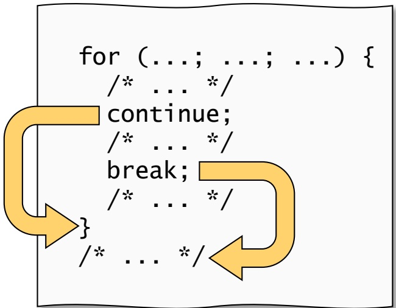

<details>
<summary>flowchart</summary>

```mermaid
graph TD
  A["for (...; ...; ...) {<br>  B[&quot;"] --> A
  C[""] --> A
```
</details>

92

© T. Gemmeke, IDS, RWTH; R. Leupers, SSS

---

while-Schleifen

for-Schleifen werden vor allem für eine **feste Anzahl** von Iterationen verwendet
Soll die Schleife ausgeführt werden, <u>solange</u> eine bestimmte **Bedingung** gilt, so ist eine while-Schleife besser
• Allgemeine Form:

```groovy
while (expression) {
    statement*
}
```

• expression wird ausgewertet

– Falls nicht null, so wird die Schleife betreten
– Nach statement\* wird an den Anfang zurückgesprungen, und expression wird erneut geprüft

93

```c
#define N 10

    /* ... */

    int fact, count;

    fact = 1; count = 1;

    while(count <= N) {
        fact *= count;
        count++;
    }

    printf("factorial(%d) = %d",
        N, fact);
```

© T. Gemmeke, IDS, RWTH; R. Leupers, SSS

---

do-Schleifen

Ebenfalls für Schleifen mit **unbekannter Anzahl** von Iterationen
**Unterschied** zu while: Mindestens eine Iteration findet statt
• Allgemeine Form: do { statement\* } while (expression)
statement\* wird ausgeführt, und expression wird ausgewertet
Falls true, so wird an den Anfang zurückgesprungen
Bsp.: **Mindestens eine** Benutzereingabe wird erwartet
break, continue können bei while- und do-Schleifen ebenfalls verwendet werden

```txt
char c;
/* ... */

do {
    scanf("%c",&c);
    /* Berechnung auf c */
} while (c != 'q'); // quit?
```

94

© T. Gemmeke, IDS, RWTH; R. Leupers, SSS

---

Äquivalenz von for, while, do

• for würde als **einziges** Schleifenkonstrukt ausreichen
• Jede Schleifenform lässt sich in die anderen **umsetzen**, z.B.

while (Ausdruck) { statement\* } entspricht

for (;Ausdruck;) { statement\* }

for (expr1; expr2; expr3) { statement\* } entspricht

expr1;

while (expr2) { statement\* expr3; }

Jedoch ist aus Gründen der **Programm-Lesbarkeit** die jeweils am besten geeignete Variante zu bevorzugen
Der Einsatz von **strukturierten Schleifen** (for, while, do) und der **Verzicht auf Sprünge** (goto) führt beim Übersetzen auch oft zu besserem Maschinencode

95

© T. Gemmeke, IDS, RWTH; R. Leupers, SSS

---

Endlosschleifen

Falls die Abbruchbedingung einer Schleife nie erfüllt ist, **terminiert** das Programm nicht
Compiler kann dies i.A. **nicht bemerken**
Bei Ausführung: Ab einem gewissen Zeitpunkt **kein Programmfortschritt** mehr zu beobachten
• **Abhilfe**:

– Programmabbruch
– Erneutes Starten unter Debugger-Kontrolle

```txt
while ((a > 10) || (b > 20)) {
    if ( /* ... */ ) {
        /* ... */
        a = 100;
        /* ... */
    } else {
        /* ... */
        b = 30;
        /* ... */
    }
    /* danach Bedingung
        stets erfüllt */
}
```

96

© T. Gemmeke, IDS, RWTH; R. Leupers, SSS
