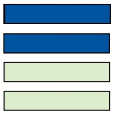
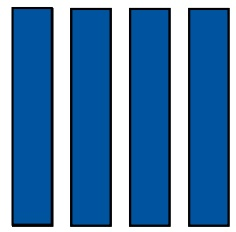
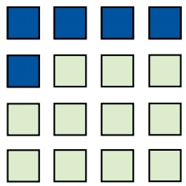

# 5. Datentypen

原始 PDF 第 123–158 页。

## 5. Datentypen

**5.1 Arrays**
5.2 Strukturen
5.3 Abstrakte Datentypen
5.4 Klassen

123

© T. Gemmeke, IDS, RWTH; R. Leupers, SSS

---

Arrays

**Arrays** (oder: Felder, Vektoren) definieren zusammengesetzte Datentypen, deren Elemente durch einen **Index** zugegriffen werden
• Vektor (**mathematisch**):

$V   =   \left( v _ { 1 } , \ldots , v _ { n } \right)$ $v _ { i }$ bezeichnet 𝑖𝑖-tes Element von 𝑉𝑉

Vektor/Array-Deklaration in $C / C + +$

– Typ ID [int-Konstante];
– Z.B. int v[10];

• deklariert 10-elementigen Vektor 𝑉𝑉
• Komponenten sind vom Typ int
• Zugriff auf 𝑖𝑖-tes Element mittels Operator [...], z.B. v[3]
Der Ausdruck 3 ist der **Index** des Elementes
• **Index-Numerierung beginnt immer bei 0**


<details>
<summary>text_image</summary>

v:= 
v[0] v[1] ... v[8] v[9]
</details>

124

© T. Gemmeke, IDS, RWTH; R. Leupers, SSS

---

Arrays und Zeiger

Benachbarte Arrayelemente befinden sich stets auch **benachbart** im Speicher
• Daher bei v[i]:

– Index i bezeichnet den Abstand (offset) des 𝑖𝑖-ten Elementes von der **Basisadresse** $v ( = \theta v [ 0 ] )$

– Operator $v [ \ldots ] ^ { n }$ entspricht **Addition** von Array-Basisadresse und Index

$$
- \mathrm{v} [ \mathrm{i} ] = * (\mathrm{v} + \mathrm{i}) = * (\mathrm{i} + \mathrm{v}) = \mathrm{i} [ \mathrm{v} ]
$$

– p = &v[0]; oder p = v; lässt p auf Anfang von v zeigen
– Die folgenden 3 Ausdrücke sind äquivalent:

$$
\mathrm{v} [ 3 ] = 1 2 3; \mathrm{p} [ 3 ] = 1 2 3; \text {und} * (\mathrm{p} + 3) = 1 2 3;
$$


<details>
<summary>text_image</summary>

p
v:= 
+3
123
v[0] v[1]
...
v[8] v[9]
</details>

125

© T. Gemmeke, IDS, RWTH; R. Leupers, SSS

---

Arrays und Schleifen

Vorteil von Arrays: **Menge „gleichartiger“ Objekte** kann mit einem Namen und variablem Index zugegriffen werden

**Meist**: in Schleifen, damit Vermeidung von Code-Duplizierung
Beispielprogramme zur Initialisierung von Array A sind äquivalent
• **Post-Inkrement:**

$$
^ {*} p + + = \dots ;
$$

ist zu lesen wie

$$
^ {*} p = \dots ; p + + ;
$$

```txt
int i, a[10];

for(i=0; i<10; i++) {
    a[i] = i;
}
```

```c
int *p, i, a[10];

p = &a[0];
for(i=0; i<10; i++) {
    *p++ = i;
}
```

126

© T. Gemmeke, IDS, RWTH; R. Leupers, SSS

---

Arrays und Schleifen

• **Array-Basisadressen** verhalten sich wie Zeiger (auf das erste Array-Element)
Nach Deklaration int a[10]; ist der Ausdruck a **identisch** mit dem Ausdruck &a[0]
• Grund: $a = a + 0 = \theta(\pi(a + 0)) = \theta a[0]$
Achtung: Arrays können **nicht** mit einem einzigen Befehl kopiert werden

```txt
int a[10], b[10], i;
// unzulässig:
a = b;      // entspricht &a[0] = &b[0]
// stattdessen:
for (i=0; i<10; i++) {  // elementweises Kopieren
    a[i] = b[i];
}
```

127

© T. Gemmeke, IDS, RWTH; R. Leupers, SSS

---

Beispiel: Ermittlung einer Stringlänge

• String = Array mit char-Elementen
Element-Wert 0 (oder '\0' als char-Konstante) kennzeichnet **String-Ende**
Daher: char-Arrays immer **ein Byte länger** als „Nutzlast“-String
Beginnend bei 0: Zähler **inkrementieren**, bis '\0' -Zeichen erreicht
• Bsp.: char $s [ 6 ] = \mathrm { { \sf { K e t t e } } }$ 1

s

<table><tr><td>K</td><td>e</td><td>t</td><td>t</td><td>e</td><td>&#x27;\0&#x27;</td></tr><tr><td colspan="5">s[0]</td><td>s[5]</td></tr></table>

```c
#define STR "teststring"

int main(void)
{
    char* s = STR;
    int i, count = 0;

    for(i=0; s[i] != 0; i++) {
        count++;
    }

    printf("Länge = %d", count);
}
```

```javascript
/* ... */

count = 0;
while (s[count]) {
    count++;
}

/* ... */
```

128

© T. Gemmeke, IDS, RWTH; R. Leupers, SSS

---

Schleifen in C++ mit Iteratoren

C++

```cpp
#include <iostream>
#include <algorithm>
#include <vector>
#include <string>
using namespace std;

void show(vector<int> c, string str) {cout<<str<<": "; for(auto e: c) cout<<e<<' ';cout<<endl<<endl;}

int main( void )
{
    vector<int> v = {1, 2, 2, 5, 6, 7};
    show(v,"Ausgangslage");

    // 1. Loop: using a copy of the value
    for(auto elm : v) { elm++; }
    show(v,"1. Loop");
    // 2. Loop: using the reference
    for(auto& elm : v) { elm++; }
    show(v,"2. Loop");
    // 3. Loop: using the reference and const
    // for(const auto& elm : v) { elm++; }
    // -> error: increment of read-only reference 'elm'
    // 4. Loop: using for_each
    for_each(v.begin(), v.end(), [](int elm) { elm++; });
    show(v,"4. Loop");
    // 5. Loop: using classic for-loop and an iterator of a container
    for(auto it = v.begin(); it != v.end(); ++it) { (*it)++; };
    show(v,"5. Loop");

    return 0;
}
```

for\_each benötigt ein unary function object

auto sucht den passen Typ automatisch aus. Hier ist es: std::vector&lt;int&gt;::iterator

129

© T. Gemmeke, IDS, RWTH

---

Mehrdimensionale Arrays

| Stunde | Mo | Di | Mi | Do | Fr |
| --- | --- | --- | --- | --- | --- |
| 1 | Mathe | Politik | Bio | Mathe | Politik |
| 2 | Mathe | Kunst | Deutsch | Mathe | Kunst |
| 3 | Deutsch | Informatik | Sport | Deutsch | Informatik |
| 4 | Englisch | Informatik | Sport | Englisch | Informatik |
| 5 | Sport | Mathe | Physik | Sport | Mathe |
| 6 | Sport | Mathe | Physik | Sport | Mathe |

Beispiel: Stundenplan
• 2-dimensionales Array (**Matrix**) als Datenstruktur
• Elemente vom Typ String
• I ndizes:

– Stunden (int)
– Wochentage Mo-Fr (?)
– enum tag\_typ {Mo, Di, Mi, Do, Fr}
– **Aufzählungstyp**: deklariert Mo, ..., Fr als symbolische Konstanten
– **Intern**: Mo = 0, Di = 1, ..., Fr = 4

130

© T. Gemmeke, IDS, RWTH; R. Leupers, SSS

---

Mehrdimensionale Arrays

```c
#define STUNDEN 6
#define TAGE 5

#define MA "Mathe"
#define DE "Deutsch"
#define SP "Sport"
/* ... */

enum tag_typ {Mo, Di, Mi, Do, Fr};

int main (void)
{
    char* plan[STUNDEN][TAGE];
    int tag, stunde;

    /* ... */
```

```c
/* ... */
plan[0][Mo] = MA;
/* ... */
plan[5][Mo] = SP;
/* ... */
plan[5][Fr] = MA;

printf("Stundenplanabfrage:\n");
scanf("%d",&tag);
scanf("%d",&stunde);

if ((tag > Fr) || (stunde > STUNDEN))
    printf("Ungültig");
else
    printf("Fach = %s", plan[stunde-1][tag];

return 0;
}
```

| Stunde | Mo | Di | Mi | Do | Fr |
| --- | --- | --- | --- | --- | --- |
| 1 | Mathe | Politik | Bio | Mathe | Politik |
| 2 | Mathe | Kunst | Deutsch | Mathe | Kunst |
| 3 | Deutsch | Informatik | Sport | Deutsch | Informatik |
| 4 | Englisch | Informatik | Sport | Englisch | Informatik |
| 5 | Sport | Mathe | Physik | Sport | Mathe |
| 6 | Sport | Mathe | Physik | Sport | Mathe |

Stundenplanabfrage:

> 2

> 4

Fach = Sport

131

© T. Gemmeke, IDS, RWTH; R. Leupers, SSS

---

Beispiel: Matrixmultiplikation

• (𝑁𝑁 × 𝑁𝑁)-Matrizen:
• **Produkt** $C ~ = ~ ( c _ { i j } )$ ergibt sich aus:

$$
A = (a _ {i j}), B = (b _ {i j})
$$

$$
c _ {i j} = \sum_ {k = 1} ^ {N} a _ {i k} \cdot b _ {k j}
$$

• **Geschachtelte** Schleifen

– Iteration über Zeilen 𝑖𝑖 = 1 … 𝑁𝑁
– Für jedes 𝑖𝑖: Iteration über Spalten = 1 … 𝑁𝑁
– Für jedes (𝑖𝑖, ): Bilde Skalarprodukt von 𝐴𝐴-Zeile 𝑖𝑖 und 𝐵𝐵-Spalte

C/C++ gestattet eine beliebige Anzahl von **Dimensionen** für Arrays

Elemente liegen stets benachbart im Speicher



<details>
<summary>natural_image</summary>

Three horizontal bars in blue and light green shades, no text or symbols present
</details>



<details>
<summary>natural_image</summary>

Four solid blue vertical bars arranged horizontally (no text or symbols)
</details>

𝐵𝐵



<details>
<summary>natural_image</summary>

Grid of 12 squares in blue and light green, no text or symbols present
</details>

```txt
typedef int matrix[N][N];
matrix a, b, c;
for (i=0; i<N; i++)
    for (j=0; j<N; j++) {
        c[i][j] = 0;
        for (k=0; k<N; k++)
            c[i][j] += a[i][k]*b[k][j];
    }
```

132

© T. Gemmeke, IDS, RWTH; R. Leupers, SSS

---

## 5. Datentypen

5.1 Arrays
**5.2 Strukturen**
5.3 Abstrakte Datentypen
5.4 Klassen

133

© T. Gemmeke, IDS, RWTH; R. Leupers, SSS

---

Strukturen

• **Struktur** (oder: struct, record): Zusammenfassung einer Gruppe von Variablen zu einer **Einheit**
**Unterschied** zum Array: Adressierung innerhalb einer Struktur per Namen, nicht per Index
Bsp. (s.o.): geometrischer Punkt struct point { float x, y; };
Allgemeine Form einer struct-Deklaration: – struct ID { Variablendeklaration\* } – Beliebige Variablendeklarationen (auch structs) – ID heißt structure tag
• struct-Deklaration oft in Verbindung mit typedef:
struct point { float x, y; } p1,p2; oder typedef struct point { float x, y; } Point; Point p1, p2;

134

© T. Gemmeke, IDS, RWTH; R. Leupers, SSS

---

Operationen auf Strukturen

```javascript
typedef struct person
    { char name[100], vorname[100];
        struct datum { int tag,monat,jahr; } gebdatum;
    } Person;
```

Person p1, p2, \*p\_ptr;

• **Kopieren:**
p1 = p2; /\* kopiert alle Komponenten auf einmal \*/

• **Adressberechnung:**

p\_ptr = &p1;

• **Komponentenzugriff direkt** (Operator „.“):

p2.gebdatum.jahr = 1950;

• **Komponentenzugriff per Zeiger** (Operator „->“):

p\_ptr->gebdatum.monat = 12; // "p->" entspricht "(\*p)."

135

© T. Gemmeke, IDS, RWTH; R. Leupers, SSS

---

Array von structs

Mit Arrays und structs lassen sich beliebige **komplexe Datenstrukturen** aufbauen
• Bsp.: **Bundesliga-Tabelle**
• **Übung**: Neuberechnung nach Spieltag-Ergebniseingabe

<table><tr><td colspan="2"></td><td>SP</td><td>S</td><td>U</td><td>N</td><td>T</td><td>DIFF</td><td>PKT</td></tr><tr><td>1</td><td>Bayern München</td><td>3</td><td>3</td><td>0</td><td>0</td><td>10:0</td><td>10</td><td>9</td></tr><tr><td>2</td><td>Arminia Bielefeld</td><td>3</td><td>2</td><td>1</td><td>0</td><td>7:3</td><td>4</td><td>7</td></tr><tr><td>3</td><td>VfL Bochum</td><td>3</td><td>2</td><td>1</td><td>0</td><td>6:4</td><td>2</td><td>7</td></tr><tr><td>4</td><td>Eintracht Frankfurt</td><td>3</td><td>2</td><td>1</td><td>0</td><td>4:2</td><td>2</td><td>7</td></tr><tr><td>5</td><td>Hamburger SV</td><td>3</td><td>2</td><td>0</td><td>1</td><td>3:2</td><td>1</td><td>6</td></tr><tr><td>6</td><td>FC Schalke 04</td><td>3</td><td>1</td><td>2</td><td>0</td><td>7:4</td><td>3</td><td>5</td></tr><tr><td>7</td><td>Bayer Leverkusen</td><td>3</td><td>1</td><td>1</td><td>1</td><td>3:1</td><td>2</td><td>4</td></tr><tr><td>8</td><td>VfL Wolfsburg</td><td>3</td><td>1</td><td>1</td><td>1</td><td>5:5</td><td>0</td><td>4</td></tr><tr><td>9</td><td>VfB Stuttgart</td><td>3</td><td>1</td><td>1</td><td>1</td><td>4:5</td><td>-1</td><td>4</td></tr><tr><td>10</td><td>Werder Bremen</td><td>3</td><td>1</td><td>1</td><td>1</td><td>3:6</td><td>-3</td><td>4</td></tr><tr><td>11</td><td>MSV Duisburg</td><td>3</td><td>1</td><td>0</td><td>2</td><td>4:5</td><td>-1</td><td>3</td></tr><tr><td>12</td><td>Hertha BSC</td><td>3</td><td>1</td><td>0</td><td>2</td><td>3:4</td><td>-1</td><td>3</td></tr><tr><td>13</td><td>Borussia Dortmund</td><td>3</td><td>1</td><td>0</td><td>2</td><td>5:7</td><td>-2</td><td>3</td></tr><tr><td>14</td><td>Karlsruher SC</td><td>3</td><td>1</td><td>0</td><td>2</td><td>3:5</td><td>-2</td><td>3</td></tr><tr><td>15</td><td>1. FC Nürnberg</td><td>3</td><td>1</td><td>0</td><td>2</td><td>2:4</td><td>-2</td><td>3</td></tr><tr><td>16</td><td>Hannover 96</td><td>3</td><td>1</td><td>0</td><td>2</td><td>2:5</td><td>-3</td><td>3</td></tr><tr><td>17</td><td>Energie Cottbus</td><td>3</td><td>0</td><td>1</td><td>2</td><td>1:5</td><td>-4</td><td>1</td></tr><tr><td>18</td><td>Hansa Rostock</td><td>3</td><td>0</td><td>0</td><td>3</td><td>1:6</td><td>-5</td><td>0</td></tr></table>

```txt
typedef struct team {
    char *name;
    int SP,S,U,N,T1,T2,DIFF,PKT;
} Team;

Team liga[18]; /* 0...17 */
/* ... */
liga[5].name = "FC Schalke 04";
liga[13].DIFF = liga[13].T1-liga[13].T2;
/* ... */
```

136

© T. Gemmeke, IDS, RWTH; R. Leupers, SSS

---

## 5. Datentypen

5.1 Arrays
5.2 Strukturen
**5.3 Abstrakte Datentypen**
5.4 Klassen

137

© T. Gemmeke, IDS, RWTH; R. Leupers, SSS

---

Abstrakte Datentypen

C++

**Def**.: Ein **abstrakter Datentyp** (**ADT**) ist ein Datentyp (eine Menge von Werten und eine Sammlung von Operationen auf diesen Werten), der nur über eine Schnittstelle zugänglich ist.

[Sedgewick, Algorithmen in C++]

• Menge set

```cpp
#include <iostream>
#include <set>
#include <algorithm> // required for set_union
using namespace std;

int main( void )
{
    set<int> s = {1, 2, 2};
    set<int> t = {7, 2, 4, 1};

    set<int> r;
    set_union(s.begin(), s.end(), t.begin(), t

    // print the contents of the sets
    cout << "s: "; for(auto elm : s) cout << e
    cout << "t: "; for(auto elm : t) cout << e
    cout << "r: "; for(auto elm : r) cout << e

    return 0;
}
```

Weitere Methoden in dieser Gruppe:

• insert
erase
• merge
• set\_difference (C++20)
• set\_intersection (C++20)

138

© T. Gemmeke, IDS, RWTH

---

## 5. Datentypen

5.1 Arrays
5.2 Strukturen
5.3 Abstrakte Datentypen
**5.4 Klassen**

i (De)Konstruktor
ii Public vs. private
iii Vererbung
iv Abstrakte Klassen
v Überladen von Operatoren

139

© T. Gemmeke, IDS, RWTH; R. Leupers, SSS

---

Abstrakte Datentypen

C++

## • Klassen und Methoden

```cpp
#include <string>
#include <iostream>
using namespace std;

class Member {
    public:
        string status = "public";
};

int main( void ) {

    Member someone;

    cout << someone.status << endl;

    return 0;
}
```

140

© T. Gemmeke, IDS, RWTH

---

## 5. Datentypen

5.1 Arrays
5.2 Strukturen
5.3 Abstrakte Datentypen
**5.4 Klassen**
**i (De)Konstruktor**
ii Public vs. private
iii Vererbung
iv Abstrakte Klassen
v Überladen von Operatoren

141

© T. Gemmeke, IDS, RWTH; R. Leupers, SSS

---

Klassen

C++

• (De)Constructor

```cpp
#include <string>
#include <iostream>
using namespace std;

class Member {
    public:
        string status;
        // constructor
        Member() { status = "starter"; }
        Member( string val ) : status(val) {}
        // (de)constructor
        ~Member() { cout << "... a member left the pack." << endl; }
        void show_status( void ) {
            cout << "Membership status: " << status << endl;
        }
};
void sub( void ) {
    cout << "> Entering function 'sub'" << endl;
    Member pers("gold");
    pers.show_status();
    cout << "> About to leave 'sub'" << endl;
}
int main( void ) {
    cout << "> Starting in 'main'" << endl;
    Member someone;
    someone.show_status();
    sub();
    cout << "> About to leave 'main'" << endl;
    return 0;
}
```

142

© T. Gemmeke, IDS, RWTH

---

## 5. Datentypen

5.1 Arrays
5.2 Strukturen
5.3 Abstrakte Datentypen
**5.4 Klassen**

i (De)Konstruktor

**ii Public vs. private**

iii Vererbung

iv Abstrakte Klassen

v Überladen von Operatoren

143

© T. Gemmeke, IDS, RWTH; R. Leupers, SSS

---

Klassen

C++

## • Klassenelemente: public vs. private

```cpp
#include <string>
#include <iostream>
using namespace std;

class Member {
    public:
        string statusA = "public"; // public variable
    private:
        string statusB = "secret"; // private variable
};

int main( void ) {

    Member someone;

    cout << someone.statusA << endl;
    cout << someone.statusB << endl;

    return 0;
}
```

~~error: ‘std::string Member::statusB’ is private within thi~~s context

144

© T. Gemmeke, IDS, RWTH

---

Klassen

C++

• Klassenelemente: public vs. private

```cpp
#include <string>
#include <iostream>
using namespace std;

class Member {
    private:
        string status = "unknown"; // Private Variable

    public:
        // public methods
        void show_status( void ) {
            cout << "Status: " << status << endl;
        }
        void update_status( string new_status ) {
            status = new_status;
        }
};
int main( void ) {

    Member someone;

    someone.show_status();
    someone.update_status("gold");
    someone.show_status();

    return 0;
}
```

Private Variablen werden mit sogenannten get und set Methoden verarbeitet.

145

© T. Gemmeke, IDS, RWTH

---

## 5. Datentypen

5.1 Arrays
5.2 Strukturen
5.3 Abstrakte Datentypen
**5.4 Klassen**

i (De)Konstruktor ii Public vs. private

**iii Vererbung**

iv Abstrakte Klassen v Überladen von Operatoren

146

© T. Gemmeke, IDS, RWTH; R. Leupers, SSS

---

Klassen

C++

## • Vererbung

Weiterführung des Beispiels:

Die Funktion main auf der vorrangegangen Folie wird durch den Code auf dieser Folie ersetzt.

```cpp
class Student : public Member {
    public:
        Student() { // constructor
            Member::update_status("Student");
        }
};

int main( void ) {
    Member someone;
    Student pers;

    someone.show_status();
    pers.show_status();

    return 0;
}
```

147

© T. Gemmeke, IDS, RWTH

---

Klassen

C++

## • Vererbung

... und noch einen Schritt ...

```cpp
class Prof : public Member {
    public:
        Prof() { // constructor
            Member::update_status("Professor");
        }
};
int main( void ) {
    Member someone;
    Student persA;
    Prof persB;

    someone.show_status();
    persA.show_status();
    persB.show_status();

    return 0;
}
```

148

© T. Gemmeke, IDS, RWTH

---

Polymorphie

C++

## • Dynamische Auswahl der Methode

```cpp
#include <string>
#include <iostream>
using namespace std;

class Being {
    public:
        string name;
        Being() {}
        Being( string str ) { name = str; }
        virtual void show( void ) { cout << ''' << name << '' is an unknown being." << endl << endl; }
};

class Insect : public Being {
    public:
        Insect( string str ) { name = str; }
        void show( void ) override { cout << "The '" << name << "' is an insect." << endl << endl; }
};

class Mammal : public Being {
    public:
        Mammal( string str ) { name = str; }
        void show( void ) override { cout << "The '" << name << "' is a mammal." << endl << endl; }
};

int main( void )
{
    Being* b; // pointer to the base class
    string in;

    while( 1 ) {
        cout << "Enter the type of being (i: insect, m: mammal): ";
        cin >> in;
        cout << endl;

        if( in[0] == 'i' ) b = new Insect("ant");
        else if( in[0] == 'm' ) b = new Mammal("cat");
        else b = new Being(in);

        b->show(); // method show is dynamically selected
    }
    return 0;
}
```

## ~~Dynamische Polymorphie (run-time poly~~morphism)

Auswahl der Methode während der Ausführung.

Hier: entscheidendes Merkmal:

<strong><u>Zugehörigkeit zu einer (Sub)Klasse</u></strong>

149

© T. Gemmeke, IDS, RWTH

---

## 5. Datentypen

5.1 Arrays
5.2 Strukturen
5.3 Abstrakte Datentypen
**5.4 Klassen**

i (De)Konstruktor
ii Public vs. private
iii Vererbung

**iv Abstrakte Klassen**

v Überladen von Operatoren

150

© T. Gemmeke, IDS, RWTH; R. Leupers, SSS

---

Abstrakte Klassen

C++

• Beispiel: Schnittstellendefinition

```cpp
#include <string>
#include <iostream>
using namespace std;

class Being {
    public:
        string name;
        Being() {}
        Being( string str ) { name = str; }
        virtual void show() = 0; // Definition einer rein virtuellen Methode
};

class Insect : public Being {
    public:
        Insect( string str ) { name = str; }
        void show() { cout << "The '" << name << "' is an insect." << endl << endl; }
};

class Mammal : public Being {
    public:
        Mammal( string str ) { name = str; }
        void show() { cout << "The '" << name << "' is a mammal." << endl << endl; }
};

int main( void )
{
    Being* b; // pointer to the base class
    string in;

    while( 1 ) {
        cout << "Enter the type of being (i: insect, m: mammal): ";
        cin >> in;
        cout << endl;

        if( in[0] == 'i' ) b = new Insect("ant");
        else b = new Mammal(in);

        b->show();
    }
    return 0;
}
```

<u>Welcher Programmierfehler ist hier versteckt?</u>

151

© T. Gemmeke, IDS, RWTH

---

## 5. Datentypen

5.1 Arrays
5.2 Strukturen
5.3 Abstrakte Datentypen
**5.4 Klassen**

i (De)Konstruktor
ii Public vs. private
iii Vererbung
iv Abstrakte Klassen
**v Überladen von Operatoren**

152

© T. Gemmeke, IDS, RWTH; R. Leupers, SSS

---

Überladen von Operatoren

C++

• 1 + 1 = …?!

```cpp
#include <iostream>
#include <vector>
using namespace std;

class myInt {
    public:
        int x;
        myInt() { x = 0; };
        myInt( int val ) : x(val){};
        myInt& operator+(const myInt& val) {
            myInt* o = new myInt(this->x + val.x + 1);
            return *o;
        }
        myInt& operator=(const myInt& rhs) {
            x = rhs.x;
            return *this;
        }
        friend ostream& operator<<(ostream& os, const myInt& val) {
            os << val.x;
            return os;
        }
};

int main( void )
{
    myInt a = 1, b = 1;

    cout << "a = " << a << "; b = " << b << " => a+b = " << a+b <<
    return 0;
}
```

Quiz: Was ist das Ergebnis von 1+1? 0, 1, 2, oder 3?

153

© T. Gemmeke, IDS, RWTH

---

Überladen von Operatoren

C++

Vereinigungsmenge (‚union‘) zweier Vektoren mit dem ‘+’-Operator

```cpp
#include <iostream>
#include <vector>
#include <algorithm>
using namespace std;

vector<int>& operator+(const vector<int>& a, const vector<int>& b) {
    vector<int>* res = new vector<int>();
    res->insert(res->begin(), a.begin(), a.end());
    res->insert(res->end(), b.begin(), b.end());
    // Let's have the vector sorted
    sort(res->begin(), res->end());
    // ... and remove all duplicate.
    // Note: the vector has to be sorted for unique to work
    // Note: unique does not shrink the vector length, so we add a call to erase
    res->erase( unique( res->begin(), res->end() ), res->end() );
    return *res;
}

int main( void )
{
    vector<int> s = {1, 2, 2};
    vector<int> t = {4, 5, 6};

    vector<int> r = s+t;

    // fancy: for(const auto& elm : ...
    for(auto elm : r) cout << elm << ' ';
    cout << endl;

    return 0;
}
```

<u>Anmerkung: der ADT set bietet diese Funktionalitä</u>t ...

154

© T. Gemmeke, IDS, RWTH

---

Überladen von Operatoren

C++

## • Stream

```cpp
#include <string>
#include <iostream>
using namespace std;

class Graphic {
    public:
        string name;
        Graphic() { name = "generic object"; }
};

ostream& operator<<(ostream& os, const Graphic& gr) {
        os << gr.name;
        return os;
}

int main( void ) {

    Graphic a;

    cout << "This is a '" << a << '"." << endl;

    return 0;
}
```

155

© T. Gemmeke, IDS, RWTH

---

Überladen von Operatoren

C++

• Stream

```cpp
class Point : public Graphic {
    public:
        int x0, y0;
        Point( int a, int b ) : x0(a), y0(b) { name = "Point"; }
};
class Line : public Graphic {
    public:
        int x0, y0, x1, y1;
        Line( int a, int b, int c, int d) : x0(a), y0(b), x1(c), y1(d) { name = "Line"; }
};

ostream& operator<<(ostream& os, const Point& gr) {
        os << gr.name << " at ( " << gr.x0 << ", " << gr.y0 << ")";
        return os;
}
ostream& operator<<(ostream& os, const Line& gr) {
        os << gr.name << " from ( " << gr.x0 << ", " << gr.y0 << ")";
        os << " -> ( " << gr.x1 << ", " << gr.y1 << ")";
        return os;
}

int main( void ) {
    Graphic a;
    Point b(1,2);
    Line c(3,4,5,6);

    cout << "This is a '" << a <<的目的" << endl;
    cout << "This is a '" << b <<的目的" << endl;
    cout << "This is a '" << c <<的目的" << endl;

    return 0;
}
```

156

© T. Gemmeke, IDS, RWTH

---

Überladen von Operatoren

C++

• Functor

```cpp
#include <iostream>
using namespace std;

class Modulo {
    private:
        long mod;
    public:
        Modulo(long val) : mod(val) {}

        long operator()(long x) {
            return x%mod;
        }

        friend ostream& operator<<(ostream& os, const Modulo& x) {
            os << x.mod;
            return os;
        }
};

int main( void )
{
    Modulo m(5);
    cout << "129 mod " << m << " = " << m(129) << endl;
    cout << "127 mod " << m << " = " << m(127) << endl;

    return 0;
}
```

<u>Funktoren werden häufig in der Methode transform</u> genutzt. Diese wendet den Funktor auf alle Elemente aus einem vorgegebenen Bereich an.

157

© T. Gemmeke, IDS, RWTH

---

Überladen von Operatoren

C++

• Beispiel: Functor translate

```cpp
#include <iostream>
#include <algorithm>
#include <string>
#include <vector>
using namespace std;

class translate {
    private:
        vector<string> ge = {"eins","zwei","drei","vier"};
        vector<string> en = {"one","two","three","four"};
        vector<string> fr = {"un","deux","trois","quatre"};
        vector<string>* source;
        vector<string>* target;
    public:
        translate(string str) { // constructor
            switch( str[0] ) {
                case 'G': source = &ge; break;
                case 'E': source = &en; break;
                case 'F': source = &fr; break;
            }
            switch( str[2] ) {
                case 'G': target = &ge; break;
                case 'E': target = &en; break;
                case 'F': target = &fr; break;
            }
        }
        string operator() (string word) { // overloading of function call operator ()
            string res = word;
            auto it = find(source->begin(), source->end(), word);
            size_t i = distance(source->begin(), it);
            if( i<source->size() && i<target->size() ) res = (*target)[i];
            return res;
        }
};

int main( void ) {
    vector<string> number = {"vier", "eins", "zwei", "four", "trois"};
    for( auto elm : number ) cout << ' ' << elm; cout << endl;

    transform(number.begin(), number.end(), number.begin(), translate("GeEn"));
    for( auto elm : number ) cout << ' ' << elm; cout << endl;

    return 0;
}
```

**Functors** hat die besondere Eigenschaft <u>zustandsorientiert (‚stateful‘) zu sein.</u>

find ersetzt klassische Suche im ADT array:

size\_t i=0;

while( i&lt;source-&gt;size() && word != (\*source)[i] ) i++;

158

© T. Gemmeke, IDS, RWTH
