# 7. Sortieralgorithmen

原始 PDF 第 189–228 页。

## 7. Sortieralgorithmen

**7.1 Einfache Verfahren (Selection/Insertion/Bubblesort)**
7.2 Quicksort
7.3 Heapsort

189

© T. Gemmeke, IDS, RWTH; R. Leupers, SSS

---

## Warum Betrachtung von Sortieralgorithmen?

Sortierung von Datensätzen wird als **Subroutine** in sehr vielen Anwendungen benötigt (s. Beispiel „Suchen in Arrays“)
Einfachster Fall: Sortieren eines **Arrays von Zahlen** (z.B. int)
• Allg. Fall: Sortieren eines **Arrays von Datensätzen** vom Typ struct
Beispiel:

typedef struct person {char name[100], vorname[100]; struct datum { int tag, monat, jahr; } gebdatum;} Person;

• Sortierung nach Namen, Vornamen oder Geburtsdatum?
Erfordert Definition eines **Schlüssels** (key), d.h. struct-Komponente, gemäß der sortiert werden soll
Unterschiedliche Vergleichsfunktionen erforderlich

190

© T. Gemmeke, IDS, RWTH; R. Leupers, SSS

---

Definition des Sortierproblems

• **Gegeben**: Folge $S \; = \; ( s _ { 1 } , \ldots , s _ { N } )$ von **Datensätzen** (struct)
Jeder Datensatz $s _ { i }$ besitzt einen Eintrag 𝑘𝑘𝑘𝑘𝑘𝑘 eines mittels einer Ordnungsrelation **linear geordneten Datentyps**
Z.B. Zahlen: $\omega ^ { \mathrm { { '' } } } \mathrm { { - } } \mathsf { { R e l a t i o n } }$ , Buchstaben: alphabetische Reihenfolge, **Geburtsdatum**: 3-stufiger Vergleich Jahr, Monat, Tag
Gesucht: **Permutation** (Anordnung) $S ^ { \prime } = ( s _ { 1 } ^ { \prime } , \dots , s _ { N } ^ { \prime } )$ der Elemente von $S _ { \perp }$ so dass

$$
s _ {1} ^ {\prime}. k e y \leq s _ {2} ^ {\prime}. k e y \leq \dots \leq s _ {N} ^ {\prime}. k e y
$$

• Gleiche Schlüssel dürfen auch **mehrfach** vorkommen
Ein Sortieralgorithmus, der die ursprüngliche Reihenfolge bei gleichem Schlüssel beibehält, heißt **stabil**
• Sprachelemente in c:

Definition der Folge als Array: Person $s [ N ]$ Auslesen des Schlüssels von Datensatz 𝑖𝑖: s[i].key

191

© T. Gemmeke, IDS, RWTH; R. Leupers, SSS

---

Analyse von Sortieralgorithmen

Wie üblich: Verwendung der 𝓞𝓞**-Notation** zur Abstraktion von konstanten Faktoren und Rechnerdetails
• Elementare Operationen von Sortieralgorithmen:

– **Vergleich** zweier Schlüssel
– **Vertauschen** von Daten in Folge S (Array oder File)

• Daher Abschätzung der **Laufzeit** in diesen Größen
• **Reale Laufzeit**: abhängig von der Komplexität dieser Operationen
Bsp.: Sortieren eines **Bücherregals**, Vergleich der Autorennamen aufwendiger als Vertauschen
Bsp.: Sortieren einer **Datenbank** mit großen Datensätzen in einem File, Umkopieren auf Festplatte oder Magnetband aufwendiger als Key-Vergleich
• Hier: nur Betrachtung der **Vergleichsoperationen**

192

© T. Gemmeke, IDS, RWTH; R. Leupers, SSS

---

## Sortieren durch Auswählen (Selection Sort)

Manuelles **alphabetisches Sortieren** eines Bücherregals mit 𝑁𝑁 Büchern:

– **Schlüssel**: Autorenname
– Durchlaufen der Bücher von links nach rechts
**Merken** des jeweils „kleinsten“bisher gefundenen Buches und dessen **Position** 𝑝𝑝 im Regal
– Zum Schluss: „Kleinstes“ Buch **ganz links** hinstellen, dort bisher stehendes Buch (vorläufig) an Position 𝑝𝑝 stellen
– Verfahren **fortsetzen** mit 𝑝𝑝 = 2

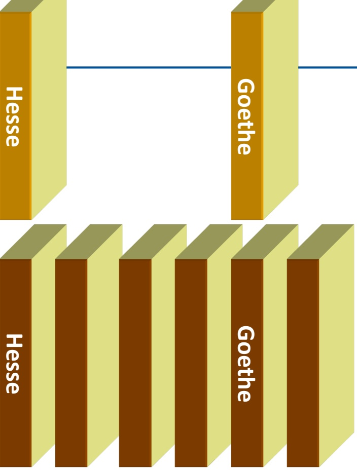

<details>
<summary>wireframe</summary>

| Position | Hesse | Goethe |
| --- | --- | --- |
| Top | High | Low |
| Bottom | Low | High |
</details>

193

© T. Gemmeke, IDS, RWTH; R. Leupers, SSS

---

Algorithmus im Detail

**Vereinfachung**: Sortieren von Arrays vom Typ int, d.h. Vergleichsoperation auf Zahlen, z.B. A[i] < A[j]

**Real**: Hilfsfunktion „less“ auf Sortierschlüsseln, jeweils Vergleich less(A[i].key, A[j].key)

```txt
void selection_sort(int A[], int l, int r)
{
    int i, j, min;
    for (i = l; i < r; i++) {
        min = i;
        for (j = i+1; j <= r; j++) {
            if (A[j] < A[min]) min = j;
        }
        exchange(A[i], A[min]); // vertauschen
    }
}
```

194

© T. Gemmeke, IDS, RWTH; R. Leupers, SSS

---

Beispiel

| 45 | 12 | 77 | 23 | 76 | 11 | 83 | 66 |
| --- | --- | --- | --- | --- | --- | --- | --- |
| 11 | 12 | 77 | 23 | 76 | 45 | 83 | 66 |
| 11 | 12 | 77 | 23 | 76 | 45 | 83 | 66 |
| 11 | 12 | 23 | 77 | 76 | 45 | 83 | 66 |
| 11 | 12 | 23 | 45 | 76 | 77 | 83 | 66 |
| 11 | 12 | 23 | 45 | 66 | 77 | 83 | 76 |
| 11 | 12 | 23 | 45 | 66 | 76 | 83 | 77 |
| 11 | 12 | 23 | 45 | 66 | 76 | 77 | 83 |

Ergebnis

| 11 | 12 | 23 | 45 | 66 | 76 | 77 | 83 |
| --- | --- | --- | --- | --- | --- | --- | --- |

**noch unsortiert**

**aktuell min. Schlüssel**

**vertauscht**

**bereits sortiert**

195

© T. Gemmeke, IDS, RWTH; R. Leupers, SSS

---

Laufzeitanalyse

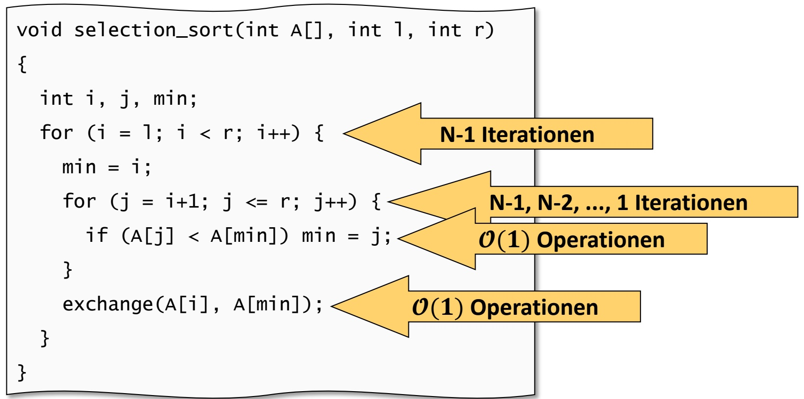

<details>
<summary>flowchart</summary>

```mermaid
graph TD
  A["&quot;void selection_sort(int A["], int l, int r)\n{"] --> B["N-1 Iterationen"]
  C["int i, j, min;\nfor (i = l; i < r; i++) {"] --> B
  D["min = i;\nfor (j = i+1; j <= r; j++) {"] --> E["N-1, N-2, ..., 1 Iterationen\nO(1) Operationen"]
  F["&quot;if (A[j"] < A["min"]) min = j;\n}"] --> G["O(1) Operationen"]
  H["&quot;exchange(A[i"], A["min"]);"] --> I["O(1) Operationen"]
  J["}"] --> K["}"]
```
</details>

• Aufruf: selection\_sort(A,0,N-1);

$$
\begin{array}{l} (\mathbf {1} + \mathbf {2} + \dots + N - \mathbf {2} + N - \mathbf {1}) \cdot \mathcal {O} (1) + (N - 1) \cdot \mathcal {O} (1) \\ = \boldsymbol {N} \cdot (\boldsymbol {N} - \boldsymbol {1}) / \boldsymbol {2} \cdot \mathcal {O} (1) + \mathcal {O} (N) = \mathcal {O} (N ^ {2}) + \mathcal {O} (N) = \mathcal {O} (N ^ {2}) \\ \end{array}
$$

196

© T. Gemmeke, IDS, RWTH; R. Leupers, SSS

---

## Sortieren durch Einfügen (Insertion Sort)

Manuelles **alphabetisches Sortieren** eines Bücherregals mit 𝑁𝑁 Büchern:

– **Schlüssel**: Autorenname
– Durchlaufen der Bücher von links nach rechts (𝑖𝑖 = 1 … 𝑁𝑁)
– Betrachtung des Buchs an Position 𝒑𝒑 = 𝒊𝒊
– Buch Nr. 𝑖𝑖 **entnehmen**
Bücher **links** von 𝑝𝑝 = 𝑖𝑖 (d.h. 𝑝𝑝 < 𝑖𝑖) nach rechts rücken, bis korrekte **Einfügeposition** für Buch 𝑖𝑖 gefunden
– Verfahren **fortsetzen** mit 𝑖𝑖 = 𝑖𝑖 + 1

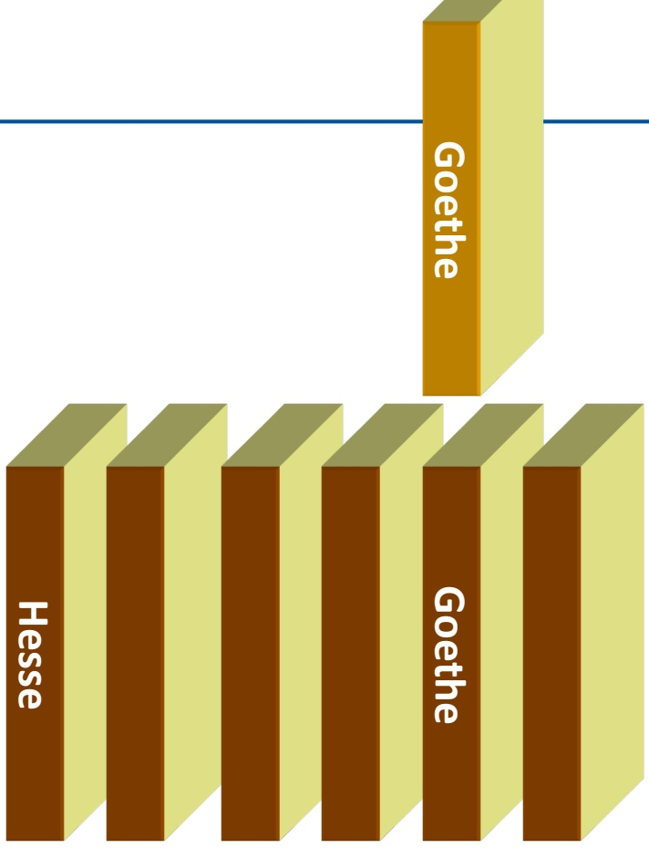

<details>
<summary>bar</summary>

| Category | Value |
| --- | --- |
| Hesse | ~100 |
| Goethe | ~100 |
</details>

197

© T. Gemmeke, IDS, RWTH; R. Leupers, SSS

---

Algorithmus im Detail

• Betrachtung aller Bücher von links nach rechts
**Erstes Buch** braucht nicht betrachtet zu werden, da kein linker Nachbar (d.h. zu Beginn i = l+1)

```lisp
void insertion_sort(int A[], int l, int r)
{
    int i, j, v;
    for (i = l+1; i <= r; i++) {
        v = A[i];
        for (j = i-1; j >= l; j--) {
            if (v < A[j]) A[j+1] = A[j];
            else break;
        }
        A[j+1] = v;
    }
}
```

198

© T. Gemmeke, IDS, RWTH; R. Leupers, SSS

---

Beispiel

| 45 | 12 | 77 | 23 | 76 | 11 | 83 | 66 |
| --- | --- | --- | --- | --- | --- | --- | --- |
| 12 | 45 | 77 | 23 | 76 | 11 | 83 | 66 |
| 12 | 45 | 77 | 23 | 76 | 11 | 83 | 66 |
| 12 | 23 | 45 | 77 | 76 | 11 | 83 | 66 |
| 12 | 23 | 45 | 76 | 77 | 11 | 83 | 66 |
| 11 | 12 | 23 | 45 | 76 | 77 | 83 | 66 |
| 11 | 12 | 23 | 45 | 76 | 77 | 83 | 66 |
| 11 | 12 | 23 | 45 | 66 | 76 | 77 | 83 |

**noch unsortiert**

**aktuelles Element**

**bereits sortiert, aber zu verschieben**

**bereits sortiert**

199

© T. Gemmeke, IDS, RWTH; R. Leupers, SSS

---

Laufzeitanalyse

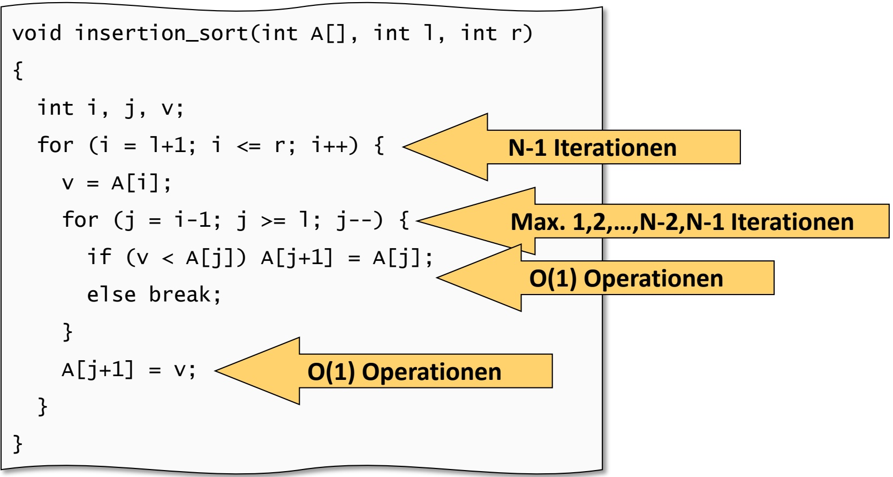

<details>
<summary>flowchart</summary>

```mermaid
graph TD
  A["&quot;void insertion_sort(int A["], int l, int r)\n{"] --> B["&quot;for (i = l+1; i <= r; i++) \n    v = A[i"];\n    for (j = i-1; j >= l; j--) \n        if (v < A["j"]) A["j+1"] = A["j"];\n        else break;\n    }"]
  B --> C["N-1 Iterationen"]
  C --> D["Max. 1,2,...,N-2,N-1 Iterationen"]
  D --> E["O(1) Operationen"]
  E --> F["O(1) Operationen"]
  F --> G["&quot;A[j+1"] = v;\n\n}
```
</details>

• Aufruf: insertion\_sort(A,0,N-1);

$$
\begin{array}{l} (\mathbf {1} + \mathbf {2} + \dots + N - \mathbf {2} + N - \mathbf {1}) \cdot \mathcal {O} (1) + (N - 1) \cdot \mathcal {O} (1) \\ = \boldsymbol {N} \cdot (\boldsymbol {N} - \boldsymbol {1}) / \boldsymbol {2} \cdot \mathcal {O} (1) + \mathcal {O} (N) = \mathcal {O} (N ^ {2}) + \mathcal {O} (N) = \mathcal {O} (N ^ {2}) \\ \end{array}
$$

200

© T. Gemmeke, IDS, RWTH; R. Leupers, SSS

---

Bubblesort

Idee: Elemente mit kleinem Schlüssel sind „**leicht**“ und steigen wie Blasen im Array auf (d.h. wandern nach links)
Aufsteigen durch fortgesetztes **paarweises Vertauschen** der Elemente von rechts nach links implementiert


<details>
<summary>natural_image</summary>

Close-up of bubbles floating in a blue water surface (no text or symbols visible)
</details>

```txt
void bubble_sort(int A[], int l, int r)
{
    int i, j;
    for (i = l; i < r; i++) {
        for (j = r; j > i; j--) {
            if (A[j-1] > A[j])
                exchange(A[j-1],A[j]);
        }
    }
}
```

201

© T. Gemmeke, IDS, RWTH; R. Leupers, SSS

---

## Beispiel (1. Durchlauf der äußeren Schleife)

| 45 | 12 | 77 | 23 | 76 | 11 | 83 | 66 |
| --- | --- | --- | --- | --- | --- | --- | --- |
| 45 | 12 | 77 | 23 | 76 | 11 | 66 | 83 |
| 45 | 12 | 77 | 23 | 11 | 76 | 66 | 83 |
| 45 | 12 | 77 | 11 | 23 | 76 | 66 | 83 |
| 45 | 12 | 11 | 77 | 23 | 76 | 66 | 83 |
| 45 | 11 | 12 | 77 | 23 | 76 | 66 | 83 |
| 11 | 45 | 12 | 77 | 23 | 76 | 66 | 83 |

**noch unsortiert**

**aktuelle linke Grenze**

**zu vertauschen**

**bereits sortiert**

Kleinstes Element (11) am Ende des 1. Durchlaufs an der linken Position
Andere relativ „leichte“ Elemente (z.B. 66) sind bereits teilweise nach links gerückt, schwere nach rechts (45, 77)

202

© T. Gemmeke, IDS, RWTH; R. Leupers, SSS

---

## Beispiel (2. und 3. Durchlauf der äußeren Schleife)

| 11 | 45 | 12 | 77 | 23 | 76 | 66 | 83 |
| --- | --- | --- | --- | --- | --- | --- | --- |
| 11 | 45 | 12 | 77 | 23 | 66 | 76 | 83 |
| 11 | 45 | 12 | 23 | 77 | 66 | 76 | 83 |
| 11 | 12 | 45 | 23 | 77 | 66 | 76 | 83 |
| 11 | 12 | 45 | 23 | 77 | 66 | 76 | 83 |
| 11 | 12 | 45 | 23 | 66 | 77 | 76 | 83 |
| 11 | 12 | 23 | 45 | 66 | 77 | 76 | 83 |
| 11 | 12 | 23 | 45 | 66 | 77 | 76 | 83 |

| noch unsortiert |
| --- |
| aktuelle linke Grenze |
| zu vertauschen |
| bereits sortiert |

**Eigenschaft**: nach 𝑖𝑖-tem Durchlauf ist 𝑖𝑖-tes kleinstes Element an seiner endgültigen Position
• Andere Elemente wurden weiter **vorsortiert**

203

© T. Gemmeke, IDS, RWTH; R. Leupers, SSS

---

Laufzeitanalyse

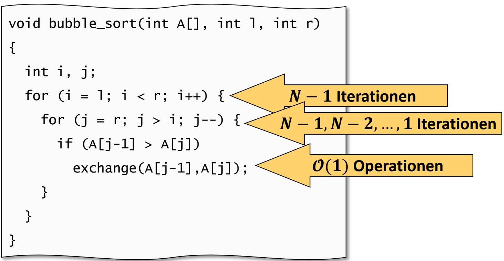

<details>
<summary>flowchart</summary>

```mermaid
graph TD
  A["&quot;void bubble_sort(int A["], int l, int r)\n{"] --> B{"for (i = l; i < r; i++) \n    for (j = r; j > i; j--) \n        if (A["j-1"] > A["j"])\n            exchange(A["j-1"],A["j"]);\n    }"]
  B --> C{"N - 1 Iterationen"}
  C --> D{"N - 1, N - 2, ..., 1 Iterationen"}
  D --> E{"O(1) Operationen"}
  E --> C
```
</details>

$$
\begin{array}{l} (1 + 2 + \dots + N - 2 + N - 1) \cdot \mathcal {O} (1) \\ = N \cdot (N - 1) / 2 \cdot \mathcal {O} (1) = \mathcal {O} (N ^ {2}) \\ \end{array}
$$

Selection Sort, Insertion Sort und Bubblesort haben asymptotisch alle **quadratische Laufzeit** in der **Eingabegröße** 𝑁𝑁 und sind (bis auf konstante Faktoren) gleichwertig

204

© T. Gemmeke, IDS, RWTH; R. Leupers, SSS

---

## 7. Sortieralgorithmen

7.1 Einfache Verfahren (Selection/Insertion/Bubblesort)
**7.2 Quicksort**
7.3 Heapsort

205

© T. Gemmeke, IDS, RWTH; R. Leupers, SSS

---

Divide-and-conquer

• „Divide et impera“, „Teile und herrsche“
• Verbreitetes Prinzip beim **Algorithmenentwurf**
D.h. selbst kein Algorithmus, nur ein „**Kochrezept**“ bei der Entwicklung
• Divide-and-conquer-Idee:

– Mehrere kleine Probleme sind insgesamt **leichter zu lösen** als ein großes
**Teile** großes Problem in mehrere kleine, löse diese, und berechne daraus die **Gesamtlösung**

• Hier:

– Zerlege zu sortierendes Array A in zwei Teile A' und A", die **unabhängig voneinander** sortiert werden können

– Sortiere A' und A" getrennt

– Zusammenfügen (**Konkatenation**) der sortierten Arrays A' und A" ergibt sortiertes Gesamtarray A

206

© T. Gemmeke, IDS, RWTH; R. Leupers, SSS

---

Quicksort-Algorithmus

• Für Array $\mathsf { A } [ \mathsf { T } \dots , \mathsf { r } ]$ wähle ein **bestimmtes** $\mathbf { A } [ k ]$ aus
$\mathbb { A } [ \mathbb { k } ]$ ist das **Trennelement**
• Ordne Array so um, dass:

$- \mathbf { A } ^ { \mathsf { T } } = \mathbf { A } [ 1 \ldots k - 1 ]$ hat nur Elemente $\leq \mathbf { A } [ \mathbf { k } ]$
$- \mathbf { A } ^ { n } = \mathbf { A } [ k + 1 \ldots , r ]$ hat nur Elemente $\geq \mathbf { A } [ \mathbf { k } ]$

Dies wird realisiert, indem bzgl. des Trennelementes $, \mathrm { f a l s c h e } ^ { \prime \prime }$ Elemente in $\textsf { A } ^ { \intercal }$ und $\mathsf { A } ^ { \textsf { I I } }$ **paarweise vertauscht** werden
• Achtung: Arrays $\mathbb { A } ^ { \dagger } , \mathbb { A } ^ { \dagger }$ sind danach i.a. **immer noch unsortiert**
Sortiere die Teilarrays $\textsf { A } ^ { \intercal }$ und $\mathsf { A } ^ { \textsf { H } }$ mittels erneutem Aufruf des Quicksort-Algorithmus (**Rekursion**)
Anschließend ist $\mathbf { A } = \mathbf { A } ^ { \mathsf { T } } \mathbf { A } [ \mathbf { k } ] \mathbf { A } ^ { \mathsf { T } }$ ein sortiertes Gesamtarray

207

© T. Gemmeke, IDS, RWTH; R. Leupers, SSS

---

Algorithmus im Detail

```c
void quick_sort(int A[], int l, int r)
{
    int k;
    if (r <= l) return;
    k = partition(A,l,r);
    quick_sort(A,l,k-1);
    quick_sort(A,k+1,r);
}
```

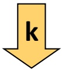

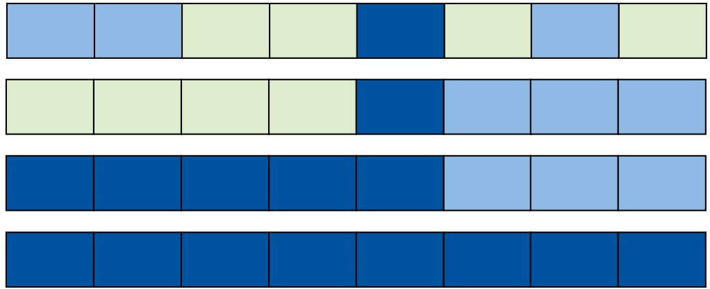

<details>
<summary>heatmap</summary>

| Category | Bar 1 | Bar 2 | Bar 3 | Bar 4 | Bar 5 | Bar 6 |
| --- | --- | --- | --- | --- | --- | --- |
| Row 1 | Light Blue | Light Blue | Light Green | Dark Blue | Light Green | Light Blue |
| Row 2 | Light Green | Light Green | Light Green | Dark Blue | Light Blue | Light Blue |
| Row 3 | Dark Blue | Dark Blue | Dark Blue | Dark Blue | Light Blue | Light Blue |
| Row 4 | Dark Blue | Dark Blue | Dark Blue | Dark Blue | Dark Blue | Dark Blue |
</details>

$$
>= A [ k ]
$$

$$
\Leftarrow \mathrm{A[k]}
$$

**fertig sortiert**

208

© T. Gemmeke, IDS, RWTH; R. Leupers, SSS

---

Algorithmus im Detail

```txt
int partition(int A[], int l, int r)
{
    int i, j, k, v;
    k = r; v = A[k]; // willkürliches Trennelement
    i = l; // starte am linken Rand
    j = r-1; // starte am rechten Rand - 1
    while (1) { // durchlaufen bis Abbruch
        while (i < r && A[i] <= v) i++;
        while (j >= l && A[j] >= v) j--;
        if (i >= j) // aneinander vorbeigelaufen ?
            break; // Abbruch der while-Schleife
        else
            exchange(A[i],A[j]);
    }
    exchange(A[i],A[k]);
    return i;
}
```

209

© T. Gemmeke, IDS, RWTH; R. Leupers, SSS

---

## Beispiel (1. Durchlauf von partition)

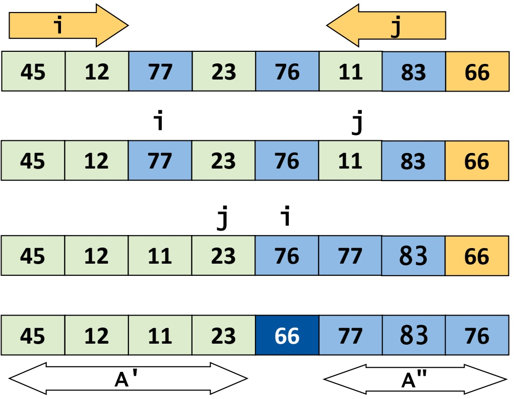

<details>
<summary>treemap</summary>

| Row | Column 1 | Column 2 | Column 3 | Column 4 | Column 5 | Column 6 |
| --- | --- | --- | --- | --- | --- | --- |
| Top | 45 | 12 | 77 | 23 | 76 | 11 |
| Middle-Top | — | — | — | — | j | — |
| Middle-Bottom | 45 | 12 | 77 | 23 | 76 | 11 |
| Bottom | — | — | — | — | j | i |
| Bottom-Right | 45 | 12 | 11 | 23 | 76 | 77 |
| Bottom-Right (Blue) | — | — | — | 66 | 77 | 83 |
| Bottom-Right (Yellow) | — | — | — | — | — | 76 |
</details>

Trennelement ist 66
• 11 und 77 werden vertauscht
• i und j laufen dann aneinander vorbei
• 66 und 76 werden vertauscht
• Anschließend Sortieren von $\textsf { A } ^ { \intercal }$ und $\mathsf { A } ^ { \textsf { m } }$

**Trennelement**

$$
>= A [ k ]
$$

$$
\Leftarrow \mathrm{A} [ \mathrm{k} ]
$$

**fertig sortiert**

210

© T. Gemmeke, IDS, RWTH; R. Leupers, SSS

---

## Beispiel (Forts.)

| 45 | 12 | 11 | 23 | 66 | 77 | 83 | 76 |
| --- | --- | --- | --- | --- | --- | --- | --- |

| 11 | 12 | 45 | 23 | 66 | 77 | 83 | 76 |
| --- | --- | --- | --- | --- | --- | --- | --- |

| 11 | 12 | 23 | 45 | 66 | 77 | 83 | 76 |
| --- | --- | --- | --- | --- | --- | --- | --- |

| 11 | 12 | 23 | 45 | 66 | 77 | 83 | 76 |
| --- | --- | --- | --- | --- | --- | --- | --- |

| 11 | 12 | 23 | 45 | 66 | 77 | 83 | 76 |
| --- | --- | --- | --- | --- | --- | --- | --- |

| 11 | 12 | 23 | 45 | 66 | 77 | 83 | 76 |
| --- | --- | --- | --- | --- | --- | --- | --- |

| 11 | 12 | 23 | 45 | 66 | 77 | 83 | 76 |
| --- | --- | --- | --- | --- | --- | --- | --- |

| 11 | 12 | 23 | 45 | 66 | 76 | 77 | 83 |
| --- | --- | --- | --- | --- | --- | --- | --- |

**Trennelement**

$$
>= \mathsf {A} [ \mathsf {k} ]
$$

$$
\leqslant = \mathsf {A} [ \mathsf {k} ]
$$

**fertig sortiert**

**noch nicht betrachtet**

211

© T. Gemmeke, IDS, RWTH; R. Leupers, SSS

---

Laufzeitanalyse

**Schlechtester Fall**: zufällig gewähltes Trennelement ist das **Maximum** des Arrays
• Z.B. bei **vorsortiertem** Array
• i durchläuft N-1 Elemente, d.h. 𝓞𝓞(𝑵𝑵 − 𝟏𝟏) **Vergleiche**
Jeder Teilungsschritt **spaltet genau ein Element** ab und hinterlässt ein um ein Element kleineres Teilarray $\textsf { A } ^ { \intercal }$
Ist A' ebenfalls schon sortiert, so **wiederholt** sich dieser Effekt – Trennelement ist Maximum von A' – i durchläuft N-2 Elemente – usw.
• **Analoger Effekt** bei Trennelement ganz links und Array-Min.

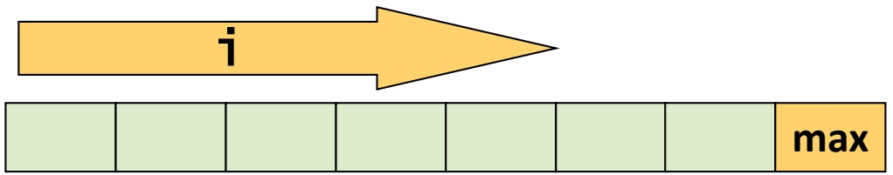

<details>
<summary>text_image</summary>

i
max
</details>

212

© T. Gemmeke, IDS, RWTH; R. Leupers, SSS

---

Laufzeitanalyse

• Anzahl Vergleiche im **worst case**:

$$
\mathcal {O} (N - 1) + \mathcal {O} (N - 2) + \dots + 1 = \mathcal {O} (N ^ {2})
$$

• Jedoch wesentlich besser im **best case**:

$T _ { N } : = \mathbb { Z }$ eit, um Array der Länge 𝑁𝑁 zu sortieren
– Pro Teilungsschritt durchlaufen 𝑖𝑖 und nicht mehr als 𝑁𝑁 Elemente, d.h. es gibt $\mathcal { O } ( N )$ Vergleiche
– Im besten Fall entstehen **jeweils 2 Teilarrays gleicher Größe**

$$
\begin{array}{l} T _ {N} = 2 \cdot T _ {N / 2} + \mathcal {O} (N) \\ = 2 \cdot \left(2 \cdot T _ {N / 4} + \mathcal {O} (N / 2)\right) + \mathcal {O} (N) \\ = 4 \cdot T _ {N / 4} + 2 \cdot \mathcal {O} (N / 2) + \mathcal {O} (N) \\ = 4 \cdot T _ {N / 4} + \mathcal {O} (N) + \mathcal {O} (N) \quad \log N \text {Teilungsschritte,} T _ {1} = \mathcal {O} (1) \\ = \dots = \mathcal {O} (N) + \dots + \mathcal {O} (N) \quad \log N \text {mal} \\ = \log N \cdot \mathcal {O} (N) \\ = \mathcal {O} (N \log N) \\ \end{array}
$$

213

© T. Gemmeke, IDS, RWTH; R. Leupers, SSS

---

Laufzeitanalyse

Durch **einfache Techniken** kann man den worst case meist ausschließen
• Z.B. **Median von 3 Elementen** als Trennelement verwenden
Man kann zeigen: Quicksort hat auch im **durchschnittlichen Fall** (average case) eine Laufzeit von 𝓞𝓞 𝑵𝑵 𝒍𝒍𝒍𝒍𝒍𝒍 𝑵𝑵
D.h. Quicksort ist fast immer **effizient** und darüber hinaus recht **einfach** zu implementieren
• Z.B. N = 1.000.000, 10<sup>9</sup> Operationen pro sec
– 𝒪𝒪 𝑁𝑁 log 𝑁𝑁 : Laufzeit < 1 sec
$- \; \mathcal { O } ( N ^ { 2 } )$ Laufzeit ≈ 17 min
Daher: Quicksort ist das Sortierverfahren mit der **größten Verbreitung**
• Z.B. Bestandteil jeder C-Standard-Library (**qsort-Funktion**)

214

© T. Gemmeke, IDS, RWTH; R. Leupers, SSS

---

## 7. Sortieralgorithmen

7.1 Einfache Verfahren (Selection/Insertion/Bubblesort)
7.2 Quicksort
**7.3 Heapsort**

215

© T. Gemmeke, IDS, RWTH; R. Leupers, SSS

---

Heapsort

• **Selection Sort**: Sortierung durch fortgesetzte Minimumsauswahl $( s . 0 . )$
• 𝑁𝑁 Minima sind auszuwählen, jede Auswahl kostet im Mittel $\mathcal { O } \big ( N / 2 \big ) = \mathcal { O } \big ( N \big )$ Schritte, daher **Gesamtlaufzeit** $\mathcal { O } \big ( N ^ { 2 } \big )$
• Idee bei Heapsort: **Beschleunigung** der Minimumsauswahl
Betrachte folgende Anordnung der Array-Elemente (Array-Indizes **laufen hier von** 𝟏𝟏 … 𝑵𝑵 statt $0 \dots N - 1 )$

| 1 | 2 | 3 | 4 | 5 | 6 | 7 | 8 |
| --- | --- | --- | --- | --- | --- | --- | --- |
| 11 | 12 | 23 | 77 | 45 | 76 | 66 | 83 |

• „Unsortiert“, aber folgende **Eigenschaft** für jedes A[i]:

$$
\begin{array}{l} - A [ i ] \leq A [ 2 i ], \quad \text {falls} 2 i \leq N \\ - A [ i ] \leq A [ 2 i + 1 ], \text {falls} 2 i + 1 \leq N \\ \end{array}
$$

216

© T. Gemmeke, IDS, RWTH; R. Leupers, SSS

---

Veranschaulichung als Baumstruktur

| 1 | 2 | 3 | 4 | 5 | 6 | 7 | 8 |
| --- | --- | --- | --- | --- | --- | --- | --- |
| 11 | 12 | 23 | 77 | 45 | 76 | 66 | 83 |

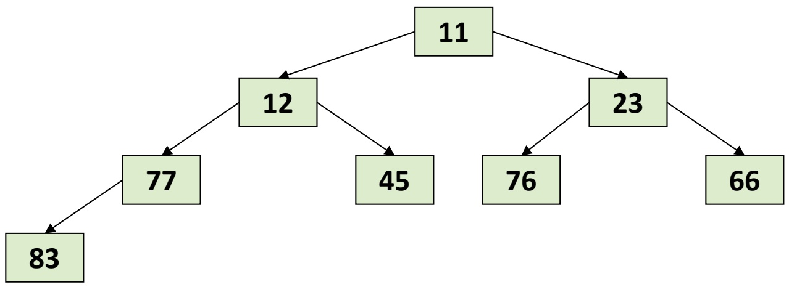

<details>
<summary>flowchart</summary>

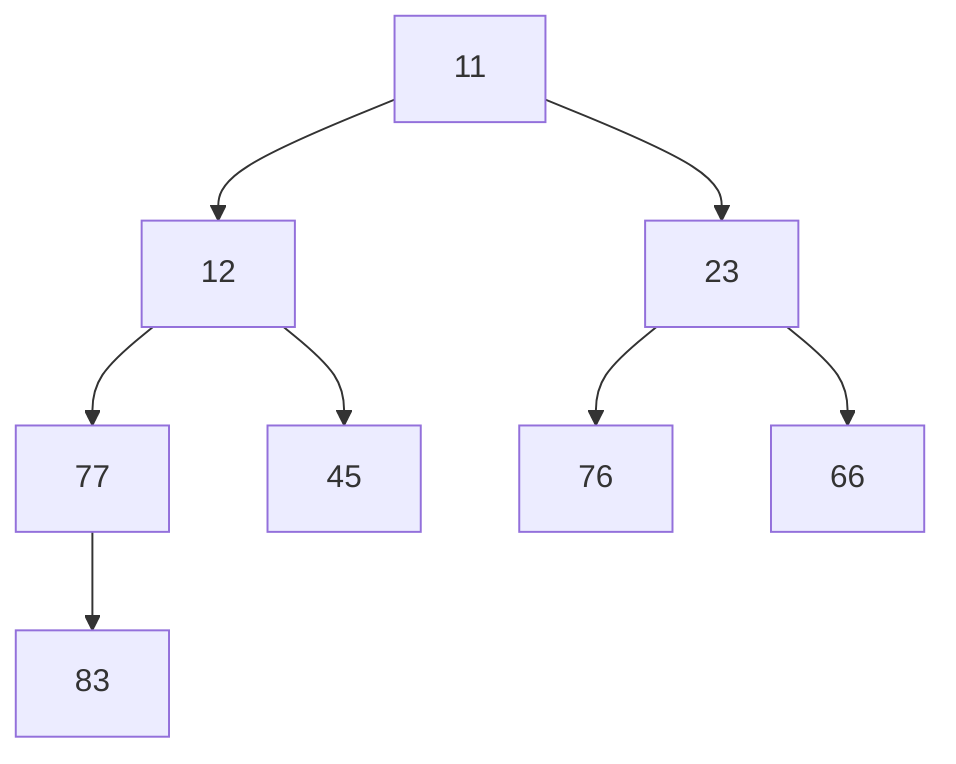
</details>

• Jedes Baumelement A[i] besitzt 0, 1, oder 2 „**Kinder**“
• Kinder besitzen Arrayindex 2i **bzw.** 2i+1
• 12, 23 sind Kinder von 11; 77, 45 sind Kinder von 12 usw.

**Def**.: Gelten im Array $\mathsf { A } [ 1  { \mathrm { ~ \textrm ~ { ~   ~ } ~ } } \mathsf { N } ]$ für jedes $\mathsf { A } [ \mathsf { i } ]$ die Eigenschaften

$\mathsf { A } [ \mathsf { i } ] \leq \mathsf { A } [ 2 \mathsf { i } ]$ (falls 2i ≤ N) und $\mathsf { A } [ \mathsf { i } ] \leq \mathsf { A } [ 2 \mathsf { i } + 1 ]$ (falls

$2 i + 1 \leq N )$ , so ist A ein **(Minimums-)Heap**.

217

© T. Gemmeke, IDS, RWTH; R. Leupers, SSS

---

Heapsort-Prinzip

**Heap-Eigenschaft**: Das (globale) **Array-Minimum** befindet sich stets ganz oben im Heap (der sog. **Wurzel**)
**Folgerung**: Entnahme des Minimums aus einem Heap ist trivial (immer in A[1], d.h. Laufzeit 𝒪𝒪 1 )
• **Ablauf von Heapsort**:

1. Verwandeln des unsortierten Arrays A[1...N] in einen Heap, danach ist Wurzel A[1] das Minimum
2. Vertausche Wurzel und A[N]
3. Min. befindet sich danach an der richtigen Stelle N (hier: **absteigende** Sortierreihenfolge!)
4. A[2...N-1] ist noch korrekter Heap, jedoch neues Element A[1] evtl. falsch
5. Wiederherstellen der Heap-Eigenschaft von A[1...N-1]
6. Fortsetzen ab Schritt 2 mit nächstem Element N-1 und neuer Wurzel

218

© T. Gemmeke, IDS, RWTH; R. Leupers, SSS

---

Heapsort-Prinzip

## min i := i-tes kleinstes Element im Array

**Unsortiertes Array**

**Verwandeln in Heap**

**min1 an Position 1**

**Vertauschen mit** A[N]

**Heap reparieren, min2 an Pos. 1**

**Vertauschen mit** A[N-1]

**Heap reparieren, min3 an Pos. 1**

**Fertig sortiert**

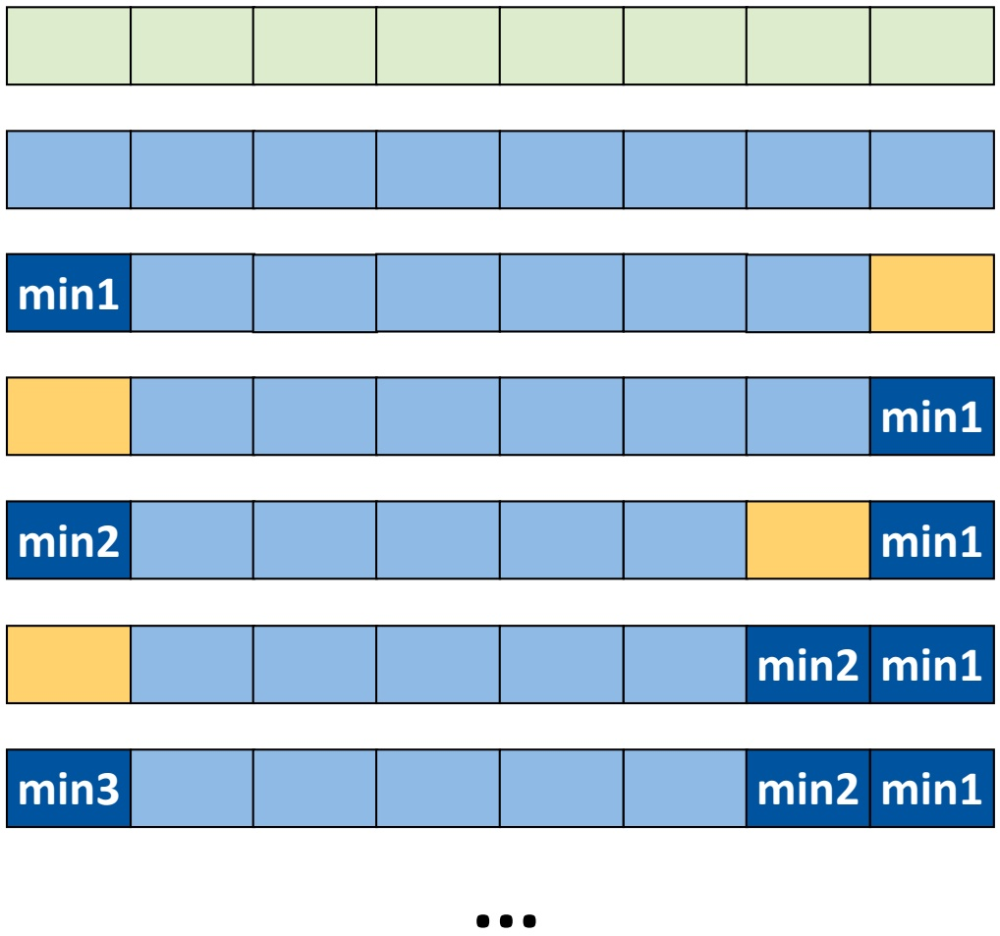

<details>
<summary>text_image</summary>

min1
min2
min3
</details>

| min8 | min7 | min6 | min5 | min4 | min3 | min2 | min1 |
| --- | --- | --- | --- | --- | --- | --- | --- |

219

© T. Gemmeke, IDS, RWTH; R. Leupers, SSS

---

## Reparatur des Heaps

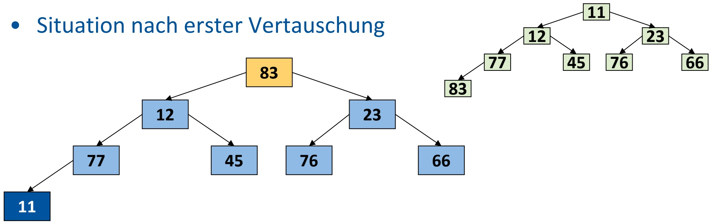

<details>
<summary>flowchart</summary>

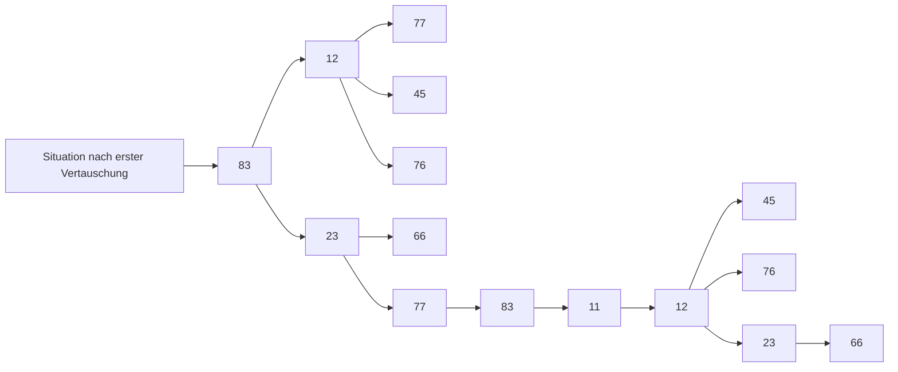
</details>

„Einsinken lassen“ der Wurzel: Vertausche Wurzel mit kleinerem der beiden Kinder

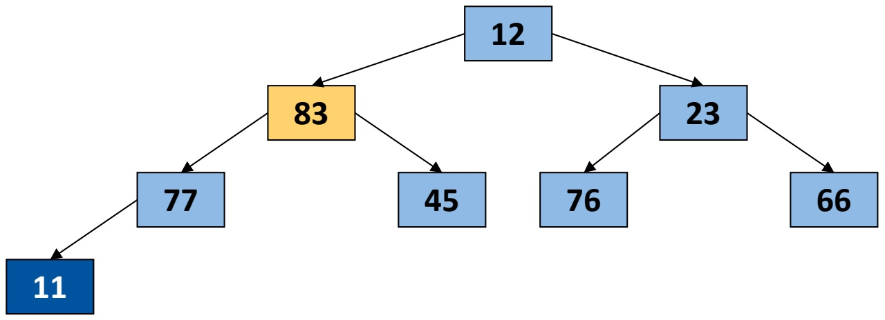

<details>
<summary>flowchart</summary>

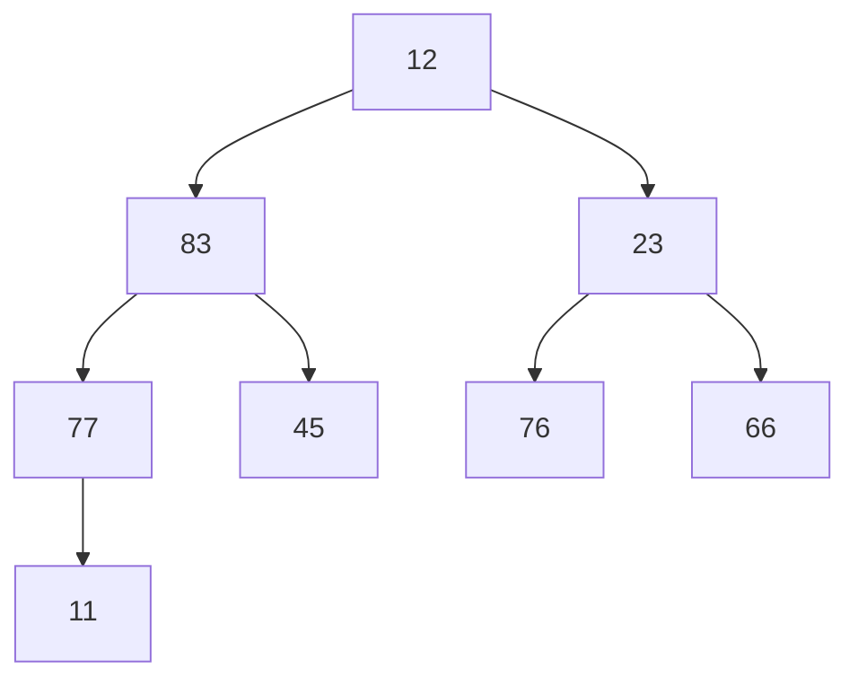
</details>

220

© T. Gemmeke, IDS, RWTH; R. Leupers, SSS

---

Reparatur des Heaps

• **Fortsetzen abwärts im Baum**, bis keine kleineren Kinder mehr vorhanden
• Vernachlässige **bereits sortierten Bereich** am Ende von A
**Heap-Eigenschaft** des unsortierten Bereichs von A wieder hergestellt

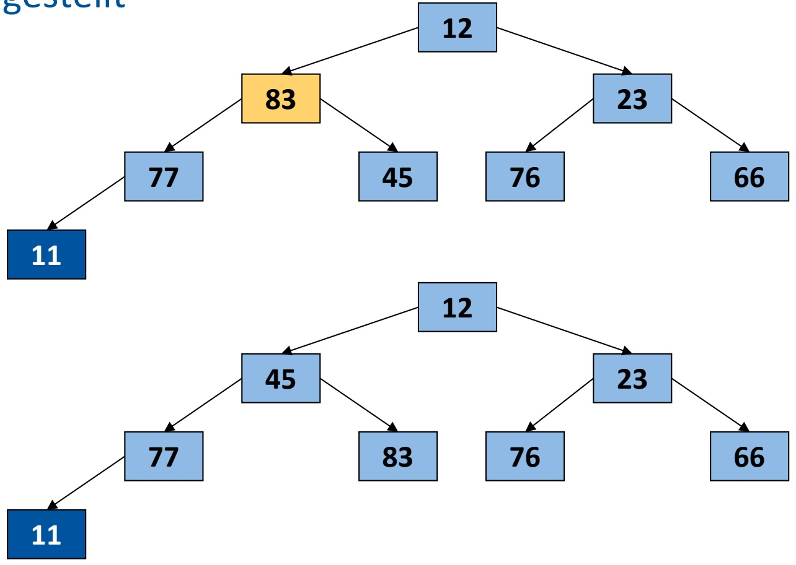

<details>
<summary>flowchart</summary>

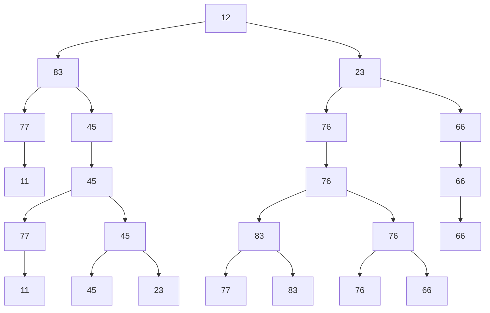
</details>

221

© T. Gemmeke, IDS, RWTH; R. Leupers, SSS

---

Heap-Reparatur (Einsinken lassen der Wurzel)

```txt
void sink(int A[], int k, int N) // A[0] nicht benutzt
{
    int child; // speichert kleinstes Kind falls vorhanden
    while (1) { // durchlaufen bis Abbruch
        if (2*k > N) break;  // Knoten k hat kein Kind
        if (2*k+1 <= N) {      // Knoten k hat 2 Kinder
            if (A[2*k] < A[2*k+1]) child = 2*k;
            else child = 2*k+1;
        } else child = 2*k;     // 2k <= N, Knoten k hat 1 Kind
        if (A[k] > A[child]) { // Vertauschen notwendig?
            exchange(A[k], A[child]);
            k = child;     // Knoten k evtl. weiter sinken lassen
        } else break; // sonst: richtige Pos. für k gefunden
    }
}
```

222

© T. Gemmeke, IDS, RWTH; R. Leupers, SSS

---

Heapsort-Algorithmus

Verwendung der Funktion **sink** auch zum einmaligen Heap-Aufbau zu Beginn
• Elemente mit Index > N/2 haben **keine Kinder**
• Dann **Vertauschen** und **Einsinken lassen** wie oben gezeigt

```txt
void heap_sort(int A[], int N) // A[0] nicht benutzt
{
    int i;
    for (i = N/2; i > 0; i--) { // Heap aufbauen
        sink(A,i,N);
    }
    for (i = N; i > 1; i--) {
        exchange(A[1], A[i]); // Min. ans akt. Heap-Ende setzen
        sink(A,1,i-1);          // Heap reparieren
    }
}
```

223

© T. Gemmeke, IDS, RWTH; R. Leupers, SSS

---

Laufzeitanalyse

```txt
void heap_sort(int A[], int N)
{
    int i;
    for (i = N/2; i > 0; i--) {
        sink(A,i,N); // Heap aufbauen
    }
    for (i = N; i > 1; i--) {
        exchange(A[1],A[i]);
        sink(A,1,i-1);
    }
}
```

<u>𝓞𝓞 𝑵𝑵</u> <strong><u>Iterationen</u></strong>

<u>𝓞𝓞 𝑵𝑵</u> <strong><u>Iterationen</u></strong>

𝓞𝓞 𝟏𝟏

Betrachtung der **worst case** Laufzeit
• 1. Schleife: 𝒪𝒪 𝑁𝑁 Aufrufe von sink
• 2. Schleife: $\mathcal { O } ( N )$ Aufrufe von sink + 𝒪𝒪 𝑁𝑁
• Gesamt: $\mathcal { O } ( N ) \cdot T _ { \mathrm { s i n k } } + \mathcal { O } ( N )$

224

© T. Gemmeke, IDS, RWTH; R. Leupers, SSS

---

Laufzeitanalyse für 𝑻𝑻<sub>𝐬𝐬𝐬𝐬𝐬𝐬𝐬𝐬</sub>

```txt
void sink(int A[], int k, int N)
{
    int child;
    while (1) {
        if (2*k > N) break;
        if (2*k+1 <= N) {
            if (A[2*k] < A[2*k+1])
                child = 2*k;
            else child = 2*k+1;
        } else child = 2*k;
        if (A[k] > A[child]) {
            exchange(A[k],A[child]);
            k = child;
        } else break;
    }
}
```

𝓞𝓞 ? ? ? Iterationen

Alle Operationen jeweils 𝓞𝓞 𝟏𝟏 , also auch insgesamt 𝓞𝓞 𝟏𝟏

225

© T. Gemmeke, IDS, RWTH; R. Leupers, SSS

---

Laufzeitanalyse

In jedem Durchlauf der while-Schleife wird k mindestens **verdoppelt** (child = 2k bzw. 2k+1; k = child; )
• Z.B. k = 1, 2, 4, 8, 16, 32, ...
• 32 nach 5 (= log 32) Schritten erreicht
**Allgemein**: k kann höchstens (𝐥𝐥𝐥𝐥𝐥𝐥 𝑵𝑵**)-mal verdoppelt** werden, bis Arraygrenze N erreicht wurde und sink terminiert
• **Gesamtlaufzeit**:

$$
\begin{array}{l} \mathcal {O} (N) \cdot T _ {\mathrm{sink}} + \mathcal {O} (N) \\ = \mathcal {O} (N) \cdot \left(\log N \cdot \mathcal {O} (1)\right) + \mathcal {O} (N) \\ = \mathcal {O} (N) \cdot \mathcal {O} (\log N) + \mathcal {O} (N) \\ = \mathcal {O} (N \log N) + \mathcal {O} (N) \\ = \mathcal {O} (N \log N) \\ \end{array}
$$

• Heapsort braucht auch im **worst case** nur 𝒪𝒪 𝑁𝑁 log 𝑁𝑁 Schritte

226

© T. Gemmeke, IDS, RWTH; R. Leupers, SSS

---

Fazit zu Sortierverfahren

**Man kann zeigen**: Jeder allgemeine Sortieralgorithmus benötigt im worst case **mindestens Laufzeit** 𝓞𝓞 𝑵𝑵 𝐥𝐥𝐥𝐥𝐥𝐥 𝑵𝑵
D.h. Heapsort ist der „**bestmögliche**“ Sortieralgorithmus bis auf nichtsignifikante Terme + Konstanten
In der **Praxis** können jedoch andere Verfahren (z.B. Quicksort und sogar Bubblesort für kleine 𝑁𝑁) durchaus **schneller** sein
In **Spezialfällen** kann man noch schneller sortieren
Sortierverfahren mit Verwendung zusätzlicher Zwischenspeicher – Bucket Sort, Radix Sort, Counting Sort (nächste Folie)

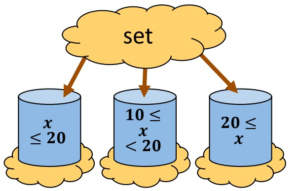

<details>
<summary>flowchart</summary>

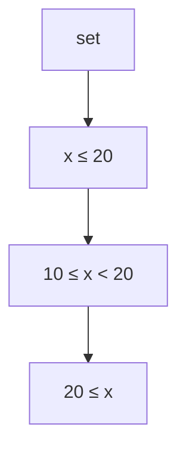
</details>

𝑚𝑚-Buckets ⭢ 𝒪𝒪 𝑚𝑚

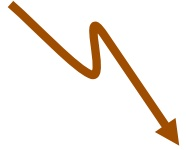

Stabile Sortierung je Radix (Buchstabe, Ziffer, …) Key ⭢ [K][e][y]

$$
m \times \text {Sortieren von Radix} r \rightarrow \mathcal {O} (m) \cdot \mathcal {O} (f (r))
$$

227

© T. Gemmeke, IDS, RWTH; R. Leupers, SSS

---

Schlüsselindiziertes Zählen

Lineare Komplexität in der Laufzeit

• Idee: „Schlüsselindiziertes Zählen“
• 𝑚𝑚 ≔ Anzahl möglicher Schlüssel
Beispiele

• $\mathtt { P L Z } ; m _ { \mathrm { P L Z } } < 1 0 ^ { 5 }$

Name (20 Buchstaben): $m _ { \mathrm { n a m e } } = 2 6 ^ { 2 0 } < 2 ^ { 5 ^ { 2 0 } } = 2 ^ { 1 0 0 } \approx 1 0 ^ { 3 0 }$

Beispiel: $\mathsf { A } [ \mathsf { \beta } ] : = \{ \mathsf { { ^ { t } a ^ { t } } } , \mathsf { { ^ { t } b ^ { t } } } , \mathsf { { ^ { t } a ^ { t } } } , \mathsf { { ^ { t } c ^ { t } } } , \mathsf { { ^ { t } a ^ { t } } } , \mathsf { { ^ { t } e ^ { t } } } , \mathsf { { ^ { t } f ^ { t } } } , \mathsf { { ^ { t } a ^ { t } } } \}$

$$
\begin{array}{l} \mathrm{C} [ \mathrm{m} ] \quad \mathrm{C} [ 0 ] := 0 \\ \text {a} ^ {\prime}: \mathrm{C} [ 1 ] = \quad \mathrm{C} [ 1 ] + = \mathrm{C} [ 0 ] = \\ \text {‘b’: C[2] = C[2] + = C[1] =} \\ \mathrm{C} ^ {\prime}: \mathrm{C} [ 3 ] = \quad \mathrm{C} [ 3 ] + = \mathrm{C} [ 2 ] = \\ \mathrm{d} ^ {\prime}: \mathrm{C} [ 4 ] = \quad \mathrm{C} [ 4 ] + = \mathrm{C} [ 3 ] = \\ \text {'e':} C [ 5 ] = C [ 5 ] + = C [ 4 ] = \\ \text {f}: \mathrm{C} [ 6 ] = \\ \end{array}
$$

$$
\mathrm{C} [ \mathrm{A} [ \mathrm{i} ] - ^ {\prime} \mathrm{a} ^ {\prime} + 1 ] + +;
$$

$$
\mathrm{C} [ \mathrm{i} ] + = \mathrm{C} [ \mathrm{i} - 1 ];
$$

$$
\mathrm{B} [ \mathrm{C} [ \mathrm{A} [ \mathrm{i} ] - ^ {\prime} \mathrm{a} ^ {\prime} ] + + ] = \mathrm{A} [ \mathrm{i} ];
$$

$$
\rightarrow \mathrm{B} [ ]: \{\text {‘a', ‘a', ‘a', ‘a', ‘b', ‘c', ‘e', ‘f'} \}\}
$$

228

© T. Gemmeke, IDS, RWTH
