# 8. Lineare Datentypen

原始 PDF 第 229–260 页。

## 8. Lineare Datentypen

**8.1 Listen**
8.2 Stacks
8.3 Queues

229

© T. Gemmeke, IDS, RWTH; R. Leupers, SSS

---

## Mengendarstellung

• **Problemstellung**: Verwaltung einer Menge von Objekten $A   =   \{ a _ { 1 } , \ldots , a _ { n } \}$ vom Typ T

• Gewünschte **Operationen**:

– Suchen, Einfügen und Entfernen von Elementen
– Vereinigung und Durchschnitt zweier Mengen 𝐴𝐴 und 𝐵𝐵

• Prinzipiell wäre ein **Array** als Datenstruktur geeignet
• Jedoch zwei Probleme:

– **Einfügen** eines neuen Elementes an einer bestimmten Position erfordert aufwendige **Umordnung**
– **Größe** der Menge muss **statisch** feststehen (Bspw. Deklaration: T A[100]; erlaubt max. 100 Elemente)


<details>
<summary>flowchart</summary>

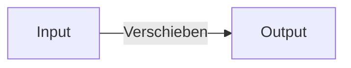
</details>

230

© T. Gemmeke, IDS, RWTH; R. Leupers, SSS

---

Verkettete Listen

**Def**.: Eine **(verkettete) Liste** ist entweder leer oder besteht aus einer Referenz auf einen **Knoten**, der ein Element und eine Referenz auf eine verkettete Liste enthält.

• Verwendung von **Zeigern** (siehe Kap. 3)
• Modellierung eines **Knotens** für ein Element vom Typ T:
typedef struct node {T\* data; struct node\* next; } \*nodeptr;
• data ist Zeiger auf Listenelement vom Typ T
next ist Zeiger auf Nachfolgerknoten


<details>
<summary>flowchart</summary>

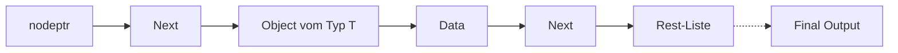
</details>

231

© T. Gemmeke, IDS, RWTH; R. Leupers, SSS

---

Verkettete Listen

• Liste im **Speicher** (vgl. Kap. 3)
• Liste = 1. Element + Restliste
Darstellung einer leeren Liste: #define NULL 0
Zeigerwert NULL bedeutet, dass der Zeiger „nirgendwohin“ zeigt
Speicherzugriff per NULL-Zeiger ist **unzulässig**, führt i.A. zum Programmabsturz


<details>
<summary>flowchart</summary>

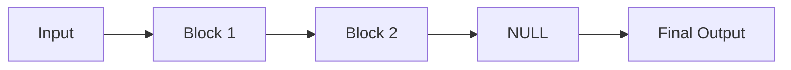
</details>

Adr.


<details>
<summary>flowchart</summary>

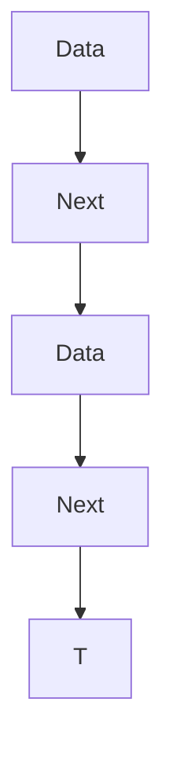
</details>

232

© T. Gemmeke, IDS, RWTH; R. Leupers, SSS

---

Listenoperationen

• Definition des Datentyps **Liste**, Elemente vom Typ T

```c
typedef struct node {
    T* data;
    struct node* next; } Node, *nodeptr;

typedef struct list {
    nodeptr first, last; } List, *listptr;
```


<details>
<summary>flowchart</summary>

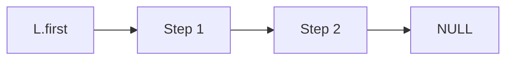
</details>

• Erzeugung einer **leeren Liste** und **Leerheitstest**

```c
List L;
void Init(listptr L)
{
    L->first = NULL; L->last = NULL;
}

int IsEmpty(List L)
{
    return (L.first == NULL && L.last == NULL);
}
```

233

© T. Gemmeke, IDS, RWTH; R. Leupers, SSS

---

Listenoperationen

• **Einfügen** eines neuen Listenelements vom Typ T am Listenanfang


<details>
<summary>flowchart</summary>

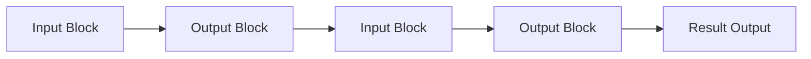
</details>

Funktion „malloc“ (siehe Kap. 3) stellt dynamisch Speicherplatz auf dem Heap bereit
Funktion „sizeof“ berechnet die erforderliche Anzahl von Bytes (hier z.B. insges. 8 Bytes bei 32-Bit-Zeigern)

```c
nodeptr newnode(T* item)
{
    nodeptr np;

    np = (nodeptr)malloc(sizeof(Node));
    np->data = item;
    np->next = NULL;

    return np;
}
```

234

© T. Gemmeke, IDS, RWTH; R. Leupers, SSS

---

Einfügen am Listenanfang

```txt
void AppendFirst(T* item, listptr L)
{
    nodeptr np = newnode(item);
    if (IsEmpty(*L)) {
        L->first = np; L->last = np;
    } else {
        np->next = L->first;
        L->first = np;
    }
}
```


235

© T. Gemmeke, IDS, RWTH; R. Leupers, SSS

---

Einfügen am Listenende

```txt
void AppendLast(T* item, listptr L)
{
    nodeptr np = newnode(item);
    if (IsEmpty(*L)) {
        L->first = np; L->last = np;
    } else {
        L->last->next = np;
        L->last = np;
    }
}
```


236

© T. Gemmeke, IDS, RWTH; R. Leupers, SSS

---

Prüfen ob Element in Liste enthalten

```cpp
int IsIn(T* item, List L)
{
    nodeptr np;
    if (IsEmpty(L)) return 0; // false
    np = L.first;
    while (np != NULL) {
        if (Equal(np->data, item)) return 1; // true
        np = np->next;
    }
    return 0; // false
}
```


<details>
<summary>flowchart</summary>

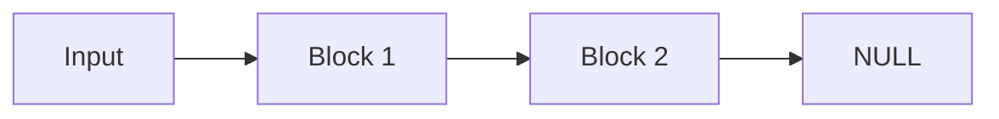
</details>

• **Laufzeit** bei N-elementiger Liste:

– Best case: O(1)
– Worst case: O(N)
– Average case: O(N/2) = O(N)

237

© T. Gemmeke, IDS, RWTH; R. Leupers, SSS

---

Einfügen hinter ein bestimmtes Listenelement

```c
// item2 hinter item1 einfügen
void InsertBehind(T* item1,
  T* item2, listptr L)
{
  nodeptr np, newnp;

  if (!IsIn(item1,*L)) {
    printf(„Fehler!“); return;
  }

  np = L->first;
  while (np != NULL) {
    if (Equal(np->data,item1)) {
      newnp = newnode(item2);
      newnp->next = np->next;
      np->next = newnp;
      if (np == L->last) {
        L->last = newnp;
      }
      break;
    }
    np = np->next;
  }
}
```


238

© T. Gemmeke, IDS, RWTH; R. Leupers, SSS

---

## Löschen eines Listenelementes

```c
void Delete(T* item, listptr L)
{
    nodeptr np1, np2;

    if (IsEmpty(*L)) return;
    np1 = L->first;
    if (Equal(np1->data,item)) {
        L->first = np1->next;
        if (L->first == NULL)
            L->last = NULL;
        free(np1);
        return;
    }
    np2 = np1->next;
    while (np2 != NULL) {
        if (Equal(np2->data,item)) {
            np1->next = np2->next;
            if (np2 == L->last)
                L->last = np1;
            free(np2);
            break;
        }
        np1 = np2;
        np2 = np2->next;
    }
}
```


<details>
<summary>flowchart</summary>

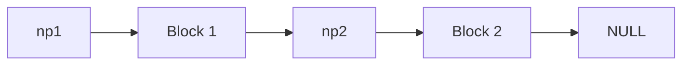
</details>


<details>
<summary>flowchart</summary>


</details>

239

© T. Gemmeke, IDS, RWTH; R. Leupers, SSS

---

Zusammenfügen zweier Listen

• Falls Liste als Mengendarstellung: entspricht **Vereinigung**
• Evtl. **Mehrfachvorkommen** von Elementen ausschließen

L1:


<details>
<summary>flowchart</summary>

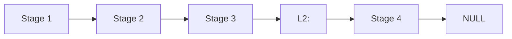
</details>

```c
listptr Union(listptr L1, listptr L2)
{
    if (IsEmpty(*L2)) return L1;
    if (IsEmpty(*L1)) return L2;

    L1->last->next = L2->first;
    L1->last = L2->last;

    return L1;
}
```

240

© T. Gemmeke, IDS, RWTH; R. Leupers, SSS

---

Schnittmengenberechnung mittels Listen

```c
listptr Intersect(listptr L1, listptr L2)
{
    nodeptr np;
    listptr L = (listptr)malloc(sizeof(List));
    Init(L);
    np = L1->first;
    while (np != NULL) {
        if (IsIn(np->data, *L2)) AppendLast(np->data, L);
        np = np->next;
    }
    return L;
}
```

L1:


<details>
<summary>flowchart</summary>

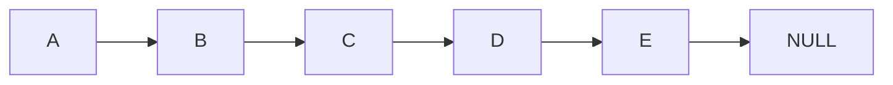
</details>

L2:


<details>
<summary>flowchart</summary>

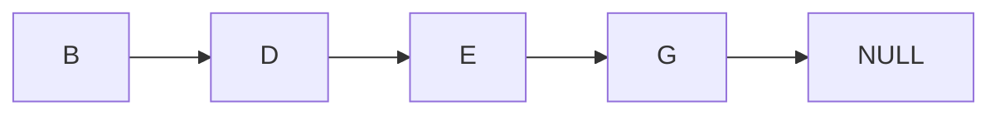
</details>

L:


<details>
<summary>flowchart</summary>

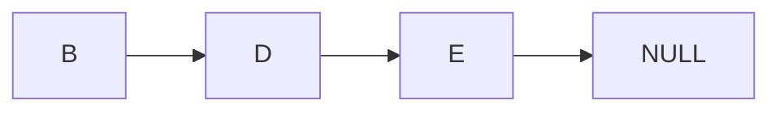
</details>

241

© T. Gemmeke, IDS, RWTH; R. Leupers, SSS

---

## 8. Lineare Datentypen

8.1 Listen
**8.2 Stacks**
8.3 Queues

242

© T. Gemmeke, IDS, RWTH; R. Leupers, SSS

---

Stacks

**Def**.: Ein **Stack** (Stapel) ist ein ADT, der folgende Grundoperationen unterstützt:

1. Einfügen eines neuen Elementes $( , \mathsf { P u s h } ^ { n } )$
2. Entfernen des zuletzt eingefügten Elementes $( , P o p ^ { n } )$

• Stacks sind eine **grundlegende Datenstruktur** in vielen Anwendungen

– Ablagesystem auf Professorenschreibtisch
– Compiler-Frontend (Analyse des Quellprogramms)
– Abarbeitung von C-Funktionsaufrufen

Aufgrund der Pop-Operation auch als **LIFO-Datenstruktur** bezeichnet (last in, first out)

Stack als ADT, d.h. **verschiedene Implementierungen** möglich (z.B. Listen und Arrays)

243

© T. Gemmeke, IDS, RWTH; R. Leupers, SSS

---

Push und Pop

push D

push EC

push B

push A

**stack**


244

© T. Gemmeke, IDS, RWTH; R. Leupers, SSS

---

Beispiel: Laufzeit-Stack für C-Funktionsaufrufe

• Siehe auch Kap. 5
Funktion f wird durch Aufruf von g **unterbrochen** und später **fortgesetzt**
g kann ihrerseits **weitere Funktionen** aufrufen
Umgebung zur Programmausführung muss einen **Stack noch aktiver Funktionen** verwalten
• **Funktionsaufruf** = Push
• **Funktionsende** = Pop


<details>
<summary>flowchart</summary>

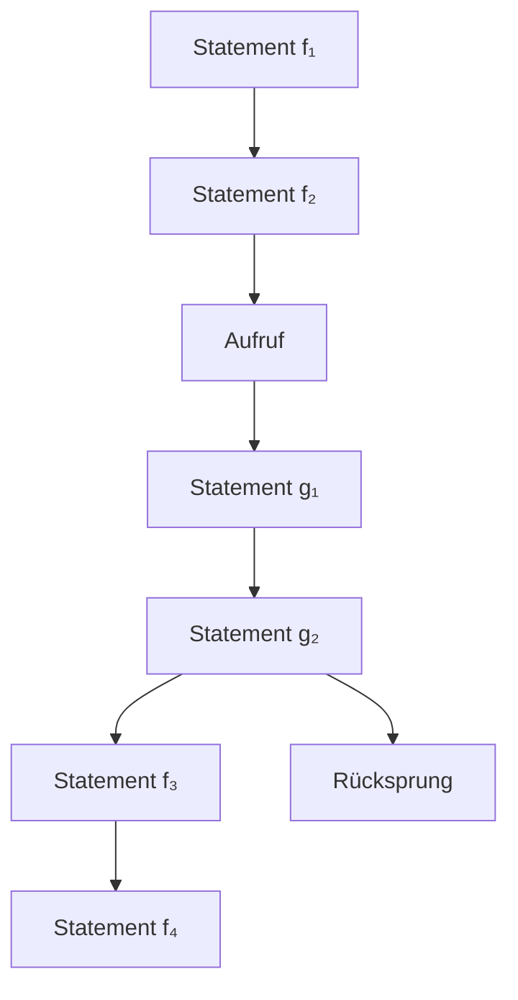
</details>

**Zeit**

245

© T. Gemmeke, IDS, RWTH; R. Leupers, SSS

---

## Beispiel: Laufzeit-Stack für C-Funktionsaufrufe

```c
void f(void)
{
    g();
}

void g(void)
{
    h();
}

void h(void)
{
    i();
}

void i(void)
{
}

int main(void)
{
    f();
    g();
    h();

    return 0;
}
```

<strong><u>main</u></strong>

f <strong><u>main</u></strong>

g f <strong><u>main</u></strong>

h g f <strong><u>main</u></strong>

i h g f <strong><u>main</u></strong>

h g f <strong><u>main</u></strong>

g f <strong><u>main</u></strong>

f <strong><u>main</u></strong> <strong><u>main</u></strong>

g <strong><u>main</u></strong>

h g <strong><u>main</u></strong>

i h g <strong><u>main</u></strong>

h g <strong><u>main</u></strong>

g <strong><u>main</u></strong> <strong><u>main</u></strong>

h <strong><u>main</u></strong>

i h <strong><u>main</u></strong> <strong><u>main</u></strong>

246

© T. Gemmeke, IDS, RWTH; R. Leupers, SSS

---

Stack-Implementierung durch Listen

Elemente auf Stack = Listenelemente
• Push = Einfügen am Listenanfang
• Pop = Entfernen des ersten Elementes
• Stack für beliebigen Elementtyp T:

```c
List L;

void Push(T* item,listptr L)
{
    AppendFirst(item, L);
}

T* Pop(listptr L)
{
    T* item;
    if (IsEmpty(*L)) return NULL;

    item = L->first->data;
    Delete(item, L);
    return item;
}
```


<details>
<summary>flowchart</summary>

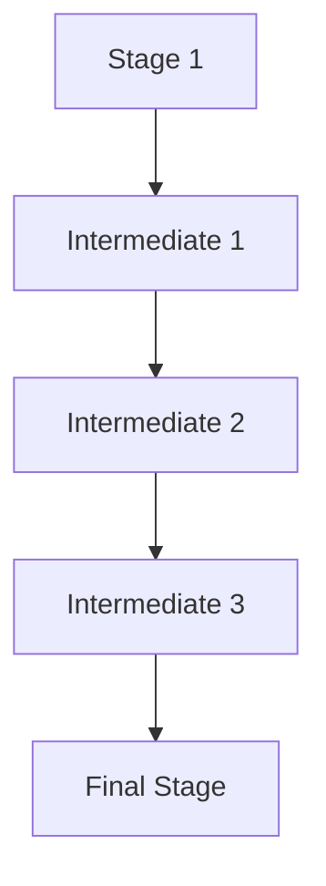
</details>

247

© T. Gemmeke, IDS, RWTH; R. Leupers, SSS

---

Stack-Implementierung durch Arrays

• Vorgabe der **max. Stack-Größe** notwendig
Elemente auf Stack = Arrayelemente
„**top**“ verweist stets auf das nächste freie Element (top = „**Stack-Pointer**“)
Push = Einfügen und Erhöhen von top um 1
Pop = Entfernen und Erniedrigen von top um 1
Prüfen auf **Überlauf** (im Gegensatz zu Listen!)

```c
#define MAX 100
typedef struct stk
{ T* elems[MAX]; int top; } stack;

void Init(stack* s)
{ s->top = 0; }

int IsEmpty(stack s)
{ return (s.top == 0); }

void Push(T* item,stack* s)
{
    if (s->top == MAX)
        printf(„Stack voll!“);
    s->elems[s->top] = item;
    s->top++;
}

T* Pop(stack* s)
{
    if (IsEmpty(*s)) return NULL;
    s->top--;
    return s->elems[s->top];
}
```

248

© T. Gemmeke, IDS, RWTH; R. Leupers, SSS

---

Beispiel-Anwendung

• Auswertung geklammerter **arithmetischer Ausdrücke**
– z.B. (( 6 \* ( 4 \* 28)) + ( 9 - (( 12 / 4) \* 2)))

**Innere Ausdrücke** vor äußeren auszuwerten

• Speicherung von Zwischenergebnissen notwendig

• **Zwei Stacks**: Operanden- und Operatorstack

Abarbeitung eines Ausdrucks **von links nach rechts**:

$\mathcal { N } ^ { ( 1 ) } ;$ keine Aktion
– Operand: Push auf Operandenstack
– Operator: Push auf Operatorstack
– „)“: Pop des obersten Operators, Pop der obersten beiden Operanden, Ausdruck auswerten, Push Ergebnis auf Operandenstack

249

© T. Gemmeke, IDS, RWTH; R. Leupers, SSS

---

Beispiel

$$
((6 * (4 * 2 8)) + (9 - ((1 2 / 4) * 2)))
$$

Operandenstack

| 6 |
| --- |
| 6 4 |
| 6 4 28 |
| 6 112 |
| 672 |
| 672 9 |
| 672 9 12 |
| 672 9 12 4 |
| 672 9 3 |
| 672 9 3 2 |
| 672 9 6 |
| 672 3 |
| 675 |

Operatorstack

| * |
| --- |
| ** |
| * |
| (leer) |
| + |
| +- |
| +-/ |
| +- |
| +-* |
| +- |
| +(leer) |

250

© T. Gemmeke, IDS, RWTH; R. Leupers, SSS

---

## 8. Lineare Datentypen

8.1 Listen
8.2 Stacks
**8.3 Queues**

251

© T. Gemmeke, IDS, RWTH; R. Leupers, SSS

---

Queues

## Def.: Eine Queue (Warteschlange) ist ein ADT, der folgende Grundoperationen unterstützt:

1. Einfügen eines neuen Elementes $( , P u t ^ { n } )$
2. Entfernen des zuerst eingefügten Elementes $( \mathrm { { , } } \mathrm { { G e t } } ^ { n } )$

• Verbreitete Datenstruktur, z.B.
– Warteschlange von auszuführenden Prozessen
– Kommunikationspuffer z.B. für Druckaufträge
• **FIFO-Prinzip**: first in, first out („zuerst gekommen, zuerst bedient“)


<details>
<summary>text_image</summary>

DELZER
nach Originalrezept
Gelo!
E's
</details>

252

© T. Gemmeke, IDS, RWTH; R. Leupers, SSS

---

Put und Get

put D

put C

put B

put A


<details>
<summary>text_image</summary>

queue
D
C
B
A
</details>

get → A

253

© T. Gemmeke, IDS, RWTH; R. Leupers, SSS

---

Put und Get

**queue**


get → B

254

© T. Gemmeke, IDS, RWTH; R. Leupers, SSS

---

Put und Get


<details>
<summary>text_image</summary>

queue
D
C
</details>

get → C

255

© T. Gemmeke, IDS, RWTH; R. Leupers, SSS

---

Queue-Implementierung durch Listen

• Queue-Elemente = Listenelemente
• Put = Einfügen am Listenende
• Get = Entfernen des ersten Elementes
• Queue für beliebigen Elementtyp T:

```c
List L;

void Put(T* item,listptr L)
{
    AppendLast(item, L);
}

T* Get(listptr L)
{
    T* item;

    if (IsEmpty(*L)) return NULL;

    item = L->first->data;
    Delete(item, L);

    return item;
}
```


<details>
<summary>flowchart</summary>


</details>

256

© T. Gemmeke, IDS, RWTH; R. Leupers, SSS

---

## Queue-Implementierung durch Arrays

Betrachte **Dynamik** von Queues im Vergleich zu Stacks in Array-Implementierung:


<details>
<summary>bar_stacked</summary>

| Category | Value 1 | Value 2 | Value 3 | Value 4 | Value 5 | Value 6 | Value 7 |
| --- | --- | --- | --- | --- | --- | --- | --- |
| Row 1 | Blue | Light Green | Light Green | Light Green | Light Green | Light Green | Light Green |
| Row 2 | Blue | Blue | Light Green | Light Green | Light Green | Light Green | Light Green |
| Row 3 | Blue | Light Green | Light Green | Light Green | Light Green | Light Green | Light Green |
| Row 4 | Blue | Blue | Blue | Light Green | Light Green | Light Green | Light Green |
| Row 5 | Blue | Blue | Light Green | Light Green | Light Green | Light Green | Light Green |
</details>

**Stack**: verwendet tendenziell immer den gleichen Speicherbereich


<details>
<summary>bar_stacked</summary>

| Category | Segment 1 (Dark Blue) | Segment 2 (Light Blue) |
| --- | --- | --- |
| Row 1 | ~30% | ~70% |
| Row 2 | ~35% | ~65% |
| Row 3 | ~40% | ~60% |
| Row 4 | ~45% | ~55% |
| Row 5 | ~50% | ~50% |
</details>

**Queue**: „wandert“tendenziell immer weiter nach rechts, daher schlechte Speicherausnutzung

257

© T. Gemmeke, IDS, RWTH; R. Leupers, SSS

---

Queue-Implementierung durch Arrays

• Lösung: **ringförmiges** Array bzw. **zyklische** Adressierung


<details>
<summary>donut</summary>

| Category | Value |
| --- | --- |
| 1 | Blue dot |
| 2 | Blue dot |
| 3 | Blue dot |
| 4 | Blue dot |
| 5 | Blue dot |
| 6 | Blue dot |
| 7 | Blue dot |
| 8 | Blue dot |
| 9 | Blue dot |
| 10 | Blue dot |
| 11 | Blue dot |
| 12 | Blue dot |
| 13 | Blue dot |
| 14 | Blue dot |
| 15 | Blue dot |
| 16 | Blue dot |
| 17 | Blue dot |
| 18 | Blue dot |
| 19 | Blue dot |
| 20 | Blue dot |
</details>

258

© T. Gemmeke, IDS, RWTH; R. Leupers, SSS

---

## Queue-Implementierung durch Arrays

Zwei **Zeiger** (Array-Indizes) first und last verweisen auf aktuellen Anfang (-1) und Ende (+1) der Queue
Verwendung des Modulo-Operators (%) zur **zyklischen Adressierung**
Prüfung auf **Über- und Unterlauf** (overflow, underflow) erforderlich

```c
#define MAX 100

typedef struct q
{ T* elems[MAX];
  int first, last; } queue;

void Init(queue* q)
{
  q->first = 0;
  q->last = 1;
}

void Put(T* item,queue* q)
{
  if (q->last == q->first) overflow();
  else {
    q->elems[q->last] = item;
    q->last = (q->last+1) % MAX;
  }
}

T* Get(queue* q)
{
  q->first = (q->first+1) % MAX;
  if (q->first == q->last) underflow();
  else return q->elems[q->first];
}
```

259

© T. Gemmeke, IDS, RWTH; R. Leupers, SSS

---

Beispiel-Ablauf


<details>
<summary>flowchart</summary>

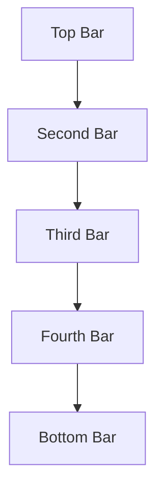
</details>


<details>
<summary>flowchart</summary>

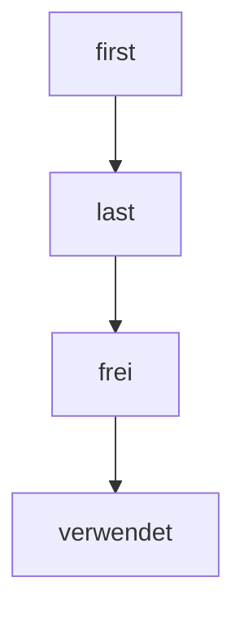
</details>

260

© T. Gemmeke, IDS, RWTH; R. Leupers, SSS
