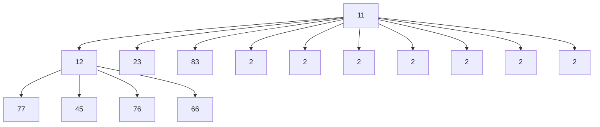
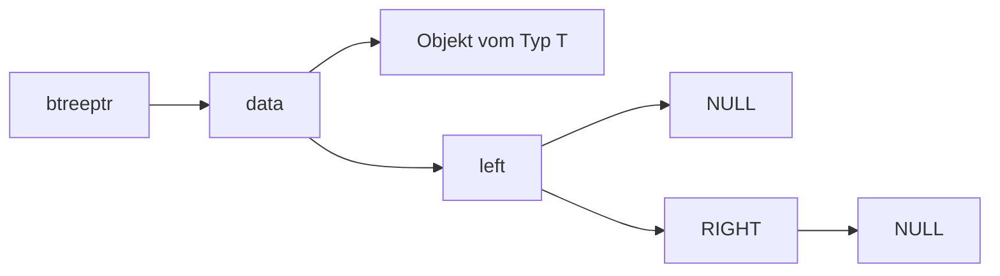
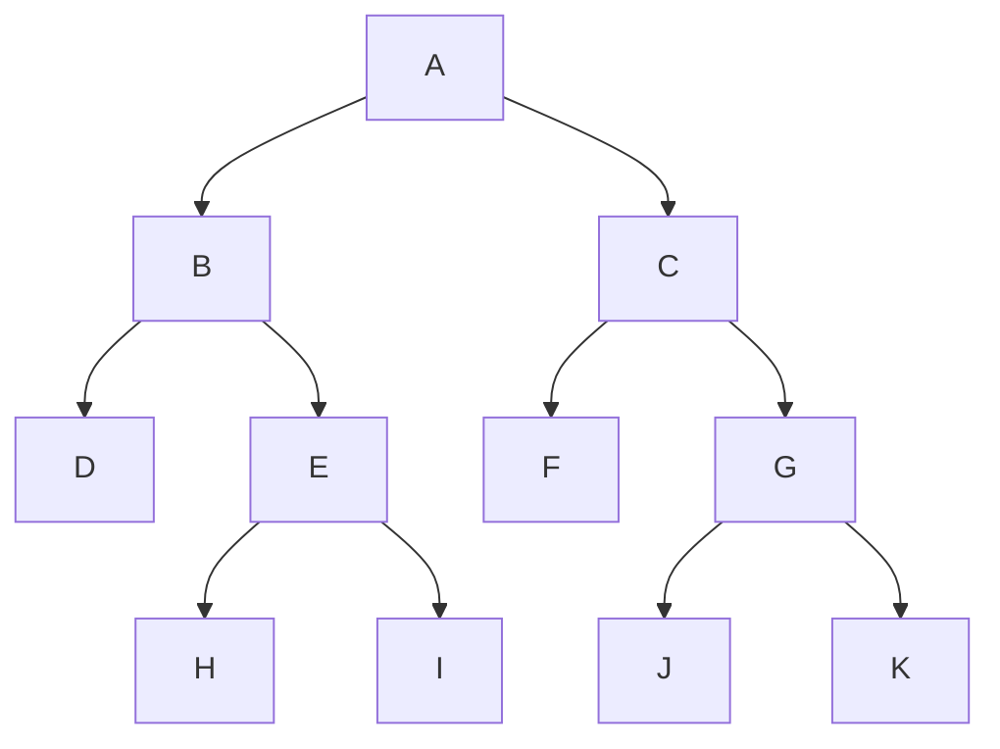
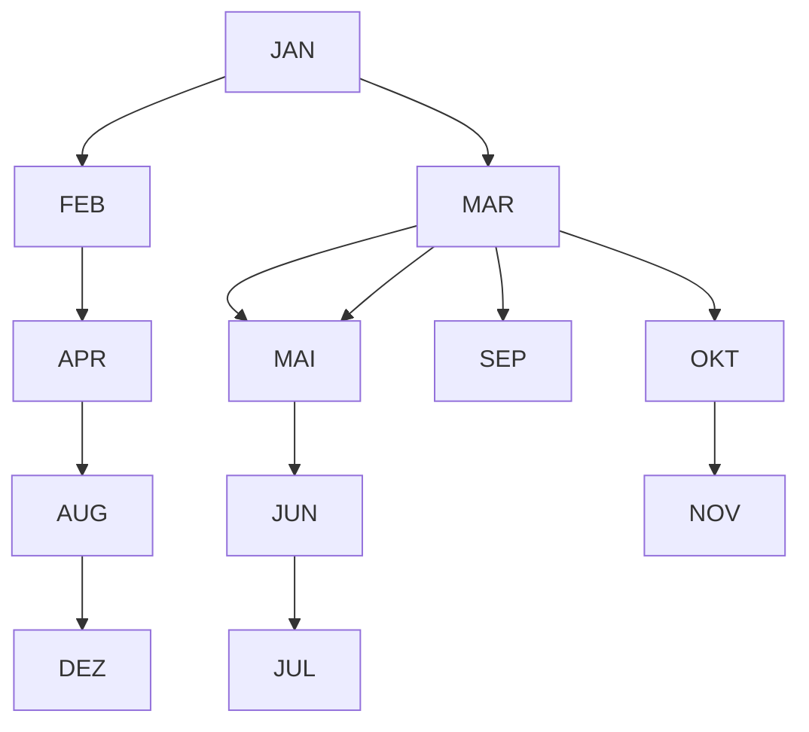
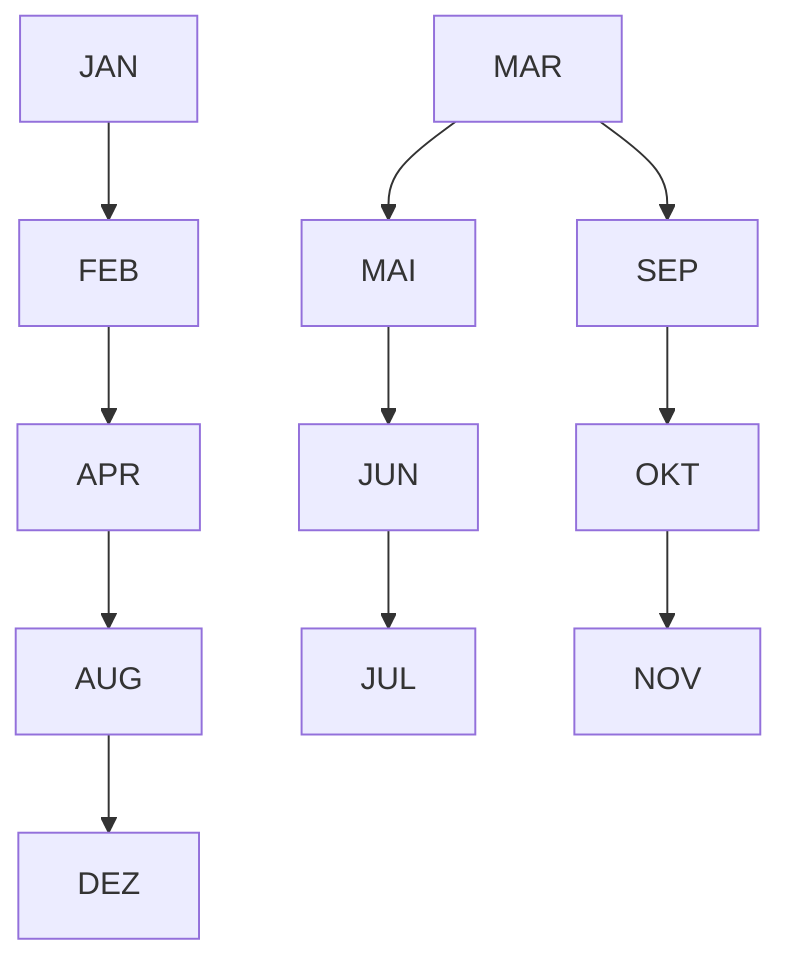
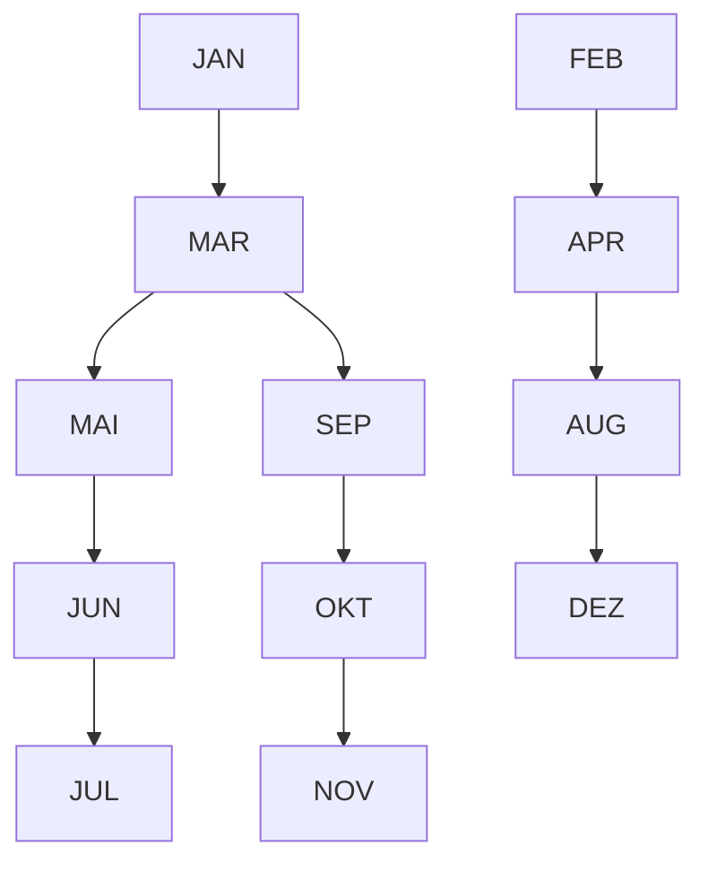
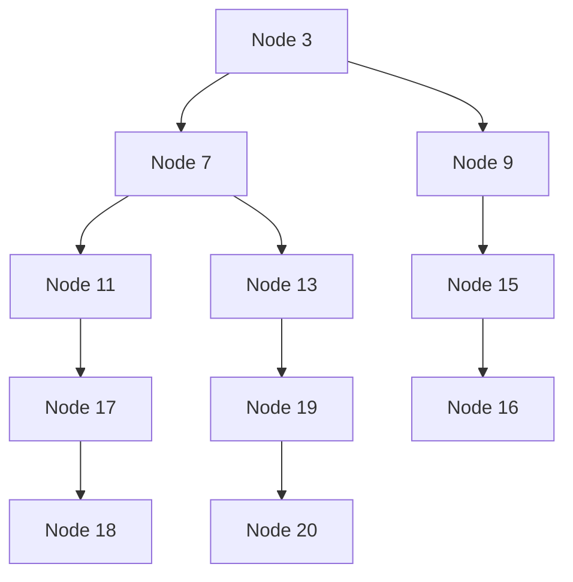

# 9. Bäume

原始 PDF 第 261–276 页。

## 9. Bäume

**9.1 Definition und Darstellung**
9.2 Baumdurchläufe
9.3 Suchbäume

261

© T. Gemmeke, IDS, RWTH; R. Leupers, SSS

---

Bäume

**Def**.: Ein **Baum** besteht aus einem ausgezeichneten Knoten 𝑟𝑟 (**Wurzel**, root) und $k \; \geq \; 0$ disjunkten Bäumen $T _ { 1 } , \ldots , T _ { k }$

Bäume sind eine äußerst verbreitete Datenstruktur mit einer **Vielzahl von Anwendungen**
Z.B. Darstellung von **Hierarchien** (Firmen-Organigramm), Eltern-Kind-Beziehung (Stammbaum), Dateisysteme u.v.m.
• Siehe auch Baumdarstellung von Arrays in **Heapsort**


<details>
<summary>text_image</summary>

C:\inetpub\wwwroot\OPINION
Datei  Bearbeiten  Ansicht  Favoriten  Etras  2
Zurück →  Suchen  Ordner  Verlauf
Adesse C:\inetpub\wwwroot\OPINION
Wechseln zu
Ordner
Arbeitsplatz
3#Diskette (A:)
PLADE (C:)
_RESTORE
ADLSF
ATI
Eigene Datenien
EPUSBDRV
FA
Inetpub
issamples
scripts
webpub
wwwroot
construction
contactus
FORUM
IMAGES
innovation
innovation-alt
membership
OPINION
OPINION-2
OPINION-alt
philosophy
protected
Query
registration
SEARCH
unused pages
JBuilder4
KPCMS
LEXWARE
Name	Giöße	Typ
ARCHIVE	Dateordiner
ARTIKEL	Dateordiner
IMAGES	Dateordiner
feedback.html	15 KB	HTML Document
must_fields.html	3 KB	HTML Document
opinion_archive.html	9 KB	HTML Document
opinion_content.html	10 KB	HTML Document
opinion_topnav.asp	6 KB	ASP-Datei
survey.html	23 KB	HTML Document
thank_you.html	3 KB	HTML Document
10 Objekt(e) (Freier Speicherplatz: 14.3 GB)	64,7 KB	Arbeitsplatz
</details>

262

---

Binärbäume

• Spezialfall: Bäume mit max. **zwei Teilbäumen**

**Def**.: Ein **Binärbaum** $B \; = \; ( r , B _ { L } , B _ { R } )$ ist entweder leer oder besteht aus einer Wurzel 𝑟𝑟 sowie einem linken und rechten Teilbaum $B _ { L }$ bzw. $B _ { R }$

Z.B. Heap im Heapsort-Algorithmus: jeder Knoten besitzt max. zwei „Kinder“
• Z.B. geschachteltes if-then-else-Statement
Z.B. graphische Darstellung eines **Münzwurf-Prozesses**


<details>
<summary>flowchart</summary>


</details>

263

© T. Gemmeke, IDS, RWTH; R. Leupers, SSS

---

Darstellung als C-Datentyp

```c
typedef struct tr {
    T* data;
    struct tr *left,*right;
} btree, *btreeptr;
```

Bäume als dynamische Datenstruktur, ähnlich zu Listen: Zeiger data auf **Nutzdaten** eines beliebigen Typs T
• Zeiger left und right verweisen auf **linken** und **rechten** Teilbaum
• NULL**-Zeiger**, falls Teilbaum leer


<details>
<summary>flowchart</summary>


</details>

264

© T. Gemmeke, IDS, RWTH; R. Leupers, SSS

---

## 9. Bäume

9.1 Definition und Darstellung
**9.2 Baumdurchläufe**
9.3 Suchbäume

265

© T. Gemmeke, IDS, RWTH; R. Leupers, SSS

---

Baumdurchläufe

Häufige Anwendung: **Durchlaufen** eines Baumes, d.h. Besuchen/Verarbeiten aller Knoten in bestimmter Reihenfolge
• Z.B. beim Kopieren von Dateisystemen
• Sei $B \; = \; ( r , B _ { L } , B _ { R } )$
• L bezeichnet Durchlauf des **linken** Teilbaums $B _ { L }$
R bezeichnet Durchlauf des **rechten** Teilbaums $B _ { R }$
• W bezeichnet Bearbeitung der **Wurzel** 𝑟𝑟
Drei prinzipielle Durchlaufschemata:
– **Inorder**: L W R
– **Preorder**: $W \mathsf { L R }$
– **Postorder**: L R W
• In/Pre/Post bzgl. des Zeitpunkts der Wurzel-Bearbeitung

266

© T. Gemmeke, IDS, RWTH; R. Leupers, SSS

---

Rekursive Implementierung der Durchläufe

```c
void visit(T* item)
{ // Verarbeitung von item
}

void preorder(btreeptr b)
{
    if (b == NULL) return;

    visit(b->data);
    preorder(b->left);
    preorder(b->right);
}

void inorder(btreeptr b)
{
    if (b == NULL) return;

    inorder(b->left);
    visit(b->data);
    inorder(b->right);
}
```

```c
void postorder(btreeptr b)
{
    if (b == NULL) return;

    postorder(b->left);
    postorder(b->right);
    visit(b->data);
}
```

• Laufzeit: 𝓞𝓞(# Knoten)
Interner Ablauf der Rekursion: **Laufzeit-Stack** für Funktionsaufrufe (vgl. Kap. 8)
**Übung**: nicht-rekursive Implementierung mittels expliziter Stack-Datenstruktur

267

© T. Gemmeke, IDS, RWTH; R. Leupers, SSS

---

Beispiel: Inorder-Durchlauf (L W R)


<details>
<summary>flowchart</summary>


</details>

```c
void inorder(btreeptr b)
{
    if (b == NULL) return;
    inorder(b->left);
    visit(b->data);
    inorder(b->right);
}
```

• Inorder-Reihenfolge: D B H E I A F C J G K
• Preorder-Reihenfolge: A B D E H I C F G J K
Postorder-Reihenfolge: D H I E B F J K G C A

268

© T. Gemmeke, IDS, RWTH; R. Leupers, SSS

---

## 9. Bäume

9.1 Definition und Darstellung
9.2 Baumdurchläufe
**9.3 Suchbäume**

269

© T. Gemmeke, IDS, RWTH; R. Leupers, SSS

---

Mengendarstellung durch Binärbäume

**Mengenoperationen** (vgl. Listen, Kap. 8): Einfügen, Löschen, Suchen (gemäß **Suchschlüssel** oder key), Schnitt, Vereinigung
In vielen Anwendungen insbes. schnelle Implementierung von **Einfügen, Löschen, Suchen** erforderlich
Beispiel: **Symboltabelle** im C-Compiler

– Symboltabelle verwaltet **Informationen zu den Identifiern** (Variablen, Funktionen, etc.) eines Programms, z.B. Datentyp und Speicherbedarf
– **Variablendeklaration** für ID bewirkt **neuen Eintrag** in Symboltabelle mit Suchschlüssel ID
– **Variablenverwendung** bewirkt **Suchen** nach ID
– Variable **nicht mehr benötigt**: ID aus Symboltabelle **löschen**

270

© T. Gemmeke, IDS, RWTH; R. Leupers, SSS

---

Suchbäume

**Komplexität** der Mengenoperationen bei Listenimplementierung typischerweise $\mathcal { O } ( N )$ bei 𝑁𝑁 Elementen
$\mathbb { Z } \mathsf { U }$ **aufwendig** für häufigen Gebrauch
Sortiertes Array: Suchen in Zeit $\mathcal { O } ( \log N )$ per **binärer Suche**, jedoch Einfügen und Löschen aufwendig
Binäre Suche: Berechnung eines **Entscheidungsbaums**, d.h. in jedem Schritt Verzweigung in linkes oder rechtes Teilarray
**Idee bei binären Suchbäumen**: Entscheidungsbaum als explizite Datenstruktur

**Def**.: Sei $B \; = \; ( r , B _ { L } , B _ { R } )$ ein Binärbaum und bezeichne key(𝑛𝑛) den Suchschlüssel für jeden Knoten 𝑛𝑛. 𝐵𝐵 heißt **Suchbaum**, falls gilt:

1. Für alle $n \in B _ { L }$ : key(𝑛𝑛) < key(𝑟𝑟)
2. Für alle $n \in B _ { R }$ : key(𝑛𝑛) > key(𝑟𝑟)
3. $B _ { L }$ und $B _ { R }$ sind Suchbäume

271

© T. Gemmeke, IDS, RWTH; R. Leupers, SSS

---

Beispiel

Suchbaum für Monatsnamen, geordnet entsprechend der **lexikographischen** Reihenfolge:


<details>
<summary>flowchart</summary>


</details>

• **Übung**:

– Welcher Baum ergibt sich bei umgekehrter Reihenfolge?
– Wie kann man mittels Suchbäumen sortieren?

272

---

Einfügen eines Elementes

```c
btreeptr insert(T* item, btreeptr b)
{
    btreeptr n;

    if (b == NULL) {
        n = (btreeptr)malloc(sizeof(btree));
        n->data = item;
        n->left = NULL; n->right = NULL;
        return n;
    }

    if (key(item) < key(b->data))
        b->left = insert(item,b->left);

    if (key(item) > key(b->data))
        b->right = insert(item,b->right);

    return b;
}
```

• Beispiel: Einfügen von „DEZ“


<details>
<summary>flowchart</summary>


</details>

273

© T. Gemmeke, IDS, RWTH; R. Leupers, SSS

---

Suchen eines Elementes

```c
T* search(T* item, btreeptr b)
{
    if (b == NULL) return NULL;

    if (key(item) == key(b->data))
        return b->data;

    if (key(item) < key(b->data))
        return search(item,b->left);

    if (key(item) > key(b->data))
        return search(item,b->right);
}
```


<details>
<summary>flowchart</summary>


</details>

• **Beispiel**: Suchen von „NOV“
**Aufwand**: Länge des Pfades von der Wurzel zum gesuchten Element (bzw. zu der Stelle, an der sich das Element befinden müsste)

274

© T. Gemmeke, IDS, RWTH; R. Leupers, SSS

---

Laufzeitanalyse für binäre Suchbäume

**Löschen eines Elementes**: gleiches Prinzip, jedoch etwas aufwendiger beim Löschen von inneren Baumknoten (Wiederherstellung der Baumstruktur notwendig)
Aufwand bestimmt durch **max. Pfadlänge** im Baum
Diese ist wiederum bestimmt durch die **Reihenfolge** der Einfügeoperationen (siehe Bsp. Monatsnamen)
Extremfälle:

**a) ausgeglichener Baum**: Höhe der Teilbäume unterscheidet sich max. um 1, auf jeder Ebene verdoppelt sich die Anzahl der Knoten, daher Suchzeit 𝒪𝒪(log 𝑛𝑛) bei n Knoten **b) entarteter Baum**: wie Liste, d.h. 𝒪𝒪(𝑛𝑛)


<details>
<summary>flowchart</summary>


</details>


<details>
<summary>flowchart</summary>

```mermaid
graph LR
  A[""] --> B[""]
  B --> C[""]
  C --> D[""]
  D --> E[""]
```
</details>

275

© T. Gemmeke, IDS, RWTH; R. Leupers, SSS

---

Laufzeitanalyse für binäre Suchbäume

Man kann zeigen: Bei einem aus **zufälligen Schlüsseln** aufgebauten binären Suchbaum liegt die Suchzeit im average case bei 𝒪𝒪(log 𝑛𝑛)
• **Jedoch**: nicht garantiert, worst case ist stets 𝒪𝒪(𝑛𝑛)
Ausgeglichene binäre Suchbäume (**AVL-Bäume**): 𝒪𝒪(log 𝑛𝑛) worst case für Suchen, Einfügen, Löschen garantiert
Weitere Suchbaumstrukturen für **spezielle Anwendungen**
• Z.B. Verwaltung großer Mengen in **externen Dateien** (Files)
– **Zugriffszeit** = Zeit für Positionierung im File + Zeit für Übertragung der Daten in den Hauptspeicher
Daher Übertragung von großen **zusammenhängenden Datenblöcken** statt einzelner Knoten sinnvoll
– Datenstruktur: **B-Bäume**

276

© T. Gemmeke, IDS, RWTH; R. Leupers, SSS
