# 10. Graphen

原始 PDF 第 277–315 页。

## 10. Graphen

## 10.1 Definition und Grapheigenschaften

10.2 Berechnung kürzester Pfade
10.3 Datenstrukturen zur Graphrepräsentation
10.4 Graphdurchläufe
10.5 Spannbäume

277

© T. Gemmeke, IDS, RWTH; R. Leupers, SSS

---

Graphen

Graph: graphische Darstellung einer **Menge von Objekten und deren Beziehungen** (d.h. Relation)
• Bsp.: **topologische Information** einer Landkarte


278

© T. Gemmeke, IDS, RWTH; R. Leupers, SSS

---

Graphen

**Def**.: Eine (binäre) **Relation** 𝑅𝑅 ist eine Teilmenge des kartesischen Produktes zweier Mengen: $R \subseteq A   \times   B$

• Bei Graphen meist $R \subseteq A   \times   A$ für gegebene Menge 𝐴𝐴 (“**Knoten**”)
• $" aRb"$ als Schreibweise für $( a , b ) \in R ,$ , “**Kante**” zwischen 𝑎𝑎 und 𝑏𝑏 im Graphen
• Spezialfall symmetrische Relation: **aRb** ⇒ **bRa**

**Def**.: Ein **(gerichteter) Graph** $G \; = \; ( V , E )$ besteht aus einer Menge 𝑉𝑉 von **Knoten** (vertices) und einer Menge 𝐸𝐸 von **Kanten** (edges) mit $E \subseteq V \times V$

**Def**.: Gilt für alle Kanten $( u , v )$ eines Graphen $G \; = \; ( V , E )$ $( u , v ) \in E \Rightarrow ( v , u ) \in E$ so heißt 𝐺𝐺 **ungerichtet**. **Schreibweise**: $\{ u , v \} \in E$

279

© T. Gemmeke, IDS, RWTH; R. Leupers, SSS

---

Pfade in Graphen

**Def**.: Eine Folge $( v _ { 1 } , \ldots , v _ { n } )$ von Knoten eines Graphen $G \; = \; ( V , E )$ heißt **Pfad**, falls für alle $i \; = \; 1 \ldots n - 1 \colon \{ v _ { i } , v _ { i + 1 } \} \in E$

Bsp. Landkarte: Knoten = Bundesländer
**Ungerichteter Graph**, da Nachbarschafts-Beziehung symmetrisch
• **Pfad** = „Reiseweg“ von einem Land in ein anderes
Im folgenden: Betrachtung **ungerichteter** Graphen


<details>
<summary>flowchart</summary>

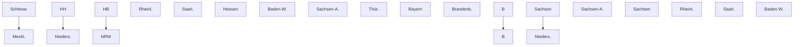
</details>

280

---

Zusammenhang und Zyklen

**Def**.: Ein Graph 𝐺𝐺 = (𝑉𝑉, 𝐸𝐸) heißt **zusammenhängend**, falls zwischen <u>zwei beliebigen Knoten</u> $u , v \in V$ <u>mindestens ein Pfad existiert.</u>

**Def**.: Ein Graph 𝐺𝐺 = (𝑉𝑉, 𝐸𝐸) heißt **zyklenfrei**, falls zwischen zwei beliebigen Knoten $u , v \in V$ höchstens ein Pfad existiert.

• Bsp. Landkarte:

– zusammenhängend
– nicht zyklenfrei


<details>
<summary>flowchart</summary>

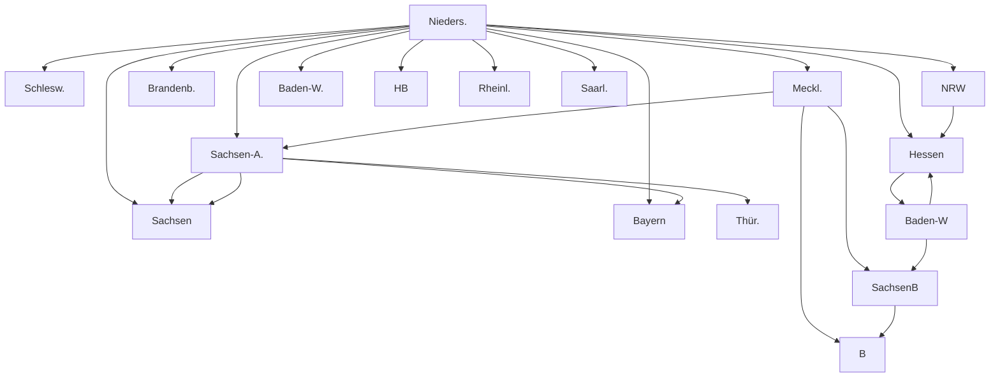
</details>

281

© T. Gemmeke, IDS, RWTH; R. Leupers, SSS

---

Graphen und Bäume, Kantengewichte

**Def**.: Ein zusammenhängender, zyklenfreier Graph $G = ( V , E )$ heißt **Baum**.


Nicht zusammenhängend

Nicht zyklenfrei

Baum

**Def**.: Ein Graph $G = ( V , E , w )$ mit einer Abbildung 𝑤𝑤: 𝐸𝐸 → ℝ heißt **(kanten)gewichteter Graph**.


<details>
<summary>flowchart</summary>

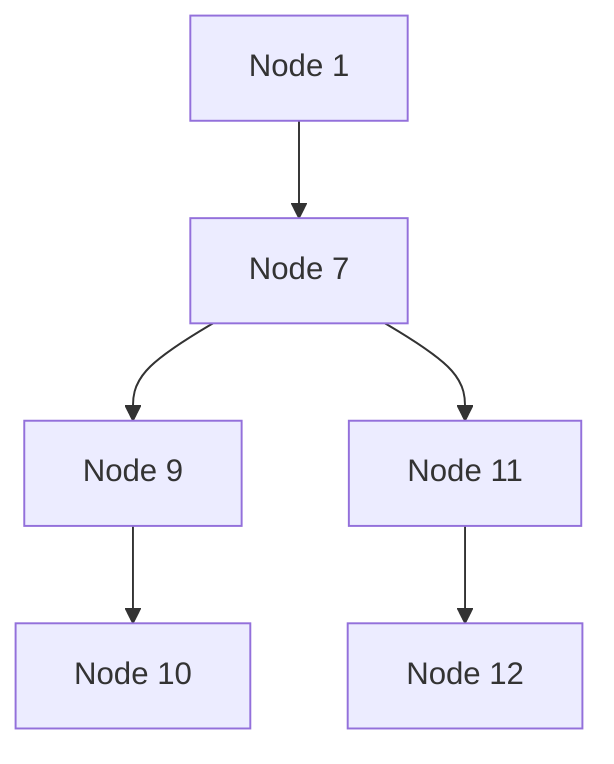
</details>

282

© T. Gemmeke, IDS, RWTH; R. Leupers, SSS

---

## 10. Graphen

10.1 Definition und Grapheigenschaften
**10.2 Berechnung kürzester Pfade**
10.3 Datenstrukturen zur Graphrepräsentation
10.4 Graphdurchläufe
10.5 Spannbäume

283

© T. Gemmeke, IDS, RWTH; R. Leupers, SSS

---

Beispiel-Anwendung: Navigationssystem


<details>
<summary>text_image</summary>

Ludwigsallee
Saarstr.
Wingertsberg
195 m
B 57
Monheimsallee
Pontviertel
Pointvir
Grotkalmstr
Markt
Kaimenstr.
Bucher
Adalbertstr
Kaiserplatz
Theatergy
Borg
Aureusstr
Walther
Bahnhurst
Hörd
Borg
Muhlenburg
Muhlenburg
Muhlenburg
Muhlenburg
Muhlenburg
Muhlenburg
Muhlenburg
Muhlenburg
Muhlenburg
Muhlenburg
Muhlenburg
Muhlenburg
Muhlenburg
Muhlenburg
Muhlenburg
Muhlenburg
Muhlenburg
Muhlenburg
Muhlenburg
Muhlenburg
Muhlenberg
Muhlenberg
Muhlenberg
Muhlenberg
Muhlenberg
Muhlenberg
Muhlenberg
Muhlenberg
Muhlenberg
Muhlenberg
Muhlenberg
Muhlenberg
Muhlenberg
Muhlenberg
Muhlenberg
Muhlenberg
Muhlenberg
Muhlenberg
Muhlenberg
Muhlenberg
Muhlenburg
Boxgraben
Aachen Schanz
Aachen Schanz
Jukkerstrat
Tumststr.
Bierstrat
Leuhrstrat
Dehauststr.
Mauerstr.
Mauerstr.
Lochnerstr.
Konigstr.
Johannesstr.
Jahoubstr.
Bendestri.
Amalsz.
Jesuternstr.
Kaimenstr.
Bergengor.
Bergengor.
Eichsenstreetsr.
Eichsenstreetsr.
Eichsenstreetsr.
Eichsenstreetsr.
Eichsenstreetsr.
Eichsenstreetsr.
Eichsenstreetsr.
Eichsenstreetsr.
Eichsenstreetsr.
Eichsenstreetsr.
Eichsenstreetsr.
Eichsenstreetsr.
Eichsenstreetsr.
Eichsenstreetsr.
Eichsenstreetsr.
B 1a
B 1a
</details>


<details>
<summary>text_image</summary>

GPS
11:5
1 mi
left
SW
GPS
</details>


<details>
<summary>natural_image</summary>

Diagram of a globe with red and black lines connecting global points, no text or symbols present
</details>

https://ndla.no/

• **Knoten** = Geographische Orte
• **Kanten** = Straßenverbindungen
• **Kantengewichte** = Länge bzw. Fahrtdauer
• **Gesucht**:

kürzester Pfad von 𝐴𝐴 nach 𝐵𝐵 gemäß Summe der Kantengewichte

284

© T. Gemmeke, IDS, RWTH; R. Leupers, SSS

---

Bestimmung kürzester Pfade

**Dijkstra-Algorithmus** (single source shortest path)
Bestimmung der kürzesten Pfade von einem Startknoten $v _ { 0 }$ aus zu allen anderen Graphknoten
• I dee:

– In jedem Schritt Betrachtung einer „**Nachbarschaft**“ 𝑁𝑁 von $v _ { 0 } ,$ innerhalb derer die kürzesten Pfade zu $v _ { 0 }$ bereits bekannt sind
– Schrittweise **Erweiterung von** 𝑵𝑵 um den jeweils am nächsten an 𝑁𝑁 liegenden Knoten


<details>
<summary>flowchart</summary>


</details>

285

© T. Gemmeke, IDS, RWTH; R. Leupers, SSS

---

Ablauf des Dijkstra-Algorithmus

**Bisher bekannter** min. Abstand dist(u,v) zwischen zwei Knoten kann durch neue Zwischenknoten **verkürzt** werden


**Def**.: Ist $G \; = \; ( V , E )$ ein Graph und $\{ u , v \} \in E ,$ so heißt 𝑣𝑣 **Nachfolger** von $u ,$ und 𝑢𝑢 heißt **Vorgänger** von 𝑣𝑣.


<details>
<summary>flowchart</summary>

This diagram illustrates a hierarchical or network-based process where multiple nodes (represented by blue and yellow circles) connect to a central node labeled v0, which branches into several outer nodes.
</details>

bereits betrachteter Bereich

Graph G


Alle Nachfolger bereits betrachtet


Nachfolger noch nicht betrachtet

Kürzeste Pfade von $v _ { 0 }$ aus

286

© T. Gemmeke, IDS, RWTH; R. Leupers, SSS

---

Dijkstra-Algorithmus

**Pseudo-Code**: abstrakter Code für Algorithmus, nicht direkt compilier- und ausführbar!
Vorauss.: Datenstruktur für **Graphen** (graph) und **Mengen** (set) verfügbar
• graph unterstützt Zugriff auf Knoten und Kanten (s. später)
• set unterstützt übliche Mengenoperationen
• Variablen:

– dist[v] bezeichnet den aktuell min. Abstand von Knoten 𝑣𝑣 zum Startknoten
– cost(u,v) bezeichnet Gewichtung der Kante {𝑢𝑢, 𝑣𝑣}
– Mengen **BLUE, GREEN und ORANGE** bezeichnen blaue und grüne Knoten sowie orangene Kanten

Orangene Kanten bilden stets einen **Baum von aktuell kürzesten Pfaden** vom Startknoten aus

287

© T. Gemmeke, IDS, RWTH; R. Leupers, SSS

---

Dijkstra-Algorithmus

```txt
void shortest_path(graph G = (V = {v0, ..., vn}, E))
{
    set BLUE = {}, GREEN = {v0}, ORANGE = {}; dist[v0] = 0;

    while (GREEN != {}) { // solange noch unbearbeitete Knoten
        v = MinDist(GREEN); // v ∈ GREEN mit min. dist-Wert
        Insert(v, BLUE);   // BLUE = BLUE ∪ {v}
        Delete(v, GREEN);   // GREEN = GREEN \ {v}

        for (u ∈ Succ(v)) { // für alle Nachfolger u von v
            if (!(u ∈ GREEN ∪ BLUE)) { // neuer Knoten erreicht
                Insert({u,v}, ORANGE);
                Insert(u, GREEN);
                dist[u] = dist[v] + cost(u,v);
            } else if (u ∈ GREEN) {      // u erneut erreicht
                if (dist[v] + cost(u,v) < dist[u]) {
                    Insert({u,v}, ORANGE);
                    e = PreviousEdge(u);   // vorher orangene Kante zu u
                    Delete(e, ORANGE);       // ORANGE = ORANGE \ {e}
                    dist[u] = dist[v] + cost(u,v);
                }
            }
        }
    }
}
```

288

© T. Gemmeke, IDS, RWTH; R. Leupers, SSS

---

Beispiel

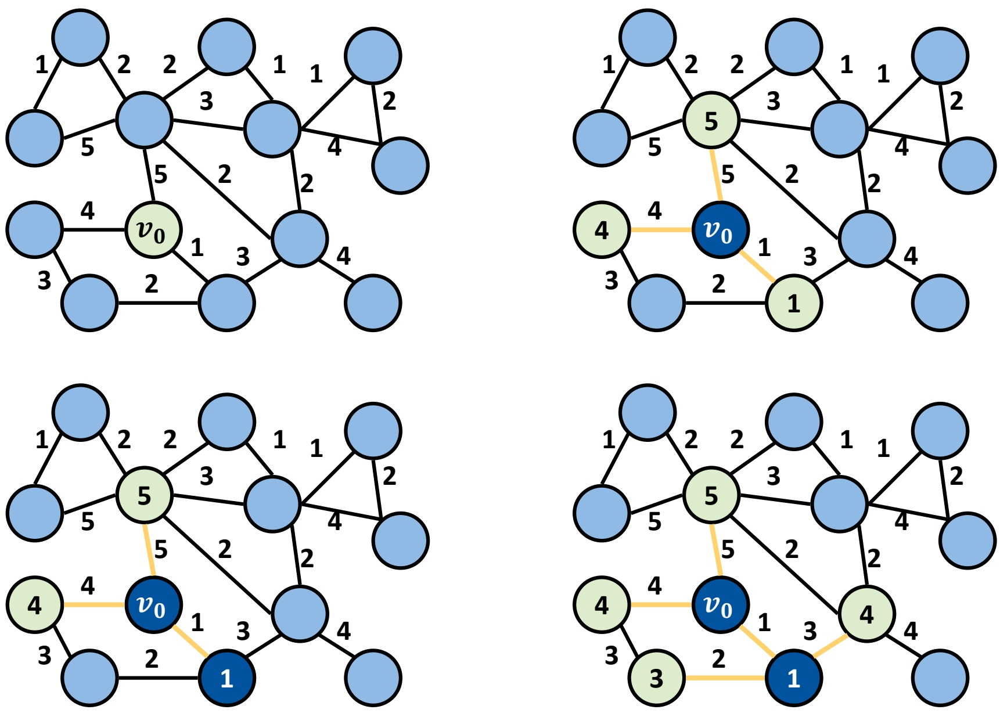

289

© T. Gemmeke, IDS, RWTH; R. Leupers, SSS

---

## Beispiel (Fortsetzung)

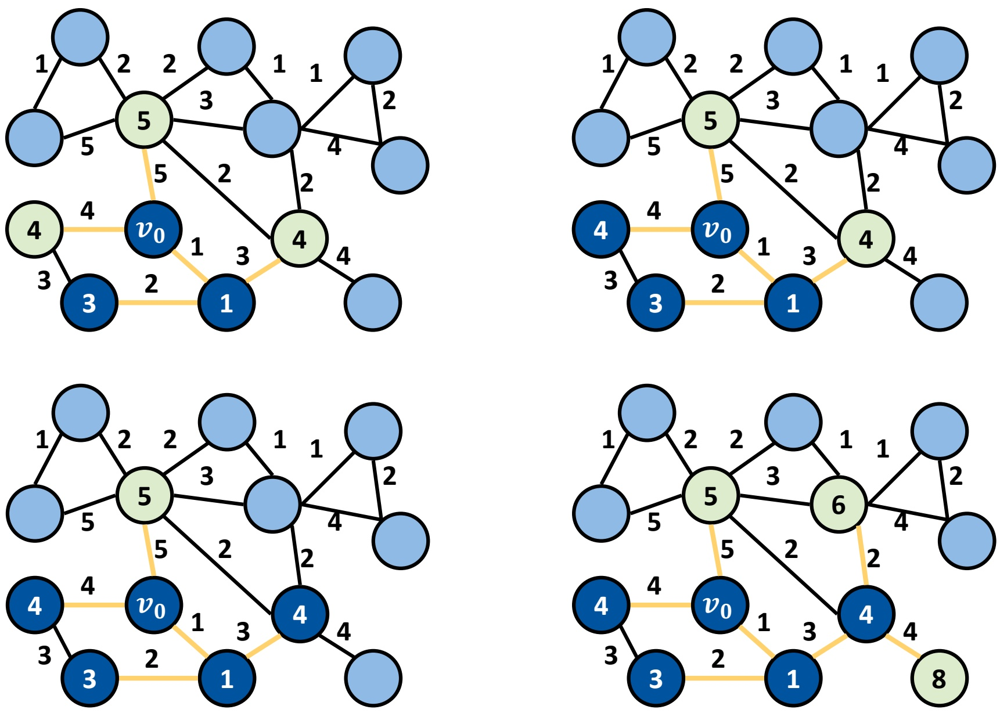

290

© T. Gemmeke, IDS, RWTH; R. Leupers, SSS

---

## Beispiel (Fortsetzung)

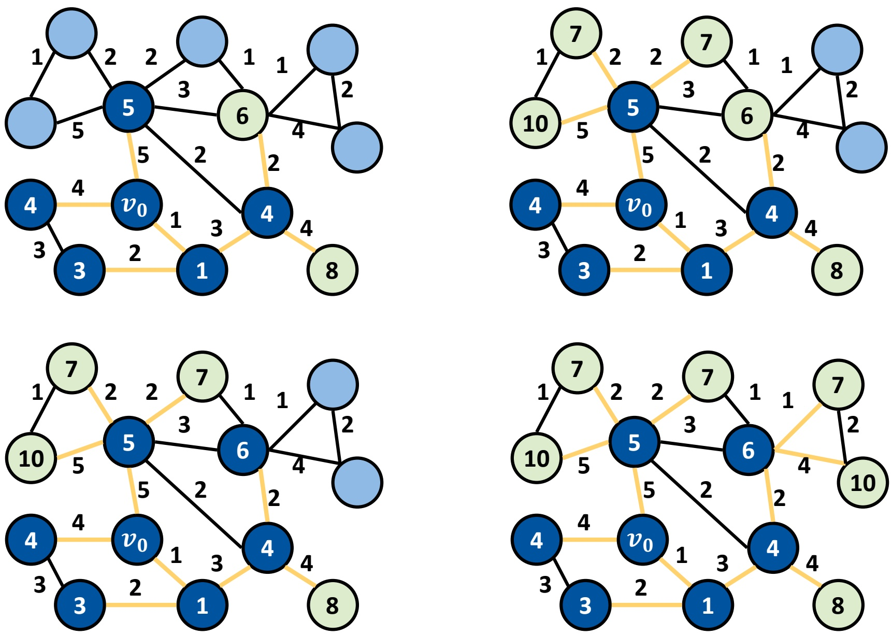

291

© T. Gemmeke, IDS, RWTH; R. Leupers, SSS

---

## Beispiel (Fortsetzung)

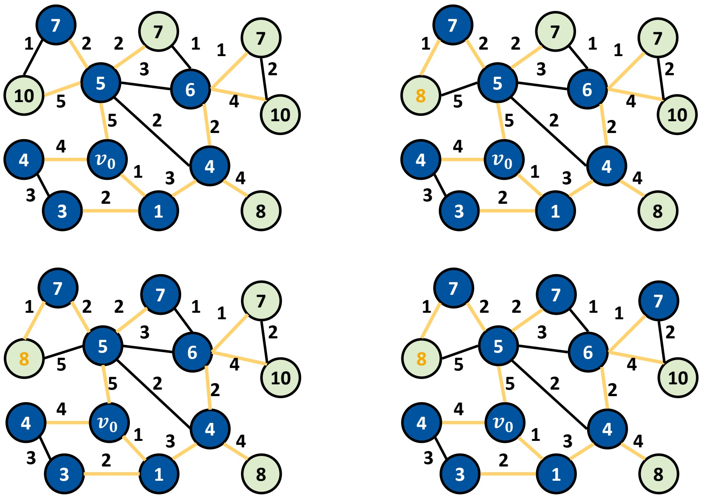

292

© T. Gemmeke, IDS, RWTH; R. Leupers, SSS

---

Beispiel (Fortsetzung), Laufzeit

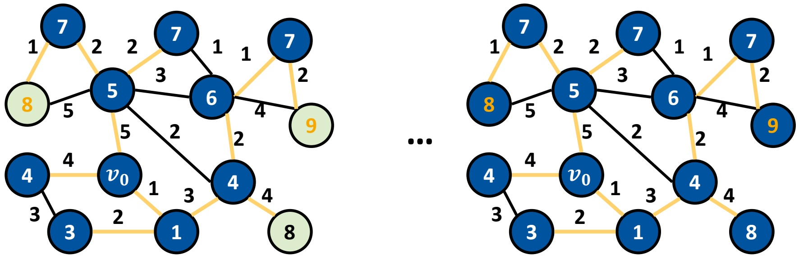

• In jedem Durchlauf der while**-Schleife** wird ein Knoten $\mathsf { { , } } \mathsf { { , } } \mathsf { { \mathsf { { b } } } } | \mathsf { { \mathsf { { a } } } } \mathsf { { \mathsf { { u } } } } ^ { \prime \prime }$
• Aufwand **für jeden Knoten**:

– Bestimmung des bzgl. dist min. „grünen“ Knotens: $\mathcal { O } ( | V | )$
– Behandlung aller $\mathcal { O } ( | V | )$ Nachfolger: jeweils 𝒪𝒪(1)

• Gesamt: $\mathcal { O } \big ( | V | ^ { 2 } \big )$
• **Geschicktere** Implementierung möglich: $\mathcal { O } ( | E | \log \lvert V \rvert )$ , d.h. besser im Fall $| E | \ll | V | ^ { 2 }   ( | E |$ stets beschränkt durch $| V | ^ { 2 } )$

293

© T. Gemmeke, IDS, RWTH; R. Leupers, SSS

---

## 10. Graphen

10.1 Definition und Grapheigenschaften
10.2 Berechnung kürzester Pfade
**10.3 Datenstrukturen zur Graphrepräsentation**
10.4 Graphdurchläufe
10.5 Spannbäume

294

© T. Gemmeke, IDS, RWTH; R. Leupers, SSS

---

Graphrepräsentation

Datenstrukturen zur **internen Speicherung** von Graphen
• Gebräuchlich vor allem: **Adjazenzmatrix** und **Adjazenzlisten**
Existiert zwischen zwei Graphknoten 𝑢𝑢 und 𝑣𝑣 eine Kante $e \; = \; \{ u , v \}$ , so heißen 𝑢𝑢 und 𝑣𝑣 **adjazent**

**Def**.: Ist $G \; = \; ( V , E )$ ein Graph mit Knotenmenge $V \; = \; \{ v _ { 1 } , \ldots , v _ { n } \} ,$ so heißt die (𝑛𝑛 × 𝑛𝑛)-Matrix $A   =   (a_{ij})$ mit

$$
a _ {i j} = 1, \text {falls} \{v _ {i}, v _ {j} \} \in E
$$

$$
a _ {i j} = 0, \text {sonst}
$$

**Adjazenzmatrix** zu $G$ .

• $a _ { i j } = 1$ zeigt an, dass zwischen zwei Knoten $v _ { i }$ und $v _ { j }$ **e**ine Kante existiert
• $a _ { i j } = 0$ zeigt an, dass **keine Kante** vorhanden ist
Knoten werden **implizit** gespeichert

295

© T. Gemmeke, IDS, RWTH; R. Leupers, SSS

---

Beispiel für Adjazenzmatrix

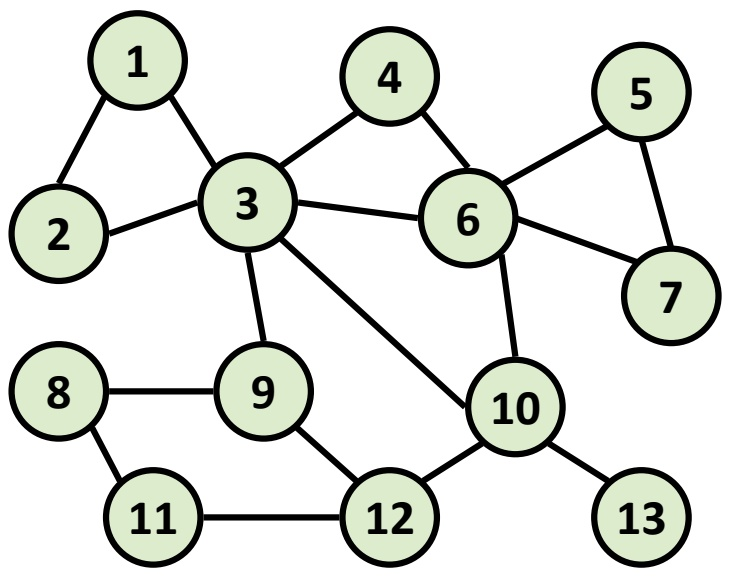

<details>
<summary>flowchart</summary>

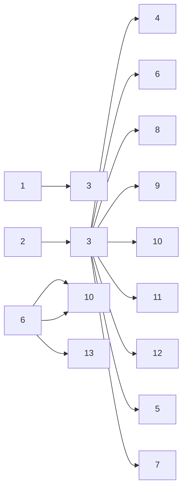
</details>

|  | 1 | 2 | 3 | 4 | 5 | 6 | 7 | 8 | 9 | 10 | 11 | 12 | 13 |
| --- | --- | --- | --- | --- | --- | --- | --- | --- | --- | --- | --- | --- | --- |
| 1 | 0 | 1 | 1 | 0 | 0 | 0 | 0 | 0 | 0 | 0 | 0 | 0 | 0 |
| 2 | 1 | 0 | 1 | 0 | 0 | 0 | 0 | 0 | 0 | 0 | 0 | 0 | 0 |
| 3 | 1 | 1 | 0 | 1 | 0 | 1 | 0 | 0 | 1 | 1 | 0 | 0 | 0 |
| 4 | 0 | 0 | 1 | 0 | 0 | 1 | 0 | 0 | 0 | 0 | 0 | 0 | 0 |
| 5 | 0 | 0 | 0 | 0 | 0 | 1 | 1 | 0 | 0 | 0 | 0 | 0 | 0 |
| 6 | 0 | 0 | 1 | 1 | 1 | 0 | 1 | 0 | 0 | 1 | 0 | 0 | 0 |
| 7 | 0 | 0 | 0 | 0 | 1 | 1 | 0 | 0 | 0 | 0 | 0 | 0 | 0 |
| 8 | 0 | 0 | 0 | 0 | 0 | 0 | 0 | 0 | 1 | 0 | 1 | 0 | 0 |
| 9 | 0 | 0 | 1 | 0 | 0 | 0 | 0 | 1 | 0 | 0 | 0 | 1 | 0 |
| 10 | 0 | 0 | 1 | 0 | 0 | 1 | 0 | 0 | 0 | 0 | 0 | 1 | 1 |
| 11 | 0 | 0 | 0 | 0 | 0 | 0 | 0 | 1 | 0 | 0 | 0 | 1 | 0 |
| 12 | 0 | 0 | 0 | 0 | 0 | 0 | 0 | 0 | 1 | 1 | 1 | 0 | 0 |
| 13 | 0 | 0 | 0 | 0 | 0 | 0 | 0 | 0 | 0 | 1 | 0 | 0 | 0 |

• Bei **kantengewichteten** Graphen:

– Kantengewicht statt 0/1 in Matrix eintragen
– spezieller Wert (z.B. ∞), falls keine Kante vorhanden

296

© T. Gemmeke, IDS, RWTH; R. Leupers, SSS

---

## Eigenschaften und Implementierung

• **Vorteil**: Adjazenz zweier Knoten kann in Zeit 𝓞𝓞(𝟏𝟏) geprüft werden
• **Nachteil**: Hoher Platzbedarf $\langle \mathcal { O } ( | V | ^ { 2 } ) \rangle$ , unabhängig von $| E |$
• C-Implementierung:

```lisp
#define N 100
int adj_matrix[N][N];
int adjacent(int i, int j)
{
    return adj_matrix[i][j] == 1 ? 1 : 0;
}
```

• **Bedingter Ausdruck** in C:

Bedingung $p ^ { 2 ^ { n } }$ then-Ausdruck „:“ else-Ausdruck

Kürzere Schreibweise als if-then-else

297

© T. Gemmeke, IDS, RWTH; R. Leupers, SSS

---

Adjazenzlisten

• Für jeden Knoten **Liste seiner Nachbarn** speichern
• **Array** von verketteten **Listen**

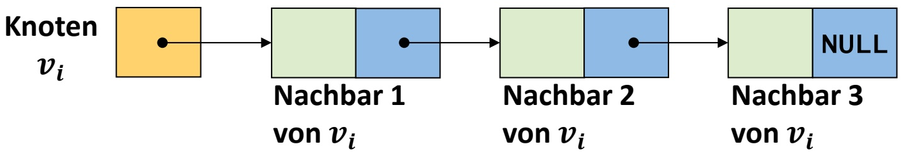

<details>
<summary>flowchart</summary>

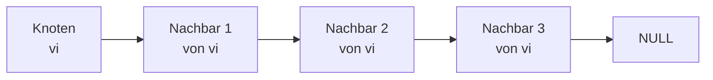
</details>

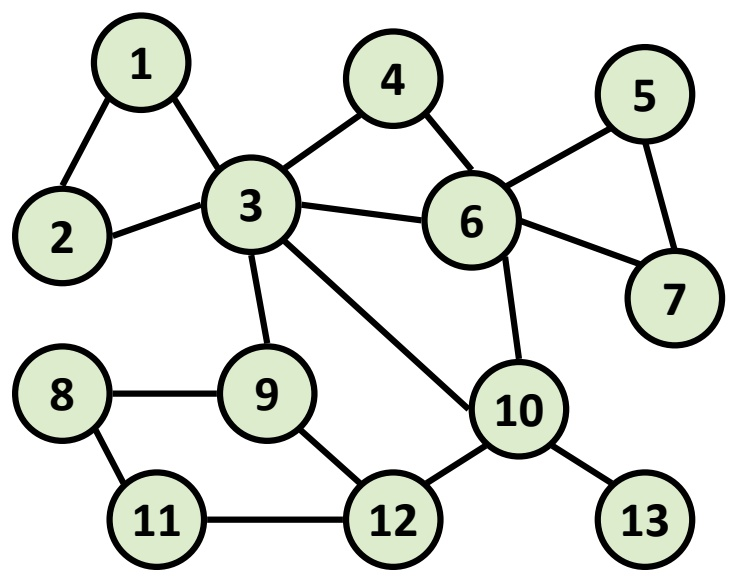

<details>
<summary>flowchart</summary>

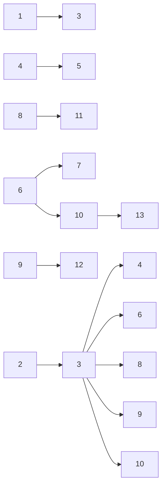
</details>

**1: 2, 3**
**2: 1, 3**
**3: 1, 2, 4, 6, 9, 10**
**4: 3, 6**
**5: 6, 7**
**6: 3, 4, 5, 7, 10**
**7: 5, 6**
**8: 9, 11**
**9: 3, 8, 12**
**10: 3, 6, 12, 13**
**11: 8, 12**
**12: 9, 10, 11**
**13: 10**

298

© T. Gemmeke, IDS, RWTH; R. Leupers, SSS

---

Eigenschaften und Implementierung

• **Vorteil**: Speicherplatzbedarf nur $\mathcal { O } ( | V | + | E | )$
• **Nachteil**: Test auf Adjazenz erfordert im worst case $\mathcal { O } ( | V | )$

```c
#define N 100

List adj_list[N];

int adjacent(int i, int j)
{
    List L;

    L = adj_list[i];
    return IsIn(j, L);
}
```

Auch **Mischformen** und **alternative Graphrepräsentationen** möglich

Auswahl je nach **Häufigkeit** der gewünschten Graphoperationen

299

© T. Gemmeke, IDS, RWTH; R. Leupers, SSS

---

## 10. Graphen

10.1 Definition und Grapheigenschaften
10.2 Berechnung kürzester Pfade
10.3 Datenstrukturen zur Graphrepräsentation
**10.4 Graphdurchläufe**
10.5 Spannbäume

300

© T. Gemmeke, IDS, RWTH; R. Leupers, SSS

---

Graphdurchläufe

**Gesucht**: Algorithmus, der alle Knoten eines Graphen der Reihe nach „besucht“
• Anwendungen u.a.:

– Systematisches **Bearbeiten** aller Graphknoten
– Prüfen ob Graph **zusammenhängend** ist

• Beispiel: **garbage collection**
Aufsammeln und Freigabe von nicht mehr benötigtem dynamisch angeforderten Heap-Speicher (garbage)
• Als **Graph-Modell**:

– Speicherblöcke = Knoten
– Verweis (Zeiger) auf Speicherblock = Kante

**Idee**: Block von Programmvariablen aus nicht mehr erreichbar → Block nicht mehr benötigt, daher Freigabe

301

© T. Gemmeke, IDS, RWTH; R. Leupers, SSS

---

Entstehung von garbage

```c
void f(T* item)
{
    nodeptr p,q;

    p = newnode(item);
    q = newnode(item);
    p->next = q;
    p = newnode(item);
    q = newnode(item);
}
```

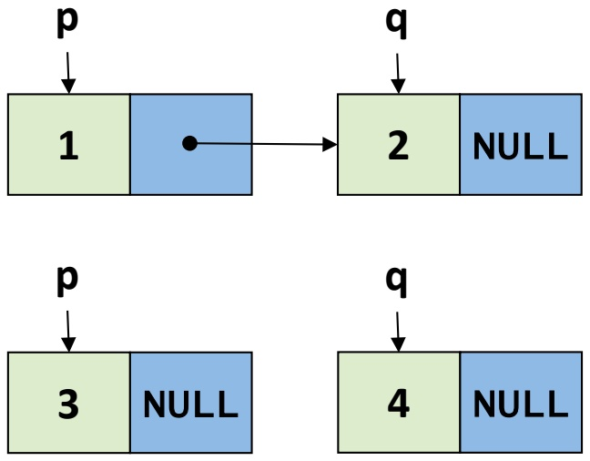

<details>
<summary>flowchart</summary>

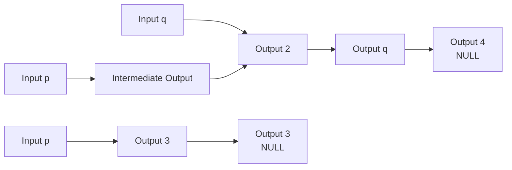
</details>

• Blöcke 1 und 2 anschließend **nicht mehr erreichbar**
Jedoch nicht als „frei“ markiert, da nicht mittels free explizit **freigegeben**
Falls malloc irgendwann im Programmverlauf **keinen freien Speicherplatz** mehr liefert, so muss eine garbage collection durchgeführt werden
• **Besserer Programmierstil**: immer Verwendung von free

© T. Gemmeke, IDS, RWTH; R. Leupers, SSS

---

Garbage collection

Im Programm deklarierte Zeigervariablen

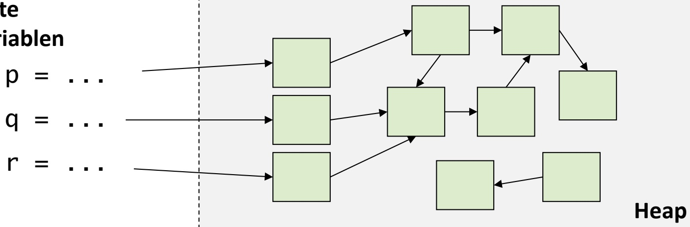

<details>
<summary>flowchart</summary>

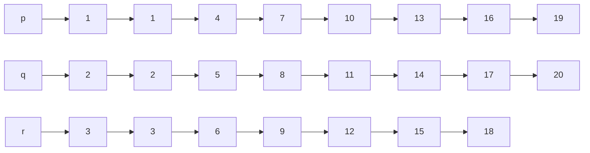
</details>

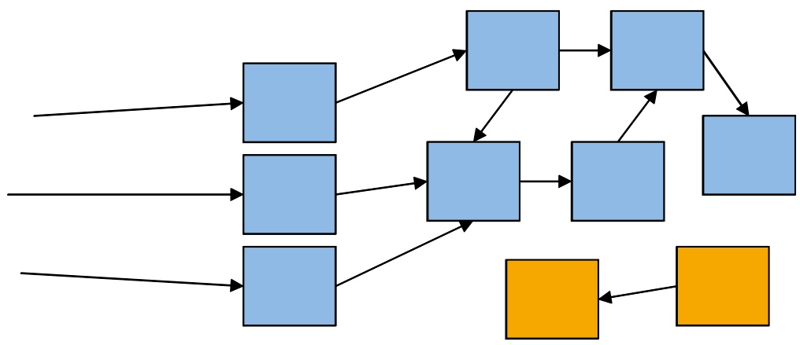

<details>
<summary>flowchart</summary>

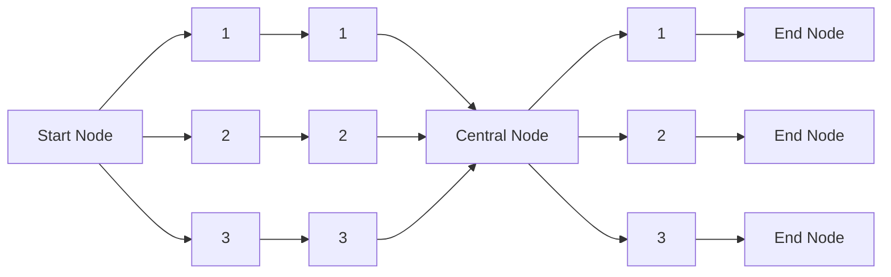
</details>

Nicht erreichte Knoten freigeben

303

© T. Gemmeke, IDS, RWTH; R. Leupers, SSS

---

Graphdurchläufe

Prinzipiell zwei Möglichkeiten für Graphdurchlauf:

**Depth First Search** (DFS, **Tiefensuche**): ausgehend vom Startknoten möglichst lange Pfade verfolgen, oder
**Breadth First Search** (BFS, **Breitensuche**): ausgehend vom Startknoten weitere Knoten in der Reihenfolge wachsenden Abstands vom Startpunkt besuchen

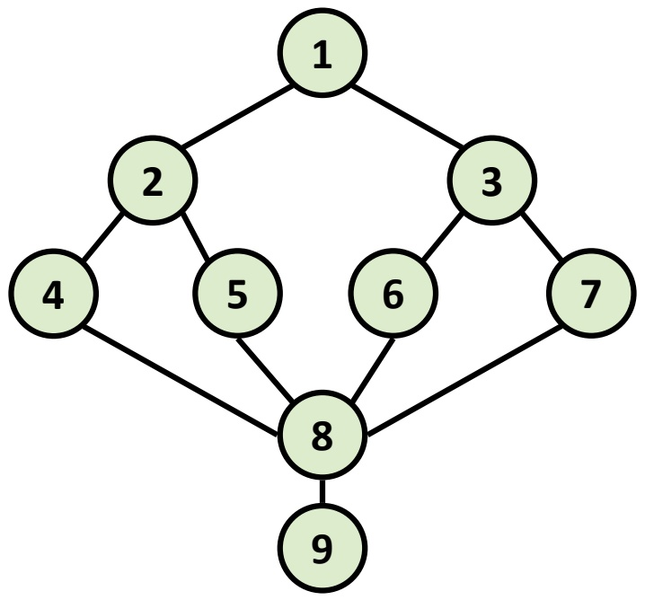

<details>
<summary>flowchart</summary>

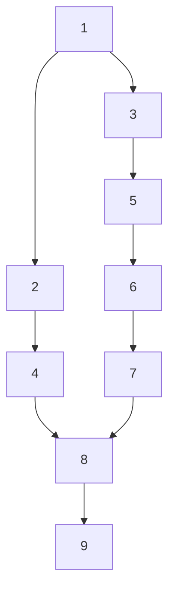
</details>

DFS 1 2 4 8 5 6 37

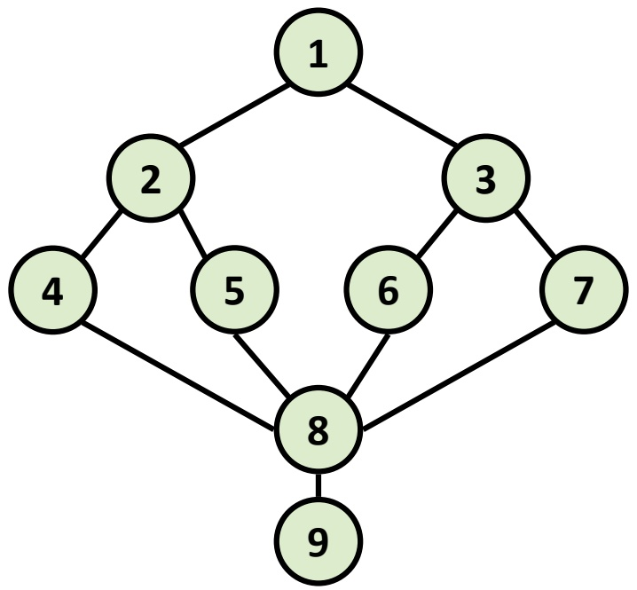

<details>
<summary>flowchart</summary>


</details>

6 78

304

© T. Gemmeke, IDS, RWTH; R. Leupers, SSS

---

DFS - Depth first search

• Algorithmus als **Pseudo-Code**
Vorauss.:

– Graphimplementierung verfügbar
– K<u>noten durch integer-Zahlen identifiziert</u>

```c
int visited[N]; // implizit mit 0 initialisiert

void dfs(int v) // DFS beginnend bei v
{ int w;
  visited[v] = 1; // markiere v als besucht
  process(v);      // Verarbeitung von v
  for ({v,w} ∈ E) // für alle Nachbarn w
  { // rekursiver Aufruf von dfs:
    if (!visited[w]) dfs(w);
  }
}

int main(void)
{
  int v;
  for (v = 0; v < N; v++)
    if (!visited[v]) dfs(v);

  return 0;
}
```

305

© T. Gemmeke, IDS, RWTH; R. Leupers, SSS

---

BFS – Breadth First Search

In BFS werden die Knoten „ebenenweise“besucht
• Verwendung einer **Queue** (Kap. 8)
Queue speichert **noch zu bearbeitende Knoten auf nächster Ebene**, während
„Geschwisterknoten“auf selber Ebene gerade bearbeitet werden

```c
int visited[N];

void bfs(int v) // BFS ab Knoten v
{
    int w; Queue Q;
    visited[v] = 1;
    process(v);
    Put(v,Q);
    while (!IsEmpty(Q)) {
        v = Get(Q);
        for ({v,w} ∈ E) {
            if (!visited[w]) {
                visited[w] = 1;
                process(w);
                Put(w,Q);
            }
        }
    }
}

void main()
{
    int v;
    for (v = 0; v < N; v++)
        if (!visited[v]) bfs(v);
}
```

306

© T. Gemmeke, IDS, RWTH; R. Leupers, SSS

---

Laufzeitanalyse

Annahme: Graphdarstellung als **Adjazenzlisten**
• **DFS**:

– Aufruf für alle Knoten aus main: 𝒪𝒪( 𝑉𝑉 )
– Einmalige Bearbeitung aller Kanten in for: 𝒪𝒪( 𝐸𝐸 )
– **Gesamt**: 𝒪𝒪( 𝑉𝑉 + 𝐸𝐸 )

• BFS

– Aufruf für alle Knoten aus main, jeder Knoten einmal in der Queue: 𝒪𝒪( 𝑉𝑉 )
– Einmalige Bearbeitung aller Kanten in for: 𝒪𝒪( 𝐸𝐸 )
– **Gesamt**: 𝒪𝒪(|𝑉𝑉| + 𝐸𝐸 )

```txt
void dfs(int v)
{
    int w;
    visited[v] = 1;
    process(v);
    for ({v,w} ∈ E) {
        if (!visited[w]) dfs(w);
    }
}
```

```txt
void bfs(int v)
{
    int w; Queue Q;
    visited[v] = 1;
    process(v);
    Put(v,Q);
    while (!IsEmpty(Q)) {
        v = Get(Q);
        for ({v,w} ∈ E) {
            if (!visited[w]) {
                visited[w] = 1;
                process(w);
                Put(w,Q);
            }
        }
    }
}
```

307

© T. Gemmeke, IDS, RWTH; R. Leupers, SSS

---

## 10. Graphen

10.1 Definition und Grapheigenschaften
10.2 Berechnung kürzester Pfade
10.3 Datenstrukturen zur Graphrepräsentation
10.4 Graphdurchläufe
**10.5 Spannbäume**

308

© T. Gemmeke, IDS, RWTH; R. Leupers, SSS

---

Spannbäume

Anwendung: z.B. **Leitungsplanung** zur Elektrifizierung entlegener Ortschaften
• **Graphmodellierung**:

– Ortschaften = Knoten
– Entfernungsmaß = Kantengewichte

Zur **Vernetzung** müssen nicht alle möglichen Leitungen realisiert werden, es müssen nur alle Knoten erreicht werden
• Mit **möglichst geringen** Gesamt-Leitungskosten

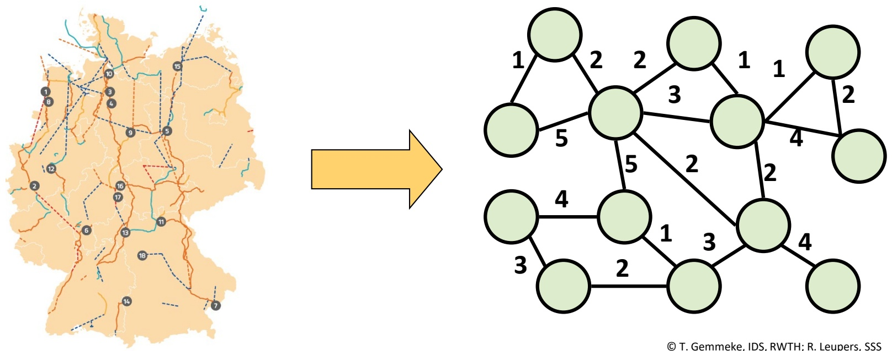

309

---

Minimale Spannbäume

**Def**.: Ein **Spannbaum** in einem ungerichteten, zusammenhängenden und kantengewichteten Graphen $G \; = \; ( V , E , w )$ ist ein zyklenfreier, zusammenhängender Teilgraph $G ^ { \prime } = ( V ^ { \prime } , E ^ { \prime } , w )$ mit $V ^ { \prime } = V$ und $E ^ { \prime } \subseteq E$

**Def**.: Ein **minimaler Spannbaum** in einem ungerichteten, zusammenhängenden und kantengewichteten Graphen $G = ( V , E , w )$ ist ein Spannbaum mit minimaler <u>Kantengewichtssumme unter allen Spannbäumen zu 𝐺𝐺.</u>

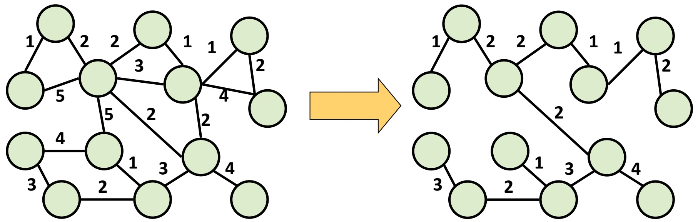

310

© T. Gemmeke, IDS, RWTH; R. Leupers, SSS

---

Kruskal-Algorithmus

## • Idee:

– fortgesetzte Auswahl von Kanten mit geringem Gewicht
dabei Zyklen vermeiden

1. Beginne mit **leerem** Spannbaum 𝑇𝑇
2. Bilde Liste 𝐿𝐿 der Graphkanten von 𝐺𝐺, **sortiert nach aufsteigendem Gewicht** (s. Sortieralgorithmen)
3. Betrachte jeweils **nächstgrößere** Kante in 𝐿𝐿
4. Falls Einfügen von in 𝑇𝑇 einen **Zyklus** verursachen würde: als ungültig betrachten und verwerfen
5. Sonst: in 𝑇𝑇 **einfügen**
6. Fortsetzen ab 3, bis 𝑇𝑇 insgesamt 𝒏𝒏 − 𝟏𝟏 **Kanten** enthält 𝑇𝑇 bildet dann einen **minimalen Spannbaum** zu 𝐺𝐺

311

© T. Gemmeke, IDS, RWTH; R. Leupers, SSS

---

Kruskal-Algorithmus

```txt
Graph MinSpanningTree(Graph G = (V,E))
{
    Graph T; List L; Edge e;
    T = {};
    L = Sort(E); // sortierte Kantenliste

    while (#Kanten in T < #Knoten in G - 1 && !IsEmpty(L)) {
        e = FirstElem(L); // nächst-günstigste Kante
        Delete(e,L);
        if (!Cycle(e,T)) { // kein Zyklus in T ∪ {e} ?
            T = T ∪ {e};
        }
    }

    if (#Kanten in T < #Knoten in G - 1) {
        /* keine verfügbaren Kanten mehr, d.h.
            G ist nicht zusammenhängend */
        printf("Fehler - kein Spannbaum möglich!");
    }
    return T;
}
```

312

© T. Gemmeke, IDS, RWTH; R. Leupers, SSS

---

Beispiel

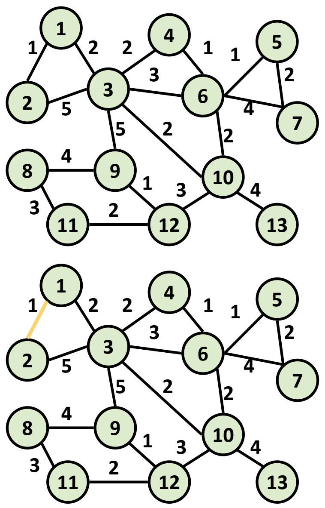

$$
T = \{\}
$$

Sortierte Kantenliste:

$$
\begin{array}{l} L = \{\{1, 2 \}, \{4, 6 \}, \{5, 6 \}, \{9, 1 2 \}, \{1, 3 \}, \{3, 4 \}, \\ \{5, 7 \}, \{3, 1 0 \}, \{6, 1 0 \}, \{1 1, 1 2 \}, \{3, 6 \}, \\ \{8, 1 1 \}, \{1 0, 1 2 \}, \{6, 7 \}, \{8, 9 \}, \{1 0, 1 3 \}, \\ \{2, 3 \}, \{3, 9 \}\} \\ \end{array}
$$

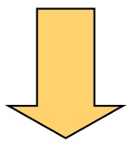

$$
T = \{\{1, 2 \} \}
$$

$$
L = \{\{4, 6 \}, \{5, 6 \}, \{9, 1 2 \}, \{1, 3 \}, \{3, 4 \},
$$

$$
\{5, 7 \}, \{3, 1 0 \}, \{6, 1 0 \}, \{1 1, 1 2 \}, \{3, 6 \},
$$

$$
\{8, 1 1 \}, \{1 0, 1 2 \}, \{6, 7 \}, \{8, 9 \}, \{1 0, 1 3 \},
$$

$$
\{2, 3 \}, \{3, 9 \}\}
$$

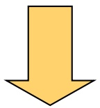

313

© T. Gemmeke, IDS, RWTH; R. Leupers, SSS

---

Beispiel

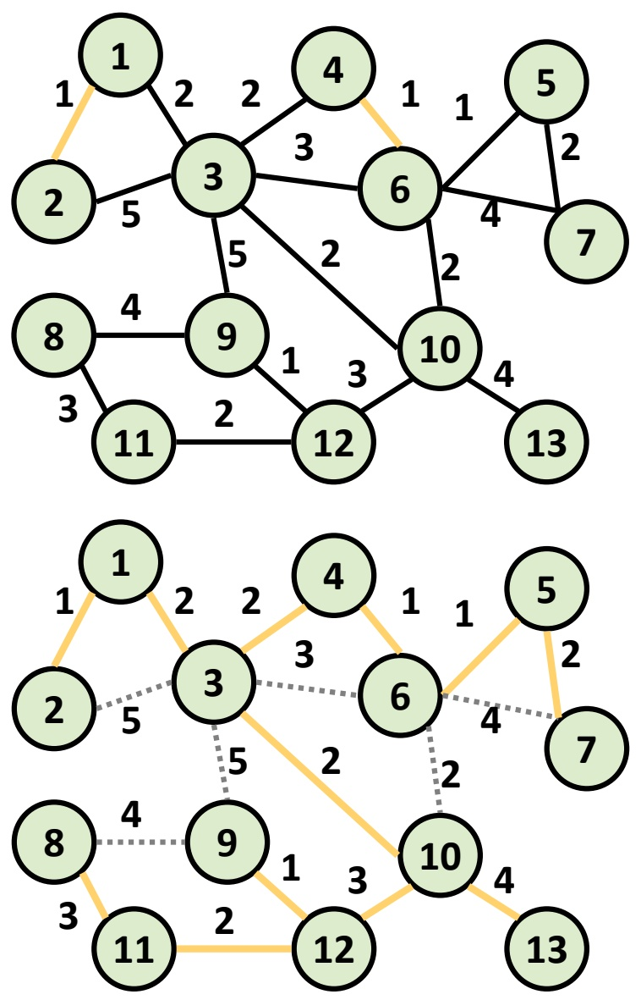

$$
\begin{array}{l} T = \{\{1, 2 \}, \{4, 6 \} \} \\ L = \{\{5, 6 \}, \{9, 1 2 \}, \{1, 3 \}, \{3, 4 \}, \\ \{5, 7 \}, \{3, 1 0 \}, \{6, 1 0 \}, \{1 1, 1 2 \}, \{3, 6 \}, \\ \{8, 1 1 \}, \{1 0, 1 2 \}, \{6, 7 \}, \{8, 9 \}, \{1 0, 1 3 \}, \\ \{2, 3 \}, \{3, 9 \}\} \\ \end{array}
$$

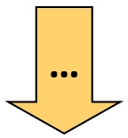

{6,10}, {3,6}, {6,7}, {8,9} bilden Zyklen !

$$
\begin{array}{l} T = \{\{1, 2 \}, \{4, 6 \}, \{5, 6 \}, \{9, 1 2 \}, \{1, 3 \}, \{3, 4 \}, \\ \{5, 7 \}, \{3, 1 0 \}, \{1 1, 1 2 \}, \{8, 1 1 \}, \{1 0, 1 2 \}, \\ \{1 0, 1 3 \}\} \\ \end{array}
$$

$$
L = \{\{2, 3 \}, \{3, 9 \} \}
$$

314

© T. Gemmeke, IDS, RWTH; R. Leupers, SSS

---

Laufzeitanalyse

• **Sortieren**: 𝒪𝒪( 𝐸𝐸 log 𝐸𝐸 )
• while**-Schleife**:

– max. 𝐸𝐸 Durchläufe
– Entnahme und Löschen von : 𝒪𝒪(1)
– Test auf Zyklus: bei Verwendung spezieller Datenstruktur („**union/find**“) praktisch in 𝒪𝒪(1)

• **Gesamtlaufzeit**:

𝒪𝒪 𝐸𝐸 log 𝐸𝐸

```txt
Graph MinSpanningTree(Graph G = (V,E))
{
    Graph T; List L; Edge e;

    T = {};
    L = Sort(E);

    while (#Kanten in T < #Knoten in G - 1 &&
        !IsEmpty(L)) {
        e = FirstElem(L);
        Delete(e, L);
        if (!Cycle(e, T)) { T = T ∪ {e}; }
    }

    if (#Kanten in T < #Knoten in G - 1) {
        printf("Fehler - kein Spannbaum möglich!");
    }

    return T;
}
```

315

© T. Gemmeke, IDS, RWTH; R. Leupers, SSS
