# Grundgebiete der Informatik 1

## Programmierung, Algorithmen und Datenstrukturen

Prof. Dr.-Ing. Tobias Gemmeke

Integrierte Digitale Systeme und Schaltungsentwurf (IDS)

gemmeke@ids.rwth-aachen.de

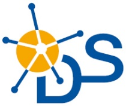

<details>
<summary>natural_image</summary>

Abstract logo design with orange circle and blue curved lines forming a stylized 'S' shape (no text or symbols)
</details>

Chair of Integrated Digital Systems and Circuit Design

RWTHAACHEN UNIVERSITY

## 1. Einleitung

<u>1.1 Thematische Einordnung</u> 16
<u>1.2 Hardware und Software</u> 19
<u>1.3 Programmiersprachen</u> 22
<u>1.4 Algorithmen und Programme</u> 26

## 2. Einführendes Beispiel

<u>2.1 Temperaturumrechnung</u> 31
<u>2.2 Analyse des Beispiels</u> 35
<u>2.3 Ausführung und Fehlersuche</u> 42

## 3. Elementare Datentypen und Anweisungen

<u>3.1 Einführung</u> 47
<u>3.2 Variablen und Konstanten</u> 53
<u>3.3 Arithmetische und logische Operationen und Zuweisungen</u> 74
<u>3.4 Kontrollanweisungen</u> 81
<u>3.5 Zeiger</u> 59

## Inhalt

## 4. Funktionen und Programmaufbau

<u>4.1 Funktionen</u> 97
<u>4.2 Parameterübergabe</u> 107
<u>4.3 Polymorphie</u> 112
<u>4.4 Templates</u> 116
<u>4.5 Lambda Funktionen</u> 118
<u>4.6 Module und Programme</u> 120

## 5. Datentypen

<u>5.1 Arrays</u> 123
<u>5.2 Strukturen</u> 133
<u>5.3 Abstrakte Datentypen</u> 137
<u>5.4 Klassen</u> 139

<u>(De)Konstruktor</u> 141
<u>Public vs. private</u> 143
<u>Vererbung</u> 146
<u>Abstrakte Klassen</u> 150
<u>Überladen von Operatoren</u> 152

## 6. Analyse von Algorithmen

<u>6.1 Laufzeitanalyse</u> 159
6.2 O-Notation für Wachstumsordnungen 165
6.3 Beispiel: Exponentialfunktion 175
6.4 Beispiel: Suchen in Arrays 180

## 7. Sortieralgorithmen

7.1 Einfache Verfahren (Selection/Insertion/Bubblesort) 189
7.2 Quicksort 205
<u>7.3 Heapsort</u> 215

## 8. Lineare Datentypen

8.1 Listen 229
8.2 Stacks 242
<u>8.3 Queues</u> 251

## 9. Bäume

9.1 Definition und Darstellung 261
9.2 Baumdurchläufe 265
<u>9.3 Suchbäume</u> 269

## 10. Graphen

<u>10.1 Definition und Grapheigenschaften</u> 277
<u>10.2 Berechnung kürzester Pfade</u> 283
<u>10.3 Datenstrukturen zur Graphrepräsentation</u> 294
<u>10.4 Graphdurchläufe</u> 300
<u>10.5 Spannbäume</u> 308

## 11. Techniken zum Algorithmenentwurf

<u>11.1 Rekursion und Iteration</u> 316
<u>11.2 Backtracking</u> 323
<u>11.3 Kombinatorische Optimierung</u> 330
<u>11.4 Schwierige Probleme und Heuristiken</u> 335
<u>11.5 Dynamische Programmierung</u> 341
<u>11.6 Branch and Bound</u> 346

• B.Sc. Elektrotechnik und Informationstechnik
• B.Sc. Computer Engineering
B.Sc. Wirtschaftsingenieurwesen EET

• **Koordination / Fachstudienbetreuung**

– Dipl.-Inform. Tatjana Eiden

• **Gemeinsame Globalübung**

– Do 12:15-13:15
– Vor allem: c/C++-Programmierkurs
– Michael Gansen


<details>
<summary>natural_image</summary>

Portrait of a smiling woman with short blonde hair and glasses, wearing a dark blazer (no text or symbols visible)
</details>


<details>
<summary>natural_image</summary>

Portrait of a man with short hair wearing a gray collared shirt (no text or symbols visible)
</details>

• **Kleingruppenübungen:**

– Interaktive Vertiefung und Ergänzung des Vorlesungsstoffes
– Tutoren: studentische Hilfskräfte
– Ca. 16 wöchentliche Termine zur Auswahl
– Vorauss. ab 2. Vorlesungswoche (siehe RWTHonline)

• Teilnahme nicht obligatorisch aber dringend empfohlen
• Anmeldungsinfo: **siehe RWTHonline**
• Anmeldeschluss beachten!
• **Gruppeneinteilung**: Benachrichtigung per email
• **Übungsaufgaben**: jeweils am Fr online über Moodle
Vorbereitungsaufgaben, Präsenzaufgaben und Nachbereitungsaufgaben

**Alle** Studierende mit 100 von 200 Punkten in den Hausübungen **haben** in 21/22 **bestanden.**

Teilnahme an der **Probeklausur** führte in 21/22 zu folgender **Verbesserung:**

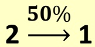


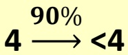

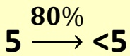

## • Klausur

– 1. Versuch: siehe RWTHonline
– 2. Versuch: siehe RWTHonline

## • Fragestunde GGI1 bei Fr. Eiden

– Di 12:15-13:45 (UMIC, ab 20.10.)
– Do 13:15-14:00 (H02, ab 15.10.) im Anschluss an die Globalübung
– sowie nach vorheriger Absprache per E-Mail

## • Aktuelle Nachrichten

– Siehe RWTHonline
– Sprechstunden bei Prof. Gemmeke n.V. per Email:
info@ids.rwth-aachen.de

B.W. Kernighan, D.M. Ritchie: Programmieren in C, 2. Auflage, Hanser, 1990, ISBN 3-446-15497-3
R. Sedgewick: Algorithmen in C++, Addison-Wesley, 2002, ISBN 3-8273-7026-4
• In der Lehrbuchsammlung
• Kommentierte Vorlesungsfolien
Grundsätzlich auch andere Einführungen in die Programmierung als Hilfsmittel geeignet


## Über das IDS (www.ids.rwth-aachen.de)

Lehrstuhl für Integrierte Digitale Systeme und Schaltungsentwurf (IDS)
• Schwerpunkte:

– Entwurfsmethodik integrierte digitale Schaltungen
– Beschleuniger für verschiedene Anwendungen:

• Simulation biologischer neuronaler Netzwerke
Inferenz in künstlichen neuronalen Netzen
• Kryptographie
• • • •

– Testmethoden

• Standort: UMIC Gebäude
– Mies-van-der-Rohe Str. 15, RWTH Hörn Campus


<details>
<summary>natural_image</summary>

Modern multi-story office building with glass windows and striped panels, surrounded by green lawn and trees under a partly cloudy sky (no signage or text visible)
</details>

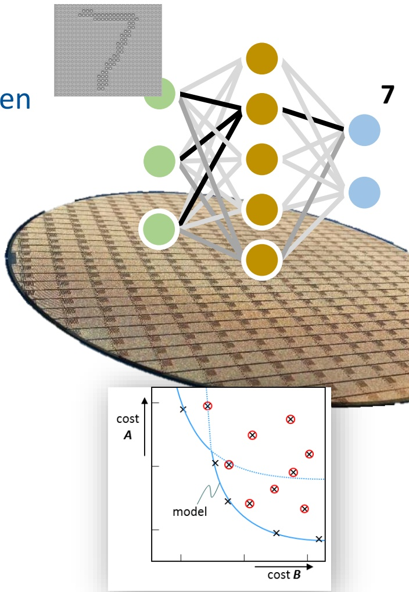

<details>
<summary>text_image</summary>

en
7
cost
A
model
cost B
</details>

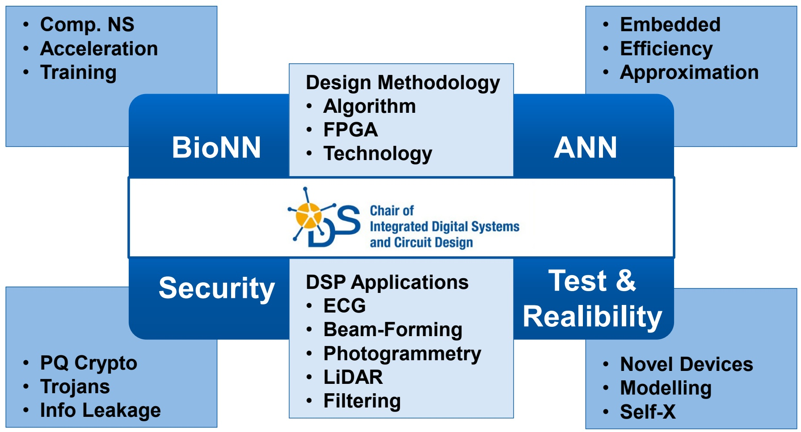

<details>
<summary>flowchart</summary>

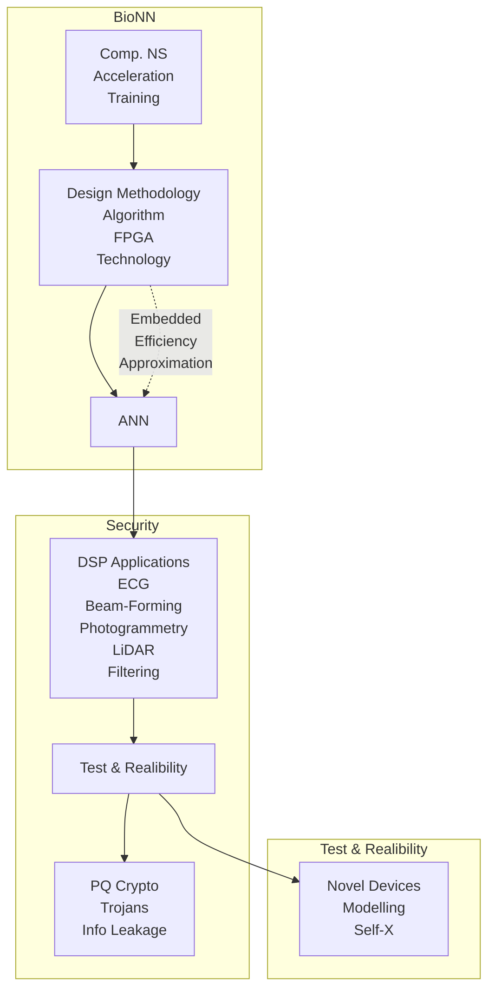
</details>

Chip-Entwurf

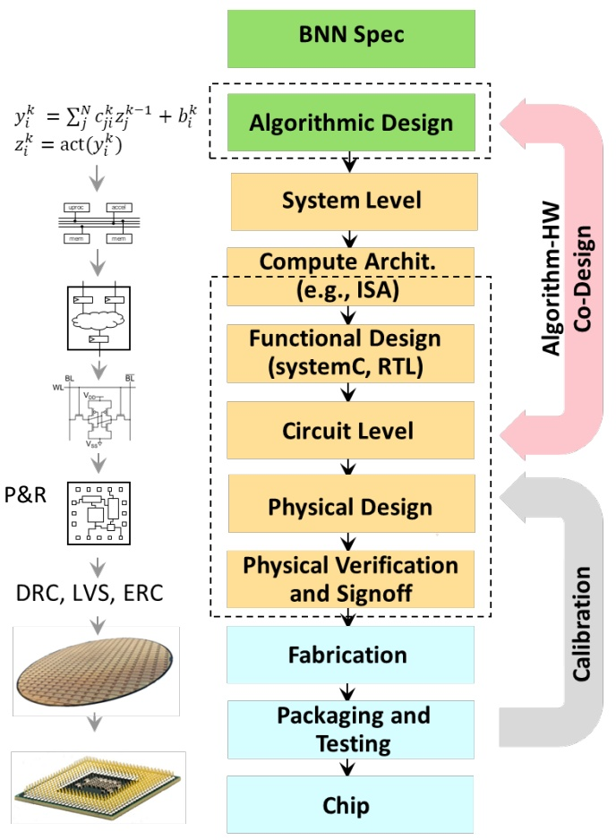

<details>
<summary>flowchart</summary>

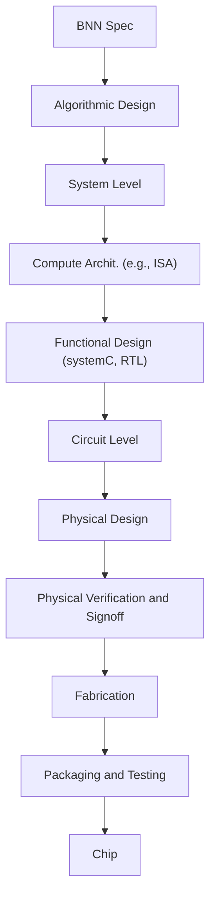
</details>

vom Layout zum Bring-Up

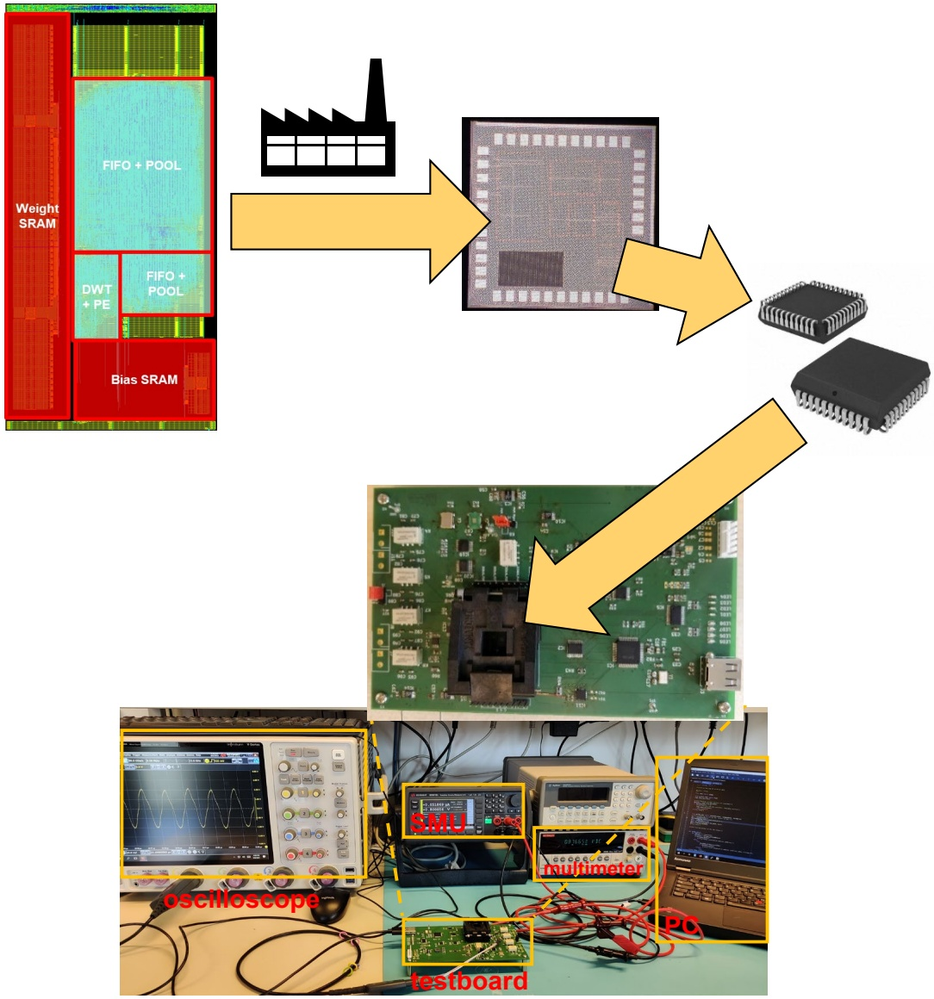

<details>
<summary>flowchart</summary>

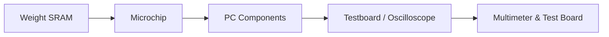
</details>

## Kooperationsprojekte (Auswahl)

## Advanced

## Computing

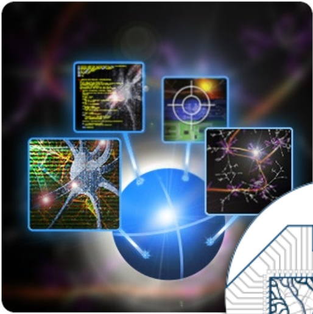

<details>
<summary>natural_image</summary>

Abstract digital illustration of a globe with four labeled technology icons (labeled 1–5) against a cosmic background, no readable text or symbols present.
</details>

Architectures (ACA)

ACA

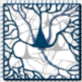

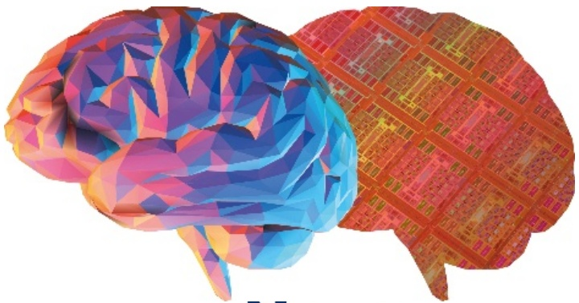

<details>
<summary>natural_image</summary>

Abstract illustration of a human brain with colorful polyhedra and a grid-patterned brain model (no text or symbols)
</details>

Neuro Sys

I&II

towards multi-scale natural-density

Neuromorphic Computing \* Mehrere Lehrstühle tragen zur Durchführung der Veranstaltung bei

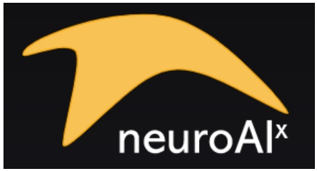

<details>
<summary>text_image</summary>

neuroAIx
</details>

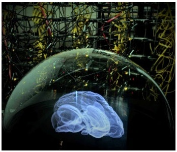

<details>
<summary>natural_image</summary>

Digital illustration of a glowing blue brain inside a transparent dome, surrounded by abstract geometric structures (no text or symbols)
</details>

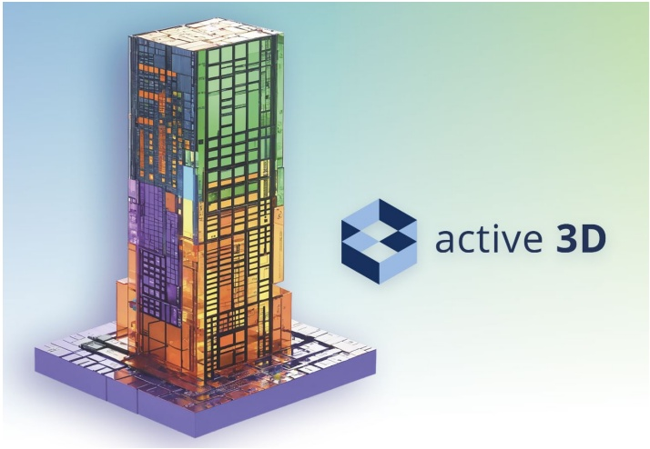

<details>
<summary>natural_image</summary>

3D architectural rendering of a modern multi-story building with visible internal structures and a logo labeled 'active 3D' (no text on the structure itself)
</details>

## • Bachelor:

– Grundgebiete der Informatik 1 (GGI1) 1. Sem
– \*Projekt PETIT ("MATLAB meets LEGO Mindstorms„) 1. Sem
\*Praktikum Informatik 2 Teile
– VLSI Schaltungen & Architekturen (VLSI-CA) 4. Sem Pflicht CE bzw. 6. Sem Wahl ET&IT
– \*Grundlagen Integrierter Schaltungen und Systeme (GISS) 5. Sem Wahl ME
Institutsprojekt „Anwendung von künstlichen neuronalen Netzen zur Linienverfolgung mit Braitenberg-Vehikeln“ 4. Sem
– \*Praktikum Mikroelektronik 5. Sem Pflicht in ME
– Bachelor-Arbeiten zu aktuellen Forschungsthemen

## • Master

– VLSI Design for Digital Signal Processing – Fundamentals (VLSI-DF)
– VLSI Design for Digital Signal Processing – Architecturs (VLSI-DA)
– Computer Arithmetic – Fundamentals (CAR-F)
– Computer Arithmetic – Advanced Topics (CAR-A)
– Laboratory: VLSI Design
– Laboratory: FPGA Design
– Master-Arbeiten zu aktuellen Forschungsthemen

## 1. Einleitung

**1.1 Thematische Einordnung**
1.2 Hardware und Software
1.3 Programmiersprachen
1.4 Algorithmen und Programme

**Informatik** (Computer Science) ist die **Wissenschaft**, die sich mit der Entwicklung und Nutzung von Computersystemen beschäftigt
• Wurzeln in der **Mathematik** und **Elektrotechnik**
**Informatikkenntnisse** (speziell: Programmierkenntnisse) gehören heute zum Handwerkszeug jedes Ingenieurs
Einteilung in drei große **Teilgebiete**:

1. <u>Theoretische Informatik</u>: Computermodelle, Sprachen, Boolesche Funktionen, Komplexitätsanalyse, ...
2. <u>Praktische Informatik</u>: Programmiersprachen, Compiler, Betriebssysteme, SW Engineering, Datenbanken, ...
3. <u>Technische Informatik</u>: Aufbau von Computer-Hardware, Chip-Entwurf, Netzwerke, Mobilfunk, ...

## Einordnung GGI1

**GGI1** ist in erster Linie in der **praktischen Informatik** angesiedelt
**GGI2**: Technische Informatik: Prinzipien des Digitalrechners
**Automaten, Sprachen, Komplexität** (CE): Theoretische Informatik
**GGI3**: Praktische und Technische Informatik: Optimierung, Modellierung und Parallelität
**SUSP:** Praktische Informatik: System-SW und systemnahe Program.
• **GGI4:** Prakt. Inf.: Betriebssysteme
• Daneben: **Projekte** und **Praktika**
Grundlagen für weitere **Spezialisierung** ab 5. Semester


<details>
<summary>flowchart</summary>

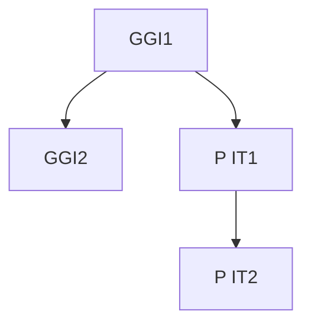
</details>

CE:


<details>
<summary>flowchart</summary>

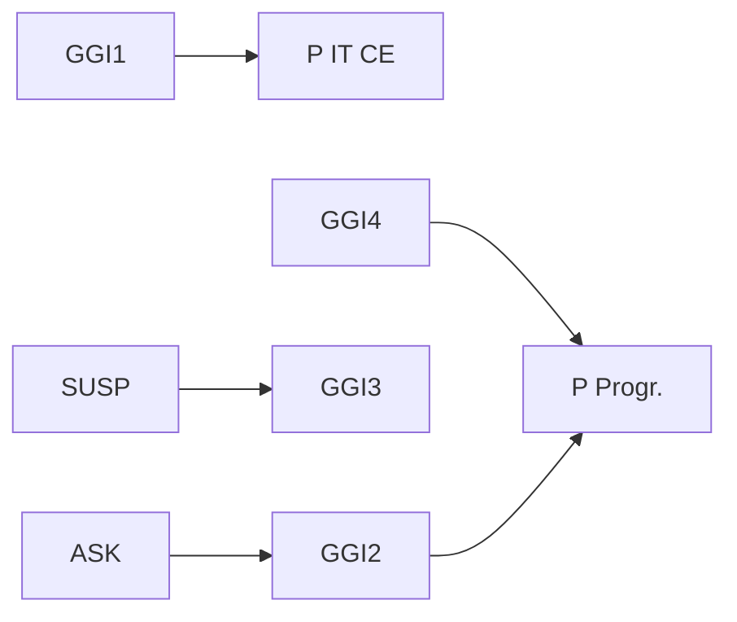
</details>

## 1. Einleitung

1.1 Thematische Einordnung
**1.2 Hardware und Software**
1.3 Programmiersprachen
1.4 Algorithmen und Programme

HW = Physikalisch existierender, programmierbarer Rechner (Computer)

→ Modifikation aufwendig

SW = Auf HW ausführbares Programm (Textdatei) für gegebene Anwendung

→ Modifikation einfach

In GGI1 wird die HW als **Black Box** betrachtet, die Programmcode ausführen kann
Innerer HW-Aufbau: siehe Vorlesung **GGI2**

## User


<details>
<summary>natural_image</summary>

Woman smiling while using a laptop (no visible text or symbols)
</details>


## SW

```c
void rgb2ycc1(
    signed char r, signed char g, signed char b,
    signed char *y, signed char *cb, signed char *cr)
{
    *y = ( 77*r + 150*g +  29*b          ) >> 8;
    *cb = (-43*r -  85*g + 128*b + 32768) >> 8;
    *cr = (128*r - 107*g -  21*b + 32768) >> 8;
}
void rgb2ycc(int NP, signed char *RGB, signed char *YCC)
{
    int i;
    for (i = 0; i < 3 * NP; i += 3) {
        rgb2ycc(RGB[i], RGB[i+1], RGB[i+2], &YCC[i], &YCC[i+1], &YCC[i+2]);
    }
}
```

## HW


<details>
<summary>natural_image</summary>

Illustration of a desktop computer tower with a yellow downward arrow indicating compression or loading (no text or symbols present)
</details>

SW wird meist in höheren **Programmiersprachen** entwickelt
Programmiersprachen als **Schnittstelle** sind sowohl für Menschen als auch für Computer verständlich
**Compiler** übersetzt Hochsprachen-Programm in **Assemblerprogramm**, bestehend aus einzelnen (noch lesbaren) Prozessorbefehlen
• Übersetzung von **Quellcode** in **Zielcode**
Auch die direkte Entwicklung von **Assemblerprogrammen** ist möglich
Assembler übersetzt Assemblerprogramm in binären **Maschinencode**, der direkt auf der HW ausgeführt werden kann


<details>
<summary>flowchart</summary>

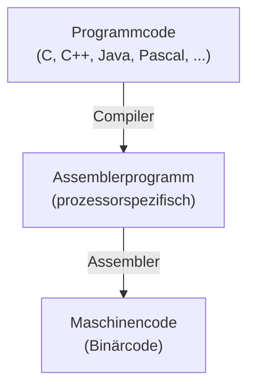
</details>

## 1. Einleitung

1.1 Thematische Einordnung
1.2 Hardware und Software
**1.3 Programmiersprachen**
1.4 Algorithmen und Programme

## Programmiersprachen

Computer wurden zu Anfang direkt in **Maschinencode** programmiert
Später Übergang zu **symbolischem** Maschinencode (Assembler)
Dann Einführung von (höheren) **Programmiersprachen**
• **Vorteile**:

– lesbar und wartbar (bei gutem Programmierstil)
– portierbar (nicht unbedingt zu 100%)

• „Evolution“ der Sprachen setzt sich ständig fort

– Zukünftig: für parallele **Multiprozessorsysteme**

Eine neue Sprache alleine ist praktisch wertlos, man benötigt

– **Programmierwerkzeuge**, z.B. Compiler
– **Akzeptanz** bei den Benutzern (u.a. wegen legacy code)


<details>
<summary>natural_image</summary>

Silhouette illustration of a person in various stages of life progression, including walking, running, and sitting (no text or symbols)
</details>

## Einteilung:

– **Imperative Sprachen**: konkrete Beschreibung eines Algorithmus als Folge von Anweisungen (Beispiel: C, Pascal)
**Deklarative Sprachen**: Beschreibung des erwünschten Programmverhaltens, konkrete Umsetzung erfolgt teilweise durch den Compiler und Laufzeitsystem (Beispiel: LISP, Prolog)
– **Objektorientierte Sprachen**: Zusammenfassung von Algorithmen und Daten zu Objekten, dadurch einfachere Programmwartung (Beispiel: C++, Java)
– Einteilung nicht disjunkt, z.B. C ⊂ C++

• Für GGI1: **C und C++** aufgrund großer praktischer Relevanz
• Nicht alle **Sprachdetails** werden vorgestellt
• Programmieren lernt man nur durch **Übung**!

• GGI1 stellt elementare Grundlagen der SW-Entwicklung bereit
• Typischer SW Life Cycle:


<details>
<summary>flowchart</summary>

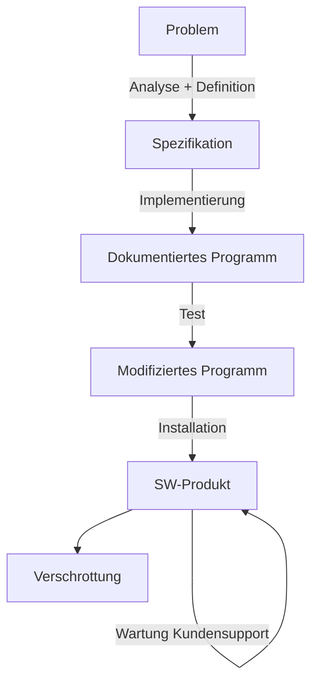
</details>

## 1. Einleitung

1.1 Thematische Einordnung
1.2 Hardware und Software
1.3 Programmiersprachen
**1.4 Algorithmen und Programme**

## • Algorithmus:

– Abstrakte Handlungsanweisung, um ein Problem zu lösen
– Ausgabe als Funktion der Eingabe
– In endlicher Zeit, eindeutig und deterministisch
– Kann in natürlicher Sprache formuliert sein

## • Programm:

– Codierung eines Algorithmus in Programmiersprache

## • Datenstruktur:

– Mathematisches Objekt zur Speicherung von Daten
– Auf bestimmte Weise angeordnet und zusammengefasst
– Sinnvoll nur im Zusammenhang mit Operationen auf den Daten
– Beispiele: Arrays, Listen, Stacks, Bäume, Graphen, ...

Für jedes (per Computer lösbare) Problem gibt es **unendlich viele** Algorithmen
Für jeden Algorithmus existieren **unendlich viele** Implementierungen in einer Programmiersprache
**Anforderung:** Finde den besten Algorithmus und die beste Implementierung hierfür; Kriterien:
– Korrektheit
– Effizienz (Laufzeit und/oder Speicherverbrauch)
– Eleganz, Programmierstil
Korrektheit eines Algorithmus lässt sich (mathematisch) beweisen, Korrektheit eines Programms oft nicht
Zur Bewertung der Effizienz von Algorithmen dient die **Komplexitätsanalyse**
• Guter **Programmierstil** muss praktisch erlernt werden

• Wann ist ein Problem per Computer lösbar?

– Problemlösung muss **mathematisch exakt** als Algorithmus beschreibbar sein
– Bsp.: Sortiere eine Menge von Namen in lexikographischer Reihenfolge

• Jedoch: Viele wichtige Probleme sind **prinzipiell lösbar**, aber in der Praxis zu komplex

– Bsp.: Primfaktorzerlegung sehr großer Zahlen
– Bsp.: Optimale Routenplanung für Spediteure (**Traveling Salesman Problem**)
– Auch schnellere Rechner helfen **nicht** weiter

• Andere Probleme sind **prinzipiell unlösbar**

Bsp.: Bestimme, ob ein Programm nach endlicher Zeit auf gegebener Eingabe anhält (**Halteproblem**)

1. Einleitung
2. Einführendes Beispiel
3. Elementare Datentypen und Anweisungen
4. Funktionen und Programmaufbau
5. Datentypen
6. Analyse von Algorithmen
7. Sortieralgorithmen
8. Lineare Datentypen
9. Bäume
10. Graphen
11. Techniken zum Algorithmenentwurf

## 2. Einführendes Beispiel

**2.1 Temperaturumrechnung**
2.2 Analyse des Beispiels
2.3 Ausführung und Fehlersuche

• Umwandlung von Grad Fahrenheit in Grad Celsius
•𝑦𝑦℃ = (5/9) ×𝑥𝑥℉ – 32

```c
#include <stdio.h>

/* Umwandlung von Fahrenheit in Celsius
    fuer fahr = 0, 20, ..., 300   */
int main()
{
    int fahr, celsius;
    int lower, upper, step;

    lower = 0; // untere Grenze der Temperaturtabelle
    upper = 300; // obere Grenze
    step  = 20; // Schrittweite

    fahr  = lower;
    while (fahr <= upper)  {
        celsius = 5  *  (fahr-32) / 9;
        printf("%d\t%d\n", fahr, celsius);
        fahr = fahr + step;
    }

    return 0;
}
```


<details>
<summary>natural_image</summary>

Medical thermometer with digital display showing 36.2°C (no text or symbols on device body)
</details>


<details>
<summary>line</summary>

| \({}^{\circ}F\) | \({}^{\circ}C\) |
| --- | --- |
| 0 | ~-1.5 |
| ~1.5 | 0 |
| ~3.0 | ~1.5 |
| ~4.5 | ~3.0 |
| ~6.0 | ~4.5 |
| ~7.5 | ~6.0 |
| ~9.0 | ~7.5 |
</details>