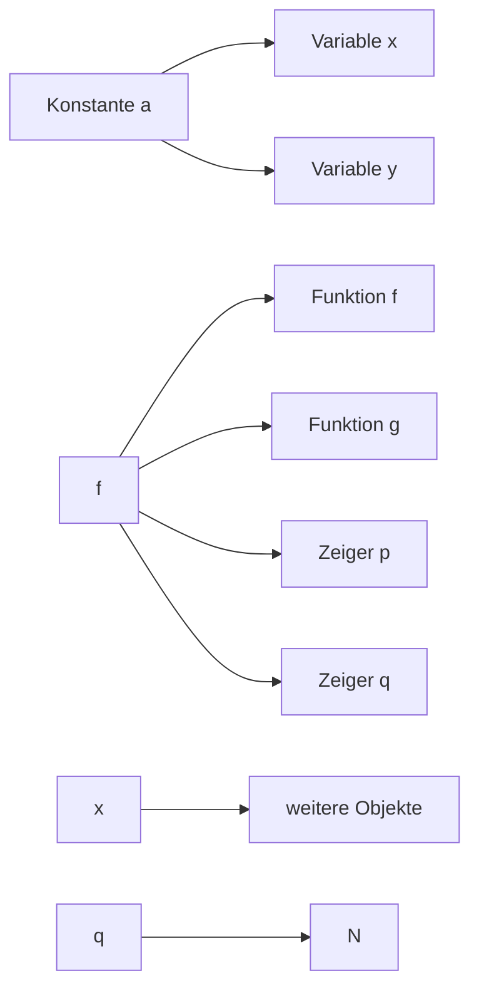
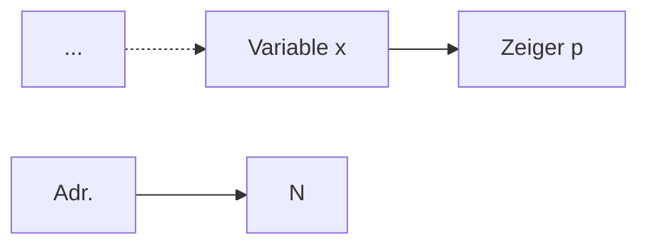
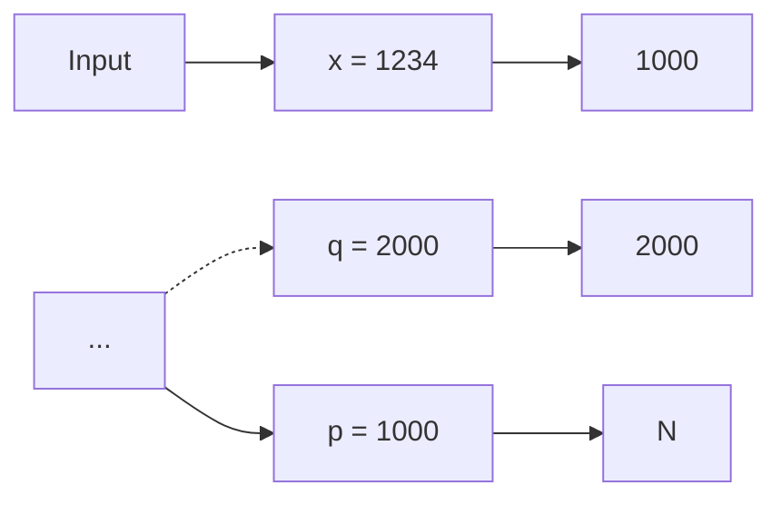
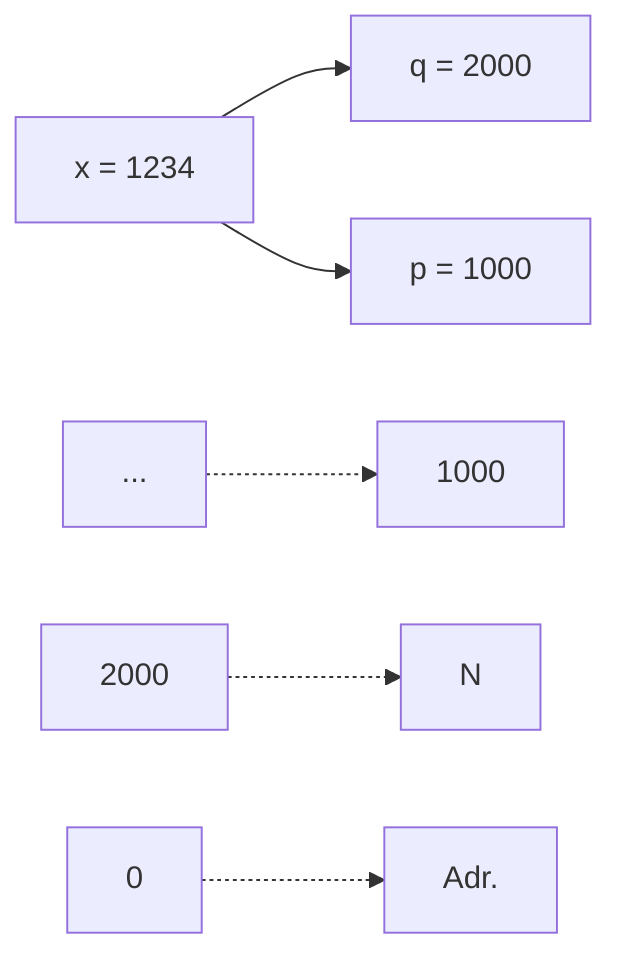

Von vielen Programmen häufig wiederverwendeter Code wird in Bibliotheken (Libraries) abgelegt
Library-Code wird nur einmal compiliert und kann dann von allen Programmen eingebunden werden
• Dies erfolgt nach der Assemblierung durch den Linker
C besitzt insges. 29 Standard-Libraries, z.B.:
– stdio: Ein- und Ausgabe
– math: Mathematische Funktionen
– string: String-Manipulation
Durch Einbinden einer Header-Datei (z.B. „stdio.h“) werden die Library-Funktionen dem benutzenden Programm bekannt gemacht
Programmierer können (und sollten) auch eigene, benutzerspezifische Libraries anlegen

• **Zeichenketten und Streams**

– string, iomanip, iostream, cstdio

• **Abtrakte Datentypen / Container**

– vector, array, (forward\_)list, queue, stack
– (unordered\_)set, (unordered\_) map
– iteratoren

• **Smart Pointer**

– unique\_prt
– shared\_prt
– weak\_ptr

• **Algorithmen**

– for\_each, sort, copy, find & search, transform

• **Funktoren**

– multiplies, negate, …

## 2. Einführendes Beispiel

2.1 Temperaturumrechnung
**2.2 Analyse des Beispiels**
2.3 Ausführung und Fehlersuche

• **Einbinden** der Standard-Library zur Ein/Ausgabe

– #include &lt;stdio.h&gt;
– Ermöglicht Kommunikation des Programms mit der Außenwelt (z.B. Benutzer)
– Siehe C-Präprozessor

• **Kommentare**

– /\* Umwandlung … \*/
– // untere Grenze …
– Erläuterung der Programmfunktion für Entwickler
– Text innerhalb /\* … \*/ und in einer Zeile nach // wird vom Compiler ignoriert

• **Hauptfunktion** main

– int main() { … }
– Alle Anweisungen innerhalb { … } gehören zu main
– main wird nach Programmstart immer direkt aufgerufen
– Im Allg. ruft main dann weitere Funktionen auf

## • Variablen-Vereinbarungen

– int fahr, celsius;
– Variablen sind benannte Speicherplätze für Werte
– Können lesend und schreibend zugegriffen werden
– Variablen müssen vor Verwendung vereinbart werden
– Hier: Verwendung von ganzzahligen (integer) Variablen

## • Zuweisungen

– lower = 0;
– upper = 300;
– Schreiben von Werten in die Variablen

## • Schleife

– while (fahr <= upper) { /\* ... \*/ }
– while ist (wie auch int) ein **C-Schlüsselwort**
– Code innerhalb { … } wird solange wiederholt, bis Bedingung nicht mehr erfüllt

## • Umrechnung

– celsius = 5 \* (fahr-32) / 9;
– Rechenoperationen auf Variablen

## • Ausgabe

– printf("%d\t%d\n", fahr, celsius);
– Formatierte Ausgabe:

• fahr als Integer-Zahl (erstes %d als Platzhalter)
• Tabulator \t
• celsius als Integer-Zahl (zweites %d als Platzhalter)
• Zeilenumbruch \n

## • Vorbereitung des nächsten Schleifendurchlaufs

– fahr = fahr + step;
– fahr wird um step erhöht, bis upper überschritten

## • Formatierte Ausgabe

Classic C++

```cpp
#include <iostream>  // std::cout, std::right, std::endl
#include <iomanip>   // std::setw

int main() {
    int val = 65;

    std::cout << "Formatted output using C++" << std::endl;
    std::cout << "-start-" << std::endl;
    std::cout << std::right;  // right-adjusted (manipulator)
    std::cout << ''' << std::setw(10) << val << ''' << std::endl;
    std::cout << "-end-" << std::endl;

    return 0;
}
```

C++11 oder c

```c
#include <cstdio> // printf; for c library: <stdio.h>, no "using ..."
using namespace std;

int main() {
    int val = 65;

    printf("Now using C++11:\n");
    printf("-start-\n'%10d'\n-end-\n", val);

    return 0;
}
```

• Using und namespace

```cpp
#include <string>
#include <iostream>

int main( void ) {

    std::string msg = "Hello world!";

    std::cout << msg << std::endl;

    return 0;
}
```

```cpp
#include <string>
#include <iostream>

using std::cout, std::endl, std::string;
// using namespace std;

int main( void ) {

    string msg = "Hello world!";

    cout << msg << endl;

    return 0;
}
```

std::cout ⭢ cout

C-Präprozessor (cpp) läuft **vor dem Compiler** über den Quellcode (C-nach-C-Übersetzung)
• cpp-Anweisungen beginnen mit Zeichen #
• cpp-Verwendung erhöht **Lesbarkeit** der Programme
• Vor allem folgende Anwendungen:

– **Symbolische Definitionen** (Konvention: Großbuchstaben)

• #define UPPER 300
• Alle Vorkommen von UPPER werden durch 300 ersetzt

– **Makros**

• #define $\mathsf { M A X ( a , b ) ~ ( a > b ) ~ ? ~ a : b }$
• Alle Vorkommen von $\operatorname { M A X } ( \ldots , \ldots )$ werden ersetzt

**Einbinden** von Standard-Libraries (und allgemein Header-Dateien mit Deklarationen)

• #include &lt;stdio.h&gt;
• Datei stdio.h wird an dieser Stelle ins Programm eingefügt

## 2. Einführendes Beispiel

2.1 Temperaturumrechnung
2.2 Analyse des Beispiels
**2.3 Ausführung und Fehlersuche**

Programm in **Textdatei** „temp.c“gespeichert
Aufruf des **C-Compilers** (z.B. aus Linux shell)

– cc temp.c (je nach Compiler)
– **Präprozessor** und **Assembler** werden implizit aufgerufen
– **Zielprogramm** „a.out“ wird erzeugt
– **Ausführung** von „a.out“generiert die gezeigte Ausgabe

Ausgabe

| 0 | -17 |
| --- | --- |
| 20 | -6 |
| 40 | 4 |
| 60 | 15 |
| 80 | 26 |
| 100 | 37 |
| 120 | 48 |
| 140 | 60 |
| 160 | 71 |
| 180 | 82 |
| 200 | 93 |
| 220 | 104 |
| 240 | 115 |
| 260 | 126 |
| 280 | 137 |
| 300 | 148 |

• **Möglichkeit 1**: Programm entspricht nicht dem C-Standard
Derartige Fehler werden vom Compiler (oder auch Linker) bemerkt und dem Programmierer mitgeteilt


<details>
<summary>flowchart</summary>

```mermaid
graph TD
  #include <stdio.h>

  /* Umwandlung von Fahrenheit in Celsius
    fuer fahr = 0, 20, ..., 300 */
  int mein()
  {
    int fahr /* , celsius */;
    int lower, upper, step;

    lower = 0; // untere Grenze der Temperaturtabelle
    upper = 300; // obere Grenze
    step = 20; // Schrittweite

    fahr = lower
    while (fahr <= upper) {
      celsius = 5 * (fahr-32) ** 9;
      printf("%d\t%d\n", fahr, celsius);
      fahr = fahr + step;
    }

    return 0;
  }
  FehlendeMainFunktion["Fehlende main-Funktion"] --> VariableNichtDeklariert["Variable nicht deklariert"]
  UnbekannterOperator["Unbekannter Operator"] --> SemikolonVergessen["Semikolon vergessen"]
```
</details>

**Möglichkeit 2**: Programm ist gültig (d.h. compilierbar), führt aber nicht die gewünschte Funktion aus (es hat „Bugs“)
• Wesentlich schwieriger zu finden und zu beheben!

```c
#include <stdio.h>

/* Umwandlung von Fahrenheit in Celsius
    fuer fahr = 0, 20, ..., 300   */
int main()
{
    int fahr, celsius;
    int lower, upper, step;

    lower = 0; // untere Grenze der Temperaturtabelle
    upper = 300; // obere Grenze
    step  = 20; // Schrittweite

    fahr = lower;
    while (fahr <= upper) {
        celsius = 5 * (fahr+32) / 9;
        printf("%d\t%d\n", fahr, celsius);
        fahr = fahr + step;
    }

    return 0;
}
```

## Fehlerhafte Programme

Programm unter Kontrolle eines **Debuggers** ausführen
Ermöglicht **Einzelschrittmodus**, Beobachtung von **Variablen** u.v.m.
Hilfreich vor allem bei **Endlosschleifen** und **Programmabstürzen**
Debugger kann Programmverhalten beeinflussen („**Heisenbugs**“)


<details>
<summary>text_image</summary>

File Edit View Program Commands Status Source Data Help
(): upper1
Lookup Find-Break Watch Print Display Plot Hide-Potise Set Undisp
1: celsius -6 5: step 20 2: fahr 40 3: lower 0 4: upper 300
Ausgabefenster
/* Umwandlung von Fahrenheit in Celsius
    fuer fahr = 0, 20, ., 300 */
main()
{
    int fahr, celsius;
    int lower, upper, step;

    lower = 0; /* untere Grenze der Temperaturtabelle */
    upper = 300; /* obere Grenze */
    step = 20; /* Schrittweite */

    fahr = lower;
    while (fahr <= upper) {
        celsius = 5 * (fahr-32) / 9;
        printf("%d\t%d\n", fahr, celsius);
        fahr = fahr + step;
    }
}
Quellcode
DDD Run Interrupt Step Stepi Next Nexti Until Finish Cont Kill Up Down Undo Redo Edit Make
(gdb) graph display celsius
(gdb) cont
0 -17
Kommandofenster
Breakpoint 1, main () at celsius.c:16
(gdb) graph display fahr
(gdb) graph display lower
(gdb) graph display upper
(gdb) graph display step
(gdb) cont
20 -6
Breakpoint 1, main () at celsius.c:16
(gdb)
</details>

## 3. Elementare Datentypen und Anweisungen

## 3.1 Einführung

3.2 Variablen und Konstanten
3.3 Zeiger
3.4 Arithmetische und logische Operationen und Zuweisungen
3.5 Kontrollanweisungen

**Def**.: Ein **Datentyp** (**DT**) ist eine Menge von Werten und eine <u>Sammlung von Operationen auf diesen Werten.</u>

Beispiel: **natürliche Zahlen** 1, 2, 3, ...
– Operationen: $+ , - , * , / , \ldots$
• Beispiel: **Zeichenketten** (Strings) über Alphabet A-Z – Operationen:

• Bestimme Stringlänge
• Ordne Strings alphabetisch an
•...

Beispiel: Menge von **Personen-Stammdaten** (Name, Geburtsdatum, Adresse, ...)

– Operationen:

• Finde Teilmenge aller Personen älter als 50 Jahre
• Finde Teilmenge aller Personen, die in Aachen wohnen
•...

## Def.: Ein abstrakter Datentyp (ADT) ist ein Datentyp der nur über eine Schnittstelle zugänglich ist.

Funktion vs. Implementierung des Datentyps
Nur Funktion nach außen von Interesse
Implementierung kann sich evtl. ändern

Beispiel: DT „Punkt“ in C
Koordinaten:
struct point { float x; float y; }
• Operation „Euklidischer Abstand“:

```lisp
float dist(struct point a, struct point b)
{
    float dx, dy;
    dx = a.x - b.x;
    dy = a.y - b.y;
    return sqrt(dx*dx + dy*dy);
}
```


<details>
<summary>text_image</summary>

y
a
dist(a,b)
b
x
</details>

In der C-Version sind Daten (point) und Operationen (dist) **getrennt**
Programme könnten (und i.d.R.: werden) ohne „dist“ auch **direkt** auf die x- und y-Koordinaten zugreifen
Ändert sich die interne Implementierung von point, so wäre evtl. ein Großteil des **übrigen Programmcodes** betroffen
• **ADT-Version** in C++: (siehe Kapitel 5)

```txt
class point {
    private:      // interne Repräsentation nicht nach außen sichtbar
        float x, y; // oder andere interne Repräsentation
    public:      // Schnittstelle für Benutzer von „point“
        float dist(point);
        /* ... */
};
```

Daten und Operationen per Konstruktion (class) **vereinigt**
• Interne Daten nur über Schnittstelle verfügbar!

Variablen, Konstanten und Programmcode (Funktionen) werden im **Speicher** abgelegt
Ein **Objekt** ist ein benannter Speicherbereich
Auf Objekte wird direkt (per **Namen**) oder indirekt (per **Zeiger**) zugegriffen; Zeiger (symbolische Adressen) sind selbst Objekte
Der **benötigte Speicherplatz** eines Objektes sowie die darauf **zulässigen Operationen** hängen vom Typ ab
Im Speicher befinden sich nur **Binärzahlen**; Interpretation ist den Operationen überlassen

Vereinfachtes Speichermodell


<details>
<summary>flowchart</summary>


</details>

• char: **Zeichen** (character) = 1 Byte (8 Bits)
• int: **ganze Zahl** (integer)

– short int: kleinerer Wertebereich (mind. 16 Bit)
– long int: größerer Wertebereich (mind. 32 Bit)

• float: **Fließkommazahl** (floating point)

– Aufteilung in Exponenten und Mantisse
$12.3 \times 10^{10} = 12.34 \times 10^{10}$
– double: größerer Wertebereich
– long double: noch größerer Wertebereich

char und ganze Zahlen können **vorzeichenbehaftet** (Standardfall) oder **vorzeichenlos** sein:

– signed short int $\in [ - 2 ^ { 1 6 - 1 } , 2 ^ { 1 6 - 1 } - 1 ] \: = \: [ - 3 2 7 6 8 , 3 2 7 6 7 ]$
– unsigned short int $\in [ 0 , 2 ^ { 1 6 } - 1 ] \qquad \quad = \quad [ 0 , 6 5 5 3 5 ]$

## 3. Elementare Datentypen und Anweisungen

3.1 Einführung
**3.2 Variablen und Konstanten**
3.3 Zeiger
3.4 Arithmetische und logische Operationen und Zuweisungen
3.5 Kontrollanweisungen

## • Variablen

– speichern Werte eines bestimmten **Datentyps**
– müssen vor Verwendung **vereinbart** werden

• z.B. float a, b; char x, y; double e, f;

– besitzen einen eindeutigen **Namen**
– Name sollte über **Verwendung** Aufschluss geben!

• z.B. int counter; ist besser als int c;

• **Schlüsselwörter** sind als Namen nicht erlaubt

– z.B. for, while, goto, int, float, ... sind in C/C++ reserviert

• Je nach Compiler:

– Es sind nur die ersten 31 Zeichen **signifikant**
– z.B. int einLangerVariablenName1234567890, einLangerVariablenName1234567891 gelten als gleich

• Aufbau von Variablennamen (Identifier-Syntax)
• Kompakte Beschreibung mit **regulären Ausdrücken**

– letter = "a"|"b"|…|"z"|"A"|"B"|…|"Z"|"\_"

• **letter** = ein Buchstabe oder „\_“

– digit = "0"|…|"9"

• **digit** = eine Dezimalziffer

– identifier = letter { letter | digit }

• **identifier** = ein letter, gefolgt von beliebig vielen Elementen (auch 0) letter oder digit

• Z.B. zulässig:
– int x, XX, y\_, a\_42;
• Z.B. unzulässig:
– int 0Z, 1234\_x, return;

• Vereinbarung vor erster Verwendung der Variable

– Deklaration ermöglicht **Korrektheitsprüfungen** durch Compiler
– Definition allokiert benötigten **Speicherplatz**

• **Allgemeine Form** der Vereinbarung:

– Typ ID (, ID)\* ;
– Typ darf sein:

Basis-DT (Schlüsselwort): char, int, float, ...
Zusammengesetzter DT (Zeiger, Array, Struct, ...)
Benutzerdefinierter DT

```c
int main(void)
{
    /* Variablen-
        Vereinbarungen */

    /* ... */

    /* Anweisungen mit
        Variablen-
        Verwendung */

    return 0;
}
```

– typedef unsigned long int UL;
– Macht UL als Abkürzung für unsigned long int bekannt
– Hilfreich vor allem bei zusammengesetzten DT

Falls Werte sich innerhalb eines Programms nie ändern, so werden diese als **Konstanten** statt Variablen dargestellt
Bessere **Lesbarkeit**, mehr **Optimierungsmöglichkeiten**
Konstanten benötigen keine explizite Definition, da ihr **Typ implizit** ist; Beispiele:

12345: ganze Zahl (int)

12345U: vorzeichenlose ganze Zahl (unsigned int)

0xAFFE: ganze Zahl in Hexcode (int)

123.45: Fließkommazahl (double)

123E-2: Fließkommazahl (double)

'a': Zeichen (char)

"String": Zeichenkette (Array aus char, s. später) int-Konstante als regulärer Ausdruck: "0" | ( [ "-" ], dnz, { d } )

• **Symbolische Konstanten** im Präprozessor

– #define MAXCOUNT 1000
– Alle Vorkommen von MAXCOUNT im Programm werden durch 1000 ersetzt
– Bessere Lesbarkeit und Wartbarkeit des Codes

• **Konstante Ausdrücke**

– MAXCOUNT + 1, MAXCOUNT \* 2, ...
– Werden vom Compiler vorab ausgerechnet, nicht zur Programm-Laufzeit (compile time-Konstante)

• **Konstante Variablen**

– const int a = 100; (const ist ein type qualifier)
– Variable a darf kein neuer Wert zugewiesen werden
– Effekt: Ablage von a im read only-Speicher (ROM)

## 3. Elementare Datentypen und Anweisungen

3.1 Einführung
3.2 Variablen und Konstanten
**3.3 Zeiger**
3.4 Arithmetische und logische Operationen und Zuweisungen
3.5 Kontrollanweisungen

Aachen

**Def**.: Ein **Zeiger** (engl. pointer) ist eine Variable, die die <u>Speicheradresse einer Variablen enthält.</u>

Zeiger gehören zu den **wichtigsten Konzepten** in C/C++ zur Definition komplexer und effizienter Datentypen
Zeiger gehören (leider) auch zu den **häufigsten Fehlerquellen** bei der Programmierung
• Bsp.:
– Der spezielle Zeigerwert NULL (0) wird oft verwendet, um einen „leeren“ Zeiger anzuzeigen (#define NULL 0)
– Der Versuch, einen Wert an Adresse 0 zu schreiben, führt in aller Regel zum **Programmabsturz**
– Enthält ein Zeiger einen sonstigen illegalen Wert, so kann sogar der **Programmcode** selbst überschrieben werden

Alle **Programm-Objekte** liegen im Speicher (s.o.)
Jedes Objekt besitzt eine **Adresse** im Speicher (wie eine Hausnummer)
Häufig werden Objekte **per Namen** zugegriffen (z.B. Variable ${ { \bf \Pi } _ { v } } \times { { \bf \Pi } ^ { \prime \prime } } )$
Oft ist auch der **indirekte Zugriff** auf ein Objekt über seine Adresse sinnvoll
Objekt-Adressen werden in **Zeigern** gespeichert
Zeiger sind selbst Objekte mit Adressen, daher sind auch **Zeiger auf Zeiger** möglich


<details>
<summary>flowchart</summary>


</details>

• Zeiger werden mittels \* deklariert
Typ \* ID; vereinbart einen Zeiger auf ein Objekt vom Typ Typ
Bsp.: int \* p; int \*\* q;
Symbol \* gehört syntaktisch zu ID, nicht zum Typ, z.B.

int \* p, q; vereinbart einen int-Zeiger p und eine int-Variable q, aber int \*p,\*q; vereinbart zwei int-Zeiger

• Äquivalent wäre: typedef int\* intptr; intptr p, q;


<details>
<summary>flowchart</summary>


</details>

**Annahme**: Adresse von Objekt x in Zeiger p gespeichert
• Wie erfolgt der Zugriff auf x?

– \*-Operator
– Ausdruck \*pointer liefert Objekt x

• **Beispiel**:

\*p liefert den Wert 1234 (int)
\*q liefert den Wert 1000 (intptr)

• **Schreibzugriff** per \*:

\*p = 4321; überschreibt x mit 4321
\*\*q = 5678; überschreibt x mit 5678

Vergleiche Syntax der **Vereinbarung**

– int \*p;
– **implizite** Deklaration von p als Zeiger


<details>
<summary>flowchart</summary>


</details>

## Adressoperator

Zeiger auf x wird auch als **Referenz** auf x bezeichnet
\*-Operator heißt auch **Dereferenzierung** (indirection)
Erzeugung von Referenzen durch den **Adressoperator** &
– An p wird die Adresse von x zugewiesen (p „zeigt“ dann auf x)
– An q wird die Adresse von p zugewiesen
& und \* sind invers zueinander:
• & nur auf **Objekte** anzuwenden, \* nur auf **Zeiger**

$$
\mathrm{p} = \& \mathrm{x};
$$

$$
q = \& p;
$$

$$
- ^ {*} (\& \mathrm{x}) = \mathrm{x}
$$


<details>
<summary>flowchart</summary>

```mermaid
graph LR
  A[""] --> B["x = 1234"]
  B --> C[""]
  D[""] --> E[""]
  F[""] --> G["q = 2000"]
  G --> H["p = 1000"]
  H --> I[""]
  J[""] --> K[""]
  L[""] --> M[""]
  N[""] --> O[""]
```
</details>