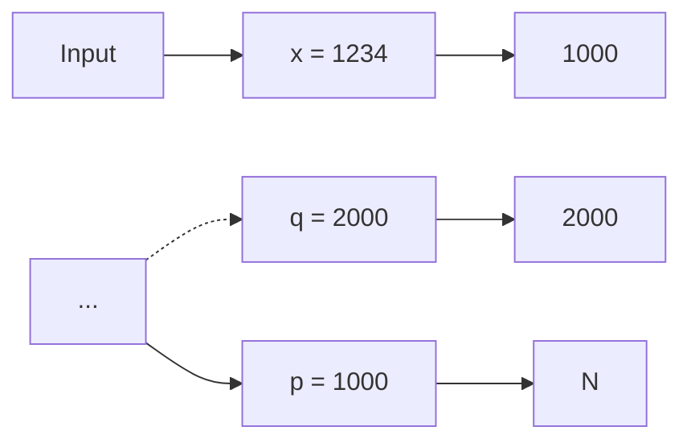
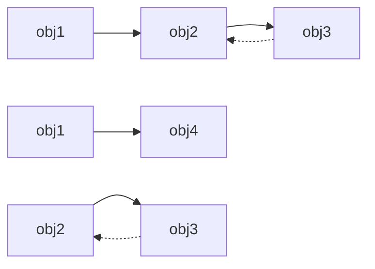
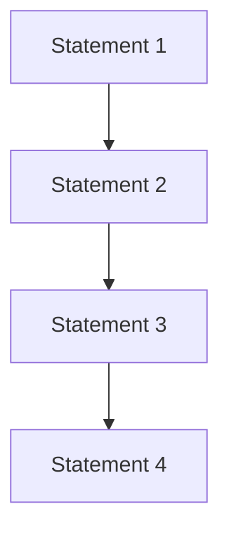
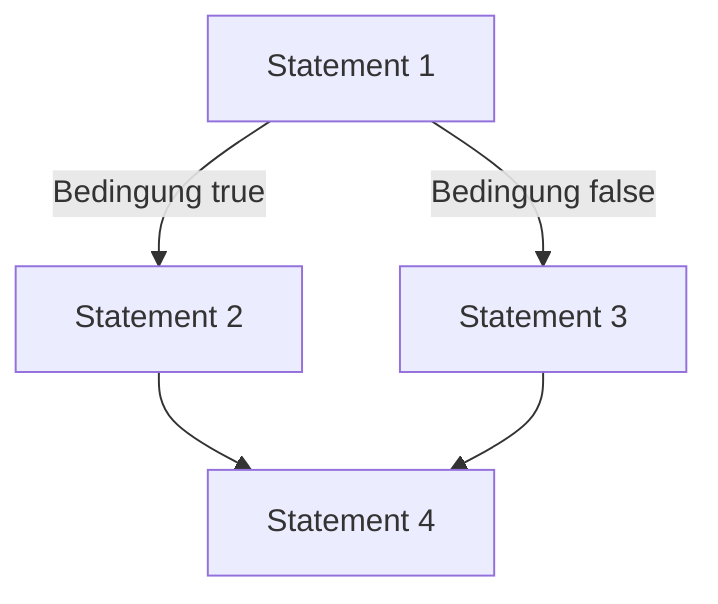
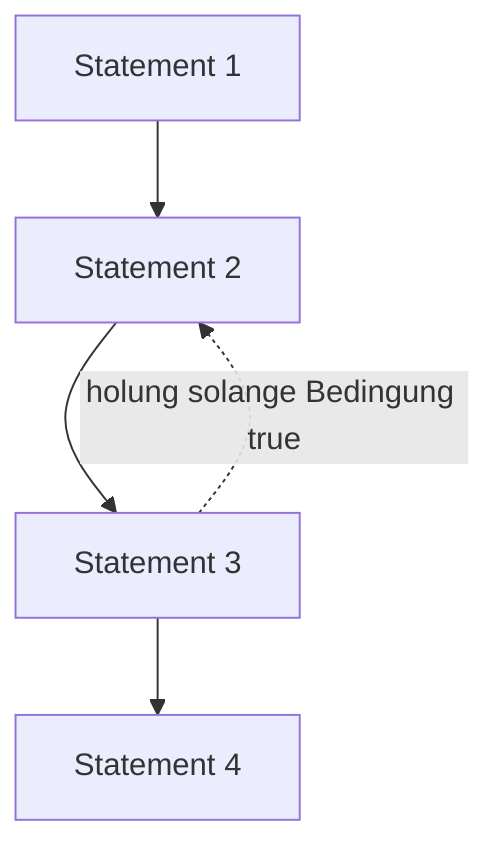

Zeiger sind im Prinzip **identisch** mit (positiven) Integer-Zahlen
Daher können Zeiger und int ineinander **umgewandelt** werden

$$
\begin{array}{l} p = (i n t ^ {*}) x; \\ x = ^ {*} p; \\ \end{array}
$$

– lädt x mit dem Inhalt von Speicherstelle 1234

$$
\mathsf {x} = (\text {int}) \mathsf {q};
$$

– lädt x mit 2000

Diese Eigenschaft von C/C++ bringt große **Flexibilität**, birgt jedoch auch **Gefahren**, z.B. möglicher Zugriff auf geschützte Speicherbereiche


<details>
<summary>flowchart</summary>


</details>

Allgemein: falls mittels eines **einzigen Objektes** (Zeiger) im Programmverlauf auf **verschiedene andere Objekte** zugegriffen werden soll
Oder falls (in der maschinennahen Programmierung) Zugriffe auf **vorgegebene feste Speicherstellen** notwendig sind
Vor allem sind Zeiger sinnvoll bei **dynamischen** (d.h. zur Laufzeit erzeugten) Datenstrukturen
Datenobjekte, deren Größe während der Programmentwicklung noch nicht feststeht und die daher **nicht statisch deklariert** werden können
Hierfür kann dynamisch (d.h. während der Programmlaufzeit) Speicher angefordert und wieder freigegeben werden
Der Speicherbereich hierfür heißt **Heap** (Halde, Haufen)

Programmcode und Variablen im **statischen** Speicherbereich
• Zugriff auf den **Heap** wie folgt:
Anforderung von Heap-Speicher mittels Funktion malloc (memory allocation)
– p zeigt dann auf Anfang von freiem 1000-Byte Heap-Block
– Adresse eines freien Blockes wird von malloc **automatisch** ermittelt (z.B. 5000)

$$
\text {int} ^ {*} \mathrm{p} = (\text {int} ^ {*}) \text {malloc(1000)};
$$

Adr.


<details>
<summary>bar_stacked</summary>

| Category | Label |
| --- | --- |
| Top (Yellow) | 0 |
| Middle (Yellow) | p = 5000 |
| Bottom (Green) | ... |
| Bottom (Blue) | H |
| Bottom (Blue) | E |
| Bottom (Blue) | A |
| Bottom (Blue) | P |
</details>

• Adressen **5000-5999** durch malloc reserviert $p = 1234$ ;
weist 1234 an erste Speicherzelle im Block zu

Da die an malloc übergebene **Blockgröße** variabel ist, kann Heap-Speicher immer **passend** angefordert werden
Nach Verwendung sollte der Heap-Block auch wieder **freigegeben** werden, um den Speicherplatz für andere Zwecke wiederverwenden zu können:

free(p); // Block 5000-5999 freigeben


<details>
<summary>bar_stacked</summary>

| Stage | Value |
| --- | --- |
| Initial State | 0 |
| Step 1 | p = 5000 |
| Step 2 | ... |
| Step 3 | 1234 |
| Step 4 | 5000 |
| Step 5 | 6000 |
| Final State | N |
</details>

Dynamische Speicherallokierung

```c
#include <stdlib.h>
#include <stdio.h>

int main( void ) {
    int* p;
    printf("Any memory          @ %p: %d_%d_%d\n", p, p[0], p[1], p[2]);
    p = (int*) malloc(1000);
    printf("Allocated memory   @ %p: %d_%d_%d\n", p, p[0], p[1], p[2]);
    p[0] = 4;
    p[1] = 7;
    p[2] = 11;
    printf("Initialized memory @ %p: %d_%d_%d\n", p, p[0], p[1], p[2]);
    free(p);
    printf("Deallocated memory @ %p: %d_%d_%d\n", p, p[0], p[1], p[2]);

    return 0;
}
```

```cpp
#include <cstdio>
#include <memory>
using namespace std;
int main( void ) {
    int* p;
    printf("Any memory          @ %p: %d_%d_%d\n", p, p[0], p[1], p[2]);
    p = new int[250];
    printf("Allocated memory   @ %p: %d_%d_%d\n", p, p[0], p[1], p[2]);
    p[0] = 4;
    p[1] = 7;
    p[2] = 11;
    printf("Initialized memory @ %p: %d_%d_%d\n", p, p[0], p[1], p[2]);
    delete [] p;
    printf("Deallocated memory @ %p: %d_%d_%d\n", p, p[0], p[1], p[2]);

    return 0;
}
```

• Motivation

```cpp
#include <iostream>
#include <memory>
#include <sys/resource.h>
using namespace std;

// get memory footprint
long get_mem() {
    struct rusage is;
    getrusage(RUSAGE_SELF, &is);
    return is.ru_maxrss; // in KB
}

void subA() {
    int a; int* pa = &a;
}

void subB() {
    int* pa = new int;
    // delete pa; // free memory space, no automatic deallocation
}

void subC() { unique_ptr<int> pa = make_unique<int>(); }

int main( void ) {
    long mem_base = get_mem();
    cout << "Memory base usage: " << mem_base << endl;

    for( long i=0; i<10000000; i++ ) {
        subA();
        if( i%1000000 == 0) cout << "Addt'l allocation: " << get_mem() - mem_base << endl;
    }
    return 0;
}
```

## • Unique Pointer


<details>
<summary>flowchart</summary>

This image displays a code editor for creating an 'unique pointer' in a context, showing the syntax and conditional logic for handling unique pointers.
</details>

• Shared Pointer

```cpp
#include <iostream>
#include <memory>
using namespace std;

void show( shared_ptr<string>& p0, shared_ptr<string>& p1 ) {
    if( p0 != nullptr ) cout << "Shared pointer p0: '" << *p0 << ''' << endl;
    if( p1 != nullptr ) cout << "Shared pointer p1: '" << *p1 << ''' << endl;
    cout << " Ptr of p0 use count: " << p0.use_count() << endl;
    cout << " Ptr of p1 use count: " << p1.use_count() << endl << endl;
}

int main( void )
{
    shared_ptr<string> ptr0 = make_shared<string>("shared");
    shared_ptr<string> ptr1;
    show(ptr0, ptr1);

    cout << "Duplicating reference to object ..." << endl;
    ptr1 = ptr0;
    show(ptr0, ptr1);

    ptr0 = make_shared<string>("something new");
    show(ptr0, ptr1);

    return 0;
}
```

## • Weak Pointer

Einen weak pointer zu de-referenzieren ist etwas ~~kompliziert. Es benötigt eine temporäre Kopie der Re~~ferenz. <u>Diese wird durch die Methode lock() erreicht.</u>

```cpp
#include <iostream>
#include <memory>
using namespace std;

void show( shared_ptr<string>& p0, weak_ptr<string>& p1 ) {
    if( p0 != nullptr ) cout << "Shared pointer p0: '" << *p0 << "''' << endl;
    if( !p1.expired() ) cout << "Weak pointer p1: '" << *(p1.lock()) << "''' << endl;
    cout << " Ptr of p0 use count: " << p0.use_count() << endl;
    cout << " Ptr of p1 use count: " << p1.use_count() << endl << endl;
}

int main( void )
{
    shared_ptr<string> ptr0 = make_shared<string>("shared");
    weak_ptr<string> ptr1;
    show(ptr0, ptr1);

    cout << "Duplicating reference to object ..." << endl;
    ptr1 = ptr0;
    show(ptr0, ptr1);

    ptr0 = make_shared<string>("something new");
    show(ptr0, ptr1);

    return 0;
}
```


<details>
<summary>flowchart</summary>


</details>

## 3. Elementare Datentypen und Anweisungen

3.1 Einführung
3.2 Variablen und Konstanten
3.3 Zeiger
**3.4 Arithmetische und logische Operationen und Zuweisungen**
3.5 Kontrollanweisungen

Auf Variablen und Konstanten können verschiedene **Rechenoperationen** angewendet werden

$$
- +, -, *, /
$$

– % (modulo, nicht bei float-Werten)

• Multiplikative Operationen haben **Vorrang**

– Der **Ausdruck** $a \pi b + c / d$ entspricht $( a \div b ) + ( c / d )$

Diese primitiven Rechenoperationen sind in der Programmiersprache „eingebaut“

Komplexere Operationen sind in **Libraries** verfügbar oder werden vom **Programmierer definiert**

• Z.B. Standard-Library math.h

– sin, cos, tan, pow (power), sqrt (square root), ...

**Ergebnisse** der Operationen haben einen bestimmten DT, der sich aus dem Operator und den Argumenttypen ergibt

## • Allgemeine Form:

– Ziel = Ausdruck
– = ist der Zuweisungsoperator
– Ausdruck wird berechnet, Wert wird in Ziel gespeichert

## • Kurzformen:

– ++, --: Increment, Decrement

$$
x + + \text {entspricht} x = x + 1
$$

$$
- + = , \quad * = , \dots
$$

$$
\mathrm{x} + = \mathrm{y} \text {entspricht} \mathrm{x} = \mathrm{x} + \mathrm{y}
$$

```c
int main()
{
    int a,b;
    int c,d;

    a = 1;
    b = 2;

    c = a+b;
    d = c+1;
    d = d+1;
    printf("%d", d);

    return 0;      #def
}                     #def
```

```c
#define a 1
#define b 2

int main()
{
    int c,d;

    c = a+b;
    d = c+1;
    d++;
    printf("%d", d);

    return 0;
}
```

• **Vergleichsoperationen**

$$
\begin{array}{l} >, > = , <  , <   = \\ = = (\text {Gleichheit}),! = (\text {Ungleichheit}) \\ \end{array}
$$

Ergebnis einer Vergleichsoperation ist stets ein **Boolescher Wert** (true oder false)
• Boolescher DT in C: \_Bool

– Äquivalenzen aus stdbool.h:

• bool ∶= \_Bool
• false ∶= 0
• true ∶= 1

• **Schiebeoperationen** (shift)

>> Rechtsshift
<< Linksshift

• Shift-Operationen nützlich für

– Zugriff auf einzelne Bits eines Wertes
– Vereinfachung von Rechenoperationen, z.B.

• x >> 1 entspricht $x / 2$
• x << 2 entspricht $X ^ { \star } 4$

Rechtsshift abhängig vom DT des ersten Arguments:

– **Logisches** Shift: Auffüllen links mit 0
– **Arithmetisches** Shift: Auffüllen links mit Vorzeichen

• Beispiel: unsigned char $a = 1 2 8$ ; signed char b = -128;

**Binärdarstellung von a und b**

| 1 | 0 | 0 | 0 | 0 | 0 | 0 | 0 |
| --- | --- | --- | --- | --- | --- | --- | --- |


**Vorzeichen bei b**

a: logisches Shift


b: arithmetisches Shift

| 0 | 1 | 0 | 0 | 0 | 0 | 0 | 0 |
| --- | --- | --- | --- | --- | --- | --- | --- |

| 1 | 1 | 0 | 0 | 0 | 0 | 0 | 0 |
| --- | --- | --- | --- | --- | --- | --- | --- |

• &: bitweise **UND-Verknüpfung**
• |: bitweise **ODER-Verknüpfung**
• ^: bitweise **Exklusiv-ODER-Verknüpfung** (XOR, „entweder...oder“)
• Prüfen, Setzen oder Löschen **einzelner Bits** von Werten
Bsp.:

– signed char a = -64, b = 0xFF; // oder b = -1;

<strong><u>1 1 0 0 0 0 0 0</u></strong>a:

<strong><u>1 1 1 1 1 1 1 1</u></strong>b:

<strong><u>1 1 0 0 0 0 0 0</u></strong>

a & b

<strong><u>1 1 0 0 0 0 0 0</u></strong>

<strong><u>1 1 1 1 1 1 1 1</u></strong>

<strong><u>1 1 1 1 1 1 1 1</u></strong>

a | b

<strong><u>1 1 0 0 0 0 0 0</u></strong>

<strong><u>1 1 1 1 1 1 1 1</u></strong>

<strong><u>0 0 1 1 1 1 1 1</u></strong>

a ^ b

## Typumwandlung (type cast)

## Beispiel:

– int a = 10, b; float pi = 3.14;
– b = pi + a;

## Welche Typen werden verwendet?

– a wird in intern in float umgewandelt (10.0 = 1E1)
– pi + a ergibt float-Resultat (13.14)
– Resultat wird in int zurückverwandelt (13)

In C/C++ gibt es umfangreiche **type cast-Regeln** für alle Kombinationen der primitiven DT

Viele Einzelheiten der Typumwandlung sind jedoch **compilerabhängig** (und damit eine „beliebte“ Fehlerquelle) !

**Expliziter** type cast durch Programmierer:

– Ziel = (Typ) Ausdruck;

## 3. Elementare Datentypen und Anweisungen

3.1 Einführung
3.2 Variablen und Konstanten
3.3 Zeiger
3.4 Arithmetische und logische Operationen und Zuweisungen
**3.5 Kontrollanweisungen**

Bisher: Alle Anweisungen (statements) werden **sequentiell** abgearbeitet
• Kontrollanweisungen ermöglichen

– **bedingte Ausführung** von Code mittels Verzweigungen
– **wiederholte Ausführung** von Code mittels Schleifen


<details>
<summary>flowchart</summary>


</details>


<details>
<summary>flowchart</summary>


</details>


<details>
<summary>flowchart</summary>


</details>

• Beispiel: Maximumsberechnung
• Allgemeine Formen:

```txt
- if ( expression ) {
    statement*
}
- if ( expression ) {
    statement*
} else { statement*
}
```

Bedingung muss true oder false ergeben (0 ≙ false)

„Beliebter“ Fehler bei Gleichheitstest:

```javascript
- if (a = b) statt if (a == b)
```

```c
#include <stdio.h>

int main(void)
{
    int a, b, max;

    // Einlesen von a und b
    scanf("%d %d", &a, &b);

    if (a > b) {
        max = a;
    } else // d.h. a <= b
        max = b;
    }

    printf("max = %d", max);

    return 0;
}
```

## Verzweigungen: if-then-else

Komplexere Bedingungen können durch **logische Verknüpfungen** geprüft werden

– ODER-Operator ||: **mindestens eine** der Teilbedingungen muss true sein
– UND-Operator &&: **alle** Teilbedingungen müssen true sein

```c
int a, b, c, x, y;
/* ... */
if (a > 10) {
    if (b >= 20) {
        if (c == 30) {
            x++;
        }
    }
}

if (a < 40) {
    y--;
} else if (b <= 50) {
    y--;
} else if (c != 60) {
    y--;
}
```

```c
int a, b, c, x, y;
/* ... */
if ((a > 10) && (b >= 20) && (c == 30)) {
    x++;
}

if ((a < 40) || (b <= 50) || (c != 60)) {
    y--;
}
```

• Betrachte folgenden Code:

if (a > 100) if (b > 50) x++; else x--;

• **Zwei Möglichkeiten** der Interpretation:

– Wird x-- ausgeführt, falls (a <= 100) ?

(1) if (a > 100) if (b > 50) x++; <u>else</u> x--;

– Oder falls (a > 100) && (b <= 50) ?

(2) if (a > 100) if (b > 50) x++; <u>else</u> x--;

**Konvention**: else gehört immer zum innersten freien if, d.h. Version (2) ist richtig

**Besser**: Vermeidung von Fehlern durch expliziten Gebrauch der **Blockstruktur** { statement\* } in der Programmierung

– if (a > 100) { if (b > 50) x++; else x--; }

Verzweigung auch über **Labels** und goto**-Statements** möglich
Ein Label ist eine symbolische **Sprungmarke** im Code
• Syntax:

– ID: statement (ID ist Bezeichner des Labels)
– goto ID; (Sprung nach Position ID)

• Labels und gotos

– beeinträchtigen die **Lesbarkeit** des Programms
– sind ein „historisches Relikt“ in Programmiersprachen
– sind nicht notwendig und sollten nur bei **zwingenden Gründen** eingesetzt werden

```txt
if (a > 10) {
        goto L1;
    }

L2: if (b < 40) {
        goto L3;
    }

L4: goto L5;

L1: x++;
        goto L2;

L3: y--;
        goto L4;

L5: ;
```

Häufiger Fall: **Fallunterscheidung** über eine bestimmte Variable mit jeweils konstantem Vergleichswert
• Normale Implementierung: **Kette** von if-then-else Statements
• Gültig, aber umständlich
Bsp.: Umrechung von römischen Ziffern:

```txt
char digit, int value;

/* ... */

if (digit == 'I') value = 1;
else if (digit == 'V') value = 5;
else if (digit == 'X') value = 10;
else if (digit == 'L') value = 50;
else if (digit == 'C') value = 100;
else if (digit == 'D') value = 500;
else if (digit == 'M') value = 1000;
else printf("Keine gültige Ziffer!");
```

• **Kompaktere** Implementierung:

switch-Statement

• Allgemeine Form:

```txt
switch (Ausdruck)
{
    case Konstante₁:
        statement*
    /* ... */
    case Konstanteₙ:
        statement*
    default: statement*
}
```

```txt
char digit, int value;

/* ... */

switch (digit)
{
    case 'I': value = 1;     break;
    case 'V': value = 5;     break;
    case 'X': value = 10;     break;
    case 'L': value = 50;     break;
    case 'C': value = 100;   break;
    case 'D': value = 500;   break;
    case 'M': value = 1000; break;
    default:
        printf("Keine gültige ziffer!");
        break;
}
```

• break: sofortiges Verlassen des ganzen switch-Statements
• default: Code im „sonst“-Fall (optional)

• Wiederholte Ausführung einer Anweisungsfolge
• Bsp.: Berechnung der Fakultätsfunktion

$$
n! := 1 \times 2 \times \dots \times n
$$

• Ohne Schleife: Code muss bei Änderung von 𝑛𝑛 modifiziert werden

```c
#define N 10
    /* ... */
    int fact, count;

    count = 0;
    fact = 1;

    count++;
    fact *= count;

    /* ... N-fache wiederholung */

    count++;
    fact *= count;
    printf("factorial(%d) = %d", N, fact);
```

• Flexiblere Variante
• Code zwischen L1 und L2 wird wiederholt bis Zähler größer als N
• Umdefinieren von N (#define) reicht aus
• Jedoch: **schlechter Programmierstil**

(gotos sollten nicht verwendet werden!)

```c
#define N 10
    /* ... */

    int fact, count;

    count = 0;
    fact = 1;

L1: if (count >= N) goto L2;
    count++;
    fact *= count;
    goto L1;

L2: printf("factorial(%d) = %d",
        N, fact);
```

• C/C++ bietet drei Formen von **strukturierten Schleifen** – for, while, do

• Allgemeine Form:

for (expr1; expr2; expr3) { statement\* }

• expr1:

– Wird vor Schleifenbeginn einmal ausgeführt → Initialisierung

```c
#define N 10

    /* ... */

    int fact, count;

    fact = 1;
    for (count = 1; count <= N; count++) {
        fact *= count;
    }
    printf("factorial(%d) = %d", N, fact);
```

• expr2:

– Bedingung für jeden Durchlauf (jede Iteration)

• expr3:

– Wird nach statement\* ausgeführt

• Nach expr3 wird an den Schleifenanfang **zurückgesprungen**

• Warum ist count = 1 ein **Ausdruck**?

– In C sind auch Zuweisungen Ausdrücke
– Das Ergebnis von $\_ ZieI = A u s d r u c k ^ { \prime \prime }$ ist per Definition $\nu ^ { \angle } I e ^ { I ^ { \prime \prime } }$

Der Wert von expr1 wird bei for-Schleifen jedoch verworfen, nur der **Seiteneffekt** einer Zuweisung ist relevant

• Zwei spezielle Statements für Ausnahmefälle in Schleifen erlaubt

– break: verlässt Schleife komplett
– continue: verlässt aktuelle Iteration

• Wie goto mit Vorsicht zu gebrauchen!


<details>
<summary>flowchart</summary>

```mermaid
graph TD
  A["for (...; ...; ...) {<br>  B[&quot;"] --> A
  C[""] --> A
```
</details>

for-Schleifen werden vor allem für eine **feste Anzahl** von Iterationen verwendet
Soll die Schleife ausgeführt werden, <u>solange</u> eine bestimmte **Bedingung** gilt, so ist eine while-Schleife besser
• Allgemeine Form:

```groovy
while (expression) {
    statement*
}
```

• expression wird ausgewertet

– Falls nicht null, so wird die Schleife betreten
– Nach statement\* wird an den Anfang zurückgesprungen, und expression wird erneut geprüft

```c
#define N 10

    /* ... */

    int fact, count;

    fact = 1; count = 1;

    while(count <= N) {
        fact *= count;
        count++;
    }

    printf("factorial(%d) = %d",
        N, fact);
```

Ebenfalls für Schleifen mit **unbekannter Anzahl** von Iterationen
**Unterschied** zu while: Mindestens eine Iteration findet statt
• Allgemeine Form: do { statement\* } while (expression)
statement\* wird ausgeführt, und expression wird ausgewertet
Falls true, so wird an den Anfang zurückgesprungen
Bsp.: **Mindestens eine** Benutzereingabe wird erwartet
break, continue können bei while- und do-Schleifen ebenfalls verwendet werden

```txt
char c;
/* ... */

do {
    scanf("%c",&c);
    /* Berechnung auf c */
} while (c != 'q'); // quit?
```

• for würde als **einziges** Schleifenkonstrukt ausreichen
• Jede Schleifenform lässt sich in die anderen **umsetzen**, z.B.

while (Ausdruck) { statement\* } entspricht

for (;Ausdruck;) { statement\* }

for (expr1; expr2; expr3) { statement\* } entspricht

expr1;

while (expr2) { statement\* expr3; }

Jedoch ist aus Gründen der **Programm-Lesbarkeit** die jeweils am besten geeignete Variante zu bevorzugen
Der Einsatz von **strukturierten Schleifen** (for, while, do) und der **Verzicht auf Sprünge** (goto) führt beim Übersetzen auch oft zu besserem Maschinencode

Falls die Abbruchbedingung einer Schleife nie erfüllt ist, **terminiert** das Programm nicht
Compiler kann dies i.A. **nicht bemerken**
Bei Ausführung: Ab einem gewissen Zeitpunkt **kein Programmfortschritt** mehr zu beobachten
• **Abhilfe**:

– Programmabbruch
– Erneutes Starten unter Debugger-Kontrolle

```txt
while ((a > 10) || (b > 20)) {
    if ( /* ... */ ) {
        /* ... */
        a = 100;
        /* ... */
    } else {
        /* ... */
        b = 30;
        /* ... */
    }
    /* danach Bedingung
        stets erfüllt */
}
```