## 4. Funktionen und Programmaufbau

## 4.1 Funktionen

4.2 Parameterübergabe
4.3 Polymorhpie
4.4 Templates
4.5 Lambda Funktionen
4.6 Module und Programme

**Def**.: Das **kartesische Produkt** 𝐴𝐴 × 𝐵𝐵 zweier Mengen 𝐴𝐴 und 𝐵𝐵 ist definiert durch

$$
A \times B = \{(a, b) \mid a \in A, b \in B \}
$$

**Def**.: Eine (binäre) **Relation** 𝑅𝑅 ist eine Teilmenge des kartesischen Produktes zweier Mengen: $R \subseteq A \times B$

**Def**.: Eine **Funktion** 𝐹𝐹 ∶ 𝐴𝐴 → 𝐵𝐵 ist eine rechtseindeutige Relation, <u>d.h. jedem a ∈ 𝐴𝐴 ist höchstens ein</u> $b \in B$ <u>zugeordnet.</u>

In **Programmiersprachen**: Eine Funktion (oder: Prozedur, Subroutine) ist ein abgegrenztes **Teilprogramm**, welches aus einer Menge von **Eingabeparametern** eine fest definierte **Ausgabe** erzeugt
**Verwendung**: Einkapselung von häufig benötigten Teilprogrammen, Aufruf aus anderen Teilprogrammen

**Zu jedem Zeitpunkt** befindet sich das Programm innerhalb einer bestimmten Funktion f
Zu Beginn ist dies die Funktion main (s.o.)
Ausführung von f kann durch **Aufruf** einer anderen Funktion g jederzeit **unterbrochen** werden
• f übergibt **Parameter** an g
• g berechnet einen **Funktionswert** und springt an **Aufrufstelle** in f zurück

Funktion f

Funktion g

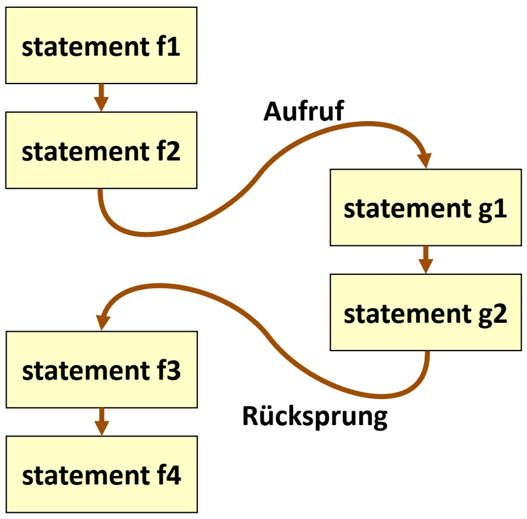

<details>
<summary>flowchart</summary>

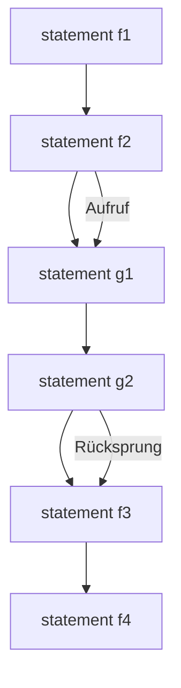
</details>

**Zeit**

Während der Ausführung kann g ihrerseits **weitere Funktionen** aufrufen (verschachtelte Funktionsaufrufe)
Ebenso können nach Ausführung von f auch **andere Funktionen** auf g zurückgreifen
**Vorteil**: Programmcode für mehrfach verwendete Routinen muss nur einmal vorhanden sein

– bessere **Wartbarkeit**
– geringere **Codegröße**

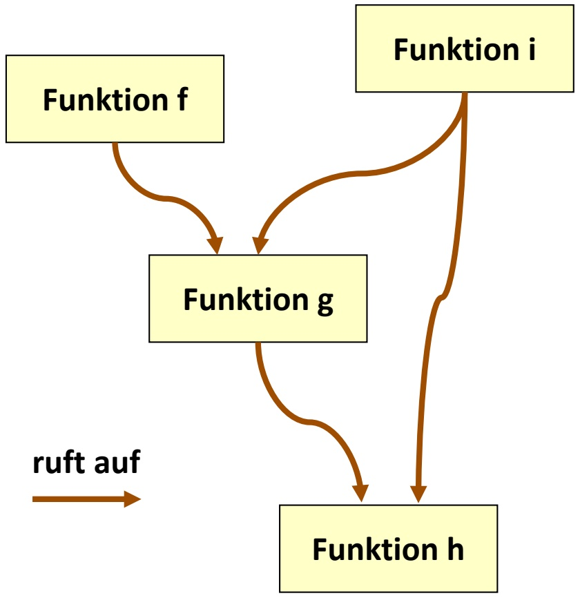

<details>
<summary>flowchart</summary>

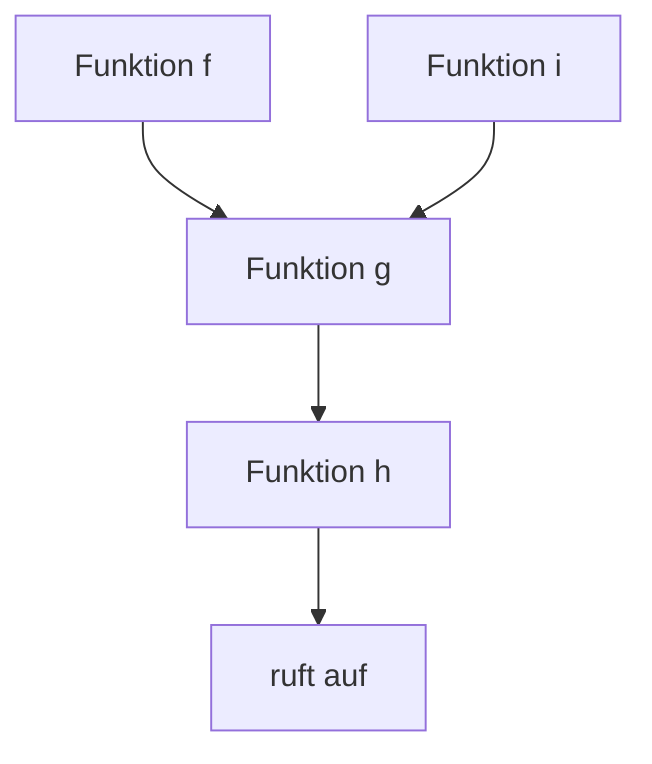
</details>

• Funktionen besitzen eine **Deklaration** und eine **Definition**
**Deklaration**: Name, Definitionsbereich, Wertebereich (d.h. **Interface** der Funktion nach außen)
**Definition**: Programmcode zur **Implementierung** der gewünschten Funktionalität
Erfolgt die Definition vor der ersten Verwendung einer Funktion, so darf die Deklaration **entfallen**
• **Allgemeine Form der Deklaration**:
– Typ ID (Parameter-Deklaration\*);
– Parameter-Deklaration syntaktisch wie Variablendeklaration
– Jedoch: Parameter-ID kann auch entfallen
– float max(float x, float y); oder
float max(float, float);
– Deklariert Funktion max: float × float → float

• **Allgemeine Form**:

– Typ ID (Parameter-Deklaration\*) { statement\* }

Interface-Definition **muss** vorheriger Deklaration entsprechen (falls vorhanden)
Funktionsrumpf innerhalb $f / \dot { r } \ldots \dot { r } / f$ kann beliebige Statements enthalten
• Verlassen einer Funktion durch return**-Statement**

– return Ausdruck;
– Typ von Ausdruck muss dem **Wertebereich** der Funktion entsprechen (falls nötig: type cast)
– Funktionen können **nicht** per goto verlassen werden (Labels nur gültig **innerhalb** einer Funktion)

Kommunikation zwischen **aufrufender** (caller) und **aufgerufener** (callee) Funktion:

```c
void f(void) { int x; /* ... ruft g auf */ };
int g(int a, int b) { return a+b; }
```

• a und b sind die **formalen Parameter** der Funktion g gemäß Deklaration
Aufruf von g durch f per Namen und Übergabe **der aktuellen Parameter**, z.B.

$$
- x = g (1, 2);
$$

– In g werden die „Platzhalter“ a und b durch 1 bzw. 2 ersetzt, g wird ausgeführt und per return beendet
– Der Ausdruck g(1,2) liefert dann den **Rückgabewert** 3; dieser kann z.B. an eine Variable (hier: x) zur Weiterverarbeitung zugewiesen werden

• Zwei Arten von Variablen:

**Globale Variablen** sind im gesamten Programm **gültig** (d.h. können zugegriffen werden)
**Lokale Variablen** sind nur in einer bestimmten Funktion gültig (ebenso wie **formale Funktionsparameter**)
– Lokale Variablen können globale Variablen gleichen Namens **verdecken**

Globale Variablen sollten zur besseren Programm-Wartbarkeit **möglichst selten** verwendet werden (sonst Gefahr von unerwünschten Seiteneffekten)

```c
int a=2, b=2, i=10;
int f(int a, int b)
{
    int i;
    i = a+b;
    return i;
}
int main(void)
{
    /* ... */
    i -= f(a, b);
    return 0;
}
```

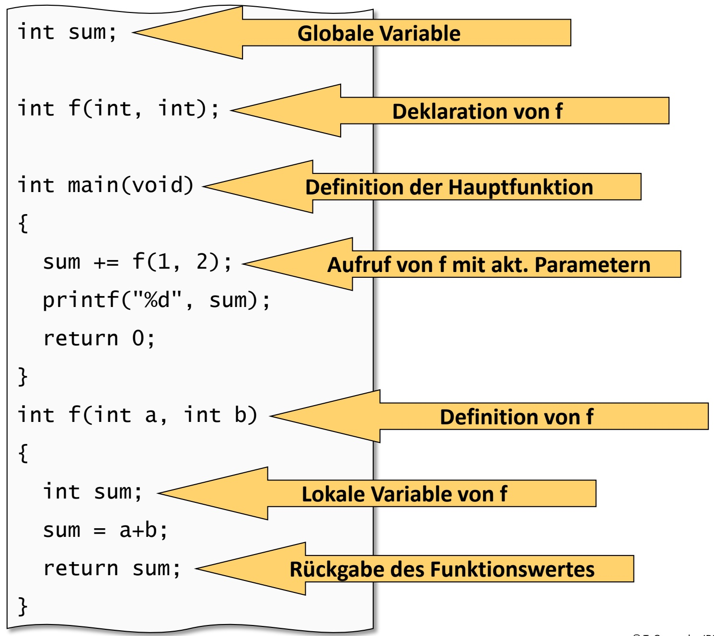

<details>
<summary>flowchart</summary>

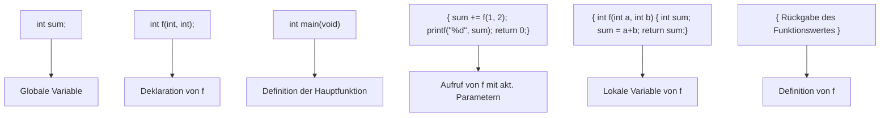
</details>

## Beispiel

Berechnung einer **Kreisfläche** als Funktion des Radius

$$
A = \pi * r ^ {2}
$$

• Definition von π als **Konstante**
**Einkapselung** der Flächenberechnung in Funktion area
Hauptfunktion main: Rückgabetyp immer int hier keine Eingangsparameter: void
Fortlaufende Ein/Ausgabe von Radius und Fläche

#define PI 3.1415926

```c
float area(float r)
{
    float a;
    a = PI * r * r;
    return a;
}

int main(void)
{
    float rad, A;
    while (1) {
        scanf("%f", &rad);
        A = area(rad);
        printf("%f \n", A);
    }
    return 0;
}
```

## 4. Funktionen und Programmaufbau

4.1 Funktionen
**4.2 Parameterübergabe**
4.3 Polymorhpie
4.4 Templates
4.5 Lambda Funktionen
4.6 Module und Programme

Bei Übergabe eines Wertes w an eine Funktion f wird dem formalen Parameter von f eine **lokale Kopie** von w zugewiesen (call by value)
f arbeitet nur mit der Kopie, kann w **nicht modifizieren**
Falls Modifikation von w erwünscht: Übergabe als **Referenzparameter** (call by reference)

– in C nur call-by-value (f1)
– in C++: Operator & (f2)C++
– **Nachbildung** in C: call by value mit Zeiger auf w (f3)

```c
void f1(int a) { a++; }
void f2(int& a) { a++; }
void f3(int* a) { (*a)++; }

int main(void)
{
    int a;
    a = 1;
    f1(a);  // a = 1
    f2(a);  // a = 2
    f3(&a); // a = 3
    return 0;
}
```

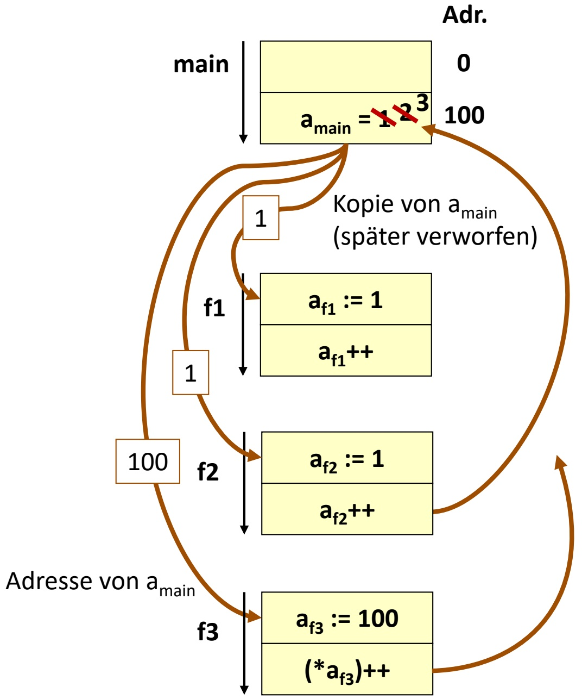

<details>
<summary>flowchart</summary>

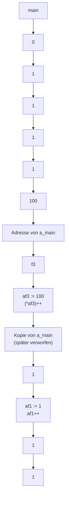
</details>

```c
void f1(int a) { a++; }
void f2(int& a) { a++; }
void f3(int* a) { (*a)++; }

int main(void)
{
    int a;
    a = 1;
    f1(a);  // a = 1
    f2(a);  // a = 2
    f3(&a); // a = 3
    return 0;
}
```

• **Beispiel**: komplexe Zahlen

$$
\mathrm{c} = (\mathrm{a}, \mathrm{b})
$$

Realteil a, Imaginärteil b

• **Produkt** zweier komplexer

Zahlen $c _ { 1 } = ( a _ { 1 } , b _ { 1 } ) , c _ { 2 } = ( a _ { 2 } , b _ { 2 } )$

$$
c _ {3} = (a _ {1} * a _ {2} - b _ {1} * b _ {2},
$$

$$
\mathrm{a} _ {1} * \mathrm{b} _ {2} + \mathrm{a} _ {2} * \mathrm{b} _ {1})
$$

• Komplexe Zahlen sind **kein**

**Basis-Datentyp** in C

• **Naive Lösung**: zwei Funktionen

für Real- und Imaginärteil

```c
float prd_real(float a1, float a2,
        float b1, float b2)
{
    return a1*a2-b1*b2;
}

float prd_imag(float a1, float a2,
        float b1, float b2)
{
    return a1*b2+a2*b1;
}

int main(void)
{
    float c_real, c_imag;
    c_real = prd_real( /* ... */ );
    c_imag = prd_imag( /* ... */ );
    return 0;
}
```

Definition des Datentyps complex als struct
• structs werden als **Wertparameter** übergeben
D.h. evtl. **kopieren** großer Speicherblöcke (langsam)
Übergabe als **Referenzparameter** (per Zeiger) evtl. besser
**Arrays** (s.u.) werden immer als Referenzparameter übergeben
• Arrays als **Rückgabewert** unzulässig (warum?)

```c
typedef struct c {
    float a, b; } complex;

complex prod(complex c1, complex c2)
{
    complex c3;
    c3.a = c1.a*c2.a-c1.b*c2.b;
    c3.b = c1.a*c2.b+c2.a*c1.b;
    return c3;
}

int main(void)
{
    complex c1, c2, c3;
    c3 = prod(c1, c2);
    return 0;
}
```

## 4. Funktionen und Programmaufbau

4.1 Funktionen
4.2 Parameterübergabe
**4.3 Polymorhpie**
4.4 Templates
4.5 Lambda Funktionen
4.6 Module und Programme

## • Auswahl der Funktionsdefinition in Abhängigkeit der Operanden

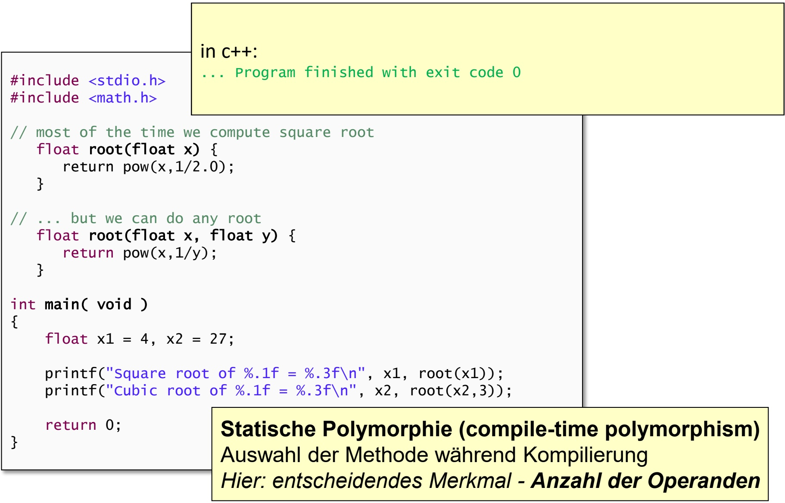

<details>
<summary>flowchart</summary>

```mermaid
graph TD
  #include <stdio.h>
  #include <math.h>

  // most of the time we compute square root
    float root(float x) {
      return pow(x,1/2.0);
    }

  // ... but we can do any root
    float root(float x, float y) {
      return pow(x,1/y);
    }

  int main( void )
  {
    float x1 = 4, x2 = 27;
    printf("Square root of %.1f = %.3f\n", x1, root(x1));
    printf("Cubic root of %.1f = %.3f\n", x2, root(x2,3));

    return 0;
  }

  in c++:
  ... Program finished with exit code 0

  Statische Polymorphie (compile-time polymorphism)
  Auswahl der Methode während Kompilierung
  Hier: entscheidendes Merkmal - Anzahl der Operanden
```
</details>

• Auswahl der Funktionsdefinition in Abhängigkeit der Operanden

```c
#include <stdio.h>

    #define TEST_INT
    #define TEST_FLOAT

#ifdef TEST_INT
int mult(int a, int b) {
    printf("Integer: %d x %d = %d\n", a, b, a*b);
    return a*b;
}
#endif

#ifdef TEST_FLOAT
float mult(float a, float b) {
    printf("Float: %.2f x %.2f = %.2f\n", a, b, a*b);
    return a*b;
}
#endif

int main( void )
{
    int i_a = 3, i_b = 4;
    float f_a = 3.1, f_b = 4.5;
```

## Statische Polymorphie (compile-time polymorphism)

Auswahl der Methode während Kompilierung

Hier: entscheidendes Merkmal - **Typ**

Funktionen sind keine Variablen, besitzen aber eine **Speicheradresse**
Daher gibt es **Zeiger auf Funktionen**, diese können als **Parameter** übergeben und „aufgerufen“ werden
Sinnvoll, falls **Aufrufstruktur** der Funktionen nicht statisch festliegen soll
Bsp.:

```txt
- Funktion f:
    int f(float, float);
- Zeiger auf f:
    int (*p)(float,float);
    p = &f;
```

```c
#include <stdio.h>
int add(int a, int b)
{
    return a+b;
}

int sub(int a, int b)
{
    return a-b;
}

int op(int (*f)(int,int), int a, int b)
{
    return f(a, b);
}

int main(void)
{
    char c;
    int result;
    scanf("%c", &c);
    if (c == 'a')
        result = op(add, 1, 2);
    else if (c == 's')
        result = op(sub, 1, 2);
    printf("%d\n", result);
    return 0;
}
```

## 4. Funktionen und Programmaufbau

4.1 Funktionen
4.2 Parameterübergabe
4.3 Polymorhpie
**4.4 Templates**
4.5 Lambda Funktionen
4.6 Module und Programme

• Typ als Variable

```cpp
#include <cstdio>
#include <iostream>

template <typename T>
T mult(T a, T b) {
    std::string tname;
    switch( typeid(a).name()[0] ) {
        case 'i': tname = "Integer"; break;
        case 'f': tname = "Float"; break;
    }
    std::cout << tname << ": " << a << " x " << b << " = " << a*b << std::endl;
    return a*b;
}

int main( void )
{
    int i_a = 3, i_b = 4;
    float f_a = 3.1, f_b = 4.5;

    mult<int>(i_a,i_b);
    mult<float>(f_a,f_b);

    return 0;
}
```

```txt
Bisher:
int mult(int a, int b) {
    printf("Integer: %d x %d = %d\n", a, b, a*b);
    return a*b;

float mult(float a, float b) {
    printf("Float: %.2f x %.2f = %.2f\n", a, b, a*b);
    return a*b;
}
```

Entsprechend können auch template-Klassen vereinbart werden.

## 4. Funktionen und Programmaufbau

4.1 Funktionen
4.2 Parameterübergabe
4.3 Polymorhpie
4.4 Templates
**4.5 Lambda Funktionen**
4.6 Module und Programme

```cpp
#include <iostream>
#include <string>
using namespace std;

// Regular Function
void report_age1(int val) {
    cout << "My age is " << val << endl;
}

int main( void )
{
    int age = 23;

    // Lambda Function
    auto report_age2 = [](int val) -> string { return "My age is " + to_string(val); };
    auto report_age3 = [age]() -> string { return "My age is " + to_string(age); };

    report_age1(19);
    cout << report_age2(21) << endl;
    cout << report_age3() << endl;

    return 0;
}
```

## 4. Funktionen und Programmaufbau

4.1 Funktionen
4.2 Parameterübergabe
4.3 Polymorhpie
4.4 Templates
4.5 Lambda Funktionen
**4.6 Module und Programme**

C-Compiler übersetzt immer **ein einzelnes** C-Modul
**Modul** = globale Variablen und Funktionen
Entwicklung von Modulen kann **parallel** erfolgen
Modul (z.B. Library) muss nicht unbedingt **main-Funktion** enthalten
Komplettes **C-Programm** wird aus einzelnen Modulen zusammengesetzt (durch den Linker)
C-Programm muss **genau eine** main-Funktion enthalten
**Globale Variablen** und **Funktionen** gleichen Namens dürfen nur einmal vorkommen

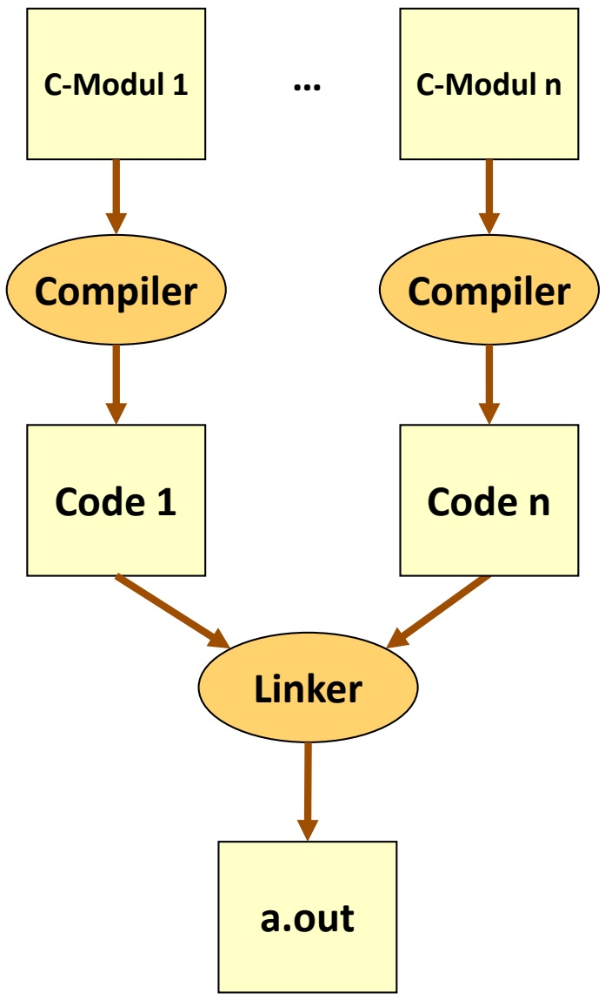

<details>
<summary>flowchart</summary>

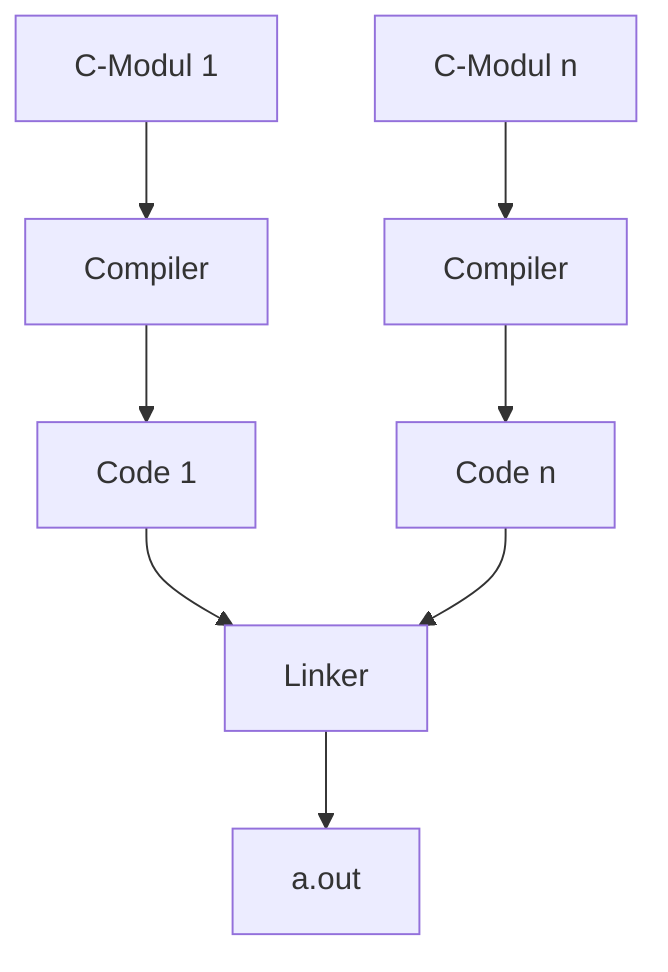
</details>

Zweckmäßig: **Trennung** von Deklarationen und Definitionen in zwei Dateien (meist: \*.h und \*.c)
• Deklarationen im **Header File**
Header File kann von allen C-Modulen **eingebunden** werden

```c
#include "lib.h"    main.c
int main(void)
{
    /* ... */
    a = sqrt( /* ... */ );
    b = sin( /* ... */ );
    c = cos( /* ... */ );
    return 0;
}
```

```txt
/* Library lib.h
  mit math. Funktionen */
float sqrt( /* ... */ );
float sin( /* ... */ );
float cos( /* ... */ );
```

```txt
/* Implementierung lib.c
  der math. Funktionen */
float sqrt( /* ... */ )
    { /* ... */ }
float sin( /* ... */ )
    { /* ... */ }
float cos( /* ... */ )
    { /* ... */ }
```

## 5. Datentypen

**5.1 Arrays**
5.2 Strukturen
5.3 Abstrakte Datentypen
5.4 Klassen

**Arrays** (oder: Felder, Vektoren) definieren zusammengesetzte Datentypen, deren Elemente durch einen **Index** zugegriffen werden
• Vektor (**mathematisch**):

$V   =   \left( v _ { 1 } , \ldots , v _ { n } \right)$ $v _ { i }$ bezeichnet 𝑖𝑖-tes Element von 𝑉𝑉

Vektor/Array-Deklaration in $C / C + +$

– Typ ID [int-Konstante];
– Z.B. int v[10];

• deklariert 10-elementigen Vektor 𝑉𝑉
• Komponenten sind vom Typ int
• Zugriff auf 𝑖𝑖-tes Element mittels Operator [...], z.B. v[3]
Der Ausdruck 3 ist der **Index** des Elementes
• **Index-Numerierung beginnt immer bei 0**

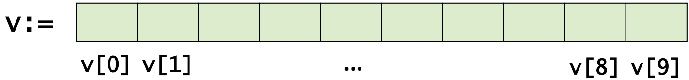

<details>
<summary>text_image</summary>

v:= 
v[0] v[1] ... v[8] v[9]
</details>

Benachbarte Arrayelemente befinden sich stets auch **benachbart** im Speicher
• Daher bei v[i]:

– Index i bezeichnet den Abstand (offset) des 𝑖𝑖-ten Elementes von der **Basisadresse** $v ( = \theta v [ 0 ] )$

– Operator $v [ \ldots ] ^ { n }$ entspricht **Addition** von Array-Basisadresse und Index

$$
- \mathrm{v} [ \mathrm{i} ] = * (\mathrm{v} + \mathrm{i}) = * (\mathrm{i} + \mathrm{v}) = \mathrm{i} [ \mathrm{v} ]
$$

– p = &v[0]; oder p = v; lässt p auf Anfang von v zeigen
– Die folgenden 3 Ausdrücke sind äquivalent:

$$
\mathrm{v} [ 3 ] = 1 2 3; \mathrm{p} [ 3 ] = 1 2 3; \text {und} * (\mathrm{p} + 3) = 1 2 3;
$$

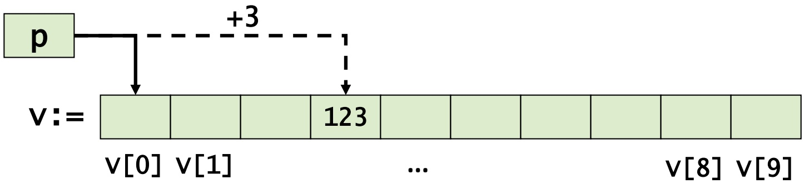

<details>
<summary>text_image</summary>

p
v:= 
+3
123
v[0] v[1]
...
v[8] v[9]
</details>

Vorteil von Arrays: **Menge „gleichartiger“ Objekte** kann mit einem Namen und variablem Index zugegriffen werden

**Meist**: in Schleifen, damit Vermeidung von Code-Duplizierung
Beispielprogramme zur Initialisierung von Array A sind äquivalent
• **Post-Inkrement:**

$$
^ {*} p + + = \dots ;
$$

ist zu lesen wie

$$
^ {*} p = \dots ; p + + ;
$$

```txt
int i, a[10];

for(i=0; i<10; i++) {
    a[i] = i;
}
```

```c
int *p, i, a[10];

p = &a[0];
for(i=0; i<10; i++) {
    *p++ = i;
}
```

• **Array-Basisadressen** verhalten sich wie Zeiger (auf das erste Array-Element)
Nach Deklaration int a[10]; ist der Ausdruck a **identisch** mit dem Ausdruck &a[0]
• Grund: $a = a + 0 = \theta(\pi(a + 0)) = \theta a[0]$
Achtung: Arrays können **nicht** mit einem einzigen Befehl kopiert werden

```txt
int a[10], b[10], i;
// unzulässig:
a = b;      // entspricht &a[0] = &b[0]
// stattdessen:
for (i=0; i<10; i++) {  // elementweises Kopieren
    a[i] = b[i];
}
```

• String = Array mit char-Elementen
Element-Wert 0 (oder '\0' als char-Konstante) kennzeichnet **String-Ende**
Daher: char-Arrays immer **ein Byte länger** als „Nutzlast“-String
Beginnend bei 0: Zähler **inkrementieren**, bis '\0' -Zeichen erreicht
• Bsp.: char $s [ 6 ] = \mathrm { { \sf { K e t t e } } }$ 1

s

<table><tr><td>K</td><td>e</td><td>t</td><td>t</td><td>e</td><td>&#x27;\0&#x27;</td></tr><tr><td colspan="5">s[0]</td><td>s[5]</td></tr></table>

```c
#define STR "teststring"

int main(void)
{
    char* s = STR;
    int i, count = 0;

    for(i=0; s[i] != 0; i++) {
        count++;
    }

    printf("Länge = %d", count);
}
```

```javascript
/* ... */

count = 0;
while (s[count]) {
    count++;
}

/* ... */
```