• Beispiel-Ablauf für 𝑛𝑛 = 5
• Welche **Laufzeit** ergibt sich?
– 19 Einzelschritte (= Statements)
• **Probleme**:
– Welche Laufzeit hat ein Schritt?
– Z.B. ist „++“ teurer als „\*=“ ?
– **Rechnerabhängig**!
• Daher: **abstrakte** Analyse
– Wie viele Einzelschritte werden ausgeführt?
– Unabhängig von Rechnergeschwindigkeit (MIPS) und Kosten der Einzelschritte

## count

1

fact = 1
count = 1
count <= n?
fact \*= count
count++
count <= n?
fact \*= count
count++
count <= n?
fact \*= count
count++
count <= n?
fact \*= count
count++
count <= n?
fact \*= count
count++
count <= n?
printf(...)

2

3

4

5

6

• Einzelschritte bei Funktion fact:

– **Initialisierung** von fact und count: 2 Schritte
– Pro **Schleifeniteration**: 3 Schritte $\left( <=, \ddot{ } =, ++ \right)$
– **Schleifenende**: 1 Schritt

• Für beliebiges 𝑛𝑛:

$$
\begin{array}{l} T _ {\mathrm{fact}} (n) = 2 + 3 \cdot n + 1 \\ = 3 n + 3 \\ \end{array}
$$

**Lineare Laufzeit** in Abhängigkeit der Eingabegröße 𝑛𝑛

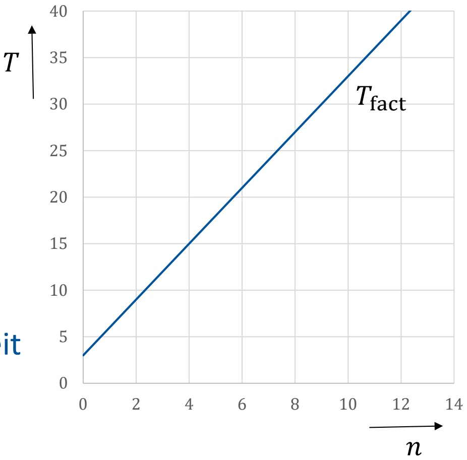

<details>
<summary>line</summary>

| n | T fact |
| --- | --- |
| 0 | ~3 |
| 2 | ~9 |
| 4 | ~15 |
| 6 | ~21 |
| 8 | ~27 |
| 10 | ~33 |
| 12 | ~40 |
</details>

**Annahme**: ein anderer Algorithmus fact2 hat Laufzeit

$$
T _ {\mathrm{fact2}} (n) = n ^ {2} + 1
$$

$$
n \leq 3
$$

• fact2 ist schneller für
• Ab $n \; = \; 4$ benötigt fact2 stets höhere Laufzeit
Differenz steigt mit 𝑛𝑛
**Ergebnis**: fact2 ist für fast alle 𝑛𝑛 langsamer als fact (d.h. die **asymptotische** Laufzeit von fact2 ist größer als von fact)

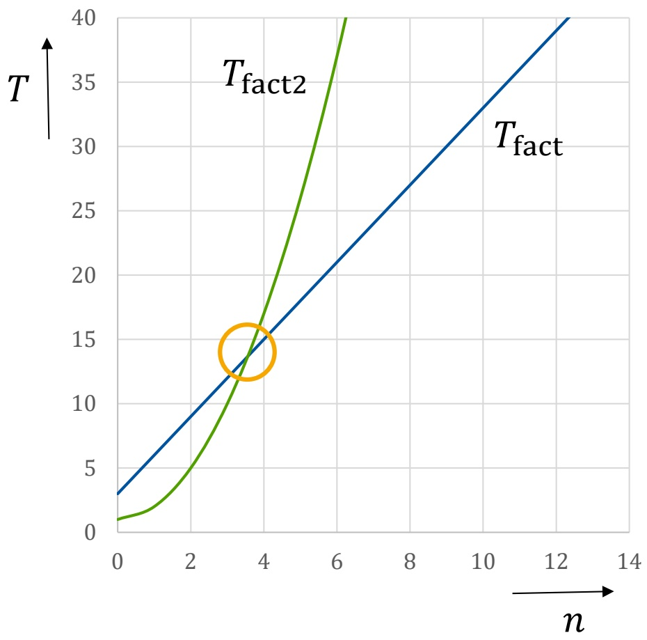

<details>
<summary>line</summary>

| n | T_fact | T_fact2 |
| --- | --- | --- |
| 0 | ~3 | ~1 |
| 2 | ~9 | ~5 |
| 4 | ~15 | ~15 |
| 6 | ~21 | ~35 |
| 8 | ~27 | — |
| 10 | ~33 | — |
| 12 | ~40 | — |
</details>

Konstante Faktoren und **Konstanten** vernachlässigen!
Analyse unabhängig von **Rechnerdetails**
Frage: wie **wächst die Laufzeit** bei Erhöhung der Eingabegröße 𝑛𝑛?
• **Näherung**:
Beeinflusst den **Vergleich** der Algorithmen nur unwesentlich

$$
T _ {\mathrm{fact}} (n) \approx n
$$

$$
T _ {\mathrm{fact2}} (n) \approx n ^ {2}
$$

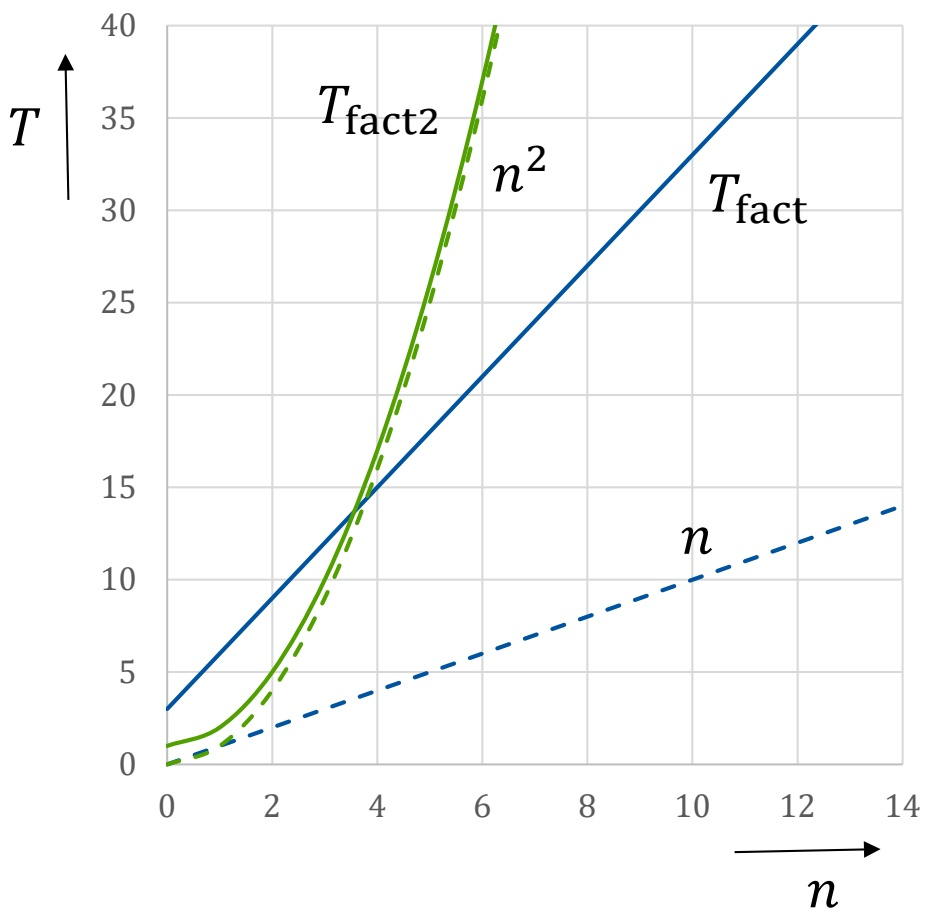

<details>
<summary>line</summary>

| n | T_fact | T_fact2 | n |
| --- | --- | --- | --- |
| 0 | ~3 | ~1 | 0 |
| 2 | ~9 | ~5 | ~2 |
| 4 | ~15 | ~15 | ~4 |
| 6 | ~21 | ~35 | ~6 |
| 8 | ~27 | — | ~8 |
| 10 | ~33 | — | ~10 |
| 12 | ~40 | — | ~12 |
| 14 | — | — | ~14 |
</details>

## 6. Analyse von Algorithmen

6.1 Laufzeitanalyse
**6.2** 𝓞𝓞**-Notation für Wachstumsordnungen**
6.3 Beispiel: Exponentialfunktion
6.4 Beispiel: Suchen in Arrays

𝒪𝒪-Notation $( \mathcal { O } = o r d e r )$ ist das gebräuchlichste Hilfsmittel zur **Wachstumsanalyse** von Algorithmen
• ℕ und ℝ seien die Menge der natürlichen bzw. reellen Zahlen

**Def**.: Sind $f : \mathbb { N } \to \mathbb { N }$ und $g : \mathbb { N } \; \rightarrow \; \mathbb { N }$ zwei Funktionen, so ist

$$
f \in \mathcal {O} (g), \text {falls}
$$

$$
\exists n _ {0} \in \mathbb {N}, \exists c \in \mathbb {R}, \text {so dass}
$$

$$
\forall n \geq n _ {0} \colon f (n) \leq c \cdot g (n)
$$

$f \in { \mathcal { O } } ( g )$ heißt:
$\nu ^ { f }$ wächst nicht schneller als $\mathfrak { g } ^ { \prime \prime }$
𝒪𝒪-Notation **eliminiert Konstanten** aus der Laufzeitberechnung
• $\mathrm { Z . B . : }   f ( n ) =   1 0 n ^ { 3 }   +   2 0 n ^ { 2 }   +   1 6 \in \mathcal { O } ( n ^ { 3 } )$ da $f ( n ) \; \leq \; 1 1 n ^ { 3 }   ( \mathrm { d . h . } \; c \; = \; 1   1 )$ sicherlich für alle $n   \geq   3 0$

| n | f(n) | c·g(n) |
| --- | --- | --- |
| 0 | 16 | 0 |
| 10 | 12016 | 11000 |
| 20 | 88016 | 88000 |
| 30 | 288016 | 297000 |
| 40 | 672016 | 704000 |
| 50 | 1300016 | 1375000 |
| 60 | 2232016 | 2376000 |
| 70 | 3528016 | 3773000 |
| 80 | 5248016 | 5632000 |
| 90 | 7452016 | 8019000 |
| 100 | 10200016 | 11000000 |

• 𝓞𝓞-Notation gibt Wachstumsordnung nur **näherungsweise** an
• Nach **Definition** gilt z.B. auch

$$
1 0 ^ {2 0} n ^ {2} \in \mathcal {O} (1 / 1 0 0 \cdot n ^ {3})
$$

• Jedoch gilt $1 0 ^ { 2 0 }   n ^ { 2 }   \leq   1 / 1 0 0   n ^ { 3 }$ erst ab $n _ { 0 } \; = \; 1 0 ^ { 2 2 }$
Eingabegröße von $1 0 ^ { 2 2 }$ **unrealistisch**, daher wäre die obige Wachstumsordnung wenig sinnvoll
In der Praxis kommen jedoch eher **kleine konstante** Faktoren vor, daher ermöglicht die O-Notation

– Die ungefähre **Abschätzung** der Laufzeit eines Algorithmus
– Den näherungsweisen **Vergleich** der Laufzeit verschiedener Algorithmen

• Vor allem: sinnvoll **vor** der detaillierten Implementierung

Mittels 𝒪𝒪-Notation können auch **andere Maße** für die Qualität eines Algorithmus im Vergleich zu anderen abgeschätzt werden, z.B. **Speicherbedarf**
Außerdem kann die 𝒪𝒪-Notation aussagen, ob sich die Suche nach einem **besseren Algorithmus** für ein Problem lohnt:

– Für viele praktisch relevante Probleme ist bekannt, dass ihre optimale Lösung **mindestens Zeit** 𝓞𝓞(𝟐𝟐<sup>𝒏𝒏</sup>) benötigt
– Daher ist die Suche nach einem effizienten Algorithmus **Zeitverschwendung**
– Für andere Probleme sind bessere **untere Schranken** bekannt
– Z.B. 𝒪𝒪(𝑛𝑛 log 𝑛𝑛) für das **Sortieren** von 𝑛𝑛 Zahlen
– Solche Algorithmen **wurden bereits gefunden**, daher lohnt die Suche nach besseren Verfahren kaum

Häufig wird die **Gesamtlaufzeit** eines Algorithmus als mathematischer Ausdruck der **Laufzeiten von Teilalgorithmen** bestimmt
• **Rechenregeln**:

$\mathcal { N } ^ { \prime \prime }$ im Ausdruck vernachlässigen
– Umformen des Ausdrucks wie gewohnt
– Nur den führenden Term (höchster Exponent) behalten

• Z.B. $g ( n ) =   2 n \cdot \mathcal { O } ( n ) \in \mathcal { O } ( n ^ { 2 } )$
$\mathcal { O } ( n )$ repräsentiert alle Funktionen f mit **linearem Wachstum**, d.h.

$$
f (n) = c _ {1} n + c _ {2} \text {mit} c _ {1}, c _ {2} \in \mathbb {R}
$$

$$
g (n) = 2 n \cdot (c _ {1} n + c _ {2}) = 2 c _ {1} n ^ {2} + 2 c _ {2} n
$$

$$
c _ {3} := 2 c _ {1}
$$

$$
c _ {4} := 2 c _ {2}
$$

$$
\begin{array}{l} \Longleftrightarrow c _ {3} n ^ {2} + c _ {4} n \quad \text {mit} \mathrm{c} _ {3}, \mathrm{c} _ {4} \in \mathbb {R} \\ \in \mathcal {O} (n ^ {2}) + \mathcal {O} (n) \in \mathcal {O} (n ^ {2}) \text {gemäß Definition} \\ \end{array}
$$

• Komplexeres Beispiel:

$$
\begin{array}{l} \big (\boldsymbol {n} + \mathcal {O} (\boldsymbol {1}) \big) \big (\boldsymbol {n} + \mathcal {O} (\log \boldsymbol {n}) + \mathcal {O} (\boldsymbol {1}) \big) \\ = n ^ {2} + n \cdot \mathcal {O} (\log n) + n \cdot \mathcal {O} (1) + \\ \mathcal {O} (1) \cdot n + \mathcal {O} (1) \cdot \mathcal {O} (\log n) + \mathcal {O} (1) \cdot \mathcal {O} (1) \\ = n ^ {2} + \mathcal {O} (n \log n) + \mathcal {O} (n \cdot 1) + \mathcal {O} (1 \cdot n) + \mathcal {O} (1 \cdot \log n) + \mathcal {O} (1 \cdot 1) \\ = \mathcal {O} (n ^ {2}) + \mathcal {O} (n \log n) + \mathcal {O} (n) + \mathcal {O} (n) + \mathcal {O} (\log n) + \mathcal {O} (1) \\ = \mathcal {O} (n ^ {2}) + \mathcal {O} (n \log n) + \mathcal {O} (2 \cdot n) + \mathcal {O} (\log n) + \mathcal {O} (1) \\ = \mathcal {O} (n ^ {2}) + \mathcal {O} (n \log n) + \mathcal {O} (n) + \mathcal {O} (\log n) + \mathcal {O} (1) \\ = \mathcal {O} (n ^ {2} + n \log n + n + \log n + 1) \\ = \mathcal {O} (n ^ {2}) \\ \end{array}
$$

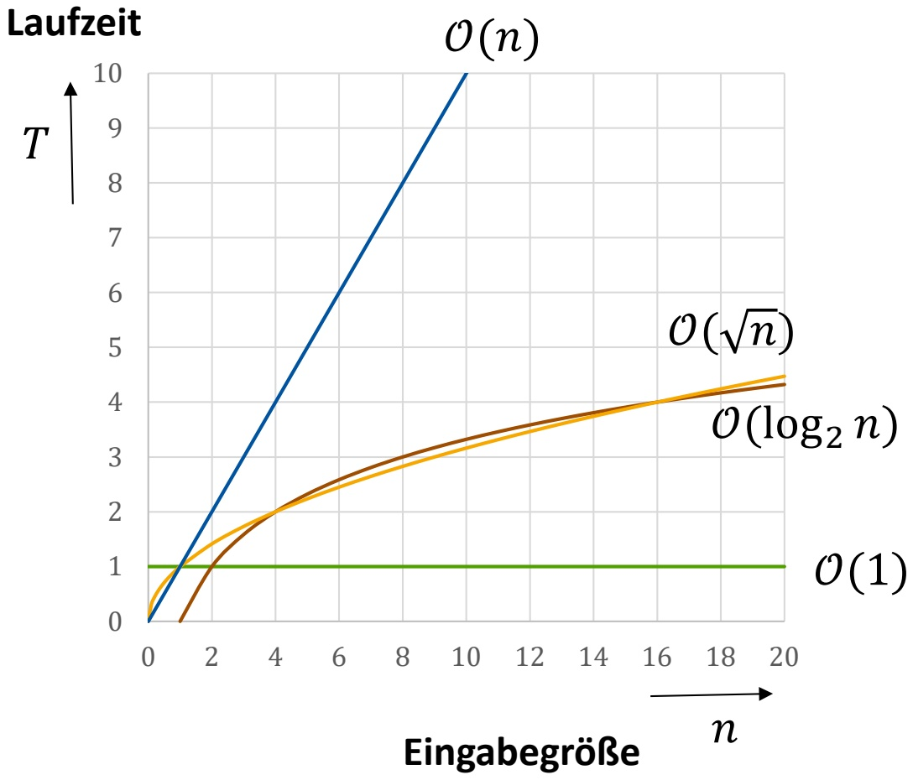

<details>
<summary>line</summary>

| Eingabegröße (n) | O(n) | \(O(\sqrt{n})\) | \(O(log_{2} n)\) | O(1) |
| --- | --- | --- | --- | --- |
| 0 | 0 | 0 | — | 1 |
| 2 | ~2.5 | ~1.3 | ~1.1 | 1 |
| 4 | ~5.0 | ~2.0 | ~2.0 | 1 |
| 6 | ~7.5 | ~2.6 | ~2.6 | 1 |
| 8 | ~9.5 | ~3.1 | ~3.1 | 1 |
| 10 | >10 | ~3.5 | ~3.5 | 1 |
| 12 | N/A | ~3.8 | ~3.8 | 1 |
| 14 | N/A | ~4.0 | ~4.0 | 1 |
| 16 | N/A | ~4.2 | ~4.2 | 1 |
| 18 | N/A | ~4.3 | ~4.3 | 1 |
| 20 | N/A | ~4.4 | ~4.4 | 1 |
</details>

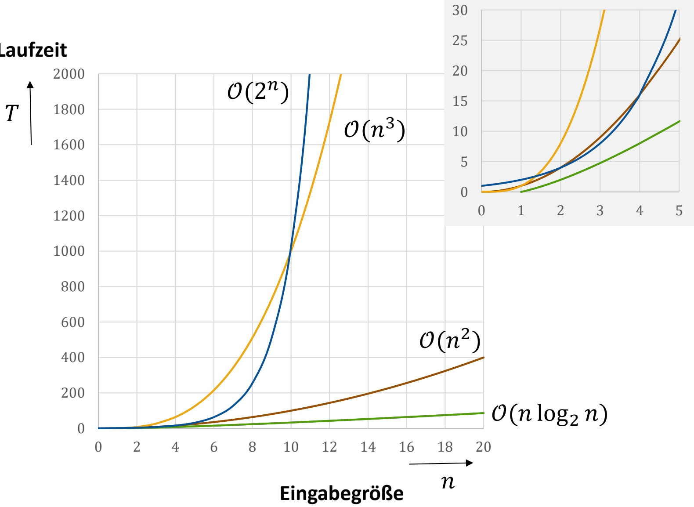

<details>
<summary>line</summary>

| n | O(2^n) | O(n^3) | O(n^2) | O(n log_2 n) |
|---|---|---|---|---|
| 0 | 0 | 0 | 0 | 0 |
| 2 | ~10 | ~10 | ~5 | ~2 |
| 4 | ~60 | ~60 | ~15 | ~4 |
| 6 | ~250 | ~250 | ~30 | ~6 |
| 8 | ~700 | ~700 | ~50 | ~8 |
| 10 | ~1400 | ~1400 | ~70 | ~10 |
| 12 | >2000 | >2000 | ~90 | ~12 |
| 14 | N/A | N/A | ~120 | ~14 |
| 16 | N/A | N/A | ~160 | ~16 |
| 18 | N/A | N/A | ~220 | ~18 |
| 20 | N/A | N/A | ~300 | ~20 |
</details>

## Wichtige Wachstumsordnungen

• Annahme: Rechner kann **1000 Operationen pro Sekunde** ausführen
• Welche **Eingabegröße** kann in Zeit t bearbeitet werden ?
Kleine konstante Faktoren spielen nur **geringe Rolle**!

| T(n) | t = 1sec (1000 Op) | t = 1 min (60.000 Op) | t = 1h (3.600.000 Op) |
| --- | --- | --- | --- |
| log2 n | 21000 | 260.000 | 23.600.000 |
| $\sqrt{n}$ | 1.000.000 | 3.600.000.000 | 12.960.000.000.000 |
| n | 1000 | 60.000 | 3.600.000 |
| n log2 n | 140 | 4.895 | 204.094 |
| n2 | 31 | 244 | 1.897 |
| n3 | 10 | 39 | 153 |
| 2n | 9 | 15 | 21 |

• Was ändert sich, wenn der Rechner **10x schneller** wird?
Betrachte max. Eingabegröße 𝑚𝑚, die in vorgegebener Zeit bearbeitet werden kann
Bei exponentieller Laufzeit $\mathcal { O } ( 2 ^ { n } )$ lässt auch eine **Vertausendfachung** der Rechenleistung die max. Eingabegröße nur um $\approx 1 0$ wachsen (da $\log _ { 2 } 1 0 0 0 \approx 1 0 )$

| T(n) | vorher | nachher |
| --- | --- | --- |
| $\log_2 n$ | m | $m^{10}$ |
| $\sqrt{n}$ | m | 100 m |
| n | m | 10 m |
| $n \log_2 n$ | m | $\approx 8 \, m$ |
| $n^2$ | m | 3,16 m |
| $n^3$ | m | 2,15 m |
| $2^n$ | m | m + 3,3 |

$$
\log m ^ {1 0} = 1 0 \log m
$$

$$
1 0 = \sqrt {1 0 0}
$$

Faktor hängt von 𝑚𝑚 ab

$$
1 0 \approx 3, 1 6 ^ {2}
$$

$$
1 0 \approx 2, 1 5 ^ {3}
$$

$$
1 0 \approx 2 ^ {3, 3}
$$

## 6. Analyse von Algorithmen

6.1 Laufzeitanalyse
6.2 𝒪𝒪-Notation für Wachstumsordnungen
**6.3 Beispiel: Exponentialfunktion**
6.4 Beispiel: Suchen in Arrays

• Berechne $b ^ { n }$ für $b \in \mathbb { R }$ und $n \in \mathbb { N }$
Es gilt:

– 𝑏𝑏<sup>0</sup> = 1, und für 𝑛𝑛 > 0:
– 𝑏𝑏<sup>𝑛𝑛</sup> = 𝑏𝑏 ⋅ 𝑏𝑏<sup>𝑛𝑛−1</sup>

• **Rekursiver** Algorithmus (d.h.

Algorithmus ruft sich selbst auf)

• Z.B. pow(10,5)

$$
\begin{array}{l} = 1 0 ^ {*} \text {pow} (1 0, 4) \\ = 1 0 * 1 0 * \text {pow} (1 0, 3) \\ = 1 0 * 1 0 * 1 0 * \text {pow} (1 0, 2) \\ = 1 0 * 1 0 * 1 0 * 1 0 * \text {pow} (1 0, 1) \\ = 1 0 * 1 0 * 1 0 * 1 0 * 1 0 * \text {pow} (1 0, 0) \\ = 1 0 * 1 0 * 1 0 * 1 0 * 1 0 * 1 \\ = 1 0 0. 0 0 0 \\ \end{array}
$$

```c
float pow(float b, int n)
{
    if (n == 0) {
        return 1;
    } else {
        return b * pow(b, n-1);
    }
}

int main(void)
{
    float b, int n;
    scanf("%f,%d", &b, &n);
    printf("%f", pow(b, n));

    return 0;
}
```

## • Laufzeitanalyse:

– Funktion pow wird aufgerufen für n, n−1, n−2, …, 1, 0, d.h. (𝑛𝑛 + 1)-mal und unabhängig von Eingabe b
– Schritte innerhalb jedes pow-Aufrufs:

• 2 Schritte (falls n = 0) oder
• 5 Schritte

– Gesamt:

$$
5 n + 2 = \mathcal {O} (n) + \mathcal {O} (1) = \mathcal {O} (n)
$$

• **Lineare** Laufzeit in 𝑛𝑛

• Geht es auch schneller?

```c
float pow(float b, int n)
{
    if (n == 0) {
        return 1;
    } else {
        return b * pow(b, n-1);
    }
}

int main(void)
{
    float b, int n;
    scanf("%f,%d", &b, &n);
    printf("%f", pow(b, n));

    return 0;
}
```

• n **gerade**: b<sup>n</sup> = (bn/2)2
• n **ungerade**: b<sup>n</sup> = b \* b<sup>n-1</sup>
fastpow(10,5)
• Asymptotisch schneller als pow?

$$
= 1 0 ^ {*} \text {fastpow} (1 0, 4)
$$

$$
= 1 0 * \text {fastpow} (1 0, 2) ^ {2}
$$

$$
= 1 0 ^ {*} (\text {fastpow} (1 0, 1) ^ {2}) ^ {2}
$$

$$
= 1 0 ^ {*} \left(\left(1 0 ^ {*} \text {fastpow} (1 0, 0)\right) ^ {2}\right) ^ {2}
$$

$$
= 1 0 ^ {*} ((1 0 ^ {*} 1) ^ {2}) ^ {2}
$$

$$
= 1 0 ^ {*} (1 0 ^ {2}) ^ {2}
$$

$$
= 10*100^2
$$

$$
= 1 0 0. 0 0 0
$$

```lisp
float sqr(float x)
{
    return x*x;
}
float fastpow(float b, int n)
{
    if (n == 0) {
        return 1;
    } else if (n % 2 == 0) {
        // gerade!
        return sqr(fastpow(b, n/2));
    } else { // n ungerade
        return b * fastpow(b,n-1);
    }
}
```

Jeder Aufruf von fastpow benötigt 𝓞𝓞(𝟏𝟏) Schritte

– n = 0: sofortiges return
– n gerade: „/“ und \*“ „
– n ungerade: „\*“ und „-“

• Anzahl Aufrufe von fastpow:

n gerade: n wird halbiert, danach gerade oder ungerade
– n **ungerade**: n-1 ist gerade

**Spätestens** alle 2 Aufrufe wird n **halbiert**

• Max. 2 ⋅ 𝒪𝒪(log 𝑛𝑛) Aufrufe

• **Gesamtlaufzeit**:

$$
\begin{array}{c} \mathcal {O} (1) \cdot \mathcal {O} (\log n) = \mathcal {O} (\log n) \\ (\text {hier:} \log = \log_ {2}) \end{array}
$$

```lisp
float fastpow(float b, int n)
{
    if (n == 0) {
        return 1;
    } else if (n % 2 == 0) {
        // gerade!
        return sqr(fastpow(b, n/2));
    } else { // n ungerade
        return b * fastpow(b,n-1);
    }
}
```

## 6. Analyse von Algorithmen

6.1 Laufzeitanalyse
6.2 𝒪𝒪-Notation für Wachstumsordnungen
6.3 Beispiel: Exponentialfunktion
**6.4 Beispiel: Suchen in Arrays**

## • Problemstellung:

Kreditkartenunternehmen möchte prüfen, ob Transaktionen mit gestohlenen Karten durchgeführt wurden

## • Modell:

– 𝑁𝑁 „verdächtige“ Kartennummern sind gespeichert
– 𝑀𝑀 Transaktionen sind zu prüfen, jede bezieht sich auf eine bestimmte Kartennummer

$$
\begin{array}{l} - N \approx 10^6 \\ - M \approx 10^9 \\ \end{array}
$$

• Anwendung ist **zeitkritisch**!


<details>
<summary>text_image</summary>

GLOBAL BANK
4321 1234 0000 1234
MAX MUSTERMANN
1234567890
Karteninhaber
12/22
gültig bis
</details>

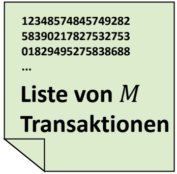

<details>
<summary>text_image</summary>

12348574845749282
58390217827532753
01829495275838688
...
Liste von M
Transaktionen
</details>

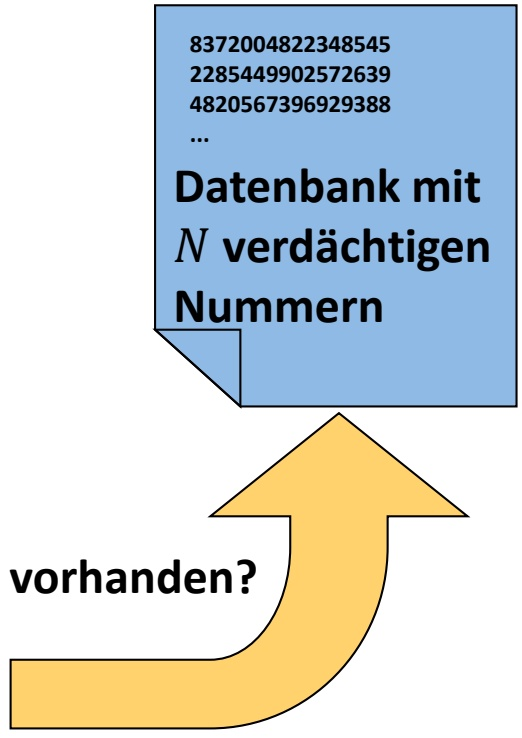

<details>
<summary>flowchart</summary>

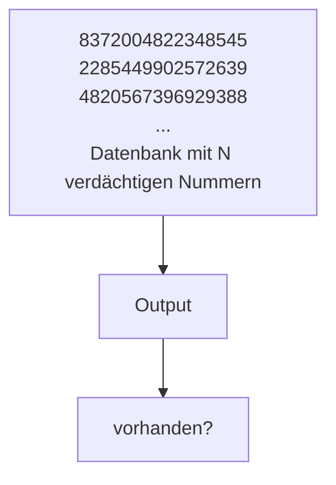
</details>

Verdächtige Nummern in **Array** A in beliebiger Reihenfolge gespeichert
Für jede Transaktionsnummer m: prüfe ob **Suchschlüssel** (key) m in Array A enthalten ist
– **Ja**: Index zurückgeben
– **Nein**: Speziellen Wert zurückgeben (NOT\_FOUND)
– Aufruf aus main: search(A,m,0,N-1);

```c
#define NOT_FOUND -1
int search(int A[], int key, int l, int r)
{
    int i;
    for (i = l; i <= r; i++) {
        if (key == A[i]) return i;
    }
    return NOT_FOUND;
}
```

• **Bester** Fall: k $( \mathsf { e } \mathsf { y } = 4 5$ , sofort gefunden, 𝒪𝒪 1 Schritte
Durchschnittlicher Fall: z.B. k $\mathrm{e}y = 76,   \mathcal{O}(N/2)$ Schritte
• **Schlechtester** Fall: z.B. $\mathrm{Key} = 99, \mathcal{O}(N)$ Schritte

Wegen $\mathcal { O } \big ( N / 2 \big ) = \frac { 1 } { 2 } \cdot \mathcal { O } \big ( N \big ) = \mathcal { O } \big ( N \big ) ;$

Laufzeit schlimmstenfalls **linear**, aber auch im Durchschnitt

• **Gesamtlaufzeit** für alle Transaktionen: $\mathcal { O } ( N \cdot M )$

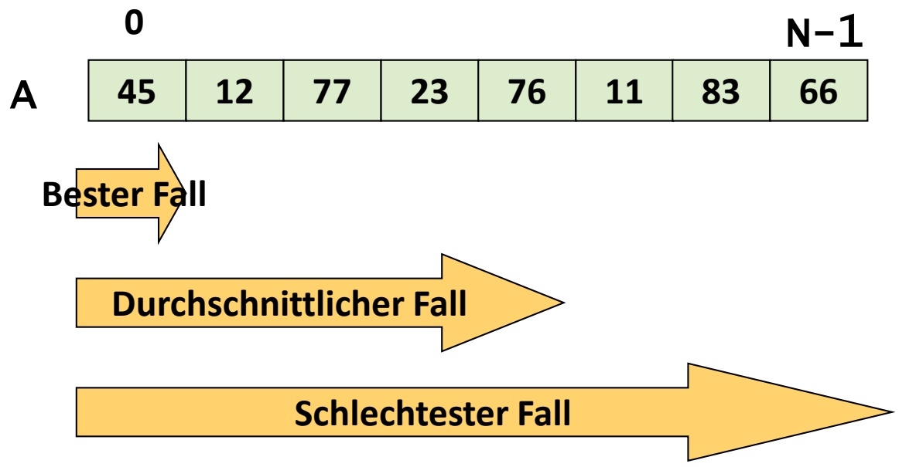

<details>
<summary>funnel</summary>

| Stage | Start Value | End Value |
| --- | --- | --- |
| A | 0 | N-1 |
| Bester Fall | 45 | — |
| Durchschnittlicher Fall | 12 | — |
| Schlechtester Fall | 77 | — |
</details>

• Annahme: Array A ist **aufsteigend sortiert**
Schnelle Prüfung, ob key (falls vorhanden) in **linker** oder **rechter** Hälfte des Arrays liegen müsste:

– Sei $k   =   N / 2   -   1$ falls 𝑁𝑁 gerade, sonst $( N - 1 ) / 2$
– Betrachte „**mittleres**“ Arrayelement $\mathbb { A } \left[ \mathbb { k } \right]$
– key <= A[k]: key in **linker** Hälfte $\to \mathsf { A } ^ { \intercal } : = \mathsf { A } [ 0 \dots \mathsf { k } ]$
– key > A[k]: key in **rechter** Hälfte $\to \mathsf { A } ^ { \mathsf { H } } \mathrel { \mathop : } = \mathsf { A } \left[ \mathsf { k } \mathord { + } \mathsf { 1 } \mathbin { \ldots } \mathbin { \mathsf { N } } \mathord { - } \mathsf { 1 } \right]$

Dann: suche key in Array **halber Größe** $( \mathsf { A } ^ { \textsf { I } }$ oder $\mathsf { A } ^ { \top } \Big )$

• Z.B. key = 83, k = 8/2-1 = 3:

– key > A[3] = 45, also key in $\mathsf { A } ^ { \textsf { H } }$ suchen

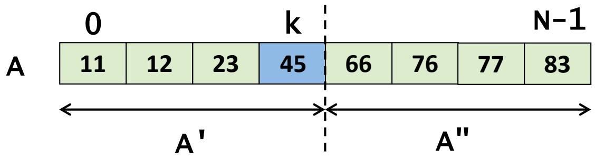

<details>
<summary>heatmap</summary>

| Segment | Value |
| --- | --- |
| Left (0) | 11 |
| Left (k) | 12 |
| Left (k) | 23 |
| Center | 45 |
| Right (N-1) | 66 |
| Right (N-1) | 76 |
| Right (N-1) | 77 |
| Right (N-1) | 83 |
</details>

• **Vorheriges** Teilarray $\textsf { A } ^ { \intercal }$ nicht mehr relevant
• Ausnutzen, dass Array $\mathsf { A } ^ { \textsf { H } }$ **ebenfalls sortiert** ist
• Setze $\mathrm { A } = \mathrm { A } ^ { \mathfrak { n } }$ , wende o.g. Verfahren **erneut** an
• $k = 4/2 - 1 = 1$
• $\mathrm{key} > \mathrm{A[k]} = 76$ , daher in $\mathsf { A } ^ { \textsf { m } }$ (neu) weitersuchen
• **Fortsetzen**, bis key gefunden, oder Array nicht weiter teilbar

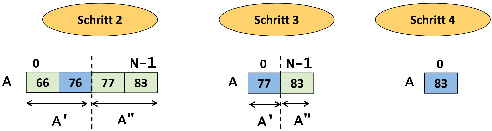

Implementierung: Array A nicht tatsächlich in A' und A" teilen, sondern nur Index-Zeiger l und r umsetzen
• Aufruf: binsearch(A,m,0,N-1);

```c
#define NOT_FOUND -1
int binsearch(int A[], int key, int l, int r)
{
    int k;
    while (r >= l) {
        k = (l+r)/2;
        if (key == A[k]) return k;
        if (key < A[k]) r = k-1;
        else l = k+1;
    }
    return NOT_FOUND;
}
```

• Suche nach key = 23:

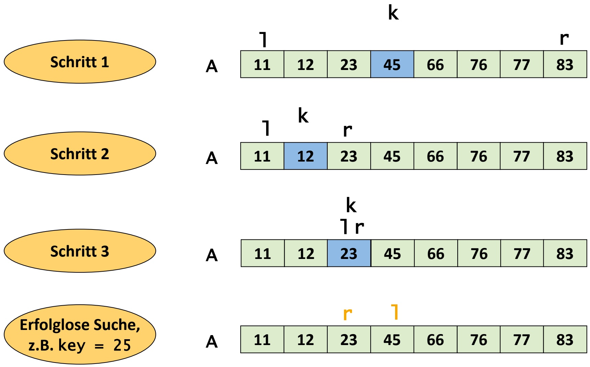

<details>
<summary>treemap</summary>

| Category | Schritt 1 | Schritt 2 | Schritt 3 | Erfolglose Suche, z.B. key = 25 |
| --- | --- | --- | --- | --- |
| A | 11 | 11 | 11 | 11 |
| k | — | k | k | r |
| r | 12 | 12 | 12 | 12 |
| 23 | 23 | 23 | 23 | 23 |
| 45 | 45 | 45 | 45 | 45 |
| 66 | 66 | 66 | 66 | 66 |
| 76 | 76 | 76 | 76 | 76 |
| 77 | 77 | 77 | 77 | 77 |
| 83 | 83 | 83 | 83 | 83 |
</details>

• **Bester** Fall: key == A[k] im 1. Schritt: 𝒪𝒪 1
• **Schlechtester** Fall: key erst nach 𝑡𝑡 Teilungsschritten gefunden bzw. gar nicht gefunden

– Wie oft kann 𝑁𝑁-elementiges Array halbiert werden?
– 𝒪𝒪 log 𝑁𝑁 mal (vgl. Bsp. Exponentialfunktion)

• **Durchschnittlicher** Fall: Ebenfalls 𝒪𝒪 log 𝑁𝑁

• Gesamtlaufzeit für 𝑀𝑀 Transaktionen: 𝒪𝒪 𝑀𝑀 ⋅ log 𝑁𝑁

• Abschätzung der **absoluten** Laufzeit:

– Annahme: Rechner mit 10<sup>9</sup> Operationen pro Sekunde
– 𝒪𝒪 𝑀𝑀 ⋅ 𝑁𝑁 ≈ 1015/109 sec ≈ 278 h ≈ 12 Tage
– 𝒪𝒪 𝑀𝑀 ⋅ log 𝑁𝑁 ≈ 109 ⋅ 109 20 sec = 20 sec
– **Zusatzaufwand**: Sortierung des Arrays A, jedoch hierdurch keine signifikante Zunahme der Laufzeit (< 1 sec)

## 7. Sortieralgorithmen

**7.1 Einfache Verfahren (Selection/Insertion/Bubblesort)**
7.2 Quicksort
7.3 Heapsort

## Warum Betrachtung von Sortieralgorithmen?

Sortierung von Datensätzen wird als **Subroutine** in sehr vielen Anwendungen benötigt (s. Beispiel „Suchen in Arrays“)
Einfachster Fall: Sortieren eines **Arrays von Zahlen** (z.B. int)
• Allg. Fall: Sortieren eines **Arrays von Datensätzen** vom Typ struct
Beispiel:

typedef struct person {char name[100], vorname[100]; struct datum { int tag, monat, jahr; } gebdatum;} Person;

• Sortierung nach Namen, Vornamen oder Geburtsdatum?
Erfordert Definition eines **Schlüssels** (key), d.h. struct-Komponente, gemäß der sortiert werden soll
Unterschiedliche Vergleichsfunktionen erforderlich

• **Gegeben**: Folge $S \; = \; ( s _ { 1 } , \ldots , s _ { N } )$ von **Datensätzen** (struct)
Jeder Datensatz $s _ { i }$ besitzt einen Eintrag 𝑘𝑘𝑘𝑘𝑘𝑘 eines mittels einer Ordnungsrelation **linear geordneten Datentyps**
Z.B. Zahlen: $\omega ^ { \mathrm { { '' } } } \mathrm { { - } } \mathsf { { R e l a t i o n } }$ , Buchstaben: alphabetische Reihenfolge, **Geburtsdatum**: 3-stufiger Vergleich Jahr, Monat, Tag
Gesucht: **Permutation** (Anordnung) $S ^ { \prime } = ( s _ { 1 } ^ { \prime } , \dots , s _ { N } ^ { \prime } )$ der Elemente von $S _ { \perp }$ so dass

$$
s _ {1} ^ {\prime}. k e y \leq s _ {2} ^ {\prime}. k e y \leq \dots \leq s _ {N} ^ {\prime}. k e y
$$

• Gleiche Schlüssel dürfen auch **mehrfach** vorkommen
Ein Sortieralgorithmus, der die ursprüngliche Reihenfolge bei gleichem Schlüssel beibehält, heißt **stabil**
• Sprachelemente in c:

Definition der Folge als Array: Person $s [ N ]$ Auslesen des Schlüssels von Datensatz 𝑖𝑖: s[i].key

Wie üblich: Verwendung der 𝓞𝓞**-Notation** zur Abstraktion von konstanten Faktoren und Rechnerdetails
• Elementare Operationen von Sortieralgorithmen:

– **Vergleich** zweier Schlüssel
– **Vertauschen** von Daten in Folge S (Array oder File)

• Daher Abschätzung der **Laufzeit** in diesen Größen
• **Reale Laufzeit**: abhängig von der Komplexität dieser Operationen
Bsp.: Sortieren eines **Bücherregals**, Vergleich der Autorennamen aufwendiger als Vertauschen
Bsp.: Sortieren einer **Datenbank** mit großen Datensätzen in einem File, Umkopieren auf Festplatte oder Magnetband aufwendiger als Key-Vergleich
• Hier: nur Betrachtung der **Vergleichsoperationen**