```txt
void sink(int A[], int k, int N)
{
    int child;
    while (1) {
        if (2*k > N) break;
        if (2*k+1 <= N) {
            if (A[2*k] < A[2*k+1])
                child = 2*k;
            else child = 2*k+1;
        } else child = 2*k;
        if (A[k] > A[child]) {
            exchange(A[k],A[child]);
            k = child;
        } else break;
    }
}
```

𝓞𝓞 ? ? ? Iterationen

Alle Operationen jeweils 𝓞𝓞 𝟏𝟏 , also auch insgesamt 𝓞𝓞 𝟏𝟏

In jedem Durchlauf der while-Schleife wird k mindestens **verdoppelt** (child = 2k bzw. 2k+1; k = child; )
• Z.B. k = 1, 2, 4, 8, 16, 32, ...
• 32 nach 5 (= log 32) Schritten erreicht
**Allgemein**: k kann höchstens (𝐥𝐥𝐥𝐥𝐥𝐥 𝑵𝑵**)-mal verdoppelt** werden, bis Arraygrenze N erreicht wurde und sink terminiert
• **Gesamtlaufzeit**:

$$
\begin{array}{l} \mathcal {O} (N) \cdot T _ {\mathrm{sink}} + \mathcal {O} (N) \\ = \mathcal {O} (N) \cdot \left(\log N \cdot \mathcal {O} (1)\right) + \mathcal {O} (N) \\ = \mathcal {O} (N) \cdot \mathcal {O} (\log N) + \mathcal {O} (N) \\ = \mathcal {O} (N \log N) + \mathcal {O} (N) \\ = \mathcal {O} (N \log N) \\ \end{array}
$$

• Heapsort braucht auch im **worst case** nur 𝒪𝒪 𝑁𝑁 log 𝑁𝑁 Schritte

**Man kann zeigen**: Jeder allgemeine Sortieralgorithmus benötigt im worst case **mindestens Laufzeit** 𝓞𝓞 𝑵𝑵 𝐥𝐥𝐥𝐥𝐥𝐥 𝑵𝑵
D.h. Heapsort ist der „**bestmögliche**“ Sortieralgorithmus bis auf nichtsignifikante Terme + Konstanten
In der **Praxis** können jedoch andere Verfahren (z.B. Quicksort und sogar Bubblesort für kleine 𝑁𝑁) durchaus **schneller** sein
In **Spezialfällen** kann man noch schneller sortieren
Sortierverfahren mit Verwendung zusätzlicher Zwischenspeicher – Bucket Sort, Radix Sort, Counting Sort (nächste Folie)


<details>
<summary>flowchart</summary>

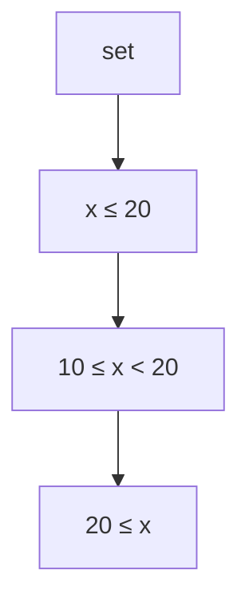
</details>

𝑚𝑚-Buckets ⭢ 𝒪𝒪 𝑚𝑚


Stabile Sortierung je Radix (Buchstabe, Ziffer, …) Key ⭢ [K][e][y]

$$
m \times \text {Sortieren von Radix} r \rightarrow \mathcal {O} (m) \cdot \mathcal {O} (f (r))
$$

Lineare Komplexität in der Laufzeit

• Idee: „Schlüsselindiziertes Zählen“
• 𝑚𝑚 ≔ Anzahl möglicher Schlüssel
Beispiele

• $\mathtt { P L Z } ; m _ { \mathrm { P L Z } } < 1 0 ^ { 5 }$

Name (20 Buchstaben): $m _ { \mathrm { n a m e } } = 2 6 ^ { 2 0 } < 2 ^ { 5 ^ { 2 0 } } = 2 ^ { 1 0 0 } \approx 1 0 ^ { 3 0 }$

Beispiel: $\mathsf { A } [ \mathsf { \beta } ] : = \{ \mathsf { { ^ { t } a ^ { t } } } , \mathsf { { ^ { t } b ^ { t } } } , \mathsf { { ^ { t } a ^ { t } } } , \mathsf { { ^ { t } c ^ { t } } } , \mathsf { { ^ { t } a ^ { t } } } , \mathsf { { ^ { t } e ^ { t } } } , \mathsf { { ^ { t } f ^ { t } } } , \mathsf { { ^ { t } a ^ { t } } } \}$

$$
\begin{array}{l} \mathrm{C} [ \mathrm{m} ] \quad \mathrm{C} [ 0 ] := 0 \\ \text {a} ^ {\prime}: \mathrm{C} [ 1 ] = \quad \mathrm{C} [ 1 ] + = \mathrm{C} [ 0 ] = \\ \text {‘b’: C[2] = C[2] + = C[1] =} \\ \mathrm{C} ^ {\prime}: \mathrm{C} [ 3 ] = \quad \mathrm{C} [ 3 ] + = \mathrm{C} [ 2 ] = \\ \mathrm{d} ^ {\prime}: \mathrm{C} [ 4 ] = \quad \mathrm{C} [ 4 ] + = \mathrm{C} [ 3 ] = \\ \text {'e':} C [ 5 ] = C [ 5 ] + = C [ 4 ] = \\ \text {f}: \mathrm{C} [ 6 ] = \\ \end{array}
$$

$$
\mathrm{C} [ \mathrm{A} [ \mathrm{i} ] - ^ {\prime} \mathrm{a} ^ {\prime} + 1 ] + +;
$$

$$
\mathrm{C} [ \mathrm{i} ] + = \mathrm{C} [ \mathrm{i} - 1 ];
$$

$$
\mathrm{B} [ \mathrm{C} [ \mathrm{A} [ \mathrm{i} ] - ^ {\prime} \mathrm{a} ^ {\prime} ] + + ] = \mathrm{A} [ \mathrm{i} ];
$$

$$
\rightarrow \mathrm{B} [ ]: \{\text {‘a', ‘a', ‘a', ‘a', ‘b', ‘c', ‘e', ‘f'} \}\}
$$

## 8. Lineare Datentypen

**8.1 Listen**
8.2 Stacks
8.3 Queues

## Mengendarstellung

• **Problemstellung**: Verwaltung einer Menge von Objekten $A   =   \{ a _ { 1 } , \ldots , a _ { n } \}$ vom Typ T

• Gewünschte **Operationen**:

– Suchen, Einfügen und Entfernen von Elementen
– Vereinigung und Durchschnitt zweier Mengen 𝐴𝐴 und 𝐵𝐵

• Prinzipiell wäre ein **Array** als Datenstruktur geeignet
• Jedoch zwei Probleme:

– **Einfügen** eines neuen Elementes an einer bestimmten Position erfordert aufwendige **Umordnung**
– **Größe** der Menge muss **statisch** feststehen (Bspw. Deklaration: T A[100]; erlaubt max. 100 Elemente)

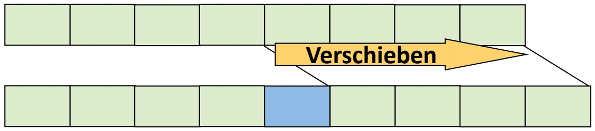

<details>
<summary>flowchart</summary>

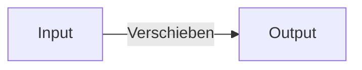
</details>

**Def**.: Eine **(verkettete) Liste** ist entweder leer oder besteht aus einer Referenz auf einen **Knoten**, der ein Element und eine Referenz auf eine verkettete Liste enthält.

• Verwendung von **Zeigern** (siehe Kap. 3)
• Modellierung eines **Knotens** für ein Element vom Typ T:
typedef struct node {T\* data; struct node\* next; } \*nodeptr;
• data ist Zeiger auf Listenelement vom Typ T
next ist Zeiger auf Nachfolgerknoten

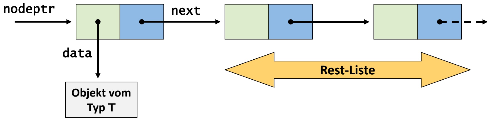

<details>
<summary>flowchart</summary>

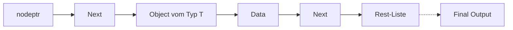
</details>

• Liste im **Speicher** (vgl. Kap. 3)
• Liste = 1. Element + Restliste
Darstellung einer leeren Liste: #define NULL 0
Zeigerwert NULL bedeutet, dass der Zeiger „nirgendwohin“ zeigt
Speicherzugriff per NULL-Zeiger ist **unzulässig**, führt i.A. zum Programmabsturz

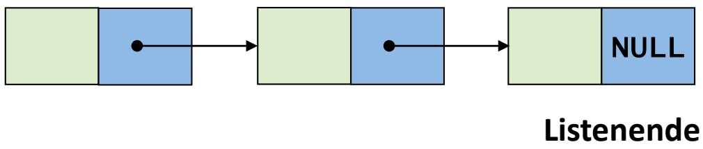

<details>
<summary>flowchart</summary>

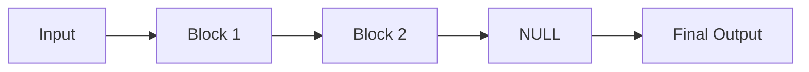
</details>

Adr.

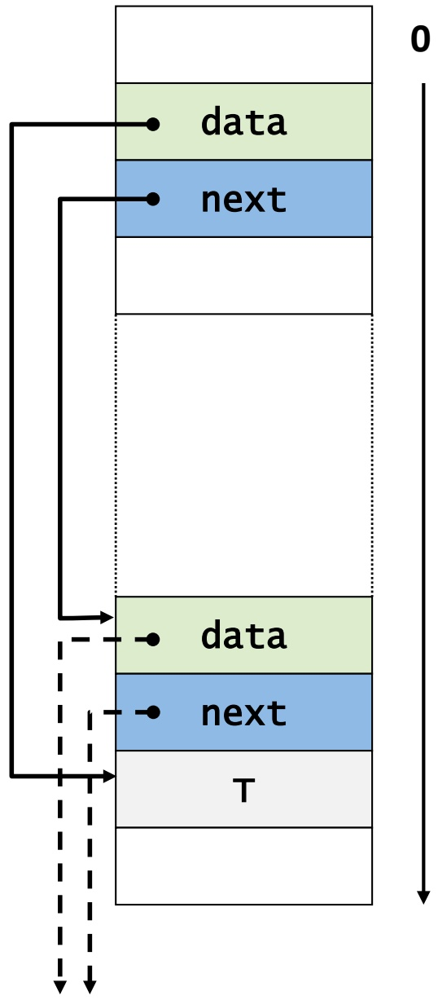

<details>
<summary>flowchart</summary>

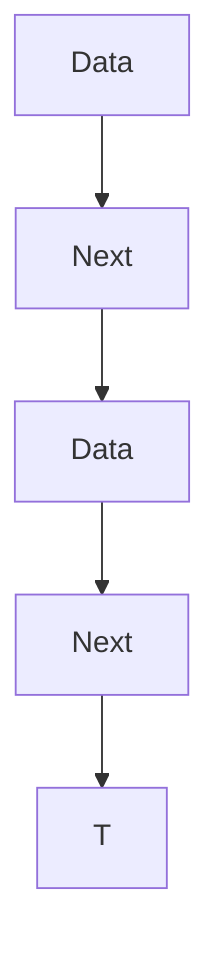
</details>

• Definition des Datentyps **Liste**, Elemente vom Typ T

```c
typedef struct node {
    T* data;
    struct node* next; } Node, *nodeptr;

typedef struct list {
    nodeptr first, last; } List, *listptr;
```

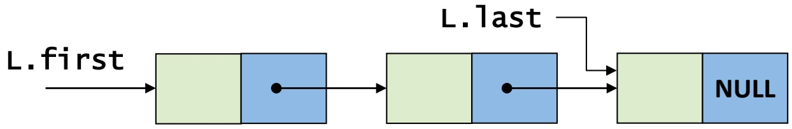

<details>
<summary>flowchart</summary>

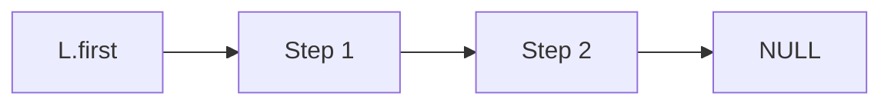
</details>

• Erzeugung einer **leeren Liste** und **Leerheitstest**

```c
List L;
void Init(listptr L)
{
    L->first = NULL; L->last = NULL;
}

int IsEmpty(List L)
{
    return (L.first == NULL && L.last == NULL);
}
```

• **Einfügen** eines neuen Listenelements vom Typ T am Listenanfang

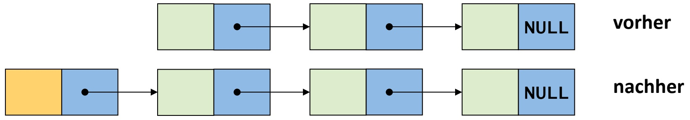

<details>
<summary>flowchart</summary>

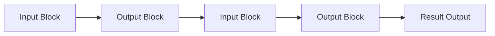
</details>

Funktion „malloc“ (siehe Kap. 3) stellt dynamisch Speicherplatz auf dem Heap bereit
Funktion „sizeof“ berechnet die erforderliche Anzahl von Bytes (hier z.B. insges. 8 Bytes bei 32-Bit-Zeigern)

```c
nodeptr newnode(T* item)
{
    nodeptr np;

    np = (nodeptr)malloc(sizeof(Node));
    np->data = item;
    np->next = NULL;

    return np;
}
```

```txt
void AppendFirst(T* item, listptr L)
{
    nodeptr np = newnode(item);
    if (IsEmpty(*L)) {
        L->first = np; L->last = np;
    } else {
        np->next = L->first;
        L->first = np;
    }
}
```

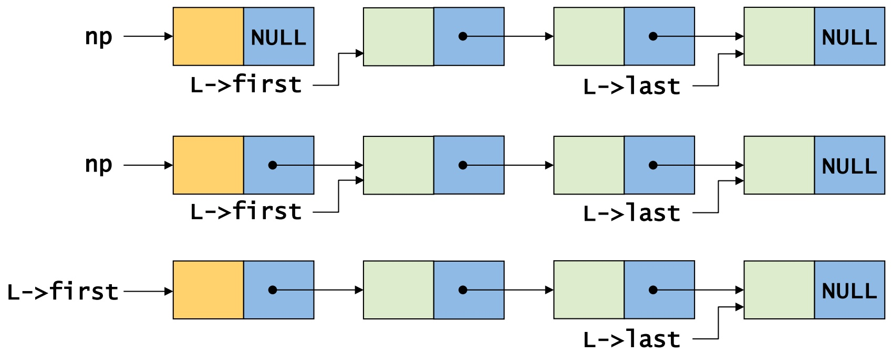

```txt
void AppendLast(T* item, listptr L)
{
    nodeptr np = newnode(item);
    if (IsEmpty(*L)) {
        L->first = np; L->last = np;
    } else {
        L->last->next = np;
        L->last = np;
    }
}
```

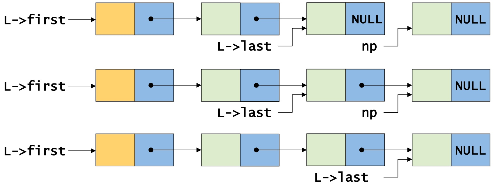

```cpp
int IsIn(T* item, List L)
{
    nodeptr np;
    if (IsEmpty(L)) return 0; // false
    np = L.first;
    while (np != NULL) {
        if (Equal(np->data, item)) return 1; // true
        np = np->next;
    }
    return 0; // false
}
```

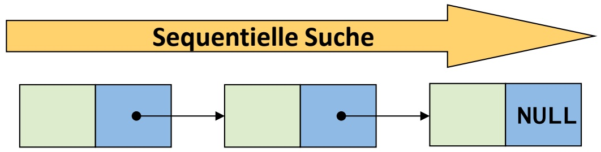

<details>
<summary>flowchart</summary>

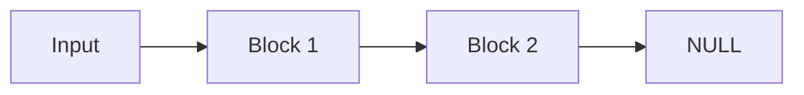
</details>

• **Laufzeit** bei N-elementiger Liste:

– Best case: O(1)
– Worst case: O(N)
– Average case: O(N/2) = O(N)

```c
// item2 hinter item1 einfügen
void InsertBehind(T* item1,
  T* item2, listptr L)
{
  nodeptr np, newnp;

  if (!IsIn(item1,*L)) {
    printf(„Fehler!“); return;
  }

  np = L->first;
  while (np != NULL) {
    if (Equal(np->data,item1)) {
      newnp = newnode(item2);
      newnp->next = np->next;
      np->next = newnp;
      if (np == L->last) {
        L->last = newnp;
      }
      break;
    }
    np = np->next;
  }
}
```

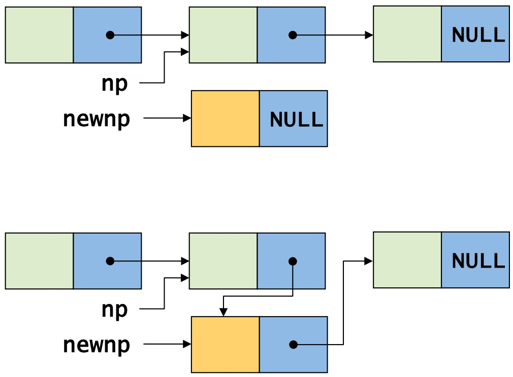

## Löschen eines Listenelementes

```c
void Delete(T* item, listptr L)
{
    nodeptr np1, np2;

    if (IsEmpty(*L)) return;
    np1 = L->first;
    if (Equal(np1->data,item)) {
        L->first = np1->next;
        if (L->first == NULL)
            L->last = NULL;
        free(np1);
        return;
    }
    np2 = np1->next;
    while (np2 != NULL) {
        if (Equal(np2->data,item)) {
            np1->next = np2->next;
            if (np2 == L->last)
                L->last = np1;
            free(np2);
            break;
        }
        np1 = np2;
        np2 = np2->next;
    }
}
```

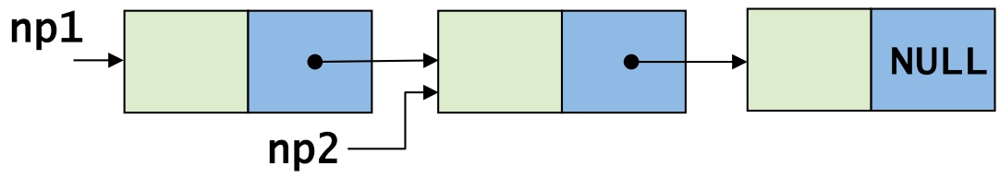

<details>
<summary>flowchart</summary>

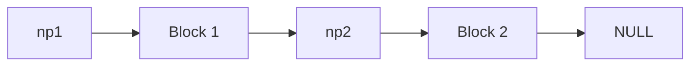
</details>

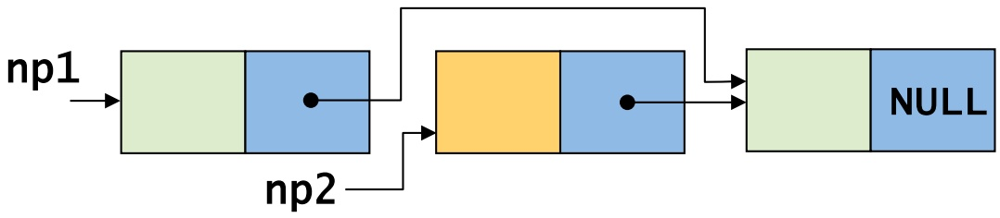

<details>
<summary>flowchart</summary>


</details>

• Falls Liste als Mengendarstellung: entspricht **Vereinigung**
• Evtl. **Mehrfachvorkommen** von Elementen ausschließen

L1:

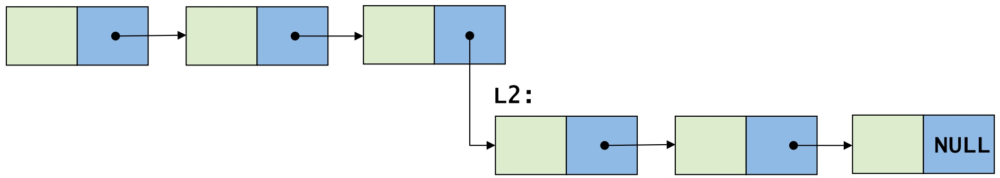

<details>
<summary>flowchart</summary>

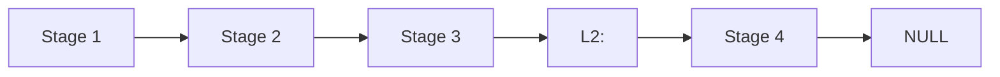
</details>

```c
listptr Union(listptr L1, listptr L2)
{
    if (IsEmpty(*L2)) return L1;
    if (IsEmpty(*L1)) return L2;

    L1->last->next = L2->first;
    L1->last = L2->last;

    return L1;
}
```

```c
listptr Intersect(listptr L1, listptr L2)
{
    nodeptr np;
    listptr L = (listptr)malloc(sizeof(List));
    Init(L);
    np = L1->first;
    while (np != NULL) {
        if (IsIn(np->data, *L2)) AppendLast(np->data, L);
        np = np->next;
    }
    return L;
}
```

L1:

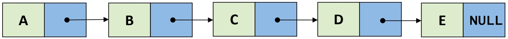

<details>
<summary>flowchart</summary>

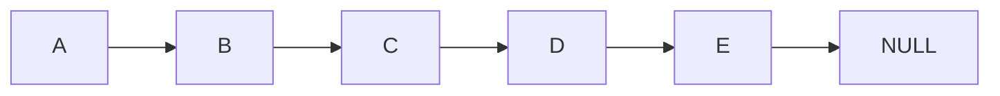
</details>

L2:

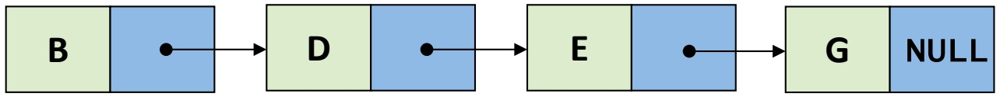

<details>
<summary>flowchart</summary>

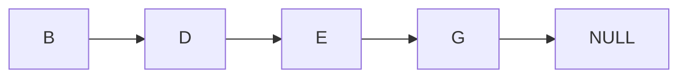
</details>

L:

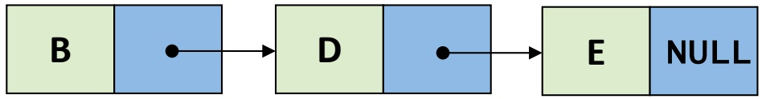

<details>
<summary>flowchart</summary>

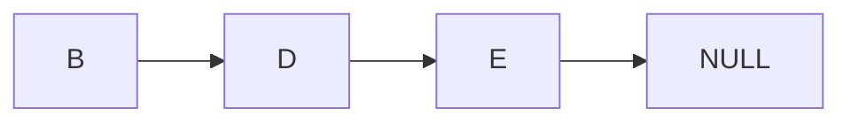
</details>

## 8. Lineare Datentypen

8.1 Listen
**8.2 Stacks**
8.3 Queues

**Def**.: Ein **Stack** (Stapel) ist ein ADT, der folgende Grundoperationen unterstützt:

1. Einfügen eines neuen Elementes $( , \mathsf { P u s h } ^ { n } )$
2. Entfernen des zuletzt eingefügten Elementes $( , P o p ^ { n } )$

• Stacks sind eine **grundlegende Datenstruktur** in vielen Anwendungen

– Ablagesystem auf Professorenschreibtisch
– Compiler-Frontend (Analyse des Quellprogramms)
– Abarbeitung von C-Funktionsaufrufen

Aufgrund der Pop-Operation auch als **LIFO-Datenstruktur** bezeichnet (last in, first out)

Stack als ADT, d.h. **verschiedene Implementierungen** möglich (z.B. Listen und Arrays)

push D

push EC

push B

push A

**stack**

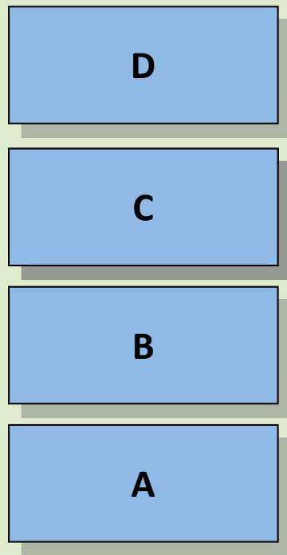

• Siehe auch Kap. 5
Funktion f wird durch Aufruf von g **unterbrochen** und später **fortgesetzt**
g kann ihrerseits **weitere Funktionen** aufrufen
Umgebung zur Programmausführung muss einen **Stack noch aktiver Funktionen** verwalten
• **Funktionsaufruf** = Push
• **Funktionsende** = Pop

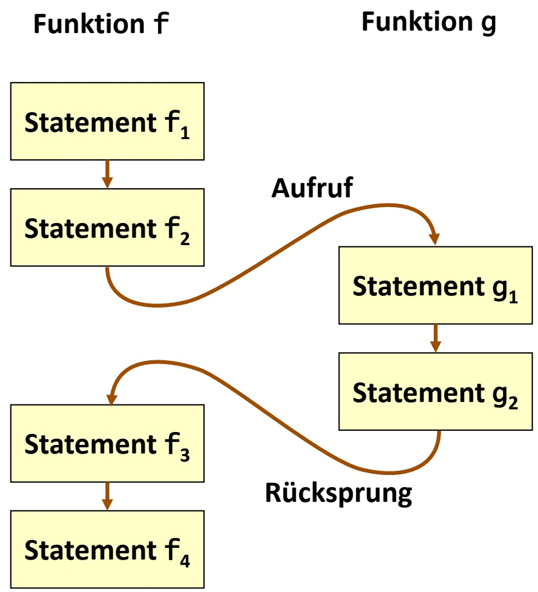

<details>
<summary>flowchart</summary>

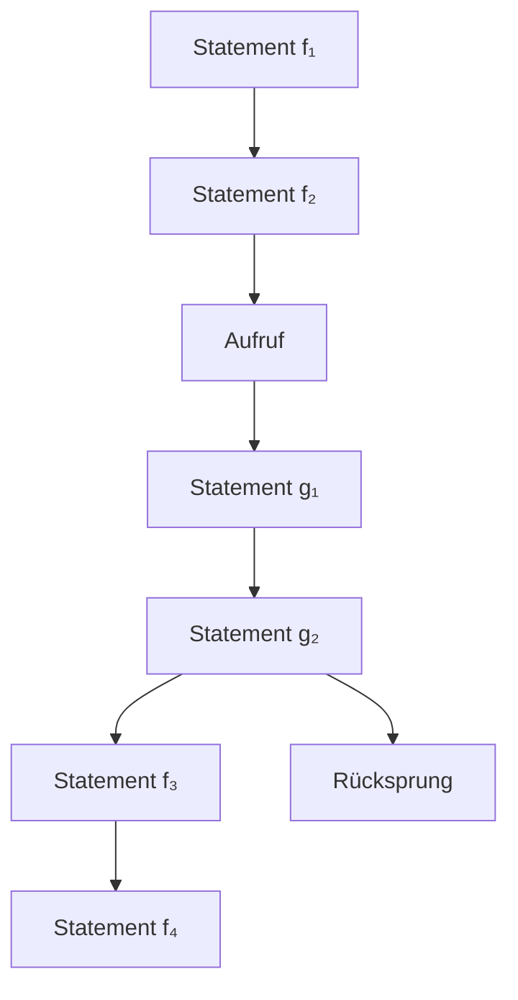
</details>

**Zeit**

## Beispiel: Laufzeit-Stack für C-Funktionsaufrufe

```c
void f(void)
{
    g();
}

void g(void)
{
    h();
}

void h(void)
{
    i();
}

void i(void)
{
}

int main(void)
{
    f();
    g();
    h();

    return 0;
}
```

<strong><u>main</u></strong>

f <strong><u>main</u></strong>

g f <strong><u>main</u></strong>

h g f <strong><u>main</u></strong>

i h g f <strong><u>main</u></strong>

h g f <strong><u>main</u></strong>

g f <strong><u>main</u></strong>

f <strong><u>main</u></strong> <strong><u>main</u></strong>

g <strong><u>main</u></strong>

h g <strong><u>main</u></strong>

i h g <strong><u>main</u></strong>

h g <strong><u>main</u></strong>

g <strong><u>main</u></strong> <strong><u>main</u></strong>

h <strong><u>main</u></strong>

i h <strong><u>main</u></strong> <strong><u>main</u></strong>

Elemente auf Stack = Listenelemente
• Push = Einfügen am Listenanfang
• Pop = Entfernen des ersten Elementes
• Stack für beliebigen Elementtyp T:

```c
List L;

void Push(T* item,listptr L)
{
    AppendFirst(item, L);
}

T* Pop(listptr L)
{
    T* item;
    if (IsEmpty(*L)) return NULL;

    item = L->first->data;
    Delete(item, L);
    return item;
}
```

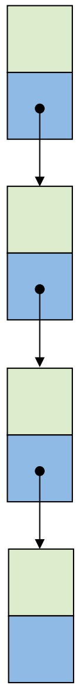

<details>
<summary>flowchart</summary>

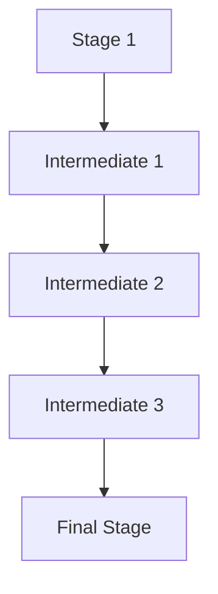
</details>

• Vorgabe der **max. Stack-Größe** notwendig
Elemente auf Stack = Arrayelemente
„**top**“ verweist stets auf das nächste freie Element (top = „**Stack-Pointer**“)
Push = Einfügen und Erhöhen von top um 1
Pop = Entfernen und Erniedrigen von top um 1
Prüfen auf **Überlauf** (im Gegensatz zu Listen!)

```c
#define MAX 100
typedef struct stk
{ T* elems[MAX]; int top; } stack;

void Init(stack* s)
{ s->top = 0; }

int IsEmpty(stack s)
{ return (s.top == 0); }

void Push(T* item,stack* s)
{
    if (s->top == MAX)
        printf(„Stack voll!“);
    s->elems[s->top] = item;
    s->top++;
}

T* Pop(stack* s)
{
    if (IsEmpty(*s)) return NULL;
    s->top--;
    return s->elems[s->top];
}
```

• Auswertung geklammerter **arithmetischer Ausdrücke**
– z.B. (( 6 \* ( 4 \* 28)) + ( 9 - (( 12 / 4) \* 2)))

**Innere Ausdrücke** vor äußeren auszuwerten

• Speicherung von Zwischenergebnissen notwendig

• **Zwei Stacks**: Operanden- und Operatorstack

Abarbeitung eines Ausdrucks **von links nach rechts**:

$\mathcal { N } ^ { ( 1 ) } ;$ keine Aktion
– Operand: Push auf Operandenstack
– Operator: Push auf Operatorstack
– „)“: Pop des obersten Operators, Pop der obersten beiden Operanden, Ausdruck auswerten, Push Ergebnis auf Operandenstack

$$
((6 * (4 * 2 8)) + (9 - ((1 2 / 4) * 2)))
$$

Operandenstack

| 6 |
| --- |
| 6 4 |
| 6 4 28 |
| 6 112 |
| 672 |
| 672 9 |
| 672 9 12 |
| 672 9 12 4 |
| 672 9 3 |
| 672 9 3 2 |
| 672 9 6 |
| 672 3 |
| 675 |

Operatorstack

| * |
| --- |
| ** |
| * |
| (leer) |
| + |
| +- |
| +-/ |
| +- |
| +-* |
| +- |
| +(leer) |

## 8. Lineare Datentypen

8.1 Listen
8.2 Stacks
**8.3 Queues**

## Def.: Eine Queue (Warteschlange) ist ein ADT, der folgende Grundoperationen unterstützt:

1. Einfügen eines neuen Elementes $( , P u t ^ { n } )$
2. Entfernen des zuerst eingefügten Elementes $( \mathrm { { , } } \mathrm { { G e t } } ^ { n } )$

• Verbreitete Datenstruktur, z.B.
– Warteschlange von auszuführenden Prozessen
– Kommunikationspuffer z.B. für Druckaufträge
• **FIFO-Prinzip**: first in, first out („zuerst gekommen, zuerst bedient“)


<details>
<summary>text_image</summary>

DELZER
nach Originalrezept
Gelo!
E's
</details>

put D

put C

put B

put A

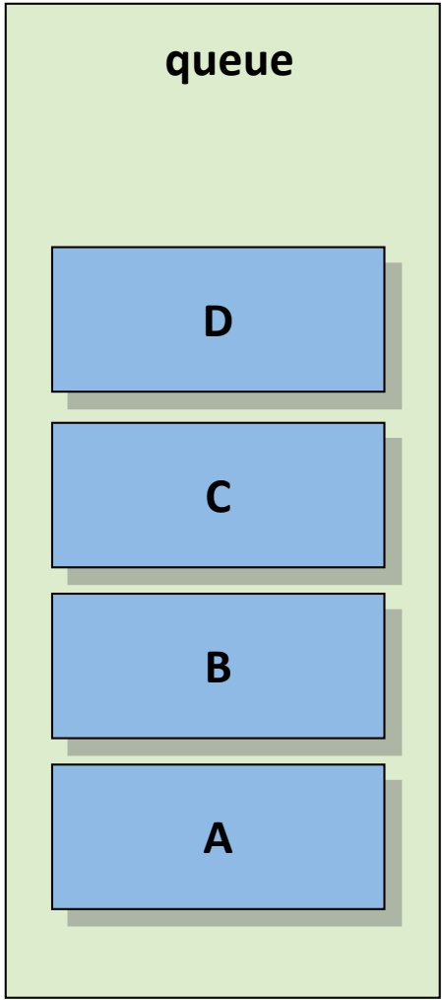

<details>
<summary>text_image</summary>

queue
D
C
B
A
</details>

get → A

**queue**

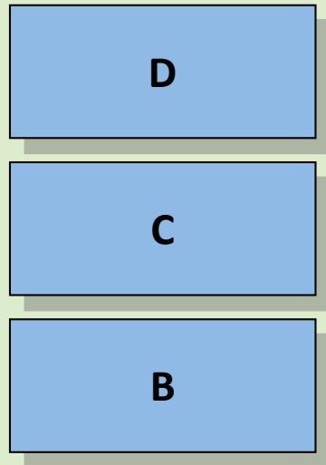

get → B

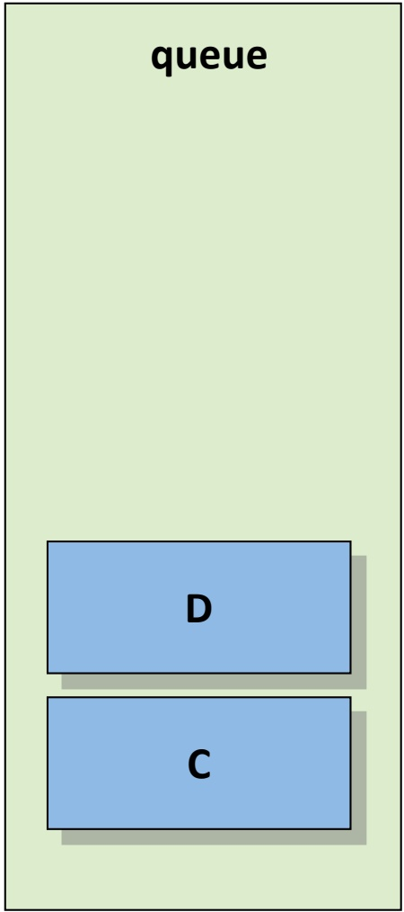

<details>
<summary>text_image</summary>

queue
D
C
</details>

get → C

• Queue-Elemente = Listenelemente
• Put = Einfügen am Listenende
• Get = Entfernen des ersten Elementes
• Queue für beliebigen Elementtyp T:

```c
List L;

void Put(T* item,listptr L)
{
    AppendLast(item, L);
}

T* Get(listptr L)
{
    T* item;

    if (IsEmpty(*L)) return NULL;

    item = L->first->data;
    Delete(item, L);

    return item;
}
```

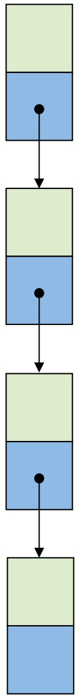

<details>
<summary>flowchart</summary>


</details>