## Queue-Implementierung durch Arrays

Betrachte **Dynamik** von Queues im Vergleich zu Stacks in Array-Implementierung:

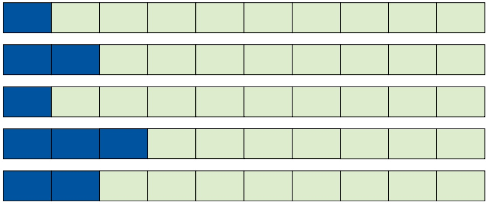

<details>
<summary>bar_stacked</summary>

| Category | Value 1 | Value 2 | Value 3 | Value 4 | Value 5 | Value 6 | Value 7 |
| --- | --- | --- | --- | --- | --- | --- | --- |
| Row 1 | Blue | Light Green | Light Green | Light Green | Light Green | Light Green | Light Green |
| Row 2 | Blue | Blue | Light Green | Light Green | Light Green | Light Green | Light Green |
| Row 3 | Blue | Light Green | Light Green | Light Green | Light Green | Light Green | Light Green |
| Row 4 | Blue | Blue | Blue | Light Green | Light Green | Light Green | Light Green |
| Row 5 | Blue | Blue | Light Green | Light Green | Light Green | Light Green | Light Green |
</details>

**Stack**: verwendet tendenziell immer den gleichen Speicherbereich

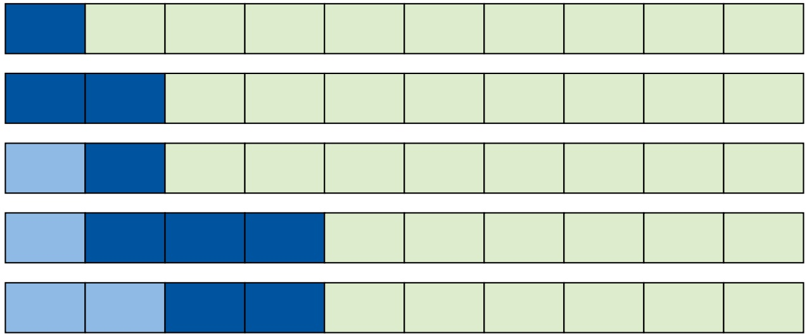

<details>
<summary>bar_stacked</summary>

| Category | Segment 1 (Dark Blue) | Segment 2 (Light Blue) |
| --- | --- | --- |
| Row 1 | ~30% | ~70% |
| Row 2 | ~35% | ~65% |
| Row 3 | ~40% | ~60% |
| Row 4 | ~45% | ~55% |
| Row 5 | ~50% | ~50% |
</details>

**Queue**: „wandert“tendenziell immer weiter nach rechts, daher schlechte Speicherausnutzung

• Lösung: **ringförmiges** Array bzw. **zyklische** Adressierung

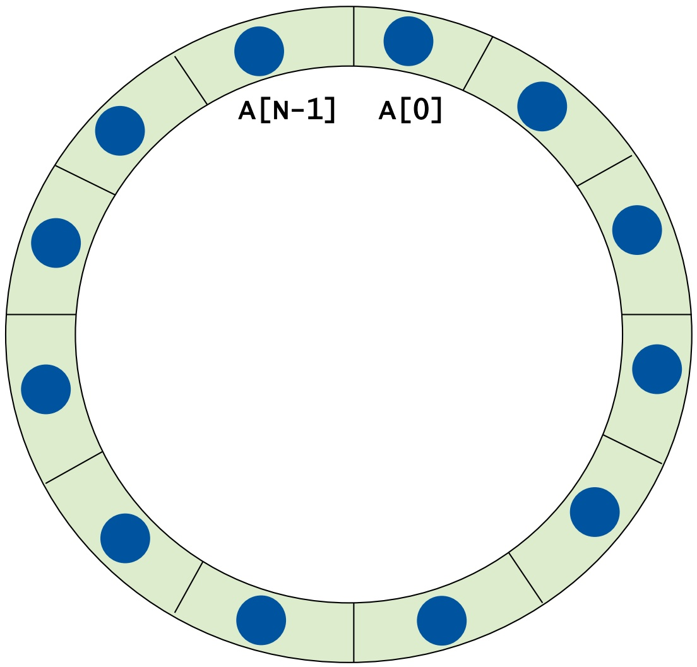

<details>
<summary>donut</summary>

| Category | Value |
| --- | --- |
| 1 | Blue dot |
| 2 | Blue dot |
| 3 | Blue dot |
| 4 | Blue dot |
| 5 | Blue dot |
| 6 | Blue dot |
| 7 | Blue dot |
| 8 | Blue dot |
| 9 | Blue dot |
| 10 | Blue dot |
| 11 | Blue dot |
| 12 | Blue dot |
| 13 | Blue dot |
| 14 | Blue dot |
| 15 | Blue dot |
| 16 | Blue dot |
| 17 | Blue dot |
| 18 | Blue dot |
| 19 | Blue dot |
| 20 | Blue dot |
</details>

## Queue-Implementierung durch Arrays

Zwei **Zeiger** (Array-Indizes) first und last verweisen auf aktuellen Anfang (-1) und Ende (+1) der Queue
Verwendung des Modulo-Operators (%) zur **zyklischen Adressierung**
Prüfung auf **Über- und Unterlauf** (overflow, underflow) erforderlich

```c
#define MAX 100

typedef struct q
{ T* elems[MAX];
  int first, last; } queue;

void Init(queue* q)
{
  q->first = 0;
  q->last = 1;
}

void Put(T* item,queue* q)
{
  if (q->last == q->first) overflow();
  else {
    q->elems[q->last] = item;
    q->last = (q->last+1) % MAX;
  }
}

T* Get(queue* q)
{
  q->first = (q->first+1) % MAX;
  if (q->first == q->last) underflow();
  else return q->elems[q->first];
}
```

Beispiel-Ablauf

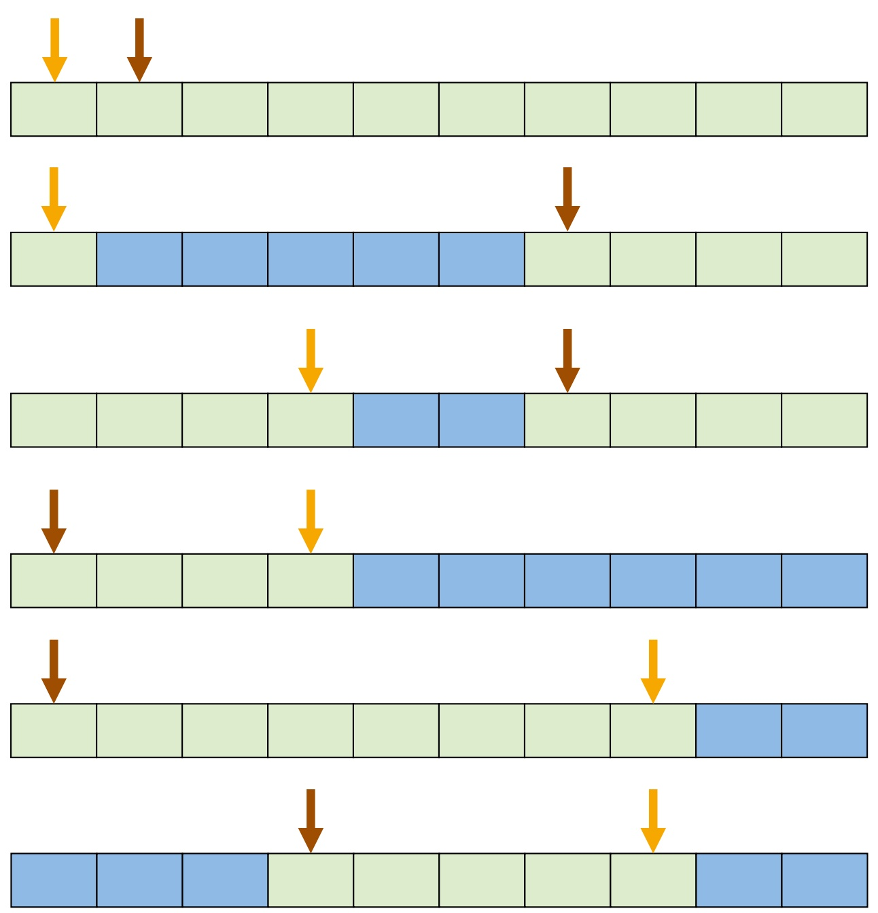

<details>
<summary>flowchart</summary>

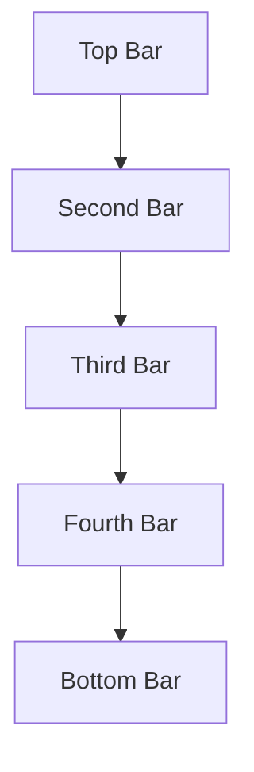
</details>

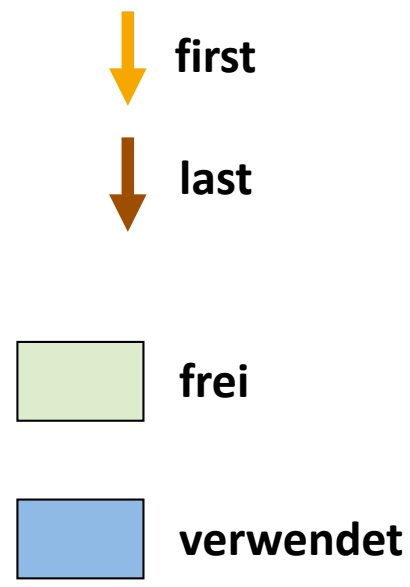

<details>
<summary>flowchart</summary>

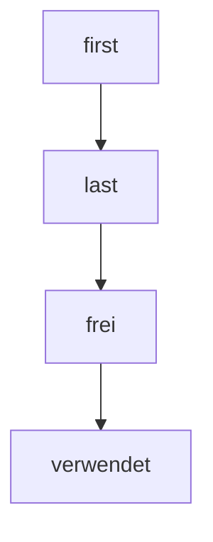
</details>

## 9. Bäume

**9.1 Definition und Darstellung**
9.2 Baumdurchläufe
9.3 Suchbäume

**Def**.: Ein **Baum** besteht aus einem ausgezeichneten Knoten 𝑟𝑟 (**Wurzel**, root) und $k \; \geq \; 0$ disjunkten Bäumen $T _ { 1 } , \ldots , T _ { k }$

Bäume sind eine äußerst verbreitete Datenstruktur mit einer **Vielzahl von Anwendungen**
Z.B. Darstellung von **Hierarchien** (Firmen-Organigramm), Eltern-Kind-Beziehung (Stammbaum), Dateisysteme u.v.m.
• Siehe auch Baumdarstellung von Arrays in **Heapsort**

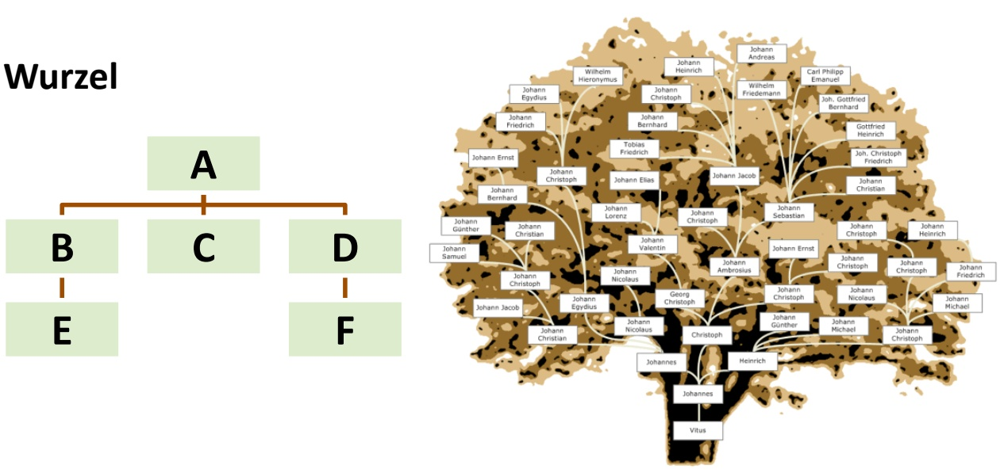


<details>
<summary>text_image</summary>

C:\inetpub\wwwroot\OPINION
Datei  Bearbeiten  Ansicht  Favoriten  Etras  2
Zurück →  Suchen  Ordner  Verlauf
Adesse C:\inetpub\wwwroot\OPINION
Wechseln zu
Ordner
Arbeitsplatz
3#Diskette (A:)
PLADE (C:)
_RESTORE
ADLSF
ATI
Eigene Datenien
EPUSBDRV
FA
Inetpub
issamples
scripts
webpub
wwwroot
construction
contactus
FORUM
IMAGES
innovation
innovation-alt
membership
OPINION
OPINION-2
OPINION-alt
philosophy
protected
Query
registration
SEARCH
unused pages
JBuilder4
KPCMS
LEXWARE
Name	Giöße	Typ
ARCHIVE	Dateordiner
ARTIKEL	Dateordiner
IMAGES	Dateordiner
feedback.html	15 KB	HTML Document
must_fields.html	3 KB	HTML Document
opinion_archive.html	9 KB	HTML Document
opinion_content.html	10 KB	HTML Document
opinion_topnav.asp	6 KB	ASP-Datei
survey.html	23 KB	HTML Document
thank_you.html	3 KB	HTML Document
10 Objekt(e) (Freier Speicherplatz: 14.3 GB)	64,7 KB	Arbeitsplatz
</details>

• Spezialfall: Bäume mit max. **zwei Teilbäumen**

**Def**.: Ein **Binärbaum** $B \; = \; ( r , B _ { L } , B _ { R } )$ ist entweder leer oder besteht aus einer Wurzel 𝑟𝑟 sowie einem linken und rechten Teilbaum $B _ { L }$ bzw. $B _ { R }$

Z.B. Heap im Heapsort-Algorithmus: jeder Knoten besitzt max. zwei „Kinder“
• Z.B. geschachteltes if-then-else-Statement
Z.B. graphische Darstellung eines **Münzwurf-Prozesses**

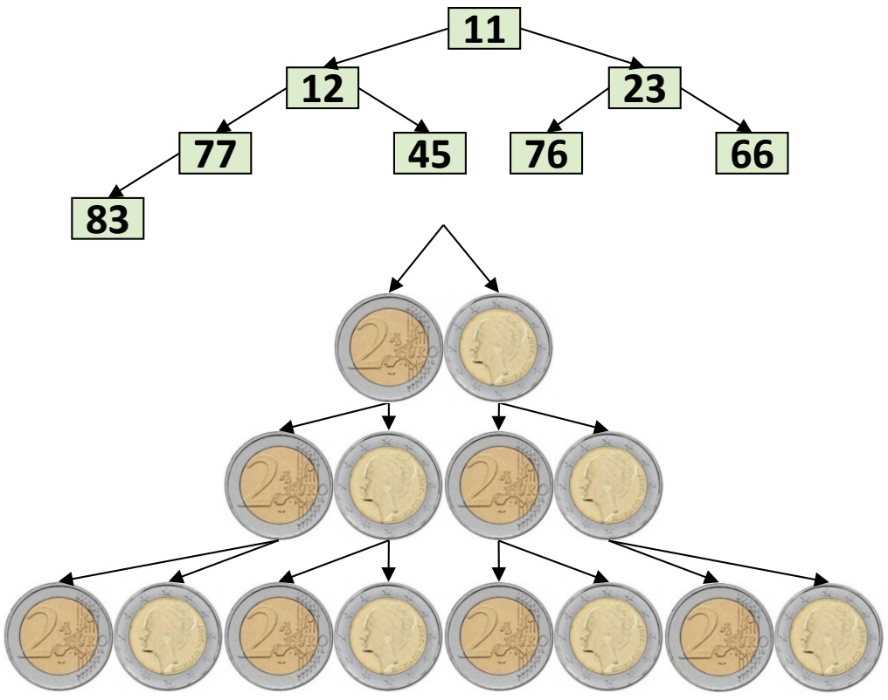

<details>
<summary>flowchart</summary>

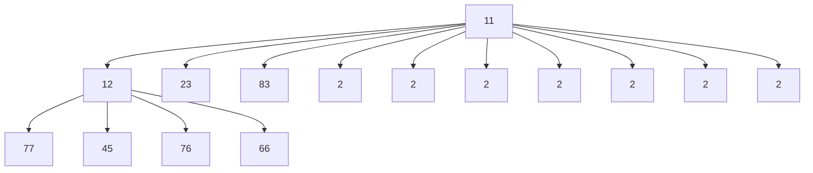
</details>

```c
typedef struct tr {
    T* data;
    struct tr *left,*right;
} btree, *btreeptr;
```

Bäume als dynamische Datenstruktur, ähnlich zu Listen: Zeiger data auf **Nutzdaten** eines beliebigen Typs T
• Zeiger left und right verweisen auf **linken** und **rechten** Teilbaum
• NULL**-Zeiger**, falls Teilbaum leer

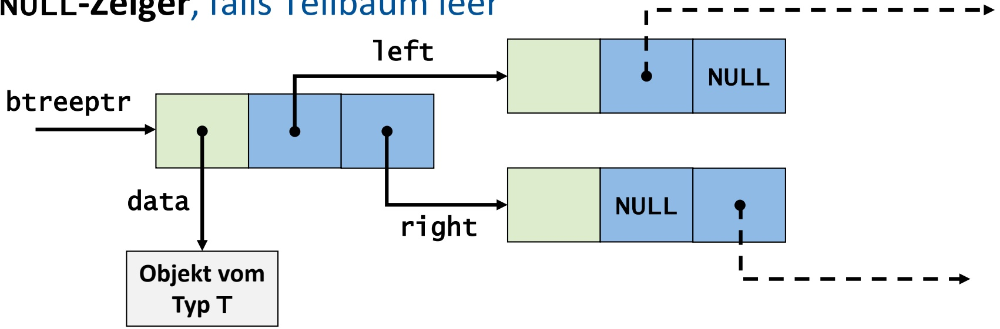

<details>
<summary>flowchart</summary>

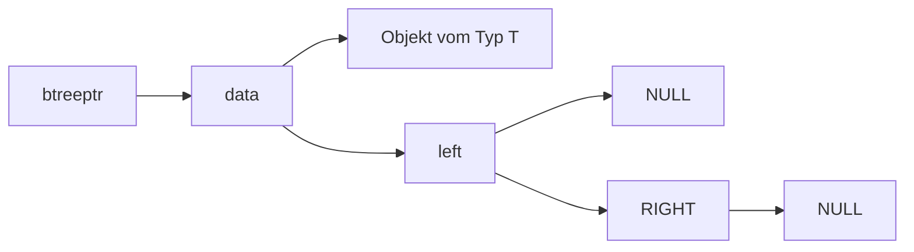
</details>

## 9. Bäume

9.1 Definition und Darstellung
**9.2 Baumdurchläufe**
9.3 Suchbäume

Häufige Anwendung: **Durchlaufen** eines Baumes, d.h. Besuchen/Verarbeiten aller Knoten in bestimmter Reihenfolge
• Z.B. beim Kopieren von Dateisystemen
• Sei $B \; = \; ( r , B _ { L } , B _ { R } )$
• L bezeichnet Durchlauf des **linken** Teilbaums $B _ { L }$
R bezeichnet Durchlauf des **rechten** Teilbaums $B _ { R }$
• W bezeichnet Bearbeitung der **Wurzel** 𝑟𝑟
Drei prinzipielle Durchlaufschemata:
– **Inorder**: L W R
– **Preorder**: $W \mathsf { L R }$
– **Postorder**: L R W
• In/Pre/Post bzgl. des Zeitpunkts der Wurzel-Bearbeitung

```c
void visit(T* item)
{ // Verarbeitung von item
}

void preorder(btreeptr b)
{
    if (b == NULL) return;

    visit(b->data);
    preorder(b->left);
    preorder(b->right);
}

void inorder(btreeptr b)
{
    if (b == NULL) return;

    inorder(b->left);
    visit(b->data);
    inorder(b->right);
}
```

```c
void postorder(btreeptr b)
{
    if (b == NULL) return;

    postorder(b->left);
    postorder(b->right);
    visit(b->data);
}
```

• Laufzeit: 𝓞𝓞(# Knoten)
Interner Ablauf der Rekursion: **Laufzeit-Stack** für Funktionsaufrufe (vgl. Kap. 8)
**Übung**: nicht-rekursive Implementierung mittels expliziter Stack-Datenstruktur

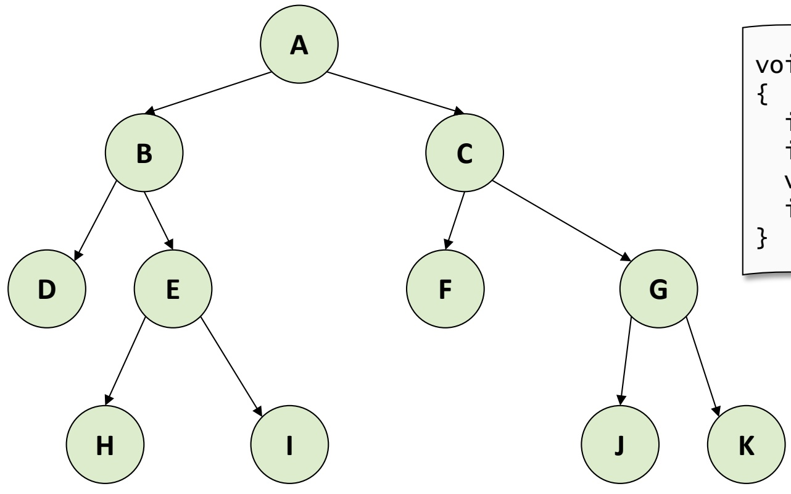

<details>
<summary>flowchart</summary>

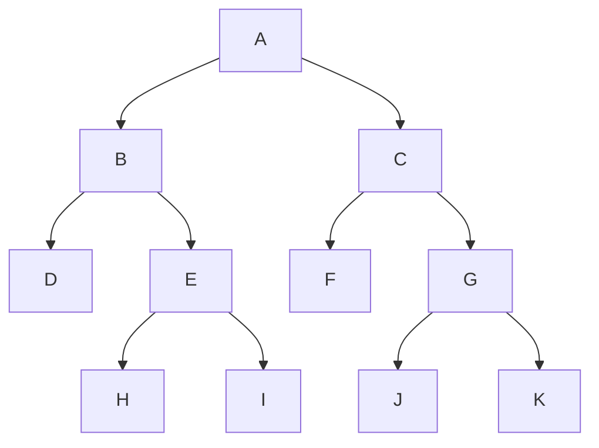
</details>

```c
void inorder(btreeptr b)
{
    if (b == NULL) return;
    inorder(b->left);
    visit(b->data);
    inorder(b->right);
}
```

• Inorder-Reihenfolge: D B H E I A F C J G K
• Preorder-Reihenfolge: A B D E H I C F G J K
Postorder-Reihenfolge: D H I E B F J K G C A

## 9. Bäume

9.1 Definition und Darstellung
9.2 Baumdurchläufe
**9.3 Suchbäume**

**Mengenoperationen** (vgl. Listen, Kap. 8): Einfügen, Löschen, Suchen (gemäß **Suchschlüssel** oder key), Schnitt, Vereinigung
In vielen Anwendungen insbes. schnelle Implementierung von **Einfügen, Löschen, Suchen** erforderlich
Beispiel: **Symboltabelle** im C-Compiler

– Symboltabelle verwaltet **Informationen zu den Identifiern** (Variablen, Funktionen, etc.) eines Programms, z.B. Datentyp und Speicherbedarf
– **Variablendeklaration** für ID bewirkt **neuen Eintrag** in Symboltabelle mit Suchschlüssel ID
– **Variablenverwendung** bewirkt **Suchen** nach ID
– Variable **nicht mehr benötigt**: ID aus Symboltabelle **löschen**

**Komplexität** der Mengenoperationen bei Listenimplementierung typischerweise $\mathcal { O } ( N )$ bei 𝑁𝑁 Elementen
$\mathbb { Z } \mathsf { U }$ **aufwendig** für häufigen Gebrauch
Sortiertes Array: Suchen in Zeit $\mathcal { O } ( \log N )$ per **binärer Suche**, jedoch Einfügen und Löschen aufwendig
Binäre Suche: Berechnung eines **Entscheidungsbaums**, d.h. in jedem Schritt Verzweigung in linkes oder rechtes Teilarray
**Idee bei binären Suchbäumen**: Entscheidungsbaum als explizite Datenstruktur

**Def**.: Sei $B \; = \; ( r , B _ { L } , B _ { R } )$ ein Binärbaum und bezeichne key(𝑛𝑛) den Suchschlüssel für jeden Knoten 𝑛𝑛. 𝐵𝐵 heißt **Suchbaum**, falls gilt:

1. Für alle $n \in B _ { L }$ : key(𝑛𝑛) < key(𝑟𝑟)
2. Für alle $n \in B _ { R }$ : key(𝑛𝑛) > key(𝑟𝑟)
3. $B _ { L }$ und $B _ { R }$ sind Suchbäume

Suchbaum für Monatsnamen, geordnet entsprechend der **lexikographischen** Reihenfolge:

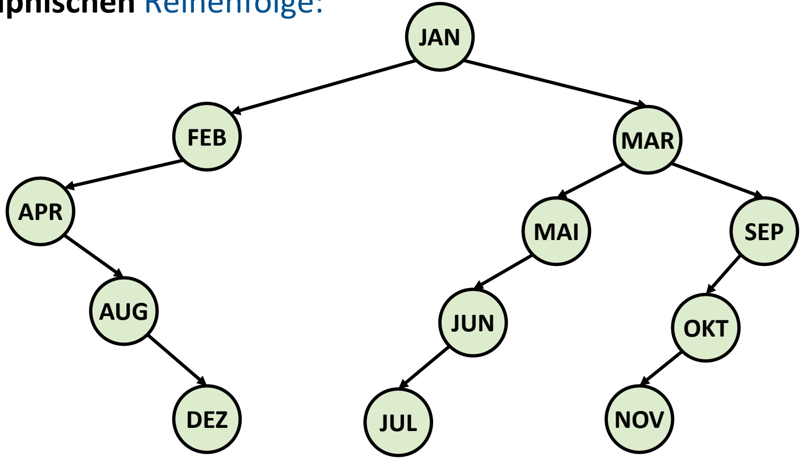

<details>
<summary>flowchart</summary>

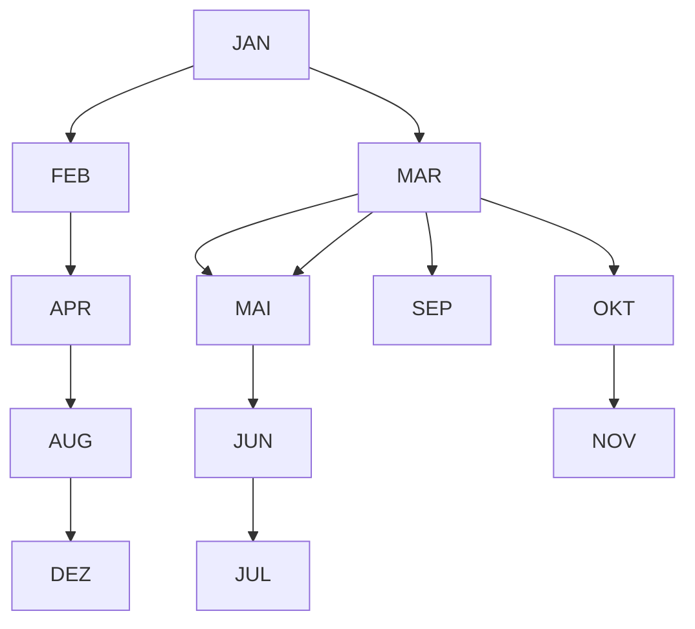
</details>

• **Übung**:

– Welcher Baum ergibt sich bei umgekehrter Reihenfolge?
– Wie kann man mittels Suchbäumen sortieren?

```c
btreeptr insert(T* item, btreeptr b)
{
    btreeptr n;

    if (b == NULL) {
        n = (btreeptr)malloc(sizeof(btree));
        n->data = item;
        n->left = NULL; n->right = NULL;
        return n;
    }

    if (key(item) < key(b->data))
        b->left = insert(item,b->left);

    if (key(item) > key(b->data))
        b->right = insert(item,b->right);

    return b;
}
```

• Beispiel: Einfügen von „DEZ“

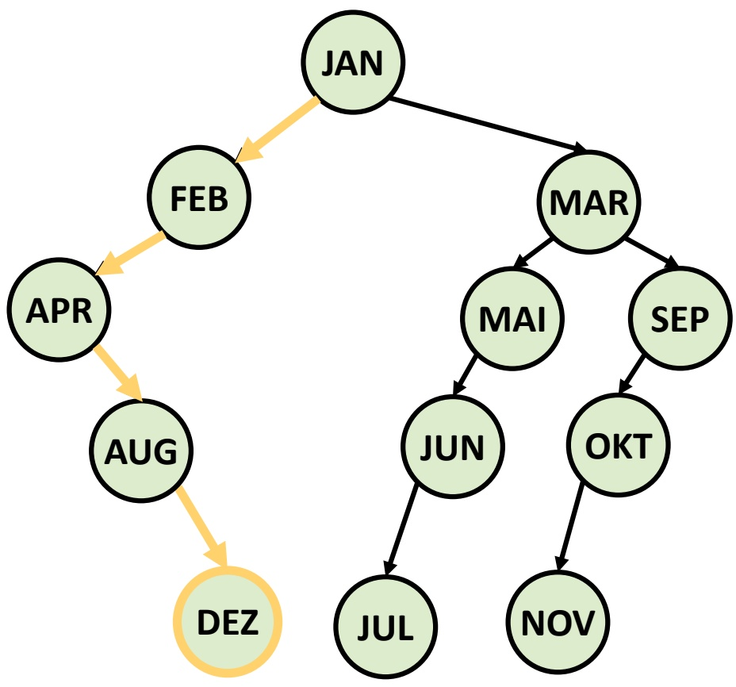

<details>
<summary>flowchart</summary>

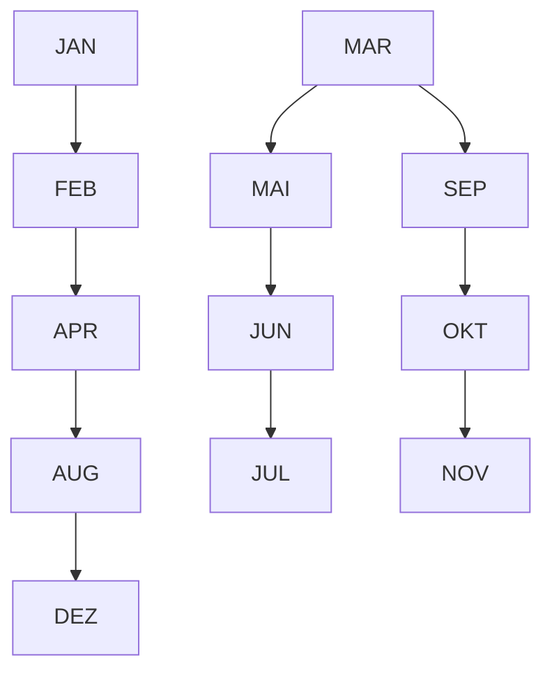
</details>

```c
T* search(T* item, btreeptr b)
{
    if (b == NULL) return NULL;

    if (key(item) == key(b->data))
        return b->data;

    if (key(item) < key(b->data))
        return search(item,b->left);

    if (key(item) > key(b->data))
        return search(item,b->right);
}
```

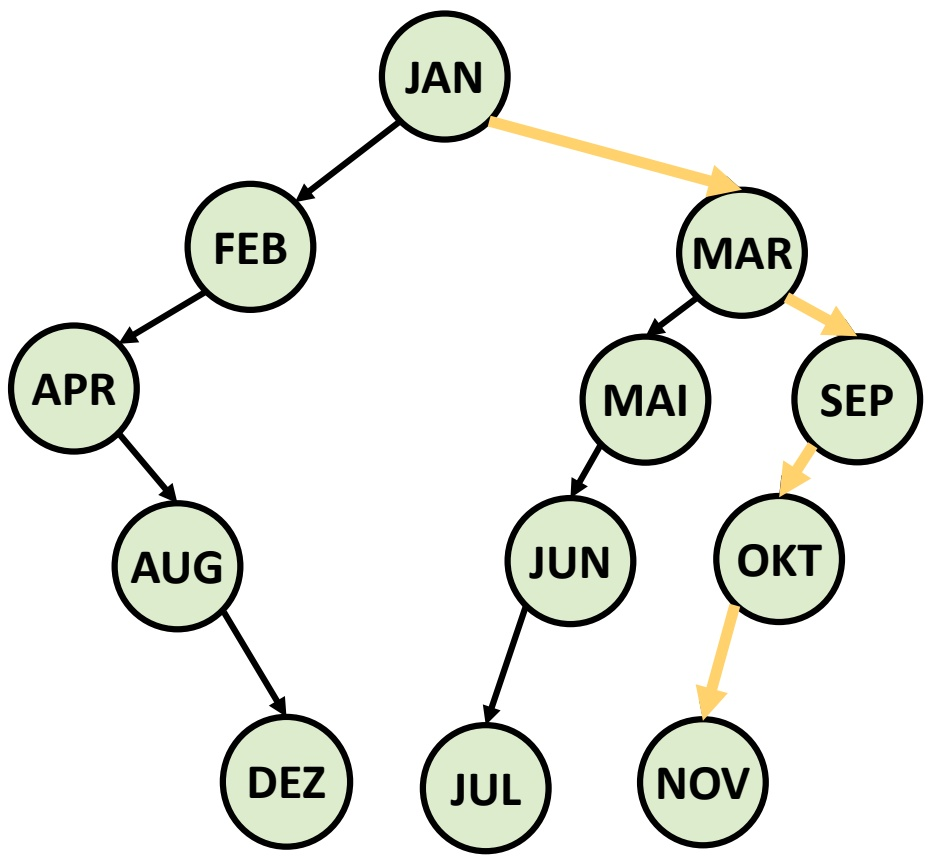

<details>
<summary>flowchart</summary>

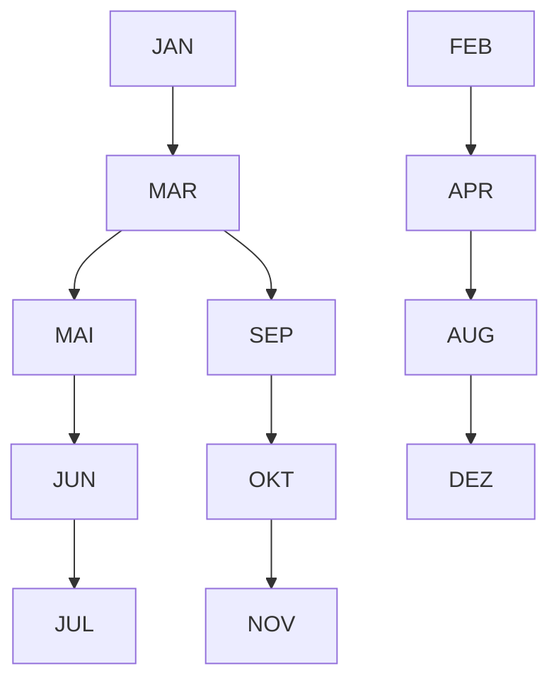
</details>

• **Beispiel**: Suchen von „NOV“
**Aufwand**: Länge des Pfades von der Wurzel zum gesuchten Element (bzw. zu der Stelle, an der sich das Element befinden müsste)

**Löschen eines Elementes**: gleiches Prinzip, jedoch etwas aufwendiger beim Löschen von inneren Baumknoten (Wiederherstellung der Baumstruktur notwendig)
Aufwand bestimmt durch **max. Pfadlänge** im Baum
Diese ist wiederum bestimmt durch die **Reihenfolge** der Einfügeoperationen (siehe Bsp. Monatsnamen)
Extremfälle:

**a) ausgeglichener Baum**: Höhe der Teilbäume unterscheidet sich max. um 1, auf jeder Ebene verdoppelt sich die Anzahl der Knoten, daher Suchzeit 𝒪𝒪(log 𝑛𝑛) bei n Knoten **b) entarteter Baum**: wie Liste, d.h. 𝒪𝒪(𝑛𝑛)

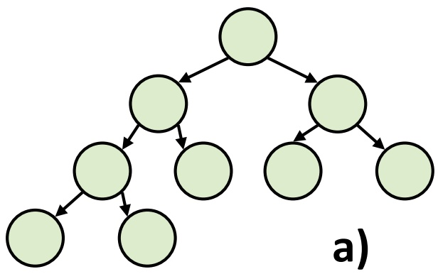

<details>
<summary>flowchart</summary>

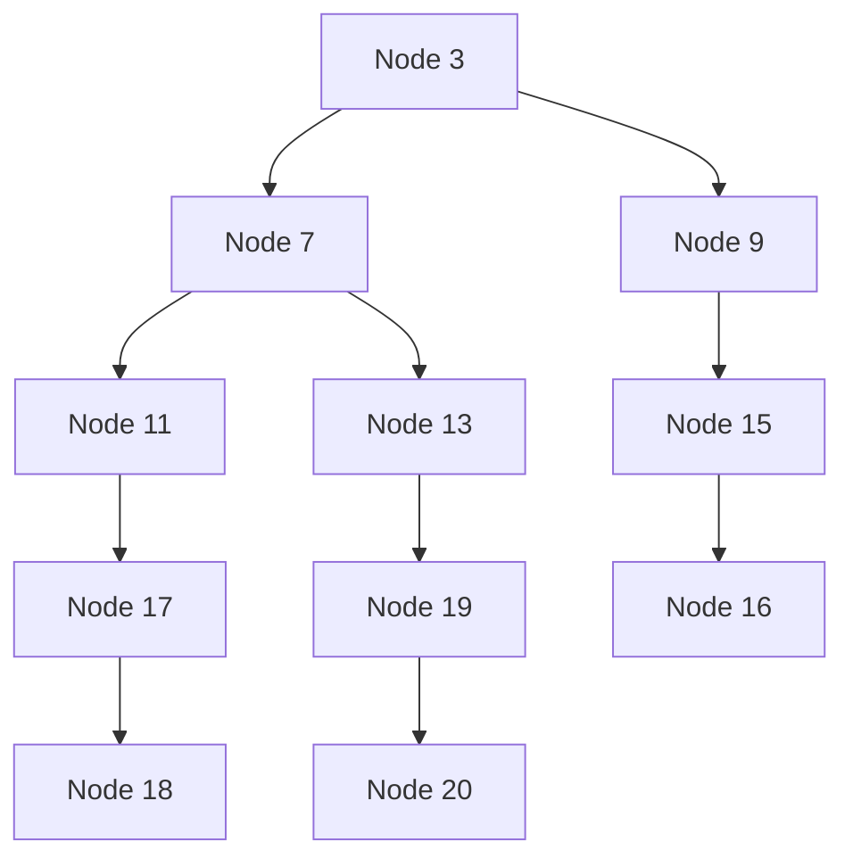
</details>

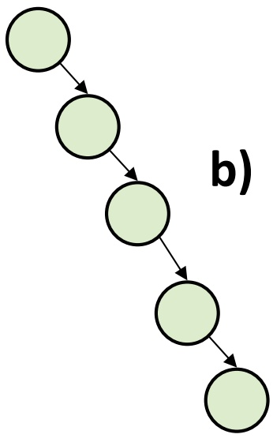

<details>
<summary>flowchart</summary>

```mermaid
graph LR
  A[""] --> B[""]
  B --> C[""]
  C --> D[""]
  D --> E[""]
```
</details>

Man kann zeigen: Bei einem aus **zufälligen Schlüsseln** aufgebauten binären Suchbaum liegt die Suchzeit im average case bei 𝒪𝒪(log 𝑛𝑛)
• **Jedoch**: nicht garantiert, worst case ist stets 𝒪𝒪(𝑛𝑛)
Ausgeglichene binäre Suchbäume (**AVL-Bäume**): 𝒪𝒪(log 𝑛𝑛) worst case für Suchen, Einfügen, Löschen garantiert
Weitere Suchbaumstrukturen für **spezielle Anwendungen**
• Z.B. Verwaltung großer Mengen in **externen Dateien** (Files)
– **Zugriffszeit** = Zeit für Positionierung im File + Zeit für Übertragung der Daten in den Hauptspeicher
Daher Übertragung von großen **zusammenhängenden Datenblöcken** statt einzelner Knoten sinnvoll
– Datenstruktur: **B-Bäume**

## 10. Graphen

## 10.1 Definition und Grapheigenschaften

10.2 Berechnung kürzester Pfade
10.3 Datenstrukturen zur Graphrepräsentation
10.4 Graphdurchläufe
10.5 Spannbäume

Graph: graphische Darstellung einer **Menge von Objekten und deren Beziehungen** (d.h. Relation)
• Bsp.: **topologische Information** einer Landkarte

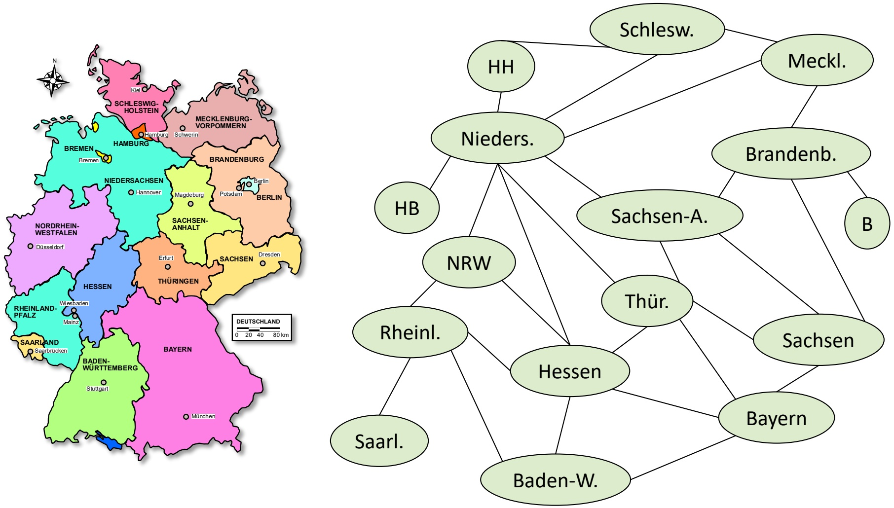

**Def**.: Eine (binäre) **Relation** 𝑅𝑅 ist eine Teilmenge des kartesischen Produktes zweier Mengen: $R \subseteq A   \times   B$

• Bei Graphen meist $R \subseteq A   \times   A$ für gegebene Menge 𝐴𝐴 (“**Knoten**”)
• $" aRb"$ als Schreibweise für $( a , b ) \in R ,$ , “**Kante**” zwischen 𝑎𝑎 und 𝑏𝑏 im Graphen
• Spezialfall symmetrische Relation: **aRb** ⇒ **bRa**

**Def**.: Ein **(gerichteter) Graph** $G \; = \; ( V , E )$ besteht aus einer Menge 𝑉𝑉 von **Knoten** (vertices) und einer Menge 𝐸𝐸 von **Kanten** (edges) mit $E \subseteq V \times V$

**Def**.: Gilt für alle Kanten $( u , v )$ eines Graphen $G \; = \; ( V , E )$ $( u , v ) \in E \Rightarrow ( v , u ) \in E$ so heißt 𝐺𝐺 **ungerichtet**. **Schreibweise**: $\{ u , v \} \in E$

**Def**.: Eine Folge $( v _ { 1 } , \ldots , v _ { n } )$ von Knoten eines Graphen $G \; = \; ( V , E )$ heißt **Pfad**, falls für alle $i \; = \; 1 \ldots n - 1 \colon \{ v _ { i } , v _ { i + 1 } \} \in E$

Bsp. Landkarte: Knoten = Bundesländer
**Ungerichteter Graph**, da Nachbarschafts-Beziehung symmetrisch
• **Pfad** = „Reiseweg“ von einem Land in ein anderes
Im folgenden: Betrachtung **ungerichteter** Graphen

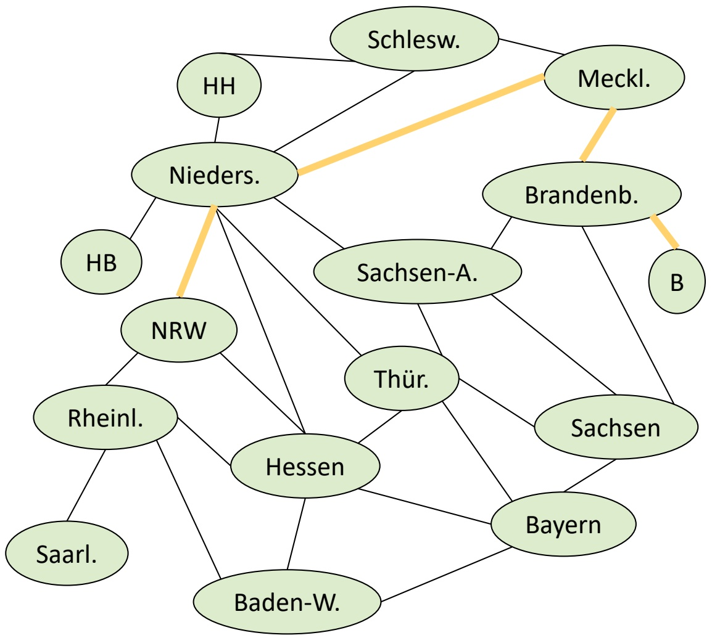

<details>
<summary>flowchart</summary>

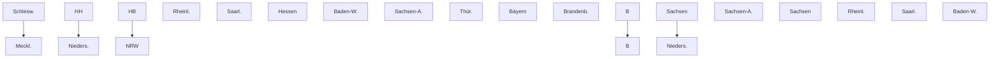
</details>

**Def**.: Ein Graph 𝐺𝐺 = (𝑉𝑉, 𝐸𝐸) heißt **zusammenhängend**, falls zwischen <u>zwei beliebigen Knoten</u> $u , v \in V$ <u>mindestens ein Pfad existiert.</u>

**Def**.: Ein Graph 𝐺𝐺 = (𝑉𝑉, 𝐸𝐸) heißt **zyklenfrei**, falls zwischen zwei beliebigen Knoten $u , v \in V$ höchstens ein Pfad existiert.

• Bsp. Landkarte:

– zusammenhängend
– nicht zyklenfrei

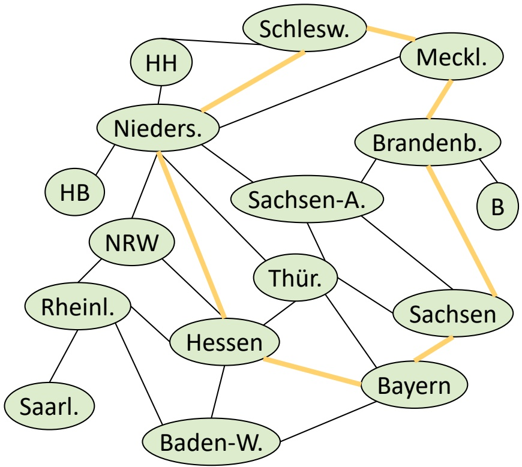

<details>
<summary>flowchart</summary>

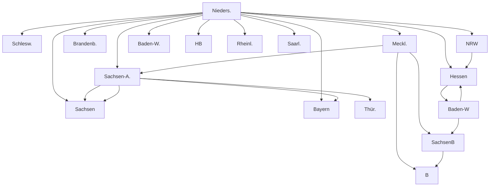
</details>

**Def**.: Ein zusammenhängender, zyklenfreier Graph $G = ( V , E )$ heißt **Baum**.

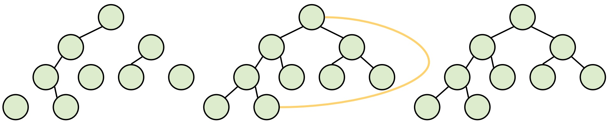

Nicht zusammenhängend

Nicht zyklenfrei

Baum

**Def**.: Ein Graph $G = ( V , E , w )$ mit einer Abbildung 𝑤𝑤: 𝐸𝐸 → ℝ heißt **(kanten)gewichteter Graph**.

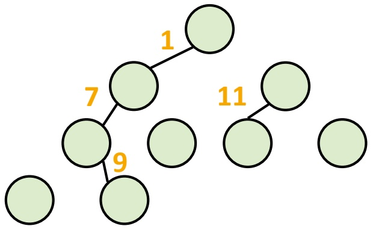

<details>
<summary>flowchart</summary>

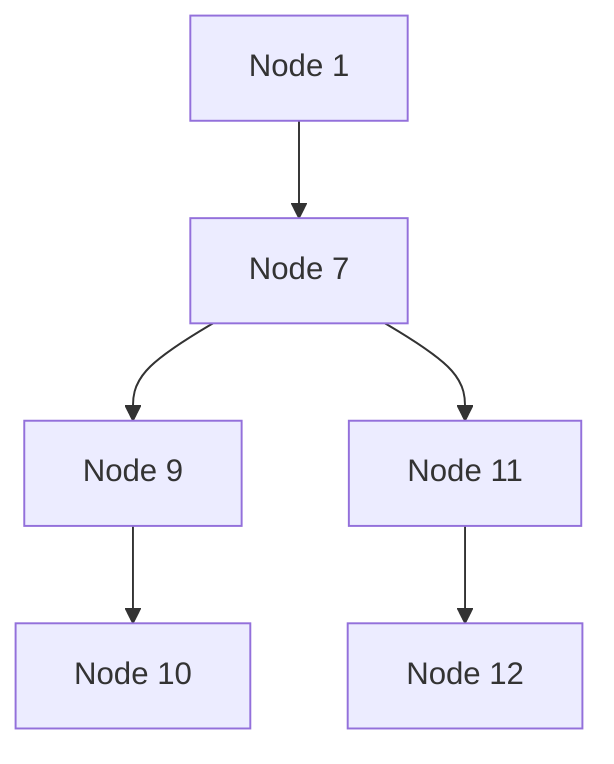
</details>

## 10. Graphen

10.1 Definition und Grapheigenschaften
**10.2 Berechnung kürzester Pfade**
10.3 Datenstrukturen zur Graphrepräsentation
10.4 Graphdurchläufe
10.5 Spannbäume

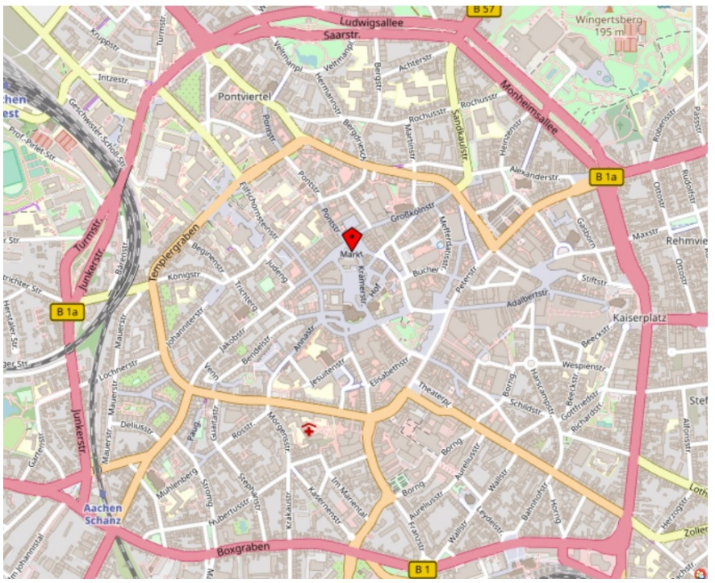

<details>
<summary>text_image</summary>

Ludwigsallee
Saarstr.
Wingertsberg
195 m
B 57
Monheimsallee
Pontviertel
Pointvir
Grotkalmstr
Markt
Kaimenstr.
Bucher
Adalbertstr
Kaiserplatz
Theatergy
Borg
Aureusstr
Walther
Bahnhurst
Hörd
Borg
Muhlenburg
Muhlenburg
Muhlenburg
Muhlenburg
Muhlenburg
Muhlenburg
Muhlenburg
Muhlenburg
Muhlenburg
Muhlenburg
Muhlenburg
Muhlenburg
Muhlenburg
Muhlenburg
Muhlenburg
Muhlenburg
Muhlenburg
Muhlenburg
Muhlenburg
Muhlenburg
Muhlenberg
Muhlenberg
Muhlenberg
Muhlenberg
Muhlenberg
Muhlenberg
Muhlenberg
Muhlenberg
Muhlenberg
Muhlenberg
Muhlenberg
Muhlenberg
Muhlenberg
Muhlenberg
Muhlenberg
Muhlenberg
Muhlenberg
Muhlenberg
Muhlenberg
Muhlenberg
Muhlenburg
Boxgraben
Aachen Schanz
Aachen Schanz
Jukkerstrat
Tumststr.
Bierstrat
Leuhrstrat
Dehauststr.
Mauerstr.
Mauerstr.
Lochnerstr.
Konigstr.
Johannesstr.
Jahoubstr.
Bendestri.
Amalsz.
Jesuternstr.
Kaimenstr.
Bergengor.
Bergengor.
Eichsenstreetsr.
Eichsenstreetsr.
Eichsenstreetsr.
Eichsenstreetsr.
Eichsenstreetsr.
Eichsenstreetsr.
Eichsenstreetsr.
Eichsenstreetsr.
Eichsenstreetsr.
Eichsenstreetsr.
Eichsenstreetsr.
Eichsenstreetsr.
Eichsenstreetsr.
Eichsenstreetsr.
Eichsenstreetsr.
B 1a
B 1a
</details>

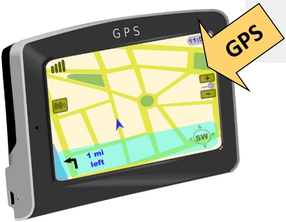

<details>
<summary>text_image</summary>

GPS
11:5
1 mi
left
SW
GPS
</details>

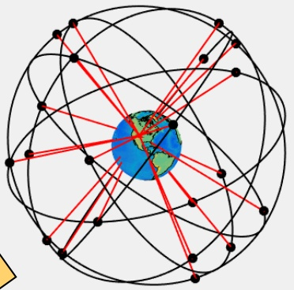

<details>
<summary>natural_image</summary>

Diagram of a globe with red and black lines connecting global points, no text or symbols present
</details>

https://ndla.no/

• **Knoten** = Geographische Orte
• **Kanten** = Straßenverbindungen
• **Kantengewichte** = Länge bzw. Fahrtdauer
• **Gesucht**:

kürzester Pfad von 𝐴𝐴 nach 𝐵𝐵 gemäß Summe der Kantengewichte

**Dijkstra-Algorithmus** (single source shortest path)
Bestimmung der kürzesten Pfade von einem Startknoten $v _ { 0 }$ aus zu allen anderen Graphknoten
• I dee:

– In jedem Schritt Betrachtung einer „**Nachbarschaft**“ 𝑁𝑁 von $v _ { 0 } ,$ innerhalb derer die kürzesten Pfade zu $v _ { 0 }$ bereits bekannt sind
– Schrittweise **Erweiterung von** 𝑵𝑵 um den jeweils am nächsten an 𝑁𝑁 liegenden Knoten

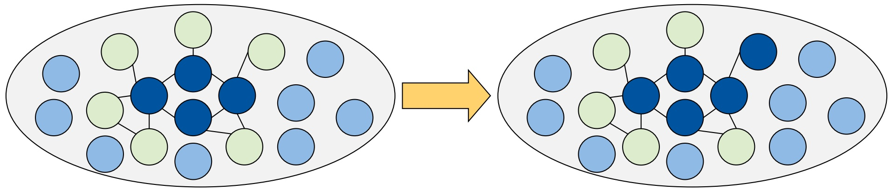

<details>
<summary>flowchart</summary>


</details>

**Bisher bekannter** min. Abstand dist(u,v) zwischen zwei Knoten kann durch neue Zwischenknoten **verkürzt** werden

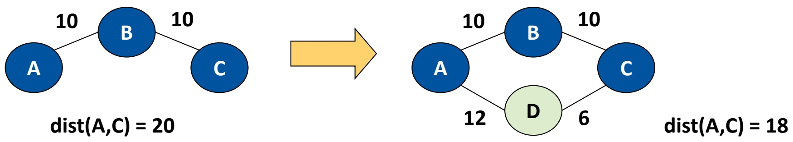

**Def**.: Ist $G \; = \; ( V , E )$ ein Graph und $\{ u , v \} \in E ,$ so heißt 𝑣𝑣 **Nachfolger** von $u ,$ und 𝑢𝑢 heißt **Vorgänger** von 𝑣𝑣.

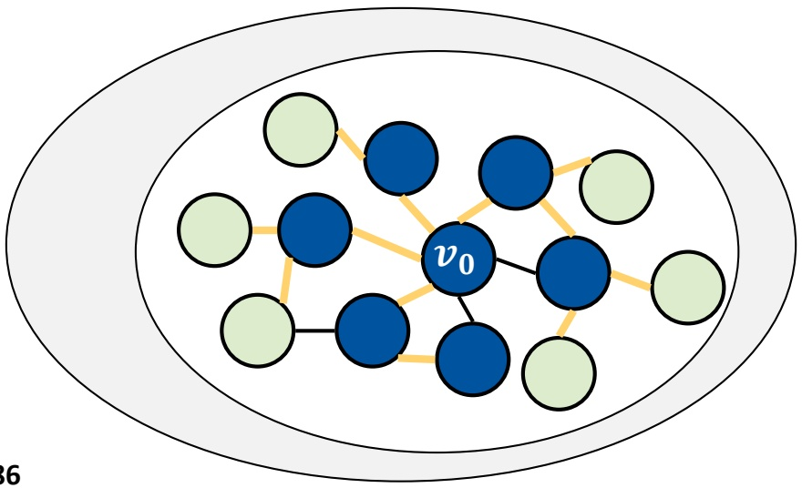

<details>
<summary>flowchart</summary>

This diagram illustrates a hierarchical or network-based process where multiple nodes (represented by blue and yellow circles) connect to a central node labeled v0, which branches into several outer nodes.
</details>

bereits betrachteter Bereich

Graph G

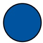

Alle Nachfolger bereits betrachtet

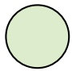

Nachfolger noch nicht betrachtet

Kürzeste Pfade von $v _ { 0 }$ aus

**Pseudo-Code**: abstrakter Code für Algorithmus, nicht direkt compilier- und ausführbar!
Vorauss.: Datenstruktur für **Graphen** (graph) und **Mengen** (set) verfügbar
• graph unterstützt Zugriff auf Knoten und Kanten (s. später)
• set unterstützt übliche Mengenoperationen
• Variablen:

– dist[v] bezeichnet den aktuell min. Abstand von Knoten 𝑣𝑣 zum Startknoten
– cost(u,v) bezeichnet Gewichtung der Kante {𝑢𝑢, 𝑣𝑣}
– Mengen **BLUE, GREEN und ORANGE** bezeichnen blaue und grüne Knoten sowie orangene Kanten

Orangene Kanten bilden stets einen **Baum von aktuell kürzesten Pfaden** vom Startknoten aus

```txt
void shortest_path(graph G = (V = {v0, ..., vn}, E))
{
    set BLUE = {}, GREEN = {v0}, ORANGE = {}; dist[v0] = 0;

    while (GREEN != {}) { // solange noch unbearbeitete Knoten
        v = MinDist(GREEN); // v ∈ GREEN mit min. dist-Wert
        Insert(v, BLUE);   // BLUE = BLUE ∪ {v}
        Delete(v, GREEN);   // GREEN = GREEN \ {v}

        for (u ∈ Succ(v)) { // für alle Nachfolger u von v
            if (!(u ∈ GREEN ∪ BLUE)) { // neuer Knoten erreicht
                Insert({u,v}, ORANGE);
                Insert(u, GREEN);
                dist[u] = dist[v] + cost(u,v);
            } else if (u ∈ GREEN) {      // u erneut erreicht
                if (dist[v] + cost(u,v) < dist[u]) {
                    Insert({u,v}, ORANGE);
                    e = PreviousEdge(u);   // vorher orangene Kante zu u
                    Delete(e, ORANGE);       // ORANGE = ORANGE \ {e}
                    dist[u] = dist[v] + cost(u,v);
                }
            }
        }
    }
}
```