• 𝑻𝑻(𝒏𝒏) = 𝑻𝑻(𝒏𝒏 − 𝟏𝟏) + 𝑻𝑻(𝒏𝒏 − 𝟐𝟐) + 𝟏𝟏
• Grobe **Abschätzung**:

$$
\begin{array}{l} T (n) \geq \mathrm{fib} (n) = \mathrm{fib} (n - 1) + \mathrm{fib} (n - 2) \\ \geq 2 \times \mathrm{fib} (n - 2) \\ = 2 \times \left(\mathrm{fib} (n - 3) + \mathrm{fib} (n - 4)\right) \\ = 2 \times \operatorname{fib} (n - 3) + 2 \times \operatorname{fib} (n - 4) \\ \geq 4 \times \mathrm{fib} (n - 4) \\ \end{array}
$$

$$
\begin{array}{l} \geq 2 ^ {k - 1} \times \operatorname{fib} (n - 2 (k - 1)) [ \text {setze} n = 2 k ] \\ = 2 ^ {k - 1} \times \operatorname{fib} (n - 2 (^ {1 / 2} n - 1)) = 2 ^ {k - 1} \times \operatorname{fib} (2) \\ = 2^{k - 1} \\ = 2 ^ {n / 2 - 1} = 1 / 2 \times 2 ^ {n / 2} \\ \end{array}
$$

• Also $T ( n ) \; = \; { \mathcal { O } } ( 2 ^ { n } )$ (mindestens)
• Zusätzlicher Overhead für **Stackverwaltung** (konst. Faktor)

**Problem** der rekursiven Version: Bei Berechnung von fib(𝑛𝑛) wird Teilfolge fib(𝑛𝑛 − 2) stets unnötig **doppelt** berechnet
• **Iterative** Version:

```c
int fib(int n)
{
    int f1, f2, f;
    if (n <= 1) return 1;

    f1 = 1;
    f2 = 0;
    for (i=2; i<=n; i++) {
        f = f1 + f2;
        f2 = f1;
        f1 = f;
    }

    return f;
}
```

• Laufzeit 𝓞𝓞(𝟏𝟏) für $n \leq 1$
• Laufzeit 𝓞𝓞(𝒏𝒏) sonst

## 11. Techniken zum Algorithmenentwurf

11.1 Rekursion und Iteration
**11.2 Backtracking**
11.3 Kombinatorische Optimierung
11.4 Schwierige Probleme und Heuristiken
11.5 Dynamische Programmierung
11.6 Branch and Bound

• „Rücksetzverfahren“
• **Grundprinzip**:

– Ausbau von Teillösung zu Gesamtlösung
– „Raten“, falls Weg zur Gesamtlösung nicht feststeht
– Rücknahme früherer Entscheidungen, falls keine Gesamtlösung erreichbar

• **Eigenschaften**:

– Existierende Lösung wird garantiert gefunden, indem notfalls alle Möglichkeiten ausprobiert werden
– Dieser Fall führt jedoch zu schlechtem Laufzeitverhalten

Analogie:

• DFS in Graphen
• TL = Teillösung

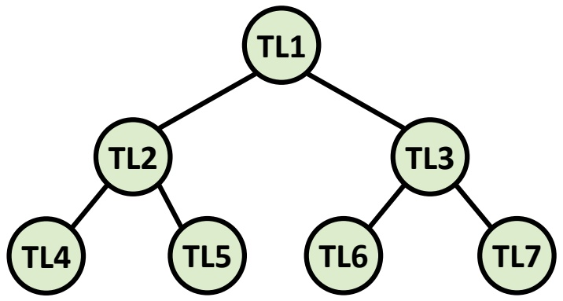

<details>
<summary>flowchart</summary>

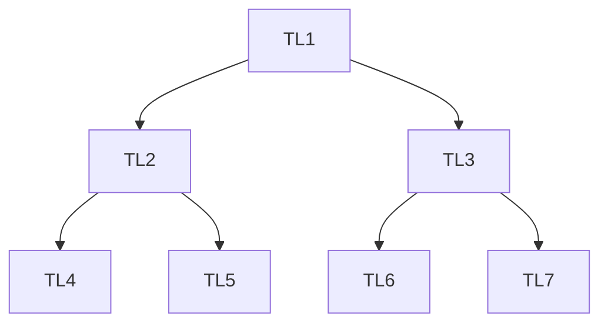
</details>

## Beispiel aus der technischen Informatik

Schaltkreise für Boolesche Funktionen
• **Boolesche Funktion** ist eine Abbildung $f :   \{ 0 ,   1 \} ^ { 2 }   \to   \{ 0 ,   1 \}$
• **Schaltkreis** = Hardware-Implementierung einer Booleschen Funktion
Einfache Funktionen $\left( f : \left\{ 0 { , } 1 \right\} \times \left\{ 0 { , } 1 \right\} \rightarrow \left\{ 0 { , } 1 \right\} \right)$ werden durch **Logikgatter** realisiert, z.B. AND, OR, NOR
Komplexe Funktionen durch **Zusammensetzen** von Gattern

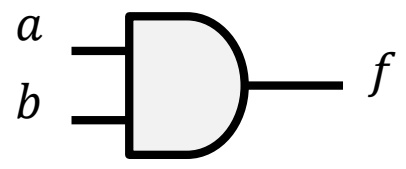

<details>
<summary>text_image</summary>

a
b
f
</details>

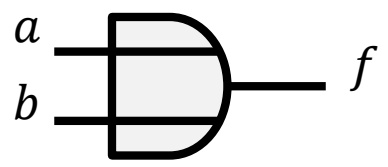

<details>
<summary>text_image</summary>

a
b
f
</details>

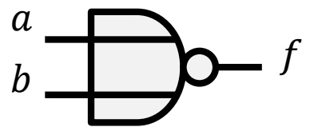

<details>
<summary>text_image</summary>

a
b
f
</details>

Bei der Herstellung von **integrierten Schaltkreisen** (integrated circuit, IC) als Silizium-Chips können Fehler auftreten
**Fehlermodell**: eine beliebige Leitung im Schaltkreis ist (z.B. durch Kurzschluss) immer konstant 0 oder 1
Beispiel:

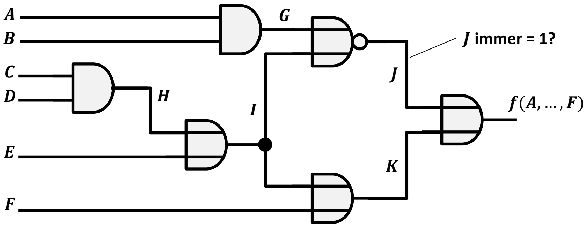

<details>
<summary>flowchart</summary>

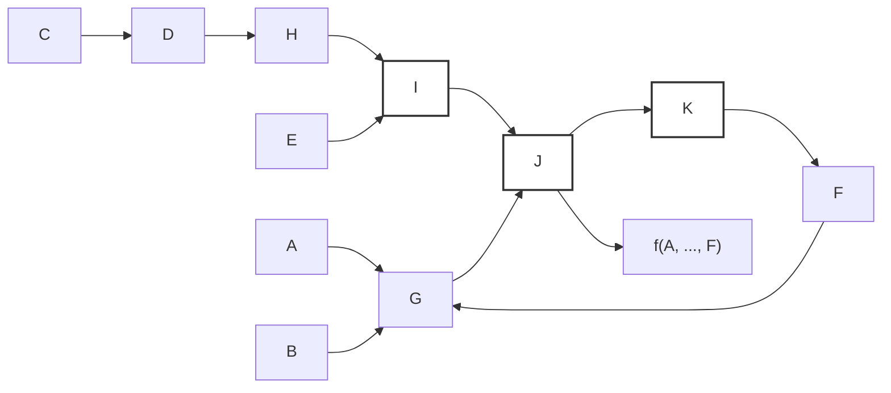
</details>

Nur **Ein- und Ausgänge** der Schaltung können gesetzt bzw. gemessen werden, jedoch keine internen Leitungen
Wie kann $J = 1$ getestet werden?
Geeigneten binären Eingabevektor $( A - F )$ wählen, so dass im korrekten Fall 𝐽𝐽 = 0
• Beobachten der **Ausgabe** 𝐿𝐿

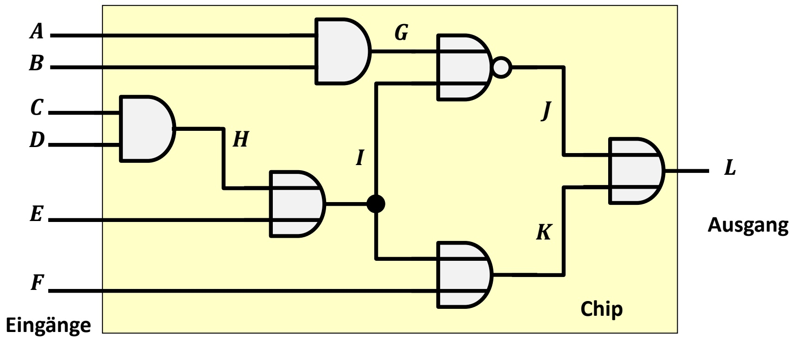

<details>
<summary>flowchart</summary>

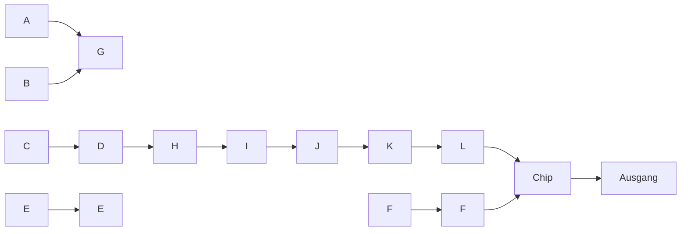
</details>

Setze $J = \mathbf { 0 } ,$ , sonst Fehler nicht messbar
• 𝐽𝐽 = 𝐺𝐺 NOR 𝐼𝐼, also z.B. 𝐺𝐺 = 1, 𝐼𝐼 = 1
• 𝐺𝐺 = 𝐴𝐴 AND 𝐵𝐵, also $A = 1 , B = 1$
• 𝐼𝐼 = 𝐻𝐻 OR 𝐸𝐸, also z.B. 𝐻𝐻 = 1, 𝐸𝐸 = 0
$H = C \; \mathrm { A N D } \; D$ , also $C = 1 , D = 1$

• Dieser Vektor $A - E$ erzwingt $J = 0$ , **falls Schaltkreis korrekt**

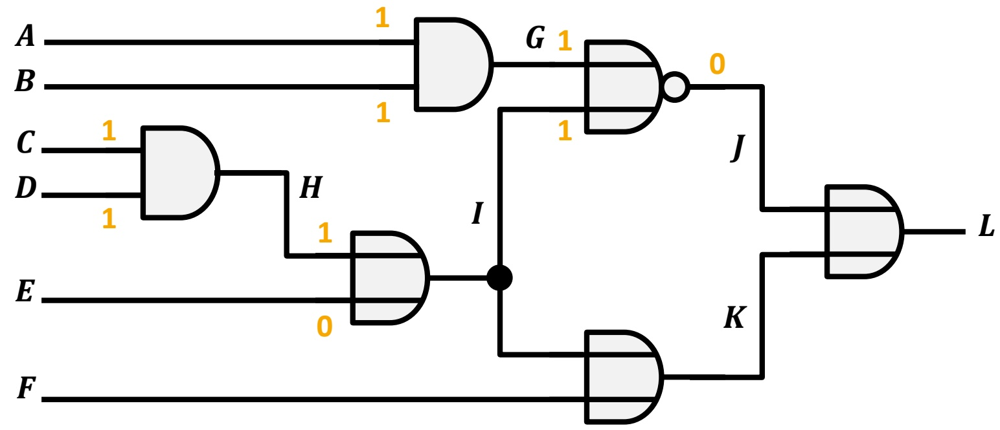

<details>
<summary>flowchart</summary>

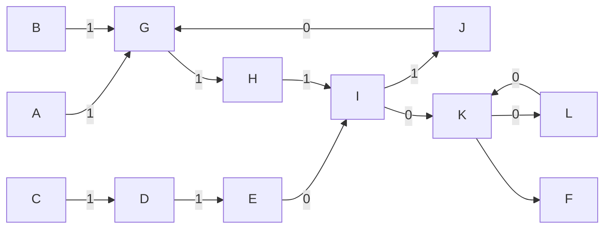
</details>

$K = 1$ impliziert $L = 1$ , unabhängig von 𝐽𝐽
• Also 𝐾𝐾 = 0 zu setzen
$K = I   \mathrm { o n }   F ,$ , also 𝐹𝐹 = 0, 𝐼𝐼 = 0 (Widerspruch zu 𝐼𝐼 = 1)
• Backtracking:

$$
I = 0, H = 0, C = 0
$$

• Dann ist $L = 0 \Leftrightarrow \operatorname { \mathsf { F e h l e r } } J = \mathbf { 1 }$ **liegt nicht vor**

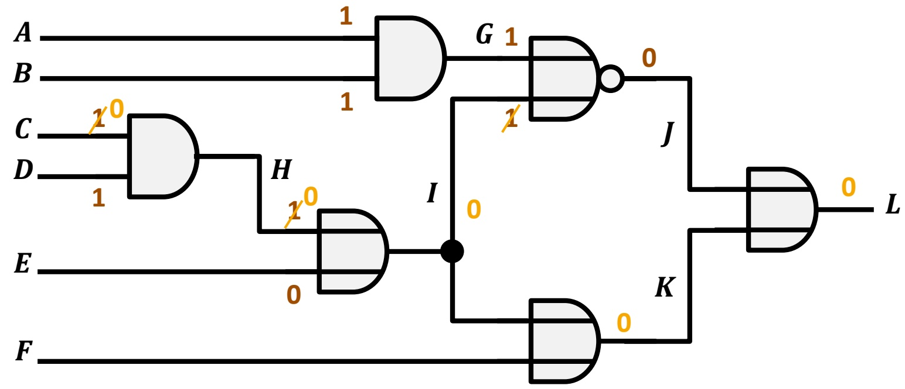

<details>
<summary>flowchart</summary>

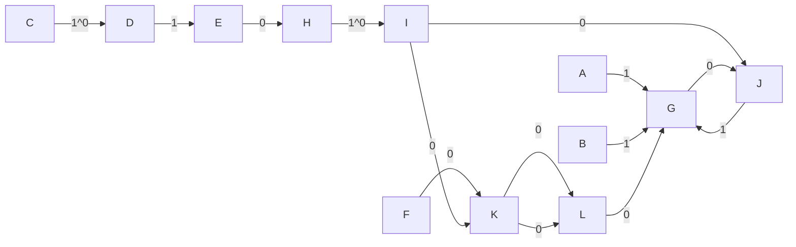
</details>

## 11. Techniken zum Algorithmenentwurf

11.1 Rekursion und Iteration
11.2 Backtracking
**11.3 Kombinatorische Optimierung**
11.4 Schwierige Probleme und Heuristiken
11.5 Dynamische Programmierung
11.6 Branch and Bound

Konstruktion einer **Lösung eines Problems** durch Auswahl einer **Teilmenge** einer **Menge von diskreten Elementen**
Jede gültige Lösung muss einer Menge von **Randbedingungen** genügen
**Gesucht**: Lösung, die bzgl. einer **Zielfunktion** optimal ist (d.h. minimal oder maximal, je nach Problemstellung)
• **Beispiel**: minimaler Spannbaum in einem Graphen

– Menge der diskreten Elemente:
• alle Graphkanten
– Gültige Lösung:
• Alle Knoten werden genau einmal erfasst
• Zusammenhängend und keine Zyklen
– Zielfunktion:
• Summe der Kantengewichte → min

• Greedy = gierig
Ausgehend von Teillösung wähle Fortsetzung, welche zum **aktuellen**

## Zeitpunkt den größten Gewinn verspricht

• Eigenschaften:

– Meist **geringe Laufzeit**
– Optimale Lösung evtl. **nicht gefunden**

Beispiel: **Kruskal-Algorithmus**

– Greedy: wähle stets nächstbilligste Kante
– Laufzeit 𝒪𝒪( 𝐸𝐸 log 𝐸𝐸 )
– Optimum garantiert gefunden

```txt
Graph MinSpanningTree(Graph G = (V,E))
{
    Graph T; List L; Edge e;

    T = {};
    L = Sort(E);

    while (#Kanten in T < #Knoten in G-1
        && !IsEmpty(L)) {
        e = FirstElem(L);
        Delete(e,L);
        if (!Cycle(e,T)) {
            T = T ∪ {e};
        }
    }
}
```

Landeswährung enthält Münzen zu $n _ { 1 } , \ldots , n _ { k }$ **Einheiten**
$n _ { 1 } > n _ { 2 }   \ldots   > n _ { k }$
Stets $n _ { k } = 1$ , sonst nicht alle Beträge wechselbar
• Z.B. **Euro/Cent**:

$$
n _ {1} = 2 0 0, n _ {2} = 1 0 0, n _ {3} = 5 0,
$$

$$
n _ {4} = 2 0, n _ {5} = 1 0, n _ {6} = 5,
$$

$$
n _ {7} = 2, n _ {8} = 1
$$

**Problem**: Auszahlung von Betrag 𝑁𝑁 mit verfügbaren Münzen
• **Diskrete Elemente**: Münzen
• **Gültige Lösung**:

Menge von Münzen mit Gesamtwert 𝑁𝑁

• **Zielfunktion**:

möglichst wenige Münzen verwenden


<details>
<summary>natural_image</summary>

Collection of various Euro-denominated coins scattered on a white surface (no text or symbols visible)
</details>

**Strategie**: immer möglichst viele „große“ Münzen wählen, bevor man zu „kleineren“ greift
„Untere Gaußklammerfunktion“: 𝐟𝐟 𝐟𝐟(𝒙𝒙) = größte ganze Zahl, die nicht größer ist als 𝑥𝑥
• Führt bei „guten“ Stückelungen immer zum **Optimum**
• **Schlechte Stückelung**: z.B. $n _ { 1 } = 2 n _ { 2 } + 1 , \quad n _ { 2 } > 1 , \quad n _ { 3 } = 1$

Greedy-Münzwechsel

```c
void change(int N)
{
    int W, i;

    W = N;
    for (i=1; i<=k; i++) {
        f = floor(w/n_i);
        wähle f Münzen
        der Einheit n_i;
        W -= n_i * f;
    }
}
```

Schlechter Fall, z.B. $N \; = \; 3 n _ { 2 }$

<div class="docvortex-algorithm" style="white-space: pre-wrap; font-family:monospace;">
z.B. $n_2 = 10$, $N = 30$, $n_1 = 21$
1 Münze zu Wert 21
dann $W = 30 - 21 = 9$
9 Münzen zu Wert 1
Zusammen 10 Münzen
Ausreichend wären 3 Münzen Wert 10
</div>

## 11. Techniken zum Algorithmenentwurf

11.1 Rekursion und Iteration
11.2 Backtracking
11.3 Kombinatorische Optimierung
**11.4 Schwierige Probleme und Heuristiken**
11.5 Dynamische Programmierung
11.6 Branch and Bound

## Komplexität von Optimierungsproblemen

Für viele wichtige kombinatorische Optimierungsprobleme ist bekannt, dass sie **nicht in akzeptabler Zeit optimal lösbar** sind, da ihre Laufzeit (höchstwahrscheinlich) mindestens in $\mathcal { O } ( 2 ^ { n } )$ liegt
• Sog. **NP-vollständige** Probleme
Rechenbeispiel: Problemgröße $n = 6 4$ , schneller Rechner führt $2 ^ { 3 2 }$ Operationen/sec aus
• **Rechenzeit**: $2 ^ { 3 2 }$ sec ≈ 136 Jahre
• **Prinzipielle Möglichkeiten**:

1. Optimale Lösung (brute force) für kleine Werte von n
2. Optimale Lösung, und dafür sorgen, dass worst case möglichst selten eintritt
3. Gute, aber nicht notwendig optimale Lösung berechnen

## • Traveling salesman problem:

– Modell: Graph mit Kantengewichten
Gesucht: Kürzester Rundweg (Zyklus), der alle Knoten genau einmal enthält

## • Graph-Färbung:

– Modell: ungerichteter Graph
Gesucht: Färbung der Knoten mit min. Anzahl Farben, so dass benachbarte Knoten unterschiedliche Farben haben

## Erfüllbarkeit Boolescher Funktionen:

– Gibt es für Funktion 𝑓𝑓 eine Eingabe 𝑥𝑥 mit 𝑓𝑓(𝑥𝑥) = 1?

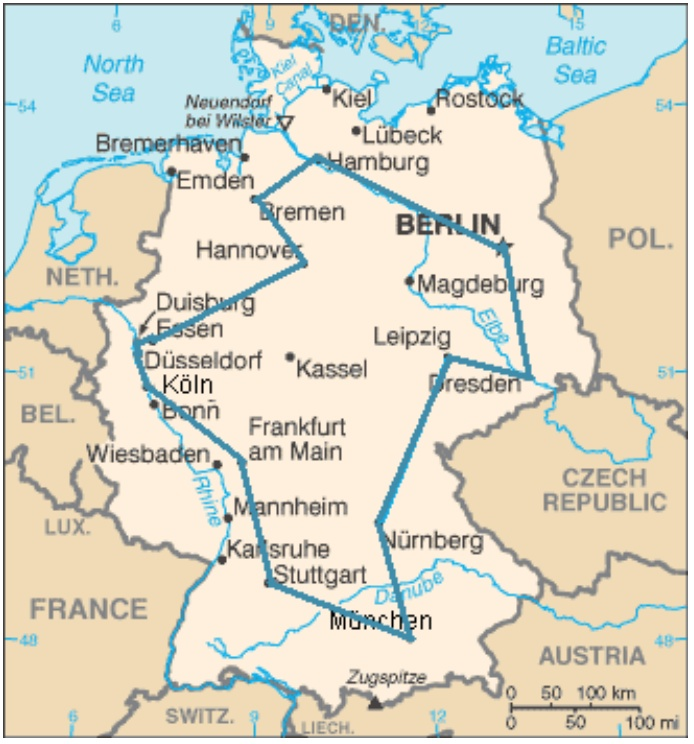

<details>
<summary>text_image</summary>

DEN.
Baltic
Sea
54
Neuendorf
bei Wilster
Kiel
Rostock
Lübeck
Bremerhaven
Hamburg
Emden
Bremen
BENLIN
POL.
NETH.
Duisburg
Essen
Düsseldorf
Köln
Bonn
Frankfurt
am Main
Mannheim
Kansruhe
Stuttgart
München
Magdeburg
Leipzig
Presden
BEL.
CZECH
REPUBLIC
LUX.
FRANCE
AUSTRIA
Zugspitze
SWITZ.
LIECH.
12
0 50 100 km
0 50 100 mi
</details>

<sup>Kürzester</sup> Rundweg über die 15 größten Städte

Deutschlands (von > 43 \* 10<sup>9</sup> <sub>möglichen</sub>) [Wikipedia]

• Zur Kategorie 3 gehören **heuristische Algorithmen**
• **Heuristik**:

– Kompromiss zwischen Rechenaufwand und Lösungsqualität
– Basierend auf **problemspezifischem Wissen** und „Daumenregeln“
– **Greedy-Algorithmen** sind oft Heuristiken
– Gewünscht: möglichst oft sehr gute Lösung
– **Nachteil**: Lösung kann auch beliebig schlecht sein

• Außerdem möglich: **Approximationsalgorithmen**

– Garantie, dass Lösungsqualität nicht um mehr als bestimmten Faktor vom Optimum abweicht
– Faktor = „**Güte**“ des Approximationsalgorithmus

• **Gegeben**: kantengewichteter **vollständiger**
Graph $G = ( V , E , w )$ , d.h. für alle Knoten 𝑢𝑢, 𝑣𝑣 gilt $\{ u , v \} \in E$

• **Gesucht**: Pfad $P \; = \; ( v _ { 1 } , \ldots , v _ { n } )$ in $G _ { j }$ , der

– jeden Knoten in 𝑉𝑉 genau einmal enthält und
– eine maximale Kantengewichtssumme besitzt

Vergleiche minimaler (bzw. maximaler) Spannbaum:

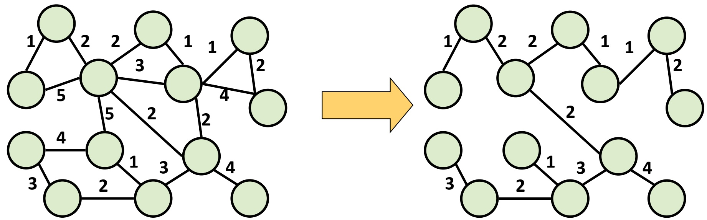

• Man kann zeigen: Problem ist **NP-vollständig**
• Ausnutzung der **Ähnlichkeit** zum Spannbaumproblem

– Pfad = „entarteter“ (d.h. linearer) Spannbaum
– Modifikation des **Kruskal-Algorithmus**: nächste Kante nur gültig, falls

• Kein Zyklus entsteht
• **Keine Verzweigungen** entstehen (d.h. kein „echter“ Baum)

– Erzeugt heuristisch **gute Lösungen** in kurzer Zeit

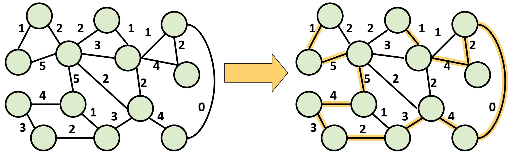

<details>
<summary>flowchart</summary>

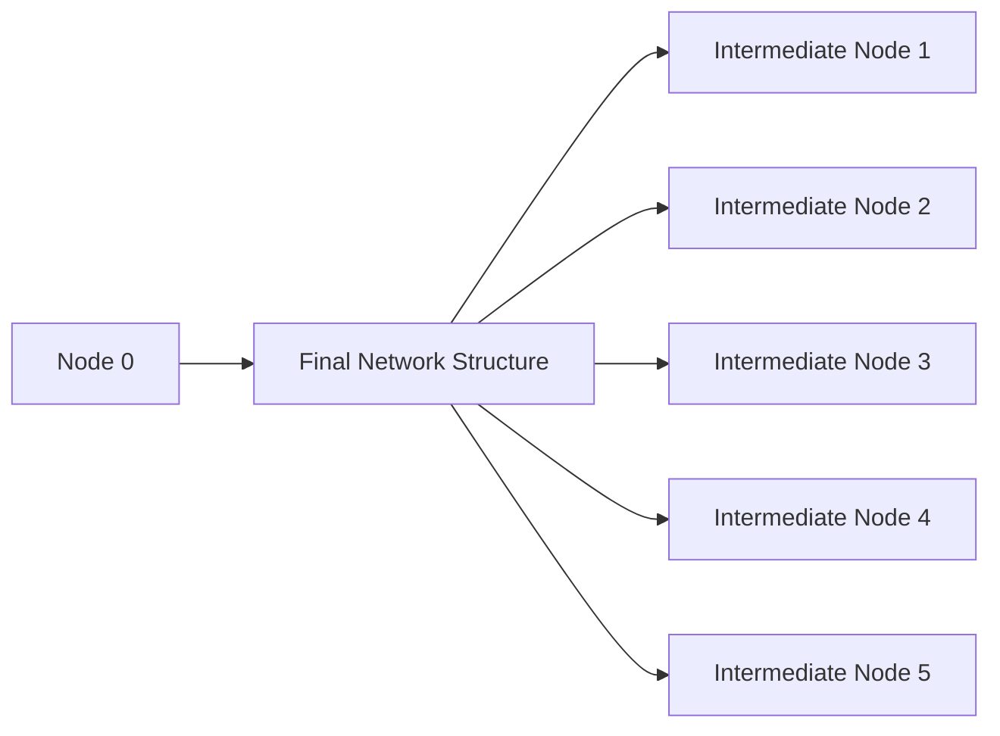
</details>

## 11. Techniken zum Algorithmenentwurf

11.1 Rekursion und Iteration
11.2 Backtracking
11.3 Kombinatorische Optimierung
11.4 Schwierige Probleme und Heuristiken
**11.5 Dynamische Programmierung**
11.6 Branch and Bound

**Effizientes exaktes Lösen** von Optimierungsproblemen mit folgender Eigenschaft:

Die optimale Lösung des Gesamtproblems kann effizient aus **optimalen Lösungen von Teilproblemen** berechnet werden

• Beispiel aus dem **Compilerbau**:

– Rechner besitzt elementare **Maschinenbefehle** (Assemblerbefehle, s. Kap. 1), z.B. Addition oder Multiplikation zweier Zahlen
– **Optimale Befehlsauswahl**: Wie kann ein komplexer arithmetischer Ausdruck in der Programmiersprache C am schnellsten mit den verfügbaren Assemblerbefehlen berechnet werden?

• Ausdruck: $( a \div b ) + ( c \div d )$
Befehle:

– Modell:

Rechner lädt Variablen (var) aus dem Speicher (load) und speichert Werte in Registern (r1, r2, r3)
• Jeder Befehl besitzt ein Kostenmaß (z.B. Zeit zur Ausführung)

– load: $r _ { 1 } = v a r _ { 1 }$ Kosten 1
– add: $r1 = + (r1, r2)$ Kosten 2
– mul: Kosten 2
– copy: Kosten 1
– muladd: $r1 = + ( \pi ( r1, r2 ), r3 )$ , Kosten 3

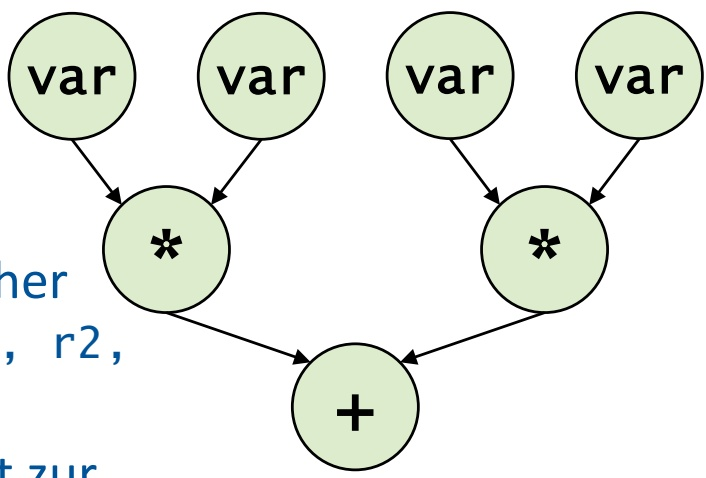

<details>
<summary>flowchart</summary>

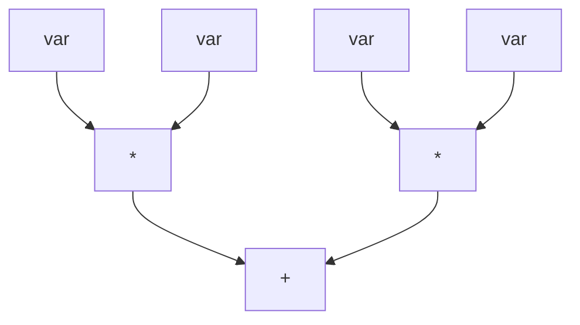
</details>

## Abstrakte

## Darstellung des

## Ausdrucks als

## Baum

## • Ansatz:

– Ausdrucksbaum mit möglichst „billiger“ Menge von Befehlen überdecken
Lösung für den gesamten Ausdrucksbaum aus optimalen Lösungen für seine Teilbäume bestimmen

## • Für jeden Teilbaum merken:

– Welcher Befehl an dessen Wurzel passt $( \mathsf { Z } . \mathsf { B } . , + ^ { \prime \prime }$ mittels „add“ zu überdecken, $v ^ { v ^ { 1 } } \theta ^ { 1 }$ mittels $, m u ] ^ { \prime \prime } )$
– In welchem Register das Ergebnis des Teilbaums gespeichert wird
– Welche Gesamtkosten hierbei entstehen

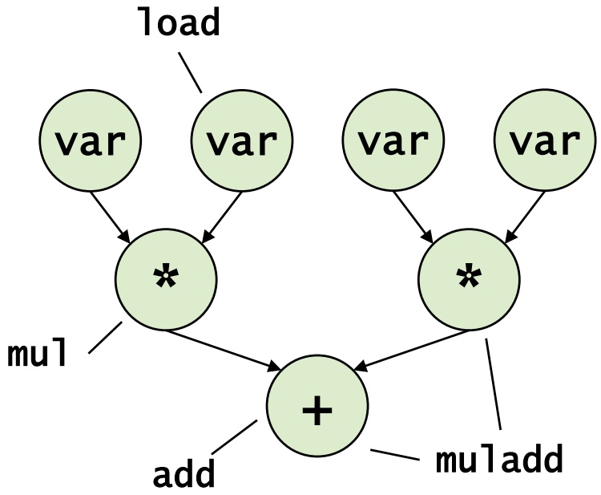

<details>
<summary>flowchart</summary>

This diagram illustrates a system process involving multiple parallel operations (var, add, mul) that converge to a central node marked with an asterisk.
</details>

var**-Knoten:**

**Überdeckung mit** $\boldsymbol { u } ^ { \intercal }$ oad“

**Ergebnis dann in Register** r1

**Kosten: 1**

**Überdeckung mit „**copy r1, $r 2 ^ { n }$

**Ergebnis dann in Register** r2

**Kosten: 2**

Überdeckung des Ausdrucksbaums

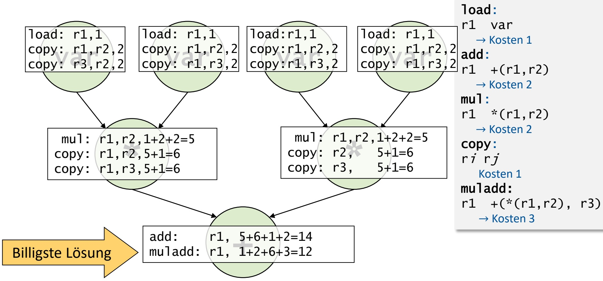

<details>
<summary>flowchart</summary>

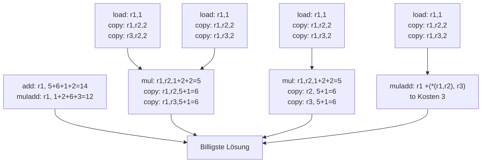
</details>

Aus dieser Lösung kann die **optimale Assembler-Befehlsfolge** unmittelbar konstruiert werden
• **Laufzeit**: 𝒪𝒪(𝑛𝑛) bei n Baumknoten

## Befehle

## load:

r1 var

→ Kosten 1

## add:

r1 +(r1,r2)

→ Kosten 2

## mul:

r1 \*(r1,r2)

→ Kosten 2

## copy:

ri rj

Kosten 1

## muladd:

r1 +(\*(r1,r2), r3)

→ Kosten 3

## 11. Techniken zum Algorithmenentwurf

11.1 Rekursion und Iteration
11.2 Backtracking
11.3 Kombinatorische Optimierung
11.4 Schwierige Probleme und Heuristiken
11.5 Dynamische Programmierung
**11.6 Branch and Bound**

• „Verzweigung und Schranke“
**Exaktes Lösen** schwieriger (NP-vollständiger) Optimierungsprobleme

• **Idee**:

– Lösen eines „schwierigen“ kombinatorischen Optimierungsproblems entspricht Durchlauf eines **Entscheidungsbaumes**

– Entscheidungsbaum typischerweise **exponentiell groß**
– „**Beschneidung**“ des Baumes verringert Laufzeit ohne Verlust an Optimalität

Ähnliches Konzept auch bei **Spielbäumen** (TicTacToe, Dame, Schach, …)

• **Charakteristik**:

– Im worst case exponentielle Laufzeit
– Im average case wesentlich schneller

## Entscheidungsbaum

Annahme: Vektor $V = ( x _ { 1 } , \ldots , x _ { n } )$ von 0/1-Variablen so zu wählen, dass eine Kostenfunktion $f ( V )$ minimiert wird
**Entscheidungsbaum**: Festlegen jeweils einer Variable

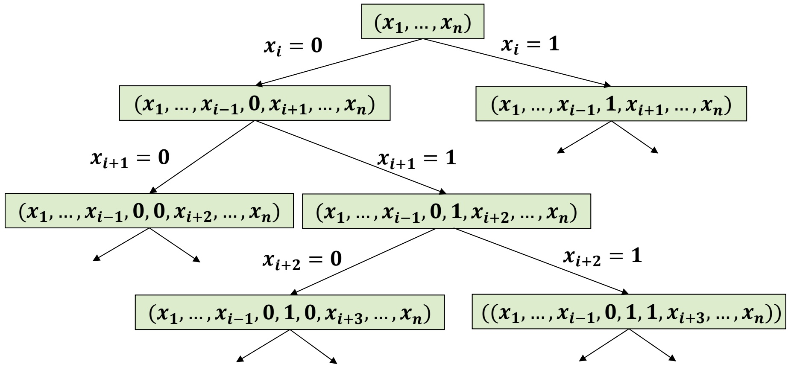

<details>
<summary>flowchart</summary>

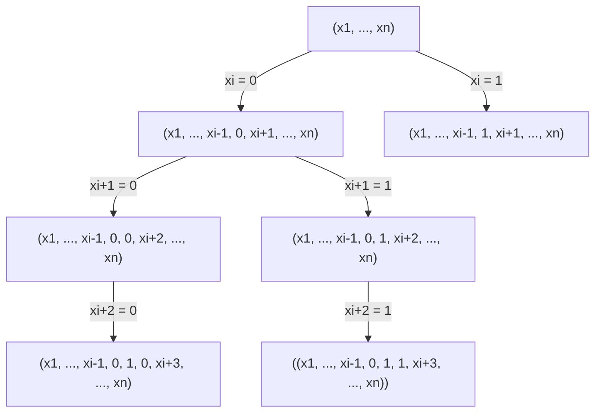
</details>

Während der Verzweigung: Berechnung von **oberen** (upper bound, 𝑈𝑈) und **unteren Schranken** (lower bound, 𝐿𝐿) für die Kostenfunktion 𝑓𝑓 an jedem Knoten 𝐾𝐾, so dass im Teilbaum unterhalb von 𝐾𝐾

– in jedem Fall **mindestens Kosten** 𝑳𝑳 entstehen
– garantiert eine Lösung mit **Kosten höchstens** 𝑼𝑼 existiert

**Bound**: Besitzt Knoten 𝐾𝐾 eine **untere Schranke** 𝑳𝑳**, welche größer ist als das kleinste bisher bekannte U**, dann kann der Teilbaum unterhalb von 𝐾𝐾 von der Suche **ausgeschlossen** werden, ohne dass eine optimale Lösung verloren geht

• **Wichtig**:

– Schranken sind schnell zu berechnen (sonst zu aufwendig)
– Schranken sind „scharf“ (sonst kein effektives Bound)

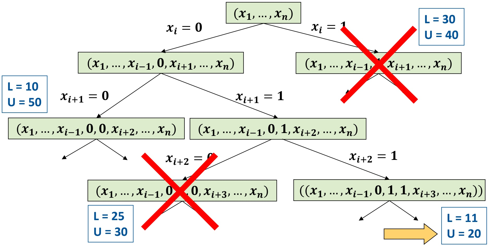

<details>
<summary>flowchart</summary>

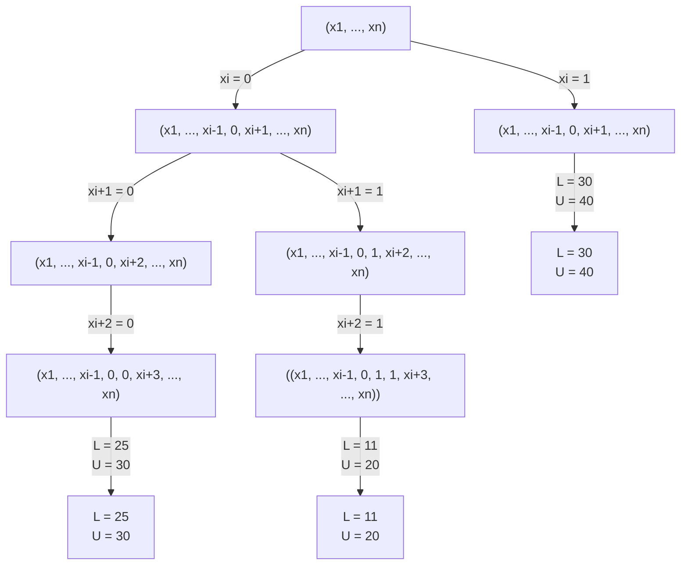
</details>

## Beispiel: max. gewichteter Pfad in Graphen

**Branch**: bestimmte Kante wird in den Pfad aufgenommen (sofern gültig) oder aber explizit ausgeschlossen

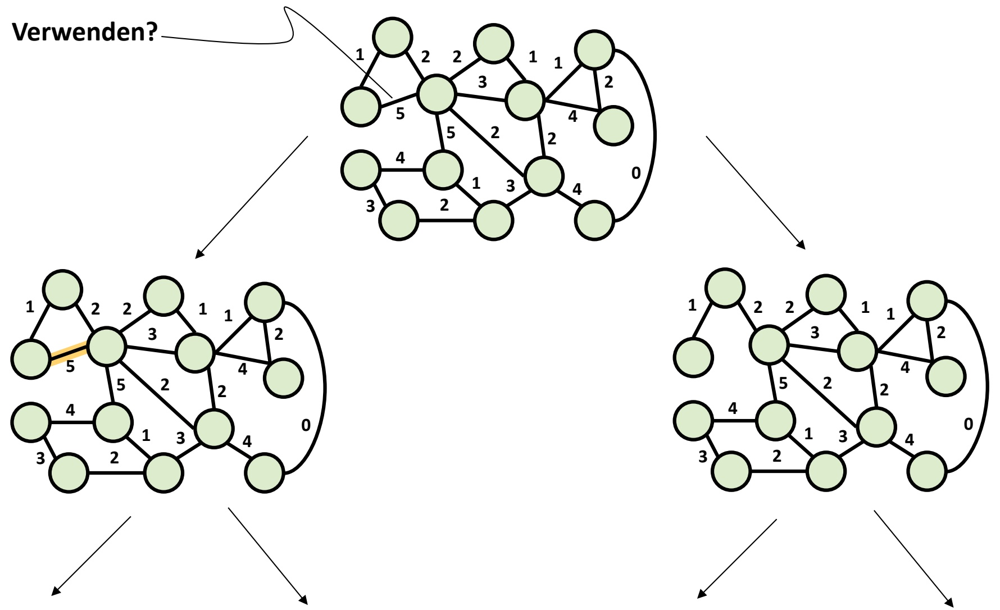

<details>
<summary>flowchart</summary>

```mermaid
graph TD
  A["Node 1"] --> B["Node 2"]
  A --> C["Node 3"]
  A --> D["Node 4"]
  A --> E["Node 5"]
  A --> F["Node 6"]
  A --> G["Node 7"]
  A --> H["Node 8"]
  A --> I["Node 9"]
  A --> J["Node 10"]
  A --> K["Node 11"]
  A --> L["Node 12"]
  A --> M["Node 13"]
  A --> N["Node 14"]
  A --> O["Node 15"]
  A --> P["Node 16"]
  A --> Q["Node 17"]
  A --> R["Node 18"]
  A --> S["Node 19"]
  A --> T["Node 20"]
  A --> U["Node 21"]
  A --> V["Node 22"]
  A --> W["Node 23"]
  A --> X["Node 24"]
  A --> Y["Node 25"]
  A --> Z["Node 26"]
  A --> AA["Node 27"]
  A --> AB["Node 28"]
  A --> AC["Node 29"]
  A --> AD["Node 30"]
  A --> AE["Node 31"]
  A --> AF["Node 32"]
  A --> AG["Node 33"]
  A --> AH["Node 34"]
  A --> AI["Node 35"]
  A --> AJ["Node 36"]
  A --> AK["Node 37"]
  A --> AL["Node 38"]
  A --> AM["Node 39"]
  A --> AN["Node 40"]
  A --> AO["Node 41"]
  A --> AP["Node 42"]
  A --> AQ["Node 43"]
  A --> AR["Node 44"]
  A --> AS["Node 45"]
  A --> AT["Node 46"]
  A --> AU["Node 47"]
  A --> AV["Node 48"]
  A --> AW["Node 49"]
  A --> AX["Node 50"]
```
</details>

Effiziente Berechnung der Schranken?
**Gegeben**: Graph mit 𝑛𝑛 Knoten und Teillösung mit 𝑘𝑘 bereits fest gewählten Kanten
• **Obere Schranke** 𝑼𝑼:

– Im besten Falle könnten noch die 𝑛𝑛 − 𝑘𝑘 − 1 „schwersten“unter den noch nicht betrachteten Kanten hinzugefügt werden
– Optimale Lösung kann höchstens schlechter sein

• **Untere Schranke** 𝑳𝑳:

– Setze Teillösung mittels Heuristik durch Hinzunahme von 𝑛𝑛 − 𝑘𝑘 − 1 Kanten zu Gesamtlösung fort
– Optimale Lösung kann höchstens besser werden

**Maximierungsproblem**: Falls für einen Knoten der Wert von 𝑈𝑈 kleiner ist als bisher bestes 𝐿𝐿, so kann der Teilbaum entfallen