# Grundgebiete der Informatik 1 – Folien mit Kommentaren

MinerU 4.0.12 Advanced；FULL 视图保留页眉、页脚、页码和边栏。

# Grundgebiete der Informatik 1

## Programmierung, Algorithmen und Datenstrukturen

Prof. Dr.‐Ing. Tobias Gemmeke

Integrierte Digitale Systeme und Schaltungsentwurf (IDS)

gemmeke@ids.rwth‐aachen.de


Chair of Integrated Digital Systems and Circuit Design

## RWTHAACHEN UNIVERSITY

**WS 2026/2027**

© T. Gemmeke, IDS, RWTH; R. Leupers, SSS

Herzlich Willkommen zur Einführung in die Informatik!

In diesem Bereich finden Sie ergänzende **Kommentare** zu den Folien, soweit diese nicht selbsterklärend sind.

Zusammen mit den Kommentaren sollten die Folien eine ausreichende Grundlage zur **Prüfungsvorbereitung** bilden. Es gibt kein spezielles Skript zu dieser Vorlesung, da zum Thema „Programmierung“ bereits eine Reihe von Büchern (siehe auch Hinweise im Lehr- und Lernportal Moodle) als Sekundärliteratur existiert.

Darüber hinaus wird natürlich auch die aktive Teilnahme an den **Übungen** dringend empfohlen, um den Stoff zu vertiefen.

**Korrekturen** und **Verbesserungsvorschläge** (am besten per email an den Dozenten) sind jederzeit erwünscht.

Bei **Fragen** zum Vorlesungsstoff stehen Ihnen der Dozent oder die Übungsleiter gerne zur Verfügung. Bitte vereinbaren Sie tel. oder per email einen Termin. Dies empfiehlt sich nicht erst während der Klausurvorbereitung!

1

---

## Inhalt

## 1. Einleitung

<u>1.1 Thematische Einordnung</u> 16
<u>1.2 Hardware und Software</u> 19
<u>1.3 Programmiersprachen</u> 22
<u>1.4 Algorithmen und Programme</u> 26

## 2. Einführendes Beispiel

<u>2.1 Temperaturumrechnung</u> 31
<u>2.2 Analyse des Beispiels</u> 35
<u>2.3 Ausführung und Fehlersuche</u> 42

## 3. Elementare Datentypen und Anweisungen

<u>3.1 Einführung</u> 47
<u>3.2 Variablen und Konstanten</u> 53
<u>3.3 Arithmetische und logische Operationen und Zuweisungen</u> 74
<u>3.4 Kontrollanweisungen</u> 81
<u>3.5 Zeiger</u> 59

2

2

---

## Inhalt

## 4. Funktionen und Programmaufbau

<u>4.1 Funktionen</u> 97
<u>4.2 Parameterübergabe</u> 107
<u>4.3 Polymorphie</u> 112
<u>4.4 Templates</u> 116
<u>4.5 Lambda Funktionen</u> 118
<u>4.6 Module und Programme</u> 120

## 5. Datentypen

<u>5.1 Arrays</u> 123
<u>5.2 Strukturen</u> 133
<u>5.3 Abstrakte Datentypen</u> 137
<u>5.4 Klassen</u> 139

<u>(De)Konstruktor</u> 141

<u>Public vs. private</u> 143

<u>Vererbung</u> 146

<u>Abstrakte Klassen</u> 150

<u>Überladen von Operatoren</u> 152

3

3

---

## Inhalt

## 6. Analyse von Algorithmen

<u>6.1 Laufzeitanalyse</u> 159
<u>6.2 O‐Notation für Wachstumsordnungen</u> 165
<u>6.3 Beispiel: Exponentialfunktion</u> 175
<u>6.4 Beispiel: Suchen in Arrays</u> 180

## 7. Sortieralgorithmen

<u>7.1 Einfache Verfahren (Selection/Insertion/Bubblesort)</u> 189
<u>7.2 Quicksort</u> 205
<u>7.3 Heapsort</u> 215

## 8. Lineare Datentypen

<u>8.1 Listen</u> 229
<u>8.2 Stacks</u> 242
<u>8.3 Queues</u> 251

## 9. Bäume

<u>9.1 Definition und Darstellung</u> 261
<u>9.2 Baumdurchläufe</u> 265
<u>9.3 Suchbäume</u> 269

4

4

---

## Inhalt

## 10. Graphen

<u>10.1 Definition und Grapheigenschaften</u> 277
<u>10.2 Berechnung kürzester Pfade</u> 283
<u>10.3 Datenstrukturen zur Graphrepräsentation</u> 294
<u>10.4 Graphdurchläufe</u> 300
<u>10.5 Spannbäume</u> 308

## 11. Techniken zum Algorithmenentwurf

<u>11.1 Rekursion und Iteration</u> 316
<u>11.2 Backtracking</u> 323
<u>11.3 Kombinatorische Optimierung</u> 330
<u>11.4 Schwierige Probleme und Heuristiken</u> 335
<u>11.5 Dynamische Programmierung</u> 341
<u>11.6 Branch and Bound</u> 346

5

5

---

## RWTH‐Studiengänge

• B.Sc. Elektrotechnik und Informationstechnik
• B.Sc. Computer Engineering
• B.Sc. Wirtschaftsingenieurwesen EET

6

© T. Gemmeke, IDS, RWTH; R. Leupers, SSS

6

---

## Übungsbetrieb

## • Koordination / Fachstudienbetreuung

– Dipl.‐Inform. Tatjana Eiden

## • Gemeinsame Globalübung

– Do 12:15‐13:15
– Vor allem: c/C++‐Programmierkurs
– Michael Gansen


## • Kleingruppenübungen:

– Interaktive Vertiefung und Ergänzung des Vorlesungsstoffes
– Tutoren: studentische Hilfskräfte
– Ca. 16 wöchentliche Termine zur Auswahl
– Vorauss. ab 2. Vorlesungswoche (siehe RWTHonline)

7

© T. Gemmeke, IDS, RWTH; R. Leupers, SSS

Aktuelle Informationen zum Übungsbetrieb sowie sonstige Informationen und Ankündigungen finden Sie auf der zugehörigen **Moodle-Seite**.

Die gemeinsame „Großübung“ ist hauptsächlich als **c/C++-Programmierkurs** für Programmieranfänger gedacht. Sie ist inhaltlich daher nur lose an die Vorlesung gekoppelt.

Zögern Sie nicht, vom Übungsangebot regen Gebrauch zu machen, denn „echte“Programmierung lernt man nur durch praktische Arbeit.

7

---

## Kleingruppenübungen

• Teilnahme nicht obligatorisch aber dringend empfohlen
• Anmeldungsinfo: **siehe RWTHonline**
• Anmeldeschluss beachten!
• **Gruppeneinteilung**: Benachrichtigung per email
• **Übungsaufgaben**: jeweils am Fr online über Moodle
Vorbereitungsaufgaben, Präsenzaufgaben und Nachbereitungsaufgaben

**Alle** Studierende mit 100 von 200 Punkten in den Hausübungen **haben** in 21/22 **bestanden.**

Teilnahme an der **Probeklausur** führte in 21/22 zu folgender **Verbesserung:**

$$
2 \xrightarrow {50\%} 1
$$

$$
3 \xrightarrow{90\%} <  3
$$

$$
4 \xrightarrow{90\%} <  4
$$

$$
5 \xrightarrow{80\%} <  5
$$

8

© T. Gemmeke, IDS, RWTH; R. Leupers, SSS

Die **Kleingruppenübungen** sind in erster Linie als eine interaktive Form der Übung gedacht, in der Aufgaben und Probleme mit dem Übungsleiter oder Kommilitonen intensiv diskutiert und gelöst werden können. Die Teilnahme macht vor allem dann Sinn, wenn auch regelmäßig die aktuellen Aufgaben bearbeitet werden.

8

---

## Organisatorisches

## Klausur

– 1. Versuch: siehe RWTHonline
– 2. Versuch: siehe RWTHonline

## • Fragestunde GGI1 bei Fr. Eiden

– Di 12:15‐13:45 (UMIC, ab 20.10.)
– Do 13:15‐14:00 (H02, ab 15.10.) im Anschluss an die Globalübung
– sowie nach vorheriger Absprache per E‐Mail

## • Aktuelle Nachrichten

– Siehe RWTHonline
– Sprechstunden bei Prof. Gemmeke n.V. per Email:
info@ids.rwth‐aachen.de

9

© T. Gemmeke, IDS, RWTH; R. Leupers, SSS

Weitere Einzelheiten zur **Klausur** werden rechtzeitig bekannt gegeben.

Das **CIP-Pool**-Angebot wendet sich in erster Linie an Studenten ohne jegliche Programmier- oder gar Computererfahrung. Hier besteht die Gelegenheit, Aufgaben unter fachlicher Anleitung zu lösen.

Der regelmäßige Besuch der **Moodle-Seite** wird dringend empfohlen, um aktuelle Neuigkeiten und Tipps von Kommilitonen zu erfahren.

9

---

## Literatur

B.W. Kernighan, D.M. Ritchie: Programmieren in C, 2. Auflage, Hanser, 1990, ISBN 3‐446‐15497‐3
R. Sedgewick: Algorithmen in C++, Addison‐Wesley, 2002, ISBN 3‐8273‐7026‐4
• In der Lehrbuchsammlung
• Kommentierte Vorlesungsfolien
Grundsätzlich auch andere Einführungen in die Programmierung als Hilfsmittel geeignet

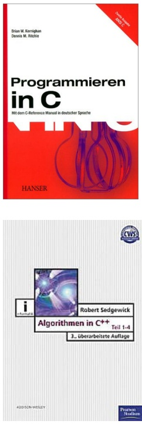

**10**

© T. Gemmeke, IDS, RWTH; R. Leupers, SSS

Das Buch von **Kernighan/Ritchie** beinhaltet den Gebrauch der Programmiersprache C und stellt ein Standardwerk dar. Es bietet keine ausreichende Einführung in Algorithmen, ist aber als Nachschlagewerk sehr gut zu gebrauchen.

Das Buch von **Sedgewick** verwendet meist C++ (die objektorientierte Erweiterung von C) und behandelt Algorithmen und Datenstrukturen in umfangreicher Form, auch weit über den GGI1-Vorlesungsstoff hinaus.

Darüber hinaus existieren zahlreiche weitere **Lehrbücher und Skripten** zur Programmierung. Diese sind per Internetrecherche leicht zu finden. Für spezielle Hinweise sei wiederum auf den Moodle-Lernraum verwiesen.

10

---

## Über das IDS (www.ids.rwth‐aachen.de)

Lehrstuhl für Integrierte Digitale Systeme und Schaltungsentwurf (IDS)
• Schwerpunkte:
– Entwurfsmethodik integrierte digitale Schaltungen
– Beschleuniger für verschiedene Anwendungen:
• Simulation biologischer neuronaler Netzwerke
• Inferenz in künstlichen neuronalen Netzen
• Kryptographie
…

– Testmethoden

• Standort: UMIC Gebäude

– Mies‐van‐der‐Rohe Str. 15, RWTH Hörn Campus


<details>
<summary>natural_image</summary>

Exterior view of a modern multi-story office building with glass windows and surrounding green lawn (no signage or text visible)
</details>

**11**

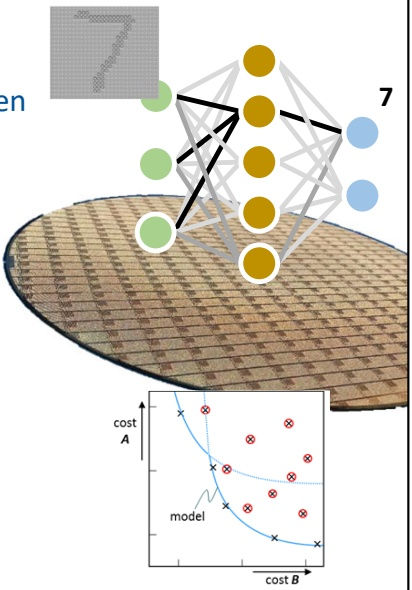

<details>
<summary>text_image</summary>

en
7
cost A
model
cost B
</details>

© T. Gemmeke, IDS, RWTH; R. Leupers, SSS

Falls Sie sich bereits für „fortgeschrittene“ Software- oder Hardware-Themen interessieren, sind Sie herzlich eingeladen, das **IDS** einmal zu besuchen. Wir geben Ihnen gerne einen Einblick in die aktuellen Forschungsaktivitäten und Hinweise auf spätere. Vielleicht möchten Sie auch später einmal, z.B. als „HiWi“in Forschung oder Lehre, für uns tätig werden.

11

---

## Forschungsgebiete am Lehrstuhl IDS

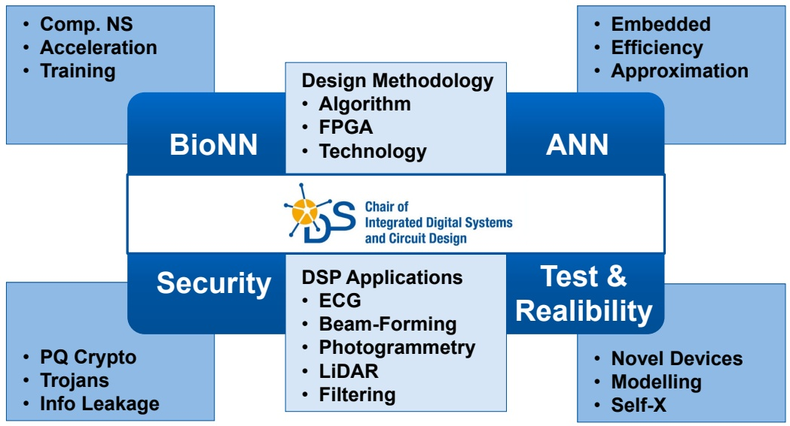

<details>
<summary>flowchart</summary>

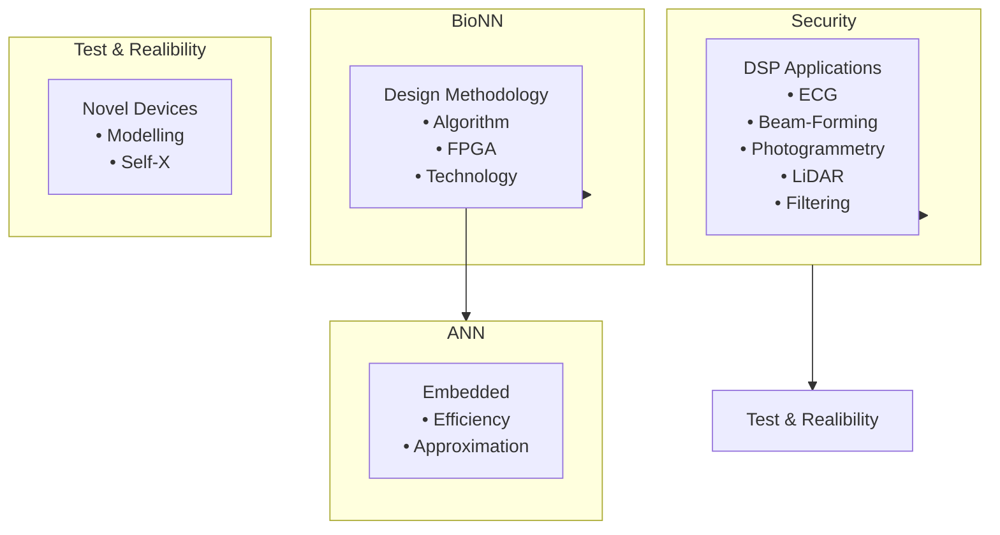
</details>

**12**

© T. Gemmeke, IDS, RWTH; R. Leupers, SSS

12

---

## Entwurfsablauf

Chip‐Entwurf

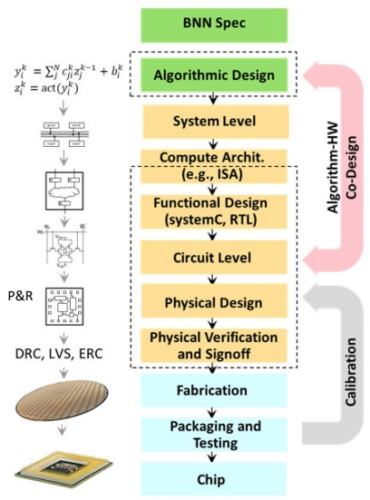

<details>
<summary>flowchart</summary>

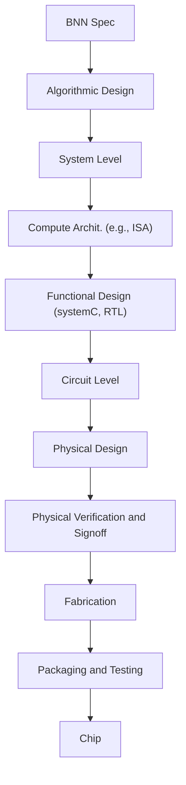
</details>

vom Layout zum Bring‐Up

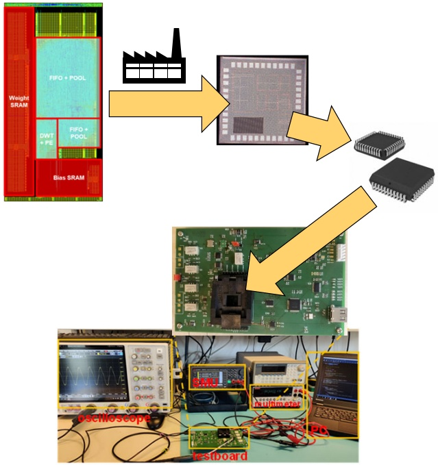

<details>
<summary>flowchart</summary>

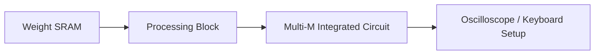
</details>

13

© T. Gemmeke, IDS, RWTH; R. Leupers, SSS

13

---

## Kooperationsprojekte (Auswahl)

Advanced

Computing


<details>
<summary>natural_image</summary>

Illustration of a blue globe with three abstract digital icons representing neural networks and data, set against a dark background (no text or symbols)
</details>

Architectures (ACA)


<details>
<summary>text_image</summary>

ACA
</details>


<details>
<summary>natural_image</summary>

3D illustration of a human brain with colorful polyhedra and a grid-patterned head model (no text or symbols)
</details>

Neuro Sys

I&II

towards multi‐scale natural‐density

Neuromorphic Computing


<details>
<summary>natural_image</summary>

3D architectural rendering of a modern building with colorful structural elements, labeled 'active 3D' in the corner (no other text or symbols)
</details>

**14**

© T. Gemmeke, IDS, RWTH; R. Leupers, SSS

14

---

## IDS‐Lehrveranstaltungen

## Bachelor:

\*  Mehrere Lehrstühle tragen zur Durchführung der Veranstaltung bei

– Grundgebiete der Informatik 1 (GGI1)   1. Sem
– \*Projekt PETIT ("MATLAB meets LEGO Mindstorms„)   1. Sem
\*Praktikum Informatik   2 Teile
– VLSI Schaltungen & Architekturen (VLSI‐CA)   4. Sem Pflicht CE bzw. 6. Sem Wahl ET&IT
– \*Grundlagen Integrierter Schaltungen und Systeme (GISS)   5. Sem Wahl ME
Institutsprojekt „Anwendung von künstlichen neuronalen Netzen zur Linienverfolgung mit Braitenberg‐Vehikeln“   4. Sem
\*Praktikum Mikroelektronik   5. Sem Pflicht in ME
– Bachelor‐Arbeiten zu aktuellen Forschungsthemen

## Master

– VLSI Design for Digital Signal Processing – Fundamentals (VLSI‐DF)
– VLSI Design for Digital Signal Processing – Architecturs (VLSI‐DA)
– Computer Arithmetic – Fundamentals (CAR‐F)
– Computer Arithmetic – Advanced Topics (CAR‐A)
– Laboratory: VLSI Design
– Laboratory: FPGA Design
– Master‐Arbeiten zu aktuellen Forschungsthemen

**15**

© T. Gemmeke, IDS, RWTH; R. Leupers, SSS

Genauere Informationen zu diesen Veranstaltungen finden Sie im Menüpunkt „Studium“ auf der IDS Homepage: **www.ids.rwth-aachen.de**

15

---

## 1. Einleitung

## 1.1 Thematische Einordnung

1.2 Hardware und Software
1.3 Programmiersprachen
1.4 Algorithmen und Programme

**16**

© T. Gemmeke, IDS, RWTH; R. Leupers, SSS

16

---

## Was ist Informatik?

**Informatik** (Computer Science) ist die **Wissenschaft**, die sich mit der Entwicklung und Nutzung von Computersystemen beschäftigt
Wurzeln in der **Mathematik** und **Elektrotechnik**
**Informatikkenntnisse** (speziell: Programmierkenntnisse) gehören heute zum Handwerkszeug jedes Ingenieurs
Einteilung in drei große **Teilgebiete**:

1. <u>Theoretische Informatik</u>: Computermodelle, Sprachen, Boolesche Funktionen, Komplexitätsanalyse, ...
2. <u>Praktische Informatik</u>: Programmiersprachen, Compiler, Betriebssysteme, SW Engineering, Datenbanken, ...
3. <u>Technische Informatik</u>: Aufbau von Computer‐Hardware, Chip‐Entwurf, Netzwerke, Mobilfunk, ...

**17**

© T. Gemmeke, IDS, RWTH; R. Leupers, SSS

Viele Ingenieure sind heute in der **Software-Entwicklung** tätig. Daher ist ein Grundverständnis der Informatik (insbes. der praktischen Informatik) sowie Implementierungskenntnisse in gängigen Sprachen wie C/C++ unerlässlich.

Die **theoretische Informatik** ist eine mathematische Disziplin. Sie befasst sich z.B. mit der prinzipiellen Berechenbarkeit von Funktionen und versucht, beweisbar optimale Algorithmen für bestimmte Probleme zu finden.

In der **praktischen Informatik** geht es im weitesten Sinne um Software-Programmierung. Eine typische Disziplin sind Betriebssysteme (wie Windows oder Linux), die die Schnittstelle zwischen der Hardware und der Anwendungs-Software bilden und z.B. die Verwaltung und Zuteilung des Prozessors (CPU) für verschiedene Anwendungsprogramme übernehmen.

Die **technische Informatik** ist eng an der Hardware orientiert. Eine typische Fragestellung ist z.B. wie man für eine gewünschte Funktion die schnellst- oder kleinstmögliche Implementierung durch Logikgatter erzielt.

17

---

## Einordnung GGI1

**GGI1** ist in erster Linie in der **praktischen Informatik** angesiedelt
**GGI2**: Technische Informatik: Prinzipien des Digitalrechners
• **Automaten, Sprachen, Komplexität** (CE): Theoretische Informatik
**GGI3**: Praktische und Technische Informatik: Optimierung, Modellierung und Parallelität
• **SUSP:** Praktische Informatik: System‐SW und systemnahe Program.
• **GGI4:** Prakt. Inf.: Betriebssysteme
Daneben: **Projekte** und **Praktika**
Grundlagen für weitere **Spezialisierung** ab 5. Semester

**18**

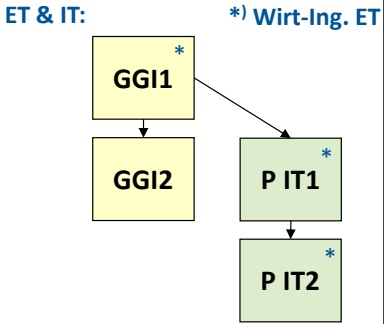

<details>
<summary>flowchart</summary>

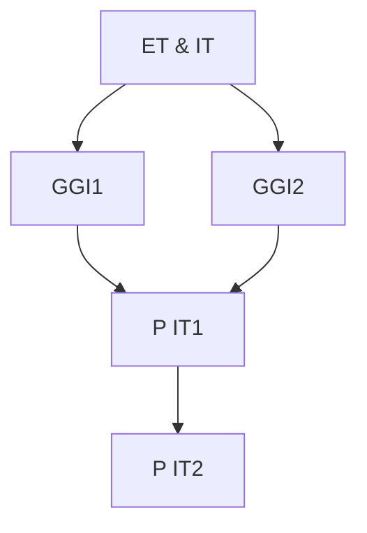
</details>

CE:

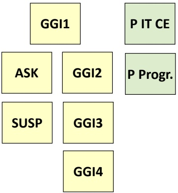

<details>
<summary>flowchart</summary>

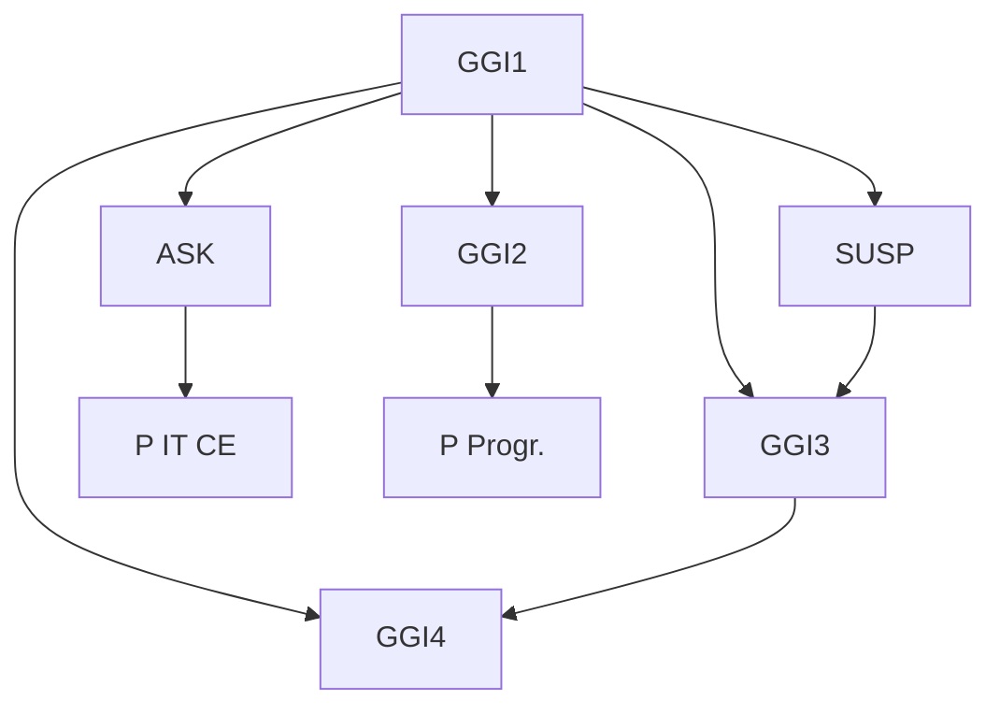
</details>

© T. Gemmeke, IDS, RWTH; R. Leupers, SSS

Die Skizze zeigt den **Ablauf der Informatik-Veranstaltungen bis zum 4.**

**Semester** für ET/TI-Bachelor-Studenten. Nach GGI1 liegt der

Vorlesungsschwerpunkt eher auf der technischen Informatik. Jedoch kommen durch Praktika/Projekte auch die praktischen Anteile nicht zu kurz. Die Vorlesung ASK bietet eine kurze Einführung in die theoretische Informatik.

18

---

## 1. Einleitung

1.1 Thematische Einordnung
**1.2 Hardware und Software**
1.3 Programmiersprachen
1.4 Algorithmen und Programme

**19**

© T. Gemmeke, IDS, RWTH; R. Leupers, SSS

19

---

## Hardware und Software

HW = Physikalisch existierender, programmierbarer Rechner (Computer)

→ Modifikation aufwendig

SW = Auf HW ausführbares Programm (Textdatei) für gegebene Anwendung

→ Modifikation einfach

In GGI1 wird die HW als **Black Box** betrachtet, die Programmcode ausführen kann
Innerer HW‐Aufbau: siehe Vorlesung **GGI2**

User


<details>
<summary>natural_image</summary>

Woman smiling while using a laptop (no visible text or symbols)
</details>

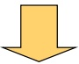

SW

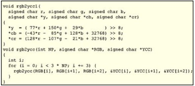

<details>
<summary>text_image</summary>

void rgb2ycc1 {
    signed char r, signed char g, signed char b,
    signed char *y, signed char *cb, signed char *cr}
    {
        *y = { 77*r + 150*g + 29*b } >> 8;
        *cb = { -43*r - 85*g + 128*b + 32768 } >> 8;
        *cr = {128*r - 107*g - 21*b + 32768 } >> 8;
    }
    void rgb2ycc(int NP, signed char *RGB, signed char *YCC)
    {
        int i;
        for (i = 0; i < 3 * NP; i += 3) {
            rgb2ycc(RGB[1], RGB[1+1], RGB[1+2], &YCC[1], &YCC[1+1], &YCC[1+2]);
        }
    }
}
</details>

HW

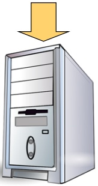

<details>
<summary>natural_image</summary>

Illustration of a desktop computer tower with a yellow arrow pointing downward (no text or symbols present)
</details>

© T. Gemmeke, IDS, RWTH; R. Leupers, SSS

**20**

Die Software befindet sich im **Speicher** der Hardware. Sie ist aus einzelnen **Anweisungen** aufgebaut, welche von der Hardware ausgeführt werden können. Hierdurch wird die Hardware sehr **flexibel** benutzbar.

Zwischen Hardware und Software gibt es noch weitere Abstufungen. In einem Gerät fest eingebaute Software, die sich – wenn überhaupt – nur sehr selten ändert, wird als **Firmware** bezeichnet.

20

---

## Abbildung von SW auf HW

SW wird meist in höheren **Programmiersprachen** entwickelt
Programmiersprachen als **Schnittstelle** sind sowohl für Menschen als auch für Computer verständlich
**Compiler** übersetzt Hochsprachen‐Programm in **Assemblerprogramm**, bestehend aus einzelnen (noch lesbaren) Prozessorbefehlen
• Übersetzung von **Quellcode** in **Zielcode**
Auch die direkte Entwicklung von **Assemblerprogrammen** ist möglich
Assembler übersetzt Assemblerprogramm in binären **Maschinencode**, der direkt auf der HW ausgeführt werden kann

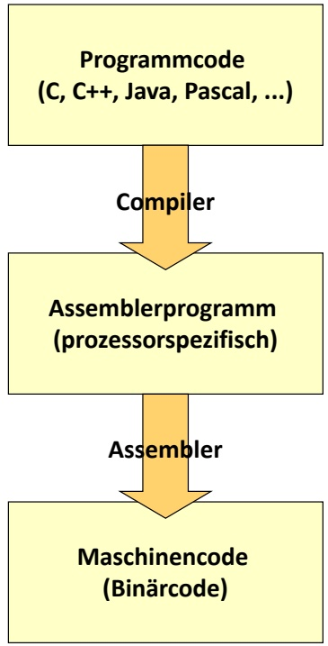

<details>
<summary>flowchart</summary>

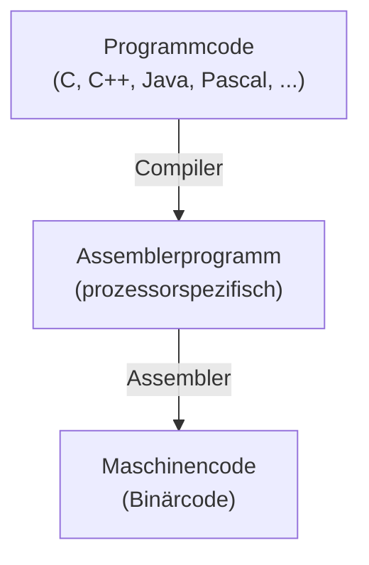
</details>

**21**

© T. Gemmeke, IDS, RWTH; R. Leupers, SSS

Programme in höheren Programmiersprachen sind weitgehend **HW-unabhängig** und können somit prinzipiell auf unterschiedlichen Computern laufen. Der **Compiler** ist ein spezielles Programm, welches ein solches Programm in HW-spezifische Befehle umsetzt, so dass diese auf einem realen Computer ausgeführt werden können.

Betrachtet man z.B. die **C-Anweisung**

$$
\mathrm{a} = \mathrm{b} + \mathrm{c} + \mathrm{d};
$$

zur Addition dreier Zahlen, so gibt es praktisch keinen Computer, der diese Anweisung direkt ausführen könnte. Der Compiler zerlegt sie daher in eine Folge von einfacheren **Assembler-Anweisungen**, z.B.:

ADD b,c,x

ADD x,d,a

Hierbei werden zunächst b und c addiert, und die Summe wird einer Hilfsvariaben x zugewiesen. Anschließend werden x und d addiert, und das Ergebnis wird in a gespeichert. Auch dieser Code kann noch nicht direkt ausgeführt werden. Da ein Computer letztlich nur Nullen und Einsen „versteht“, muss der **Assembler** ihn in noch in einen Binärcode umwandeln, dieser könnte z.B. so aussehen:

0010100101001001

1101001010010101

Dieser **Maschinencode** kann nun direkt auf der HW ausgeführt werden.

21

---

## 1. Einleitung

1.1 Thematische Einordnung
1.2 Hardware und Software
**1.3 Programmiersprachen**
1.4 Algorithmen und Programme

**22**

© T. Gemmeke, IDS, RWTH; R. Leupers, SSS

22

---

## Programmiersprachen

Computer wurden zu Anfang direkt in **Maschinencode** programmiert
• Später Übergang zu **symbolischem** Maschinencode (Assembler)
Dann Einführung von (höheren) **Programmiersprachen**
• **Vorteile**:

– lesbar und wartbar (bei gutem Programmierstil)
– portierbar (nicht unbedingt zu 100%)

• „Evolution“ der Sprachen setzt sich ständig fort
– Zukünftig: für parallele **Multiprozessorsysteme**
Eine neue Sprache alleine ist praktisch wertlos, man benötigt

– **Programmierwerkzeuge**, z.B. Compiler
– **Akzeptanz** bei den Benutzern (u.a. wegen legacy code)

**23**

© T. Gemmeke, IDS, RWTH; R. Leupers, SSS

In der Computer-“Urzeit“ wurden zur Programmierung noch keine Compiler oder Assembler verwendet. Bei steigender SW-Komplexität ist die Programmierung in Maschinencode aber extrem aufwendig und fehleranfällig. Auch

Assemblersprachen helfen hier nur begrenzt weiter. Daher fanden **höhere**

**Programmiersprachen** schnell Verbreitung.

Es existiert heute eine große Vielzahl von Programmiersprachen mit jeweils verschiedenen Vor- und Nachteilen und Einsatzgebieten. Hiervon hat jedoch nur eine relativ kleine Anzahl tatsächlich praktische Verbreitung gefunden. Dies liegt zum einen daran, dass eine neue Sprache auch stets von umfangreichen **SW-**

**Entwicklungstools** (Compiler, Assembler u.v.m.) unterstützt werden muss, welche zunächst einmal entwickelt werden müssen. Zum anderen verfügt die Industrie stets über einen großen Fundus an „alter“ SW (legacy code), welche nicht ohne riesigen Aufwand auf eine neue Sprache portiert werden könnte.

Daher gibt es nur selten einen Wechsel von Programmiersprachen auf breiter Front.

In neuerer Zeit fand ein solcher Wechsel z.B. von **C zu C++** statt. C++ erlaubt die **objektorientierte Programmierung** und erleichtert damit die Entwicklung und Wartung sehr großer SW-Pakete. Gleichzeitig war C++ als echte Erweiterung von C konzipiert, so dass die legacy-code-Problematik entfiel.

23

---

## Wahl der Programmiersprache

## Einteilung:

– **Imperative Sprachen**: konkrete Beschreibung eines Algorithmus als Folge von Anweisungen (Beispiel: C, Pascal)
– **Deklarative Sprachen**: Beschreibung des erwünschten Programmverhaltens, konkrete Umsetzung erfolgt teilweise durch den Compiler und Laufzeitsystem (Beispiel: LISP, Prolog)
**Objektorientierte Sprachen**: Zusammenfassung von Algorithmen und Daten zu Objekten, dadurch einfachere Programmwartung (Beispiel: C++, Java)
– Einteilung nicht disjunkt, z.B. C  C++

• Für GGI1: **C und C++** aufgrund großer praktischer Relevanz
Nicht alle **Sprachdetails** werden vorgestellt
• Programmieren lernt man nur durch **Übung**!

**24**

© T. Gemmeke, IDS, RWTH; R. Leupers, SSS

Bei **imperativen Sprachen** gibt der Programmierer dem Computer in einzelnen Schritten/Anweisungen genau vor, was zu tun ist. Hierdurch hat der Programmierer volle Kontrolle aber auch mehr Arbeit.

Anders bei **deklarativen Sprachen**: Hier wird nur spezifiziert, was zu tun ist, und die genaue Realisierung (bzw. zeitliche Abfolge der Anweisungen) bleibt teilweise dem Computer selbst überlassen. Dies spart Programmieraufwand, macht es jedoch schwieriger, ein Programm zu analysieren, z.B. die genaue Laufzeit vorherzusagen.

In **objektorientierten Sprachen** wie C++ werden Daten und dazugehörige Algorithmen syntaktisch zu „Klassen“ zusammengefasst, wodurch Programme leichter lesbar werden. Darüber hinaus wird durch ein **hierarchisches Klassenkonzept** Redundanz vermieden: Algorithmen für Klassen mit ähnlichen Eigenschaften müssen nur einmal programmiert werden.

**C++** ist deutlich komplexer als C. Die Vorlesung GGI1 baut zunächst ein solides Fundament in der „klassischen“ Programmiersprache C, welche auch heute immer noch sehr verbreitet ist. Aufbauend auf diesen Kenntnissen werden Erweiterungen hin zur objektorientierten Programmierung in C++ eingeführt.

24

---

## Software Life Cycle

• GGI1 stellt elementare Grundlagen der SW‐Entwicklung bereit
• Typischer SW Life Cycle:

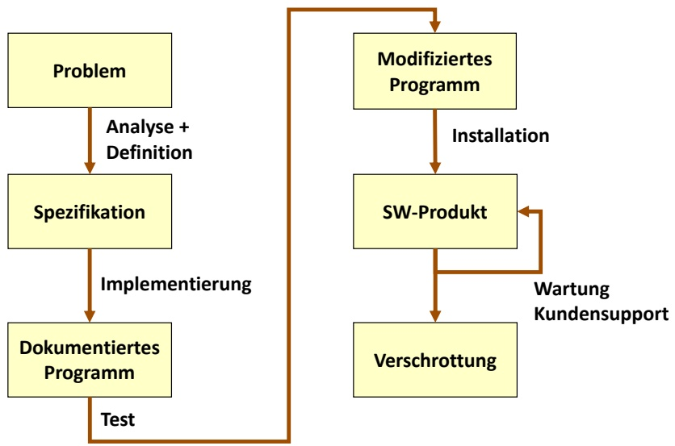

<details>
<summary>flowchart</summary>

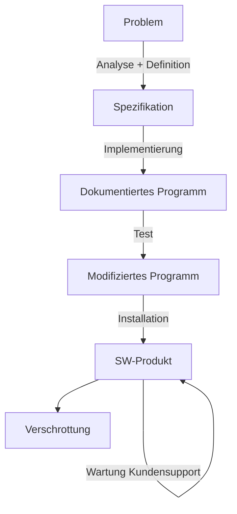
</details>

**25**

© T. Gemmeke, IDS, RWTH; R. Leupers, SSS

Die SW-Entwicklung besteht nicht nur aus der Implementierung in einer Programmiersprache. Zunächst muss das zu lösende Problem **analysiert** werden, und es muss – in Zusammenarbeit mit dem Kunden – genau **spezifiziert** werden, was eigentlich implementiert werden soll. Um Wartbarkeit auch noch nach Jahren und evtl. durch anderes Personal zu ermöglichen, muss das Programm **dokumentiert** werden.

Frisch entwickelte SW hat typischerweise noch eine Reihe von Fehlern („Bugs“), von denen möglichst viele in einer **Testphase** vor Auslieferung beseitigt werden sollten. Das getestete Programm muss nun beim Kunden „vor Ort“ in der dort vorliegenden HW- und SW-Umgebung in Betrieb genommen („**installiert**“) werden, was trotz der vermeintlichen HW-Unabhängigkeit höherer Programmiersprachen nicht immer einfach ist.

Im Laufe des Betriebs werden meist noch weitere Bugs entdeckt, und/oder der Kunde kann Änderungs- und Erweiterungswünsche haben, welche während der **Wartungs- und Supportphase** realisiert werden. Nach (mehr oder weniger) vielen Jahren wird die SW aufgrund von grundlegenden Neuerungen oder mangelnder Nachfrage dann nicht mehr weiter unterstützt und somit schrittweise „verschrottet“. Im PC-Bereich wird dies z.B. im nächsten Jahr für das verbreitete Microsoft-Betriebssystem Windows 10 der Fall sein, da mit Windows 11, … Nachfolger auf den Markt gekommen sind.

25

---

## 1. Einleitung

1.1 Thematische Einordnung
1.2 Hardware und Software
1.3 Programmiersprachen
**1.4 Algorithmen und Programme**

26

© T. Gemmeke, IDS, RWTH; R. Leupers, SSS

26

---

## Grundbegriffe aus GGI1

## • Algorithmus:

– Abstrakte Handlungsanweisung, um ein Problem zu lösen
– Ausgabe als Funktion der Eingabe
– In endlicher Zeit, eindeutig und deterministisch
– Kann in natürlicher Sprache formuliert sein

## • Programm:

– Codierung eines Algorithmus in Programmiersprache

## Datenstruktur:

– Mathematisches Objekt zur Speicherung von Daten
– Auf bestimmte Weise angeordnet und zusammengefasst
– Sinnvoll nur im Zusammenhang mit Operationen auf den Daten
– Beispiele: Arrays, Listen, Stacks, Bäume, Graphen, ...

**27**

© T. Gemmeke, IDS, RWTH; R. Leupers, SSS

Ein Programm ist eine Implementierung eines Algorithmus für eine konkrete HW/SW-Plattform. Programme führen Berechnungen auf Daten aus. Daten können z.B. Zahlen, Buchstaben oder auch komplexere, zusammengesetzte Objekte (**Datenstrukturen**) sein. Viele elementare Datenstrukturen werden in der Vorlesung vorgestellt.

Zu Datenstrukturen gehören auch stets **Algorithmen**, die Operationen auf Daten ausführen. Ein Beispiel ist das Suchen von Datensätzen in einer Datenbank. Algorithmen und Datenstrukturen bilden oft eine sehr enge Einheit, da der genaue Aufbau einer Datenstruktur großen Einfluss auf die **Effizienz** eines Algorithmus für ein bestimmtes Problem haben kann.

27

---

## Vom Problem zum Programm

Für jedes (per Computer lösbare) Problem gibt es **unendlich viele** Algorithmen
Für jeden Algorithmus existieren **unendlich viele** Implementierungen in einer Programmiersprache
• **Anforderung:** Finde den besten Algorithmus und die beste Implementierung hierfür; Kriterien:
– Korrektheit
– Effizienz (Laufzeit und/oder Speicherverbrauch)
– Eleganz, Programmierstil
Korrektheit eines Algorithmus lässt sich (mathematisch) beweisen, Korrektheit eines Programms oft nicht
Zur Bewertung der Effizienz von Algorithmen dient die **Komplexitätsanalyse**
• Guter **Programmierstil** muss praktisch erlernt werden

**28**

© T. Gemmeke, IDS, RWTH; R. Leupers, SSS

Aufgrund des riesigen **Lösungsraumes** ist die Implementierung eines „guten“Programms für ein gegebenes Problem oft eine schwierige Aufgabe. Jedoch kann man – zumindest für Teilprobleme – häufig auf bewährte Standardtechniken (Algorithmen und Datenstrukturen) zurückgreifen, von denen viele in dieser Vorlesung vorgestellt werden.

Der **Korrektheitsnachweis** für ein Programm ist deshalb schwierig, weil Implementierungsdetails in einer bestimmten Sprache oft für eine formale Analyse unzugänglich sind. Schwierigkeiten zeigen sich z.B. oft bei der Verwendung von Zeigern. Für compilierte Programme auf Assemblerebene müsste zudem die Korrektheit des Compilers nachgewiesen werden, was für realistische Sprachen praktisch unmöglich ist.

Ein wichtiges Mittel zur **Komplexitätsanalyse** ist die O-Notation, welche in Kap. 6 vorgestellt wird.

28

---

## Grenzen der Programmierung

• Wann ist ein Problem per Computer lösbar?

– Problemlösung muss **mathematisch exakt** als Algorithmus beschreibbar sein
– Bsp.: Sortiere eine Menge von Namen in lexikographischer Reihenfolge

• Jedoch: Viele wichtige Probleme sind **prinzipiell lösbar**, aber in der Praxis zu komplex

– Bsp.: Primfaktorzerlegung sehr großer Zahlen
– Bsp.: Optimale Routenplanung für Spediteure (**Traveling Salesman Problem**)
– Auch schnellere Rechner helfen **nicht** weiter

• Andere Probleme sind **prinzipiell unlösbar**

– Bsp.: Bestimme, ob ein Programm nach endlicher Zeit auf gegebener Eingabe anhält (**Halteproblem**)

**29**

© T. Gemmeke, IDS, RWTH; R. Leupers, SSS

Zu den prinzipiell **unlösbaren** („unentscheidbaren“) Problemen gehört z.B. die Aufgabe, zu einem gegebenen Programm zu entscheiden, ob es für eine bestimmte Eingabe terminieren wird, oder in eine Endlosschleife gerät („**Halteproblem**“). Dies liegt intuitiv daran, dass jeder Algorithmus zur Prüfung ebenfalls in eine Endlosschleife geraten kann, so dass keine Entscheidung zu erwarten ist.

Eine andere wichtige Klasse von „schwierigen“ Problemen sind die **NP-harten** und **NP-vollständigen** Probleme. Darunter fallen viele wichtige

Optimierungsprobleme in zahlreichen Anwendungsbereichen. Diese sind zwar entscheidbar, aber zur optimalen Lösung ist ein exponentieller Aufwand (O(2<sup>n</sup>), siehe Kap. 6) notwendig. Jedenfalls höchstwahrscheinlich, denn ein formaler Beweis hierfür steht noch aus, und die „P = NP“-Frage gehört zu den größten offenen Problemen der theoretischen Informatik.

29

---

## Inhalt der Vorlesung

1. Einleitung
2. Einführendes Beispiel
3. Elementare Datentypen und Anweisungen
4. Funktionen und Programmaufbau
5. Datentypen
6. Analyse von Algorithmen
7. Sortieralgorithmen
8. Lineare Datentypen
9. Bäume
10. Graphen
11. Techniken zum Algorithmenentwurf

**30**

© T. Gemmeke, IDS, RWTH; R. Leupers, SSS

30

---

## 2. Einführendes Beispiel

**2.1 Temperaturumrechnung**
2.2 Analyse des Beispiels
2.3 Ausführung und Fehlersuche

**31**

© T. Gemmeke, IDS, RWTH; R. Leupers, SSS

31

---

## Einführendes C‐Programmbeispiel

Umwandlung von Grad Fahrenheit in Grad Celsius
• ௬℃ ൌ ሺ5/9ሻ ൈ௫℉ – 32

```c
#include <stdio.h>

/* Umwandlung von Fahrenheit in Celsius
    fuer fahr = 0, 20, ..., 300   */
int main()
{
    int fahr, celsius;
    int lower, upper, step;

    lower = 0; // untere Grenze der Temperaturtabelle
    upper = 300; // obere Grenze
    step  = 20; // Schrittweite

    fahr  = lower;
    while (fahr <= upper)  {
        celsius = 5 * (fahr-32) / 9;
        printf("%d\t%d\n", fahr, celsius);
        fahr = fahr + step;
    }

    return 0;
}
```


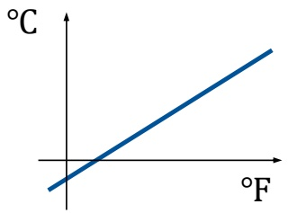

<details>
<summary>line</summary>

| \({}^{\circ}F\) | \({}^{\circ}C\) |
| --- | --- |
| 0 | ~-1.5 |
| ~1.5 | 0 |
| ~3.5 | ~1.5 |
| ~5.5 | ~2.5 |
</details>

**32**

© T. Gemmeke, IDS, RWTH; R. Leupers, SSS

Zwischen Grad Celsius und Grad Fahrenheit besteht ein einfacher **linearer Zusammenhang**, der hier als allererstes C-Programmbeispiel dienen soll.

Das gezeigte **C-Programm** berechnet anhand der Umrechnungsformel die Celsius-Werte für eine Reihe von Fahrenheit-Werten im Intervall [0,300] mit Schrittweite von 20.

Nach **Übersetzung** durch den C-Compiler und **Starten** des Programms werden diese Werte fortlaufend auf dem Bildschirm ausgegeben (printf-Befehl). Anschließend beendet das Programm seine Arbeit.

Durch Modifikation der Intervallgrenzen (lower, upper) und der Schrittweite (step) könnte das Programm auch leicht so **modifiziert** werden, dass es andere Wertetabellen ausgäbe.

Die einzelnen **Komponenten** des Programms werden im folgenden im Detail betrachtet.

32

---

## Libraries

• Von vielen Programmen häufig wiederverwendeter Code wird in Bibliotheken (Libraries) abgelegt
• Library‐Code wird nur einmal compiliert und kann dann von allen Programmen eingebunden werden
• Dies erfolgt nach der Assemblierung durch den Linker
• C besitzt insges. 29 Standard‐Libraries, z.B.:
– stdio: Ein‐ und Ausgabe
– math: Mathematische Funktionen
– string: String‐Manipulation
Durch Einbinden einer Header‐Datei (z.B. „stdio.h“) werden die Library‐Funktionen dem benutzenden Programm bekannt gemacht
Programmierer können (und sollten) auch eigene, benutzerspezifische Libraries anlegen

**33**

© T. Gemmeke, IDS, RWTH; R. Leupers, SSS

Beim Einstieg in die C-Programmierung ist es sinnvoll, sich ein wenig mit den **Standard-Libraries** vertraut zu machen. Zum einen werden viele Funktionen von den meisten Programmen benötigt (z.B. für Ein- und Ausgabe von Daten), zum anderen findet man evtl. nützliche Funktionen, die man dann nicht selbst programmieren muss.

**Libraries** sind eine spezielle Form des Maschinencodes. Sie stellen selbst keine ausführbaren Programme dar. Vielmehr sucht der Compiler (eigentlich: der Linker) anhand von Funktionsnamen (s. auch Kap. 5), ob sich für eine bestimmte Funktion Code in der Library befindet. Falls ja, so wird dieser Code verwendet, ansonsten wird eine Fehlermeldung ausgegeben.

33

---

## Standardbibliothek C++ ‐ Beispiele

C++

• **Zeichenketten und Streams**
– string, iomanip, iostream, cstdio
• **Abtrakte Datentypen / Container**
– vector, array, (forward\_)list, queue, stack
– (unordered\_)set, (unordered\_) map
– iteratoren
• **Smart Pointer**
– unique\_prt
– shared\_prt
– weak\_ptr
• **Algorithmen**
– for\_each, sort, copy, find & search, transform
• **Funktoren**
– multiplies, negate, …

**34**

© T. Gemmeke, IDS, RWTH; R. Leupers, SSS

34

---

## 2. Einführendes Beispiel

2.1 Temperaturumrechnung
**2.2 Analyse des Beispiels**
2.3 Ausführung und Fehlersuche

**35**

© T. Gemmeke, IDS, RWTH; R. Leupers, SSS

35

---

## Analyse des C‐Programms

• **Einbinden** der Standard‐Library zur Ein/Ausgabe
– #include &lt;stdio.h&gt;
– Ermöglicht Kommunikation des Programms mit der Außenwelt (z.B. Benutzer)
– Siehe C‐Präprozessor
• **Kommentare**
– /\* Umwandlung … \*/
– // untere Grenze …
– Erläuterung der Programmfunktion für Entwickler
– Text innerhalb /\* … \*/ und in einer Zeile nach // wird vom Compiler ignoriert
• **Hauptfunktion** main
– int main() { … }
– Alle Anweisungen innerhalb { … } gehören zu main
– main wird nach Programmstart immer direkt aufgerufen
– Im Allg. ruft main dann weitere Funktionen auf

**36**

© T. Gemmeke, IDS, RWTH; R. Leupers, SSS

Die Standard-Libraries sind dem Compiler nicht automatisch bekannt. Vielmehr muss mit Hilfe eines **include-Statements** deklariert werden, dass man eine bestimmte Library verwenden möchte. Diese kann auch benutzerdefiniert sein.

**Kommentare** sind ein (leider oft vernachlässigtes) Mittel, Programme sauber zu dokumentieren, so dass auch nach längerer Zeit noch Wartungsarbeiten möglich sind. Zwar kann man einem Programm auch eine separate Dokumentation zur Seite stellen. Jedoch sind Kommentare oft praktischer, da sie sich direkt an der richtigen Stelle im Programm befinden, wodurch auch die Konsistenz zwischen Programmtext und Dokumentation gefördert wird. Für das eigentliche Programmverhalten sind Kommentare aber vollkommen bedeutungslos, da sie der Compiler einfach „überliest“.

Die **main-Funktion** ist der Einstiegspunkt eines jeden C-Programms. Sie kann sich an beliebiger Stelle im Programmtext befinden, definiert aber immer eindeutig, wo bei der Programmausführung begonnen wird. Im einfachsten Fall (wie im aktuellen Beispiel) besteht das gesamte Programm lediglich aus der main-Funktion.

36

---

## Analyse des C‐Programms

## • Variablen‐Vereinbarungen

– int fahr, celsius;
– Variablen sind benannte Speicherplätze für Werte
– Können lesend und schreibend zugegriffen werden
– Variablen müssen vor Verwendung vereinbart werden
– Hier: Verwendung von ganzzahligen (integer) Variablen

## • Zuweisungen

– lower = 0;
– upper = 300;
– Schreiben von Werten in die Variablen

## • Schleife

– while (fahr <= upper) { /\* ... \*/ }
– while ist (wie auch int) ein **C‐Schlüsselwort**
– Code innerhalb { … } wird solange wiederholt, bis Bedingung nicht mehr erfüllt

**37**

© T. Gemmeke, IDS, RWTH; R. Leupers, SSS

Die Semantik von **Zuweisungen** ist recht einfach. Der Wert auf der rechten Seite von “=„ wird an die linke Seite (meist eine Variable) zugewiesen. Der Operator “=„ in C ist also nicht mit dem mathematischen Gleichheitsoperator zu verwechseln. Dieser heißt in C „==“, was auch eine verbreitete Fehlerquelle bei der Programmierung darstellt.

**Schleifen** sind ein extrem wichtiges Programmierelement. Im Beispiel müsste man ohne Schleife sämtliche Tabelleneinträge durch separate Anweisungen ausgeben – eine mühselige Angelegenheit. Mit Hilfe der Schleife muss man den hierfür notwendigen Code jedoch nur ein einziges Mal hinschreiben.

**C-Schlüsselwörter** bilden den Kern der Programmiersprache C. Sie haben für den Compiler eine vordefinierte Bedeutung und weisen ihn an, bestimmte Code-Strukturen zu generieren (z.B. eine Schleife im Falle von „while“ oder Platz für eine ganzzahlige Variable im Falle von „int“). Daher dürfen Variablennamen nicht mit den C-Schlüsselwörtern übereinstimmen, ansonsten wird eine Fehlermeldung erzeugt. Umgekehrt wird der Compiler versuchen, alle Zeichenfolgen, die kein Schlüsselwort sind, als Variablennamen o.ä. zu interpretieren.

37

---

## Analyse des C‐Programms

## • Umrechnung

```txt
- celsius = 5 * (fahr-32) / 9;
- Rechenoperationen auf Variablen
```

## • Ausgabe

```txt
- printf("%d\t%d\n", fahr, celsius);
- Formatierte Ausgabe:
  - fahr als Integer-Zahl (erstes %d als Platzhalter)
  - Tabulator \t
  - celsius als Integer-Zahl (zweites %d als Platzhalter)
  - Zeilenumbruch \n
```

## • Vorbereitung des nächsten Schleifendurchlaufs

```txt
- fahr = fahr + step;
- fahr wird um step erhöht, bis upper überschritten
```

**38**

© T. Gemmeke, IDS, RWTH; R. Leupers, SSS

Die **printf-Funktion** aus der Standard-Library sieht auf den ersten Blick etwas kryptisch aus, ist aber eine mächtige, generische Funktion zur Ausgabe verschiedenster Daten. Standardmäßig gibt „printf“ die Daten auf dem Bildschirm aus. Die verwandte Funktion „fprintf“ funktioniert sehr ähnlich, gibt jedoch die Daten in Dateien (Files) aus, z.B. auf der Festplatte.

Der printf-Funktion werden stets zwei Parameter übergeben: (1) die Art der Ausgabe der Daten (z.B. ganzzahlig, Fließkomma, Hexadezimal) und (2) die auszugebenden Daten selbst. Für eine genaue Auflistung der printf-Möglichkeiten sei auf die **C-Dokumentation** verwiesen.

38

---

## Ausgabe

C++

## • Formatierte Ausgabe

Classic C++

```cpp
#include <iostream>  // std::cout, std::right, std::endl
#include <iomanip>   // std::setw

int main() {
    int val = 65;

    std::cout << "Formatted output using C++" << std::endl;
    std::cout << "-start-" << std::endl;
    std::cout << std::right;  // right-adjusted (manipulator)
    std::cout << """ << std::setw(10) << val << """ << std::endl;
    std::cout << "-end-" << std::endl;

    return 0;
}
```

C++11 oder c

```c
#include <cstdio> // printf; for c library: <stdio.h>, no "using ..." using namespace std;

int main() {
    int val = 65;

    printf("Now using C++11:\n");
    printf("-start-\n'%10d'\n-end-\n", val);

    return 0;
}
```

**39**

© T. Gemmeke, IDS, RWTH

Printing to the console is fundamentally a stream of bytes sent to a specific destination. C++ embraces this concept.

However, detailed output formatting becomes unnecessarily complex. Hence, C++11 has introduced the cstdio library that includes the printf function known from c.

39

---

## Libraries

C++

• Using und namespace

```cpp
#include <string>
#include <iostream>

int main( void ) {

    std::string msg = "Hello world!";

    std::cout << msg << std::endl;

    return 0;
}
```

**40**

std::cout ⭢ cout

© T. Gemmeke, IDS, RWTH

Referring to a specific function of the used libraries can sometimes be cumbersome to type and read considering the additional prefix.

This can be simplified by adding those to the local namespace with using.

Be careful when applying using namespace, as it brings many functions and variables to the scope of the program. Thereby conflicts with your own symbols of functions and variables may occur.

(Please note: the comma separated list in using requires at least C++17.)

40

---

## C‐Präprozessor

• C‐Präprozessor (cpp) läuft **vor dem Compiler** über den Quellcode (C‐nach‐C‐Übersetzung)
• cpp‐Anweisungen beginnen mit Zeichen #
• cpp‐Verwendung erhöht **Lesbarkeit** der Programme
• Vor allem folgende Anwendungen:

– **Symbolische Definitionen** (Konvention: Großbuchstaben)

• #define UPPER 300
• Alle Vorkommen von UPPER werden durch 300 ersetzt

– **Makros**

• #define MAX(a,b) (a > b) ? a : b
• Alle Vorkommen von MAX(..., ...) werden ersetzt

– **Einbinden** von Standard‐Libraries (und allgemein Header‐Dateien mit Deklarationen)

• #include &lt;stdio.h&gt;
• Datei stdio.h wird an dieser Stelle ins Programm eingefügt

**41**

© T. Gemmeke, IDS, RWTH; R. Leupers, SSS

In der Praxis muss der **Präprozessor** nicht separat vor dem Compiler aufgerufen werden. Vielmehr tut dies der Compileraufruf selbständig, und der Compiler arbeitet dann auf dem „vorverarbeiteten“ Code.

Von **symbolischen Definitionen** per #define sollte reger Gebrauch gemacht werden, um die Lesbarkeit der Programme zu erhöhen und Änderungen zu vereinfachen. Die #define-Anweisungen befinden sich typischerweise am Anfang des Programmtextes. Daher können z.B. neue Werte für Programmparameter einfach und lokal begrenzt eingestellt werden.

Die **#include-Anweisungen** können theoretisch zum Einbinden von beliebigem Programmtext benutzt werden. Dies würde allerdings nicht unbedingt zur Lesbarkeit beitragen. Daher werden sie in der Praxis nur zum Einbinden sog. Header Files verwendet, welche dem Programm die in einer Library verfügbaren Elemente bekannt machen.

41

---

## 2. Einführendes Beispiel

2.1 Temperaturumrechnung
2.2 Analyse des Beispiels
**2.3 Ausführung und Fehlersuche**

**42**

© T. Gemmeke, IDS, RWTH; R. Leupers, SSS

42

---

## Übersetzung und Ausgabe

Programm in **Textdatei** „temp.c“gespeichert
• Aufruf des **C‐Compilers** (z.B. aus Linux shell)
– cc temp.c (je nach Compiler)
– **Präprozessor** und **Assembler** werden implizit aufgerufen
– **Zielprogramm** $\scriptstyle { \boldsymbol { \upsilon } } ^ { \mathsf { a } }$ .out“ wird erzeugt
– **Ausführung** von ${ \boldsymbol { \nu } } ^ { \mathsf { a } } .$ .out“generiert die gezeigte Ausgabe

Ausgabe

| 0 | -17 |
| --- | --- |
| 20 | -6 |
| 40 | 4 |
| 60 | 15 |
| 80 | 26 |
| 100 | 37 |
| 120 | 48 |
| 140 | 60 |
| 160 | 71 |
| 180 | 82 |
| 200 | 93 |
| 220 | 104 |
| 240 | 115 |
| 260 | 126 |
| 280 | 137 |
| 300 | 148 |

**43**

© T. Gemmeke, IDS, RWTH; R. Leupers, SSS

Sofern noch keine Erfahrung mit **Dateien** und **Compilerbenutzung** vorhanden ist, sollten diese Dinge unbedingt praktisch geübt werden!

Kurzanleitungen verschiedener gängiger C/C++-Entwicklungsumgebungen finden Sie im Lernraum mit einigen Informationen zu den ersten Schritten zur Erstellung, Übersetzung und Ausführung eines C-Programms.

43

---

## Fehlerhafte Programme

• **Möglichkeit 1**: Programm entspricht nicht dem C‐Standard
Derartige Fehler werden vom Compiler (oder auch Linker) bemerkt und dem Programmierer mitgeteilt

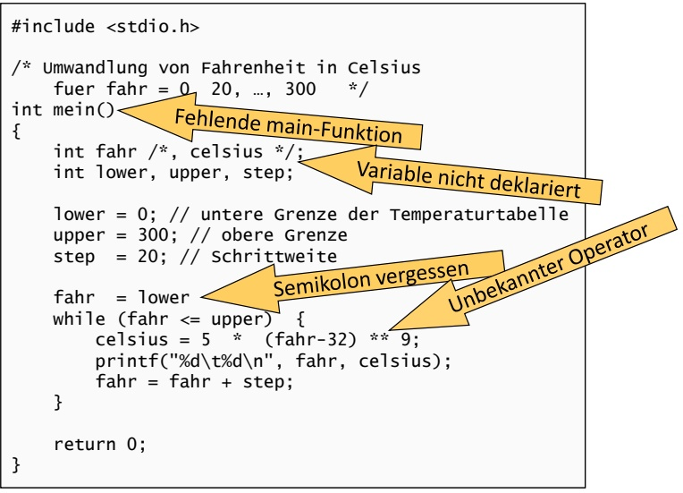

<details>
<summary>flowchart</summary>

```mermaid
graph TD
  #include <stdio.h>
  /* Umwandlung von Fahrenheit in Celsius
    fuer fahr = 0, 20, ..., 300 */
  int mein()
  {
    int fahrigt *, celsius */;
    int lower, upper, step;

    lower = 0; // untere Grenze der Temperaturtabelle
    upper = 300; // obere Grenze
    step = 20; // Schrittweite

    fahr = lower
    while (fahr <= upper) {
        celsius = 5 * (fahr-32) ** 9;
        printf("%d\t%d\n", fahr, celsius);
        fahr = fahr + step;
    }

    return 0;
  }
  FehlendeMainFunktion["Fehlende main-Funktion"] --> VariableNichtDeklariert["Variable nicht deklariert"]
  UnbekannterOperator["Unbekannter Operator"] --> SemikolonVergessen["Semikolon vergessen"]
```
</details>

**44**

© T. Gemmeke, IDS, RWTH; R. Leupers, SSS

Vor allem am Anfang ist es sehr wahrscheinlich, dass man beim Programmieren **Fehler** macht. Die Frage ist nun, inwieweit man durch den Compiler Unterstützung bei der Fehlersuche bekommt.

Die hier gezeigte Möglichkeit ist der „beste Fall“, denn der Compiler zeigt anhand von Fehlermeldungen recht genau, was (und wo, d.h. in welcher Programmzeile) schiefgegangen ist. So kann man den Fehler leicht beheben und den Compiler erneut aufrufen.

44

---

## Fehlerhafte Programme

**Möglichkeit 2**: Programm ist gültig (d.h. compilierbar), führt aber nicht die gewünschte Funktion aus (es hat „Bugs“)
• Wesentlich schwieriger zu finden und zu beheben!

```c
#include <stdio.h>

/* Umwandlung von Fahrenheit in Celsius
    fuer fahr = 0, 20, ..., 300   */
int main()
{
    int fahr, celsius;
    int lower, upper, step;

    lower = 0; // untere Grenze der Temperaturtabelle
    upper = 300; // obere Grenze
    step  = 20; // Schrittweite

    fahr  = lower;
    while (fahr <= upper)  {
        celsius = 5 * (fahr+32) / 9;
        printf("%d\t%d\n", fahr, celsius);
        fahr = fahr + step;
    }

    return 0;
}
```

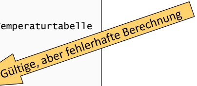

<details>
<summary>other</summary>

| Kategorie | Wert |
| --- | --- |
| Temperaturtabelle | N/A |
</details>

**45**

© T. Gemmeke, IDS, RWTH; R. Leupers, SSS

Da der Compiler nicht wissen kann, was der Programmierer ursprünglich implementieren wollte, kann es leicht zu **Bugs** kommen. Die meisten Software-Pakete haben Bugs, und manche werden erst sehr spät oder nie entdeckt. Zur Minimierung der Anzahl der Bugs hilft nur umfangreiches Testen und – bei nicht offensichtlichen Bugs – die geschickte Eingrenzung der Fehlerstelle, z.B. durch das temporäre Einstreuen zusätzlicher printf-Anweisungen zur Kontrolle von (sonst nach außen unsichtbaren) Zwischenergebnissen.

45

---

## Fehlerhafte Programme

• Programm unter Kontrolle eines **Debuggers** ausführen
Ermöglicht **Einzelschrittmodus**, Beobachtung von **Variablen** u.v.m.
Hilfreich vor allem bei **Endlosschleifen** und **Programmabstürzen**
Debugger kann Programmverhalten beeinflussen („**Heisenbugs**“)

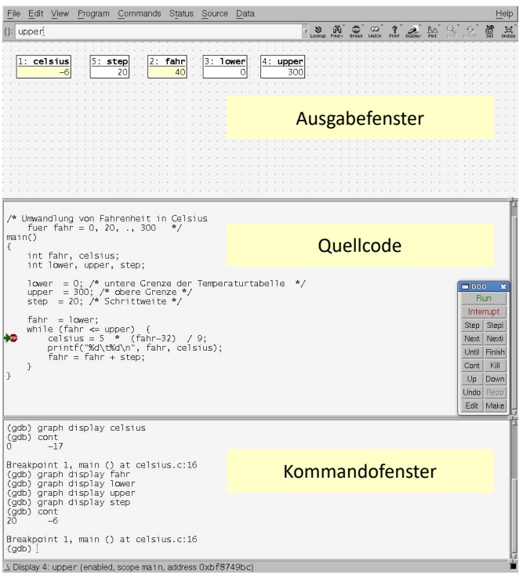

**46**

© T. Gemmeke, IDS, RWTH; R. Leupers, SSS

Im Gegensatz zum gezeigten Bespiel sind manche Bugs sehr schwer zu finden. Das sog. „Debugging“ nimmt oft mehr Zeit in Anspruch als die eigentliche Programmierung!

Daneben wird ein Bug oft durch das komplexe Zusammenspiel verschiedener Programmteile bewirkt. Gerät das Programm in eine **Endlosschleife**, so „passiert“ nach außen nichts mehr, ohne dass ein Fehler direkt sichtbar wird. Ein **Absturz** ist ein unkontrollierter Programmabbruch aufgrund eines unzulässigen Programmverhaltens (z.B. Zugriff auf geschützte Speicherbereiche). Die genaue Absturzstelle (und noch weniger die Ursache) ist ebenfalls nicht direkt nach außen sichtbar.

In diesen Fällen hilft nur ein **Debugger-Werkzeug** weiter. Der Debugger ermöglicht eine kontrollierte Ausführung eines Programms unter „ständiger Beobachtung“ des Programmierers. Hiermit können die meisten Bugs relativ schnell gefunden werden. Im schlimmsten Fall arbeitet ein Programm unter Debugger-Kontrolle jedoch anders als das ursprüngliche Programm. Dies liegt daran, dass der Debugger selbst ein Programm ist, welches auf unerwünschte Weise mit dem fehlerhaften Programm interagieren kann. Denkbar ist natürlich auch, dass der Debugger selbst Bugs hat. In jedem Fall muss dann noch tiefer in die „Debugging-Trickkiste“ gegriffen werden.

**Literaturhinweis**: Grötker/Holtmann/Keding/Wloka: „The Developer´s Guide to Debugging“, Springer, 2008, ISBN 978-1-4020-5539-3

46

---

## 3. Elementare Datentypen und Anweisungen

## 3.1 Einführung

3.2 Variablen und Konstanten
3.3 Zeiger
3.4 Arithmetische und logische Operationen und Zuweisungen
3.5 Kontrollanweisungen

47

© T. Gemmeke, IDS, RWTH; R. Leupers, SSS

47

---

## Datentypen ‐ Einführung

**Def**.: Ein **Datentyp** (**DT**) ist eine Menge von Werten und eine <u>Sammlung von Operationen auf diesen Werten.</u>

Beispiel: **natürliche Zahlen** 1, 2, 3, ... – Operationen: +, ‐, \*, /, ...
Beispiel: **Zeichenketten** (Strings) über Alphabet A‐Z – Operationen:
• Bestimme Stringlänge
• Ordne Strings alphabetisch an
•...

Beispiel: Menge von **Personen‐Stammdaten** (Name, Geburtsdatum, Adresse, ...)

– Operationen:

• Finde Teilmenge aller Personen älter als 50 Jahre
• Finde Teilmenge aller Personen, die in Aachen wohnen
•...

**48**

© T. Gemmeke, IDS, RWTH; R. Leupers, SSS

Man beachte, dass durch die Definition des **Datentyps** Werte und Operationen zu einer Einheit zusammengefasst werden. Dies ist wichtig, da reine Daten ohne Operationen hierauf (z.B. Abfragen, Berechnungen oder Modifikationen) an sich wertlos sind.

48

---

## Datentypen ‐ Einführung

## Def.: Ein abstrakter Datentyp (ADT) ist ein Datentyp der nur über eine Schnittstelle zugänglich ist.

• Funktion vs. Implementierung des Datentyps
• Nur Funktion nach außen von Interesse
• Implementierung kann sich evtl. ändern
Beispiel: DT „Punkt“ in C
• Koordinaten:
struct point { float x; float y; }
Operation „Euklidischer Abstand“:

```lisp
float dist(struct point a, struct point b)
{
    float dx, dy;
    dx = a.x - b.x;
    dy = a.y - b.y;
    return sqrt(dx*dx + dy*dy);
}
```

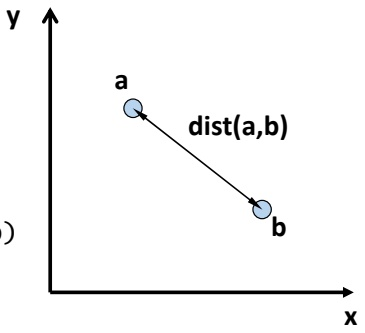

<details>
<summary>text_image</summary>

y
a
dist(a,b)
b
x
</details>

**49**

© T. Gemmeke, IDS, RWTH; R. Leupers, SSS

Beim **ADT** wird die Implementierung explizit außen vor gehalten, d.h. für einen ADT kann es viele verschiedene Implementierungen z.B. als C-Code geben. Programme, die den ADT benutzen, sehen aufgrund des Interfaces nichts von seiner „inneren“ Implementierung. So ist es z.B. möglich, den ADT im Laufe der Zeit durch eine andere/bessere Implementierung zu ersetzen, ohne dass alle Programme entsprechend angepasst werden müssen.

Im Beispiel kann die Funktion „dist“ zwar als (Teil des) **Interface** aufgefasst werden, jedoch ist die Implementierung als C-struct auch nach außen sichtbar, so dass man bei schlechtem Programmierstil explizit auf die Koordinaten x und y zugreifen könnte.

49

---

## Datentypen ‐ Einführung

In der C‐Version sind Daten (point) und Operationen (dist) **getrennt**
Programme könnten (und i.d.R.: werden) ohne „dist“ auch **direkt** auf die x‐ und y‐Koordinaten zugreifen
Ändert sich die interne Implementierung von point, so wäre evtl. ein Großteil des **übrigen Programmcodes** betroffen
• **ADT‐Version** in C++: (siehe Kapitel 5)
• Daten und Operationen per Konstruktion (class) **vereinigt**
Interne Daten nur über Schnittstelle verfügbar!

```txt
class point {
    private:      // interne Repräsentation nicht nach außen sichtbar
        float x, y; // oder andere interne Repräsentation
    public:      // Schnittstelle für Benutzer von „point“
        float dist(point);
        /* ... */
};
```

**50**

© T. Gemmeke, IDS, RWTH; R. Leupers, SSS

In der **C++ Version** des Beispiel-ADT werden die Koordinaten x und y durch das Schlüsselwort „private“ vor direktem Zugriff von außen geschützt. D.h. dass ein Programm, welches versucht, diese direkt zuzugreifen, vom Compiler mit einer Fehlermeldung zurückgewiesen wird. Nur die unter „public“ sichtbaren Interface-Operationen sind nach außen verfügbar. Auf diese Weise kann der Programmierer des ADT für die gewünschte „Einkapselung“ der ADT-Daten sorgen.

50

---

## Objekte in C

Variablen, Konstanten und Programmcode (Funktionen) werden im **Speicher** abgelegt
Ein **Objekt** ist ein benannter Speicherbereich
Auf Objekte wird direkt (per **Namen**) oder indirekt (per **Zeiger**) zugegriffen; Zeiger (symbolische Adressen) sind selbst Objekte
Der **benötigte Speicherplatz** eines Objektes sowie die darauf **zulässigen Operationen** hängen vom Typ ab
Im Speicher befinden sich nur **Binärzahlen**; Interpretation ist den Operationen überlassen

Vereinfachtes Speichermodell

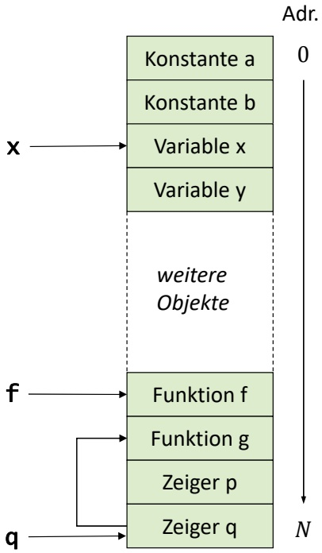

<details>
<summary>flowchart</summary>

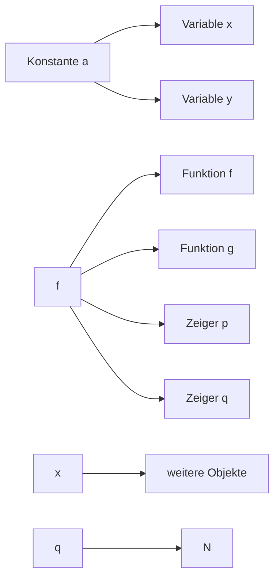
</details>

**51**

© T. Gemmeke, IDS, RWTH; R. Leupers, SSS

Der Speicher ist das „Gedächtnis“ eines Programms. Er wird aus

Programmierersicht als eine lineare Folge von **Speicherplätzen** aufgefasst. In der Realität ist die Speicherarchitektur wesentlich komplexer, dies wird jedoch hier nicht weiter betrachtet.

Jeder Speicherplatz besitzt eine **Adresse**, ähnlich zu einer Hausnummer, unter der er angesprochen (d.h. gelesen oder geschrieben) werden kann. Der Inhalt eines Speicherplatzes bleibt erhalten, solange vom Programm kein neuer Wert hineingeschrieben wird (oder die Stromversorgung unterbrochen wird).

Im Beispiel laufen die Adressen von 0 bis N. In den ersten Speicherplätzen sind Konstanten und Variablen abgelegt. Auch die **Software** selbst befindet sich im Speicher (z.B. die Funktionen f und g).

Eine Besonderheit sind **Zeiger** (siehe Ende Kap.3). Diese verweisen auf andere Objekte im Speicher. Befindet sich z.B. die Funktion g an Adresse 1000 im Speicher, so hätte der Zeiger q den Wert 1000. Dies wird durch den Pfeil vom Zeigerobjekt q (welches sich an beliebiger Stelle im Speicher befinden kann) auf die Funktion g angedeutet.

Programmieranfängern bereitet das Verständnis der Zeiger erfahrungsgemäß oft große Schwierigkeiten. Da sie aber ein äußerst wichtiges

**Programmierhilfsmittel** darstellen, ist eine nähere (und vor allem praktische) Beschäftigung mit diesem Thema zwingend notwendig.

51

---

## Basis‐Datentypen in C

• char: **Zeichen** (character) = 1 Byte (8 Bits)
• int: **ganze Zahl** (integer)

– short int: kleinerer Wertebereich (mind. 16 Bit)
– long int: größerer Wertebereich (mind. 32 Bit)

• float: **Fließkommazahl** (floating point)

– Aufteilung in Exponenten und Mantisse
– z.B. „12.34E10“ ൌ 12,34 ⋅ 10<sup>ଵ</sup>଴
– double: größerer Wertebereich
– long double: noch größerer Wertebereich

• char und ganze Zahlen können **vorzeichenbehaftet** (Standardfall) oder **vorzeichenlos** sein:

– signed short int  ሾെ2<sup>ଵ</sup>଺ି<sup>ଵ</sup>, 2<sup>ଵ</sup>଺ି<sup>ଵ</sup> െ 1ሿ ൌ ሾെ32768, 32767ሿ
– unsigned short int  ሾ0, 2<sup>ଵ</sup>଺ െ 1ሿ ൌ ሾ0, 65535ሿ

**52**

© T. Gemmeke, IDS, RWTH; R. Leupers, SSS

Alle Datentypen in C können auf die **Basis-Datentypen** zurückgeführt werden. Diese sind Sprachelemente von C und somit dem Compiler implizit bekannt.

Je nach Anwendung verwendet man bei Zahlen-Datentypen solche mit oder ohne **Vorzeichen**. Der darstellbare Wertebereich ist durch die Anzahl der Bits beschränkt. Ist z.B. von vornherein bekannt, dass eine Variable niemals negative Werte annehmen kann, so kann durch die Verwendung von „unsigned“ eine bessere Ausnutzung des Wertebereichs erreicht werden.

Ganze Zahlen werden meist im **2er-Komplement** dargestellt. In diesem Format lassen sich bestimmte mathematische Operationen einfach in Hardware realisieren. Der jeweils halbe Wertebereich wird für negative bzw. positive Zahlen verwendet. Das erste Bit gibt das Vorzeichen an („1“ = negativ“). Da die 0 als positive Zahl aufgefasst wird, ergibt sich eine kleine Asymmetrie im Wertebereich.

**Beispiel**: 2er-Komplement bei 3-Bit-Zahlen

$$
0 0 0 = 0 \quad 1 0 0 = - 4
$$

$$
0 0 1 = 1 \quad 1 0 1 = - 3
$$

$$
0 1 0 = 2 \quad 1 1 0 = - 2
$$

$$
0 1 1 = 3 \quad 1 1 1 = - 1
$$

Die Negation einer Zahl erfolgt durch Invertieren der Bits und anschließender Addition von 1. Z.B. -2 = Inv(010) + 1 = 101 + 1 = 110

52

---

## 3. Elementare Datentypen und Anweisungen

3.1 Einführung
**3.2 Variablen und Konstanten**
3.3 Zeiger
3.4 Arithmetische und logische Operationen und Zuweisungen
3.5 Kontrollanweisungen

53

© T. Gemmeke, IDS, RWTH; R. Leupers, SSS

53

---

## Variablen

## • Variablen

– speichern Werte eines bestimmten **Datentyps**
– müssen vor Verwendung **vereinbart** werden

• z.B. float a, b; char x, y; double e, f;

– besitzen einen eindeutigen **Namen**
– Name sollte über **Verwendung** Aufschluss geben!

• z.B. int counter; ist besser als int c;

## • Schlüsselwörter sind als Namen nicht erlaubt

– z.B. for, while, goto, int, float, ... sind in C/C++ reserviert

## • Je nach Compiler:

– Es sind nur die ersten 31 Zeichen **signifikant**
– z.B. int einLangerVariablenName1234567890, einLangerVariablenName1234567891 gelten als gleich

**54**

© T. Gemmeke, IDS, RWTH; R. Leupers, SSS

Wird eine Variable verwendet, ohne vorher vereinbart worden zu sein, so erzeugt der Compiler eine Fehlermeldung. Die **Deklaration** dient dazu, eindeutig festzulegen welche Variablen welchen Typs im Programm verwendet werden. Auf diese Weise werden Fehler vermieden. Darüber hinaus kann der Compiler mit Hilfe der Vereinbarung bestimmen, wieviel Speicherplatz für die Variablen zu reservieren ist.

**Variablennamen** sind in C zwar quasi beliebig. Aussagekräftige Namen sind jedoch dringend zu empfehlen. Ein Programm, welches nur Variablennamen wie a, b, c, d etc. verwendet, kann nach einiger Zeit von niemandem mehr verstanden werden.

Manche C-Compiler betrachten auch mehr als 31 Zeichen als signifikant. Dies sollte jedoch nicht unbedingt ausgenutzt werden, da darunter die **Portierbarkeit** des Codes auf andere Rechner/Compiler-Plattformen beeinträchtigt wird. Zwar ist C als höhere Programmiersprache prinzipiell rechnerunabhängig, aber im Detail gilt dies leider nicht. Ein weiteres Beispiel hierfür ist die nicht eindeutige Standardisierung der Datentyp-Bitbreiten (Bsp. int: „16 Bits oder mehr“). So kann ein Programm auf verschiedenen Rechnern durchaus verschiedenes Verhalten zeigen.

54

---

## Variablen

• Aufbau von Variablennamen (Identifier‐Syntax)
• Kompakte Beschreibung mit **regulären Ausdrücken**
• Z.B. zulässig:
– int x, XX, y\_, a\_42;
• Z.B. unzulässig:
– int 0Z, 1234\_x, return;

```txt
- letter = "a" | "b" | ... | "z" | "A" | "B" | ... | "Z" | "_"
    - letter = ein Buchstabe oder „_"
- digit = "0" | ... | "9"
    - digit = eine Dezimalziffer
- identifier = letter { letter | digit }
    - identifier = ein letter, gefolgt von beliebig vielen Elementen (auch 0)
    letter oder digit
```

**55**

© T. Gemmeke, IDS, RWTH; R. Leupers, SSS

**Identifier** sind eindeutige Namen für Variablen, Konstanten, Datentypen, Funktionen etc. Mittels **regulärer Ausdrücke** (RAs) können bestimmte Sprachen (wie hier die Sprache der möglichen C-Identifier) kompakt beschrieben werden.

Grundlage für RAs ist immer ein **Alphabet**. Im Falle von C ist dies eine Teilmenge der sog. ASCII-Zeichen, welche aus Buchstaben, Ziffern und einigen Sonderzeichen bestehen. Jedes Element des Alphabets ist per Definition selbst schon ein RA.

Aus zwei beliebigen gegebenen RAs R1 und R2 kann man einen neuen, komplexeren RA R3 mittels dreier Regeln formen:

**1) Alternative**: R3 = R1 | R2 (R3 darf aus R1 oder R2 bestehen)
**2) Konkatenation** R3 = R1 R2 (R3 besteht aus dem Hintereinanderschalten von R1 und R2)
**3) Kleene‘sche Hülle**: R3 = {R1} (oder auch in vielen Sprachen (R1)\* ) (R3 besteht aus beliebig vielen Wiederhholungen von R1)

Mit Hilfe dieser Definition kann der **Aufbau** (oder die Syntax) von C-Identifiern wie gezeigt leicht erklärt werden: Jeder Identifier muss zu Beginn einen „letter“ (Buchstabe oder Unterstrich „\_“) haben, gefolgt von beliebig vielen weiteren Zeichen des Alphabetes. Man beachte jedoch die praktische Einschränkung auf 31 signifikante Zeichen, sowie das Verbot, Schlüsselwörter als Identifier zu verwenden.

Für eine genauere Erläuterung des RA-Begriffes sei hier auf spätere Vorlesungen (z.B. ASK oder Compilerbau) verwiesen.

55

---

## Variablen‐Vereinbarung

• Vereinbarung vor erster Verwendung der Variable

– Deklaration ermöglicht **Korrektheitsprüfungen** durch Compiler
– Definition allokiert benötigten **Speicherplatz**

• **Allgemeine Form** der Vereinbarung:

– Typ ID (, ID)\* ;
– Typ darf sein:

• Basis‐DT (Schlüsselwort): char, int, float, ...
• Zusammengesetzter DT (Zeiger, Array, Struct, ...)
• Benutzerdefinierter DT

– typedef unsigned long int UL;
– Macht UL als Abkürzung für unsigned long int bekannt
– Hilfreich vor allem bei zusammengesetzten DT

```c
int main(void)
{
    /* Variablen-
        Vereinbarungen */

    /* ... */

    /* Anweisungen mit
        Variablen-
        Verwendung */

    return 0;
}
```

**56**

© T. Gemmeke, IDS, RWTH; R. Leupers, SSS

Wir werden das Konzept der RAs im folgenden gelegentlich weiterverwenden. Z.B. hier bei der Vorstellung der Syntax von Vereinbarungen. Eine **Vereinbarung** setzt im wesentlichen einen Datentyp in Verbindung zu einem Identifier. Um Schreibarbeit zu sparen, reicht es bei mehreren gleichartigen Variablen, den Typnamen nur einmal zu nennen (daher die \*-Konstruktion).

Verwendet man den Zusatz „**typedef**“ in einer Vereinbarung, so wird dadurch ein Datentyp unter einem neuen (und meist kürzeren) Namen bekannt gemacht. Dies spart Schreibarbeit und verbessert die Programm-Lesbarkeit.

Generell sollte in einem Programm immer **Redundanz** vermieden werden. D.h. falls bestimmte Programmelemente mehrfach vorkommen, so sollten diese unter einem eindeutigen Namen möglichst nur einmal abgelegt und dann per Namen ggf. mehrfach instanziiert werden (vgl. auch die Verwendung von Makros im C-Präprozessor).

56

---

## Konstanten

• Falls Werte sich innerhalb eines Programms nie ändern, so werden diese als **Konstanten** statt Variablen dargestellt
Bessere **Lesbarkeit**, mehr **Optimierungsmöglichkeiten**
• Konstanten benötigen keine explizite Definition, da ihr **Typ implizit** ist; Beispiele:

12345: ganze Zahl (int)
12345U: vorzeichenlose ganze Zahl (unsigned int)
0xAFFE: ganze Zahl in Hexcode (int)
123.45:    Fließkommazahl (double)
123E-2:   Fließkommazahl (double)
'a': Zeichen (char)
"String": Zeichenkette (Array aus char, s. später) int‐Konstante als regulärer Ausdruck: "0" | ( [ "‐" ], dnz, { d } )

**57**

© T. Gemmeke, IDS, RWTH; R. Leupers, SSS

Für eine genaue Auflistung des möglichen **Aufbaus von C-Konstanten** und deren Datentypen sei auf die C-Dokumentation verwiesen.

57

---

## Weitere Formen von Konstanten

• **Symbolische Konstanten** im Präprozessor
– #define MAXCOUNT 1000
– Alle Vorkommen von MAXCOUNT im Programm werden durch 1000 ersetzt
– Bessere Lesbarkeit und Wartbarkeit des Codes

• **Konstante Ausdrücke**

– MAXCOUNT + 1, MAXCOUNT \* 2, ...
– Werden vom Compiler vorab ausgerechnet, nicht zur Programm‐Laufzeit (compile time‐Konstante)

• **Konstante Variablen**

– const int a = 100; (const ist ein type qualifier)
– Variable a darf kein neuer Wert zugewiesen werden
– Effekt: Ablage von a im read only‐Speicher (ROM)

**58**

© T. Gemmeke, IDS, RWTH; R. Leupers, SSS

Die **Präprozessorkonstanten** sind ein Spezialfall der echten Konstanten aus der vorherigen Folie, denn der Präprozessor nimmt nur eine rein textuelle Ersetzung vor.

Mit „compile time“ bezeichnet man den Zeitpunkt, zu dem der Compiler läuft (im Gegensatz zur „runtime“, d.h. Programm-Laufzeit). Hat der Präprozessor MAXCOUNT z.B. durch 1000 ersetzt, so steht anschließend der Ausdruck 1000+1 im Programm. Das Ergebnis wird auf jedem Rechner 1001 sein. Daher kann der Compiler dies bereits (ein einziges Mal) ausrechnen, um später (vielfach) „runtime“ zu sparen.

**Konstante Variablen** sind Objekte im Speicher, die nicht modifiziert werden dürfen. Der Compiler kann dies prüfen und ggf. eine Fehlermeldung ausgeben. Beim Speicher unterscheidet man ROM (read only) und RAM (random access memory). Letzterer kann beliebig zugegriffen werden. ROM-Speicher ist jedoch platzsparender.

58

---

## 3. Elementare Datentypen und Anweisungen

3.1 Einführung

3.2 Variablen und Konstanten

**3.3 Zeiger**

3.4 Arithmetische und logische Operationen und Zuweisungen

3.5 Kontrollanweisungen

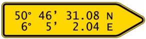


59

© T. Gemmeke, IDS, RWTH; R. Leupers, SSS

59

---

## Zeiger

**Def**.: Ein **Zeiger** (engl. pointer) ist eine Variable, die die <u>Speicheradresse einer Variablen enthält.</u>

Zeiger gehören zu den **wichtigsten Konzepten** in C/C++ zur Definition komplexer und effizienter Datentypen
Zeiger gehören (leider) auch zu den **häufigsten Fehlerquellen** bei der Programmierung
• Bsp.:
– Der spezielle Zeigerwert NULL (0) wird oft verwendet, um einen „leeren“ Zeiger anzuzeigen (#define NULL 0)
– Der Versuch, einen Wert an Adresse 0 zu schreiben, führt in aller Regel zum **Programmabsturz**
– Enthält ein Zeiger einen sonstigen illegalen Wert, so kann sogar der **Programmcode** selbst überschrieben werden

**60**

© T. Gemmeke, IDS, RWTH; R. Leupers, SSS

Das Grundproblem bei der Programmierung mit Zeigern ist, dass bei mangelndem Verständnis ihrer Funktionsweise (oder einfach aus mangelnder Sorgfalt bei der Programmierung) die Zeiger „außer Kontrolle“ geraten können. Jedes Programm besitzt einen **Speicherbereich**, der ihm „gehört“, und in dem es seine Daten ablegt. Zeitgleich können auch noch andere Programme und Daten im Speicher vorhanden sein, welche natürlich nicht beeinflusst werden dürfen. Da ein Zeiger jeden beliebigen Wert annehmen kann, kann er bei fehlerhaftem Gebrauch insbes. auf einen Speicherbereich zeigen, der einem anderen Programm gehört. Der Versuch, auf diesen Bereich zuzugreifen, führt in aller Regel zum **Programmabsturz**.

Meist wird dieser Fehler vom Betriebssystem abgefangen und dem Benutzer gemeldet. Bei einfacheren Computersystemen kann es jedoch auch einen „totalen“ Absturz geben, über dessen Ursache dann zunächst einmal nichts bekannt ist. Derartige Bugs sind auch mit Debuggern oft schwer zu beheben, so dass bei der Programmierung mit Zeigern große **Sorgfalt** geboten ist. Es ist besser, eine Stunde länger in die saubere Programmierung zu investieren, als sich anschließend viele Stunden per Debugger auf Fehlersuche zu machen.

60

---

## Zeiger

• Alle **Programm‐Objekte** liegen im Speicher (s.o.)
• Jedes Objekt besitzt eine **Adresse** im Speicher (wie eine Hausnummer)
Häufig werden Objekte **per Namen** zugegriffen (z.B. Variable ${ { } _ { v } } { { \times } ^ { \prime \prime } } )$
Oft ist auch der **indirekte Zugriff** auf ein Objekt über seine Adresse sinnvoll
• Objekt‐Adressen werden in **Zeigern** gespeichert
Zeiger sind selbst Objekte mit Adressen, daher sind auch **Zeiger auf Zeiger** möglich

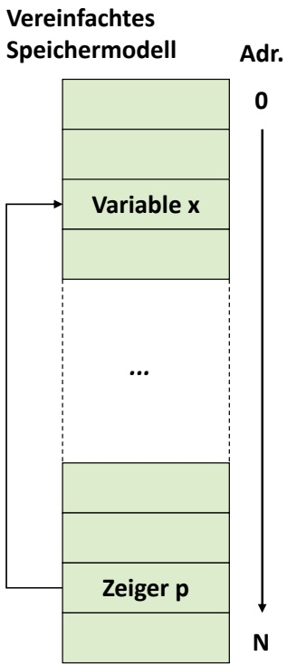

<details>
<summary>flowchart</summary>

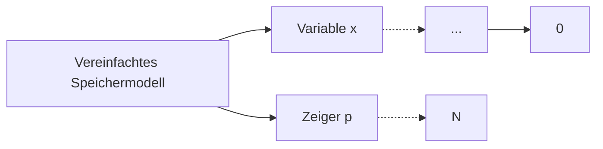
</details>

© T. Gemmeke, IDS, RWTH; R. Leupers, SSS

**61**

Die gezeigte Struktur im Speicher würde bspw. durch das folgende Programm bewirkt (zur genauen Syntax s. folgende Folien):

int $x ; \quad //$ normale int-Variable

$\mathrm{int}^* \mathrm{p}; \quad //$ Zeiger auf einen int-Wert im Speicher

$\mathrm{p}=\&\mathrm{x}; \quad // \mathrm{p}=\mathrm{Adresse}(\mathrm{x}), \quad \mathrm{d.h.} \quad , \mathrm{p}$ auf x zeigen lassen“

Anschließend können $_ { 2 3 } \mathrm { { x } ^ { 6 6 } }$ und ${ \cos ^ { * } p ^ { \cos } }$ synonym verwendet werden. Man sagt auch $_ { 2 3 } \mathrm { { x } ^ { 6 6 } }$ und ${ \cos ^ { 4 } p ^ { 6 0 } }$ sind **Decknamen**, d.h. verschiedene Namen für das gleiche Objekt, welches sich an der Adresse von x im Speicher befindet.

61

---

## Zeigervereinbarung und ‐operationen

• Zeiger werden mittels \* deklariert
• Typ \* ID; vereinbart einen Zeiger auf ein Objekt vom Typ Typ
• Bsp.: int \* p; int \*\* q;
• Symbol \* gehört syntaktisch zu ID, nicht zum Typ, z.B.
Äquivalent wäre: typedef int\* intptr; intptr p, q;

```c
int * p, q;
vereinbart einen int-Zeiger p und
    eine int-Variable q, aber
    int *p,*q;
vereinbart zwei int-Zeiger
```

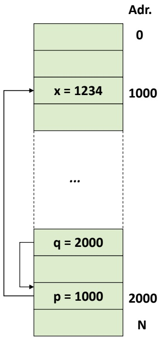

<details>
<summary>flowchart</summary>

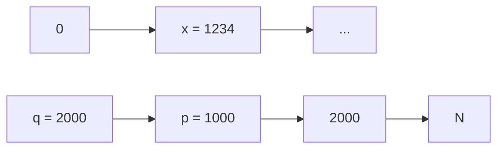
</details>

**62**

© T. Gemmeke, IDS, RWTH; R. Leupers, SSS

Die Deklaration „int\*\* q“ ist zu lesen wie „(int\*)\* q“, d.h. q ist ein Zeiger auf „int\*“, somit ein **Zeiger auf einen Zeiger auf int**. Im Beispiel zeigt q auf p und p wiederum auf x. Synonyme Ausdrücke wären hier also „x“, „\*p“ und „\*\*q“.

Die C-Syntax ist in diesem Fall sicher nicht optimal lesbar, so dass bei komplexen Zeigerdeklarationen möglichst auf „typedef“-Deklarationen zurückgegriffen werden sollte, um komplexe Deklarationen nur einmal hinschreiben zu müssen. Die Minimierung der Redundanz beseitigt unnötige Fehlerquellen.

62

---

## Zeigerdeklaration und ‐operationen

• **Annahme**: Adresse von Objekt x in Zeiger p gespeichert
Wie erfolgt der Zugriff auf x? – \*‐Operator – Ausdruck \*pointer liefert Objekt x
• **Beispiel**: \*p liefert den Wert 1234 (int) \*q liefert den Wert 1000 (intptr)
**Schreibzugriff** per \*: \*p = 4321; überschreibt x mit 4321 \*\*q = 5678; überschreibt x mit 5678
Vergleiche Syntax der **Vereinbarung** – int \*p; – **implizite** Deklaration von p als Zeiger

**63**


<details>
<summary>flowchart</summary>


</details>

© T. Gemmeke, IDS, RWTH; R. Leupers, SSS

Der „\*“-Operator (nicht zu verwechseln mit dem „\*“-Operator für Zahlen, d.h. Multiplikation) „**dereferenziert**“ einen Zeiger. Somit ist auch die Syntax der Zeigerdeklaration besser zu verstehen: „int \*p“ kann als Deklaration einer int-Variable aufgefasst werden, die jedoch keinen eigenen Namen besitzt, sondern nur indirekt über den Zeiger p angesprochen werden kann (Man beachte, dass diese „int-Variable“ dann keinen festen Platz im Speicher hat, da p prinzipiell „überall“ hinzeigen kann).

63

---

## Adressoperator

Zeiger auf x wird auch als **Referenz** auf x bezeichnet
\*‐Operator heißt auch **Dereferenzierung** (indirection)
Erzeugung von Referenzen durch den **Adressoperator** &
& und \* sind invers zueinander: – \*(&x) = x
• & nur auf **Objekte** anzuwenden, \* nur auf **Zeiger**

```matlab
p = &x;
- An p wird die Adresse von x zugewiesen
  (p „zeigt“ dann auf x)
q = &p;
- An q wird die Adresse von p zugewiesen
```

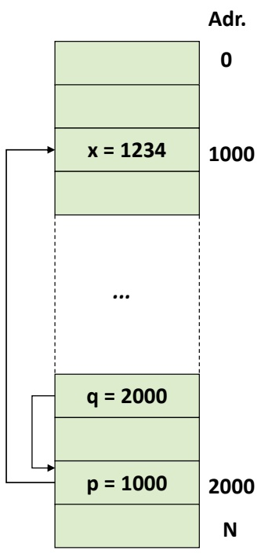

<details>
<summary>flowchart</summary>

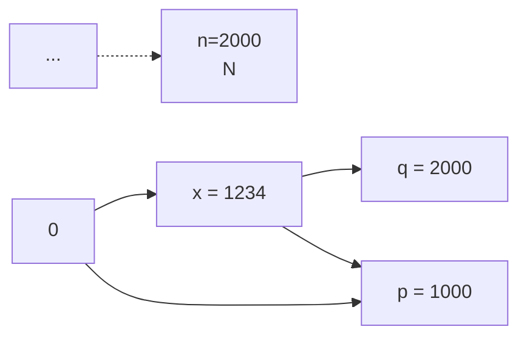
</details>

**64**

© T. Gemmeke, IDS, RWTH; R. Leupers, SSS

Es ist also z.B. unzulässig, den $\cos ^ { \theta ^ { \mathrm { d } } }$ -Operator (nicht zu verwechseln mit der logischen UND-Verknüpfung $_ { 0 } \theta ^ { 6 6 }$ **zweimal** hintereinander $( 0 , 0 , 0 , 1 )$ auf ein Objekt x anzuwenden, denn eine Adresse $, \ell x ^ { \epsilon }$ ist selbst kein Objekt mehr. Mehrfache „indirection“ wie $\mathrm { z . B . ~ , * * * p ^ { \omega } }$ ist dagegen zulässig, vorausgesetzt, dass der Ausdruck $\mathrm { s ^ { * * } p ^ { \mathrm { \textell o } } }$ ein Zeiger ist.

64

---

## Type cast mit Zeigern

Zeiger sind im Prinzip **identisch** mit (positiven) Integer‐Zahlen
Daher können Zeiger und int ineinander **umgewandelt** werden
Diese Eigenschaft von C/C++ bringt große **Flexibilität**, birgt jedoch auch **Gefahren**, z.B. möglicher Zugriff auf geschützte Speicherbereiche

```txt
p = (int*)x;
x = *p;
- lädt x mit dem Inhalt von Speicherstelle 1234
x = (int)q;
- lädt x mit 2000
```

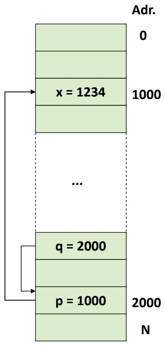

<details>
<summary>flowchart</summary>


</details>

**65**

© T. Gemmeke, IDS, RWTH; R. Leupers, SSS

Die Identität von Zeigern und int-Zahlen (genauer gesagt: unsigned int, denn die Adressen sind immer positiv) resultiert daraus, dass Zahlen und Zeiger im Speicher die gleiche Darstellung haben. Die **Wertebereiche** müssen jedoch nicht immer gleich sein, abhängig von der zugrunde liegenden Computerarchitektur. So könnten unsigned int-Zahlen bspw. im Wertebereich [0,65535] liegen (bei 16-Bit-Darstellung), wogegen der Speicher 32-Bit-Adressen (d.h. [0, 2<sup>32</sup>-1]) haben kann.

65

---

## Wozu dienen Zeiger?

Allgemein: falls mittels eines **einzigen Objektes** (Zeiger) im Programmverlauf auf **verschiedene andere Objekte** zugegriffen werden soll
Oder falls (in der maschinennahen Programmierung) Zugriffe auf **vorgegebene feste Speicherstellen** notwendig sind
Vor allem sind Zeiger sinnvoll bei **dynamischen** (d.h. zur Laufzeit erzeugten) Datenstrukturen
Datenobjekte, deren Größe während der Programmentwicklung noch nicht feststeht und die daher **nicht statisch deklariert** werden können
Hierfür kann dynamisch (d.h. während der Programmlaufzeit) Speicher angefordert und wieder freigegeben werden
• Der Speicherbereich hierfür heißt **Heap** (Halde, Haufen)

**66**

© T. Gemmeke, IDS, RWTH; R. Leupers, SSS

Ist z.B. eine **Datenbank** zu implementieren, so kann der Programmierer nicht genau wissen, wie viele Datensätze später im Betrieb einmal zu speichern sind. Die statische Vorabreservierung eines möglichst großen Speicherbereichs wäre zwar denkbar, aber ineffizient (wegen Platzverschwendung) und unsicher (wegen möglicher Überläufe). Daher wäre dies ein typischer Anwendungsfall für **dynamische Datenstrukturen**, bei denen der notwendige Speicherbereich erst zur Programmlaufzeit ermittelt und reserviert wird.

In der **maschinennahen Programmierung** kann es vorkommen, dass auf ganz bestimmte (konstante) Adressen zugegriffen werden muss. Ist z.B. bekannt, dass ein bestimmtes Gerät einen zu verarbeitenden Wert immer an Adresse 1000 hinterlegt, so gäbe es mit Hilfe normaler Variablendeklarationen keine Möglichkeit, hierauf zuzugreifen, da der Compiler die Variablenadressen selbst bestimmt. Mit Hilfe einer Deklaration wie $\mathrm{int^{*}p=(int^{*})1000;}$ kann jedoch mittels Zeiger p auf die gewünschte Adresse direkt zugegriffen werden.

66

---

## Heap‐Speicher

Programmcode und Variablen im **statischen** Speicherbereich
• Zugriff auf den **Heap** wie folgt:
Anforderung von Heap‐Speicher mittels Funktion malloc (memory allocation)
int\* p = (int\*) malloc(1000);
– p zeigt dann auf Anfang von freiem 1000‐Byte Heap‐Block
– Adresse eines freien Blockes wird von malloc **automatisch** ermittelt (z.B. 5000)

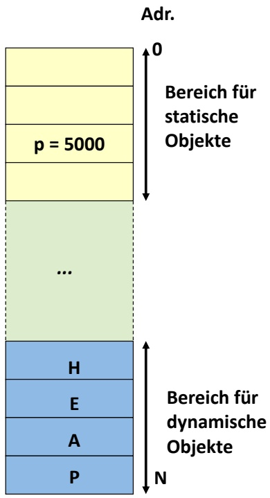

<details>
<summary>bar_stacked</summary>

| Component | Relative Area |
| --- | --- |
| p = 5000 | N/A |
| H | N/A |
| E | N/A |
| A | N/A |
| P | N/A |
</details>

**67**

© T. Gemmeke, IDS, RWTH; R. Leupers, SSS

Im Falle der Standard-Library-Funktion „**malloc**“ ist ein type cast notwendig. Da die malloc-Funktion nicht „wissen“ kann, welcher Datentyp im Speicher abgelegt werden soll, gibt sie zunächst einmal einen „generischen“ Zeiger vom Typ „void\*“ zurück. Dieser kann dann (optional) explizit auf den gewünschten Typ (hier „int\*“) gecastet werden.

„malloc“ kann auch eine Fehlermeldung zurückgeben, falls **kein freier Speicher** mehr gefunden werden kann. Da heutige Computer mit Speicher meist sehr großzügig ausgestattet sind, ist ein solcher Fehler jedoch oft ein Hinweis auf einen Bug, z.B. malloc-Aufruf in einer Endlosschleife, welcher zwangsläufig irgendwann nicht mehr erfolgreich ausgeführt werden kann.

67

---

## Heap‐Speicher

Adressen **5000‐5999** durch malloc reserviert \*p = 1234; weist 1234 an erste Speicherzelle im Block zu

Da die an malloc übergebene **Blockgröße** variabel ist, kann Heap‐Speicher immer **passend** angefordert werden

Nach Verwendung sollte der Heap‐Block auch wieder **freigegeben** werden, um den Speicherplatz für andere Zwecke wiederverwenden zu können: free(p); // Block 5000-5999 freigeben

**68**

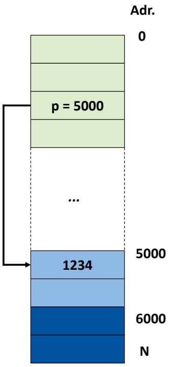

<details>
<summary>bar_stacked</summary>

| Stage | Value |
| --- | --- |
| Initial State | 0 |
| Transition | p = 5000 |
| Final Step | 1234 |
| Intermediate Level | 5000 |
| Intermediate Level | 6000 |
| Final Level | N |
</details>

© T. Gemmeke, IDS, RWTH; R. Leupers, SSS

„free“ ist das Gegenstück zu „malloc“. Die explizite **Freigabe von nicht mehr benötigten Speicherbereichen** ist bei ausreichend großem Speicher nicht unbedingt notwendig, es ist jedoch schlechter Programmierstil, so zu verfahren. Führt z.B. der Aufruf von „free“ zu einer Fehlermeldung, so ist dies ein sicherer Hinweis darauf, dass die Speicherverwaltung im Programm falsch angelegt ist. Ohne explizites „free“ könnte dies eine zeitlang unbemerkt bleiben und irgendwann zu einem fatalen Absturz führen.

68

---

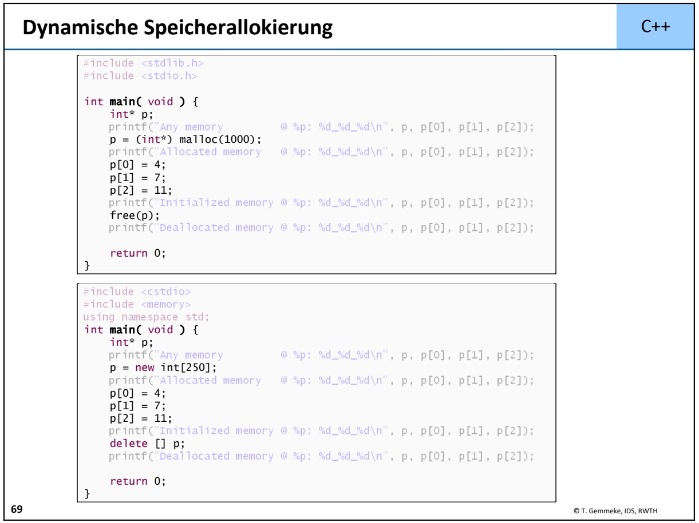

<details>
<summary>text_image</summary>

#include <stdlib.h>
#include <stdio.h>

int main( void ) {
    int* p;
    printf("Any memory        @ %p: %d_%d_%d\n", p, p[0], p[1], p[2]);
    p = (int*) malloc(1000);
    printf("Allocated memory   @ %p: %d_%d_%d\n", p, p[0], p[1], p[2]);
    p[0] = 4;
    p[1] = 7;
    p[2] = 11;
    printf("Initialized memory @ %p: %d_%d_%d\n", p, p[0], p[1], p[2]);
    free(p);
    printf("Deallocated memory @ %p: %d_%d_%d\n", p, p[0], p[1], p[2]);
    return 0;
}

#include <cstdio>
#include <memory>
using namespace std;
int main( void ) {
    int* p;
    printf("Any memory       @ %p: %d_%d_%d\n", p, p[0], p[1], p[2]);
    p = new int[250];
    printf("Allocated memory   @ %p: %d_%d_%d\n", p, p[0], p[1], p[2]);
    p[0] = 4;
    p[1] = 7;
    p[2] = 11;
    printf("Initialized memory @ %p: %d_%d_%d\n", p, p[0], p[1], p[2]);
    delete [] p;
    printf("Deallocated memory @ %p: %d_%d_%d\n", p, p[0], p[1], p[2]);
    return 0;
}
</details>

Whether you use c or C++, dynamic memory allocation uses different commands. The result is the same.

Please note: the first printf statement can lead to a program crash as the pointer p is not initialized and my point to areas outside the allocated memory space. Sometimes variables are automatically initialized to zero - accessing the address zero also results in a crash.

69

---

## Smart Pointer

C++

• Motivation

```cpp
#include <iostream>
#include <memory>
#include <sys/resource.h>
using namespace std;

// get memory footprint
long get_mem() {
    struct rusage is;
    getrusage(RUSAGE_SELF, &is);
    return is.ru_maxrss; // in KB

}

void subA() {
    int a; int* pa = &a;
}

void subB() {
    int* pa = new int;
    // delete pa; // free memory space, no automatic deallocation
}

void subC() { unique_ptr<int> pa = make_unique<int>(); }

int main( void ) {
    long mem_base = get_mem();
    cout << "Memory base usage: " << mem_base << endl;

    for( long i=0; i<10000000; i++ ) {
        subA();
        if( i%1000000 == 0) cout << "Addt'l allocation: " << get_mem() - mem_base << endl;
    }
    return 0;
}
```

**70**

© T. Gemmeke, IDS, RWTH

subA creates a local integer variable. Itself as well as the local pointer to it get deleted, once we leave the context.

In subB the local pointer pa points to a newly requested memory location of size integer. The local pointer variable is deleted as we leave the context. However, the memory location allocated with new is not freed up. Missing the explicit delete command, there is no reference to this memory location available to the program – a memory leak is created.

subC uses a smart pointer, that keeps track of its usage. The original assignment increases the number of references to the allocated memory location by one. Leaving the context, the deletion of the local smart pointer reduces the reference count to zero, which automatically triggers memory management routine to freeup the memory resource.

70

---

## Smart Pointer

C++

## • Unique Pointer

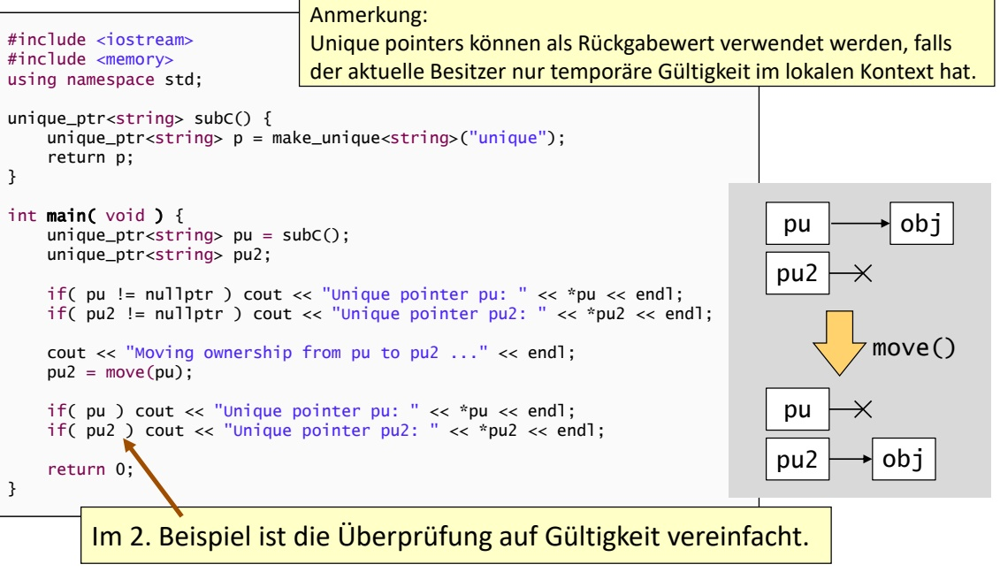

<details>
<summary>flowchart</summary>

```mermaid
graph TD
  #include <iostream>
  #include <memory>
  using namespace std;

  subC() {
    unique_ptr<string> subC() {
      unique_ptr<string> p = make_unique<string>("unique");
      return p;
    }
  int main( void ) {
    unique_ptr<string> pu = subC();
    unique_ptr<string> pu2;

    if( pu != nullptr ) cout << "Unique pointer pu: " << *pu << endl;
    if( pu2 != nullptr ) cout << "Unique pointer pu2: " << *pu2 << endl;

    cout << "Moving ownership from pu to pu2 ..." << endl;
    pu2 = move(pu);

    if( pu ) cout << "Unique pointer pu: " << *pu << endl;
    if( pu2 ) cout << "Unique pointer pu2: " << *pu2 << endl;

    return 0;
  }
  #Anmerkung:
  Unique pointers können als Rückgabewert verwendet werden, falls der aktuelle Besitzer nur temporäre Gültigkeit im lokalen Kontext hat.

  ##Object Diagrams
  pu --> obj
  pu2 --> x
  move() --> move()
  pu --> x
  pu2 --> obj

  Im 2. Beispiel ist die Überprüfung auf Gültigkeit vereinfacht.
```
</details>

**71**

© T. Gemmeke, IDS, RWTH

Unique pointers assure that an object can only be owned by a single pointer. No other pointer can reference the same object.

The move() method is used to explicitly move ownership of an object from one pointer to another. If an object is owned by a temporary unique pointer, the object can be transferred using a return expression without explicitly requiring a call to move().

As best practice, objects handled by unique pointers should be created with make\_unique.

71

---

## Smart Pointer

C++

• Shared Pointer

```cpp
#include <iostream>
#include <memory>
using namespace std;

void show( shared_ptr<string>& p0, shared_ptr<string>& p1 ) {
    if( p0 != nullptr ) cout << "Shared pointer p0: '" << *p0 << "''' << endl;
    if( p1 != nullptr ) cout << "Shared pointer p1: '" << *p1 << "''' << endl;
    cout << " Ptr of p0 use count: " << p0.use_count() << endl;
    cout << " Ptr of p1 use count: " << p1.use_count() << endl << endl;
}

int main( void )
{
    shared_ptr<string> ptr0 = make_shared<string>("shared");
    shared_ptr<string> ptr1;
    show(ptr0, ptr1);

    cout << "Duplicating reference to object ..." << endl;
    ptr1 = ptr0;
    show(ptr0, ptr1);

    ptr0 = make_shared<string>("something new");
    show(ptr0, ptr1);

    return 0;
}
```

**72**

© T. Gemmeke, IDS, RWTH

Shared pointers shared\_ptr allow object ownership by multiple pointers. An internal counter keeps track whether there is still a pointer referencing it. If the count is down to zero, the object is automatically deleted.

72

---

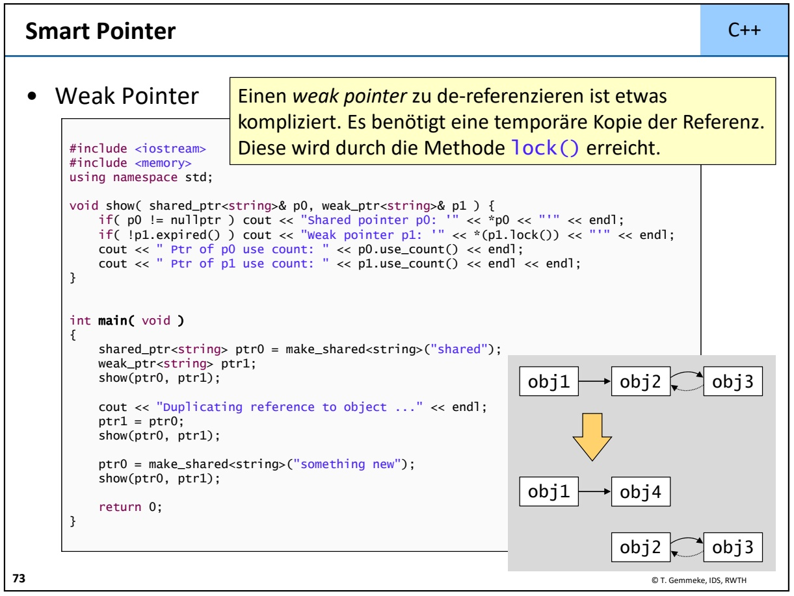

<details>
<summary>flowchart</summary>

```mermaid
graph TD
  A["#include <iostream>"] --> B["Einen weak pointer zu de-referenzieren ist etwas kompliziert. Es benötigt eine temporäre Kopie der Referenz. Diese wird durch die Methode lock() erreicht."]
  C["#include <memory>"] --> D["using namespace std;"]
  D --> E["void show( shared_ptr<string>& p0, weak_ptr<string>& p1 ) {<br>    if( p0 != nullptr ) cout << &quot;Shared pointer p0: '&quot; << *p0 << &quot;' << endl;<br>    if( !p1.expired() ) cout << &quot;Weak pointer p1: '&quot; << *(p1.lock()) << &quot;' << endl;<br>    cout << &quot; Ptr of p0 use count: &quot; << p0.use_count() << endl;<br>    cout << &quot; Ptr of p1 use count: &quot; << p1.use_count() << endl << endl;<br>  }<br>  E --> F[&quot;int main( void ){<br>  D --> G[&quot;shared_ptr<string> ptr0 = make_shared<string>(&quot;shared&quot;);<br>  G --> H[&quot;weak_ptr<string> ptr1;<br>  H --> I[&quot;show(ptr0, ptr1);<br>  I --> J[&quot;cout << &quot;Duplicating reference to object ...&quot; << endl;<br>  J --> K[&quot;ptr1 = ptr0;<br>  K --> L[&quot;show(ptr0, ptr1);<br>  L --> M[&quot;ptr0 = make_shared<string>(&quot;something new&quot;);<br>  M --> N[&quot;show(ptr0, ptr1);<br>  N --> O[&quot;return 0;"]
  end
```
</details>

Weak pointers weak\_ptr can also point to objects owned by shared pointers. However, they do not add to the count metric. If no shared pointer is referencing the object, it is deleted. The weak pointer is then pointing to an invalid address.

In the figure, example obj1 points to obj2, which points itself to obj3. If obj3 used a shared\_ptr to point back to obj2, the re-assignment of obj1 to obj4 would lose any reference to the other two objects. However, the system could not identify the two objects being obsolete – a memory leak is created. With the indicated weak pointer, obj2 looses any reference to it. Once obj2 is deleted also obj3 is up for removal.

73

---

## 3. Elementare Datentypen und Anweisungen

3.1 Einführung
3.2 Variablen und Konstanten
3.3 Zeiger
**3.4 Arithmetische und logische Operationen und Zuweisungen**
3.5 Kontrollanweisungen

74

© T. Gemmeke, IDS, RWTH; R. Leupers, SSS

74

---

## Arithmetische und logische Operationen

Auf Variablen und Konstanten können verschiedene **Rechenoperationen** angewendet werden
• Multiplikative Operationen haben **Vorrang** – Der **Ausdruck** a\*b+c/d entspricht (a\*b) + (c/d)
Diese primitiven Rechenoperationen sind in der Programmiersprache „eingebaut“
Komplexere Operationen sind in **Libraries** verfügbar oder werden vom **Programmierer definiert**
Z.B. Standard‐Library math.h – sin, cos, tan, pow (power), sqrt (square root), ...
**Ergebnisse** der Operationen haben einen bestimmten DT, der sich aus dem Operator und den Argumenttypen ergibt

$$
\begin{array}{l} - +, -, *, / \\ - \% (\text {modulo, nicht bei float - Werten}) \end{array}
$$

**75**

© T. Gemmeke, IDS, RWTH; R. Leupers, SSS

Die **Datentypen von Operationsergebnissen** werden im Compiler mittels bestimmter Regeln hergeleitet (die sog. usual arithmetic conversions, s. C-Dokumentation). Zu beachten ist hierbei auch die definierte Präzedenz (Reihenfolge der Auswertung) der Operatoren. Bei Library-Funktionen ist (wie auch bei allen anderen C-Funktionen) der Ergebnistyp explizit in der Deklaration enthalten.

75

---

## Zuweisungen

## • Allgemeine Form:

– Ziel = Ausdruck
– = ist der Zuweisungsoperator
– Ausdruck wird berechnet, Wert wird in Ziel gespeichert

## Kurzformen:

```matlab
- ++, -:-: Increment, Decrement
    x++ entspricht x = x+1
- +=, *=, ...
    x += y entspricht x = x+y
```

```c
int main()
{
    int a,b;
    int c,d;

    a = 1;
    b = 2;

    c = a+b;
    d = c+1;
    d = d+1;
    printf("%d", d);
```

```c
return 0;
}
#define a 1
#define b 2

int main()
{
    int c,d;

    c = a+b;
    d = c+1;
    d++;
    printf("%d", d);

    return 0;
}
```

**76**

© T. Gemmeke, IDS, RWTH; R. Leupers, SSS

In der Sprache C gibt es verschiedene Elemente, die aus Zeiten resultieren, in denen die Compiler noch nicht sehr leistungsfähig waren. Ein Beispiel sind die **Kurzformen** für Zuweisungen wie $_ { 2 ^ { x + + } }$ statt $\mathbf { x } = \mathbf { x } + 1 ^ { \circ \circ }$ . Hierdurch wurde der Compiler angewiesen, einen speziellen Assemblerbefehl (increment) statt eines normalen Additionsbefehls zu erzeugen, wodurch u.U. effizienterer Code generiert werden konnte.

Moderne optimierende Compiler werden jedoch stets die beste Alternative wählen, unabhängig von der genauen Formulierung des Programms. Allerdings kann es je nach Verwendung von Kurz- oder Langformen zu unterschiedlichen **Seiteneffekten** kommen (auf die hier nicht weiter eingegangen werden soll), welche die Optimierung einschränken können.

76

---

## Arithmetische und logische Operationen

• **Vergleichsoperationen**
Ergebnis einer Vergleichsoperation ist stets ein **Boolescher Wert** (true oder false)
Boolescher DT in C: \_Bool – Äquivalenzen aus stdbool.h:
• **Schiebeoperationen** (shift)

```txt
>, >=, <, <=
== (Gleichheit), != (Ungleichheit)
```

```txt
• bool := _Bool
• false := 0
• true := 1
```

```txt
>> Rechtsshift
<< Linksshift
```

**77**

© T. Gemmeke, IDS, RWTH; R. Leupers, SSS

Man beachte, dass aufgrund der Konvention bzgl. **Boolescher Datentypen** es genau eine Möglichkeit zur Darstellung von „false“ gibt (die 0), aber sehr viele verschiedene für „true“. Auch dies kann eine Fehlerquelle bei der Programmierung sein.

77

---

## Arithmetische und logische Operationen

• Shift‐Operationen nützlich für
– Zugriff auf einzelne Bits eines Wertes
– Vereinfachung von Rechenoperationen, z.B.
• x >> 1 entspricht x/2
• x << 2 entspricht x\*4

Rechtsshift abhängig vom DT des ersten Arguments:

– **Logisches** Shift: Auffüllen links mit 0

– **Arithmetisches** Shift: Auffüllen links mit Vorzeichen

• Beispiel: unsigned char a = 128; signed char b = -128;

Binärdarstellung von a und b

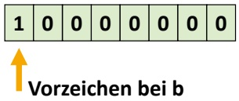

<details>
<summary>other</summary>

| Row | Column 1 | Column 2 | Column 3 | Column 4 | Column 5 |
| --- | --- | --- | --- | --- | --- |
| 1 | 1 | 0 | 0 | 0 | 0 |
| 2 | — | — | — | — | — |
| 3 | — | — | — | — | — |
| 4 | — | — | — | — | — |
| 5 | — | — | — | — | — |
| 6 | — | — | — | — | — |
| 7 | — | — | — | — | — |
| 8 | — | — | — | — | — |
| 9 | — | — | — | — | — |
| 10 | — | — | — | — | — |

Vorzeichen bei b
</details>

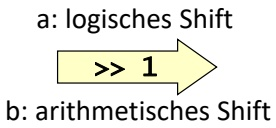

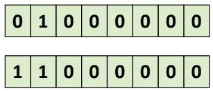

<details>
<summary>text_image</summary>

0 1 0 0 0 0 0 0
1 1 0 0 0 0 0 0
</details>

$$
\mathbf {a} = 6 4
$$

$$
\mathbf {b} = - 6 4
$$

**78**

© T. Gemmeke, IDS, RWTH; R. Leupers, SSS

Bzgl. des Beispiels sei auf die o.g. **2er-Komplement**-Darstellung verwiesen. Die Bitfolge „10000000“ kann also unterschiedliche Interpretationen als Dezimalzahl haben, je nach Deklaration (signed bzw. unsigned). Bei Zahlen muss daher der richtige Shift-Modus (arithmetisch oder logisch) verwendet werden, um falsche Ergebnisse zu vermeiden (wie z.B. -128/2 = 64).

Da jedoch auf C-Ebene keine separaten Operatoren hierfür existieren, sorgt der Compiler automatisch hierfür. Ein Grundverständnis der Shifts ist jedoch notwendig, um den Compiler bei Bedarf dazu zwingen zu können, den gewünschten Modus zu verwenden.

78

---

## Arithmetische und logische Operationen

• &: bitweise **UND‐Verknüpfung**
• |: bitweise **ODER‐Verknüpfung**
• ^: bitweise **Exklusiv‐ODER‐Verknüpfung** (XOR, „entweder...oder“)
• Prüfen, Setzen oder Löschen **einzelner Bits** von Werten
• Bsp.:
– signed char a = -64, b = 0xFF; // oder b = -1;

a: **1 1 0 0 0 0 0 0**

**1 1 1 1 1 1 1 1**b:

**1 1 0 0 0 0 0 0**

a & b

**1 1 0 0 0 0 0 0**

**1 1 1 1 1 1 1 1**

**1 1 1 1 1 1 1 1**

a | b

**1 1 0 0 0 0 0 0**

**1 1 1 1 1 1 1 1**

**0 0 1 1 1 1 1 1**

a ^ b

**79**

© T. Gemmeke, IDS, RWTH; R. Leupers, SSS

Die gezeigten bitweisen logischen Operationen werden meist in der **maschinennahen Programmierung** verwendet, um einzelne Bits abzufragen oder zu manipulieren. Möchte man z.B. Bit Nr. 3 in einer bestimmten Speicherstelle auf 1 setzen, ohne die übrigen Bits zu verändern, so kann dies durch eine ODER-Verknüpfung mit einem Bitstring erfolgen, der an der 3. Stelle eine 1 hat und sonst nur Nullen.

79

---

## Typumwandlung (type cast)

Beispiel: – int a = 10, b; float pi = 3.14; – b = pi + a;
Welche Typen werden verwendet? – a wird in intern in float umgewandelt (10.0 = 1E1) – pi + a ergibt float‐Resultat (13.14) – Resultat wird in int zurückverwandelt (13)
In C/C++ gibt es umfangreiche **type cast‐Regeln** für alle Kombinationen der primitiven DT
Viele Einzelheiten der Typumwandlung sind jedoch **compilerabhängig** (und damit eine „beliebte“ Fehlerquelle) !
**Expliziter** type cast durch Programmierer: – Ziel = (Typ) Ausdruck;

**80**

© T. Gemmeke, IDS, RWTH; R. Leupers, SSS

In manchen Sprachen wird eine implizite Typumwandlung nur erlaubt, wenn dadurch keine Daten verloren gehen. Dann sollte insbes. von expliziten type casts, d.h. verlustbehafteten Typumwandlungen, sparsamer Gebrauch gemacht werden. Die mangelnde Standardisierung der **type casts** ist sicher eine Schwäche der Sprache C.

80

---

## 3. Elementare Datentypen und Anweisungen

3.1 Einführung
3.2 Variablen und Konstanten
3.3 Zeiger
3.4 Arithmetische und logische Operationen und Zuweisungen
**3.5 Kontrollanweisungen**

**81**

© T. Gemmeke, IDS, RWTH; R. Leupers, SSS

81

---

## Kontrollanweisungen

Bisher: Alle Anweisungen (statements) werden **sequentiell** abgearbeitet
• Kontrollanweisungen ermöglichen

– **bedingte Ausführung** von Code mittels Verzweigungen

– **wiederholte Ausführung** von Code mittels Schleifen

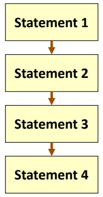

<details>
<summary>flowchart</summary>

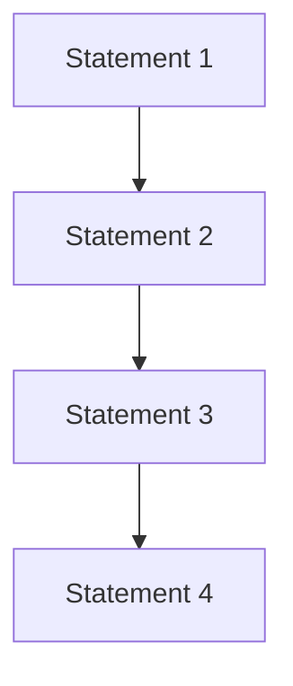
</details>

**82**

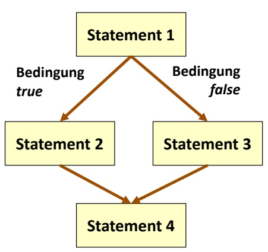

<details>
<summary>flowchart</summary>

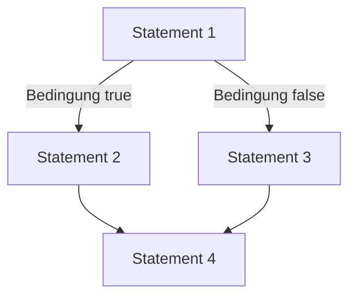
</details>

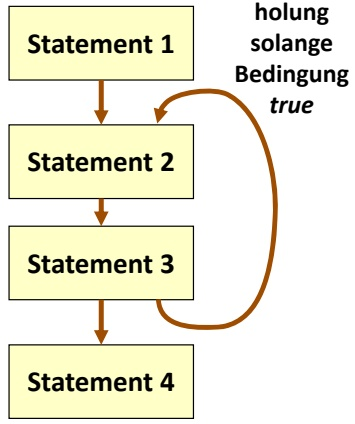

<details>
<summary>flowchart</summary>

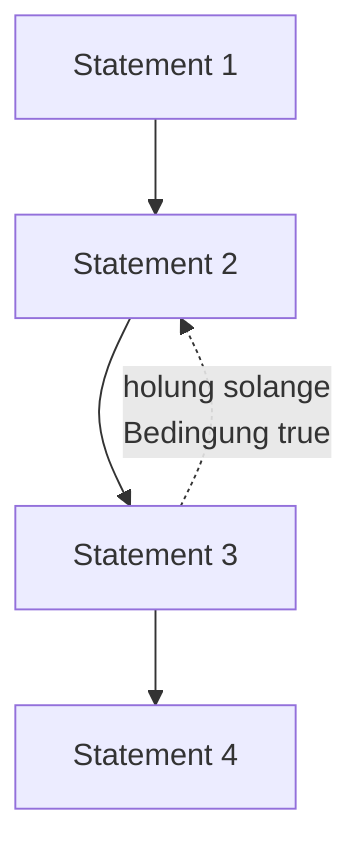
</details>

© T. Gemmeke, IDS, RWTH; R. Leupers, SSS

Bedingte und wiederholte Ausführung sind **Grundelemente** fast aller Programmiersprachen, wenngleich die genaue Syntax unterschiedlich ist.

82

---

## Verzweigungen: if‐then‐else

Beispiel: Maximumsberechnung
• Allgemeine Formen:

```txt
- if ( expression ) {
    statement*
}
- if ( expression ) {
    statement*
} else { statement*
}
```

Bedingung muss true oder false ergeben (0 ≙ false)
„Beliebter“ Fehler bei Gleichheitstest:

– if (a = b) statt if (a == b)

```c
#include <stdio.h>

int main(void)
{
    int a, b, max;

    // Einlesen von a und b
    scanf("%d %d", &a, &b);

    if (a > b) {
        max = a;
    } else // d.h. a <= b
        max = b;
    }

    printf("max = %d", max);

    return 0;
}
```

**83**

© T. Gemmeke, IDS, RWTH; R. Leupers, SSS

Wir greifen hier wieder auf die **regulären Ausdrücke** zurück: statement\* steht hier also für beliebig viele (auch 0) Anweisungen bzw. Statements.

Bei nur einem Statement darf auf die **{}-Klammerung** in den Zweigen von if/else verzichtet werden, um Schreibarbeit zu sparen. Da sich hierdurch –inbes. bei späteren Codeänderungen- jedoch leicht Fehler einschleichen, sollte man grundsätzlich immer die {}-Klammerung verwenden. (Dieser Hinweis wird allerdings aus Platzgründen in diesem Skript leider auch nicht konsequent angewandt.)

**Übungsfrage**: was passiert konkret im Programm, wenn fälschlicherweise $\mathbf { , } \mathbf { a } =$ b“ statt $\mathsf { , a } = = \mathsf { b } ^ { \mathsf { \epsilon } \mathsf { \epsilon } }$ für den Gleichheitstest verwendet wird?

83

---

## Verzweigungen: if‐then‐else

Komplexere Bedingungen können durch **logische Verknüpfungen** geprüft werden

– ODER‐Operator ||: **mindestens eine** der Teilbedingungen muss true sein
– UND‐Operator &&: **alle** Teilbedingungen müssen true sein

```c
int a, b, c, x, y;
/* ... */
if (a > 10) {
    if (b >= 20) {
        if (c == 30) {
            x++;
        }
    }
}

if (a < 40) {
    y--;
} else if (b <= 50) {
    y--;
} else if (c != 60) {
    y--;
}
```

```c
int a, b, c, x, y;
/* ... */
if ((a > 10) && (b >= 20) && (c == 30)) {
    x++;
}

if ((a < 40) || (b <= 50) || (c != 60)) {
    y--;
}
```

**84**

© T. Gemmeke, IDS, RWTH; R. Leupers, SSS

In bestimmten Fällen sollte man sich der sog. **Short-Circuit-Auswertung** der logischen Verknüpfungen bewusst sein: Dies bedeutet, dass nur soviel von einer komplexen Bedingung ausgewertet wird wie nötig, um das Gesamtresultat zu kennen. Wenn bspw. bei einem Ausdruck der Form „a || b || c“ bereits der Teilausdruck a als true erkannt wurde, so werden b und c nicht mehr ausgeführt. Analog bei $\scriptstyle { \mathfrak { p } } ^ { \mathbf { a } }$ && b && $\mathbf { c } ^ { \mathfrak { c } \mathfrak { c } }$ und a = false.

In den gezeigten Codebeispielen ist dies ohne weitere Bedeutung, denn die Short-Circuit-Auswertung führt lediglich zu einer schnelleren Programmbearbeitung. Fehlerträchtig ist sie allerdings u.U. bei **Seiteneffekten** in den Teilausdrücken. Beispiel: „f(x) || g(y)“ für zwei Funktionen f und g. Wird die Auswertung nach f(x) abgebrochen, so ergibt sich evtl. ein anderes (unerwartetes!)

Programmverhalten als wenn g(y) noch ausgewertet worden wäre (und dabei z.B. eine globale Variable schreibt, die später noch gelesen wird).

84

---

## Dangling else‐Problem

• Betrachte folgenden Code: if (a > 100) if (b > 50) x++; else x--;
**Zwei Möglichkeiten** der Interpretation: – Wird x-- ausgeführt, falls (a <= 100) ?
(1) if (a > 100) if (b > 50) x++; <u>else</u> x--;
– Oder falls (a > 100) && (b <= 50) ?
(2) if (a > 100) if (b > 50) x++; <u>else</u> x--;
• **Konvention**: else gehört immer zum innersten freien if, d.h. Version (2) ist richtig
**Besser**: Vermeidung von Fehlern durch expliziten Gebrauch der **Blockstruktur** { statement\* } in der Programmierung – if (a > 100) { if (b > 50) x++; else x--; }

**85**

© T. Gemmeke, IDS, RWTH; R. Leupers, SSS

Auch das „dangling else“ ist eine häufige **Fehlerquelle** (nicht nur) bei Programmieranfängern.

85

---

## Verzweigungen: goto

Verzweigung auch über **Labels** und goto**‐Statements** möglich
Ein Label ist eine symbolische **Sprungmarke** im Code
• Syntax:

– ID: statement (ID ist Bezeichner des Labels)
– goto ID; (Sprung nach Position ID)

• Labels und gotos

– beeinträchtigen die **Lesbarkeit** des Programms
– sind ein „historisches Relikt“ in Programmiersprachen
– sind nicht notwendig und sollten nur bei **zwingenden Gründen** eingesetzt werden

**86**

© T. Gemmeke, IDS, RWTH; R. Leupers, SSS

**Labels und gotos** haben direkte Entsprechungen im Assemblercode. Daher war es früher üblich, Kontrollfluss mit diesen Mitteln zu beschreiben. Aufgrund der Unübersichtlichkeit des Codes werden sie allerdings heute kaum mehr verwendet. Man findet sie meist nur noch in automatisch generierten C-Programmen, deren Korrektheit dann vorausgesetzt werden kann und die nicht mehr für Modifikationen durch den menschlichen Programmierer vorgesehen sind.

86

---

## Verzweigungen: switch

Häufiger Fall: **Fallunterscheidung** über eine bestimmte Variable mit jeweils konstantem Vergleichswert
• Normale Implementierung: **Kette** von if‐then‐else Statements
• Gültig, aber umständlich
• Bsp.: Umrechung von römischen Ziffern:

```txt
char digit, int value;

/* ... */

if (digit == 'I') value = 1;
else if (digit == 'V') value = 5;
else if (digit == 'X') value = 10;
else if (digit == 'L') value = 50;
else if (digit == 'C') value = 100;
else if (digit == 'D') value = 500;
else if (digit == 'M') value = 1000;
else printf("Keine gültige Ziffer!");
```

**87**

© T. Gemmeke, IDS, RWTH; R. Leupers, SSS

87

---

## Verzweigungen: switch

• **Kompaktere** Implementierung: switch‐Statement
Allgemeine Form: switch (Ausdruck) {case Konstante<sub>1</sub>: statement\* /\* … \*/ case Konstante<sub>n</sub>: statement\* default: statement\*}

```txt
char digit, int value;

/* ... */

switch (digit)
{
    case 'I': value = 1;     break;
    case 'V': value = 5;     break;
    case 'X': value = 10;     break;
    case 'L': value = 50;     break;
    case 'C': value = 100;     break;
    case 'D': value = 500;     break;
    case 'M': value = 1000; break;
    default:
        printf("Keine gültige ziffer!");
        break;
}
```

• break: sofortiges Verlassen des ganzen switch‐Statements
• default: Code im „sonst“‐Fall (optional)

**88**

© T. Gemmeke, IDS, RWTH; R. Leupers, SSS

Ein verbreiteter Fehler ist das „Vergessen“ des **break-Statements** in jedem case-Zweig. Wird das gesamte switch-Statement nicht nach dem ersten erfolgreichen Test verlassen, so kann unerwünschtes Programmverhalten auftreten.

Der **default-Zweig** trifft immer dann zu, wenn alle anderen Tests negativ verlaufen sind. Er muss jedoch nicht vorhanden sein.

Das switch-Statement ist nicht nur eine kompaktere (und damit besser lesbare) Variante einer Kette von if-Statements. Es kann vom Compiler auch in **effizienteren Assemblercode** übersetzt werden.

88

---

## Schleifen

• Wiederholte Ausführung einer Anweisungsfolge
Bsp.: Berechnung der Fakultätsfunktion
• Ohne Schleife: Code muss bei Änderung von 𝑛 modifiziert werden

$$
n! := 1 \times 2 \times \dots \times n
$$

```c
#define N 10

    /* ... */

    int fact, count;

    count = 0;
    fact = 1;

    count++;
    fact *= count;

    /* ... N-fache wiederholung */

    count++;
    fact *= count;
    printf("factorial(%d) = %d", N, fact);
```

**89**

© T. Gemmeke, IDS, RWTH; R. Leupers, SSS

Selbst die **#define-Anweisung** nützt in diesem Fall nicht viel, da der Code in Abhängigkeit von N immer manuell dupliziert werden müsste. Schleifen dienen dazu, solche Redundanzen zu vermeiden.

89

---

## Schleifen

Flexiblere Variante
• Code zwischen L1 und L2 wird wiederholt bis Zähler größer als N
Umdefinieren von N (#define) reicht aus
• Jedoch: **schlechter Programmierstil**

(gotos sollten nicht verwendet werden!)

```c
#define N 10
    /* ... */

    int fact, count;

    count = 0;
    fact = 1;

L1: if (count >= N) goto L2;
    count++;
    fact *= count;
    goto L1;

L2: printf("factorial(%d) = %d",
        N, fact);
```

• C/C++ bietet drei Formen von **strukturierten Schleifen** – for, while, do

**90**

© T. Gemmeke, IDS, RWTH; R. Leupers, SSS

Wie später gezeigt wird, sind die drei **Schleifenformen** in C im Prinzip äquivalent, daher ist die konkrete Wahl eine Sache des Geschmacks und des guten Programmierstils. Generell kann man sich wie folgt orientieren:

• for-Schleife, falls die Anzahl der Durchläufe von vornherein feststeht
• do-Schleife, falls mindestens ein Durchlauf stattfinden muss
• while-Schleife: sonst

90

---

## for‐Schleifen

```c
#define N 10

    /* ... */

    int fact, count;

    fact = 1;
    for (count = 1; count <= N; count++) {
        fact *= count;
    }
    printf("factorial(%d) = %d", N, fact);
```

• Allgemeine Form: for (expr1; expr2; expr3) { statement\* }
• expr1: – Wird vor Schleifenbeginn einmal ausgeführt → Initialisierung
• expr2: – Bedingung für jeden Durchlauf (jede Iteration)
• expr3: – Wird nach statement\* ausgeführt
• Nach expr3 wird an den Schleifenanfang **zurückgesprungen**

**91**

© T. Gemmeke, IDS, RWTH; R. Leupers, SSS

Die häufigste Form der for-Schleife ist die hier gezeigte, d.h. es gibt einen **Schleifenzähler** (hier: count), welcher in Ausdruck1 auf einen Startwert gesetzt wird. Ausdruck2 prüft, ob die obere Grenze erreicht worden ist, und ggf. wird abgebrochen. Ansonsten wird der Zähler in Ausdruck3 modifiziert (wie hier: häufig inkrementiert).

Die allg. Form der for-Schleife lässt aber **beliebige Ausdrücke** zu. Man könnte daher auch viel komplexere Berechnungen durchführen oder den gesamten Schleifenkörper (statement\*) im for-Statement selbst unterbringen. Dies würde jedoch keine Verbesserung des Codes bewirken, sondern lediglich schlechtere Lesbarkeit.

91

---

## for‐Schleifen

Warum ist count = 1 ein **Ausdruck**?
– In C sind auch Zuweisungen Ausdrücke
– Das Ergebnis von $\_ ZieI = A u s d r u c k ^ { \prime \prime }$ ist per Definition $\ , Z   i e ^ { i \prime \prime }$

Der Wert von expr1 wird bei for‐Schleifen jedoch verworfen, nur der **Seiteneffekt** einer Zuweisung ist relevant

Zwei spezielle Statements für Ausnahmefälle in Schleifen erlaubt

– break: verlässt Schleife komplett

– continue: verlässt aktuelle Iteration

• Wie goto mit Vorsicht zu gebrauchen!

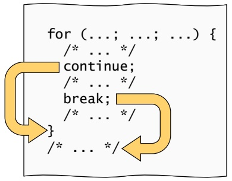

<details>
<summary>flowchart</summary>

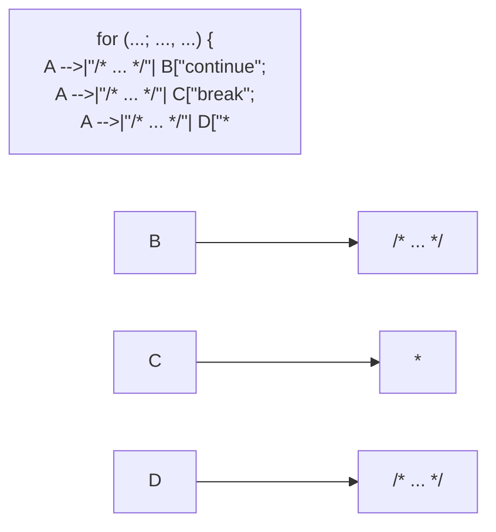
</details>

**92**

© T. Gemmeke, IDS, RWTH; R. Leupers, SSS

Die Tatsache, dass in C **Zuweisungen** der Form $\mathbf { \nabla } _ { \mathbf { \nabla } ^ { \mathbf { a } } } = \mathbf { b } ^ { \mathbf { \nabla } ^ { \mathbf { a } } }$ auch gleichzeitig **Ausdrücke** mit dem Wert a sind, ist sicher etwas gewöhnungsbedürftig. In den meisten Fällen wird dieser Wert auch verworfen, da man nur an der Durchführung der Zuweisung an sich interessiert ist. Sinnvoll ist es aber manchmal, bestimmte Zwischenergebnisse zu speichern. Beispiel:

$$
\text {int} \mathrm{a}, \mathrm{b}, \mathrm{c}, \mathrm{d}, \mathrm{e}, \mathrm{x};
$$

$$
\mathrm{a} = \mathrm{b} + \mathrm{c} + (\mathrm{x} = \mathrm{d} + \mathrm{e});
$$

Hier wird der Ausdruck $\mathbf { \nabla } _ { 2 } \mathbf { b } + \mathbf { c } + \mathbf { d } + \mathbf { e } ^ { \mathbf { \nabla } \mathbf { c } }$ in a gespeichert, und zusätzlich wird der Teilausdruck $\mathbf { \nabla } _ { \mathbf { \nabla } ^ { \prime } } \mathbf { d } + \mathbf { c } ^ { \epsilon \epsilon }$ in x gespeichert. Dieser könnte dann woanders wiederverwendet werden, ohne neu berechnet werden zu müssen. Dieser Programmierstil ist aber nicht zu empfehlen, denn man könnte auch (etwas klarer) schreiben

$$
\text {int} \mathrm{a}, \mathrm{b}, \mathrm{c}, \mathrm{d}, \mathrm{e}, \mathrm{x};
$$

$$
\mathrm{x} = \mathrm{d} + \mathrm{e};
$$

$$
\mathrm{a} = \mathrm{b} + \mathrm{c} + \mathrm{x};
$$

und x stünde wie oben für weitere Berechnungen zur Verfügung.

92

---

## while‐Schleifen

for‐Schleifen werden vor allem für eine **feste Anzahl** von Iterationen verwendet
Soll die Schleife ausgeführt werden, <u>solange</u> eine bestimmte **Bedingung** gilt, so ist eine while‐Schleife besser
Allgemeine Form: while (expression) {statement\*}
expression wird ausgewertet – Falls nicht null, so wird die Schleife betreten Nach statement\* wird an den Anfang zurückgesprungen, und expression wird erneut geprüft

**93**

```c
#define N 10

    /* ... */

    int fact, count;

    fact = 1; count = 1;

    while(count <= N) {
        fact *= count;
        count++;
    }

    printf("factorial(%d) = %d",
        N, fact);
```

© T. Gemmeke, IDS, RWTH; R. Leupers, SSS

Auch in while-Schleifen sind **break** und **continue** erlaubt. Break ist (im Gegensatz zu for-Schleifen) bei while-Schleifen sogar verbreitet: Wenn die Abbruchbedingung sehr komplex ist, die Anzahl der Durchläufe nicht feststeht, und es mehrere Stellen im Schleifenkörper gibt, an denen die Schleife verlassen werden soll, so programmiert man häufig nach dem Schema:

```txt
while(1) // „für immer“
{ ...
    if (Bedingung1) break;
    ....
    if (Bedingung2) break;
    ....
}
```

Man muss allerdings aufpassen, dass keine echte **Endlosschleife** (siehe später) entsteht, d.h. dass eine Abbruchbedingung nach endlicher Zeit auch tatsächlich erfüllt ist.

Die Verwendung von continue ist bei sauberem Programmierstil dagegen unüblich und überflüssig.

93

---

## do‐Schleifen

Ebenfalls für Schleifen mit **unbekannter Anzahl** von Iterationen
• **Unterschied** zu while: Mindestens eine Iteration findet statt
Allgemeine Form: do { statement\* } while (expression)
statement\* wird ausgeführt, und expression wird ausgewertet
Falls true, so wird an den Anfang zurückgesprungen
Bsp.: **Mindestens eine** Benutzereingabe wird erwartet
break, continue können bei while‐ und do‐Schleifen ebenfalls verwendet werden

**94**

```txt
char c;
/* ... */

do {
    scanf("%c",&c);
    /* Berechnung auf c */
} while (c != 'q'); // quit?
```

© T. Gemmeke, IDS, RWTH; R. Leupers, SSS

Die do-Schleife bietet sich an, wenn zunächst einmal **eine Iteration** durchzuführen ist, bevor die Abbruchbedingung getestet werden kann (wie im gezeigten Beispiel). Unter den drei Schleifenformen in C ist sie aber in der Praxis die am seltensten gebrauchte.

94

---

Äquivalenz von for, while, do

<div class="docvortex-algorithm" style="white-space: pre-wrap; font-family:monospace;">
- for würde als einziges Schleifenkonstrukt ausreichen
- Jede Schleifenform lässt sich in die anderen umsetzen, z.B.
    while (Ausdruck) { statement* }
entspricht
    for (;Ausdruck;) { statement* }

    for (expr1; expr2; expr3) { statement* }
entspricht
    expr1;
    while (expr2) { statement* expr3; }

- Jedoch ist aus Gründen der Programm-Lesbarkeit die jeweils am besten geeignete Variante zu bevorzugen
- Der Einsatz von strukturierten Schleifen (for, while, do) und der Verzicht auf Sprünge (goto) führt beim Übersetzen auch oft zu besserem Maschinencode
</div>

95

© T. Gemmeke, IDS, RWTH; R. Leupers, SSS

95

---

## Endlosschleifen

Falls die Abbruchbedingung einer Schleife nie erfüllt ist, **terminiert** das Programm nicht
Compiler kann dies i.A. **nicht bemerken**
Bei Ausführung: Ab einem gewissen Zeitpunkt **kein Programmfortschritt** mehr zu beobachten
• **Abhilfe**:

– Programmabbruch
– Erneutes Starten unter Debugger‐Kontrolle

```txt
while ((a > 10) || (b > 20)) {
    if ( /* ... */ ) {
        /* ... */
        a = 100;
        /* ... */
    } else {
        /* ... */
        b = 30;
        /* ... */
    }
    /* danach Bedingung
        stets erfüllt */
}
```

**96**

© T. Gemmeke, IDS, RWTH; R. Leupers, SSS

Terminiert ein Programm nicht wie gewünscht nach „vernünftiger“ Zeit, so handelt es sich meist um einen Bug aufgrund einer **Endlosschleife**. Im gezeigten Beispiel könnte man dies theoretisch vorab im Compiler erkennen, aber im allg. ist dies praktisch nicht möglich. Mit Hilfe eines Debuggers lässt sich das Problem aber meist schnell finden und beseitigen.

96

---

## 4. Funktionen und Programmaufbau

## 4.1 Funktionen

4.2 Parameterübergabe
4.3 Polymorhpie
4.4 Templates
4.5 Lambda Funktionen
4.6 Module und Programme

97

© T. Gemmeke, IDS, RWTH; R. Leupers, SSS

97

---

## Funktionen und Programmaufbau

**Def**.: Das **kartesische Produkt** $A \times B$ zweier Mengen 𝐴 und 𝐵 ist definiert durch

$$
A \times B = \{(a, b) \mid a \in A, b \in B \}
$$

**Def**.: Eine (binäre) **Relation** 𝑅 ist eine Teilmenge des kartesischen Produktes zweier Mengen: $R \subseteq A \times B$

**Def**.: Eine **Funktion** 𝐹 ∶ 𝐴 → 𝐵 ist eine rechtseindeutige Relation, <u>d.h. jedem</u> ${ \mathfrak { a } } \in A$ <u>ist höchstens ein</u> $b \in B$ <u>zugeordnet.</u>

In **Programmiersprachen**: Eine Funktion (oder: Prozedur, Subroutine) ist ein abgegrenztes **Teilprogramm**, welches aus einer Menge von **Eingabeparametern** eine fest definierte **Ausgabe** erzeugt
**Verwendung**: Einkapselung von häufig benötigten Teilprogrammen, Aufruf aus anderen Teilprogrammen

**98**

© T. Gemmeke, IDS, RWTH; R. Leupers, SSS

Funktionen in höheren Programmiersprachen wie C sind dem mathematischen **Funktionsbegriff** entlehnt.

Man stelle sich eine Code-Folge vor, die mehrmals im Programm vorkommt, z.B. eine mathematische Formel. Anstatt dieses Codestück mehrmals zu schreiben – was nicht nur Zeit beim Erstellen des Programms und Speicherplatz im ausführbaren Programm kostet, sondern auch eine häufige “Cut&Paste”- Fehlerquelle darstellt – kann der Code-Abschnitt in eine Funktion **gekapselt** werden, die von jeder Stelle des Programms aus verwendet werden kann.

Die **Hauptgründe**, Funktionen zu verwenden sind:

- Wiederverwendung von Code
- Übersichtlichkeit, bessere Lesbarkeit
- Modularisierung
- bessere Wartbarkeit

98

---

## Modell der Funktionsabarbeitung

**Zu jedem Zeitpunkt** befindet sich das Programm innerhalb einer bestimmten Funktion f
• Zu Beginn ist dies die Funktion main (s.o.)
Ausführung von f kann durch **Aufruf** einer anderen Funktion g jederzeit **unterbrochen** werden
• f übergibt **Parameter** an g
• g berechnet einen **Funktionswert** und springt an **Aufrufstelle** in f zurück


<details>
<summary>flowchart</summary>

```mermaid
graph TD
  subgraph Funktion_f["Funktion f"]
  A1["statement f1"] --> B2["statement f2"]
  end
  subgraph Funktion_g["Funktion g"]
  C1["statement g1"] --> D2["statement g2"]
  D2 --> E3["statement f3"]
  E3 --> F4["statement f4"]
  end
  B2 --> C1
  C1 --> D2
  D2 --> E3
```
</details>

**99**

© T. Gemmeke, IDS, RWTH; R. Leupers, SSS

Der zugehörige Code zu der obigen Darstellung könnte so aussehen:

```c
int g(int a, int b)
{
    a=0;  // g1
    b=a;  // g2
    return b;
}

int f(void)
{
    int x, y, z;
    x=1;          // f1
    y=0;          // f2
    z = g(x, y);  // Aufruf von g mit Übergabe von x und y
    printf("Rücksprung von g nach f"); // f3
    return z;      // f4
}
```

99

---

## Modell der Funktionsabarbeitung

Während der Ausführung kann g ihrerseits **weitere Funktionen** aufrufen (verschachtelte Funktionsaufrufe)
Ebenso können nach Ausführung von f auch **andere Funktionen** auf g zurückgreifen
**Vorteil**: Programmcode für mehrfach verwendete Routinen muss nur einmal vorhanden sein
– bessere **Wartbarkeit**
– geringere **Codegröße**


<details>
<summary>flowchart</summary>

```mermaid
graph TD
  A["Funktion f"] --> B["Funktion g"]
  C["Funktion i"] --> B
  B --> D["Funktion h"]
  E["ruft auf"] -.-> D
```
</details>

**100**

© T. Gemmeke, IDS, RWTH; R. Leupers, SSS

Mit Hilfe von Funktionen können beliebig komplexe Aufrufhierarchien erzeugt werden. Funktionen können nicht nur andere Funktionen, sondern auch sich selbst aufrufen, diesen Fall nennt man **Rekursion**.

100

---

## Funktionen

• Funktionen besitzen eine **Deklaration** und eine **Definition**
**Deklaration**: Name, Definitionsbereich, Wertebereich (d.h. **Interface** der Funktion nach außen)
• **Definition**: Programmcode zur **Implementierung** der gewünschten Funktionalität
Erfolgt die Definition vor der ersten Verwendung einer Funktion, so darf die Deklaration **entfallen**
• **Allgemeine Form der Deklaration**:

```txt
- Typ ID (Parameter-Deklaration*);
- Parameter-Deklaration syntaktisch wie Variablendeklaration
- Jedoch: Parameter-ID kann auch entfallen
- float max(float x, float y);
    oder
    float max(float, float);
- Deklariert Funktion max: float × float → float
```

**101**

© T. Gemmeke, IDS, RWTH; R. Leupers, SSS

Eine Funktion sollte in einem Programm erst verwendet werden, nachdem sie dem Compiler bekannt gemacht (**deklariert**) wurde. Hierzu reicht ein einfacher Prototyp aus, in dem die Namen der Übergabeparameter fehlen können.

In der **Funktionsdefinition** wird die Funktionalität der Funktion programmiert.

Beispiel:

```txt
double quadrat (double); // Funktionsdeklaration

int main(void)
{
    double a, b = 12;
    a = quadrat(b);  // Funktionsaufruf
    return 0;
}

double quadrat(double x) // Funktionsdefinition
{
    return x*x;
}
```

101

---

## Funktionsdefinitionen

• **Allgemeine Form**:
– Typ ID (Parameter‐Deklaration\*) { statement\* }
Interface‐Definition **muss** vorheriger Deklaration entsprechen (falls vorhanden)
**Funktionsrumpf** innerhalb { /\* ... \*/ } kann beliebige Statements enthalten
Verlassen einer Funktion durch return**‐Statement**
– return Ausdruck;
– Typ von Ausdruck muss dem **Wertebereich** der Funktion entsprechen (falls nötig: type cast)
– Funktionen können **nicht** per goto verlassen werden (Labels nur gültig **innerhalb** einer Funktion)

**102**

© T. Gemmeke, IDS, RWTH; R. Leupers, SSS

Da eine Funktion im allgemeinen einen Wert zurückliefert, beginnt eine Funktionsdefinition immer mit einer Typangabe, gefolgt von einem eindeutigen Funktionsnamen. Der Rückgabewert der Funktion wird mit Hilfe des **return-Statements** an die aufrufende Funktion zurückgeliefert.

Es gibt auch Funktionen ohne Rückgabewerte, in diesem Fall wird der Typ **void** („leerer Typ“) als Funktionstyp angegeben. Die return-Anweisung darf in diesem Fall fehlen. Erreicht die Funktion ihr Ende, springt der Programmablauf automatisch zurück zur aufrufenden Funktion.

102

---

## Funktionsaufrufe

Kommunikation zwischen **aufrufender** (caller) und **aufgerufener** (callee) Funktion: void f(void) { int x; /\* ... ruft g auf \*/ }; int g(int a, int b) { return a+b; }
• a und b sind die **formalen Parameter** der Funktion g gemäß Deklaration
Aufruf von g durch f per Namen und Übergabe **der aktuellen Parameter**, z.B.
– In g werden die „Platzhalter“ a und b durch 1 bzw. 2 ersetzt, g wird ausgeführt und per return beendet
– Der Ausdruck g(1,2) liefert dann den **Rückgabewert** 3; dieser kann z.B. an eine Variable (hier: x) zur Weiterverarbeitung zugewiesen werden

$$
- x = g (1, 2);
$$

**103**

© T. Gemmeke, IDS, RWTH; R. Leupers, SSS

In runden Klammern hinter dem Funktionsnamen in der Funktionsdefinition folgt die Parameterliste, die der Funktion übergeben wird. Jeder Parameter muss einzeln mit einem Typ versehen werden. Einzelne Parameter werden durch Kommata getrennt. Die Namen der **formalen Parameter** sind Platzhalter für die **aktuellen Parameter**, die beim Aufruf an die Funktion übergeben werden.

Aktuelle Parameter können Konstanten, Variablen oder auch Ausdrücke sein, die vor dem Funktionsaufruf zunächst ausgewertet werden. Beispielsweise können auch die Rückgabewerte von Funktionsaufrufen wiederum als aktuelle Parameter übergeben werden: x = f(y, g(a,b)).

103

---

## Lokale und globale Variablen

Zwei Arten von Variablen:

– **Globale Variablen** sind im gesamten Programm **gültig** (d.h. können zugegriffen werden)
– **Lokale Variablen** sind nur in einer bestimmten Funktion gültig (ebenso wie **formale Funktionsparameter**)
– Lokale Variablen können globale Variablen gleichen Namens **verdecken**

Globale Variablen sollten zur besseren Programm‐Wartbarkeit **möglichst selten** verwendet werden (sonst Gefahr von unerwünschten Seiteneffekten)

```c
int a=2, b=2, i=10;
int f(int a, int b)
{
    int i;
    i = a+b;
    return i;
}
int main(void)
{
    /* ... */
    i -= f(a, b);
    return 0;
}
```

**104**

© T. Gemmeke, IDS, RWTH; R. Leupers, SSS

**Lokale** und **globale Variablen** unterscheiden sich hinsichtlich ihres Gültigkeitsbereichs. Im obigen Beispiel sind die Variablen a, b und i global, d.h. außerhalb der main-Funktion und außerhalb der Funktion f, deklariert.

Innerhalb von f wird die Variable i erneut deklariert, damit wird die globale Variable i von der lokalen verdeckt, d.h. auf die globale Variable i kann von f aus nicht mehr zugegriffen werden. Ebenso verhält es sich mit den formalen Parametern a und b der Funktion f, welche die globalen Variablen a und b verdecken. Auf die globalen Variablen a und b kann von f aus ebenfalls nicht mehr zugegriffen werden.

Das Beispiel zeigt bereits, dass durch die gleiche Namensgebung von lokalen und globalen Variablen leicht **Verwechselungsgefahr** besteht und damit unerwünschte Seiteneffekte auftreten können. Daher sollte auf die Verwendung von globalen Variablen weitgehend verzichtet werden.

104

---

Funktionen auf einen Blick


<details>
<summary>flowchart</summary>

```mermaid
graph TD
  A["int sum;"] --> B["Globale Variable"]
  C["int f(int, int);"] --> D["Deklaration von f"]
  E["int main(void)"] --> F["Definition der Hauptfunktion"]
  G["{ sum += f(1, 2); printf(&quot;%d&quot;, sum); return 0;}"] --> H["Aufruf von f mit akt. Parametern"]
  I["{ int f(int a, int b) { int sum; sum = a+b; return sum;}"] --> J["Lokale Variable von f"]
  K["{ Rückgabe des Funktionswertes }"] --> L["Definition von f"]
  M["105"]
```
</details>

Im Beispiel wird sowohl die **globale** Variable sum deklariert als auch innerhalb von f die **lokale** Variable sum. Innerhalb von f kann auf die globale Variable sum nicht zugegriffen werden. In der main-Funktion wird die globale Variable sum verwendet.

Die **formalen** Parameter a und b von f werden beim Aufruf durch die **aktuellen** Parameter 1 und 2 ersetzt. Der Aufruf von f liefert den Rückgabewert 3 zurück, der zum Wert der globalen Variable sum addiert und ausgegeben wird.

Der Vollständigkeit halber sollte die globale Variable sum mit 0 **initialisiert** werden (int sum = 0;), obwohl ein korrekter Compiler globale Variablen automatisch mit 0 initialisiert, sofern nichts anderes angegeben ist.

105

---


<details>
<summary>flowchart</summary>

```mermaid
graph TD
  A["Beispiel"] --> B["Berechnung einer Kreisfläche als Funktion des Radius\nA = π * r²"]
  B --> C["#define PI 3.1415926"]
  C --> D["float area(float r)\n{ float a;\na = PI * r * r;\nreturn a;\n}"]
  D --> E["int main(void)\n{ float rad, A;\nwhile (1) { scanf(&quot;%f&quot;, &rad);\nA = area(rad);\nprintf(&quot;%f \n&quot;, A);\n} return 0;\n}"]
  E --> F["Fortlaufende Ein/Ausgabe von Radius und Fläche"]
```
</details>

Hier wird fortlaufend der Radius als **Benutzereingabe** eingelesen, die Kreisfläche mit Hilfe der Funktion area berechnet und anschließend ausgegeben. Die Kreiszahl Pi wird durch eine Präprozessoranweisung als Konstante definiert. Die Funktion area berechnet aus dem übergebenen Radius r und der Kreiszahl pi die **Kreisfläche** A und gibt diese als Rückgabewert zurück.

106

---

## 4. Funktionen und Programmaufbau

4.1 Funktionen
**4.2 Parameterübergabe**
4.3 Polymorhpie
4.4 Templates
4.5 Lambda Funktionen
4.6 Module und Programme

**107**

© T. Gemmeke, IDS, RWTH; R. Leupers, SSS

107

---

## Wert‐ und Referenzparameter

Bei Übergabe eines Wertes w an eine Funktion f wird dem formalen Parameter von f eine **lokale Kopie** von w zugewiesen (call by value)
f arbeitet nur mit der Kopie, kann w **nicht modifizieren**
Falls Modifikation von w erwünscht: Übergabe als **Referenzparameter** (call by reference)
– in C nur call‐by‐value (f1)
– in C++: Operator & (f2)C++
– **Nachbildung** in C: call by value mit Zeiger auf w (f3)

```c
void f1(int a) { a++; }
void f2(int& a) { a++; }
void f3(int* a) { (*a)++; }

int main(void)
{
    int a;
    a = 1;
    f1(a);  // a = 1
    f2(a);  // a = 2
    f3(&a); // a = 3
    return 0;
}
```

**108**

© T. Gemmeke, IDS, RWTH; R. Leupers, SSS

Alle Parameter, die an Funktionen übergeben werden, werden grundsätzlich **kopiert**, dieses Konzept wird **call-by-value** genannt. D.h. es wird nicht das Parameterobjekt selbst übergeben, sondern nur dessen Wert. Dies hat folgende Auswirkungen:

• Änderungen an einem Parameter in einer Funktion erscheinen nicht in der aufrufenden Funktion
• Soll eine Funktion einen Wert trotzdem dauerhaft ändern, so muss die Adresse des Wertes via Zeiger übergeben werden, damit die aufgerufene Funktion Zugriff auf das Parameterobjekt bekommt.
• Werden Strukturen übergeben, so wird von ihnen eine Kopie erstellt, was bei großen Strukturen viel Zeit und Arbeitsspeicher kostet. Deshalb wird häufig nur die Adresse von Strukturen übergeben, da die Adresse viel schneller und platzsparender als die Struktur selbst kopiert werden kann.

In C++ gibt es die Möglichkeit, Referenzparameter einzusetzen. Hier wird keine Kopie eines übergebenen Wertes angelegt, sondern eine Referenz auf den Wert. Dieses Konzept nennt man **call-by-reference**.

In C ist eine Parameterübergabe nur call-by-value möglich. Soll keine Kopie angelegt werden, so muss die Parameterübergabe per **Zeiger** geschehen.

108

---

Wert‐ und Referenzparameter


<details>
<summary>flowchart</summary>

```mermaid
graph TD
  A["Adr."] --> B["main"]
  B --> C["0"]
  C --> D["a_main = 1 * 2 * 3"]
  D --> E["1"]
  E --> F["f1"]
  F --> G["af1 := 1"]
  G --> H["af1++"]
  H --> I["1"]
  I --> J["100"]
  J --> K["Adresse von a_main"]
  K --> L["f2"]
  L --> M["af2 := 1"]
  M --> N["af2++"]
  N --> O["100"]
  O --> P["af3 := 100"]
  P --> Q["(*a_f3)++"]
  Q --> R["Kopie von a_main\n(später verworfen)"]
  R --> S["1"]
  S --> T["1"]
  T --> U["1"]
  U --> V["adresse von a_main"]
```
</details>

**109**

© T. Gemmeke, IDS, RWTH; R. Leupers, SSS

Die in der main-Funktion deklarierte und mit 1 initialisierte lokale Variable a wird zunächst per **call by value** an die Funktion f1 übergeben. Die

Inkrementierung von a in f1 hat daher keine Auswirkung in main, da sie auf der lokalen Kopie erfolgt, die nach dem Aufruf von f1 wieder verworfen wird. a hat nach Aufruf von f1 immer noch den Wert 1.

Im Falle von c++ (hier nicht abgebildet) hätte eine anschließende

Inkrementierung von a in f2 (siehe vorhergehende Darstellung) sehr wohl eine Auswirkung in main, da an f2 die **Referenz** von a übergeben würde. a hätte daher nach dem Aufruf von f2 bereits den Wert 2.

Die abschließende Inkrementierung von a in f3 wirkt sich in main aus, da ein **Zeiger** auf a, d.h. die Adresse von a, an f3 übergeben wird. a hat daher nach dem Aufruf von f3 den Wert 2.

109

---

**Beispiel**: komplexe Zahlen c = (a,b) Realteil a, Imaginärteil b
**Produkt** zweier komplexer Zahlen
Komplexe Zahlen sind **kein Basis‐Datentyp** in C
**Naive Lösung**: zwei Funktionen für Real‐ und Imaginärteil

Funktionen mit mehreren Rückgabewerten

```c
float prd_real(float a1, float a2,
        float b1, float b2)
{
    return a1*a2-b1*b2;
}

float prd_imag(float a1, float a2,
        float b1, float b2)
{
    return a1*b2+a2*b1;
}

int main(void)
{
    float c_real, c_imag;
    c_real = prd_real( /* ... */ );
    c_imag = prd_imag( /* ... */ );
    return 0;
}
```

**110**

© T. Gemmeke, IDS, RWTH; R. Leupers, SSS

Als **Rückgabewerte** von Funktionen kommen alle in C **gültigen Datentypen** in Frage. Für komplexe Zahlen existiert in C jedoch kein gültiger Basis-Datentyp. Will man eine Funktion für komplexe Zahlen implementieren – beispielsweise das Produkt zweier komplexer Zahlen -, die als Rückgabewert ebenfalls eine komplexe Zahl ergibt, so ist dies nur über „Umwege“ möglich. Im obigen Beispiel ist die naive Lösung mit zwei Funktionen für den Real- und Imaginärteil angegeben.

110

---

Funktionen mit mehreren Rückgabewerten

<div class="docvortex-algorithm" style="white-space: pre-wrap; font-family:monospace;">
- Definition des Datentyps
complex als struct
- structs werden als
Wertparameter übergeben
- D.h. evtl. kopieren großer
Speicherblöcke (langsam)
- Übergabe als
Referenzparameter (per
Zeiger) evtl. besser
- Arrays (s.u.) werden immer
als Referenzparameter
übergeben
- Arrays als Rückgabewert
unzulässig (warum?)
</div>

**111**

© T. Gemmeke, IDS, RWTH; R. Leupers, SSS

Eine bessere und lesbarere Variante hierfür ist die **Definition eines neuen Datentyps complex** als Struktur mit Realteil und Imaginärteil als Komponenten.

Dieser neue Datentyp kann nun sowohl als Parametertyp als auch als Rückgabetyp bei Funktionen verwendet werden.

Zu beachten ist, dass structs bei der Parameterübergabe (außer natürlich bei explizitem Gebrauch des Adressoperators „&“) immer **call-by-value** übergeben werden, was je nach Größe der Struktur viel Zeit und Speicherplatz kostet. Deshalb wird häufig nur die Adresse von Strukturen übergeben, da die Adresse viel schneller und platzsparender als die Struktur selbst kopiert werden kann.

111

---

## 4. Funktionen und Programmaufbau

4.1 Funktionen
4.2 Parameterübergabe
4.4 Templates
4.5 Lambda Funktionen
4.6 Module und Programme

## 4.3 Polymorhpie

**112**

© T. Gemmeke, IDS, RWTH; R. Leupers, SSS

112

---

## Polymorphie

C++

• Auswahl der Funktionsdefinition in Abhängigkeit der Operanden

<div class="docvortex-algorithm" style="white-space: pre-wrap; font-family:monospace;">
#include &lt;stdio.h&gt;
#include &lt;math.h&gt;

// most of the time we compute square root
    float root(float x) {
        return pow(x,1/2.0);
    }

// ... but we can do any root
    float root(float x, float y) {
        return pow(x,1/y);
    }

int main( void )
{
    float x1 = 4, x2 = 27;

    printf("Square root of %.1f = %.3f\n", x1, root(x1));
    printf("Cubic root of %.1f = %.3f\n", x2, root(x2,3));

    return 0;
}
</div>

In C++, we can have different declarations for the same symbol of a function – this is called **polymorphism**. In c this is not possible. As an example, we want to compute the root of a number, which frequently is simply the square root. In this case, a single input parameter is required as given in the first declaration of the function root.

In c, only one of the declarations of root be included at a given time.

Activating both in C++ triggers the compiler to select the appropriate declaration during compile-time. The decision is based on the number of provided parameters given in the function call. As this decision is done prior to execution we call this **static polymorphism**.

113

---

## Polymorphie

C++

• Auswahl der Funktionsdefinition in Abhängigkeit der Operanden

```c
#include <stdio.h>

    #define TEST_INT
    #define TEST_FLOAT

#ifdef TEST_INT
int mult(int a, int b) {
    printf("Integer: %d x %d = %d\n", a, b, a*b);
    return a*b;
}
#endif

#ifdef TEST_FLOAT
float mult(float a, float b) {
    printf("Float: %.2f x %.2f = %.2f\n", a, b, a*b);
    return a*b;
}
#endif

int main( void )
{
    int i_a = 3, i_b = 4;
    float f_a = 3.1, f_b = 4.5;

    mult(i_a,i_b);
    mult(f_a,f_b);

    return 0;
}
```

**114**

(dynamische Polymorphie folgt später ...)

© T. Gemmeke, IDS, RWTH; R. Leupers, SSS

In this second example, we want to compute the result of a multiplication. In c, only one of the define blocks can be activated at a given time. Type-casting will be applied to convert the input operands to match the declaration of the function.

Activating both in C++ triggers the compiler to select the appropriate definition during compile time as can be seen in the output of the console. The decision is based on the type of the parameters given in the function call. As this decision is again done during compile-time we call this **static polymorphism**.

We will discuss dynamic (or run-time) polymorphism later on.

114

---

## Funktionen als Parameter

Funktionen sind keine Variablen, besitzen aber eine **Speicheradresse**
Daher gibt es **Zeiger auf Funktionen**, diese können als **Parameter** übergeben und „aufgerufen“ werden

Sinnvoll, falls **Aufrufstruktur** der Funktionen nicht statisch festliegen soll

Bsp.:

```txt
- Funktion f:
    int f(float, float);
- Zeiger auf f:
    int (*p)(float,float);
    p = &f;
```

```c
#include <stdio.h>
int add(int a, int b)
{
    return a+b;
}

int sub(int a, int b)
{
    return a-b;
}

int op(int (*f)(int,int), int a, int b)
{
    return f(a, b);
}

int main(void)
{
    char c;
    int result;
    scanf("%c", &c);
    if (c == 'a')
        result = op(add, 1, 2);
    else if (c == 's')
        result = op(sub, 1, 2);
    printf("%d\n", result);
    return 0;
}
```

**115**

© T. Gemmeke, IDS, RWTH; R. Leupers, SSS

In C ist der Name einer Funktion keine Variable, sondern (wie ein Arrayname) eine Adresskonstante. Es können deshalb Zeiger auf Funktionen definiert werden, die man dann wie Variablen verwenden kann. Damit wird es möglich, Funktionen als Parameter an Funktionen zu übergeben.

Solche **Funktionszeiger** werden beispielsweise benötigt, um dem Betriebssystem mitzuteilen, welche Funktionen des Anwenderprogramms aufzurufen sind, wenn bestimmte Ereignisse eintreten. So wird beispielsweise eine Signalbehandlung durchgeführt. Dabei meldet das Anwenderprogramm dem Betriebssystem die Funktion, die es aufrufen soll, wenn das Programm terminiert wird. In dieser Funktion kann die Anwendung noch ordnungsgemäß ihre Daten sichern, bevor es dem Betriebssystem „gehorcht“ und sich beendet.

115

---

## 4. Funktionen und Programmaufbau

4.1 Funktionen
4.2 Parameterübergabe
4.3 Polymorhpie
**4.4 Templates**
4.5 Lambda Funktionen
4.6 Module und Programme

**116**

© T. Gemmeke, IDS, RWTH; R. Leupers, SSS

116

---


<details>
<summary>flowchart</summary>

```mermaid
graph TD
  A["Template"] --> B["Typ als Variable"]
  B --> C["#include <cstdio><br>  B --> D[&quot;template <typename T><br>  C --> E[&quot;int mult(int a, int b) {<br>  C --> F[&quot;printf(&quot;Integer: %d x %d = %d\n&quot;, a, b, a*b);<br>  C --> G[&quot;return a*b;"]
  F --> H["float mult(float a, float b) {<br>  F --> I[&quot;printf(&quot;Float: %.2f x %.2f = %.2f\n&quot;, a, b, a*b);<br>  F --> J[&quot;return a*b;<br>  end"]
  style E fill:#fff,stroke:#333
  style F fill:#fff,stroke:#333
  style G fill:#fff,stroke:#333
  style H fill:#fff,stroke:#333
  style I fill:#fff,stroke:#333
  style J fill:#fff,stroke:#333
  style K fill:#fff,stroke:#333
  style L fill:#fff,stroke:#333
  style M fill:#fff,stroke:#333
  style N fill:#fff,stroke:#333
  style O fill:#fff,stroke:#333
  style P fill:#fff,stroke:#333
  style Q fill:#fff,stroke:#333
  style R fill:#fff,stroke:#333
  style S fill:#fff,stroke:#333
  style T fill:#fff,stroke:#333
  style U fill:#fff,stroke:#333
  style V fill:#fff,stroke:#333
  style W fill:#fff,stroke:#333
  style X fill:#fff,stroke:#333
  style Y fill:#fff,stroke:#333
  style Z fill:#fff,stroke:#333
  style AA fill:#fff,stroke:#333
  style AB fill:#fff,stroke:#333
  style AC fill:#fff,stroke:#333
  style AD fill:#fff,stroke:#333
  style AE fill:#fff,stroke:#333
  style AF fill:#fff,stroke:#333
  style AG fill:#fff,stroke:#333
  style AH fill:#fff,stroke:#333
  style AI fill:#fff,stroke:#333
  style AJ fill:#fff,stroke:#333
  style AK fill:#fff,stroke:#333
  style AL fill:#fff,stroke:#333
  style AM fill:#fff,stroke:#333
  style AN fill:#fff,stroke:#333
  style AO fill:#fff,stroke:#333
  style AP fill:#fff,stroke:#333
  style AQ fill:#fff,stroke:#333
  style AR fill:#fff,stroke:#333
  style AS fill:#fff,stroke:#333
  style AT fill:#fff,stroke:#333
  style AU fill:#fff,stroke:#333
  style AV fill:#fff,stroke:#333
  style AW fill:#fff,stroke:#333
  style AX fill:#fff,stroke:#333
  style AY fill:#fff,stroke:#333
  style AZ fill:#fff,stroke:#333
  style AL fill:#fff,stroke:#333
  style AM fill:#fff,stroke:#333
  style AN fill:#fff,stroke:#333
  style AO fill:#fff,stroke:#333
  style AP fill:#fff,stroke:#333
  style AQ fill:#fff,stroke:#333
  style AR fill:#fff,stroke:#33<nl>
```
</details>

Writing a dedicated function for each type we want to use appears cumbersome.

To resolve this, C++ provides the possibility to define **templates**. A template declaration precedes the function declaration and introduces a placeholder for the type using the keyword typename.

In the declaration of the function the placeholder (typically the letter ‘T’) is used in the places where normally we would have a specific type written.

117

---

## 4. Funktionen und Programmaufbau

4.1 Funktionen
4.2 Parameterübergabe
4.3 Polymorhpie
4.4 Templates
**4.5 Lambda Funktionen**
4.6 Module und Programme

**118**

© T. Gemmeke, IDS, RWTH; R. Leupers, SSS

118

---


<details>
<summary>flowchart</summary>

```mermaid
graph TD
  #include <iostream>
  #include <string>
  using namespace std;

  // Regular Function
  void report_age1(int val) {
    cout << "My age is " << val << endl;
  }

  int main( void )
  {
    int age = 23;

    // Lambda Function
    auto report_age2 = [](int val) --> string { return "My age is " + to_string(val); };
    auto report_age3 = [age]() --> string { return "My age is " + to_string(age); };

    report_age1(19);
    cout << report_age2(21) << endl;
    cout << report_age3() << endl;

    return 0;
  }
  #include <iostream>
  #include <string>
  using namespace std;

  #include <iostream>
  #include <string>
  using namespace std;

  // Regular Function
  void report_age1(int val) {
    cout << "My age is " << val << endl;
  }

  int main( void )
  {
    int age = 23;

    // Lambda Function
    auto report_age2 = [](int val) --> string { return "My age is " + to_string(val); };
    auto report_age3 = [image]() --> string { return "My age is " + to_string(age); };

    report_age1(19);
    cout << report_age2(21) << endl;
    cout << report_age3() << endl;

    return 0;
  }
  #include <iostream>
  #include <string>
  using namespace std;

  #include <iostream>
  #include <string>
  using namespace std;

  #include <iostream>
  #include <string>
  using namespace std;

  #include <iostream>
  #include <string>
  using namespace std;

  #include <iostream>
  #include <string>
  using namespace std;

  #include <iostream>
  #include <string>
  using namespace std;

  #include <iostream>
  #include <string>
  using ripple

  Anwendung von lambda-Funktionen
  Lokale und einmalige Nutzung
  Kein spezifischer Name
  Kleiner Funktionsumfang (,body')

  Falls die lokale Variable in der lambda-Funktion geändert werden soll, ist ein ein call-by-reference erforderlich. Hier wäre dies:
  "... [&age] ...".
```
</details>

Consider the basic example of report\_age1, that is used to display an int value in nice context.

In the **2**<strong><sup>nd</sup></strong> function report\_age2 the input parameter of type int is converted to a nicely formatted result of type string.

**Lambda** functions are brief ways to define a function. They are used in case of

- local and single use,
- no specific name, or
- small function bodies.

As shown in the **3**<strong><sup>rd</sup></strong> example, they can also overcome cases where a unary function must be used, but you would like to provide multiple parameters. The parameter age provides access to the local variable within the context of the lambda function.

If you wanted to modify the local variable, you have to use call-by-reference. Here, it would be “... [&age] ...” to update age within the lambda function.

119

---

## 4. Funktionen und Programmaufbau

4.1 Funktionen
4.2 Parameterübergabe
4.3 Polymorhpie
4.4 Templates
4.5 Lambda Funktionen
**4.6 Module und Programme**

**120**

© T. Gemmeke, IDS, RWTH; R. Leupers, SSS

120

---

## Module und Programme

C‐Compiler übersetzt immer **ein einzelnes** C‐Modul
**Modul** = globale Variablen und Funktionen
Entwicklung von Modulen kann **parallel** erfolgen
Modul (z.B. Library) muss nicht unbedingt **main‐Funktion** enthalten
Komplettes **C‐Programm** wird aus einzelnen Modulen zusammengesetzt (durch den Linker)
C‐Programm muss **genau eine** main‐Funktion enthalten
**Globale Variablen** und **Funktionen** gleichen Namens dürfen nur einmal vorkommen

**121**


<details>
<summary>flowchart</summary>

```mermaid
graph TD
  A["C-Modul 1"] --> B["Compiler"]
  C["C-Modul n"] --> D["Compiler"]
  B --> E["Code 1"]
  D --> F["Code n"]
  E --> G["Linker"]
  F --> G
  H["..."] -.-> G
  G --> I["a.out"]
```
</details>

© T. Gemmeke, IDS, RWTH; R. Leupers, SSS

Module sind selbständig übersetzbare Programmeinheiten. Der Sinn der modularen Erstellung von Programmsystemen liegt darin, zusammengehörige Quellcodes in separaten Dateien zusammenzufassen.

Ein **Modul** bündelt typischerweise verschiedene logisch zusammengehörige Funktionen, die durch Programme bzw. andere Module genutzt werden können. Ein Modul kann jedoch nicht nur Funktionen, sondern auch Datentypen, Variablen und symbolische Konstanten exportieren.

Ein Modul besteht häufig aus zwei Teilen:

• einem Interfaceteil, der für andere Module sichtbar die Schnittstelle der zu exportierenden Ressourcen beschreibt,
• einem Implementationsteil, in dem diese Ressourcen realisiert werden; die nicht im Interfaceteil beschriebenen Ressourcen des Moduls sind für andere Module nicht sichtbar.

Die Trennung in Interface- und Implementationsteil wird unterschiedlich realisiert (z.B. über Header-Datei und Library).

121

---

## Module und Programme

Zweckmäßig: **Trennung** von Deklarationen und Definitionen in zwei Dateien (meist: \*.h und \*.c)
Deklarationen im **Header File**
Header File kann von allen C‐Modulen **eingebunden** werden

```c
#include "lib.h"    main.c
int main(void)
{
    /* ... */
    a = sqrt( /* ... */ );
    b = sin( /* ... */ );
    c = cos( /* ... */ );
    return 0;
}
```

```txt
/* Library lib.h
  mit math. Funktionen */
float sqrt( /* ... */ );
float sin( /* ... */ );
float cos( /* ... */ );
```

```txt
/* Implementierung     lib.c
  der math. Funktionen */
float sqrt( /* ... */ )
  { /* ... */ }
float sin( /* ... */ )
  { /* ... */ }
float cos( /* ... */ )
  { /* ... */ }
```

**122**

© T. Gemmeke, IDS, RWTH; R. Leupers, SSS

Im obigen Beispiel ist eine Trennung von Interfaceteil und Implementationsteil durch Aufteilung der Deklarationen im **Header File** (hier: lib.h) und der eigentlichen Implementierung im **Source File** (hier: lib.c) dargestellt. Das Header File kann nun per Präprozessor-Include von sämtlichen C-Sourcen (hier: main.c) eingebunden werden.

122

---

## 5. Datentypen

**5.1 Arrays**
5.2 Strukturen
5.3 Abstrakte Datentypen
5.4 Klassen

**123**

© T. Gemmeke, IDS, RWTH; R. Leupers, SSS

123

---

## Arrays

**Arrays** (oder: Felder, Vektoren) definieren zusammengesetzte Datentypen, deren Elemente durch einen **Index** zugegriffen werden
• Vektor (**mathematisch**): – 𝑉 ൌ 𝑣<sub>1</sub>, … , 𝑣<sub>𝑛</sub> ; 𝑣௜ bezeichnet 𝑖‐tes Element von 𝑉
Vektor/Array‐Deklaration in C/C++: – Typ ID [int-Konstante]; – Z.B. int v[10]; • deklariert 10‐elementigen Vektor 𝑉 • Komponenten sind vom Typ int • Zugriff auf 𝑖‐tes Element mittels Operator [...], z.B. v[3] • Der Ausdruck 3 ist der **Index** des Elementes • **Index‐Numerierung beginnt immer bei 0**


<details>
<summary>text_image</summary>

v:= 
v[0] v[1] ... v[8] v[9]
</details>

**124**

© T. Gemmeke, IDS, RWTH; R. Leupers, SSS

Man beachte die Tatsache, dass die **Indizierung bei 0** beginnt. D.h. obwohl man z.B. „int V[10]“ deklariert, sind nur V[0] … V[9] tatsächlich zugreifbar. Was beim Zugriff auf V[10] passieren würde, wird später genauer klar. Ein Programmabsturz ist jedoch in jedem Fall wahrscheinlich. Möchte man aus bestimmten Gründen unbedingt eine Indizierung ab 1 verwenden, so muss das Array um ein Element „zu groß“ deklariert werden, und das 0-te Element bleibt unbenutzt.

124

---

## Arrays und Zeiger

• Benachbarte Arrayelemente befinden sich stets auch **benachbart** im Speicher
Daher bei v[i]:

$$
- v [ i ] = * (v + i) = * (i + v) = i [ v ]
$$

– Index i bezeichnet den Abstand (offset) des 𝑖‐ten Elementes von der **Basisadresse** v (= &v[0])
– Operator „[...]“ entspricht **Addition** von Array‐Basisadresse und Index
– p = &v[0]; oder p = v; lässt p auf Anfang von v zeigen
– Die folgenden 3 Ausdrücke sind äquivalent:

$$
\mathrm{v} [ 3 ] = 1 2 3; \mathrm{p} [ 3 ] = 1 2 3; \text {und} * (\mathrm{p} + 3) = 1 2 3;
$$

**125**


<details>
<summary>text_image</summary>

p
v:=
+3
123
v[0] v[1]
...
v[8] v[9]
</details>

© T. Gemmeke, IDS, RWTH; R. Leupers, SSS

Es besteht wie gezeigt in der Sprache C ein enger **Zusammenhang** zwischen Arrays und Zeigern. Der Operator $[ \cdots ] ^ { 6 6 }$ ist sogar kommutativ, was aber in der Praxis aus Lesbarkeitsgründen nicht ausgenutzt werden sollte.

125

---

## Arrays und Schleifen

Vorteil von Arrays: **Menge „gleichartiger“ Objekte** kann mit einem Namen und variablem Index zugegriffen werden
**Meist**: in Schleifen, damit Vermeidung von Code‐Duplizierung
Beispielprogramme zur Initialisierung von Array A sind äquivalent
• **Post‐Inkrement:**

```matlab
*p++ = ... ;
ist zu lesen wie
*p = ... ; p++;
```

```c
int i, a[10];
for(i=0; i<10; i++) {
    a[i] = i;
}

int *p, i, a[10];
p = &a[0];
for(i=0; i<10; i++) {
    *p++ = i;
}
```

**126**

© T. Gemmeke, IDS, RWTH; R. Leupers, SSS

Beim **Post-Inkrement** (analog: Post-Dekrement) wird der Ausdruck zunächst ausgewertet und dann inkrementiert. D.h. im Beispiel wird der $\mathrm { { , } a l t e ^ { \mathrm { {  } } } }$ Wert von p für $2 ^ { 3 ^ { 4 6 6 } }$ verwendet und erst danach erhöht. Dual hierzu gibt es auch Pre-Increment/Dekrement, wobei $\mathrm { { \underline { { { \rho } } } } _ { 2 } + + \mathrm { { } ^ { \mathrm { { \textlangle } } \mathrm { { \rho } } } b Z W . \underline { { { \rho } } } } _ { 2 } = \mathrm { { } ^ { \mathrm { { \textlangle } } \mathrm { { \rho } } } } }$ als Präfix benutzt werden. Hierbei wird dann der Ausdruck zuerst erhöht bzw. erniedrigt und dann verwendet. Diese Effekte kann man stets auch durch explizite Zuweisungen erzielen $(z.B.,p =$ $\mathbf { p } ^ { + 1 ^ { \mathrm { { e q } } } } )$ , die Verwendung von $e ^ { + + + ^ { 6 6 } / ^ { 6 6 } - - ^ { 6 6 } }$ gestattet jedoch oft eine kompaktere Schreibweise.

126

---

## Arrays und Schleifen

**Array‐Basisadressen** verhalten sich wie Zeiger (auf das erste Array‐Element)
Nach Deklaration int a[10]; ist der Ausdruck a **identisch** mit dem Ausdruck &a[0]
• Grund: a = a + 0 = &(\*(a + 0)) = &a[0]
Achtung: Arrays können **nicht** mit einem einzigen Befehl kopiert werden

```txt
int a[10], b[10], i;
// unzulässig:
a = b;      // entspricht &a[0] = &b[0]
// stattdessen:
for (i=0; i<10; i++) {  // elementweises Kopieren
    a[i] = b[i];
}
```

**127**

© T. Gemmeke, IDS, RWTH; R. Leupers, SSS

Die Ungültigkeit der Zuweisung $\mathbf { \& a } [ 0 ] = \mathbf { \& b } [ 0 ] ^ { \mathbf { \& } }$ ergibt sich aus der Tatsache, dass die Adresse von a[0] statisch festliegt und somit (wie bei jeder anderen Variable auch) nicht zur Programmlaufzeit geändert werden kann.

127

---

Beispiel: Ermittlung einer Stringlänge

• String = Array mit char‐Elementen
Element‐Wert 0 (oder '\0' als char‐Konstante) kennzeichnet **String‐Ende**
Daher: char‐Arrays immer **ein Byte länger** als „Nutzlast“‐String
Beginnend bei 0: Zähler **inkrementieren**, bis '\0' ‐Zeichen erreicht
• Bsp.: char s[6] = "Kette";


<details>
<summary>text_image</summary>

s K e t t e '\0'
s[0] s[5]
</details>

```c
#define STR "teststring"

int main(void)
{
    char* s = STR;
    int i, count = 0;

    for(i=0; s[i] != 0; i++) {
        count++;
    }

    printf("Länge = %d", count);
}
```

```javascript
/* ... */

count = 0;
while (s[count]) {
    count++;
}

/* ... */
```

**128**

© T. Gemmeke, IDS, RWTH; R. Leupers, SSS

Strings sind ein häufig verwendeter Spezialfall von Arrays. Es gibt daher eine Reihe von String-Funktionen in der C-Standard-Library, auf die man bei der Programmierung zurückgreifen kann. Per Konvention verlangen alle String-Funktionen das **0-Zeichen als letztes String-Element**, um das String-Ende eindeutig erkennen zu können (da 0 an sich kein gültiges Zeichen ist, vgl. auch Verwendung von „NULL“ bei „leeren“ Zeigern). Nicht durch 0-Zeichen abgeschlossene Strings sind eine häufige Fehlerquelle.

128

---

## Schleifen in C++ mit Iteratoren

C++

```cpp
#include <iostream>
#include <algorithm>
#include <vector>
#include <string>
using namespace std;

void show(vector<int> c, string str) {cout<<str<<": "; for(auto e: c) cout<<e<<' ';cout<<endl<<endl;}

int main( void )
{
    vector<int> v = {1, 2, 2, 5, 6, 7};
    show(v,"Ausgangslage");

    // 1. Loop: using a copy of the value
    for(auto elm : v) { elm++; }
    show(v,"1. Loop");
    // 2. Loop: using the reference
    for(auto& elm : v) { elm++; }
    show(v,"2. Loop");
    // 3. Loop: using the reference and const
    // for(const auto& elm : v) { elm++; }
    // -> error: increment of read-only reference 'elm'
    // 4. Loop: using for_each
    for_each(v.begin(), v.end(), [](int elm) { elm++; });
    show(v,"4. Loop");
    // 5. Loop: using classic for-loop and an iterator of a container
    for(auto it = v.begin(); it != v.end(); ++it) { (*it)++; };
    show(v,"5. Loop");
    return 0;
}
```

**129**

© T. Gemmeke, IDS, RWTH

A variable can also hold a set (i.e., a collection of objects) - we call such variable a container. In the simplest form this can be a vector or an array, that is a linear arrangement of the objects in memory. We will learn more about other data structures in the later chapters.

The $\mathbf { 1 ^ { s t } }$ for-loop iterates through all elements of the container. The current element is copied into elm. This is basically a for-each operation.

In the $2 ^ { \mathbf { n d } }$ example, elm contains a copy-by-reference of the element in the container, i.e., the int values in the vector cannot be modified. It uses a copy by reference, which is good practice especially for large objects such that no temporary copy has to be created. In principle, elements of a vector could now be modified.

The additional type specifier const prevents this again in the $\mathbf { 3 ^ { r d } }$ loop.

The $4 ^ { \mathbf { f h } }$ loop uses an explicit for\_each expression.

Finally, the $\mathbf { 5 ^ { t h } }$ loop uses a classic for construct, but with an iterator variable. An alternative would be using the index:

129

---

## Mehrdimensionale Arrays

| Stunde | Mo | Di | Mi | Do | Fr |
| --- | --- | --- | --- | --- | --- |
| 1 | Mathe | Politik | Bio | Mathe | Politik |
| 2 | Mathe | Kunst | Deutsch | Mathe | Kunst |
| 3 | Deutsch | Informatik | Sport | Deutsch | Informatik |
| 4 | Englisch | Informatik | Sport | Englisch | Informatik |
| 5 | Sport | Mathe | Physik | Sport | Mathe |
| 6 | Sport | Mathe | Physik | Sport | Mathe |

• Beispiel: Stundenplan
• 2‐dimensionales Array (**Matrix**) als Datenstruktur
Elemente vom Typ String
• Indizes:
– Stunden (int)
– Wochentage Mo‐Fr (?)
– enum tag\_typ {Mo, Di, Mi, Do, Fr}
– **Aufzählungstyp**: deklariert Mo, ..., Fr als symbolische Konstanten
– **Intern**: Mo = 0, Di = 1, ..., Fr = 4

**130**

© T. Gemmeke, IDS, RWTH; R. Leupers, SSS

Arrays sind in C die direkte Entsprechung von mathematischen Vektoren. Häufig sind auch matrixartige Strukturen zu programmieren. Hierfür können Arrays beliebig viele **Dimensionen** bekommen (d.h. 2 für Matrizen).

Im Beispiel wird ein **Aufzählungstyp** (enum) zur Matrix-Indizierung eingesetzt. Dies sind benutzerdefinierte Typen, die in erster Linie der besseren Programmlesbarkeit und –wartbarkeit dienen. Ein „enum“ ersetzt int-Konstanten durch lesbare Symbole (hier: Wochentage). Der Compiler (nicht der Präprozessor wie bei #define) ersetzt die Symbole dann durch die konkreten Konstanten. Standardmäßig beginnt die Nummerierung der enum-Konstanten bei 0, der Programmierer kann jedoch bei Bedarf auch manuell andere Werte festlegen.

130

---

Mehrdimensionale Arrays

```c
#define STUNDEN 6
#define TAGE 5
#define MA "Mathe"
#define DE "Deutsch"
#define SP "Sport"
/* ... */
enum tag_typ {Mo, Di, Mi, Do, Fr};
int main (void)
{
    char* plan[STUNDEN][TAGE];
    int tag, stunde;
    /* ... */

/* ... */
plan[0][Mo] = MA;
/* ... */
plan[5][Mo] = SP;
/* ... */
plan[5][Fr] = MA;

printf("Stundenplanabfrage:\n");
scanf("%d",&tag);
scanf("%d",&stunde);

if ((tag > Fr) || (stunde > STUNDEN))
    printf("Ungültig");
else
    printf("Fach = %s", plan[stunde-1][tag];
return 0;
}
```

| Stunde | Mo | Di | Mi | Do | Fr |
| --- | --- | --- | --- | --- | --- |
| 1 | Mathe | Politik | Bio | Mathe | Politik |
| 2 | Mathe | Kunst | Deutsch | Mathe | Kunst |
| 3 | Deutsch | Informatik | Sport | Deutsch | Informatik |
| 4 | Englisch | Informatik | Sport | Englisch | Informatik |
| 5 | Sport | Mathe | Physik | Sport | Mathe |
| 6 | Sport | Mathe | Physik | Sport | Mathe |

| Stundenplanabfrage: |
| --- |
| > 2 |
| > 4 |
| Fach = Sport |

**131**

© T. Gemmeke, IDS, RWTH; R. Leupers, SSS

Unten rechts ist eine **Beispiel-Ein/Ausgabe** gezeigt. Tag 2 bezeichnet „Mi“(siehe enum-Deklaration), so dass für Stunde 3 wie zu erwarten „Sport“ausgegeben wird. Man beachte, dass intern „stunde-1“ zur Indizierung verwendet wird, da (s.o.) die Indizierung immer bei 0 beginnt. Andererseits wäre es für den Stundenplanbenutzer unkomfortabel 0-5 statt 1-6 für die Indizierung zu verwenden.

131

---

## Beispiel: Matrixmultiplikation

ሺ𝑁 ൈ 𝑁ሻ‐Matrizen:
• **Produkt** ergibt sich aus:

$$
A = (a _ {i j}), B = (b _ {i j})
$$

$$
c _ {i j} = \sum_ {k = 1} ^ {N} a _ {i k} \cdot b _ {k j}
$$

• **Geschachtelte** Schleifen

– Iteration über Zeilen 𝑖 ൌ 1 … 𝑁
– Für jedes 𝑖: Iteration über Spalten 𝑗 ൌ 1 … 𝑁
– Für jedes ሺ𝑖,𝑗ሻ: Bilde Skalarprodukt von 𝐴‐Zeile 𝑖 und 𝐵‐Spalte 𝑗

C/C++ gestattet eine beliebige Anzahl von **Dimensionen** für Arrays
Elemente liegen stets benachbart im Speicher


```txt
typedef int matrix[N][N];
matrix a, b, c;
for (i=0; i<N; i++)
    for (j=0; j<N; j++) {
        c[i][j] = 0;
        for (k=0; k<N; k++)
            c[i][j] += a[i][k]*b[k][j];
    }
```

**132**

© T. Gemmeke, IDS, RWTH; R. Leupers, SSS

Für die (NxN)-Matrizen wird ein neuer Typ **matrix** mit N Zeilen und N Spalten definiert. Die einzelnen Elemente sind vom Typ int. Die Variablen A, B und C werden vom Typ matrix deklariert. Bei der Berechnung des Matrixprodukts laufen die Indizes in jeder Dimension wieder von 0 bis N-1.

Werden weitere Dimensionen benötigt, so müssen in der Deklaration mehrere eckige Klammern angegeben werden. Beim Zugriff auf die Elemente werden dann auch mehrere Indizes benötigt.

132

---

## 5. Datentypen

5.1 Arrays
**5.2 Strukturen**
5.3 Abstrakte Datentypen
5.4 Klassen

**133**

© T. Gemmeke, IDS, RWTH; R. Leupers, SSS

133

---

## Strukturen

• **Struktur** (oder: struct, record): Zusammenfassung einer Gruppe von Variablen zu einer **Einheit**
**Unterschied** zum Array: Adressierung innerhalb einer Struktur per Namen, nicht per Index
Bsp. (s.o.): geometrischer Punkt struct point { float x, y; };
Allgemeine Form einer struct‐Deklaration: – struct ID { Variablendeklaration\* } – Beliebige Variablendeklarationen (auch structs) – ID heißt structure tag
• struct‐Deklaration oft in Verbindung mit typedef: struct point { float x, y; } p1,p2; oder typedef struct point { float x, y; } Point; Point p1, p2;

**134**

© T. Gemmeke, IDS, RWTH; R. Leupers, SSS

Bei **Strukturen** handelt es sich um eine Zusammenfassung mehrerer Datentypen zu einem größeren. Im Gegensatz zu Arrays können in Strukturen unterschiedliche Datentypen zusammengestellt und gespeichert werden.

Beispiel:

```javascript
/* Definition der Struktur ,person' */
struct person
{
    int id;
    char vorname[20], nachname[20];
    char telnr[15];
    int alter;
};
```

Um eine Variable H des Typs struct person anzulegen, geben Sie einfach an struct person H;

Zum Zugriff auf eine Komponente der Struktur gibt man den Namen der Struktur-Variablen an (im folgenden Beispiel also H), einen Punkt und danach den Bezeichner der Komponente:

H.alter = 32;

134

---

Operationen auf Strukturen

<div class="docvortex-algorithm" style="white-space: pre-wrap; font-family:monospace;">
typedef struct person
    { char name[100], vorname[100];
        struct datum { int tag,monat,jahr; } gebdatum;
    } Person;
Person p1, p2, *p_ptr;
• Kopieren:
    p1 = p2;  /* kopiert alle Komponenten auf einmal */
• Adressberechnung:
    p_ptr = &amp;p1;
• Komponentenzugriff direkt (Operator „.“):
    p2.gebdatum.jahr = 1950;
• Komponentenzugriff per Zeiger (Operator „-&gt;“):
    p_ptr-&gt;gebdatum.monat = 12;
    // "p-&gt;" entspricht "(*p)."
</div>

**135**

© T. Gemmeke, IDS, RWTH; R. Leupers, SSS

Der eventuell etwas lästige Gebrauch von struct kann schon bei der Definition der Struktur vermieden werden. Der Definition ist ein **typedef** voranzustellen. Der Definition folgt dann ein gültiger (und auch eindeutiger) C-Name, in diesem Beispiel „Person“.

Der Zugriff auf Komponenten von „Person“ über eine Zeigervariable p\_ptr, der die Adresse der Strukturvariablen p1 zugewiesen wird, kann über den **Pfeil-Operator** (->) oder über den **Dereferenzierungs-Operator** (\*) geschehen:

<div class="docvortex-algorithm" style="white-space: pre-wrap; font-family:monospace;">
p_ptr-&gt;gebdatum.tag = 30;
    ist identisch zu
(*p_ptr).gebdatum.tag = 30;
</div>

135

---

## Array von structs

Mit Arrays und structs lassen sich beliebige **komplexe Datenstrukturen** aufbauen
Bsp.: **Bundesliga‐Tabelle**
• **Übung**: Neuberechnung nach Spieltag‐Ergebniseingabe

<table><tr><td colspan="2"></td><td>SP</td><td>S</td><td>U</td><td>N</td><td>T</td><td>DIFF</td><td>PKT</td></tr><tr><td>1</td><td>Bayern München</td><td>3</td><td>3</td><td>0</td><td>0</td><td>10:0</td><td>10</td><td>9</td></tr><tr><td>2</td><td>Arminia Bielefeld</td><td>3</td><td>2</td><td>1</td><td>0</td><td>7:3</td><td>4</td><td>7</td></tr><tr><td>3</td><td>VfL Bochum</td><td>3</td><td>2</td><td>1</td><td>0</td><td>6:4</td><td>2</td><td>7</td></tr><tr><td>4</td><td>Eintracht Frankfurt</td><td>3</td><td>2</td><td>1</td><td>0</td><td>4:2</td><td>2</td><td>7</td></tr><tr><td>5</td><td>Hamburger SV</td><td>3</td><td>2</td><td>0</td><td>1</td><td>3:2</td><td>1</td><td>6</td></tr><tr><td>6</td><td>FC Schalke 04</td><td>3</td><td>1</td><td>2</td><td>0</td><td>7:4</td><td>3</td><td>5</td></tr><tr><td>7</td><td>Bayer Leverkusen</td><td>3</td><td>1</td><td>1</td><td>1</td><td>3:1</td><td>2</td><td>4</td></tr><tr><td>8</td><td>VfL Wolfsburg</td><td>3</td><td>1</td><td>1</td><td>1</td><td>5:5</td><td>0</td><td>4</td></tr><tr><td>9</td><td>VfB Stuttgart</td><td>3</td><td>1</td><td>1</td><td>1</td><td>4:5</td><td>-1</td><td>4</td></tr><tr><td>10</td><td>Werder Bremen</td><td>3</td><td>1</td><td>1</td><td>1</td><td>3:6</td><td>-3</td><td>4</td></tr><tr><td>11</td><td>MSV Duisburg</td><td>3</td><td>1</td><td>0</td><td>2</td><td>4:5</td><td>-1</td><td>3</td></tr><tr><td>12</td><td>Hertha BSC</td><td>3</td><td>1</td><td>0</td><td>2</td><td>3:4</td><td>-1</td><td>3</td></tr><tr><td>13</td><td>Borussia Dortmund</td><td>3</td><td>1</td><td>0</td><td>2</td><td>5:7</td><td>-2</td><td>3</td></tr><tr><td>14</td><td>Karlsruher SC</td><td>3</td><td>1</td><td>0</td><td>2</td><td>3:5</td><td>-2</td><td>3</td></tr><tr><td>15</td><td>1. FC Nürnberg</td><td>3</td><td>1</td><td>0</td><td>2</td><td>2:4</td><td>-2</td><td>3</td></tr><tr><td>16</td><td>Hannover 96</td><td>3</td><td>1</td><td>0</td><td>2</td><td>2:5</td><td>-3</td><td>3</td></tr><tr><td>17</td><td>Energie Cottbus</td><td>3</td><td>0</td><td>1</td><td>2</td><td>1:5</td><td>-4</td><td>1</td></tr><tr><td>18</td><td>Hansa Rostock</td><td>3</td><td>0</td><td>0</td><td>3</td><td>1:6</td><td>-5</td><td>0</td></tr></table>

```txt
typedef struct team {
  char *name;
  int SP,S,U,N,T1,T2,DIFF,PKT;
} Team;

Team liga[18]; /* 0...17 */
/* ... */
liga[5].name = "FC Schalke 04";
liga[13].DIFF = liga[13].T1-liga[13].T2;
/* ... */
```

**136**

© T. Gemmeke, IDS, RWTH; R. Leupers, SSS

Im Beispiel wird eine Struktur „Team“ als Typ definiert. Im Anschluss erfolgt die Deklaration einer Variablen „liga“ als 18-elementiges **Array von Teams**.

Mit Hilfe des Index greift man innerhalb des Arrays auf genau ein Strukturelement vom Typ Team zu, welches dann wiederum über den Punkt-Operator den Zugriff auf einzelne Komponenten erlaubt.

136

---

## 5. Datentypen

5.1 Arrays
5.2 Strukturen
**5.3 Abstrakte Datentypen**
5.4 Klassen

**137**

© T. Gemmeke, IDS, RWTH; R. Leupers, SSS

137

---

## Abstrakte Datentypen

C++

**Def**.: Ein **abstrakter Datentyp** (**ADT**) ist ein Datentyp (eine Menge von Werten und eine Sammlung von Operationen auf diesen Werten), der nur über eine Schnittstelle zugänglich ist.

[Sedgewick, Algorithmen in C++]

• Menge set

```cpp
#include <iostream>
#include <set>
#include <algorithm> // required for set_union
using namespace std;

int main( void )
{
    set<int> s = {1, 2, 2};
    set<int> t = {7, 2, 4, 1};

    set<int> r;
    set_union(s.begin(), s.end(), t.begin(), t.end(), inserter(r, r.begin());

    // print the contents of the sets
    cout << "s: "; for(auto elm : s) cout << elm << ' '; cout << endl;
    cout << "t: "; for(auto elm : t) cout << elm << ' '; cout << endl;
    cout << "r: "; for(auto elm : r) cout << elm << ' '; cout << endl;

    return 0;
}
```

**138**

© T. Gemmeke, IDS, RWTH

set\_union is a method to create the union of two sets.

It requires the first and last element of the two sources as well as an iterator pointing to the next position for insertion.

The input sets have to occur in a sorted fashion when iterating through them.

Related operations are the **difference of sets** and their **intersection**.

The method merge combines both input sets including duplicates. To see this effect, the target container has to be a vector as duplicates get automatically removed in a set.

138

---

## 5. Datentypen

5.1 Arrays
5.2 Strukturen
5.3 Abstrakte Datentypen

## 5.4 Klassen

i (De)Konstruktor
ii Public vs. private
iii Vererbung
iv Abstrakte Klassen
v Überladen von Operatoren

**139**

© T. Gemmeke, IDS, RWTH; R. Leupers, SSS

139

---

## Abstrakte Datentypen

C++

## Klassen und Methoden

```cpp
#include <string>
#include <iostream>
using namespace std;

class Member {
    public:
        string status = "public";
};

int main( void ) {

    Member someone;

    cout << someone.status << endl;

    return 0;
}
```

**140**

© T. Gemmeke, IDS, RWTH

A class is introduced with the keyword class followed by its name. You can have various variables and methods declared. A variable or method can be referenced using the object identifier followed by a ‘.’ and the corresponding method or variable.

Please note: a class declaration is always concluded by a ‘;’ – this goes back to the concept of struct declarations that can have objects be defined at the end (after the closing curly bracket).

140

---

## 5. Datentypen

5.1 Arrays
5.2 Strukturen
5.3 Abstrakte Datentypen

**5.4 Klassen**

**i (De)Konstruktor**
ii Public vs. private
iii Vererbung
iv Abstrakte Klassen
v Überladen von Operatoren

**141**

© T. Gemmeke, IDS, RWTH; R. Leupers, SSS

141

---

## Klassen

C++

(De)Constructor

```cpp
#include <string>
#include <iostream>
using namespace std;

class Member {
    public:
        string status;
    // constructor
    Member() { status = "starter"; }
    Member( string val ) : status(val) {}
    // (de)constructor
    ~Member() { cout << "... a member left the pack." << endl; }
    void show_status( void ) {
        cout << "Membership status: " << status << endl;
    }
};
void sub( void ) {
    cout << "> Entering function 'sub'" << endl;
    Member pers("gold");
    pers.show_status();
    cout << "> About to leave 'sub'" << endl;
}
int main( void ) {
    cout << "> Starting in 'main'" << endl;
    Member someone;
    someone.show_status();
    sub();
    cout << "> About to leave 'main'" << endl;
    return 0;
}
```

**142**

© T. Gemmeke, IDS, RWTH

The class name itself acts as **constructor**, which is called when an object of that class is created. When the object is deleted, the **deconstructor** method is called, which has a preceding ‘\~’ in front of the class name.

In this example, we use polymorphism to enable variations of the created object – a default way and one that provides a specific status. Constructor and deconstructor can be omitted if nothing is to be done on creation or deletion of an object.

The shown example highlights the concept of the **scope** of objects and their automatic deletion, once they leave a scope. Leaving the function sub results in an automatic call of the deconstrutor of the object stored in pers (which is of the Member class).

142

---

## 5. Datentypen

5.1 Arrays
5.2 Strukturen
5.3 Abstrakte Datentypen

## 5.4 Klassen

i (De)Konstruktor
**ii Public vs. private**
iii Vererbung
iv Abstrakte Klassen
v Überladen von Operatoren

**143**

© T. Gemmeke, IDS, RWTH; R. Leupers, SSS

143

---

## Klassen

C++

## • Klassenelemente: public vs. private

```cpp
#include <string>
#include <iostream>
using namespace std;

class Member {
    public:
        string statusA = "public"; // public Variable
    private:
        string statusB = "secret"; // private Variable
};

int main( void ) {

    Member someone;

    cout << someone.statusA << endl;
    cout << someone.statusB << endl;

    return 0;
}
```

error: ‘std::string Member::statusB’ is private within this context

**144**

© T. Gemmeke, IDS, RWTH

The variables and methods declared that are either private or public. **Private** ones are only accessible to other elements of the class itself. In this example, we cannot directly access the variable statusB of the class Member.

144

---

## Klassen

C++

• Klassenelemente: public vs. private

```cpp
#include <string>
#include <iostream>
using namespace std;

class Member {
    private:
        string status = "unknown"; // Private Variable

    public:
        // public methods
        void show_status( void ) {
            cout << "Status: " << status << endl;
        }
        void update_status( string new_status ) {
            status = new_status;
        }
};

int main( void ) {

    Member someone;

    someone.show_status();
    someone.update_status("gold");
    someone.show_status();

    return 0;
}
```

Private Variablen werden mit sogenannten get und set Methoden verarbeitet.

**145**

© T. Gemmeke, IDS, RWTH

To access the **private** variable, we define a public method. This way the contents is protected against inadvertent manipulations.

In general, there should be related get and set methods to manipulate private objects.

145

---

## 5. Datentypen

5.1 Arrays
5.2 Strukturen
5.3 Abstrakte Datentypen

## 5.4 Klassen

i (De)Konstruktor
ii Public vs. private
**iii Vererbung**
iv Abstrakte Klassen
v Überladen von Operatoren

**146**

© T. Gemmeke, IDS, RWTH; R. Leupers, SSS

146

---

## Klassen

C++

## • Vererbung

Weiterführung des Beispiels: Die Funktion main auf der vorrangegangen Folie wird durch den Code auf dieser Folie ersetzt.

```cpp
...

class Student : public Member {
    public:
        Student() { // constructor
            Member::update_status("Student");
        }
};

int main( void ) {
    Member someone;
    Student pers;

    someone.show_status();
    pers.show_status();

    return 0;
}
```

**147**

© T. Gemmeke, IDS, RWTH

**Inheritance** is a key element of object-oriented programming. We have a base class, that we re-use in multiple sub-classes and their potential derivation thereof.

147

---

## Klassen

C++

## • Vererbung

... und noch einen Schritt ...

```cpp
...

class Prof : public Member {
    public:
        Prof() { // constructor
            Member::update_status("Professor");
        }
};

int main( void ) {
    Member someone;
    Student persA;
    Prof persB;

    someone.show_status();
    persA.show_status();
    persB.show_status();

    return 0;
}
```

**148**

© T. Gemmeke, IDS, RWTH

Apparently, multiple sub-classes can inherit from the same base class.

148

---

## Polymorphie

C++

## Dynamische Auswahl der Methode

```cpp
#include <string>
#include <iostream>
using namespace std;

class Being {
    public:
        string name;
        Being() {}
        Being( string str ) { name = str; }
        virtual void show( void ) { cout << "'" << name << "' is an unknown being." << endl << endl; }
};

class Insect : public Being {
    public:
        Insect( string str ) { name = str; }
        void show( void ) override { cout << "The '" << name << "' is an insect." << endl << endl; }
};

class Mammal : public Being {
    public:
        Mammal( string str ) { name = str; }
        void show( void ) override { cout << "The '" << name << "' is a mammal." << endl << endl; }
};

int main( void )
{
    Being* b; // pointer to the base class
    string in;

    while( 1 ) {
        cout << "Enter the type of being (i: insect, m: mammal): ";
        cin >> in;
        cout << endl;

        if( in[0] == 'i' ) b = new Insect("ant");
        else if( in[0] == 'm' ) b = new Mammal("cat");
        else b = new Being(in);

        b->show(); // method show is dynamically selected
    }
    return 0;
}
```

**149**

© T. Gemmeke, IDS, RWTH

At this point, we know the essential elements to introduce **dynamic polymorphism** - a concept where the binding of a function call with an appropriate declaration happens during run-time.

To enable this, we introduce the keyword virtual in the base class to label methods that should be considered for this. This triggers the compiler to create a table of potential methods to be used.

A typical application of this is handling objects of the base or derived class with the same code as shown in the given example:

We declare a pointer to an object of the base class. Depending on the user input, either an object of the base class or any of the two derived classes is created.

The call of show is then dynamically bound to the (sub-)class the base class of the object the pointer is pointing to, i.e., the class of the handled object determines during run-time the binding of show.

149

---

## 5. Datentypen

5.1 Arrays
5.2 Strukturen
5.3 Abstrakte Datentypen

## 5.4 Klassen

i (De)Konstruktor
ii Public vs. private
iii Vererbung
**iv Abstrakte Klassen**
v Überladen von Operatoren

**150**

© T. Gemmeke, IDS, RWTH; R. Leupers, SSS

150

---

## Abstrakte Klassen

C++

Beispiel: Schnittstellendefinition

```cpp
#include <string>
#include <iostream>
using namespace std;

class Being {
    public:
        string name;
        Being() {}
        Being( string str ) { name = str; }
        virtual void show() = 0; // Definition einer rein virtuellen Methode
};

class Insect : public Being {
    public:
        Insect( string str ) { name = str; }
        void show() { cout << "The '" << name << "' is an insect." << endl << endl; }
};

class Mammal : public Being {
    public:
        Mammal( string str ) { name = str; }
        void show() { cout << "The '" << name << "' is a mammal." << endl << endl; }
};

int main( void )
{
    Being* b: // pointer to the base class
    string in;

    while( 1 ) {
        cout << "Enter the type of being (i: insect, m: mammal): ";
        cin >> in;
        cout << endl;

    if( in[0] == 'i' ) b = new Insect("ant");
    else b = new Mammal(in);

    b->show();
}
return 0;
}
```

**151**

© T. Gemmeke, IDS, RWTH

The declaration of purely virtual methods (as shown in this example) leads to **abstract classes**.

They can be used as before, but not to generate an object.

A typical application case is the definition of **interfaces**. The specific implementation is realized in a sub class, in which all virtual methods have to be declared, otherwise the sub class remains virtual.

151

---

## 5. Datentypen

5.1 Arrays
5.2 Strukturen
5.3 Abstrakte Datentypen

## 5.4 Klassen

i (De)Konstruktor
ii Public vs. private
iii Vererbung
iv Abstrakte Klassen
**v Überladen von Operatoren**

**152**

© T. Gemmeke, IDS, RWTH; R. Leupers, SSS

152

---

## Überladen von Operatoren

C++

• 1 + 1 = …?!

```cpp
#include <iostream>
#include <vector>
using namespace std;

class myInt {
    public:
        int x;
        myInt() { x = 0; };
        myInt( int val ) : x(val){};
        myInt& operator+(const myInt& val) {
            myInt* o = new myInt(this->x + val.x + 1);
            return *o;
        }
        myInt& operator=(const myInt& rhs) {
            x = rhs.x;
            return *this;
        }
        friend ostream& operator<<(ostream& os, const myInt& val) {
            os << val.x;
            return os;
        }
};

int main( void )
{
    myInt a = 1, b = 1;

    cout << "a = " << a << "; b = " << b << " => a+b = " << a+b <-

    return 0;
}
```

**153**

Quiz: Was ist das Ergebnis von 1+1? 0, 1, 2, oder 3?

© T. Gemmeke, IDS, RWTH

153

---

## Überladen von Operatoren

C++

• Vereinigungsmenge (‚union‘) zweier Vektoren mit dem ‘+’‐Operator

```cpp
#include <iostream>
#include <vector>
#include <algorithm>
using namespace std;

vector<int>& operator+(const vector<int>& a, const vector<int>& b) {
    vector<int>* res = new vector<int>();
    res->insert(res->begin(), a.begin(), a.end());
    res->insert(res->end(), b.begin(), b.end());
    // Let's have the vector sorted
    sort(res->begin(), res->end());
    // ... and remove all duplicate.
    // Note: the vector has to be sorted for unique to work
    // Note: unique does not shrink the vector length, so we add a call to erase
    res->erase( unique( res->begin(), res->end() ), res->end() );
    return *res;
}

int main( void )
{
    vector<int> s = {1, 2, 2};
    vector<int> t = {4, 5, 6};

    vector<int> r = s+t;

    // fancy: for(const auto& elm : ...
    for(auto elm : r) cout << elm << ' ';
    cout << endl;

    return 0;
}
```

**154**

Anmerkung: der ADT set bietet diese Funktionalität ...

© T. Gemmeke, IDS, RWTH

This example overloads the ‘+’ operator to generate a union of two vectors.

Please note: the ADT set provides this functionality.

154

---

## Überladen von Operatoren

C++

## • Stream

```cpp
#include <string>
#include <iostream>
using namespace std;

class Graphic {
    public:
        string name;
        Graphic() { name = "generic object"; }
};

ostream& operator<<(ostream& os, const Graphic& gr) {
            os << gr.name;
            return os;
}

int main( void ) {

    Graphic a;

    cout << "This is a '" << a <<的目的" << endl;

    return 0;
}
```

**155**

© T. Gemmeke, IDS, RWTH

Operators can be **overloaded** – it is a way of static polymorphism.

In this example, it is used to define the representation of an object of the class graphic in a stream. In this way, we can define a class specific representation of an object when used with a standard operator.

155

---

## Überladen von Operatoren

C++

• Stream

```cpp
class Point : public Graphic {
    public:
        int x0, y0;
        Point( int a, int b ) : x0(a), y0(b) { name = "Point"; }
};
class Line : public Graphic {
    public:
        int x0, y0, x1, y1;
        Line( int a, int b, int c, int d) : x0(a), y0(b), x1(c), y1(d) { name = "Line"; }
};

ostream& operator<<(ostream& os, const Point& gr) {
            os << gr.name << " at (" << gr.x0 << ", " << gr.y0 << ")";
            return os;
}
ostream& operator<<(ostream& os, const Line& gr) {
            os << gr.name << " from (" << gr.x0 << ", " << gr.y0 << ")";
            os << " -> (" << gr.x1 << ", " << gr.y1 << ")";
            return os;
}

int main( void ) {
    Graphic a;
    Point b(1,2);
    Line c(3,4,5,6);

    cout << "This is a '" << a <<的目的 << endl;
    cout << "This is a '" << b <<的目的 << endl;
    cout << "This is a '" << c <<的目的 << endl;

    return 0;
}
```

**156**

© T. Gemmeke, IDS, RWTH

This example is meant to highlight the advantage of using streams as opposed to calls to printf. The stream expression in main is identical for all three data types.

(Please note: the code of this slide should replace the declaration of main on the previous slide.)

156

---

## Überladen von Operatoren

C++

## • Functor

Funktoren werden häufig in der Methode transform genutzt. Diese wendet den Funktor auf alle Elemente aus einem vorgegebenen Bereich an.

```cpp
#include <iostream>
using namespace std;

class Modulo {
    private:
        long mod;
    public:
        Modulo(long val) : mod(val) {}

        long operator()(long x) {
            return x%mod;
        }

        friend ostream& operator<<(ostream& os, const Modulo& x) {
            os << x.mod;
            return os;
        }
};

int main( void )
{
    Modulo m(5);
    cout << "129 mod " << m << " = " << m(129) << endl;
    cout << "127 mod " << m << " = " << m(127) << endl;

    return 0;
}
```

**157**

© T. Gemmeke, IDS, RWTH

The overload of the function call operator ‘()’ is called a **functor**.

A functor is frequently used with the method transform, which applies the functor to elements withing a specified range.

157

---

## Überladen von Operatoren

C++

• Beispiel: Functor translate

<div class="docvortex-algorithm" style="white-space: pre-wrap; font-family:monospace;">
#include &lt;iostream&gt;
#include &lt;algorithm&gt;
#include &lt;string&gt;
#include &lt;vector&gt;
using namespace std;

class translate {
    private:
        vector&lt;string&gt; ge = {"eins","zwei","drei","vier"};
        vector&lt;string&gt; en = {"one","two","three","four"};
        vector&lt;string&gt; fr = {"un","deux","trois","quatre"};
        vector&lt;string&gt;* source;
        vector&lt;string&gt;* target;
    public:
        translate(string str) { // constructor
            switch( str[0] ) {
                case 'G': source = &amp;ge; break;
                case 'E': source = &amp;en; break;
                case 'F': source = &amp;fr; break;
            }
            switch( str[2] ) {
                case 'G': target = &amp;ge; break;
                case 'E': target = &amp;en; break;
                case 'F': target = &amp;fr; break;
            }
        }
        string operator() (string word) { // overloading of function call operator ()
            string res = word;
            auto it = find(source-&gt;begin(), source-&gt;end(), word);
            size_t i = distance(source-&gt;begin(), it);
            if( i&lt;source-&gt;size() &amp;&amp; i&lt;target-&gt;size() ) res = (*target)[i];
            return res;
        }
};

int main( void ) {
    vector&lt;string&gt; number = {"vier", "eins", "zwei", "four", "trois"};
    for( auto elm : number ) cout &lt;&lt; ' ' &lt;&lt; elm; cout &lt;&lt; endl;

    transform(number.begin(), number.end(), number.begin(), translate("GeEn"));
    for( auto elm : number ) cout &lt;&lt; ' ' &lt;&lt; elm; cout &lt;&lt; endl;

    return 0;
}
</div>

**158**

© T. Gemmeke, IDS, RWTH

The method transform calls the constructor of translate in translate("GeEn"), which returns an object of this class with a specific initialization that encodes the intended translation – let’s call it temp. This temporary object is used to infer a unary function (as required by transform) that is called with the function call operator () and the current element of the vector number as parameter. Due to the overloading, we execute temp(elm), which performs the actual translation.

158

---

## 6. Analyse von Algorithmen

## 6.1 Laufzeitanalyse

6.2 𝒪‐Notation für Wachstumsordnungen
6.3 Beispiel: Exponentialfunktion
6.4 Beispiel: Suchen in Arrays

**159**

© T. Gemmeke, IDS, RWTH; R. Leupers, SSS

159

---

## Analyse von Algorithmen

Für jedes Problem gibt es **viele mögliche** Algorithmen und Implementierungen
Häufig gesucht: **effizienteste/schnellste** Implementierung
• Wie wird diese bestimmt?

```c
#define n 10

/* ... */

    int fact, count;

    fact = 1;

    for (count = 1; count <= n; count++) {
        fact *= count;
    }

    printf("factorial(%d) = %d", n, fact);
```

– Algorithmenentwicklung ist ein **kreativer** Prozess

– **Analyse** eines gegebenen Algorithmus mittels **Wachstumsordnungen**

• Bsp.: Fakultätsfunktion

Factorial: 𝑛! ൌ 1 ⋅ 2 ⋅ … ⋅ 𝑛 ൌ ∏ 𝑖 ௡௜ୀଵ

**160**

© T. Gemmeke, IDS, RWTH; R. Leupers, SSS

Da es für das gleiche Problem nicht nur viele mögliche unterschiedliche Algorithmen, sondern auch unterschiedlichste Darstellungen für denselben Algorithmus in Form von Programmen gibt, ist es das Ziel, Algorithmen miteinander vergleichen zu können. Dies nennt man **Komplexitätsanalyse von Algorithmen.** Die Komplexität kann als Maß für die **Effizienz** eines Algorithmus herangezogen werden.

Kriterien für die Analyse sind häufig **Laufzeit** und **Speicherplatzbedarf**. Die Komplexität wird ausgedrückt in Abhängigkeit von der Menge und Größe der bearbeiteten Daten.

Im obigen Beispiel ist die Berechnung der Fakultätsfunktion (hier: Fakultät von 10) dargestellt.

160

---

## Analyse von Algorithmen

Beispiel‐Ablauf für 𝑛 ൌ 5
• Welche **Laufzeit** ergibt sich?
– 19 Einzelschritte (= Statements)
• **Probleme**:
– Welche Laufzeit hat ein Schritt?
– Z.B. ist „++“ teurer als „\*=“ ?
– **Rechnerabhängig**!
Daher: **abstrakte** Analyse
– Wie viele Einzelschritte werden ausgeführt?
– Unabhängig von Rechnergeschwindigkeit (MIPS) und Kosten der Einzelschritte

## count

1

fact = 1 count = 1 count <= n? fact \*= count

2

count++ count <= n? fact \*= count

3

count++ count <= n? fact \*= count

4

count++ count <= n? fact \*= count

5

count++ count <= n? fact \*= count

6

count++ count <= n? printf(...)

**161**

© T. Gemmeke, IDS, RWTH; R. Leupers, SSS

Welche Möglichkeiten gibt es für das „**Messen**“ der Effizienz eines Algorithmus:

**1. Zählen der Rechenschritte**, die bei Durchführung für eine Eingabe gemacht werden

Nachteile: hoher Aufwand, Frage: Was ist ein Rechenschritt?, Rechnerabhängigkeit, Frage der Übertragbarkeit auf andere Programmiersprachen

**2. Abstrakte Analyse**: Operationen auf sehr hohem Niveau zählen (z.B. Anzahl der Vergleiche beim Suchen in Listen oder Anzahl der zu vertauschenden Elementpaare beim Sortieren)

Vorteile: Unabhängigkeit von der Rechnergeschwindigkeit und der Kosten der jeweiligen Rechenschritte
Nachteil: Grobe Abschätzung

161

---

## Analyse von Algorithmen

• Einzelschritte bei Funktion fact:

– **Initialisierung** von fact und count: 2 Schritte
– Pro **Schleifeniteration**: 3 Schritte $\left( < = , \ddot { \mathbf { \nabla } } = , + + \right)$
– **Schleifenende**: 1 Schritt

• Für beliebiges 𝑛:

$$
\begin{array}{l} T _ {\mathrm{fact}} (n) = 2 + 3 \cdot n + 1 \\ = 3 n + 3 \\ \end{array}
$$

• **Lineare Laufzeit** in Abhängigkeit der Eingabegröße 𝑛


<details>
<summary>line</summary>

| n | T |
| --- | --- |
| 0 | ~3 |
| 2 | ~9 |
| 4 | ~15 |
| 6 | ~21 |
| 8 | ~27 |
| 10 | ~33 |
| 12 | ~40 |
</details>

**162**

© T. Gemmeke, IDS, RWTH; R. Leupers, SSS

Jeder ausgeführte Befehl zählt als Rechenschritt. Im obigen Beispiel werden für die Initialisierung 2 Schritte, für die Ausgabe 1 Schritt und für jede Schleifeniteration 3 Schritte benötigt.

Für eine beliebige Eingabegröße n lässt sich dieser Zeitverlauf auch als Funktion in Abhängigkeit von n darstellen. Im Beispiel besitzt die Funktion T **lineare Laufzeit**, ist also eine Gerade.

162

---

## Analyse von Algorithmen

• **Annahme**: ein anderer Algorithmus fact2 hat Laufzeit
• fact2 ist schneller für $n \leq 3$
• Ab 𝑛 ൌ 4 benötigt fact2 stets höhere Laufzeit
• Differenz steigt mit 𝑛
**Ergebnis**: fact2 ist für fast alle 𝑛 langsamer als fact (d.h. die **asymptotische** Laufzeit von fact2 ist größer als von fact)

**163**


<details>
<summary>line</summary>

| n | T_fact | T_fact2 |
| --- | --- | --- |
| 0 | ~3 | ~1 |
| 2 | ~9 | ~5 |
| 4 | ~15 | ~15 |
| 6 | ~21 | ~35 |
| 8 | ~27 | — |
| 10 | ~33 | — |
| 12 | ~40 | — |
</details>

© T. Gemmeke, IDS, RWTH; R. Leupers, SSS

Annahme: es gibt mehrere mögliche Algorithmen für das Problem (hier: fact und fact2).

Interessant ist die Fragestellung, welcher Algorithmus der schnellste in Abhängigkeit von der Problemgröße n ist.

Für **große Werte von n** wird immer derjenige Algorithmus der schnellste sein, dessen **Laufzeit am wenigsten mit n** ansteigt. Im Beispiel ist dies bereits für n>3 für den Algorithmus fact der Fall, so dass fact2 für fast alle n langsamer ist als fact. Nur für n <= 3 ist fact2 schneller als fact.

163

---

## Analyse von Algorithmen

Konstante Faktoren und **Konstanten** vernachlässigen!
Analyse unabhängig von **Rechnerdetails**
Frage: wie **wächst die Laufzeit** bei Erhöhung der Eingabegröße 𝑛?
• **Näherung**:
Beeinflusst den **Vergleich** der Algorithmen nur unwesentlich


<details>
<summary>line</summary>

| n | T_fact | T_fact2 | n |
| --- | --- | --- | --- |
| 0 | ~3 | ~1 | 0 |
| 2 | ~9 | ~5 | ~2 |
| 4 | ~15 | ~15 | ~4 |
| 6 | ~21 | ~38 | ~6 |
| 8 | ~27 | — | ~8 |
| 10 | ~33 | — | ~10 |
| 12 | ~39 | — | ~12 |
| 14 | >40 | — | ~14 |
</details>

**164**

© T. Gemmeke, IDS, RWTH; R. Leupers, SSS

Konstanten und konstante Faktoren können bei der Analyse vernachlässigt werden, da sie für große n nur noch eine untergeordnete Rolle spielen und durch die Abstraktion von Rechnerdetails ohnehin wenig praktische Aussagekraft haben.

Für die Auswahl des schnellsten Algorithmus ist es also entscheidend, wie sich die Laufzeit bei **wachsendem n** entwickelt.

Als grobe Annäherung für die Laufzeiten von fact und fact2 erhält man n (**lineare Laufzeit**) und $\mathtt { n } ^ { 2 }$ (**quadratische Laufzeit**). Je schneller die Laufzeit mit wachsendem n ansteigt, umso langsamer ist der analysierte Algorithmus.

164

---

## 6. Analyse von Algorithmen

6.1 Laufzeitanalyse
**6.2** 𝓞**‐Notation für Wachstumsordnungen**
6.3 Beispiel: Exponentialfunktion
6.4 Beispiel: Suchen in Arrays

**165**

© T. Gemmeke, IDS, RWTH; R. Leupers, SSS

165

---

## 𝓞‐Notation

𝒪‐Notation (𝒪 = order) ist das gebräuchlichste Hilfsmittel zur **Wachstumsanalyse** von Algorithmen
• ℕ und ℝ seien die Menge der natürlichen bzw. reellen Zahlen

**Def**.: Sind 𝑓 ∶ ℕ → ℕ und  𝑔 ∶ ℕ → ℕ zwei Funktionen, so ist $f \in { \mathcal { O } } ( g )$ falls  $n _ { 0 } \in \mathbb { N } , \exists   c \in \mathbb { R } ,$ so dass $\forall   n \geq n _ { 0 } :   f ( n ) \leq c \cdot g ( n )$

$f \in { \mathcal { O } } ( g )$ heißt: $\nu ^ { \dagger }$ wächst nicht schneller als $\mathfrak { g } ^ { \prime \prime }$
𝒪‐Notation **eliminiert Konstanten** aus der Laufzeitberechnung
• $\begin{array} { r } { \mathrm { Z . B . : }   f ( n ) = \; 1 0 n ^ { 3 } \; + \; 2 0 n ^ { 2 } \; + \; 1 6 \in \mathcal { O } ( n ^ { 3 } ) , } \end{array}$ da $f(n) \leq 11n^3   (d.h.c = 11)$ sicherlich für alle $n   \geq   3 0$

**166**

| n | f(n) | c·g(n) |
| --- | --- | --- |
| 0 | 16 | 0 |
| 10 | 12016 | 11000 |
| 20 | 88016 | 88000 |
| 30 | 288016 | 297000 |
| 40 | 672016 | 704000 |
| 50 | 1300016 | 1375000 |
| 60 | 2232016 | 2376000 |
| 70 | 3528016 | 3773000 |
| 80 | 5248016 | 5632000 |
| 90 | 7452016 | 8019000 |
| 100 | 10200016 | 11000000 |

© T. Gemmeke, IDS, RWTH; R. Leupers, SSS

In der Regel ist man nicht an der exakten Anzahl von Operationen interessiert, sondern an **Komplexitätsklassen**: Wie verändert sich der Rechenaufwand, wenn man die Eingabegröße um einen bestimmten Faktor vergrößert? Wie ist der qualitative Verlauf des Laufzeitbedarfs?

Die **O-Notation** wird als das gebräuchlichste Hilfsmittel zur Wachstumsanalyse von Algorithmen verwendet. Bezeichnungen für O:

• Asymptotische obere Schranke
• (Wachstums)ordnung der Funktion
• Komplexitätsklasse

O(g) ist die Menge aller Funktionen, die höchstens so schnell wachsen wie $\mathbf { c } ^ { * } \mathbf { g } ,$ z.B. ist

• 2n<sup>2</sup> +5n + 13  O(n<sup>2</sup>)
• 2n<sup>2</sup> +5n + 13  O(n)
• 5n + 13  O(n<sup>2</sup>)
• 5n + 13  O(n)

O(f) untersucht das asymptotische Verhalten der Funktion f, d.h. das Verhalten, das für alle n oberhalb einer festen Grenze $\mathbf { n } _ { 0 }$ liegt. Hierbei werden Konstanten aus der Funktion eliminiert. Bei Summen setzt sich der am schnellsten ansteigende Term durch.

166

---

## 𝓞‐Notation

𝓞‐Notation gibt Wachstumsordnung nur **näherungsweise** an
• Nach **Definition** gilt z.B. auch

$$
1 0 ^ {2 0} n ^ {2} \in \mathcal {O} (1 / 1 0 0 \cdot n ^ {3})
$$

• Jedoch gilt $1 0 ^ { 2 0 }   n ^ { 2 }   \leq   1 / 1 0 0   n ^ { 3 }$ erst ab $n _ { 0 } \; = \; 1 0 ^ { 2 2 }$
Eingabegröße von $1 0 ^ { 2 2 }$ **unrealistisch**, daher wäre die obige Wachstumsordnung wenig sinnvoll
In der Praxis kommen jedoch eher **kleine konstante** Faktoren vor, daher ermöglicht die O‐Notation

– Die ungefähre **Abschätzung** der Laufzeit eines Algorithmus
– Den näherungsweisen **Vergleich** der Laufzeit verschiedener Algorithmen

• Vor allem: sinnvoll **vor** der detaillierten Implementierung

**167**

© T. Gemmeke, IDS, RWTH; R. Leupers, SSS

167

---

## 𝓞‐Notation

Mittels 𝒪‐Notation können auch **andere Maße** für die Qualität eines Algorithmus im Vergleich zu anderen abgeschätzt werden, z.B. **Speicherbedarf**
Außerdem kann die 𝒪‐Notation aussagen, ob sich die Suche nach einem **besseren Algorithmus** für ein Problem lohnt:
– Für viele praktisch relevante Probleme ist bekannt, dass ihre optimale Lösung **mindestens Zeit** 𝓞ሺ𝟐<sup>𝒏</sup>ሻ benötigt
– Daher ist die Suche nach einem effizienten Algorithmus **Zeitverschwendung**
– Für andere Probleme sind bessere **untere Schranken** bekannt
– Z.B. 𝒪ሺ𝑛 log 𝑛ሻ für das **Sortieren** von 𝑛 Zahlen
– Solche Algorithmen **wurden bereits gefunden**, daher lohnt die Suche nach besseren Verfahren kaum

**168**

© T. Gemmeke, IDS, RWTH; R. Leupers, SSS

Mittels O-Notation kann nicht nur die **Zeitkomplexität**, sondern auch de **Platzkomplexität**, d.h. der Bedarf an Speicherplatz, abgeschätzt werden.

Viele Probleme, genauer gesagt die Klasse der **NP-vollständigen** (NP = nichtdeterministisch polynomiell) Probleme, lassen sich höchstwahrscheinlich nicht effizient lösen. Alle bekannten deterministischen Algorithmen für diese Probleme erfordern exponentiellen Rechenaufwand, und es wird vermutet, dass es keine effizienteren Algorithmen gibt. Das vielleicht bekannteste NP-vollständige Problem ist das Problem des Handelsreisenden (traveling salesman problem, TSP).

168

---

## Rechnen mit 𝓞‐Notationen

Häufig wird die **Gesamtlaufzeit** eines Algorithmus als mathematischer Ausdruck der **Laufzeiten von Teilalgorithmen** bestimmt
**Rechenregeln**: $\mathcal { N } ^ { \prime }$ im Ausdruck vernachlässigen – Umformen des Ausdrucks wie gewohnt – Nur den führenden Term (höchster Exponent) behalten
• $2. B. $g ( n ) = \thinspace 2 n \cdot \mathcal { O } ( n ) \in \mathcal { O } ( n ^ { 2 } )$$
• 𝒪ሺ𝑛ሻ repräsentiert alle Funktionen f mit **linearem Wachstum**, d.h.

$$
f (n) = c _ {1} n + c _ {2} \text {mit} c _ {1}, c _ {2} \in \mathbb {R}
$$

$$
g (n) = 2 n \cdot (c _ {1} n + c _ {2}) = 2 c _ {1} n ^ {2} + 2 c _ {2} n
$$

$$
c _ {3} := 2 c _ {1}
$$

$$
c _ {4} := 2 c _ {2}
$$

$$
\stackrel {{\uparrow}} {{\Longleftrightarrow}} \stackrel {{\downarrow}} {{c}} _ {3} n ^ {2} + c _ {4} n \quad \text {mit} \mathrm{c} _ {3}, \mathrm{c} _ {4} \in \mathbb {R}
$$

$$
\in \mathcal {O} (n ^ {2}) + \mathcal {O} (n) \in \mathcal {O} (n ^ {2}) \text {gemäß Definition}
$$

**169**

© T. Gemmeke, IDS, RWTH; R. Leupers, SSS

Zur Bestimmung der Laufzeit in O-Notation existieren einige **Rechenregeln**. Die Gesamtlaufzeit eines Algorithmus kann dabei heruntergebrochen werden auf die Laufzeiten der Teilalgorithmen.

• Addition: $\mathrm{f}+\mathrm{g} \in \mathrm{O}(\max \{\mathrm{f}, \mathrm{g}\})$
• Multiplikation: $\mathbf { f } ^ { * } \mathbf { g } \in \mathrm { O } ( \mathbf { f } ^ { * } \mathbf { g } )$

• Linearität: $\mathrm{f}(\mathrm{n}) = \mathrm{c}_1 \mathrm{g}(\mathrm{n}) + \mathrm{c}_2$ mit $\mathbf { c } _ { 1 }$ und $\mathbf { c } _ { 2 }$ aus $\mathtt { R } ,$ so ist $\mathbf { f \in } \mathrm { O } ( \mathbf { g } )$

Beispiel: Ein Algorithmus A habe den maximalen Zeitbedarf

$$
\mathrm{T} _ {\mathrm{A}} (\mathrm{n}) = 3 \mathrm{n} ^ {2} + 8 \mathrm{n} + 4.
$$

$$
\text {Dann ist} \mathrm{O} (3 \mathrm{n} ^ {2} + 8 \mathrm{n} + 4)
$$

$$
= \mathrm{O} (3 \mathrm{n} ^ {2}) + \mathrm{O} (8 \mathrm{n}) + \mathrm{O} (4)
$$

$$
= \mathrm{O} (\mathrm{n} ^ {2}) + \mathrm{O} (\mathrm{n}) = \mathrm{O} (\mathrm{n} ^ {2}).
$$

Also ist $\mathrm { T _ { A } ( n ) \in O ( n ^ { 2 } ) }$ , aber auch $\mathrm { T _ { A } } (  { \mathsf { n } } ) \in  { \mathrm { O } } (  { \mathsf { n } } ^ { 3 } )$ , usw.

Interessant ist natürlich vor allem das minimale O(g), d.h. die **kleinste obere Schranke** bezüglich der Laufzeit, hier also $\mathrm { O } ( \mathbf { n } ^ { 2 } )$

**Faustregel**: Komplexitätsklasse (in O-Notation) ergibt sich aus $\mathbf { T } _ { \mathrm { A } } ( \mathbf { n } )$ durch:

• Extraktion des „dominanten“ (größten) Terms und
• Weglassen des Koeffizienten

169

---

## Rechnen mit 𝓞‐Notationen

## • Komplexeres Beispiel:

$$
\begin{array}{l} \left(\boldsymbol {n} + \mathcal {O} (\boldsymbol {1})\right) \left(\boldsymbol {n} + \mathcal {O} (\log \boldsymbol {n}) + \mathcal {O} (\boldsymbol {1})\right) \\ = n ^ {2} + n \cdot \mathcal {O} (\log n) + n \cdot \mathcal {O} (1) + \\ \mathcal {O} (1) \cdot n + \mathcal {O} (1) \cdot \mathcal {O} (\log n) + \mathcal {O} (1) \cdot \mathcal {O} (1) \\ = n ^ {2} + \mathcal {O} (n \log n) + \mathcal {O} (n \cdot 1) + \mathcal {O} (1 \cdot n) + \mathcal {O} (1 \cdot \log n) + \mathcal {O} (1 \cdot 1) \\ = \mathcal {O} (n ^ {2}) + \mathcal {O} (n \log n) + \mathcal {O} (n) + \mathcal {O} (n) + \mathcal {O} (\log n) + \mathcal {O} (1) \\ = \mathcal {O} (n ^ {2}) + \mathcal {O} (n \log n) + \mathcal {O} (2 \cdot n) + \mathcal {O} (\log n) + \mathcal {O} (1) \\ = \mathcal {O} (n ^ {2}) + \mathcal {O} (n \log n) + \mathcal {O} (n) + \mathcal {O} (\log n) + \mathcal {O} (1) \\ = \mathcal {O} (n ^ {2} + n \log n + n + \log n + 1) \\ = \mathcal {O} \left(\boldsymbol {n} ^ {2}\right) \\ \end{array}
$$

**170**

© T. Gemmeke, IDS, RWTH; R. Leupers, SSS

Die Anwendung der Rechenregeln wird im obigen Beispiel noch einmal illustriert.

170

---

## Wichtige Wachstumsordnungen


<details>
<summary>line</summary>

| Eingabegröße (n) | O(n) | \(O(\sqrt{n})\) | \(O(log2 n)\) | O(1) |
| --- | --- | --- | --- | --- |
| 0 | 0 | 0 | — | 1 |
| 2 | ~2.5 | ~1.3 | ~0.8 | 1 |
| 4 | ~5.5 | ~2.1 | ~2.0 | 1 |
| 6 | ~8.0 | ~2.7 | ~2.6 | 1 |
| 8 | ~10.5 | ~3.2 | ~3.1 | 1 |
| 10 | >10 | ~3.6 | ~3.5 | 1 |
| 12 | >10 | ~3.9 | ~3.8 | 1 |
| 14 | >10 | ~4.2 | ~4.0 | 1 |
| 16 | >10 | ~4.4 | ~4.2 | 1 |
| 18 | >10 | ~4.5 | ~4.3 | 1 |
| 20 | >10 | ~4.6 | ~4.4 | 1 |
</details>

**171**

© T. Gemmeke, IDS, RWTH; R. Leupers, SSS

Das obige Diagramm stellt die Laufzeit in Abhängigkeit von der Eingabegröße n dar und enthält einige in der Praxis relevante, **wichtige Wachstumsordnungen**:

• O(1): konstant, Beispiel: elementarer Befehl
• O(log<sub>2</sub> n): logarithmisch, Beispiel: binäre Suche
• O(√n):Wachstum wie die Quadratwurzelfunktion, Beispiel: Suche nach kleinstem Teiler eines gegebenen Wertes
• O(n): linear, Beispiel: Suche nach dem Minimum einer Folge

171

---

Wichtige Wachstumsordnungen


<details>
<summary>line</summary>

| Eingabegröße (n) | \(O(2^{n})\) | \(O(n^{3})\) | \(O(n^{2})\) | \(O(n log_{2} n)\) |
| --- | --- | --- | --- | --- |
| 0 | 0 | 0 | 0 | 0 |
| 2 | ~10 | ~5 | ~5 | ~2 |
| 4 | ~80 | ~30 | ~15 | ~5 |
| 6 | ~300 | ~150 | ~30 | ~8 |
| 8 | ~700 | ~450 | ~60 | ~12 |
| 10 | ~1300 | ~900 | ~100 | ~15 |
| 12 | >2000 | ~1500 | ~150 | ~18 |
| 14 | — | — | ~200 | ~22 |
| 16 | — | — | ~280 | ~28 |
| 18 | — | — | ~350 | ~35 |
| 20 | — | — | ~400 | ~40 |
</details>

**172**

© T. Gemmeke, IDS, RWTH; R. Leupers, SSS

Das obige Diagramm enthält weitere in der Praxis relevante, wichtige Wachstumsordnungen:

• O(n $\log _ { 2 } \mathbf { n } )$ : überlinear, Beispiel: effiziente Sortierverfahren
$\mathbf { O } ( \mathbf { n } ^ { 2 } )$ : quadratisch, Beispiel: einfache Sortierverfahren
$\mathrm { O } ( \mathbf { n } ^ { 3 } )$ : kubisch, Beispiel: Matrixmultiplikation
• O(2<sup>n</sup>): exponentiell, Beispiel: Backtracking

172

---

## Wichtige Wachstumsordnungen

Annahme: Rechner kann **1000 Operationen pro Sekunde** ausführen
• Welche **Eingabegröße** kann in Zeit t bearbeitet werden ?
Kleine konstante Faktoren spielen nur **geringe Rolle**!

<table><tr><td> $T(n)$ </td><td rowspan="2"> $t = 1\sec (1000_{\text{op}})$ </td><td rowspan="2"> $t = 1\min (60.000_{\text{Op}})$ </td><td rowspan="2"> $t = 1h (3.600.000_{\text{Op}})$ </td></tr><tr><td> $\log_2 n$ </td></tr><tr><td> $\sqrt{n}$ </td><td> $1.000.000$ </td><td> $3.600.000.000$ </td><td> $12.960.000.000.000$ </td></tr><tr><td> $n$ </td><td>1000</td><td>60.000</td><td>3.600.000</td></tr><tr><td> $n\log_2 n$ </td><td>140</td><td>4.895</td><td>204.094</td></tr><tr><td> $n^2$ </td><td>31</td><td>244</td><td>1.897</td></tr><tr><td> $n^3$ </td><td>10</td><td>39</td><td>153</td></tr><tr><td> $2^n$ </td><td>9</td><td>15</td><td>21</td></tr></table>

**173**

In der obigen Tabelle sind die wichtigen Wachstumsordnungen und die Anzahl der in Zeit t = 1 sec/1 min/1 h durchführbaren Operationen aufgelistet unter der Annahme, dass 1000 Operationen pro Sekunde ausgeführt werden können.

An diesem Beispiel erkennt man noch einmal klar die **Beziehung**

$$
\mathrm{O} (1) \subset \mathrm{O} (\log_ {2} \mathrm{n}) \subset \mathrm{O} (\sqrt {\mathrm{n}}) \subset \mathrm{O} (\mathrm{n}) \subset \mathrm{O} (\mathrm{n} \log_ {2} \mathrm{n}) \subset \mathrm{O} (\mathrm{n} ^ {2}) \subset \mathrm{O} (\mathrm{n} ^ {3}) \subset \mathrm{O} (2 ^ {\mathrm{n}})
$$

173

---

## Wichtige Wachstumsordnungen

• Was ändert sich, wenn der Rechner **10x schneller** wird?
Betrachte max. Eingabegröße 𝑚, die in vorgegebener Zeit bearbeitet werden kann
Bei **exponentieller Laufzeit** $\mathcal { O } ( 2 ^ { n } )$ lässt auch eine **Vertausendfachung** der Rechenleistung die max. Eingabegröße nur um ൎ 10 wachsen (da $\log _ { 2 } 1 0 0 0 \approx 1 0 )$

| $T(n)$ | vorher | nachher |
| --- | --- | --- |
| $\log_2 n$ | m | $m^{10}$ |
| $\sqrt{n}$ | m | 100 m |
| n | m | 10 m |
| $n \log_2 n$ | m | $\approx 8 \, m$ |
| $n^2$ | m | 3,16 m |
| $n^3$ | m | 2,15 m |
| $2^n$ | m | $m + 3,3$ |

$\log m^{10} = 10\log m$

$1 0 = { \sqrt { 1 0 0 } }$

Faktor hängt von 𝑚 ab

$1 0 \approx 3 { , } 1 6 ^ { 2 }$

$1 0 \approx 2 { , } 1 5 ^ { 3 }$

$1 0 \approx 2 ^ { 3 , 3 }$

**174**

Am Beispiel zeigt sich, dass eine Investition in die Entwicklung **effizienter Algorithmen** anstatt in die Verbesserung der Rechenleistung wesentlich effektiver ist.

Selbst eine Vertausendfachung der Rechenleistung bringt bei Algorithmen mit exponentieller Laufzeit keine wesentliche Verbesserung.

174

---

## 6. Analyse von Algorithmen

6.1 Laufzeitanalyse
6.2 𝒪‐Notation für Wachstumsordnungen
**6.3 Beispiel: Exponentialfunktion**
6.4 Beispiel: Suchen in Arrays

**175**

© T. Gemmeke, IDS, RWTH; R. Leupers, SSS

175

---

Beispiel: Exponentialfunktion

<div class="docvortex-algorithm" style="white-space: pre-wrap; font-family:monospace;">
- Berechne $b^n$ für $b \in \mathbb{R}$ und $n \in \mathbb{N}$
- Es gilt:
  - $b^0 = 1$, und für $n &gt; 0$:
  - $b^n = b \cdot b^{n-1}$
- Rekursiver Algorithmus (d.h. Algorithmus ruft sich selbst auf)
- Z.B. pow(10, 5)
  = 10*pow(10, 4)
  = 10*10*pow(10, 3)
  = 10*10*10*pow(10, 2)
  = 10*10*10*10*pow(10, 1)
  = 10*10*10*10*10*pow(10, 0)
  = 10*10*10*10*10*1
  = 100.000
</div>

**176**

```c
float pow(float b, int n)
{
    if (n == 0) {
        return 1;
    } else {
        return b * pow(b, n-1);
    }
}

int main(void)
{
    float b, int n;
    scanf("%f,%d", &b, &n);
    printf("%f", pow(b, n));

    return 0;
}
```

© T. Gemmeke, IDS, RWTH; R. Leupers, SSS

Es soll ein Algorithmus für die **Berechnung der Potenzfunktion** bzw.

Exponentialfunktion entwickelt werden, d.h. für die Berechnung von b<sup>n</sup> für b  R und n  N.

Für die Berechnung stehen die Operationen Multiplikation und Addition bzw. Subtraktion zur Verfügung.

Die erste Möglichkeit besteht in der **rekursiven** Berechnung, d.h. der Algorithmus ruft sich selbst auf. Er nutzt die Tatsache aus, dass

$$
\mathsf {b} ^ {\mathrm{n}} = \mathsf {b} * \mathsf {b} ^ {\mathrm{n-1}} \text {ist}.
$$

Im Beispiel ist die Aufrufreihenfolge für b=10 und n=5 angegeben. Wie man sehen kann, löst der Aufruf von pow(10,5) fünf weitere Aufrufe von pow aus bis die Abbruchbedingung (n==0) zutrifftt.

176

---

## Beispiel: Exponentialfunktion

## • Laufzeitanalyse:

– Funktion pow wird aufgerufen für n, n−1, n−2, …, 1, 0, d.h. ሺ𝑛 ൅ 1ሻ‐mal und unabhängig von Eingabe b
– Schritte innerhalb jedes pow‐Aufrufs:

• 2 Schritte (falls n = 0) oder
• 5 Schritte

– Gesamt:

$$
5 n + 2 = \mathcal {O} (n) + \mathcal {O} (1) = \mathcal {O} (n)
$$

• **Lineare** Laufzeit in 𝑛
Geht es auch schneller?

```c
float pow(float b, int n)
{
    if (n == 0) {
        return 1;
    } else {
        return b * pow(b, n-1);
    }
}

int main(void)
{
    float b, int n;
    scanf("%f,%d", &b, &n);
    printf("%f", pow(b, n));

    return 0;
}
```

**177**

© T. Gemmeke, IDS, RWTH; R. Leupers, SSS

Eine **Analyse** der Laufzeit ergibt folgendes:

Abhängig vom Exponenten n wird die Funktion pow (n+1)-mal aufgerufen.

Innerhalb eines Aufrufs trifft entweder die Abbruchbedingung (2 Schritte) zu, oder pow wird erneut aufgerufen (5 Schritte). Insgesamt abgeschätzt werden daher 5n+2 Schritte benötigt, das sind O(5n) + O(2) = O(n).

Die Laufzeit ist daher **linear** in Abhängigkeit von n.

Interessant ist die Frage, ob ein effizienterer Algorithmus gefunden werden kann.

177

---

Beispiel: Exponentialfunktion

<div class="docvortex-algorithm" style="white-space: pre-wrap; font-family:monospace;">
- n gerade: $b^n = (b^{n/2})^2$
- n ungerade: $b^n = b * b^{n-1}$
fastpow(10, 5)
= 10*fastpow(10, 4)
= 10*fastpow(10, 2)$^2$
= 10*(fastpow(10, 1)$^2$)$^2$
= 10*((10*fastpow(10, 0))$^2$)$^2$
= 10*((10*1)$^2$)$^2$
= 10*(10$^2$)$^2$
= 10*100$^2$
= 100.000
- Asymptotisch schneller als pow?
</div>

<div class="docvortex-algorithm" style="white-space: pre-wrap; font-family:monospace;">
float sqr(float x)
{
    return x*x;
}
float fastpow(float b, int n)
{
    if (n == 0) {
        return 1;
    } else if (n % 2 == 0) {
        // gerade!
        return sqr(fastpow(b, n/2));
    } else { // n ungerade
        return b * fastpow(b,n-1);
    }
}
</div>

**178**

© T. Gemmeke, IDS, RWTH; R. Leupers, SSS

Folgende Überlegung macht man sich hierbei zunutze:

$$
\mathrm{b} ^ {\mathrm{n}} = \mathrm{b} * \mathrm{b} ^ {\mathrm{n-1}} \text { für   ungeraden }
$$

$$
\mathrm{b} ^ {\mathrm{n}} = (\mathrm{b} ^ {\mathrm{n} / 2}) ^ {2} \text { für   gerade   n }
$$

Nach diesem Algorithmus wird die Funktion fastpow implementiert. Der Abbruch der Rekursion erfolgt wieder bei n=0. Der Aufruf von fastpow(10,5) löst noch vier weitere Aufrufe von fastpow aus bis die Abbruchbedingung zutrifft.

Die Laufzeit kann man nun für beliebige n untersuchen, um zu prüfen, ob fastpow asymptotisch tatsächlich schneller ist als pow.

178

---

Beispiel: Exponentialfunktion

Jeder Aufruf von fastpow benötigt 𝓞ሺ𝟏ሻ Schritte

```txt
- n = 0: sofortiges return
- n gerade: „/“ und „*“
- n ungerade: „,*“ und „-“
```

• Anzahl Aufrufe von fastpow: – n **gerade**: n wird halbiert, danach gerade oder ungerade – n **ungerade**: n-1 ist gerade

• **Spätestens** alle 2 Aufrufe wird n **halbiert**
• Max. 2 ⋅ 𝒪ሺlog 𝑛ሻ Aufrufe
**Gesamtlaufzeit**: 𝒪 1 ⋅ 𝒪 log 𝑛 ൌ 𝒪 log 𝑛 (hier: log ൌ log<sub>ଶ</sub>)

**179**

```lisp
float fastpow(float b, int n)
{
    if (n == 0) {
        return 1;
    } else if (n % 2 == 0) {
        // gerade!
        return sqr(fastpow(b, n/2));
    } else { // n ungerade
        return b * fastpow(b,n-1);
    }
}
```

© T. Gemmeke, IDS, RWTH; R. Leupers, SSS

Insgesamt ist die Laufzeit von fastpow (**logarithmisch**) also in der asymptotischen Betrachtung schneller als die von pow (**linear**).

179

---

## 6. Analyse von Algorithmen

6.1 Laufzeitanalyse
6.2 𝒪‐Notation für Wachstumsordnungen
6.3 Beispiel: Exponentialfunktion
**6.4 Beispiel: Suchen in Arrays**

**180**

© T. Gemmeke, IDS, RWTH; R. Leupers, SSS

180

---

## Beispiel

## • Problemstellung:

Kreditkartenunternehmen möchte prüfen, ob Transaktionen mit gestohlenen Karten durchgeführt wurden

## Modell:

– 𝑁 „verdächtige“ Kartennummern sind gespeichert
– 𝑀 Transaktionen sind zu prüfen, jede bezieht sich auf eine bestimmte Kartennummer

$$
- N \approx 10^{6}
$$

$$
- M \approx 1 0 ^ {9}
$$

• Anwendung ist **zeitkritisch**!


<details>
<summary>text_image</summary>

GLOBAL BANK
4321 1234 0000 1234
MAX MUSTERMANN
3234567810 12/22
Kurzmann
0000 1234
</details>


<details>
<summary>text_image</summary>

12348574845749282
58390217827532753
01829495275838688
...
Liste von M
Transaktionen
</details>

**8372004822348545 2285449902572639 4820567396929388**

**Datenbank mit** 𝑁 **verdächtigen Nummern**


<details>
<summary>text_image</summary>

vorhanden?
</details>

© T. Gemmeke, IDS, RWTH; R. Leupers, SSS

**181**

In der Informatik bedeutet das **Suchen** den Vorgang, einen oder mehrere Datensätze aus einer Menge von Datensätzen zu identifizieren. Dabei wird ein Suchschlüssel (hier: Kreditkartennummer) vorgegeben, der die Kriterien für die zu findenden Datenobjekte vorgibt.

Zum systematischen Suchen in Datenmengen gibt es in der Informatik verschiedene Suchalgorithmen.

181

---

## Lineare Suche

• Verdächtige Nummern in **Array** A in beliebiger Reihenfolge gespeichert
Für jede Transaktionsnummer m: prüfe ob **Suchschlüssel** (key) m in Array A enthalten ist
– **Ja**: Index zurückgeben
– **Nein**: Speziellen Wert zurückgeben (NOT\_FOUND)
– Aufruf aus main: search(A,m,0,N-1);

```c
#define NOT_FOUND -1
int search(int A[], int key, int l, int r)
{
    int i;
    for (i = l; i <= r; i++) {
        if (key == A[i]) return i;
    }
    return NOT_FOUND;
}
```

**182**

© T. Gemmeke, IDS, RWTH; R. Leupers, SSS

Der einfachste Algorithmus zum Suchen in einer Menge von Datensätzen ist die **lineare Suche**, d.h. es wird der Reihe nach jeder Schlüssel auf Übereinstimmung mit dem **Suchschlüssel** geprüft.

Im obigen Beispiel ist hierfür eine Funktion search implementiert, der als Parameter das Array A mit allen Datensätzen, der Suchschlüssel key, der linke und der rechte Index im Array A übergeben werden.

Eine Schleife läuft vom linken bis zum rechten Index, um jedes Element von A mit dem Suchschlüssel key zu vergleichen. Wird das Element gefunden, so kann die Schleife beendet und die Funktion mit dem gefundenen Index als Rückgabewert verlassen werden.

182

---

## Laufzeitanalyse

• **Bester** Fall: key = 45, sofort gefunden, 𝒪 1 Schritte
• **Durchschnittlicher** Fall: z.B. key = 76, 𝒪 𝑁/2 Schritte
• **Schlechtester** Fall: z.B. key = 99, 𝒪 𝑁 Schritte
• Wegen $\mathcal { O } ( N / 2 ) = \frac { 1 } { 2 } \cdot \mathcal { O } ( N ) = \mathcal { O } ( N ) ;$ Laufzeit schlimmstenfalls **linear**, aber auch im Durchschnitt
**Gesamtlaufzeit** für alle Transaktionen: 𝒪 𝑁 ⋅ 𝑀


<details>
<summary>flowchart</summary>

```mermaid
graph LR
  A["A"] -->|"0"| B["45"]
  B -->|"12"| C["77"]
  C -->|"23"| D["76"]
  D -->|"11"| E["83"]
  E -->|"66"| F["N-1"]
```
</details>

**183**

© T. Gemmeke, IDS, RWTH; R. Leupers, SSS

Für die Laufzeitanalyse wird von der Annahme ausgegangen, dass das Array A nicht sortiert vorliegt.

• Im besten Fall (**best case**) wird der Suchschlüssel sofort gefunden: O(1) Schritte
• Im schlechtesten Fall (**worst case**) wird das gesamte Array durchlaufen, ohne dass der Schlüssel gefunden wird: O(N) Schritte
• Im mittleren Fall (**average case**) wird der Schlüssel im Schnitt nach der Hälfte der Elemente von A gefunden, d.h. in O(N/2) Schritten

Da nach den Rechenregeln der O-Notation jedoch gilt $\mathrm { O } ( \mathrm { N } / 2 ) = \mathrm { O } ( \mathrm { N } )$ , ist die durchschnittliche, aber auch schlechteste Laufzeit linear, d.h. O(N).

Für eine Menge von M Suchschlüsseln in einem Array der Länge N erhält man also eine **Gesamtlaufzeit** von $\mathrm { O ( M ^ { * } N ) }$

183

---

## Binäre Suche

• Annahme: Array A ist **aufsteigend sortiert**
• Schnelle Prüfung, ob key (falls vorhanden) in **linker** oder **rechter** Hälfte des Arrays liegen müsste:
– Sei 𝑘 ൌ 𝑁/2 െ 1 falls 𝑁 gerade, sonst ሺ𝑁 െ 1ሻ/2
– Betrachte „**mittleres**“ Arrayelement A[k]
– key <= A[k]: key in **linker** Hälfte → A':= A[0...k]
– key > A[k]: key in **rechter** Hälfte $\to \mathsf { A } ^ { \mathsf { H } } : = \mathsf { A } \left[ \mathsf { k } { + } \mathsf { 1 } \ldots \mathsf { N } { - } \mathsf { 1 } \right]$

Dann: suche key in Array **halber Größe** (A' oder A")
• Z.B. key = 83, k = 8/2-1 = 3:
– key > A[3] = 45, also key in A" suchen


<details>
<summary>heatmap</summary>

| Segment | Value |
| --- | --- |
| 0 | 11 |
| 1 | 12 |
| 2 | 23 |
| k | 45 |
| N-1 | 66 |
| N-1 | 76 |
| N-1 | 77 |
| N-1 | 83 |
</details>

**184**

© T. Gemmeke, IDS, RWTH; R. Leupers, SSS

Die **binäre Suche** ist eine effiziente Alternative, die auf einem Array sehr schnell ein gesuchtes Element findet bzw. eine Aussage über das Fehlen dieses Elementes liefert. Voraussetzung ist, dass die Elemente des Arrays aufsteigend sortiert sind. Der Algorithmus basiert auf dem Prinzip „Teile und Herrsche“.

Zuerst wird das mittlere Element des Arrays A[k] überprüft. Es kann kleiner, größer oder gleich dem gesuchten Element sein. Ist das gesuchte Element kleiner als das mittlere Element, muss das gesuchte Element in der linken Hälfte A stecken, falls es sich dort überhaupt befindet. Ist es hingegen größer, muss nur in der rechten Hälfte A´´ weitergesucht werden. Die jeweils andere Hälfte muss nicht mehr betrachtet werden. Ist es gleich dem gesuchten Element, ist die Suche beendet.

184

---

## Binäre Suche

• **Vorheriges** Teilarray $\textsf { A } ^ { \intercal }$ nicht mehr relevant
• Ausnutzen, dass Array $\mathsf { A } ^ { \textsf { n } }$ **ebenfalls sortiert** ist
• Setze ${ \mathsf { A } } = { \mathsf { A } } ^ { \mathsf { m } } ,$ , wende $0 . \mathfrak { g } .$ Verfahren **erneut** an
• $k = 4/2 - 1 = 1$
• key > A[k] = 76, daher in $\mathsf { A } ^ { \mathsf { n } }$ (neu) weitersuchen
• **Fortsetzen**, bis key gefunden, oder Array nicht weiter teilbar


<details>
<summary>bar</summary>

| Segment | Value |
| --- | --- |
| A (Green) | 66 |
| A (Blue) | 76 |
| N-1 (Green) | 77 |
| N-1 (Green) | 83 |
</details>

185


<details>
<summary>bar</summary>

| Stage | Value |
| --- | --- |
| A | 77 |
| N-1 | 83 |
</details>


<details>
<summary>donut</summary>

| Category | Value |
| --- | --- |
| Schritt 4 | 0 |
| A | 83 |
</details>

© T. Gemmeke, IDS, RWTH; R. Leupers, SSS

Jede weiterhin zu untersuchende Hälfte wird wieder gleich behandelt: Das mittlere Element liefert wieder die Entscheidung darüber, wo bzw. ob weitergesucht werden muss.

Die Länge des Suchbereiches wird von Schritt zu Schritt **halbiert**. Spätestens wenn der Suchbereich auf 1 Element geschrumpft ist, ist die Suche beendet. Dieses eine Element ist entweder das gesuchte Element, oder das gesuchte Element kommt nicht vor.

Im vorliegenden Beispiel wird das gesuchte Element in vier Suchschritten gefunden.

185

---

## Binäre Suche

Implementierung: Array A nicht tatsächlich in A' und A" teilen, sondern nur Index‐Zeiger l und r umsetzen
• Aufruf: binsearch(A,m,0,N-1);

```c
#define NOT_FOUND -1
int binsearch(int A[], int key, int l, int r)
{
    int k;
    while (r >= l) {
        k = (l+r)/2;
        if (key == A[k]) return k;
        if (key < A[k]) r = k-1;
        else l = k+1;
    }
    return NOT_FOUND;
}
```

**186**

© T. Gemmeke, IDS, RWTH; R. Leupers, SSS

Bei der konkreten Implementierung muss das Array A nicht in zwei neue Arrays A´ und A´´ aufgeteilt werden. Es reicht aus, die Indizes l und r umzusetzen.

Über die Funktion **binsearch** wird die binäre Suche iterativ implementiert. Hierzu wird solange gesucht wie der rechte Index größer oder gleich dem linken Index ist. Pro Schleifendurchlauf wird nun der Index k des mittleren Elements bestimmt. Je nach Vergleich des gesuchten Elements mit dem mittleren Element wird

• k zurückgeliefert (das gesuchte Element wurde gefunden)
• der rechte Index angepasst (das Element befindet sich in der linken Hälfte)
• der linke Index angepasst (das Element befindet sich in der rechten Hälfte)

186

---

## Beispiel

• Suche nach key = 23:


<details>
<summary>text_image</summary>

k
1
r
A 11 12 23 45 66 76 77 83
</details>


<details>
<summary>text_image</summary>

l k r
A 11 12 23 45 66 76 77 83
</details>


<details>
<summary>text_image</summary>

k
1 r
A 11 12 23 45 66 76 77 83
</details>


<details>
<summary>text_image</summary>

A 11 12 23 45 66 76 77 83
</details>

**187**

© T. Gemmeke, IDS, RWTH; R. Leupers, SSS

Im obigen Beispiel kann man die Veränderung der Indizes beobachten.

In Schritt 1 wird in der linken Hälfte weitergesucht, da das Suchelement (23) kleiner ist als das mittlere Element (45).

In Schritt 2 wird in der rechten Hälfte weitergesucht, da das Suchelement größer ist als das mittlere Element (12).

Im letzten Schritt ist das Suchelement gleich dem mittleren Element.

Das gesuchte Element wird demnach nach 3 Suchschritten gefunden. Im Falle einer erfolglosen Suche laufen linker und rechter Rand aneinander vorbei.

187

---

## Laufzeitanalyse

• **Bester** Fall: key == A[k] im 1. Schritt: $\mathcal { O } ( 1 )$
• **Schlechtester** Fall: key erst nach 𝑡 Teilungsschritten gefunden bzw. gar nicht gefunden
– Wie oft kann 𝑁‐elementiges Array halbiert werden?
$\mathcal { O } ( \log N )$ mal (vgl. Bsp. Exponentialfunktion)
**Durchschnittlicher** Fall: Ebenfalls 𝒪 log 𝑁
• Gesamtlaufzeit für 𝑀 Transaktionen: $\mathcal { O } ( M \cdot \log N )$
• Abschätzung der **absoluten** Laufzeit:
– Annahme: Rechner mit $1 0 ^ { 9 }$ Operationen pro Sekunde
\_ $\mathcal { O } ( M \cdot N ) \approx 1 0 ^ { 1 5 } / 1 0 ^ { 9 } \; \mathrm { s e c } \approx 2 7 8 \; \mathrm { h } \approx 1 2 \; \mathrm { T a g e }$
– **Zusatzaufwand**: Sortierung des Arrays A, jedoch hierdurch keine signifikante Zunahme der Laufzeit (< 1 sec)

**188**

© T. Gemmeke, IDS, RWTH; R. Leupers, SSS

Die Laufzeitanalyse ergibt folgendes:

Im **best case** wird das Element sofort im ersten Schritt gefunden: O(1).

Im **worst case** wird das Element erst im letzten Teilungsschritt bzw. überhaupt nicht gefunden. Da es maximal $\log _ { 2 } \mathrm { N }$ Teilungsschritte für ein N-elementiges Array geben kann, ist der Aufwand hierfür $\mathrm { O } ( \log _ { 2 } \mathrm { N } )$

Im **average case** wird das Element nach der Hälfte aller möglichen Teilungsschritte gefunden, d.h. $\mathrm { O } ( 1 / 2 ^ { * } \log _ { 2 } \mathrm { N } ) = \mathrm { O } ( \log _ { 2 } \mathrm { N } ) .$

Als Gesamtlaufzeit ergibt sich daher für die Suche nach M Elementen in einer Nelementigen Menge der Aufwand $\mathrm { O } ( \mathrm { M } ^ { * } \log _ { 2 } \mathrm { N } )$

Für die Größen des Eingangsbeispiels $\mathrm { N { = } 1 0 ^ { 6 } }$ und $M { = } 1 0 ^ { 9 }$ bei einer Rechnerleistung von $1 0 ^ { 9 }$ Operationen pro Sekunde ergibt sich eine absolute Laufzeit von ca. 12 Tagen für $\mathrm { O ( M ^ { * } N ) }$ und 20 Sekunden für $\mathrm { O } ( \mathrm { M } ^ { * } \log _ { 2 } \mathrm { N } )$

Als zusätzlicher Aufwand kommt die **Sortierung** des Arrays hinzu. Hierfür wird im nächsten Kapitel eine Reihe von weit verbreiteten und bekannten Sortieralgorithmen unterschiedlicher Komplexität vorgestellt.

188

---

## 7. Sortieralgorithmen

**7.1 Einfache Verfahren (Selection/Insertion/Bubblesort)**
7.2 Quicksort
7.3 Heapsort

**189**

© T. Gemmeke, IDS, RWTH; R. Leupers, SSS

189

---

## Warum Betrachtung von Sortieralgorithmen?

• Sortierung von Datensätzen wird als **Subroutine** in sehr vielen Anwendungen benötigt (s. Beispiel „Suchen in Arrays“)
• Einfachster Fall: Sortieren eines **Arrays von Zahlen** (z.B. int)
• Allg. Fall: Sortieren eines **Arrays von Datensätzen** vom Typ struct
• Beispiel:
• Sortierung nach Namen, Vornamen oder Geburtsdatum?
Erfordert Definition eines **Schlüssels** (key), d.h. struct‐Komponente, gemäß der sortiert werden soll
• Unterschiedliche Vergleichsfunktionen erforderlich

```c
typedef struct person {
    char name[100], vorname[100];
    struct datum { int tag, monat, jahr; } gebdatum;
} Person;
```

**190**

© T. Gemmeke, IDS, RWTH; R. Leupers, SSS

## Sortierte Datensätze können

• viel effizienter durchsucht werden (s. binäre Suche)
• leichter auf Duplikate geprüft werden
• von Menschen leichter gelesen werden.

Sortiert wird eine Menge von Datensätzen, meist in Form von Arrays. Hierzu wird eine **Schlüsselkomponente** der Arrayelemente benötigt, der die Datensätze vergleichbar macht.

## Schlüssel

• dienen der Identifikation der Datensätze,
• sind meist Bestandteil der Daten oder werden zusammen mit
„Nutzdaten“ gespeichert,
• müssen nicht unbedingt Zahlen sein (Bsp.: Name, Vorname / lexikographische Ordnung).

190

---

## Definition des Sortierproblems

• **Gegeben**: Folge $S   =   ( s _ { 1 } , \ldots , s _ { N } )$ von **Datensätzen** (struct)
Jeder Datensatz $s _ { i }$ besitzt einen Eintrag 𝑘𝑒𝑦 eines mittels einer Ordnungsrelation **linear geordneten Datentyps**
• Z.B. **Zahlen**: $\scriptstyle { \boldsymbol { \upsilon } } \leq { \boldsymbol { \theta } } ^ { \prime \prime }$ Relation, **Buchstaben**: alphabetische Reihenfolge, **Geburtsdatum**: 3‐stufiger Vergleich Jahr, Monat, Tag
Gesucht: **Permutation** (Anordnung) $S ^ { \prime } = ( s _ { 1 } ^ { \prime } , \dots , s _ { N } ^ { \prime } )$ der Elemente von $S ,$ so dass
Gleiche Schlüssel dürfen auch **mehrfach** vorkommen
Ein Sortieralgorithmus, der die ursprüngliche Reihenfolge bei gleichem Schlüssel beibehält, heißt **stabil**
Sprachelemente in c: Definition der Folge als Array: Person $s [ N ]$ Auslesen des Schlüssels von Datensatz 𝑖: s[i].key

$$
s _ {1} ^ {\prime}. k e y \leq s _ {2} ^ {\prime}. k e y \leq \dots \leq s _ {N} ^ {\prime}. k e y
$$

**191**

© T. Gemmeke, IDS, RWTH; R. Leupers, SSS

Die **Stabilität** ist für die Korrektheit eines Sortierverfahrens ohne Belang. Sie kann jedoch nützlich sein, wenn gewünscht ist, dass eine einmal hergestellte Ordnung durch erneutes Sortieren der Datensätze (z.B. nach Einfügen eines neuen Eintrags) nicht wieder durcheinandergebracht wird.

**Übung**: Untersuchen Sie die im folgenden besprochenen Sortieralgorithmen auf Stabilität.

191

---

## Analyse von Sortieralgorithmen

Wie üblich: Verwendung der 𝓞**‐Notation** zur Abstraktion von konstanten Faktoren und Rechnerdetails
Elementare Operationen von Sortieralgorithmen:
– **Vergleich** zweier Schlüssel
– **Vertauschen** von Daten in Folge S (Array oder File)
Daher Abschätzung der **Laufzeit** in diesen Größen
• **Reale Laufzeit**: abhängig von der Komplexität dieser Operationen
Bsp.: Sortieren eines **Bücherregals**, Vergleich der Autorennamen aufwendiger als Vertauschen
Bsp.: Sortieren einer **Datenbank** mit großen Datensätzen in einem File, Umkopieren auf Festplatte oder Magnetband aufwendiger als Key‐Vergleich
• Hier: nur Betrachtung der **Vergleichsoperationen**

**192**

© T. Gemmeke, IDS, RWTH; R. Leupers, SSS

Die Anzahl der Vergleichsoperationen ist eine **obere Schranke** für die Anzahl der Vertauschungen, da jede evtl. notwendige Vertauschung immer erst nach einem Vergleich durchgeführt werden kann. Für eine abstrakte Analyse ist die o.g. Einschränkung also zulässig.

192

---

## Sortieren durch Auswählen (Selection Sort)

Manuelles **alphabetisches Sortieren** eines Bücherregals mit 𝑁 Büchern:

– **Schlüssel**: Autorenname
– Durchlaufen der Bücher von links nach rechts
– **Merken** des jeweils „kleinsten“bisher gefundenen Buches und dessen **Position** 𝑝 im Regal
– Zum Schluss: „Kleinstes“ Buch **ganz links** hinstellen, dort bisher stehendes Buch (vorläufig) an Position 𝑝 stellen
– Verfahren **fortsetzen** mit 𝑝 ൌ 2


<details>
<summary>text_image</summary>

Hesse
Goethe
Hesse
Goethe
</details>

**193**

© T. Gemmeke, IDS, RWTH; R. Leupers, SSS

Für das Verständnis von Sortieralgorithmen ist es hilfreich, sich einmal zu überlegen, wie man Objekte (Bücher, Kartenspiele, etc.) **von Hand** sortiert.

Vielleicht haben Sie das hier gezeigte Selection Sort schon einmal „unbewusst“ angewendet.

Die Grundidee ist es, fortlaufend das kleinste Element zu suchen und nach links zu schaffen. Zu jedem Zeitpunkt befindet sich im linken Teil bereits eine sortierte Teilfolge, während der rechte Teil noch unsortiert ist. Der sortierte Teil wächst fortlaufend, bis zum Schluss der unsortierte Teil leer ist.

193

---

## Algorithmus im Detail

**Vereinfachung**: Sortieren von Arrays vom Typ int, d.h. Vergleichsoperation auf Zahlen, z.B. A[i] < A[j]
**Real**: Hilfsfunktion „less“ auf Sortierschlüsseln, jeweils Vergleich less(A[i].key, A[j].key)

```txt
void selection_sort(int A[], int l, int r)
{
    int i, j, min;
    for (i = l; i < r; i++) {
        min = i;
        for (j = i+1; j <= r; j++) {
            if (A[j] < A[min]) min = j;
        }
        exchange(A[i], A[min]); // vertauschen
    }
}
```

**194**

© T. Gemmeke, IDS, RWTH; R. Leupers, SSS

Zur einfacheren Darstellung des Algorithmus gehen wir hier von Integer-Arrays aus. Die Arrayelemente entsprechen dann unmittelbar den **Schlüsselelementen**, d.h. es wird direkt A[i] mit A[j] verglichen. In realen Anwendungen wird man meist eine Hilfsfunktion implementieren, die den Vergleich der Schlüsselelemente A[i].key und A[j].key vornimmt.

Der **Algorithmus** durchläuft das Array A vom linken Rand l bis zum rechten Rand r-1 mit Hilfe des Index i. In jedem Durchlauf i wird nun zunächst das Minimum auf den Index i gesetzt. Im Folgenden wird das Array von der i-ten Position aus nach rechts durchlaufen und das Minimum mit dem aktuellen Element verglichen und u.U. aktualisiert. Am Ende des Arrays angelangt wird das i-te Element mit dem dem gefundenen (lokal) minimalen Element vertauscht.

194

---

## Beispiel


<details>
<summary>heatmap</summary>

| Category | Value 1 | Value 2 | Value 3 | Value 4 | Value 5 | Value 6 |
| --- | --- | --- | --- | --- | --- | --- |
| Row 1 | 45 | 12 | 77 | 23 | 76 | 11 |
| Row 2 | 11 | 12 | 77 | 23 | 76 | 45 |
| Row 3 | 11 | 12 | 77 | 23 | 76 | 45 |
| Row 4 | 11 | 12 | 23 | 77 | 76 | 45 |
| Row 5 | 11 | 12 | 23 | 45 | 76 | 77 |
| Row 6 | 11 | 12 | 23 | 45 | 66 | 77 |
| Row 7 | 11 | 12 | 23 | 45 | 66 | 76 |
| Row 8 | 11 | 12 | 23 | 45 | 66 | 76 |
| Row 9 | 11 | 12 | 23 | 45 | 66 | 76 |
| Row 10 | 11 | 12 | 23 | 45 | 66 | 76 |
| Row 11 | 11 | 12 | 23 | 45 | 66 | 76 |
| Row 12 | — | — | — | — | — | — |
| Row 13 | — | — | — | — | — | — |
| Row 14 | — | — | — | — | — | — |
| Row 15 | — | — | — | — | — | — |
| Row 16 | — | — | — | — | — | — |
| Row 17 | — | — | — | — | — | — |
| Row 18 | — | — | — | — | — | — |
| Row 19 | — | — | — | — | — | — |
| Row 20 | — | — | — | — | — | — |
| Row 21 | — | — | — | — | — | — |
| Row 22 | — | — | — | — | — | — |
| Row 23 | — | — | — | — | — | — |
| Row 24 | — | — | — | — | — | — |
| Row 25 | — | — | — | — | — | — |
| Row 26 | — | — | — | — | — | — |
| Row 27 | — | — | — | — | — | — |
| Row 28 | — | — | — | — | — | — |
| Row 29 | — | — | — | — | — | — |
| Row 30 | — | — | — | — | — | — |
</details>

**noch unsortiert**

**aktuell min. Schlüssel**

**vertauscht**

**bereits sortiert**

Ergebnis

| 11 | 12 | 23 | 45 | 66 | 76 | 77 | 83 |
| --- | --- | --- | --- | --- | --- | --- | --- |

**195**

© T. Gemmeke, IDS, RWTH; R. Leupers, SSS

Im obigen **Beispiel** wird der **Selection Sort** anschaulich anhand einer beispielhaften Zahlenfolge dargestellt.

Im ersten Durchlauf wird das Element 11 als Minimum identifiziert und mit dem Element an Position 1 vertauscht. Die sortierte Folge enthält nun ein Element, der Algorithmus wird mit der restlichen Folge analog verfahren.

Im zweiten Durchlauf wird das Element 12 als Minimum identifiziert, steht jedoch schon an der richtigen Stelle, so dass kein Vertauschen notwendig ist. Die sortierte Folge enthält nun zwei Elemente.

Im dritten Durchlauf wird das Element 23 als Minimum identifiziert und mit dem Element an Position 3 vertauscht. Die sortierte Folge enthält nun drei Elemente.

Im vierten Durchlauf wird das Element 45 als Minimum identifiziert und mit dem Element an Position 4 vertauscht. Die sortierte Folge enthält nun vier Elemente.

Im fünften Durchlauf wird das Element 66 als Minimum identifiziert und mit dem Element an Position 5 vertauscht. Die sortierte Folge enthält nun fünf Elemente.

Im sechsten Durchlauf wird das Element 76 als Minimum identifiziert und mit dem Element an Position 6 vertauscht. Die sortierte Folge enthält nun sechs Elemente, usw.

Nach 7 Durchläufen ist die Folge sortiert.

195

---

## Laufzeitanalyse


<details>
<summary>flowchart</summary>

```mermaid
graph TD
  A["&quot;void selection_sort(int A["], int l, int r)\n{"] -->|"N-1 Iterationen"| B["N-1, N-2, ..., 1 Iterationen"]
  B -->|"O1 Operationen"| C["O(1) Operationen"]
  C -->|"O1 Operationen"| D["&quot;exchange(A[i"], A["min"]);\n}
```
</details>

• Aufruf: selection\_sort(A,0,N-1);

$$
\begin{array}{l} (\mathbf {1} + \mathbf {2} + \dots + N - \mathbf {2} + N - \mathbf {1}) \cdot \mathcal {O} (1) + (N - 1) \cdot \mathcal {O} (1) \\ = \boldsymbol {N} \cdot (\boldsymbol {N} - \boldsymbol {1}) / \boldsymbol {2} \cdot \mathcal {O} (1) + \mathcal {O} (N) = \mathcal {O} (N ^ {2}) + \mathcal {O} (N) = \mathcal {O} (N ^ {2}) \\ \end{array}
$$

**196**

© T. Gemmeke, IDS, RWTH; R. Leupers, SSS

Die **Laufzeitanalyse** ergibt folgendes Ergebnis:

Die äußere Schleife enthält O(N) Iterationen mit jeweils einer Vertauschung (d.h. O(1) Operationen) $\Rightarrow \mathrm{O}(\mathrm{N})^{*} \mathrm{O}(1)=\mathrm{O}(\mathrm{N})$

In der inneren Schleife werden im k-ten Durchlauf (N-k) Vergleiche (d.h. je O(1) Operationen) durchgeführt, also $((  N-1 ) + (  N-2 ) + \cdots + 2 + 1 ) *  O ( 1 ) =  N  * (  N-1 ) / 2 *$ $\mathrm { O } ( 1 )   =   \mathrm { O } ( \mathrm { N } ^ { 2 } )$

Die Anzahl der Vergleiche ist dabei immer identisch, auch bei einer Vorsortierung des Arrays!

Insgesamt ergibt sich also $\mathrm { O } ( \mathrm { N } ) + \mathrm { O } ( \mathrm { N } ^ { 2 } ) { = } \mathrm { O } ( \mathrm { N } ^ { 2 } )$

196

---

## Sortieren durch Einfügen (Insertion Sort)

Manuelles **alphabetisches Sortieren** eines Bücherregals mit 𝑁 Büchern:

– **Schlüssel**: Autorenname
– Durchlaufen der Bücher von links nach rechts (𝑖 ൌ 1 … 𝑁)
– Betrachtung des Buchs an Position 𝒑 = 𝒊
– Buch Nr. 𝑖 **entnehmen**
– Bücher **links** von 𝑝 ൌ 𝑖 (d.h. 𝑝 ൏ 𝑖) nach rechts rücken, bis korrekte **Einfügeposition** für Buch 𝑖 gefunden
– Verfahren **fortsetzen** mit 𝑖 ൌ 𝑖 ൅ 1


<details>
<summary>bar</summary>

| Category | Value |
| --- | --- |
| Hesse | ~1.0 |
| Goethe | ~1.0 |
</details>

**197**

© T. Gemmeke, IDS, RWTH; R. Leupers, SSS

Beim **Insertion Sort** ist die Grundidee, jeweils ein Element herauszunehmen, und durch Nach-Rechts-Schieben von größeren Elementen die richtige “Lücke” für das entnommene Element zu finden und es dort einzufügen. Nach entsprechender Behandlung des letzten (rechtesten) Elementes ist dann das gesamte Array sortiert.

197

---

## Algorithmus im Detail

Betrachtung aller Bücher von links nach rechts
**Erstes Buch** braucht nicht betrachtet zu werden, da kein linker Nachbar (d.h. zu Beginn i = l+1)

```lisp
void insertion_sort(int A[], int l, int r)
{
    int i, j, v;
    for (i = l+1; i <= r; i++) {
        v = A[i];
        for (j = i-1; j >= l; j--) {
            if (v < A[j]) A[j+1] = A[j];
            else break;
        }
        A[j+1] = v;
    }
}
```

**198**

© T. Gemmeke, IDS, RWTH; R. Leupers, SSS

Der Algorithmus durchläuft das Array von links nach rechts, fängt jedoch an Position i=l+1 an, da das erste Buch **automatisch** eine sortierte Folge der Länge 1 ist. Nun wird sukzessive von rechts nach links die richtige **Einfügeposition** für das gerade betrachtete Element in der bereits sortierten Folge gesucht. D.h. die Elemente der bereits sortierten Folge werden solange um eine Position nach rechts gerückt, bis das einzufügende Element aufgrund der verwendeten Ordnungsrelation größer ist als das gerade betrachtete Element in der sortierten Folge. An der aktuellen Position wird nun das gerade betrachtete Element eingefügt. Die sortierte Folge ist nun um ein Element gewachsen.

198

---

## Beispiel


<details>
<summary>bar_stacked</summary>

| Category | Value 1 | Value 2 | Value 3 | Value 4 | Value 5 | Value 6 |
| --- | --- | --- | --- | --- | --- | --- |
| Row 1 | 45 | 12 | 77 | 23 | 76 | 11 |
| Row 2 | 12 | 45 | 77 | 23 | 76 | 11 |
| Row 3 | 12 | 45 | 77 | 23 | 76 | 11 |
| Row 4 | 12 | 23 | 45 | 77 | 76 | 11 |
| Row 5 | 12 | 23 | 45 | 76 | 77 | 11 |
| Row 6 | 11 | 12 | 23 | 45 | 76 | 77 |
| Row 7 | 11 | 12 | 23 | 45 | 76 | 77 |
| Row 8 | 11 | 12 | 23 | 45 | 66 | 76 |
| Row 9 | — | — | — | — | — | 83 |
| Row 10 | — | — | — | — | — | 66 |
| Row 11 | — | — | — | — | — | 66 |
| Row 12 | — | — | — | — | — | 66 |
| Row 13 | — | — | — | — | — | 83 |
| Row 14 | — | — | — | — | — | 83 |
| Row 15 | — | — | — | — | — | 83 |
| Row 16 | — | — | — | — | — | 83 |
| Row 17 | — | — | — | — | — | 83 |
| Row 18 | — | — | — | — | — | 83 |
| Row 19 | — | — | — | — | — | 83 |
| Row 20 | — | — | — | — | — | 83 |
| Row 21 | — | — | — | — | — | 83 |
| Row 22 | — | — | — | — | — | 83 |
| Row 23 | — | — | — | — | — | 83 |
| Row 24 | — | — | — | — | — | 83 |
| Row 25 | — | — | — | — | — | 83 |
| Row 26 | — | — | — | — | — | 83 |
| Row 27 | — | — | — | — | — | 83 |
| Row 28 | — | — | — | — | — | 83 |
| Row 29 | — | — | — | — | — | 83 |
</details>

**noch unsortiert**

**aktuelles Element**

**bereits sortiert, aber zu verschieben**

**bereits sortiert**

**199**

© T. Gemmeke, IDS, RWTH; R. Leupers, SSS

Im ersten Schritt hat die sortierte Folge die Länge 1. Das Element 45 wird nun um eine Position nach rechts gerückt, da 12 kleiner 45 ist. Die 12 wird also vor der 45 eingefügt. Die sortierte Folge hat nun die Länge 2.

Im zweiten Schritt steht das Element 77 bereits an der richtigen Position. Die sortierte Folge hat nun die Länge 3.

Im dritten Schritt wird das Element 23 hinter der 12 eingefügt, alle anderen Elemente werden um eine Position nach rechts gerückt. Die sortierte Folge hat nun die Länge 4.

So wird mit in den nächsten Schritten fortgefahren, bis das Array komplett sortiert ist.

199

---

Laufzeitanalyse

<div class="docvortex-algorithm" style="white-space: pre-wrap; font-family:monospace;">
void insertion_sort(int A[], int l, int r)
{
    int i, j, v;
    for (i = l+1; i &lt;= r; i++) {
        v = A[i];
        for (j = i-1; j &gt;= l; j--) {
            if (v &lt; A[j]) A[j+1] = A[j];
            else break;
        }
        A[j+1] = v;
    }
}
</div>

• Aufruf: insertion\_sort(A,0,N‐1);

$$
\begin{array}{l} (\mathbf {1} + \mathbf {2} + \dots + N - \mathbf {2} + N - \mathbf {1}) \cdot \mathcal {O} (1) + (N - 1) \cdot \mathcal {O} (1) \\ = \boldsymbol {N} \cdot (\boldsymbol {N} - \boldsymbol {1}) / \boldsymbol {2} \cdot \mathcal {O} (1) + \mathcal {O} (N) = \mathcal {O} (N ^ {2}) + \mathcal {O} (N) = \mathcal {O} (N ^ {2}) \\ \end{array}
$$

**200**

© T. Gemmeke, IDS, RWTH; R. Leupers, SSS

Die **Laufzeitanalyse** ergibt: Die äußere Schleife wird N-1 mal durchlaufen, vom zweiten bis zum letzten Element des Arrays. In jedem Schleifendurchlauf wird nun die Einfügeposition des aktuellen Elements gesucht. Hier erfolgt im ersten Schleifendurchlauf eine Iteration, da mit nur einem Vorgängerelement verglichen werden muss. Im (N-1)-ten Schleifendurchlauf muss mit maximal N-1 Elementen verglichen werden. Für diese maximal N-1 Iterationen wird jeweils eine Operation (nach rechts rücken) der Komplexität O(1) ausgeführt. Das Einfügen selbst ist dann wiederum von der Komplexität O(1).

Insgesamt ergibt sich also eine **Gesamtlaufzeit** von O(N<sup>2</sup>).

200

---

## Bubblesort

Idee: Elemente mit kleinem Schlüssel sind „**leicht**“ und steigen wie Blasen im Array auf (d.h. wandern nach links)
Aufsteigen durch fortgesetztes **paarweises Vertauschen** der Elemente von rechts nach links implementiert


<details>
<summary>natural_image</summary>

Close-up of bubbles floating in water under blue sky (no text or symbols)
</details>

```txt
void bubble_sort(int A[], int l, int r)
{
    int i, j;
    for (i = l; i < r; i++) {
        for (j = r; j > i; j--) {
            if (A[j-1] > A[j])
                exchange(A[j-1],A[j]);
        }
    }
}
```

**201**

© T. Gemmeke, IDS, RWTH; R. Leupers, SSS

Ein weiteres elementares Sortierverfahren ist **Bubblesort**, das auf dem Prinzip des fortgesetzten Vertauschens von rechts nach links basiert.

Im ersten Durchlauf wandert dabei das kleinste Element an den Anfang des Arrays, im zweiten Durchlauf das zweitkleinste usw.

201

---

## Beispiel (1. Durchlauf der äußeren Schleife)

| 45 | 12 | 77 | 23 | 76 | 11 | 83 | 66 |
| --- | --- | --- | --- | --- | --- | --- | --- |
| 45 | 12 | 77 | 23 | 76 | 11 | 66 | 83 |
| 45 | 12 | 77 | 23 | 11 | 76 | 66 | 83 |
| 45 | 12 | 77 | 11 | 23 | 76 | 66 | 83 |
| 45 | 12 | 11 | 77 | 23 | 76 | 66 | 83 |
| 45 | 11 | 12 | 77 | 23 | 76 | 66 | 83 |
| 11 | 45 | 12 | 77 | 23 | 76 | 66 | 83 |

**noch unsortiert**

**aktuelle linke Grenze**

**zu vertauschen**

**bereits sortiert**

Kleinstes Element (11) am Ende des 1. Durchlaufs an der linken Position
Andere relativ „leichte“ Elemente (z.B. 66) sind bereits teilweise nach links gerückt, schwere nach rechts (45, 77)

**202**

© T. Gemmeke, IDS, RWTH; R. Leupers, SSS

Betrachtet werden im ersten Schritt die letzten beiden Elemente des Arrays, sie werden nötigenfalls vertauscht. So werden sukzessive paarweise Elemente verglichen, so dass das Element 11 im ersten Durchlauf an den Anfang des Arrays gerückt wird.

202

---

## Beispiel (2. und 3. Durchlauf der äußeren Schleife)


<details>
<summary>bar_stacked</summary>

| Category | Value 1 | Value 2 | Value 3 | Value 4 | Value 5 | Value 6 |
| --- | --- | --- | --- | --- | --- | --- |
| Row 1 | 45 | 12 | 77 | 23 | 76 | 66 |
| Row 2 | 45 | 12 | 77 | 23 | 66 | 76 |
| Row 3 | 45 | 12 | 23 | 77 | 66 | 76 |
| Row 4 | 12 | 45 | 23 | 77 | 66 | 76 |
| Row 5 | 12 | 45 | 23 | 77 | 66 | 76 |
| Row 6 | 12 | 45 | 23 | 66 | 77 | 76 |
| Row 7 | 12 | 23 | 45 | 66 | 77 | 76 |
| Row 8 | 12 | 23 | 45 | 66 | 77 | 76 |
| Row 9 | — | — | — | — | — | — |
| Row 10 | — | — | — | — | — | — |
| Row 11 | — | — | — | — | — | — |
| Row 12 | — | — | — | — | — | — |
| Row 13 | — | — | — | — | — | — |
| Row 14 | — | — | — | — | — | — |
| Row 15 | — | — | — | — | — | — |
| Row 16 | — | — | — | — | — | — |
| Row 17 | — | — | — | — | — | — |
| Row 18 | — | — | — | — | — | — |
| Row 19 | — | — | — | — | — | — |
| Row 20 | — | — | — | — | — | — |
| Row 21 | — | — | — | — | — | — |
| Row 22 | — | — | — | — | — | — |
| Row 23 | — | — | — | — | — | — |
| Row 24 | — | — | — | — | — | — |
| Row 25 | — | — | — | — | — | — |
| Row 26 | — | — | — | — | — | — |
| Row 27 | — | — | — | — | — | — |
| Row 28 | — | — | — | — | — | — |
| Row 29 | — | — | — | — | — | — |
| Row 30 | — | — | — | — | — | — |
</details>

**noch unsortiert**

**aktuelle linke Grenze**

**zu vertauschen**

**bereits sortiert**

**Eigenschaft**: nach 𝑖‐tem Durchlauf ist 𝑖‐tes kleinstes Element an seiner endgültigen Position
• Andere Elemente wurden weiter **vorsortiert**

**203**

© T. Gemmeke, IDS, RWTH; R. Leupers, SSS

Im zweiten Durchlauf wandert das Element 12 wiederum durch paarweise Vertauschung an die zweite Position, im dritten Durchlauf rückt die 23 an die dritte Position usw., d.h. im i-ten Durchlauf ist die Länge der sortierten Liste jeweils gleich i.

203

---

Laufzeitanalyse

<div class="docvortex-algorithm" style="white-space: pre-wrap; font-family:monospace;">
void bubble_sort(int A[], int l, int r)
{
    int i, j;
    for (i = l; i &lt; r; i++) {
        for (j = r; j &gt; i; j--) {
            if (A[j-1] &gt; A[j])
                exchange(A[j-1],A[j]);
        }
    }
}
</div>

$$
\begin{array}{l} (1 + 2 + \dots + N - 2 + N - 1) \cdot \mathcal {O} (1) \\ = N \cdot (N - 1) / 2 \cdot \mathcal {O} (1) = \mathcal {O} (N ^ {2}) \\ \end{array}
$$

Selection Sort, Insertion Sort und Bubblesort haben asymptotisch alle **quadratische Laufzeit** in der **Eingabegröße** 𝑁 und sind (bis auf konstante Faktoren) gleichwertig

**204**

© T. Gemmeke, IDS, RWTH; R. Leupers, SSS

Die **Laufzeitanalyse** ergibt N-1 Durchläufe. Dabei werden im i-ten Durchlauf Ni Iterationen, d.h. evtl. Vertauschungen in je O(1) Operationen durchgeführt.

204

---

## 7. Sortieralgorithmen

7.1 Einfache Verfahren (Selection/Insertion/Bubblesort)
**7.2 Quicksort**
7.3 Heapsort

**205**

© T. Gemmeke, IDS, RWTH; R. Leupers, SSS

205

---

## Divide‐and‐conquer

• „Divide et impera“, „Teile und herrsche“
• Verbreitetes Prinzip beim **Algorithmenentwurf**
D.h. selbst kein Algorithmus, nur ein „**Kochrezept**“ bei der Entwicklung
• Divide‐and‐conquer‐Idee:
– Mehrere kleine Probleme sind insgesamt **leichter zu lösen** als ein großes
– **Teile** großes Problem in mehrere kleine, löse diese, und berechne daraus die **Gesamtlösung**

• Hier:

– Zerlege zu sortierendes Array A in zwei Teile A' und A", die **unabhängig voneinander** sortiert werden können
– Sortiere A' und A" getrennt
– Zusammenfügen (**Konkatenation**) der sortierten Arrays A' und A" ergibt sortiertes Gesamtarray A

**206**

© T. Gemmeke, IDS, RWTH; R. Leupers, SSS

Mit **Quicksort** stellen wir jetzt ein etwas komplexeres Sortierverfahren vor, in dem Sinne, dass man so wohl nicht von Hand sortieren würde. Wie wir später sehen werden, würde man bei großen Datenmengen aber hiermit wesentlich schneller zum Ziel kommen.

Das “**divide and conquer**”-Prinzip findet seinen Einsatz auch bei vielen anderen Problemen in der Informatik.

206

---

## Quicksort‐Algorithmus

• Für Array $\mathsf { A } [ 1 \ldots r ]$ wähle ein **bestimmtes** A[k] aus
$\mathbb { A } [ \mathbb { k } ]$ ist das **Trennelement**
• Ordne Array so um, dass:
Dies wird realisiert, indem bzgl. des Trennelementes $, \mathsf { f a l s c h e ^ { \prime \prime } }$ Elemente in $\textsf { A } ^ { \intercal }$ und $\mathbb { A } ^ { \textsf { n } }$ **paarweise vertauscht** werden
• Achtung: Arrays $\mathbb { A } ^ { \intercal } , \mathbb { A } ^ { \mathsf { n } }$ sind danach i.a. **immer noch unsortiert**
• Sortiere die Teilarrays $\textsf { A } ^ { \intercal }$ und $\mathsf { A } ^ { \textsf { n } }$ mittels erneutem Aufruf des Quicksort‐Algorithmus (**Rekursion**)
• Anschließend ist $\mathbf { A } = \mathbf { A } ^ { \mathsf { T } } \mathbf { A } [ \mathbf { k } ] \mathbf { A } ^ { \mathsf { T } }$ ein sortiertes Gesamtarray

$$
- A ^ {\prime} = A [ 1 \dots k - 1 ] \text {hat nur Elemente} \leq A [ k ]
$$

$$
- A ^ {\prime \prime} = A [ k + 1 \dots r ] \text {hat nur Elemente} \geq A [ k ]
$$

**207**

© T. Gemmeke, IDS, RWTH; R. Leupers, SSS

Man sieht ein Grundproblem bei der möglichen “manuellen” Anwendung von Quicksort, $\mathbf { z . B . }$ bei einem Bücherregal: Man müsste häufig hin- und herlaufen und sich darüber hinaus diverse Informationen merken, um noch zu wissen, an welcher Stelle man weitermachen muss. In einer Implementierung in einem **Programm** ist beides allerdings sehr einfach zu bewerkstelligen.

207

---

Algorithmus im Detail

```c
void quick_sort(int A[], int l, int r)
{
    int k;
    if (r <= l) return;
    k = partition(A,l,r);
    quick_sort(A,l,k-1);
    quick_sort(A,k+1,r);
}
```

**208**


$$
>= \mathrm{A} [ \mathrm{k} ]
$$

$$
\Leftarrow \mathsf {A} [ \mathsf {k} ]
$$

**fertig sortiert**

© T. Gemmeke, IDS, RWTH; R. Leupers, SSS

Die Array-Darstellungen zeigen vier **prinzipielle Schritte** beim Ablauf von Quicksort:

1) Unsortiertes Array
2) Array mit der Eigenschaft “kleine Elemente links vom Trennelement, große rechts davon” (divide-Schritt)
3) Teilarray A´ nach rekursivem Quicksort-Aufruf bereits fertig sortiert, rechter Teil $\mathrm { A } ^ { \prime } { } ^ { \prime }$ noch unsortiert
4) Fertig sortiert

Quicksort besteht aus einer **Hauptfunktion** (“quick\_sort”), welche sich der **Hilfsfunktion** “partition” bedient, um den gewünschten Zustand (2) herzustellen. Diese liefert auch den Index k des Trennelementes zurück. Anschließend finden zwei rekursive Quicksort-Aufrufe statt, um die Sortierung fertigzustellen. Die Grenze zwischen den beiden Teilarrays ist dabei durch den Index k gegeben. Nach dem ersten rekursiven Aufruf bspw. ist die in Schritt 3) gezeigte Situation hergestellt.

208

---

Algorithmus im Detail

```txt
int partition(int A[], int l, int r)
{
    int i, j, k, v;
    k = r; v = A[k]; // willkürliches Trennelement
    i = l; // starte am linken Rand
    j = r-1; // starte am rechten Rand - 1
    while (1) { // durchlaufen bis Abbruch
        while (i < r && A[i] <= v) i++;
        while (j >= l && A[j] >= v) j--;
        if (i >= j) // aneinander vorbeigelaufen ?
            break; // Abbruch der while-Schleife
        else
            exchange(A[i],A[j]);
    }
    exchange(A[i],A[k]);
    return i;
}
```

**209**

© T. Gemmeke, IDS, RWTH; R. Leupers, SSS

Als erstes wird das **Trennelement** gewählt. Da in einem unsortierten Array jedes Element “so gut wie das andere” ist, wird willkürlich das letzte Element gewählt. Innerhalb der äußeren while-Schleife wird das paarweise Vertauschen von Elementen durchgeführt. Die beiden inneren while-Schleifen sorgen dafür, dass i bzw. j nach Abbruch auf “falsche” Elemente zeigen, d.h. Elemente, die vertauscht werden müssen.

Die äußere Schleife endet, wenn die Indizes i und j aneinander vorbeigelaufen sind. Dann muss noch das Trennelement durch Vertauschen mit Element i an die richtige Stelle in der “Array-Mitte” gebracht werden.

209

---

Beispiel (1. Durchlauf von partition)


<details>
<summary>bar</summary>

| Category | Value 1 | Value 2 | Value 3 | Value 4 | Value 5 | Value 6 |
| --- | --- | --- | --- | --- | --- | --- |
| i | 45 | 12 | 77 | 23 | 76 | 11 |
| j | — | — | — | — | — | — |
| j' | 45 | 12 | 77 | 23 | 76 | 11 |
| j' | — | — | — | — | — | — |
| j'' | 45 | 12 | 11 | 23 | 76 | 77 |
| j'' | — | — | — | — | — | — |
| A' | 45 | 12 | 11 | 23 | 66 | 77 |
| A' | — | — | — | — | — | — |
| A'' | — | — | — | — | — | — |
| A''' | — | — | — | — | — | — |
| A'''' | — | — | — | — | — | — |
| A''''' | — | — | — | — | — | — |
| A''''''' | — | — | — | — | — | — |
| A''''''''' | — | — | — | — | — | — |
| A''''''''''' | — | — | — | — | — | — |
| A''''''''''' | — | — | — | — | — | — |
| A''''''''''''' | — | — | — | — | — | — |
| A''''''''''''' | — | — | — | — | — | — |
| A''''''''''''' | — | — | — | — | — | — |
| A''''''''''''' | — | — | — | — | — | — |
| A''''''''''''' | — | — | 66 | 77 | 83 | 76 |
| A''''''''''''' | — | — | — | — | — | — |
| A''''''''''''' | — | — | — | — | — | — |
| A''''''''''''' | — | — | — | — | — | 66 |
</details>

Am Ende dieses Beispiels befindet sich das Element 66 an der richtigen Stelle im Array. Alle Elemente links davon sind kleiner als 66, alle Elemente rechts davon sind größer.

210

---

## Beispiel (Forts.)

| 45 | 12 | 11 | 23 | 66 | 77 | 83 | 76 |
| --- | --- | --- | --- | --- | --- | --- | --- |

| 11 | 12 | 45 | 23 | 66 | 77 | 83 | 76 |
| --- | --- | --- | --- | --- | --- | --- | --- |

| 11 | 12 | 23 | 45 | 66 | 77 | 83 | 76 |
| --- | --- | --- | --- | --- | --- | --- | --- |

| 11 | 12 | 23 | 45 | 66 | 77 | 83 | 76 |
| --- | --- | --- | --- | --- | --- | --- | --- |

| 11 | 12 | 23 | 45 | 66 | 77 | 83 | 76 |
| --- | --- | --- | --- | --- | --- | --- | --- |

| 11 | 12 | 23 | 45 | 66 | 77 | 83 | 76 |
| --- | --- | --- | --- | --- | --- | --- | --- |

| 11 | 12 | 23 | 45 | 66 | 77 | 83 | 76 |
| --- | --- | --- | --- | --- | --- | --- | --- |

...

| 11 | 12 | 23 | 45 | 66 | 76 | 77 | 83 |
| --- | --- | --- | --- | --- | --- | --- | --- |

**211**

**Trennelement**

$$
>= \mathrm{A} [ \mathrm{k} ]
$$

$$
\Leftarrow \mathsf {A} [ \mathsf {k} ]
$$

**fertig sortiert**

**noch nicht betrachtet**

© T. Gemmeke, IDS, RWTH; R. Leupers, SSS

Man beachte, dass aufgrund des **Rekursionsschemas** zunächst immer das linke Teilarray ganz fertig sortiert wird, bevor die rechte Hälfte betrachtet wird.

211

---

## Laufzeitanalyse

• **Schlechtester Fall**: zufällig gewähltes Trennelement ist das **Maximum** des Arrays
• Z.B. bei **vorsortiertem** Array
• i durchläuft N-1 Elemente, d.h. 𝓞ሺ𝑵 െ 𝟏ሻ **Vergleiche**
• Jeder Teilungsschritt **spaltet genau ein Element** ab und hinterlässt ein um ein Element kleineres Teilarray A'
• Ist A' ebenfalls schon sortiert, so **wiederholt** sich dieser Effekt
– Trennelement ist Maximum von A
– i durchläuft N-2 Elemente
– usw.
• **Analoger Effekt** bei Trennelement ganz links und Array‐Min.


<details>
<summary>text_image</summary>

i
max
</details>

**212**

© T. Gemmeke, IDS, RWTH; R. Leupers, SSS

Im Gegensatz zu anderen Sortierverfahren hängt die Laufzeit von Quicksort stark vom **Sortierungszustand** des Eingabearrays ab. Bei einem bereits sortierten Array findet keine Vertauschung statt, und die Arrayelemente werden jeweils O(N)-mal durchlaufen. Wie auf der nächsten Folie gezeigt, läuft dies auf eine **quadratische Laufzeit** hinaus.

Diesen schlechtesten Fall erhält man, wenn in jedem Durchlauf nur das Trennelement abgespalten wird, z.B. wenn das Trennelement jeweils das größte oder das kleinste Element des Arrays ist. In diesem Fall wird im Teilungsschritt nicht halbiert sondern nur um ein Element reduziert.

212

---

## Laufzeitanalyse

• Anzahl Vergleiche im **worst case**:
• Jedoch wesentlich besser im **best case**:
$T _ { N } : = \mathsf { Z e i t } ,$ um Array der Länge 𝑁 zu sortieren
– Pro Teilungsschritt durchlaufen 𝑖 und 𝑗 nicht mehr als 𝑁 Elemente, d.h. es gibt $\mathcal { O } ( N )$ Vergleiche
– Im besten Fall entstehen **jeweils 2 Teilarrays gleicher Größe**

$$
\mathcal {O} (N - 1) + \mathcal {O} (N - 2) + \dots + 1 = \mathcal {O} (N ^ {2})
$$

$$
\begin{array}{l} T _ {N} = 2 \cdot T _ {N / 2} + \mathcal {O} (N) \\ = 2 \cdot \left(2 \cdot T _ {N / 4} + \mathcal {O} (N / 2)\right) + \mathcal {O} (N) \\ = 4 \cdot T _ {N / 4} + 2 \cdot \mathcal {O} (N / 2) + \mathcal {O} (N) \\ = 4 \cdot T _ {N / 4} + \mathcal {O} (N) + \mathcal {O} (N) \quad \log N \text {Teilungsschritte,} T _ {1} = \mathcal {O} (1) \\ = \dots = \mathcal {O} (N) + \dots + \mathcal {O} (N) \quad \log N \text {mal} \\ = \log N \cdot \mathcal {O} (N) \\ = \mathcal {O} (N \log N) \\ \end{array}
$$

**213**

© T. Gemmeke, IDS, RWTH; R. Leupers, SSS

Im besten Fall ist die Laufzeit jedoch wesentlich kürzer. Beim Ansatz zur **Bestimmung von** $\mathbf { T } _ { \mathbf { N } }$ sieht man zunächst, dass pro partition-Schritt nur O(N) Operationen stattfinden können: Egal, wie weit i und j laufen, sie treffen sich nach O(N) Schritten mehr oder weniger in der Mitte des Arrays.

Für die nach dem ersten partition-Aufruf entstehenden Teilarrays gilt das gleiche Argument, so dass man für $\mathbf { T } _ { \mathbf { N } / 2 }$ die entsprechende Formel rekursiv einsetzen kann. Hierbei wird der **best case** vorausgesetzt, d.h. das Array wird jeweils genau in der Mitte geteilt. Somit ergibt sich dann die gezeigte Gesamtlaufzeit.

213

---

## Laufzeitanalyse

• Durch **einfache Techniken** kann man den worst case meist ausschließen
• Z.B. **Median von 3 Elementen** als Trennelement verwenden
Man kann zeigen: Quicksort hat auch im **durchschnittlichen Fall** (average case) eine Laufzeit von 𝓞 𝑵 𝒍𝒐𝒈 𝑵
D.h. Quicksort ist fast immer **effizient** und darüber hinaus recht **einfach** zu implementieren
• Z.B. N = 1.000.000, 10<sup>9</sup> Operationen pro sec – 𝒪 𝑁 log 𝑁 : Laufzeit < 1 sec – 𝒪 𝑁<sup>ଶ</sup> : Laufzeit ≈ 17 min
Daher: Quicksort ist das Sortierverfahren mit der **größten Verbreitung**
• Z.B. Bestandteil jeder C‐Standard‐Library (**qsort‐Funktion**)

**214**

© T. Gemmeke, IDS, RWTH; R. Leupers, SSS

Nimmt man den **Median** (das “Mittel”) mehrerer Elemente als Trennelement, so kann man den worst case (dass man ausgerechnet das Maximum erwischt) praktisch ausschließen.

Mit Hilfe einer umfangreicheren mathematischen Analyse kann man zeigen, dass die **average case Laufzeit** für “zufällige” Arrays der best case Laufzeit von der Größenordnung her entspricht.

214

---

## 7. Sortieralgorithmen

7.1 Einfache Verfahren (Selection/Insertion/Bubblesort)
7.2 Quicksort
**7.3 Heapsort**

**215**

© T. Gemmeke, IDS, RWTH; R. Leupers, SSS

215

---

## Heapsort

• **Selection Sort**: Sortierung durch fortgesetzte Minimumsauswahl (s.o.)
• 𝑁 Minima sind auszuwählen, jede Auswahl kostet im Mittel $\mathcal { O } \big ( N / 2 \big ) = \mathcal { O } \big ( N \big )$ Schritte, daher **Gesamtlaufzeit** $\mathcal { O } \big ( N ^ { 2 } \big )$
• Idee bei Heapsort: **Beschleunigung** der Minimumsauswahl
Betrachte folgende Anordnung der Array‐Elemente (Array‐Indizes **laufen hier von** 𝟏 … 𝑵 statt 0 … 𝑁 െ 1):

| 1 | 2 | 3 | 4 | 5 | 6 | 7 | 8 |
| --- | --- | --- | --- | --- | --- | --- | --- |
| 11 | 12 | 23 | 77 | 45 | 76 | 66 | 83 |

• „Unsortiert“, aber folgende **Eigenschaft** für jedes A[i]:

$$
\begin{array}{l} - A [ i ] \leq A [ 2 i ], \quad \text {falls} 2 i \leq N \\ - A [ i ] \leq A [ 2 i + 1 ], \text {falls} 2 i + 1 \leq N \\ \end{array}
$$

**216**

© T. Gemmeke, IDS, RWTH; R. Leupers, SSS

**Heapsort** ist im wesentlichen ein verbessertes Selection Sort. Grundlage hierfür ist die hier gezeigte “Heap-Eigenschaft” des Arrays.

216

---

## Veranschaulichung als Baumstruktur


<details>
<summary>flowchart</summary>

```mermaid
graph TD
  A["1"] --> B["11"]
  B --> C["12"]
  C --> D["77"]
  D --> E["83"]
  C --> F["45"]
  F --> G["23"]
  G --> H["66"]
```
</details>

• Jedes Baumelement A[i] besitzt 0, 1, oder 2 „**Kinder**“
Kinder besitzen Arrayindex 2i **bzw.** 2i+1
• 12, 23 sind Kinder von 11; 77, 45 sind Kinder von 12 usw.

**Def**.: Gelten im Array A[1...N] für jedes A[i] die Eigenschaften A[i] ≤ A[2i] (falls 2i ≤ N) und A[i] ≤ A[2i+1] (falls 2i+1 ≤ N), so ist A ein **(Minimums‐)Heap**.

**217**

© T. Gemmeke, IDS, RWTH; R. Leupers, SSS

Analog kann man einen **Maximums-Heap** definieren, mit dem ein leicht abgewandeltes Heapsort ebenfalls arbeiten könnte (Übungsaufgabe!)

217

---

## Heapsort‐Prinzip

**Heap‐Eigenschaft**: Das (globale) **Array‐Minimum** befindet sich stets ganz oben im Heap (der sog. **Wurzel**)
**Folgerung**: Entnahme des Minimums aus einem Heap ist trivial (immer in A[1], d.h. Laufzeit 𝒪 1 )
**Ablauf von Heapsort**:

1. Verwandeln des unsortierten Arrays A[1...N] in einen Heap, danach ist Wurzel A[1] das Minimum
2. Vertausche Wurzel und A[N]
3. Min. befindet sich danach an der richtigen Stelle N (hier: **absteigende** Sortierreihenfolge!)
4. A[2...N-1] ist noch korrekter Heap, jedoch neues Element A[1] evtl. falsch
5. Wiederherstellen der Heap‐Eigenschaft von A[1...N-1]
6. Fortsetzen ab Schritt 2 mit nächstem Element N-1 und neuer Wurzel

**218**

© T. Gemmeke, IDS, RWTH; R. Leupers, SSS

Das hier gezeigte Heapsort berechnet eine **absteigende Sortierreihenfolge**. Dies tut aber der Korrektheit keinen Abbruch, und falls man eine aufsteigende Reihenfolge benötigt, so lässt sich diese in einem Durchlauf durch Invertieren des Arrays schnell herstellen.

218

---

## Heapsort‐Prinzip

**min i := i‐tes kleinstes Element im Array**

**Unsortiertes Array**

**Verwandeln in Heap**

**min1 an Position 1**

**Vertauschen mit** A[N]

**Heap   reparieren, min2 an Pos. 1**

**Vertauschen mit** A[N-1]

**Heap reparieren, min3 an Pos. 1**


**Fertig sortiert**


**219**

© T. Gemmeke, IDS, RWTH; R. Leupers, SSS

219

---

## Reparatur des Heaps


<details>
<summary>flowchart</summary>

```mermaid
graph TD
  A["Situation nach erster Vertauschung"] --> B["83"]
  B --> C["12"]
  C --> D["77"]
  C --> E["45"]
  C --> F["76"]
  C --> G["23"]
  G --> H["66"]
  B --> G
  G --> I["83"]
  I --> J["77"]
  J --> K["11"]
  K --> L["11"]
  L --> M["12"]
  M --> N["45"]
  N --> O["76"]
  M --> P["23"]
  P --> Q["66"]
```
</details>

„Einsinken lassen“ der Wurzel: Vertausche Wurzel mit kleinerem der beiden Kinder


<details>
<summary>flowchart</summary>

```mermaid
graph TD
  A["12"] --> B["83"]
  A --> C["23"]
  B --> D["77"]
  B --> E["45"]
  B --> F["76"]
  C --> G["66"]
  D --> H["11"]
```
</details>

**220**

© T. Gemmeke, IDS, RWTH; R. Leupers, SSS

Bei der ersten Vertauschung wechseln 11 und 83 ihre Plätze im Array. Die 83 ist danach (bzgl. Heap-Eigenschaft) **falsch**, da sie größer ist als ihre Kinder. Sie wechselt ihren Platz daher zunächst mit der 12. Die 11 hat bereits ihren endgültigen Platz eingenommen und wird von nun an nicht mehr weiter betrachtet.

220

---

## Reparatur des Heaps

• **Fortsetzen abwärts im Baum**, bis keine kleineren Kinder mehr vorhanden
• Vernachlässige **bereits sortierten Bereich** am Ende von A
**Heap‐Eigenschaft** des unsortierten Bereichs von A wieder hergestellt


**221**

© T. Gemmeke, IDS, RWTH; R. Leupers, SSS

Anschließend tauscht die 83 noch ihren Platz mit der 45, wodurch die **Heap-Eigenschaft** wieder komplett hergestellt ist.

221

---

Heap‐Reparatur (Einsinken lassen der Wurzel)

```txt
void sink(int A[], int k, int N) // A[0] nicht benutzt
{
    int child; // speichert kleinstes Kind falls vorhanden
    while (1) { // durchlaufen bis Abbruch
        if (2*k > N) break;  // Knoten k hat kein Kind
        if (2*k+1 <= N) {   // Knoten k hat 2 Kinder
            if (A[2*k] < A[2*k+1]) child = 2*k;
            else child = 2*k+1;
        } else child = 2*k;     // 2k <= N, Knoten k hat 1 Kind
        if (A[k] > A[child]) { // Vertauschen notwendig?
            exchange(A[k], A[child]);
            k = child;    // Knoten k evtl. weiter sinken lassen
        } else break; // sonst: richtige Pos. für k gefunden
    }
}
```

**222**

© T. Gemmeke, IDS, RWTH; R. Leupers, SSS

Die while-Schleife läuft solange, bis der Knoten k seinen richtigen Platz im Heap gefunden hat. Im wesentlichen wird eine **Fallunterscheidung** durchgeführt:

1) Hat der Knoten 0, 1 oder 2 Kinder?
2) Muss noch mit einem Kind vertauscht werden?
Die Hilfsfunktion **exchange** soll zwei Arrayelemente vertauschen. Streng genommen müssten die Parameter per Zeiger übergeben werden, damit die Vertauschung wirksam wird, also:
void exchange(int\* a, int\* b)
und Aufruf wie folgt:
exchange(&A[k],&A[child]);

$$
\{\text {int} \mathrm{x}; \mathrm{x} = ^ {*} \mathrm{a}; ^ {*} \mathrm{a} = ^ {*} \mathrm{b}; ^ {*} \mathrm{b} = \mathrm{x}; \}
$$

**Übungsaufgabe**: Wie könnte man die Funktion sink rekursiv formulieren?

222

---

## Heapsort‐Algorithmus

Verwendung der Funktion **sink** auch zum einmaligen Heap‐Aufbau zu Beginn
Elemente mit Index > N/2 haben **keine Kinder**
• Dann **Vertauschen** und **Einsinken lassen** wie oben gezeigt

```txt
void heap_sort(int A[], int N) // A[0] nicht benutzt
{
    int i;
    for (i = N/2; i > 0; i--) { // Heap aufbauen
        sink(A,i,N);
    }
    for (i = N; i > 1; i--) {
        exchange(A[1], A[i]); // Min. ans akt. Heap-Ende setzen
        sink(A,1,i-1);          // Heap reparieren
    }
}
```

**223**

© T. Gemmeke, IDS, RWTH; R. Leupers, SSS

Der Vorteil der gezeigten Formulierung von sink ist, dass die Funktion sowohl für den Heap-Aufbau als auch für die “lokale Reparatur” benutzt werden kann. Dies macht die Formulierung der **Hauptfunktion** recht einfach.

Man beachte die unterschiedlichen **Parameter**: In der zweiten for-Schleife wird sink immer mit i-1 als Arraygrenze aufgerufen, da alle Elemente >= i sich bereits am endgültigen Platz befinden. Außerdem lässt man immer die Heap-Wurzel (d.h. A[1]) einsinken.

223

---

Laufzeitanalyse


<details>
<summary>flowchart</summary>

```mermaid
graph TD
  A["&quot;void heap_sort(int A["], int N)\n{"] --> B["for (i = N/2; i > 0; i--) \n    sink(A,i,N); // Heap aufbauen\n}"]
  B --> C["&quot;for (i = N; i > 1; i--) \n    exchange(A[1"],A["i"]);
    sink(A,1,i-1);\n}"]
```
</details>

Betrachtung der **worst case** Laufzeit
• 1. Schleife: 𝒪 𝑁 Aufrufe von sink
• 2. Schleife: 𝒪 𝑁 Aufrufe von $\sin \mathsf { k } + \mathcal { O } ( N )$
• Gesamt: $\mathcal { O } ( N ) \cdot T _ { \mathrm { s i n k } } + \mathcal { O } ( N )$

**224**

© T. Gemmeke, IDS, RWTH; R. Leupers, SSS

Wie üblich wird die **Laufzeit** durch Betrachtung der Einzelkomponenten des Algorithmus analysiert.

Für die Hauptfunktion ist dies einfach: Die beiden for-Schleifen führen offensichtlich jeweils O(N) Iterationen durch. Dies ist zu multiplizieren mit der Zeit, die für jede Iteration benötigt wird.

Das Vertauschen per exchange benötigt nur O(1), also ist entscheidend, was innerhalb von sink passiert. Diese Zeit $\mathbf { T _ { s i n k } }$ wird im folgenden analysiert.

224

---

Laufzeitanalyse für 𝑻<sub>𝐬𝐢𝐧𝐤</sub>

<div class="docvortex-algorithm" style="white-space: pre-wrap; font-family:monospace;">
void sink(int A[], int k, int N)
{
    int child;
    while (1) {
        if (2*k &gt; N) break;
        if (2*k+1 &lt;= N) {
            if (A[2*k] &lt; A[2*k+1])
                child = 2*k;
            else child = 2*k+1;
        } else child = 2*k;
        if (A[k] &gt; A[child]) {
            exchange(A[k], Aumas);
            k = child;
        } else break;
    }
}
</div>

Da die while-Schleife keine sichtbare Grenze besitzt, ist die Anzahl ihrer Iterationen zunächst einmal unklar. Man kann jedoch feststellen, dass jede Iteration nur O(1) benötigt, da –unabhängig vom vorliegenden Fall- nur Elementaroperationen ohne weitere innere Schleifen ausgeführt werden. Daher ist die **Laufzeit von sink** = O(1) \* (Anzahl Iterationen der while-Schleife)

225

---

## Laufzeitanalyse

In jedem Durchlauf der while‐Schleife wird k mindestens **verdoppelt** (child = 2k bzw. 2k+1; k = child; )
• Z.B. k = 1, 2, 4, 8, 16, 32, ...
• 32 nach 5 (= log 32) Schritten erreicht
**Allgemein**: k kann höchstens (𝐥𝐨𝐠 𝑵**)‐mal verdoppelt** werden, bis Arraygrenze N erreicht wurde und sink terminiert
**Gesamtlaufzeit**:
• Heapsort braucht auch im **worst case** nur 𝒪 𝑁 log 𝑁 Schritte

$$
\begin{array}{l} \mathcal {O} (N) \cdot T _ {\mathrm{sink}} + \mathcal {O} (N) \\ = \mathcal {O} (N) \cdot \left(\log N \cdot \mathcal {O} (1)\right) + \mathcal {O} (N) \\ = \mathcal {O} (N) \cdot \mathcal {O} (\log N) + \mathcal {O} (N) \\ = \mathcal {O} (N \log N) + \mathcal {O} (N) \\ = \mathcal {O} (N \log N) \\ \end{array}
$$

**226**

© T. Gemmeke, IDS, RWTH; R. Leupers, SSS

Wie schon häufiger kann man die **log-Funktion** zur Laufzeitabschätzung benutzen. Gemäß der Rechenregeln für die O-Notation ergibt sich die gezeigte Gesamtlaufzeit (hier: **worst case**!)

226

---

## Fazit zu Sortierverfahren

**Man kann zeigen**: Jeder allgemeine Sortieralgorithmus benötigt im worst case **mindestens Laufzeit** 𝓞 𝑵 𝐥𝐨𝐠 𝑵
D.h. Heapsort ist der „**bestmögliche**“ Sortieralgorithmus bis auf nichtsignifikante Terme + Konstanten
In der **Praxis** können jedoch andere Verfahren (z.B. Quicksort und sogar Bubblesort für kleine 𝑁) durchaus **schneller** sein
• In **Spezialfällen** kann man noch schneller sortieren
Sortierverfahren mit Verwendung zusätzlicher Zwischenspeicher – Bucket Sort, Radix Sort, Counting Sort (nächste Folie)


<details>
<summary>flowchart</summary>

```mermaid
graph LR
  A["Set"] --> B["x ≤ 20"]
  A --> C["10 ≤ x < 20"]
  A --> D["20 ≤ x"]
  B --> E["m-Buckets → O(m)"]
  C --> E
  D --> E
  E --> F["&quot;Stabile Sortierung je Radix (Buchstabe, Ziffer, ...)\nKey → [K"][e][y]\nm × Sortieren von Radix r → O(m) · O(f(r))"]
```
</details>

© T. Gemmeke, IDS, RWTH; R. Leupers, SSS

Der Nachweis der **unteren Schranke** O(N log N) für allgemeine Sortierverfahren ist aufwendig. Die Existenz dieser Schranke, sowie die Tatsache, dass es Verfahren gibt, die diese Schranke (asymptotisch) bereits realisieren, zeigt, dass die Suche nach besseren allgemeinen Sortierverfahren nicht mehr lohnen kann.

Für **kleine Werte** von N oder bei ganz **bestimmten Anforderungen** an die Sortierung kann es natürlich in der Praxis sehr wohl auf die durch die O-Notation versteckten Terme und Faktoren ankommen, so dass man nicht immer zu Heapsort oder Quicksort greifen sollte.

227

---

## Schlüsselindiziertes Zählen

• Lineare Komplexität in der Laufzeit

Idee: „Schlüsselindiziertes Zählen“
• 𝑚 ≔ Anzahl möglicher Schlüssel
Beispiele

• $\mathtt { P L Z } ; m _ { \mathrm { P L Z } } < 1 0 ^ { 5 }$
• Name (20 Buchstaben): $m _ { \mathrm { n a m e } } = 2 6 ^ { 2 0 } < 2 ^ { 5 ^ { 2 0 } } = 2 ^ { 1 0 0 } \approx 1 0 ^ { 3 0 }$

Beispiel: $\mathsf { A } [ ] : = \{ \verb ^ { i } \mathsf { a } ^ { i } , \verb ^ { i } \mathsf { b } ^ { i } , \verb ^ { i } \mathsf { a } ^ { i } , \verb ^ { i } \mathsf { c } ^ { i } , \verb ^ { i } \mathsf { a } ^ { i } , \verb ^ { i } \mathsf { e } ^ { i } , \verb ^ { i } \mathsf { f } ^ { i } , \verb ^ { i } \mathsf { a } ^ { i } \}$

C[m]

C[0] := 0

'a': C[1] =

C[1] += C[0] =

'b': C[2] =

C[2] += C[1] =

'c': C[3] =

C[3] += C[2] =

'd': C[4] =

C[4] += C[3] =

'e': C[5] =

C[5] += C[4] =

'f': C[6] =

for( all letters in A )

C[A[i]-'a'+1]++;

for( all C \ C[0] )

C[i] += C[i-1];

for( all letters in A )

B[C[A[i]-'a']++] = A[i];

$$
\rightarrow \mathrm{B} [ ]: \{\text {^ {\prime} a ^ {\prime}}, \text {^ {\prime} a ^ {\prime}}, \text {^ {\prime} a ^ {\prime}}, \text {^ {\prime} a ^ {\prime}}, \text {^ {\prime} b ^ {\prime}}, \text {^ {\prime} c ^ {\prime}}, \text {^ {\prime} e ^ {\prime}}, \text {^ {\prime} f ^ {\prime}} \}
$$

**228**

© T. Gemmeke, IDS, RWTH

Es gibt viele weitere Varianten an Sortieralgorithmen, welche für bestimmte Anwendungsfälle bessere Ergebnisse erzielen können.

Hier ist abschließend eine Variante dargestellt, welche in der Laufzeit sogar nur proportional zur Komplexität zunimmt. Hierzu sind allerdings zwei zusätzliche Speicherbereiche erforderlich. Einerseits in der Größe des zu sortierenden Arrays, um die sortierten Einträge aufzunehmen, und andererseits in der Größe aller möglichen Schlüssel m. Letzteres wächst exponentiell mit der verwendeten maximalen Anzahl an Symbolen n im Schlüssel.

In einem ersten Durchlauf wird die Anzahl eines jedes vorkommenden Schlüssels gezählt. In einem zweiten Schritt können dann die Einträge direkt an der richtigen Stelle im neuen Array abgespeichert werden. Beide Durchläufe haben die Komplexität O(n), d.h. insgesamt auch O(n+m). (O(m) für Initialisierung von c und aufaddieren im Zwischenschritt.)

Um das Problem der großen Anzahl an möglichen Schlüsseln zu überkommen, kann diese Algorithmus auch je Symbol einmal aufgerufen werden (engl. „radix sort“). Gibt es r verschiedene Symbole je Stelle mit maximal k Stellen, so ist die Laufzeit O(rk).

228

---

## 8. Lineare Datentypen

**8.1 Listen**
8.2 Stacks
8.3 Queues

**229**

© T. Gemmeke, IDS, RWTH; R. Leupers, SSS

229

---

## Mengendarstellung

• **Problemstellung**: Verwaltung einer Menge von Objekten $A   =   \{ a _ { 1 } , \ldots , a _ { n } \}$ vom Typ T
Gewünschte **Operationen**: – Suchen, Einfügen und Entfernen von Elementen – Vereinigung und Durchschnitt zweier Mengen 𝐴 und 𝐵
• Prinzipiell wäre ein **Array** als Datenstruktur geeignet
• Jedoch zwei Probleme: – **Einfügen** eines neuen Elementes an einer bestimmten Po erfordert aufwendige **Umordnung** – **Größe** der Menge muss **statisch** feststehen (Bspw. Deklaration: T A[100]; erlaubt max. 100 Elemente)


<details>
<summary>flowchart</summary>

```mermaid
graph LR
  Input["Input Variable"] --> Decision{"Verschieben"}
  Decision --> Output["Final Output"]
```
</details>

**230**

© T. Gemmeke, IDS, RWTH; R. Leupers, SSS

Eine sehr häufige Anwendung in der Informatik ist die Verwaltung von **Mengen**, z.B. in Datenbanken. Grundsätzlich sind hierfür sehr viele Datenstrukturen geeignet. Es kommt jedoch immer auf die gewünschten **Mengenoperationen** an, welche Datenstruktur sich als besonders effizient erweist.

230

---

## Verkettete Listen

**Def**.: Eine **(verkettete) Liste** ist entweder leer oder besteht aus einer Referenz auf einen **Knoten**, der ein Element und eine Referenz auf eine verkettete Liste enthält.

• Verwendung von **Zeigern** (siehe Kap. 3)
• Modellierung eines **Knotens** für ein Element vom Typ T:
typedef struct node {$\mathsf { T } ^ { \star }$ data; struct node\* next; } \*nodeptr;
• data ist Zeiger auf Listenelement vom Typ T
• next ist Zeiger auf Nachfolgerknoten


<details>
<summary>flowchart</summary>

```mermaid
graph LR
  A["nodeptr"] --> B["data"]
  B --> C["Objekt vom Typ T"]
  B --> D["next"]
  D --> E["Intermediate Path"]
  E --> F["Rest-Liste"]
  F -.-> G["Final Output"]
```
</details>

**231**

© T. Gemmeke, IDS, RWTH; R. Leupers, SSS

Eine Liste ist generell eine **rekursive Datenstruktur**. Sie besteht aus einem “Kopf” (dem ersten Knoten) und einer Restliste. Die Bezeichnung “verkettet” rührt daher, dass die Elemente wie in einer Kette aneinandergereiht sind, wobei jeweils ein Element per Zeiger auf das nächste Element verweist.

In einer Liste sind “**Nutzdaten**” eines beliebigen Typs T gespeichert. T ist variabel und für die Listenimplementierung auch nicht von Belang.

231

---

## Verkettete Listen

• Liste im **Speicher** (vgl. Kap. 3)
• Liste = 1. Element + Restliste
Darstellung einer leeren Liste: #define NULL 0
Zeigerwert NULL bedeutet, dass der Zeiger „nirgendwohin“ zeigt
Speicherzugriff per NULL‐Zeiger ist **unzulässig**, führt i.A. zum Programmabsturz


<details>
<summary>flowchart</summary>

```mermaid
graph LR
  A["Initial State"] --> B["Intermediate Block"]
  B --> C["Final Output: NULL"]
```
</details>

**232**


<details>
<summary>flowchart</summary>

```mermaid
graph TD
  A["Data"] --> B["Next"]
  B --> C["Data"]
  C --> D["Next"]
  D --> E["T"]
```
</details>

© T. Gemmeke, IDS, RWTH; R. Leupers, SSS

Rechts wird gezeigt, wie eine Liste tatsächlich im **Speicher** abgelegt sein könnte. Der obere data-Zeiger verweist auf ein Nutzdatum vom Typ T. Der zugehörige next-Zeiger verweist auf den nächsten Listenknoten, welcher sich theoretisch an beliebiger Stelle im Speicher (genauer gesagt: im Heap-Bereich) befinden kann.

Auch der nächste data-Zeiger verweist dann auf ein Objekt vom Typ T, und der zugehörige next-Zeiger verweist wiederum auf den **Nachfolgerknoten** in der Liste.

Zur Kennzeichnung des **Listenendes** wird der next-Zeiger des letzten Knotens mit **NULL** belegt. Diese spezielle “0” ist ein ausgezeichneter Zeigerwert, der immer so interpretiert wird, dass er “auf nichts” zeigt. Er darf daher auch nicht dereferenziert werden. Ein Anwendungsprogramm, welches Listen benutzt, fragt daher häufig durch einen expliziten Vergleich mit NULL ab, ob der letzte Knoten erreicht worden ist, bspw. nach folgendem Schema:

nodeptr n;

n = “erster Knoten in Liste”;

```c
while (n != NULL) /* Abbruch bei Listenende */
{ "verarbeite Objekt n->data"; /* n != NULL) */
    n = n->next; /* n weitersetzen */
}
```

232

---

## Listenoperationen

Definition des Datentyps **Liste**, Elemente vom Typ T

```c
typedef struct node {
    T* data;
    struct node* next; } Node, *nodeptr;

typedef struct list {
    nodeptr first, last; } List, *listptr;
```


<details>
<summary>flowchart</summary>

```mermaid
graph LR
  A["L.first"] --> B["Intermediate Stage 1"]
  B --> C["Intermediate Stage 2"]
  C --> D["L.last"]
  D --> E["NULL"]
```
</details>

Erzeugung einer **leeren Liste** und **Leerheitstest**

```c
List L;
void Init(listptr L)
{
    L->first = NULL; L->last = NULL;
}

int IsEmpty(List L)
{
    return (L.first == NULL && L.last == NULL);
}
```

**233**

© T. Gemmeke, IDS, RWTH; R. Leupers, SSS

Die Datenstruktur “List” bedient sich der Datenstruktur “Node” für Listenknoten und besteht nur aus **zwei Zeigern**: einem auf das erste und einem auf das letzte Listenelement.

Die Datentypen "nodeptr" und "listptr" stellen Zeigertypen auf die jeweiligen Datenstrukturen Node und List dar.

Per Definition sollen bei einer **leeren Liste** beide Zeiger gleich NULL sein. Beim Leerheitstest (Funktion “IsEmpty”) wird daher diese Eigenschaft geprüft.

Auf den “last”-Zeiger könnte in einer Listenimplementierung prinzipiell auch verzichtet werden, auf “first” dagegen nicht. **Übungsaufgabe**: Warum ist das so, und welche Funktionen müssten dann wie angepasst werden?

233

---

## Listenoperationen

• **Einfügen** eines neuen Listenelements vom Typ T am Listenanfang


<details>
<summary>flowchart</summary>

```mermaid
graph LR
  A["Input Block"] --> B["Output Block"]
  B --> C["Vorher Output"]
  B --> D["Nachher Output"]
```
</details>

Funktion „malloc“ (siehe Kap. 3) stellt dynamisch Speicherplatz auf dem Heap bereit
Funktion „sizeof“ berechnet die erforderliche Anzahl von Bytes (hier z.B. insges. 8 Bytes bei 32‐Bit‐Zeigern)

```c
nodeptr newnode(T* item)
{
    nodeptr np;

    np = (nodeptr)malloc(sizeof(Node));
    np->data = item;
    np->next = NULL;

    return np;
}
```

**234**

© T. Gemmeke, IDS, RWTH; R. Leupers, SSS

Die Funktion **newnode** soll ein Nutzdatum item vom Typ T in einen Listenknoten einkapseln. Zunächst wird per malloc passender Speicherplatz auf dem Heap angefordert, dann wird der Anfang dieses Speicherblocks an die Zeigervariable np zugewiesen.

Die Komponenten des neuen Knotens werden passend **initialisiert**, d.h. data zeigt auf das Nutzdatum, und next wird – da über die Einbettung von np in eine Liste noch nichts weiteres bekannt ist – mit NULL belegt.

Anschließend wird np als Zeiger auf den nun fertigen Listenknoten per return zurückgeliefert.

234

---

Einfügen am Listenanfang

<div class="docvortex-algorithm" style="white-space: pre-wrap; font-family:monospace;">
void AppendFirst(T* item, listptr L)
{
    nodeptr np = newnode(item);
    if (IsEmpty(*L)) {
        L-&gt;first = np; L-&gt;last = np;
    } else {
        np-&gt;next = L-&gt;first;
        L-&gt;first = np;
    }
}

np --&gt; NULL
L-&gt;first --&gt; NULL
np --&gt; NULL
L-&gt;first --&gt; NULL
np --&gt; NULL
L-&gt;first --&gt; NULL
235
</div>

Die Skizze zeigt den **Ablauf beim Einfügen am Listenanfang**. Zunächst wird mittels “newnode” ein neuer Knoten “np” erzeugt, welcher das Nutzdatum “item” einkapselt.

Der Nachfolgerzeiger “next” von “np” wird auf das ursprünglich erste Element der Liste L umgelenkt. Abschließend wird “np” zum neuen **Listenanfang** gemacht, d.h. der Zeiger L->first wird entsprechend umgesetzt.

Der Sonderfall, dass die Liste L **leer** ist (IsEmpty-Funktion) wird vorab abgefangen. In diesem Fall wird “np” gleichzeitig zum ersten und letzten Listenelement.

235

---

Einfügen am Listenende

```txt
void AppendLast(T* item, listptr L)
{
    nodeptr np = newnode(item);
    if (IsEmpty(*L)) {
        L->first = np; L->last = np;
    } else {
        L->last->next = np;
        L->last = np;
    }
}

L->first
L->first
L->first
```

Analog kann man wie in der Skizze gezeigt das neue Element “np” am **Listenende** anfügen. Die Zeiger werden entsprechend “umgebogen”, und auch hier ist evtl. der Spezialfall einer leeren Liste L vorab zu behandeln.

236

---

Prüfen ob Element in Liste enthalten

```cpp
int IsIn(T* item, List L)
{
    nodeptr np;
    if (IsEmpty(L)) return 0; // false
    np = L.first;
    while (np != NULL) {
        if (Equal(np->data, item)) return 1; // true
        np = np->next;
    }
    return 0; // false
}
```


<details>
<summary>flowchart</summary>

```mermaid
graph LR
  Input["Input Sequence"] --> Process1["Query Process"]
  Process1 --> Output["Result: NULL"]
```
</details>

**Laufzeit** bei N‐elementiger Liste:

– Best case: O(1)
– Worst case: O(N)
– Average case: O(N/2) = O(N)

**237**

© T. Gemmeke, IDS, RWTH; R. Leupers, SSS

Zum **Auffinden** des Elementes “item” wird die Liste von links nach rechts durchlaufen. Ist die Liste leer, so kann “item” trivialerweise nicht enthalten sein. Ansonsten wird eine while-Schleife durchlaufen, welche terminiert, sobald per NULL-Zeiger das Listenende angezeigt wird.

Die **Equal-Funktion** (hier nicht weiter vertieft) soll prüfen, ob es sich bei dem aktuellen betrachteten Element um das gesuchte handelt. Man beachte, dass ein Vergleich per “==“-Operator i.a. nicht funktionieren wird: Da es sich bei T um einen beliebigen komplexen Datentyp handeln kann, welcher dann komponentenweise verglichen werden müsste, ist ein einfacher Zeigervergleich unzulässig. Es ist auch – je nach Implementierung – denkbar, dass verschiedene Zeiger auf das gesuchte Datum “\*item” zeigen, d.h. “\*(np->data)” und “\*item” sind evtl. identisch, obwohl die Zeiger “np->data” und “item” durchaus verschieden sein könnten.

Bei positivem Vergleich wird sofort 1 (wahr) per return zurückgeliefert. Wurde das Listenende erreicht, so wird 0 (falsch) zurückgegeben.

237

---

Einfügen hinter ein bestimmtes Listenelement

```c
// item2 hinter item1 einfügen
void InsertBehind(T* item1,
  T* item2, listptr L)
{
  nodeptr np, newnp;

  if (!IsIn(item1,*L)) {
    printf(„Fehler!“); return;
  }

  np = L->first;
  while (np != NULL) {
    if (Equal(np->data,item1)) {
      newnp = newnode(item2);
      newnp->next = np->next;
      np->next = newnp;
      if (np == L->last) {
        L->last = newnp;
      }
      break;
    }
    np = np->next;
  }
}
```


<details>
<summary>flowchart</summary>

```mermaid
graph LR
  A["Input"] --> B["Block 1"]
  C["Block 2"] --> D["Block 3"]
  B --> D
  D --> E["NULL"]
  F["np"] -.-> D
  G["newnp"] --> H["NULL"]
```
</details>


<details>
<summary>flowchart</summary>

```mermaid
graph LR
  A["Input Block"] --> B["Block 1"]
  A --> C["Block 2"]
  B --> D["Output Block 1"]
  C --> E["Output Block 2"]
  D --> F["NULL"]
  E --> G["Newnp"]
  G --> H["Newnp"]
  H --> I["Output Block 3"]
  I --> J["Output Block 4"]
  J --> K["Final Output"]
```
</details>

**238**

© T. Gemmeke, IDS, RWTH; R. Leupers, SSS

Zum **Auffinden** des Elementes “item” wird die Liste von links nach rechts durchlaufen. Ist die Liste leer, so kann “item” trivialerweise nicht enthalten sein. Ansonsten wird eine while-Schleife durchlaufen, welche terminiert, sobald per NULL-Zeiger das Listenende angezeigt wird.

Die **Equal-Funktion** (hier nicht weiter vertieft) soll prüfen, ob es sich bei dem aktuellen betrachteten Element um das gesuchte handelt. Man beachte, dass ein Vergleich per “= =“-Operator i.a. nicht funktionieren wird: Da es sich bei T um einen beliebigen komplexen Datentyp handeln kann, welcher dann komponentenweise verglichen werden müsste, ist ein einfacher Zeigervergleich unzulässig. Es ist auch –je nach Implementierung- denkbar, dass verschiedene Zeiger auf das gesuchte Datum “\*item” zeigen, d.h. “\*(np->data)” und “\*item” sind evtl. identisch, obwohl die Zeiger “np->data” und “item” durchaus verschieden sein könnten.

Bei positivem Vergleich wird sofort 1 (wahr) per return zurückgeliefert. Wurde das Listenende erreicht, so wird 0 (falsch) zurückgegeben.

238

---

Löschen eines Listenelementes

```c
void Delete(T* item, listptr L)
{
    nodeptr np1, np2;

    if (IsEmpty(*L)) return;
    np1 = L->first;
    if (Equal(np1->data,item)) {
        L->first = np1->next;
        if (L->first == NULL)
            L->last = NULL;
        free(np1);
        return;
    }
    np2 = np1->next;
    while (np2 != NULL) {
        if (Equal(np2->data,item)) {
            np1->next = np2->next;
            if (np2 == L->last)
                L->last = np1;
            free(np2);
            break;
        }
        np1 = np2;
        np2 = np2->next;
    }
}
```

**239**


<details>
<summary>flowchart</summary>

```mermaid
graph LR
  A["np1"] --> B["Block 1"]
  B --> C["Block 2"]
  C --> D["NULL"]
  E["np2"] --> C
```
</details>


<details>
<summary>flowchart</summary>

```mermaid
graph LR
  A["np1"] --> B["Block 1"]
  B --> C["np2"]
  C --> D["Block 2"]
  D --> E["NULL"]
```
</details>

© T. Gemmeke, IDS, RWTH; R. Leupers, SSS

Das **Löschen** eines Elementes “item” aus Liste L ist etwas komplizierter, da verschiedene Fälle zu betrachten sind.

Ist L **leer**, so braucht nichts unternommen zu werden (bzw. es liegt möglicherweise sogar ein Fehler vor).

Ist “item” zufälligerweise das **erste Listenelement**, so muss L->first angepasst werden. Außerdem kann durch das Löschen (per “free”, dem Gegenstück zu “malloc”) die Liste ganz leer werden, was wiederum einen “reset” des Zeigers “L->last” notwendig macht.

Der **Normalfall** ist, dass “irgendwo” innerhalb der Liste zu löschen ist. Um das gesuchte Element aushängen zu können, muss die Liste mittels zweier (synchron und jeweils um eine Position versetzt laufender) Zeiger “np1” und “np2” durchlaufen werden. Auch hier ist der Sonderfall zu betrachten, dass “item” zufällig das letzte Listenelement ist.

239

---

## Zusammenfügen zweier Listen

• Falls Liste als Mengendarstellung: entspricht **Vereinigung**
• Evtl. **Mehrfachvorkommen** von Elementen ausschließen

L1:


<details>
<summary>flowchart</summary>

```mermaid
graph LR
  A["Start"] --> B["Step 1"]
  B --> C["Step 2"]
  C --> D["Step 3"]
  D --> E["L2"]
  E --> F["Step 4"]
  F --> G["NULL"]
```
</details>

```c
listptr Union(listptr L1, listptr L2)
{
    if (IsEmpty(*L2)) return L1;
    if (IsEmpty(*L1)) return L2;

    L1->last->next = L2->first;
    L1->last = L2->last;

    return L1;
}
```

**240**

© T. Gemmeke, IDS, RWTH; R. Leupers, SSS

Die **Vereinigung** zweier Listen geschieht einfach durch Aneinanderhängen. Sonderfälle treten nur ein, wenn eine der beiden Listen zufällig leer ist.

Man beachte, dass durch das Aneinanderhängen **keine** neue Liste mit Kopien von Elementen aus den alten Listen erzeugt wird.

Zu beachten ist, ob mit Hilfe der Listen Mengen (im mathematischen Sinn) oder andere Daten zu verwalten sind. Bei Mengen gibt es kein **Mehrfachvorkommen** von Elementen, so dass u.U. zusätzlich sichergestellt werden muss, dass in der Vereinigung alle Elemente höchstens einmal vorhanden sind (**Übungsaufgabe**: wie lässt sich dies implementieren?)

240

---

Schnittmengenberechnung mittels Listen

```c
listptr Intersect(listptr L1, listptr L2)
{
    nodeptr np;
    listptr L = (listptr)malloc(sizeof(List));
    Init(L);
    np = L1->first;
    while (np != NULL) {
        if (IsIn(np->data, *L2)) AppendLast(np->data, L);
        np = np->next;
    }
    return L;
}
```

L1:


<details>
<summary>flowchart</summary>

```mermaid
graph LR
  A["A"] --> B["B"]
  B --> C["C"]
  C --> D["D"]
  D --> E["E"]
  E --> NULL["NULL"]
  L2["L2:"]
  B --> D["D"]
  D --> E["E"]
  E --> G["G"]
  G --> NULL["NULL"]
  L["L:"]
  B --> D["D"]
  D --> E["E"]
  E --> NULL["NULL"]
```
</details>

**241**

© T. Gemmeke, IDS, RWTH; R. Leupers, SSS

Analog zur Vereinigung lassen sich **Schnittmengen** berechnen. Im Gegensatz zur Funktion Union wird in der Funktion Intersect eine neue Liste mit Kopien von Elementen aus den beiden alten Listen generiert.

Zunächst wird eine neue Liste L erzeugt, welche den Schnitt von L1 und L2 aufnehmen soll. Anschließend wird L1 elementweise durchlaufen, und es wird jeweils geprüft, ob das aktuelle Element auch in L2 enthalten ist. Falls ja, so gehört es in die Schnittmengenliste L.

241

---

## 8. Lineare Datentypen

8.1 Listen
**8.2 Stacks**
8.3 Queues

**242**

© T. Gemmeke, IDS, RWTH; R. Leupers, SSS

242

---

## Stacks

**Def**.: Ein **Stack** (Stapel) ist ein ADT, der folgende Grundoperationen unterstützt:

1. Einfügen eines neuen Elementes $( , \mathsf { P u s h } ^ { n } )$
2. Entfernen des zuletzt eingefügten Elementes $( , P o p ^ { n } )$

• Stacks sind eine **grundlegende Datenstruktur** in vielen Anwendungen
– Ablagesystem auf Professorenschreibtisch
– Compiler‐Frontend (Analyse des Quellprogramms)
– Abarbeitung von C‐Funktionsaufrufen
Aufgrund der Pop‐Operation auch als **LIFO‐Datenstruktur** bezeichnet (last in, first out)
• Stack als ADT, d.h. **verschiedene Implementierungen** möglich (z.B. Listen und Arrays)

**243**

© T. Gemmeke, IDS, RWTH; R. Leupers, SSS

Der **Stack** ist eine Datenstruktur, auf die nur “von oben” zugegriffen werden kann. “Push” legt etwas auf den Stapel, und “Pop” nimmt das oberste Element herunter.

In diesem Fall unterscheiden wir genauer zwischen dem Stack als **abstrakter Datentyp** (ADT) und seiner Implementierung. Aus ADT-Sicht ist nur von Belang, dass der Stack Daten speichern kann, und dass Push und Pop das Gewünschte tun. Die eigentliche Realisierung als Programm ist unabhängig von dieser Sichtweise (und sollte es auch sein). Glücklicherweise kennen wir bereits zwei konkrete Datenstrukturen zur Stack-Implementierung.

243

---

## Push und Pop

push D

push EC

push B

push A


<details>
<summary>text_image</summary>

stack
D
C
B
A
</details>

pop → D

pop → E C

pop → B

pop → A

**244**

© T. Gemmeke, IDS, RWTH; R. Leupers, SSS

Die Animation veranschaulicht eine willkürliche **Folge von Stack-Zugriffen** an einem Beispiel. Push und Pop müssen bei typischen Stapeln nicht immer abwechselnd erfolgen. Zu Vermeiden sind jedoch zwei Sondersituationen:

(1) Der Versuch, etwas auf einen “vollen” Stack abzulegen
(2) Der Versuch, etwas von einem leeren Stack zu entnehmen

244

---

## Beispiel: Laufzeit‐Stack für C‐Funktionsaufrufe

• Siehe auch Kap. 5
Funktion f wird durch Aufruf von g **unterbrochen** und später **fortgesetzt**
g kann ihrerseits **weitere Funktionen** aufrufen
Umgebung zur Programmausführung muss einen **Stack noch aktiver Funktionen** verwalten
• **Funktionsaufruf** = Push
• **Funktionsende** = Pop


<details>
<summary>flowchart</summary>

```mermaid
graph TD
  A["Statement f₁"] --> B["Statement f₂"]
  B --> C["Statement g₁"]
  C --> D["Statement g₂"]
  D --> E["Statement f₃"]
  E --> F["Statement f₄"]
  B --> G["Aufruf"]
  G --> C
  D --> E
  D --> F
  C -.-> H["Rücksprung"]
  H --> E
```
</details>

**245**

© T. Gemmeke, IDS, RWTH; R. Leupers, SSS

Das Konzept der **Funktionsaufrufe** in C wird über Stacks realisiert. Wird ein Programm ausgeführt, so ist dabei stets (für den Programmierer nicht direkt sichtbar) ein (Laufzeit-)Stack aktiv, auf dem Rücksprungpunkte aus Funktionen abgespeichert sind.

Da Funktionsaufrufe beliebig **verschachtelt** sein können, aber jede Funktion stets zur jeweils **letzten** aufrufenden Funktion zurückkehren muss, ist ein Stack genau die richtige Datenstruktur für diesen Zweck. Bei einem Aufruf von g aus f bspw. wird per Push auf dem Stack die aktuelle Position in f gespeichert. Nun wird g abgearbeitet (was evtl. zu weiteren Pushs führt), und der Rücksprung erfolgt dann nach f an die per Pop zu bestimmende Stelle.

245

---

## Beispiel: Laufzeit‐Stack für C‐Funktionsaufrufe


<details>
<summary>flowchart</summary>

This image displays a structured logic diagram representing a program or system with multiple input/output states (void f, void g, void h, i, int main) and their corresponding function blocks.
</details>

Das Beispiel zeigt, wie sich der Laufzeit-Stack für ein gegebenes (hier sicherlich nicht weiter sinnvolles) Programm entwickelt. Bei einer korrekten

Programmabarbeitung sollte am Ende in jedem Fall der gleiche **Stack-Zustand** wie am Anfang herrschen (d.h. es ist lediglich die main-Funktion aktiv).

Bei manchen **Programmierfehlern** (z.B. Schreiben in ein lokales Array jenseits seiner Grenzen) kann der Laufzeitstack beschädigt (d.h. mit ungültigen Daten gefüllt) werden. Als Folge könnte eine Funktion ihre richtige Rücksprungadresse “vergessen”, was unweigerlich zu einem Programmabsturz führt.

246

---

## Stack‐Implementierung durch Listen

Elemente auf Stack = Listenelemente
• Push = Einfügen am Listenanfang
• Pop = Entfernen des ersten Elementes
• Stack für beliebigen Elementtyp T:

```c
List L;

void Push(T* item,listptr L)
{
    AppendFirst(item, L);
}

T* Pop(listptr L)
{
    T* item;
    if (IsEmpty(*L)) return NULL;

    item = L->first->data;
    Delete(item, L);
    return item;
}
```


<details>
<summary>flowchart</summary>

```mermaid
graph TD
  A["Stage 1"] --> B["Intermediate 1"]
  B --> C["Intermediate 2"]
  C --> D["Intermediate 3"]
  D --> E["Final Stage"]
```
</details>

**247**

© T. Gemmeke, IDS, RWTH; R. Leupers, SSS

Stacks lassen sich wie gezeigt sehr leicht durch **Listen** implementieren. Der Unterschied zu einer “normalen” Liste liegt lediglich darin, dass man auf sie nur per Push und Pop zugreift, wodurch die Funktionalität des ADT Stack gewährleistet wird.

247

---

Stack‐Implementierung durch Arrays

• Vorgabe der **max. Stack‐Größe** notwendig
Elemente auf Stack = Arrayelemente
„top“ verweist stets auf das nächste freie Element (top = „**Stack‐Pointer**“)
Push = Einfügen und Erhöhen von top um 1
Pop = Entfernen und Erniedrigen von top um 1
Prüfen auf **Überlauf** (im Gegensatz zu Listen!)

```c
#define MAX 100
typedef struct stk
{ T* elems[MAX]; int top; } stack;

void Init(stack* s)
{ s->top = 0; }

int IsEmpty(stack s)
{ return (s.top == 0); }

void Push(T* item,stack* s)
{
    if (s->top == MAX)
        printf(„Stack voll!“);
    s->elems[s->top] = item;
    s->top++;
}

T* Pop(stack* s)
{
    if (IsEmpty(*s)) return NULL;
    s->top--;
    return s->elems[s->top];
}
```

**248**

© T. Gemmeke, IDS, RWTH; R. Leupers, SSS

Eine andere Variante besteht in der **Implementierung durch Arrays**. Der wesentliche Unterschied zur Listenimplementierung liegt darin, dass der Speicherplatz statisch festgelegt werden muss. Der hier gezeigte Stack kann exakt 100 Elemente speichern, was u.U. zum Überlauf oder zu Platzverschwendung führen kann.

Der Vorteil der Arrays liegt jedoch in der einfacheren Stack-Implementierung. Bzgl. Push und Pop beachte man, dass Inkrementieren und Dekrementieren des Stack-Pointers zueinander **asymmetrisch** erfolgen müssen (Push: einfügen, dann inkrementieren, Pop: dekrementieren, dann lesen), da per Definition der Stack-Pointer immer auf das nächste freie Element im Array verweisen soll.

248

---

## Beispiel‐Anwendung

• Auswertung geklammerter **arithmetischer Ausdrücke** $- \mathrm { ~ z . B . ~ } ( ( \mathrm { ~ 6 ~ } ^ { * } ( \mathrm { ~ 4 ~ } ^ { * } \mathrm { ~ 2 8 } ) ) + ( \mathrm { ~ 9 ~ } \mathrm { - } ( ( \mathrm { ~ 1 2 ~ } / \mathrm { ~ 4 } ) ^ { * } \mathrm { ~ 2 } ) ) )$
• **Innere Ausdrücke** vor äußeren auszuwerten
• Speicherung von Zwischenergebnissen notwendig
• **Zwei Stacks**: Operanden‐ und Operatorstack
• Abarbeitung eines Ausdrucks **von links nach rechts**:

${ \bf \nabla } _ { \nu } \left( { \bf \nabla } ^ { \prime } \right)$ keine Aktion
– Operand: Push auf Operandenstack
– Operator: Push auf Operatorstack
${ \bf \Phi } _ { \nu } ) ^ { \prime \prime } ;$ Pop des obersten Operators, Pop der obersten beiden Operanden, Ausdruck auswerten, Push Ergebnis auf Operandenstack

**249**

© T. Gemmeke, IDS, RWTH; R. Leupers, SSS

Mittels Stacks kann man einen einfachen “**Taschenrechner**” implementieren, welcher komplexe arithmetische Ausdrücke auswertet und dabei die Klammerung beachtet. Beim Durchlauf durch den Ausdruck ist folgende **Fallunterscheidung** zu machen:

(1) Öffnende Klammer: ein neuer Teilausdruck beginnt, aber es ist nichts zu speichern oder auszuwerten
(2) Operand: man befindet sich “mitten” in einem Ausdruck, und der Operand muss gespeichert werden
(3) Operator: man befindet sich “mitten” in einem Ausdruck, und der Operator muss gespeichert werden
(4) Schließende Klammer: Ende eines Teilausdrucks, der zuletzt gespeicherte Operator muss auf die zuletzt gespeicherten Operanden angewendet werden, und das Ergebnis muss (als evtl. Operand für andere noch offene Teilausdrücke) gespeichert werden

249

---

## Beispiel

$$
\left(\left(6 ^ {*} (4 ^ {*} 2 8)\right) + (9 - \left((1 2 / 4) ^ {*} 2\right))\right)
$$

Operandenstack

| 6 |
| --- |
| 6 4 |
| 6 4 28 |
| 6 112 |
| 672 |
| 672 9 |
| 672 9 12 |
| 672 9 12 4 |
| 672 9 3 |
| 672 9 3 2 |
| 672 9 6 |
| 672 3 |
| 675 |

Operatorstack

| * |
| --- |
| ** |
| * |
| (leer) |
| + |
| +- |
| +-/ |
| +- |
| +-* |
| +- |
| +(leer) |

**250**

© T. Gemmeke, IDS, RWTH; R. Leupers, SSS

Das Beispiel zeigt die **Entwicklung der beiden Stacks**. Jede neue Zeile entspricht dabei neuen, gemäß der obigen Fallunterscheidung angenommenen Stack-Zuständen.

250

---

## 8. Lineare Datentypen

8.1 Listen
8.2 Stacks
**8.3 Queues**

**251**

© T. Gemmeke, IDS, RWTH; R. Leupers, SSS

251

---

## Queues

**Def**.: Eine **Queue** (Warteschlange) ist ein ADT, der folgende Grundoperationen unterstützt:

1. Einfügen eines neuen Elementes $( , \mathsf { P u t } ^ { n } )$
2. Entfernen des zuerst eingefügten Elementes $( , \mathsf { G e t } ^ { n } )$

• Verbreitete Datenstruktur, z.B.
– Warteschlange von auszuführenden Prozessen
– Kommunikationspuffer z.B. für Druckaufträge
• **FIFO‐Prinzip**: first in, first out $( . ,$ zuerst gekommen, zuerst bedient“)


<details>
<summary>text_image</summary>

DEZZEN
nach Originalrezept
</details>

**252**

© T. Gemmeke, IDS, RWTH; R. Leupers, SSS

**Queues** haben eine gewisse Verwandtschaft mit Stacks. Der Zugriff erfolgt jedoch quasi umgekehrt: Statt des zuletzt eingefügten Elementes wird immer das zuerst eingefügte Element entnommen (FIFO). Auch hier betrachten wir die Queue zunächst als ADT.

Außer im wirklichen Leben (s. Foto) begegnet man Warteschlangen in sehr vielen IT-Anwendungen, z.B. bei der **Synchronisation paralleler Prozesse**.

**Beispiel: Druckerbetrieb**. Ein Drucker (Prozess 1) interagiert mit einer Menge von Benutzern (Prozesse 2…N). Jeder Prozess arbeitet mit seiner eigenen Geschwindigkeit, und Interaktionen finden nur gelegentlich und zu unvorhersagbaren Zeitpunkten statt. Damit das Gesamtsystem Drucker/Benutzer sinnvoll funktioniert, müssen die Prozesse synchronisiert werden. Möchte Prozess i (i > 1) drucken, so kann Prozess 1 zufällig gerade beschäftigt sein. Damit keine Aufträge verloren gehen, müssen diese in einem Speicher zwischengelagert (gepuffert) werden. Außerdem ist es “fair”, dass zuerst abgesandte Druckaufträge auch als erstes abgearbeitet werden. Daher ist eine Queue als Puffer sehr geeignet (bei einem Stack als Puffer würde immer der letzte Auftraggeber gewinnen, wodurch die “Fleissigen bestraft” und die “Nachzügler bevorzugt” würden).

Dieses Beispiel ließe sich auch für die Interaktion (Informations- und Auftragsaustausch) zwischen den Benutzern selbst fortsetzen. Eine Queue wird dann als Puffermodell allerdings nicht mehr ausreichen, da es in diesem Fall weitere Kriterien für “Fairness” gibt, z.B. Prioritäten.

252

---

## Put und Get

put D

put C

put B

put A


<details>
<summary>text_image</summary>

queue
D
C
B
A
</details>

get → A

**253**

© T. Gemmeke, IDS, RWTH; R. Leupers, SSS

Für den Zugriff auf eine Queue existieren zwei Funktionen Put und Get. Put hängt ein Element an das Ende der Queue, Get entfernt das erste Element aus der Queue. Ähnlich wie beim Stack sind auch hier die folgenden Sondersituationen zu vermeiden:

• Der Versuch, etwas an eine “volle” Queue mittels Put anzuhängen
• Der Versuch, etwas aus einer leeren Queue mittels Get zu entnehmen

253

---

## Put und Get

**queue**

D

C

B

get → B

**254**

© T. Gemmeke, IDS, RWTH; R. Leupers, SSS

254

---

## Put und Get

**queue**

D

C

get → C

**255**

© T. Gemmeke, IDS, RWTH; R. Leupers, SSS

255

---

## Queue‐Implementierung durch Listen

Queue‐Elemente = Listenelemente
• Put = Einfügen am Listenende
• Get = Entfernen des ersten Elementes
• Queue für beliebigen Elementtyp T:

```c
List L;

void Put(T* item,listptr L)
{
    AppendLast(item, L);
}

T* Get(listptr L)
{
    T* item;

    if (IsEmpty(*L)) return NULL;

    item = L->first->data;
    Delete(item, L);

    return item;
}
```

**256**


<details>
<summary>flowchart</summary>

```mermaid
graph TD
  A["Stage 1"] --> B["Stage 2"]
  B --> C["Stage 3"]
  C --> D["Stage 4"]
  D --> E["Stage 5"]
```
</details>

© T. Gemmeke, IDS, RWTH; R. Leupers, SSS

Ähnlich zu den Stacks lassen sich auch Queues leicht mittels **Listen** implementieren. Der Zugriff erfolgt dann per Put und Get.

256

---

## Queue‐Implementierung durch Arrays

Betrachte Dynamik von Queues im Vergleich zu Stacks in Array‐Implementierung:


<details>
<summary>bar_stacked</summary>

| Kategorie | Wert 1 | Wert 2 | Wert 3 | Wert 4 | Wert 5 | Wert 6 | Wert 7 |
| --- | --- | --- | --- | --- | --- | --- | --- |
| Stack (Verwendung) | ~10% | ~10% | ~10% | ~10% | ~10% | ~10% | ~10% |
| Stack (Tendenziellem) | ~10% | ~10% | ~10% | ~10% | ~10% | ~10% | ~10% |
| Stack (Speichereich) | ~10% | ~10% | ~10% | ~10% | ~10% | ~10% | ~10% |
| Stack (Spaicherausnutzung) | ~10% | ~10% | ~10% | ~10% | ~10% | ~10% | ~10% |
| Queue (Wandert) | ~10% | ~10% | ~10% | ~10% | ~10% | ~10% | ~10% |
| Queue (Weiter nach rechts) | ~10% | ~10% | ~10% | ~10% | ~10% | ~10% | ~10% |
| Queue (Schlechte Speicherausnutzung) | ~10% | ~10% | ~10% | ~10% | ~10% | ~10% | ~10% |
| Queue (Spaicherausnutzung 257) | ~10% | ~10% | ~10% | ~10% | ~10% | ~10% | ~10% |

© T. Gemmeke, IDS, RWTH; R. Leupers, SSS
</details>

Bei der Array-Implementierung von Queues ist eine **Besonderheit** zu beachten: Die anfangs genutzten Speicherplätze würden im Zeitablauf nicht mehr weiter verwendet und somit für die spätere Verwendung vergeudet. Eine solche “naive” Implementierung scheidet daher meist aus.

257

---

## Queue‐Implementierung durch Arrays

• Lösung: **ringförmiges** Array bzw. **zyklische** Adressierung


<details>
<summary>text_image</summary>

A[N-1] A[0]
</details>

**258**

© T. Gemmeke, IDS, RWTH; R. Leupers, SSS

Der Trick besteht darin, den für die Queue reservierten Speicherbereich (das Array) als **ringförmige** Struktur zu betrachten. D.h. der Nachfolger von A[N-1] wird per Definition zu A[0] statt A[N]. Die aktiven Elemente in der Queue können sich dann an beliebigen Stellen im Array befinden, und die Anfangselemente ab A[0] werden automatisch wiederverwendet, sobald die Grenze A[N] überschritten wird. Natürlich sind hierbei **Überlaufsituationen** (d.h. das Überschreiben von noch aktiven Elementen durch Put) zu vermeiden.

258

---

Zwei **Zeiger** (Array‐Indizes) first und last verweisen auf aktuellen Anfang (‐1) und Ende (+1) der Queue
Verwendung des Modulo‐Operators (%) zur **zyklischen Adressierung**
Prüfung auf **Über‐ und Unterlauf** (overflow, underflow) erforderlich

Queue‐Implementierung durch Arrays

```c
#define MAX 100

typedef struct q
{ T* elems[MAX];
    int first, last; } queue;

void Init(queue* q)
{
    q->first = 0;
    q->last = 1;
}

void Put(T* item,queue* q)
{
    if (q->last == q->first) overflow();
    else {
        q->elems[q->last] = item;
        q->last = (q->last+1) % MAX;
    }
}

T* Get(queue* q)
{
    q->first = (q->first+1) % MAX;
    if (q->first == q->last) underflow();
    else return q->elems[q->first];
}
```

**259**

© T. Gemmeke, IDS, RWTH; R. Leupers, SSS

Da der Speicher immer linear adressiert wird, muss die zyklische Adressierung anderweitig nachgebildet werden. Hierzu kann der **%-Operator** verwendet werden, welcher den Rest bei der ganzzahligen Division liefert. Damit wird gewährleistet, dass bei Put und Get niemals der Speicherbereich A[0…MAX-1] verlassen wird.

Die **Überlaufbehandlung** (normalerweise: Ausgabe einer Fehlermeldung) wird hier nicht weiter vertieft. Eine leere Queue wird dadurch gekennzeichnet, dass sich first und last um 1 unterscheiden (siehe Init-Funktion). Der Überlauf lässt sich somit durch einen Vergleich von first und last erkennen: Der last-Zeiger soll stets auf das nächste freie Element zeigen. Ist er bei Put identisch zum first-Zeiger, so wird die Queue als “voll” betrachtet (theoretisch würde jedoch noch ein zusätzliches Element hineinpassen, wenn man das Array bis zum letzten Feld füllt). Analog bei Get: Erreicht man durch Inkrementieren von first die Position last, so gibt es nichts mehr zu entnehmen.

259

---


<details>
<summary>state_timeline</summary>

| Step | Outcome |
| --- | --- |
| 1 | first |
| 2 | last |
| 3 | frei |
| 4 | verwendet |
| 5 | second |
| 6 | third |
| 7 | fourth |
| 8 | fifth |
| 9 | sixth |
| 10 | seventh |
| 11 | eighth |
| 12 | fifth |
| 13 | sixth |
| 14 | fifth |
| 15 | sixth |
| 16 | fifth |
| 17 | sixth |
| 18 | fifth |
| 19 | sixth |
| 20 | fifth |
| 21 | sixth |
| 22 | fifth |
| 23 | sixth |
| 24 | fifth |
| 25 | sixth |
| 26 | fifth |
| 27 | sixth |
| 28 | fifth |
| 29 | sixth |
| 30 | fifth |
| 31 | sixth |
| 32 | fifth |
| 33 | sixth |
| 34 | fifth |
| 35 | sixth |
| 36 | fifth |
| 37 | sixth |
| 38 | fifth |
| 39 | sixth |
| 40 | fifth |
| 41 | sixth |
| 42 | fifth |
| 43 | sixth |
| 44 | fifth |
| 45 | sixth |
| 46 | fifth |
| 47 | sixth |
| 48 | fifth |
| 49 | sixth |
| 50 | fifth |
| 51 | sixth |
| 52 | fifth |
| 53 | sixth |
| 54 | fifth |
| 55 | sixth |
| 56 | fifth |
| 57 | sixth |
| 58 | fifth |
| 59 | sixth |
| 60 | fifth |
| 61 | sixth |
| 62 | fifth |
| 63 | sixth |
| 64 | fifth |
| 65 | sixth |
| 66 | fifth |
| 67 | sixth |
| 68 | fifth |
| 69 | sixth |
| 70 | fifth |
| 71 | sixth |
| 72 | fifth |
| 73 | sixth |
| 74 | fifth |
| 75 | sixth |
| 76 | fifth |
| 77 | sixth |
| 78 | fifth |
| 79 | sixth |
| 80 | fifth |
| 81 | sixth |
| 82 | fifth |
| 83 | sixth |
| 84 | fifth |
| 85 | sixth |
| 86 | fifth |
| 87 | sixth |
| 88 | fifth |
| 89 | sixth |
| 90 | fifth |
| 91 | sixth |
| 92 | fifth |
| 93 | sixth |
| 94 | fifth |
| 95 | sixth |
| 96 | fifth |
| 97 | sixth |
| 98 | fifth |
| 99 | sixth |
| 100 | fifth |

© T. Gemmeke, IDS, RWTH; R. Leupers, SSS
</details>

**Beispiel-Zustände** einer Queue nach verschiedenen Operationen:

Queue 1: Zustand nach Init

Queue 2: nach Put einiger Elemente

Queue 3: nach Get einiger Elemente

Queue 4: Put weiterer Elemente, last-Zeiger geht zurück auf Array-Anfang

Queue 5: Get weiterer Elemente

Queue 6: Put weiterer Elemente, aktive Elemente befinden sich nun sowohl am Ende als auch am Anfang des Arrays

260

---

## 9. Bäume

**9.1 Definition und Darstellung**
9.2 Baumdurchläufe
9.3 Suchbäume

**261**

© T. Gemmeke, IDS, RWTH; R. Leupers, SSS

261

---

## Bäume

**Def**.: Ein **Baum** besteht aus einem ausgezeichneten Knoten 𝑟 (**Wurzel**, root) und $k   \geq   0$ disjunkten Bäumen $T _ { 1 } , \ldots , T _ { k }$

Bäume sind eine äußerst verbreitete Datenstruktur mit einer **Vielzahl von Anwendungen**
Z.B. Darstellung von **Hierarchien** (Firmen‐Organigramm), Eltern‐Kind‐Beziehung (Stammbaum), Dateisysteme u.v.m.
Siehe auch Baumdarstellung von Arrays in **Heapsort**


**262**

Bäume werden **rekursiv** definiert. Unterhalb der Wurzel befinden sich weitere Bäume. Auf der untersten Ebene haben die Bäume dann keine “Kinder” mehr.

Eine weitverbreitete Baum-Anwendung sind **Directory-Systeme** zur Dateiverwaltung. Erst durch die durch den Datei-Baum induzierte Hierarchie werden tausende von Dateien auf einer Festplatte übersichtlich.

262

---

## Binärbäume

• Spezialfall: Bäume mit max. **zwei Teilbäumen**

**Def**.: Ein **Binärbaum** $B \; = \; ( r , B _ { L } , B _ { R } )$ ist entweder leer oder besteht aus einer Wurzel 𝑟 sowie einem linken und rechten Teilbaum $B _ { L }$ bzw. $B _ { R }$

Z.B. Heap im Heapsort‐Algorithmus: jeder Knoten besitzt max. zwei „Kinder“
Z.B. geschachteltes if-then-else‐Statement
Z.B. graphische Darstellung eines **Münzwurf‐Prozesses**


<details>
<summary>flowchart</summary>

This flowchart illustrates a hierarchical classification or grouping structure, starting from an initial category (11) and branching into multiple sub-categories with associated numerical values.
</details>

**263**

© T. Gemmeke, IDS, RWTH; R. Leupers, SSS

Der Spezialfall **Binärbaum** wird ebenfalls rekursiv definiert.

263

---

## Darstellung als C‐Datentyp

```c
typedef struct tr {
    T* data;
    struct tr *left,*right;
} btree, *btreeptr;
```

Bäume als dynamische Datenstruktur, ähnlich zu Listen: Zeiger data auf **Nutzdaten** eines beliebigen Typs T

Zeiger left und right verweisen auf **linken** und **rechten** Teilbaum


<details>
<summary>flowchart</summary>

```mermaid
graph LR
  A["btreeptr"] --> B["data"]
  B --> C["Objekt vom Typ T"]
  B --> D["left"]
  B --> E["right"]
  D --> F["NULL"]
  E --> G["NULL"]
  F -.-> H["NULL-Zeiger"]
  G -.-> H
  style A fill:#fff,stroke:#333,stroke-width:2px
  style B fill:#fff,stroke:#333,stroke-width:2px
  style C fill:#fff,stroke:#333,stroke-width:2px
  style D fill:#fff,stroke:#333,stroke-width:2px
  style E fill:#fff,stroke:#333,stroke-width:2px
```
</details>

**264**

© T. Gemmeke, IDS, RWTH; R. Leupers, SSS

Binärbäume lassen sich leicht als **C-struct** implementieren. Ähnlich zu Listen verweist ein Zeiger “data” auf das im Knoten abzuspeichernde Nutzdatum. Daneben verweisen “left” und “right” auf die Kinder.

264

---

## 9. Bäume

9.1 Definition und Darstellung
**9.2 Baumdurchläufe**
9.3 Suchbäume

**265**

© T. Gemmeke, IDS, RWTH; R. Leupers, SSS

265

---

## Baumdurchläufe

Häufige Anwendung: **Durchlaufen** eines Baumes, d.h. Besuchen/Verarbeiten aller Knoten in bestimmter Reihenfolge
• Z.B. beim Kopieren von Dateisystemen
• Sei $B \; = \; ( r , B _ { L } , B _ { R } )$
• L bezeichnet Durchlauf des **linken** Teilbaums $B _ { L }$
• R bezeichnet Durchlauf des **rechten** Teilbaums $B _ { R }$
• W bezeichnet Bearbeitung der **Wurzel** 𝑟
Drei prinzipielle Durchlaufschemata:
– **Inorder**: L W R
– **Preorder**: W L R
– **Postorder**: L R W
• In/Pre/Post bzgl. des Zeitpunkts der Wurzel‐Bearbeitung

**266**

© T. Gemmeke, IDS, RWTH; R. Leupers, SSS

Die **Bezeichnung** eines Baumdurchlaufs richtet sich danach, zu welchem Zeitpunkt bzgl. des linken und des rechten Teilbaums die Wurzel besucht/verarbeitet wird, z.B. zwischen den Teilbäumen im Falle von Inorder.

266

---

Rekursive Implementierung der Durchläufe

```c
void visit(T* item)
{ // Verarbeitung von item
}

void preorder(btreeptr b)
{
    if (b == NULL) return;

    visit(b->data);
    preorder(b->left);
    preorder(b->right);
}

void inorder(btreeptr b)
{
    if (b == NULL) return;

    inorder(b->left);
    visit(b->data);
    inorder(b->right);
}
```

```c
void postorder(btreeptr b)
{
    if (b == NULL) return;

    postorder(b->left);
    postorder(b->right);
    visit(b->data);
}
```

Laufzeit: 𝓞ሺ# Knotenሻ
Interner Ablauf der Rekursion: **Laufzeit‐Stack** für Funktionsaufrufe (vgl. Kap. 8)
**Übung**: nicht‐rekursive Implementierung mittels expliziter Stack‐Datenstruktur

**267**

© T. Gemmeke, IDS, RWTH; R. Leupers, SSS

Die Funktion “visit” steht hier als **Platzhalter** für eine beliebige Funktion, welche ein Datum vom Typ T verarbeitet (z.B. Ausgabe des Datums).

Die Durchläufe selbst lassen sich aufgrund der Baumstruktur sehr leicht rekursiv implementieren. Ein **leerer Baum** soll dabei durch einen NULL-Zeiger repräsentiert werden, damit die Rekursion terminiert.

Eine Rekursion lässt sich prinzipiell immer auflösen, indem der implizite **Laufzeitstack** bei der C-Programmausführung durch einen **explizit programmierten Stack** ersetzt wird. Dies erfordert jedoch zusätzlichen Programmieraufwand, daher ist die Programmierung mittels Rekursion in der Regel die elegantere Variante.

267

---

## Beispiel: Inorder‐Durchlauf (L W R)


<details>
<summary>flowchart</summary>

```mermaid
graph TD
  A["A"] --> B["B"]
  A["A"] --> C["C"]
  B["B"] --> D["D"]
  B["B"] --> E["E"]
  C["C"] --> F["F"]
  C["C"] --> G["G"]
  E["E"] --> H["H"]
  E["E"] --> I["I"]
  G["G"] --> J["J"]
  G["G"] --> K["K"]
```
</details>

```c
void inorder(btreeptr b)
{
    if (b == NULL) return;
    inorder(b->left);
    visit(b->data);
    inorder(b->right);
}
```

• Inorder‐Reihenfolge:     D B H E I A F C J G K
• Preorder‐Reihenfolge:   A B D E H I C F G J K
• Postorder‐Reihenfolge: D H I E B F J K G C A

**268**

© T. Gemmeke, IDS, RWTH; R. Leupers, SSS

268

---

## 9. Bäume

9.1 Definition und Darstellung
9.2 Baumdurchläufe
**9.3 Suchbäume**

**269**

© T. Gemmeke, IDS, RWTH; R. Leupers, SSS

269

---

## Mengendarstellung durch Binärbäume

**Mengenoperationen** (vgl. Listen, Kap. 8): Einfügen, Löschen, Suchen (gemäß **Suchschlüssel** oder key), Schnitt, Vereinigung
In vielen Anwendungen insbes. schnelle Implementierung von **Einfügen, Löschen, Suchen** erforderlich
Beispiel: **Symboltabelle** im C‐Compiler

– Symboltabelle verwaltet **Informationen zu den Identifiern** (Variablen, Funktionen, etc.) eines Programms, z.B. Datentyp und Speicherbedarf
– **Variablendeklaration** für ID bewirkt **neuen Eintrag** in Symboltabelle mit Suchschlüssel ID
– **Variablenverwendung** bewirkt **Suchen** nach ID
– Variable **nicht mehr benötigt**: ID aus Symboltabelle **löschen**

**270**

© T. Gemmeke, IDS, RWTH; R. Leupers, SSS

Bei großen Datenmengen sind Listen zur **Mengenverwaltung** zu ineffizient. Da z.B. ein Compiler in der Regel sehr schnell arbeiten soll, benötigt er spezielle Datenstrukturen zur Verwaltung größerer Mengen von Objekten. Eine häufige Operation in einem Compiler ist bspw. das Suchen eines Variablennamens in der **Symboltabelle**. Anhand des gefundenen Objektes kann der Compiler dann Attribute wie den Datentyp bestimmen, was wiederum für die Codeerzeugung wichtig ist. Da ein Programm tausende von Variablen enthalten kann, muss diese Operation sehr effizient sein.

270

---

## Suchbäume

**Komplexität** der Mengenoperationen bei Listenimplementierung typischerweise 𝒪ሺ𝑁ሻ bei 𝑁 Elementen
• Zu **aufwendig** für häufigen Gebrauch
• Sortiertes Array: Suchen in Zeit 𝒪ሺlog 𝑁ሻ per **binärer Suche**, jedoch Einfügen und Löschen aufwendig
Binäre Suche: Berechnung eines **Entscheidungsbaums**, d.h. in jedem Schritt Verzweigung in linkes oder rechtes Teilarray
**Idee bei binären Suchbäumen**: Entscheidungsbaum als explizite Datenstruktur

**Def**.: Sei $B \; = \; ( r , B _ { L } , B _ { R } )$ ein Binärbaum und bezeichne keyሺ𝑛ሻ den Suchschlüssel für jeden Knoten 𝑛. 𝐵 heißt **Suchbaum**, falls gilt:

1. Für alle $n \in B _ { L } { : } \operatorname { k e y } ( n ) < \operatorname { k e y } ( r )$
2. Für alle $n \in B _ { R } : \operatorname { k e y } ( n ) > \operatorname { k e y } ( r )$
3. $B _ { L }$ und $B _ { R }$ sind Suchbäume

**271**

© T. Gemmeke, IDS, RWTH; R. Leupers, SSS

Der Datentyp **Suchbaum** ähnelt dem Konzept der binären Suche in sortierten Arrays. Alle Schlüssel im Suchbaum sind auf spezielle Weise angeordnet: links stehen alle Schlüssel die bzgl. der gegebenen **Ordnungsrelation** kleiner sind als die Wurzel, und rechts stehen alle größeren Schlüssel. Hierbei wird vorausgesetzt, dass bei den Daten kein **Mehrfachvorkommen** von Schlüsseln erlaubt ist.

Somit kann an jedem Punkt durch einen einfachen Vergleich festgestellt werden, in welchem Teilbaum die Suche fortgesetzt werden soll. Die Größe des noch zu untersuchenden Restbaumes **halbiert** sich dabei tendenziell in jedem Schritt.

271

---

## Beispiel

• Suchbaum für Monatsnamen, geordnet entsprechend der **lexikographischen** Reihenfolge:


<details>
<summary>flowchart</summary>

```mermaid
graph TD
  JAN["JAN"] --> FEB["FEB"]
  JAN --> MAR["MAR"]
  FEB --> APR["APR"]
  APR --> AUG["AUG"]
  AUG --> DEZ["DEZ"]
  MAR --> MAI["MAI"]
  MAR --> SEP["SEP"]
  MAI --> JUN["JUN"]
  JUN --> JUL["JUL"]
  SEP --> OKT["OKT"]
  OKT --> NOV["NOV"]
```
</details>

• **Übung**:

– Welcher Baum ergibt sich bei umgekehrter Reihenfolge?
– Wie kann man mittels Suchbäumen sortieren?

**272**

Der hier gezeigte Suchbaum ergibt sich durch Einfügen der Monatsnamen entsprechend der Reihenfolge das Jahresablaufes unter Verwendung der lexikographischen Ordnungsrelation.

Probieren Sie auch einmal andere **Einfügereihenfolgen** (z.B. direkt nach der lexikographischen Reihenfolge) aus. Man sieht, dass die Struktur des resultierenden Suchbaums erhebliche Unterschiede aufweisen kann.

272

---

Einfügen eines Elementes

```c
btreeptr insert(T* item, btreeptr b)
{
    btreeptr n;

    if (b == NULL) {
        n = (btreeptr)malloc(sizeof(btree));
        n->data = item;
        n->left = NULL; n->right = NULL;
        return n;
    }

    if (key(item) < key(b->data))
        b->left = insert(item,b->left);

    if (key(item) > key(b->data))
        b->right = insert(item,b->right);

    return b;
}
```


<details>
<summary>flowchart</summary>

```mermaid
graph TD
  JAN["JAN"] --> FEB["FEB"]
  FEB --> APR["APR"]
  APR --> AUG["AUG"]
  AUG --> DEZ["DEZ"]
  MAR["MAR"] --> MAI["MAI"]
  MAR --> SEP["SEP"]
  MAI --> JUN["JUN"]
  SEP --> OKT["OKT"]
  JUN --> JUL["JUL"]
  OKT --> NOV["NOV"]
```
</details>

Beispiel: Einfügen von „DEZ“

**273**

© T. Gemmeke, IDS, RWTH; R. Leupers, SSS

Die **insert-Funktion** arbeitet folgendermaßen: Ist der gegebene Baum b leer, so wird ein neuer Knoten (mit NULL-Zeigern als Nachfolgern) erzeugt und als Ergebnisbaum zurückgegeben.

Ansonsten wird geprüft, ob das neue Element item in den linken oder den rechten Teilbaum gehört. Ist z.B. der linke der richtige, so wird der left-Zeiger des aktuellen Knotens b ersetzt durch den **Ergebnisbaum**, der sich beim Aufruf von insert für den linken Teilbaum ergibt. Dieser Ergebnisbaum besitzt dann das Element item als neues **Blatt** (d.h. Knoten auf unterster Ebene, ohne Nachfolger).

Man beachte, dass der Baum immer “nach unten” wächst, d.h. neue Elemente werden stets an **Blattpositionen** eingefügt.

273

---

## Suchen eines Elementes

```c
T* search(T* item, btreeptr b)
{
    if (b == NULL) return NULL;

    if (key(item) == key(b->data))
        return b->data;

    if (key(item) < key(b->data))
        return search(item,b->left);

    if (key(item) > key(b->data))
        return search(item,b->right);
}
```


<details>
<summary>flowchart</summary>

```mermaid
graph TD
  JAN["JAN"] --> MAR["MAR"]
  MAR --> MAI["MAI"]
  MAR --> SEP["SEP"]
  MAR --> OKT["OKT"]
  APR["APR"] --> AUG["AUG"]
  AUG --> DEZ["DEZ"]
  JUN["JUN"] --> JUL["JUL"]
  JUN --> NOV["NOV"]
  OKT --> NOV
```
</details>

**Beispiel**: Suchen von „NOV“
**Aufwand**: Länge des Pfades von der Wurzel zum gesuchten Element (bzw. zu der Stelle, an der sich das Element befinden müsste)

**274**

© T. Gemmeke, IDS, RWTH; R. Leupers, SSS

Das Suchen im Suchbaum arbeitet völlig analog zur **binären Suche** in Arrays. Es können vier Fälle auftreten:

1. Der Baum b ist leer, dann war die Suche erfolglos, und es wird NULL als Ergebnis zurückgegeben.
2. Der aktuelle Knoten b entält das gesuchte Element.
3. Es ist im linken Teilbaum (rekursiv) weiterzusuchen.
4. Es ist im rechten Teilbaum (rekursiv) weiterzusuchen.

274

---

## Laufzeitanalyse für binäre Suchbäume

**Löschen eines Elementes**: gleiches Prinzip, jedoch etwas aufwendiger beim Löschen von inneren Baumknoten (Wiederherstellung der Baumstruktur notwendig)
• Aufwand bestimmt durch **max. Pfadlänge** im Baum
Diese ist wiederum bestimmt durch die **Reihenfolge** der Einfügeoperationen (siehe Bsp. Monatsnamen)
• Extremfälle:

**a) ausgeglichener Baum**: Höhe der Teilbäume unterscheidet sich max. um 1, auf jeder Ebene verdoppelt sich die Anzahl der Knoten, daher Suchzeit 𝒪ሺlog 𝑛ሻ bei n Knoten

**b) entarteter Baum**: wie Liste, d.h. 𝒪ሺ𝑛ሻ


<details>
<summary>flowchart</summary>

```mermaid
graph TD
  A["Node 1"] --> B["Node 2"]
  B --> C["Node 3"]
  B --> D["Node 4"]
  B --> E["Node 5"]
  C --> F["Node 6"]
  D --> G["Node 7"]
  E --> H["Node 8"]
```
</details>


<details>
<summary>flowchart</summary>

```mermaid
graph LR
  A[""] --> B[""]
  B --> C[""]
  C --> D[""]
  D --> E[""]
```
</details>

**275**

© T. Gemmeke, IDS, RWTH; R. Leupers, SSS

Bei einem **ausgeglichenen** Suchbaum sind die Teilbäume optimal “ausbalanciert”, und es wird eine minimale Suchzeit garantiert.

Der worst case ist der **entartete** Baum, welcher im Wesentlichen die gleichen Eigenschaften wie eine lineare Liste aufweist.

275

---

## Laufzeitanalyse für binäre Suchbäume

Man kann zeigen: Bei einem aus **zufälligen Schlüsseln** aufgebauten binären Suchbaum liegt die Suchzeit im average case bei 𝒪ሺlog 𝑛ሻ
• **Jedoch**: nicht garantiert, worst case ist stets 𝒪ሺ𝑛ሻ
Ausgeglichene binäre Suchbäume (**AVL‐Bäume**): 𝒪ሺlog 𝑛ሻ worst case für Suchen, Einfügen, Löschen garantiert
• Weitere Suchbaumstrukturen für **spezielle Anwendungen**
• Z.B. Verwaltung großer Mengen in **externen Dateien** (Files)
– **Zugriffszeit** = Zeit für Positionierung im File + Zeit für Übertragung der Daten in den Hauptspeicher
– Daher Übertragung von großen **zusammenhängenden Datenblöcken** statt einzelner Knoten sinnvoll
– Datenstruktur: **B‐Bäume**

**276**

© T. Gemmeke, IDS, RWTH; R. Leupers, SSS

Bei **AVL-Bäumen** (benannt nach den Erfindern) wird durch einen geringen Zusatzaufwand beim Einfügen und Löschen einzelner Elemente sichergestellt, dass stets eine optimale Baumstruktur vorliegt. Dadurch wird der worst case ausgeschlossen.

Ist die Suchzeit in einer Datei nicht vernachlässigbar gegenüber der Zeit, die der eigentliche Datentransport benötigt, so sollte auf weiterentwickelte Datenstrukturen zurückgegriffen werden. Bei **B-Bäumen** kann statt in 2 Richtungen in k>2 Richtungen verzweigt werden. Jeder Knoten besteht aus einem ganzen Block von Einzelelementen. Hierdurch wird die Suche in Files insgesamt effizienter, da die externe Suchzeit (z.B. auf der Festplatte statt im Hauptspeicher) nicht so häufig anfällt wie bei binären Suchbäumen.

276

---

## 10. Graphen

## 10.1 Definition und Grapheigenschaften

10.2 Berechnung kürzester Pfade
10.3 Datenstrukturen zur Graphrepräsentation
10.4 Graphdurchläufe
10.5 Spannbäume

**277**

© T. Gemmeke, IDS, RWTH; R. Leupers, SSS

277

---

## Graphen

Graph: graphische Darstellung einer **Menge von Objekten und deren Beziehungen** (d.h. Relation)
• Bsp.: **topologische Information** einer Landkarte


<details>
<summary>flowchart</summary>

This image displays a map of Germany and its associated network diagram, illustrating the relationships between German states and their respective cities.
</details>

**278**

© T. Gemmeke, IDS, RWTH; R. Leupers, SSS

Das Beispiel zeigt, wie ein Graph abstrakte Information speichern kann. Ist man z.B. nur an der Frage interessiert, welche Bundesländer benachbart sind (aber nicht an der Länge und Gestalt der Grenzen), so genügt die **topologische Information**, d.h. die “Vernetzung” der Länder untereinander.

Diese wird durch den hier gezeigten Graphen erfasst. Jeder “**Knoten**” steht für ein Land, und jede “**Kante**” (Verbindung) zwischen zwei Ländern weist auf deren Nachbarschaft hin.

278

---

## Graphen

**Def**.: Eine (binäre) **Relation** 𝑅 ist eine Teilmenge des kartesischen Produktes zweier Mengen: $R \subseteq A   \times   B$

• Bei Graphen meist $R \subseteq A   \times   A$ für gegebene Menge 𝐴 ( $( \mathsf { K n o t e n } ^ { \prime \prime } )$
• $" aRb"$ als Schreibweise für $( a , b ) \in R ,$ “**Kante**” zwischen 𝑎 und 𝑏 im Graphen
• Spezialfall symmetrische Relation: $\mathsf { a R b } \Rightarrow \mathsf { b R a }$

**Def**.: Ein **(gerichteter) Graph** $G \; = \; ( V , E )$ besteht aus einer Menge 𝑉 von **Knoten** (vertices) und einer Menge 𝐸 von **Kanten** $( e d g e s )$ mit $E \subseteq V \times V .$

**Def**.: Gilt für alle Kanten $( u , v )$ eines Graphen $G \; = \; ( V , E )$ $(u,v) \in E \Rightarrow (v,u) \in E$ so heißt 𝐺 **ungerichtet**. **Schreibweise**: $\{ u , v \} \in E .$

**279**

© T. Gemmeke, IDS, RWTH; R. Leupers, SSS

Standardmäßig sind Graphen aufgrund des Relationsbegriffes **gerichtet**, d.h. die Kanten weisen in eine bestimmte Richtung. Graphisch werden die Kanten dann als Pfeil dargestellt.

Eine symmetrische Relation führt dagegen zu einem **ungerichteten** Graphen. Alle Kanten haben “beide” Richtungen, und werden daher nur als eine einzige richtungslose Kante gezeichnet.

279

---

## Pfade in Graphen

**Def**.: Eine Folge $( v _ { 1 } , \ldots , v _ { n } )$ von Knoten eines Graphen $G \; = \; ( V , E )$ heißt **Pfad**, falls für alle $i \; = \; 1 \ldots n - 1 \colon \{ v _ { i } , v _ { i + 1 } \} \in E .$

Bsp. Landkarte: Knoten = Bundesländer
**Ungerichteter Graph**, da Nachbarschafts‐Beziehung symmetrisch
• **Pfad** ${ \sf = { \sf , } { \sf R e i s e w e g } ^ { \prime \prime } }$ von einem Land in ein anderes
Im folgenden: Betrachtung **ungerichteter** Graphen


<details>
<summary>flowchart</summary>

This diagram illustrates a hierarchical classification or relationship structure among German states, with 'Nieders.' (National Living) being the most prominent category.
</details>

**280**

Ein Pfad ist eine **zusammenhängende Folge** von Knoten in einem Graphen. Zwei durch eine Kante verbundene Knoten heißen “adjazent”.

280

---

## Zusammenhang und Zyklen

**Def**.: Ein Graph 𝐺 ൌ ሺ𝑉, 𝐸ሻ heißt **zusammenhängend**, falls zwischen zwei beliebigen Knoten 𝑢, 𝑣  𝑉 mindestens ein Pfad existiert.

**Def**.: Ein Graph 𝐺 ൌ ሺ𝑉, 𝐸ሻ heißt **zyklenfrei**, falls zwischen zwei beliebigen Knoten 𝑢, 𝑣  𝑉 höchstens ein Pfad existiert.

• Bsp. Landkarte:

– zusammenhängend
– nicht zyklenfrei


<details>
<summary>flowchart</summary>

```mermaid
graph TD
  A["Nieders."] --> B["HH"]
  A --> C["Schlesw."]
  A --> D["Meckl."]
  A --> E["Brandenb."]
  A --> F["Sachsen-A."]
  A --> G["HB"]
  A --> H["NRW"]
  A --> I["Rheinl."]
  A --> J["Saarl."]
  A --> K["Hessen"]
  A --> L["Baden-W."]
  A --> M["Thür."]
  A --> N["Sachsen"]
  A --> O["Bayern"]
```
</details>

**281**

© T. Gemmeke, IDS, RWTH; R. Leupers, SSS

Im Beispiel bedeutet **zusammenhängend**, dass jedes Land von jedem anderen aus (evtl. über andere Länder) erreichbar ist. **Nicht zyklenfrei** bedeutet, dass es Rundreisen gibt.

281

---

## Graphen und Bäume, Kantengewichte

**Def**.: Ein zusammenhängender, zyklenfreier Graph $G = ( V , E )$ heißt **Baum**.


**Def**.: Ein Graph $G = ( V , E , w )$ mit einer Abbildung 𝑤: 𝐸 → ℝ heißt **(kanten)gewichteter Graph**.


<details>
<summary>flowchart</summary>

```mermaid
graph TD
  A["Node 1"] --> B["Node 7"]
  B --> C["Node 9"]
  C --> D["Node 11"]
```
</details>

**282**

© T. Gemmeke, IDS, RWTH; R. Leupers, SSS

**Kantengewichte** werden z.B. verwendet, um Entfernungen zwischen zwei Knoten zu repräsentieren.

282

---

## 10. Graphen

10.1 Definition und Grapheigenschaften
**10.2 Berechnung kürzester Pfade**
10.3 Datenstrukturen zur Graphrepräsentation
10.4 Graphdurchläufe
10.5 Spannbäume

**283**

© T. Gemmeke, IDS, RWTH; R. Leupers, SSS

283

---

## Beispiel‐Anwendung: Navigationssystem


• **Knoten** = Geographische Orte
**Kanten** = Straßenverbindungen
• **Kantengewichte** = Länge bzw. Fahrtdauer
• **Gesucht**:

kürzester Pfad von 𝐴 nach 𝐵 gemäß Summe der Kantengewichte

**284**

© T. Gemmeke, IDS, RWTH; R. Leupers, SSS

Eine Teilfunktion eines **Navigationssystems** ist es, die kürzeste bzw. schnellste Verbindung zwischen zwei Orten über andere Orte zu bestimmen. Dabei sind geographische Einzelheiten zunächst belanglos, daher ist ein kantengewichteter Graph ein geeignetes Modell einer Strassenkarte.

Die **Kantengewichte** spiegeln dabei entweder direkt die Entfernung zweier Orte wider (falls die kürzeste Strecke gesucht ist), oder sie sind noch mit der zu erwartenden Durchschnittsgeschwindigkeit gewichtet (falls der schnellste Weg gewünscht ist). Z.B. können sich erhebliche Umwege lohnen, sofern man dann Autobahnen benutzen kann.

284

---

## Bestimmung kürzester Pfade

• **Dijkstra‐Algorithmus** (single source shortest path)
Bestimmung der kürzesten Pfade von einem Startknoten $v _ { 0 }$ aus zu allen anderen Graphknoten
• Idee:
– In jedem Schritt Betrachtung einer „**Nachbarschaft**“ 𝑁 von $v _ { 0 } ,$ innerhalb derer die kürzesten Pfade zu $v _ { 0 }$ bereits bekannt sind
– Schrittweise **Erweiterung von** 𝑵 um den jeweils am nächsten an 𝑁 liegenden Knoten


<details>
<summary>flowchart</summary>

```mermaid
graph LR
  A["Initial State"] --> B["Final State"]
  B --> C["Final State"]
```
</details>

285

© T. Gemmeke, IDS, RWTH; R. Leupers, SSS

Der **Dijkstra-Algorithmus** findet alle kürzesten Wege von einem Startknoten aus gesehen auf einmal. Die Grundidee ist es, eine “Wellenausbreitung” (als ob man einen Stein am Startpunkt ins Wasser werfen würde) vom Startknoten aus vorzunehmen und dabei neue minimale Entfernungen vom Startknoten aus erreichter Knoten zu protokollieren.

285

---

## Ablauf des Dijkstra‐Algorithmus

**Bisher bekannter** min. Abstand dist(u,v) zwischen zwei Knoten kann durch neue Zwischenknoten **verkürzt** werden


<details>
<summary>flowchart</summary>

```mermaid
graph LR
  A["A"] -->|"10"| B["B"]
  B -->|"10"| C["C"]
  A -->|"12"| D["D"]
  B -->|"10"| E["E"]
  C -->|"6"| F["F"]
  D -->|"10"| G["G"]
  E -->|"10"| H["H"]
  F -->|"10"| I["I"]
  G -->|"10"| J["J"]
  H -->|"10"| K["K"]
  I -->|"10"| L["L"]
  J -->|"10"| M["M"]
  K -->|"10"| N["N"]
  L -->|"10"| O["O"]
  M -->|"10"| P["P"]
  N -->|"10"| Q["Q"]
  O -->|"10"| R["R"]
  P -->|"10"| S["S"]
  Q -->|"10"| T["T"]
  R -->|"10"| U["U"]
  S -->|"10"| V["V"]
  T -->|"10"| W["W"]
  U -->|"10"| X["X"]
  V -->|"10"| Y["Y"]
  W -->|"10"| Z["Z"]
  X -->|"10"| AA["AA"]
  Y -->|"10"| AB["AB"]
  Z -->|"10"| AC["AC"]
  AA -->|"10"| AD["AD"]
  AB -->|"10"| AE["AE"]
  AD -->|"10"| AF["AF"]
  AE -->|"10"| AG["AG"]
  AF -->|"10"| AH["AH"]
  AG -->|"10"| AI["AI"]
  AH -->|"10"| AJ["AJ"]
  AI -->|"10"| AK["AK"]
  AJ -->|"10"| AL["AL"]
  AK -->|"10"| AM["AM"]
  AJ -->|"10"| AN["AN"]
  AL -->|"10"| AO["AO"]
  AM -->|"10"| AP["AP"]
  AN -->|"10"| AQ["AQ"]
  AO -->|"10"| AR["AR"]
  AP -->|"10"| AS["AS"]
  AQ -->|"10"| AT["AT"]
  AO -->|"10"| AU["AU"]
  AP -->|"10"| AV["AV"]
  AU -->|"10"| AW["AW"]
  AO -->|"10"| AX["AX"]
  AU -->|"10"| AY["AY"]
  AO -->|"10"| AZ["AZ"]
  AU -->|"10"| AY2["AY2"]
  AO -->|"10"| AZ2["AZ2"]
  AU -->|"10"| AZ2["AZ2"]
  AO -->|"10"| AZ3["AZ3"]
  AU -->|"10"| AZ4["AZ4"]
  AO -->|"10"| AZ5["AZ5"]
  AU -->|"10"| AZ6["AZ6"]
  AO -->|"10"| AZ7["AZ7"]
  AU -->|"10"| AZ8["AZ8"]
  AO -->|"10"| AZ9["AZ9"]
  AU -->|"10"| AZ10["AZ10"]
  AO -->|"10"| AZ11["AZ11"]
  AU -->|"10"| AZ12["AZ12"]
  AO -->|"10"| AZ13["AZ13"]
  AU -->|"10"| AZ14["AZ14"]
  AO -->|"10"| AZ15["AZ15"]
  AU -->|"10"| AZ16["AZ16"]
  AO -->|"10"| AZ17["AZ17"]
  AU -->|"10"| AZ18["AZ18"]
  AO -->|"10"| AZ19["AZ19"]
  AU -->|"10"| AZ20["AZ20"]
```
</details>

**Def**.: Ist 𝐺 ൌ ሺ𝑉, 𝐸ሻ ein Graph und ሼ𝑢, 𝑣ሽ  𝐸, so heißt 𝑣 **Nachfolger** von 𝑢, und 𝑢 heißt **Vorgänger** von 𝑣.


<details>
<summary>flowchart</summary>

```mermaid
graph TD
  v0["v0"] --> Node1["Node 1"]
  v0 --> Node2["Node 2"]
  v0 --> Node3["Node 3"]
  v0 --> Node4["Node 4"]
  v0 --> Node5["Node 5"]
  Node1 --> Node6["Node 6"]
  Node2 --> Node7["Node 7"]
  Node3 --> Node8["Node 8"]
  Node4 --> Node9["Node 9"]
  Node5 --> Node10["Node 10"]
  Node6 --> Node11["Node 11"]
  Node7 --> Node12["Node 12"]
  Node8 --> Node13["Node 13"]
  Node9 --> Node14["Node 14"]
  Node10 --> Node15["Node 15"]
```
</details>

Graph G

bereits betrachteter Bereich


Alle Nachfolger bereits betrachtet


Nachfolger noch nicht betrachtet

Kürzeste Pfade von 𝑣଴ aus

© T. Gemmeke, IDS, RWTH; R. Leupers, SSS

Aufgrund der **Kantengewichte** kann es sinnvoll sein, “Umwege” über andere Knoten zu nehmen, um einen bestimmten Knoten mit minimalen Kosten zu erreichen. D.h. der Abstand eines Knotens vom Startknoten hängt nicht unmittelbar damit zusammen, wie viele Zwischenknoten besucht werden müssen.

Während der Abarbeitung des Algorithmus zerfällt der Graph in verschiedene **Regionen**: Der “blaue” Bereich, in dessen Zentrum der Startknoten liegt, wurde bereits vollständig abgearbeitet, und alle kürzesten Wege darin sind bekannt.

Der “grüne” Bereich bildet die Grenze von Knoten, die noch weiter untersucht werden müssen. Durch “orangene” Kanten werden jeweils die aktuell bekannten kürzesten Wege dargestellt.

Die Definition von **Vorgänger** und **Nachfolger** in ungerichteten Graphen ist natürlich “richtungslos”: Da für jede Kante (u,v) auch die Kante (v,u) in E enthalten ist, sind u und v gegenseitig Vorgänger und Nachfolger. Man könnte sie auch einfach als “Nachbarknoten” im Graphen definieren.

286

---

## Dijkstra‐Algorithmus

**Pseudo‐Code**: abstrakter Code für Algorithmus, nicht direkt compilier‐ und ausführbar!
Vorauss.: Datenstruktur für **Graphen** (graph) und **Mengen** (set) verfügbar
• graph unterstützt Zugriff auf Knoten und Kanten (s. später)
set unterstützt übliche Mengenoperationen
• Variablen:

– dist[v] bezeichnet den aktuell min. Abstand von Knoten 𝑣 zum Startknoten

– cost(u,v) bezeichnet Gewichtung der Kante ሼ𝑢, 𝑣ሽ

– Mengen **BLUE, GREEN und ORANGE** bezeichnen blaue und grüne Knoten sowie orangene Kanten

Orangene Kanten bilden stets einen **Baum von aktuell kürzesten Pfaden** vom Startknoten aus

**287**

© T. Gemmeke, IDS, RWTH; R. Leupers, SSS

Da der komplette Algorithmus als C-Code zu komplex zur Darstellung an dieser Stelle ist, greifen wir auf “**Pseudo-Code**” zurück. Hierunter versteht man eine Programmdarstellung, die nur die wesentlichen Schritte des Algorithmus abstrakt darstellt.

Programmdetails und die Implementierung der einzelnen benutzten Datenstrukturen werden als bekannt oder “leicht ergänzbar” vorausgesetzt. Die genaue Implementierung der Datenstruktur Graph wird jedoch erst etwas später erläutert.

287

---

Dijkstra‐Algorithmus

```txt
void shortest_path(graph G = (V = {v0,...,vn},E))
{
    set BLUE = {}, GREEN = {v0}, ORANGE = {}; dist[v0] = 0;

    while (GREEN != {}) { // solange noch unbearbeitete Knoten
        v = MinDist(GREEN); // v ∈ GREEN mit min. dist-Wert
        Insert(v, BLUE);   // BLUE = BLUE ∪ {v}
        Delete(v, GREEN);   // GREEN = GREEN \ {v}

        for (u ∈ Succ(v)) { // für alle Nachfolger u von v
            if (!(u ∈ GREEN ∪ BLUE)) { // neuer Knoten erreicht
                Insert({u,v}, ORANGE);
                Insert(u, GREEN);
                dist[u] = dist[v] + cost(u,v);
            } else if (u ∈ GREEN) {      // u erneut erreicht
                if (dist[v] + cost(u,v) < dist[u]) {
                    Insert({u,v}, ORANGE);
                    e = PreviousEdge(u);   // vorher orangene Kante zu u
                    Delete(e, ORANGE);     // ORANGE = ORANGE \ {e}
                    dist[u] = dist[v] + cost(u,v);
                }
            }
        }
    }
}
```

**288**

© T. Gemmeke, IDS, RWTH; R. Leupers, SSS

Der Algorithmus arbeitet in folgenden **Schritten**:

Zunächst werden die verwendeten Mengen initialisiert. Die äußere while-Schleife läuft dann solange, bis alle Knoten untersucht worden sind und somit alle kürzesten Pfade bestimmt sind.

Der Knoten v mit minimalem dist-Wert wird aus der GREEN-Menge in die BLUE überführt. Für diesen wird anschließend geprüft (indem alle Nachfolger betrachtet werden), ob er zu neuen kürzesten Wegen beitragen kann.

**Fall 1** (if): Der Knoten u wurde bisher noch gar nicht erreicht. Der kürzeste Weg zu u führt somit per Definition über v, und die Distanz wird entsprechend vermerkt.

**Fall 2** (else): u wurde bereits auf einem anderen Weg erreicht. Ist der neue Weg zu u über v kürzer als der bisher bekannte, so wird der Wert dist[u] entsprechend aktualisiert und die Menge der orangenen Kanten demzufolge angepasst.

Der Ablauf wird in den folgenden Folien am **Beispiel** verdeutlicht.

288

---

## Beispiel


**289**

© T. Gemmeke, IDS, RWTH; R. Leupers, SSS

Schritt 1: v0 ist Startknoten und wird dann zum ersten blauen Knoten.

Schritt 2: Die drei Nachfolger von v0 gelangen in die grüne Menge.

Schritt 3: Der mit 1 markierte Knoten besitzt den minimalen dist-Wert und wird daher zum nächsten blauen Knoten. Im folgenden werden die Knoten immer mit dem aktuell bekannten minimalen dist-Wert markiert.

Schritt 4: Zwei weitere Nachfolgerknoten gelangen in die grüne Menge und werden mit dist-Werten markiert.

289

---

Beispiel (Fortsetzung)


**290**

© T. Gemmeke, IDS, RWTH; R. Leupers, SSS

Schritt 1: Der mit 3 markierte Knoten wird der nächste blaue Knoten.

Schritt 2: Der linke mit 4 markierte Knoten wird der nächste blaue Knoten. Er besitzt aber keine weiteren Nachfolger mehr.

Schritt 3: Der rechte mit 4 markierte Knoten wird der nächste blaue Knoten.

Schritt 4: Seine Nachfolger werden erfasst und mit den dist-Werten 6 und 8 markiert. Der bereits mit 5 markierte Knoten ist zwar auch Nachfolger, er kann jedoch vom 4er-Knoten nur mit Distanz 2 erreicht werden (d.h. insges. mit Kosten 6) und behält daher seine alte Markierung.

290

---

Beispiel (Fortsetzung)


**291**

© T. Gemmeke, IDS, RWTH; R. Leupers, SSS

Schritt 1: Der mit 5 markierte Knoten weist aktuell den minimalen dist-Wert in der grünen Menge auf und wird daher zum blauen Knoten.

Schritt 2: Die Nachfolger gelangen in die grüne Menge und werden markiert.

Schritt 3: Der mit 6 markierte Knoten wird zum blauen Knoten.

Schritt 4: Die beiden bisher unerreichten Nachfolger von Knoten 6 werden erfasst.

291

---

Beispiel (Fortsetzung)


**292**

© T. Gemmeke, IDS, RWTH; R. Leupers, SSS

Schritt 1: Der linke 7er-Knoten wird (willkürlich, da es noch zwei weitere 7er-Knoten gibt) der nächste blaue Knoten.

Schritt 2: Der bisher mit 10 markierte Knoten erhält die neue Markierung 8, da über den 7er-Knoten ein neuer minimaler Weg gefunden wurde.

Schritt 3: Der mittlere 7er-Knoten wird zum blauen Knoten.

Schritt 4: Der rechte 7er-Knoten wird zum blauen Knoten.

292

---

## Beispiel (Fortsetzung), Laufzeit


• In jedem Durchlauf der while**‐Schleife** wird ein Knoten $\mathsf { , b l a u ^ { \prime \prime } }$
• Aufwand **für jeden Knoten**:

– Bestimmung des bzgl. dist min. $\mathsf { { \mathsf { { \mathsf { { \mathsf { { \mathsf { { \mathsf { { \mathsf { { \mathsf { { \mathsf { { \mathsf { } { \mathsf { } { \mathsf { } { \mathsf { \mathsf { { \mathsf { } { \mathsf { } } { \mathsf { } { \mathsf { \mathsf { } { \mathsf { } { \mathsf { } } { \mathsf { \mathsf { } { \mathsf { } } { \mathsf { \mathsf { } { \mathsf { } } { \mathsf { } } { \mathsf { \mathsf { } } { \mathsf { \mathsf { } } { \mathsf { } \mathsf { } } { \mathsf { \mathsf { } } \mathsf { } } { \mathsf { \mathsf { } \mathsf { } } \mathsf { } \mathsf { } \mathsf { } \mathsf { } \mathsf { } \mathsf { } \mathsf { } \mathsf { } \mathsf { } \mathsf } } \mathsf { \mathsf { } \mathsf { } \mathsf } } \mathsf { \mathsf { } \mathsf } } \mathsf { \mathsf } } \mathsf { \mathsf } } \mathsf { \mathsf } } \mathsf } } } } } } } } } } } } } } { } } } } } } } \mathsf { { } } } \mathsf { { } } } \mathsf { { } } \mathsf { } } \mathsf { { } } \mathsf{ { } } \mathsf{ } \mathsf{ } } \mathsf{ { } } \mathsf{ } \mathsf{ } \mathsf{ } \mathsf{ } \mathsf{ } \mathsf{ } \mathsf{ } \mathsf{ } }$ Knotens: $\mathcal { O } ( | V | )$
– Behandlung aller $\mathcal { O } ( | V | )$ Nachfolger: jeweils $\mathcal { O } ( 1 )$

• Gesamt: $\mathcal { O } \big ( | V | ^ { 2 } \big )$
• **Geschicktere** Implementierung möglich: $\mathcal { O } ( | E | \log \lvert V \rvert )$ , d.h. besser im Fall $| E | \ll | V | ^ { 2 }$ ( 𝐸 stets beschränkt durch $| V | ^ { 2 } )$

**293**

© T. Gemmeke, IDS, RWTH; R. Leupers, SSS

Schritt 1: Der rechte bisher mit 10 markierte Knoten erhält die Markierung 9, da er vom rechten 7er-Knoten mit Distanz 2 erreichbar ist

Schritt 2 etc.: Die übrigen Knoten gelangen letztlich auch in die blaue Menge, wodurch sich aber keine neuen kürzesten Wege mehr ergeben

Man versuche die **Aufwandsanalyse** für den einfachen Fall $\mathrm { O } ( | \mathrm { V } | ^ { 2 } )$ am Pseudocode nachzuvollziehen.

Da ein Graph nie mehr als $| \mathbf { V } | ^ { 2 }$ Kanten haben kann, wird die u.g. “geschicktere” Implementierung (ohne nähere Erläuterung hier) meist schneller zum Ergebnis führen.

293

---

## 10. Graphen

10.1 Definition und Grapheigenschaften
10.2 Berechnung kürzester Pfade
**10.3 Datenstrukturen zur Graphrepräsentation**
10.4 Graphdurchläufe
10.5 Spannbäume

**294**

© T. Gemmeke, IDS, RWTH; R. Leupers, SSS

294

---

## Graphrepräsentation

Datenstrukturen zur **internen Speicherung** von Graphen
• Gebräuchlich vor allem: **Adjazenzmatrix** und **Adjazenzlisten**
• Existiert zwischen zwei Graphknoten 𝑢 und 𝑣 eine Kante $e \; = \; \{ u , v \}$ , so heißen 𝑢 und 𝑣 **adjazent**

**Def**.: Ist $G \; = \; ( V , E )$ ein Graph mit Knotenmenge $V   =   \{ v _ { 1 } , \ldots , v _ { n } \} ,$ so heißt die $( n \times n ) \mathrm { - } \mathsf { M a t r i x }   A \; = \; ( a _ { i j } )$ mit

$$
a _ {i j} = 1, \text {falls} \{v _ {i}, v _ {j} \} \in E
$$

$$
a _ {i j} = 0, \text {sonst}
$$

**Adjazenzmatrix** zu 𝐺.

• $a _ { i j } = 1$ zeigt an, dass zwischen zwei Knoten $v _ { i }$ und $v _ { j }$ **e**ine Kante existiert
• $a _ { i j } = 0$ zeigt an, dass **keine Kante** vorhanden ist
• Knoten werden **implizit** gespeichert

**295**

© T. Gemmeke, IDS, RWTH; R. Leupers, SSS

Graphen auf dem Papier zu zeichnen ist sehr intuitiv, aber wie werden Graphen als **Datenstruktur** zur Verarbeitung durch ein Programm am besten intern gespeichert?

Eine Methode besteht darin, anzugeben welche Knotenpaare durch eine Kante verbunden (adjazent) sind. Hierfür genügt ein Bit pro Paar (1 = verbunden, $0 =$ nicht verbunden), was dann unmittelbar zur **Adjazenzmatrix** führt.

Die Knoten werden dabei gar nicht explizit gespeichert: Die Adjazenzmatrix ist ein **zweidimensionales Array**, und durch die Anzahl der Zeilen bzw. Spalten ist klar, wieviele Knoten vorhanden sind. Natürlich können bei Bedarf noch weitere Informationen über die Knoten (z.B. Markierungen) noch anderweitig separat gespeichert werden.

**Übung**: Wie könnte man bei der Darstellung von ungerichteten Graphen (anstelle von gerichteten) Platz in der Adjazenzmatrix sparen?

295

---

## Beispiel für Adjazenzmatrix


<details>
<summary>flowchart</summary>

```mermaid
graph LR
  1["1"] --> 3["3"]
  2["2"] --> n3["3"]
  n3 --> 4["4"]
  n3 --> 6["6"]
  n3 --> 8["8"]
  n3 --> 9["9"]
  n3 --> 10["10"]
  n4["4"] --> 5["5"]
  n6["6"] --> 7["7"]
  n6 --> n10["10"]
  n8["8"] --> 11["11"]
  n9["9"] --> 12["12"]
  n10 --> 13["13"]
```
</details>

|  | 1 | 2 | 3 | 4 | 5 | 6 | 7 | 8 | 9 | 10 | 11 | 12 | 13 |
| --- | --- | --- | --- | --- | --- | --- | --- | --- | --- | --- | --- | --- | --- |
| 1 | 0 | 1 | 1 | 0 | 0 | 0 | 0 | 0 | 0 | 0 | 0 | 0 | 0 |
| 2 | 1 | 0 | 1 | 0 | 0 | 0 | 0 | 0 | 0 | 0 | 0 | 0 | 0 |
| 3 | 1 | 1 | 0 | 1 | 0 | 1 | 0 | 0 | 1 | 1 | 0 | 0 | 0 |
| 4 | 0 | 0 | 1 | 0 | 0 | 1 | 0 | 0 | 0 | 0 | 0 | 0 | 0 |
| 5 | 0 | 0 | 0 | 0 | 0 | 1 | 1 | 0 | 0 | 0 | 0 | 0 | 0 |
| 6 | 0 | 0 | 1 | 1 | 1 | 0 | 1 | 0 | 0 | 1 | 0 | 0 | 0 |
| 7 | 0 | 0 | 0 | 0 | 1 | 1 | 0 | 0 | 0 | 0 | 0 | 0 | 0 |
| 8 | 0 | 0 | 0 | 0 | 0 | 0 | 0 | 0 | 1 | 0 | 1 | 0 | 0 |
| 9 | 0 | 0 | 1 | 0 | 0 | 0 | 0 | 1 | 0 | 0 | 0 | 1 | 0 |
| 10 | 0 | 0 | 1 | 0 | 0 | 1 | 0 | 0 | 0 | 0 | 0 | 1 | 1 |
| 11 | 0 | 0 | 0 | 0 | 0 | 0 | 0 | 1 | 0 | 0 | 0 | 1 | 0 |
| 12 | 0 | 0 | 0 | 0 | 0 | 0 | 0 | 0 | 1 | 1 | 1 | 0 | 0 |
| 13 | 0 | 0 | 0 | 0 | 0 | 0 | 0 | 0 | 0 | 1 | 0 | 0 | 0 |

## • Bei kantengewichteten Graphen:

– Kantengewicht statt 0/1 in Matrix eintragen
– spezieller Wert (z.B. ∞), falls keine Kante vorhanden

**296**

© T. Gemmeke, IDS, RWTH; R. Leupers, SSS

296

---

## Eigenschaften und Implementierung

• **Vorteil**: Adjazenz zweier Knoten kann in Zeit 𝓞ሺ𝟏ሻ geprüft werden
• **Nachteil**: Hoher Platzbedarf $( \mathcal { O } ( | V | ^ { 2 } ) )$ , unabhängig von 𝐸
C‐Implementierung:

```c
#define N 100

int adj_matrix[N][N];

int adjacent(int i, int j)
{
    return adj_matrix[i][j] == 1 ? 1 : 0;
}
```

**Bedingter Ausdruck** in C:
Bedingung $_ { \nu } 2 ^ { \prime \prime }$ then‐Ausdruck „:“ else‐Ausdruck
• Kürzere Schreibweise als if-then-else

**297**

© T. Gemmeke, IDS, RWTH; R. Leupers, SSS

Der **Adjazenztest** geht in O(1), da der Arrayzugriff in einem Schritt erfolgen kann.

Jedoch führt die Adjazenzmatrix oft zur **Platzverschwendung**: Sind nur wenige Kanten im Graphen vorhanden, so besteht sie fast nur aus 0en. Besser wäre es dann offenbar, die (nur wenigen) Kanten explizit zu speichern.

Die C-Implementierung der Adjazenzmatrix ist denkbar einfach. Hier wird auch ein neues C-Sprachelement eingeführt: Möchte man einem bestimmten Objekt einen Wert in Abhängigkeit von einer Bedingung zuweisen, so spart der **bedingte Ausdruck** etwas Schreibarbeit.

Das Gegenstück zur gezeigten Implementierung von “adjacent” wäre dann unter expliziter Verwendung von if-else:

else return 0;

297

---

## Adjazenzlisten

• Für jeden Knoten **Liste seiner Nachbarn** speichern
• **Array** von verketteten **Listen**


<details>
<summary>flowchart</summary>

```mermaid
graph LR
  A["Knoten\nvi"] --> B["Nachbar 1\nvon vi"]
  B --> C["Nachbar 2\nvon vi"]
  C --> D["Nachbar 3\nvon vi"]
  D --> E["NULL"]
```
</details>


<details>
<summary>flowchart</summary>

```mermaid
graph TD
  1["1"] --> 3["3"]
  2["2"] --> n3["3"]
  n3 --> 4["4"]
  n3 --> 6["6"]
  n3 --> 8["8"]
  n3 --> 9["9"]
  n3 --> 10["10"]
  n4["4"] --> 5["5"]
  n6["6"] --> 7["7"]
  n6 --> n10["10"]
  n8["8"] --> 11["11"]
  n9["9"] --> 12["12"]
  n10 --> 13["13"]
```
</details>

**1:  2, 3**
**2:  1, 3**
**3:  1, 2, 4, 6, 9, 10**
**4:  3, 6**
**5:  6, 7**
**6:  3, 4, 5, 7, 10**
**7:  5, 6**
**8:  9, 11**
**9:  3, 8, 12**
**10: 3, 6, 12, 13**
**11: 8, 12**
**12: 9, 10, 11**
**13: 10**

© T. Gemmeke, IDS, RWTH; R. Leupers, SSS

Eine Alternative zur Adjazenzmatrix bilden **Adjazenzlisten**. Bei dieser Datenstruktur werden nur die Graphkanten explizit abgespeichert. Jeder Knoten besitzt eine Liste seiner Nachbarn. Sind nur wenige Kanten vorhanden, so kann dies erheblich Platz sparen.

298

---

## Eigenschaften und Implementierung

• **Vorteil**: Speicherplatzbedarf nur 𝒪ሺ 𝑉 ൅ 𝐸 ሻ
• **Nachteil**: Test auf Adjazenz erfordert im worst case 𝒪ሺ 𝑉 ሻ

```c
#define N 100

List adj_list[N];

int adjacent(int i, int j)
{
    List L;

    L = adj_list[i];
    return IsIn(j, L);
}
```

• Auch **Mischformen** und **alternative Graphrepräsentationen** möglich
Auswahl je nach **Häufigkeit** der gewünschten Graphoperationen

**299**

© T. Gemmeke, IDS, RWTH; R. Leupers, SSS

Die Auswahl zwischen Adjazenzmatrix und Adjazenzlisten muss sich (wie bei allen anderen Datenstrukturen auch) nach den **Anforderungen der Operationen** richten. Steht z.B. die Minimierung des Speicherplatzes im Vordergrund, so sind Adjazenzlisten oft die bessere Wahl. Die Platzersparnis erkauft man sich jedoch mit einem höheren Aufwand beim Adjazenztest.

299

---

## 10. Graphen

10.1 Definition und Grapheigenschaften
10.2 Berechnung kürzester Pfade
10.3 Datenstrukturen zur Graphrepräsentation
**10.4 Graphdurchläufe**
10.5 Spannbäume

**300**

© T. Gemmeke, IDS, RWTH; R. Leupers, SSS

300

---

## Graphdurchläufe

**Gesucht**: Algorithmus, der alle Knoten eines Graphen der Reihe nach „besucht“
• Anwendungen u.a.:
– Systematisches **Bearbeiten** aller Graphknoten
– Prüfen ob Graph **zusammenhängend** ist
Beispiel: **garbage collection**
Aufsammeln und Freigabe von nicht mehr benötigtem dynamisch angeforderten Heap‐Speicher (garbage)
• Als **Graph‐Modell**:
– Speicherblöcke = Knoten
– Verweis (Zeiger) auf Speicherblock = Kante
**Idee**: Block von Programmvariablen aus nicht mehr erreichbar → Block nicht mehr benötigt, daher Freigabe

**301**

© T. Gemmeke, IDS, RWTH; R. Leupers, SSS

Graphdurchläufe werden häufig benötigt. Für den **Zusammenhangstest** bspw. beginnt man den Durchlauf an einem beliebigen Knoten. Werden dann im Durchlauf letztlich alle Knoten erreicht, so ist der Graph offensichtlich zusammenhängend.

Die Notwendigkeit zur **garbage collection** (Müllabfuhr) ergibt sich aus der fortwährenden Anforderung und Wiederfreigabe von Speicherblöcken auf dem Heap. Ein Programm “weiss” nicht, ob ein bestimmter Speicherblock später noch benötigt wird. Spätestens wenn der Heapspeicher knapp wird, sollte eine garbage collection durchgeführt werden, um nicht mehr benötigten Speicher wieder freizugeben.

Ein Speicherblock kann sicher dann als nicht mehr benötigt angesehen werden, **wenn es keinen Zeiger mehr gibt, der auf den Block verweist**. Der Block ist dann nicht mehr zugreifbar und somit offenbar überflüssig.

Es genügt jedoch nicht, die statischen im Programm selbst deklarierten Zeigervariablen zu betrachten, da sich Zeiger auch häufig auf dem Heap selbst befinden (z.B. bei Listen). Vielmehr muss geprüft werden, welche Speicherblöcke von Zeigervariablen aus erreichbar sind, welche dann wiederum indirekt über diese Blöcke erreichbar sind, usw.

301

---

## Entstehung von garbage


Blöcke 1 und 2 anschließend **nicht mehr erreichbar**
Jedoch nicht als $\mathrm { , f r e i ^ { \prime \prime } }$ markiert, da nicht mittels free explizit **freigegeben**
Falls malloc irgendwann im Programmverlauf **keinen freien Speicherplatz** mehr liefert, so muss eine garbage collection durchgeführt werden
• **Besserer Programmierstil**: immer Verwendung von free

© T. Gemmeke, IDS, RWTH; R. Leupers, SSS

Das einfache Beispiel zeigt, wie **garbage** entstehen kann. Da die zuerst an p und q zugewiesenen Speicherblöcke nicht freigegeben wurden, sind sie nach der zweiten Zuweisung an p und q nicht mehr erreichbar.

302

---

## Garbage collection

Im Programm deklarierte Zeigervariablen


<details>
<summary>flowchart</summary>

```mermaid
graph LR
  A["p = ..."] --> B["State 1"]
  C["q = ..."] --> D["State 2"]
  E["r = ..."] --> F["State 3"]
  B --> G["State 4"]
  D --> H["State 5"]
  F --> I["State 6"]
  G --> J["State 7"]
  H --> K["State 8"]
  I --> L["State 9"]
  J --> M["State 10"]
  K --> N["State 11"]
  L --> O["State 12"]
  M --> P["State 13"]
  N --> Q["State 14"]
  O --> R["State 15"]
  P --> S["State 16"]
  Q --> T["State 17"]
  R --> U["State 18"]
  S --> V["State 19"]
  T --> W["State 20"]
```
</details>


<details>
<summary>flowchart</summary>

```mermaid
graph LR
  A["Top Node"] --> B["Left Path"]
  A --> C["Middle Path"]
  A --> D["Bottom Path"]
  B --> E["Central Node"]
  C --> E
  D --> E
  E --> F["Right Path"]
  E --> G["Bottom Node"]
  F --> H["Final Output"]
  G --> I["Final Output"]
```
</details>

Nicht erreichte Knoten freigeben

**303**

© T. Gemmeke, IDS, RWTH; R. Leupers, SSS

Die Idee ist es, einen **Graphdurchlauf** ausgehend von den deklarierten Zeigervariablen aus durchzuführen. Zu Anfang werden alle Speicherblöcke als “nicht mehr benötigt” angesehen. Sind Blöcke jedoch noch (direkt oder indirekt) über Zeiger erreichbar, so werden sie als “noch benötigt” markiert. Alle übrigen Blöcke können dann freigegeben werden.

303

---

## Graphdurchläufe

• Prinzipiell zwei Möglichkeiten für Graphdurchlauf:

– **Depth First Search** (DFS, **Tiefensuche**): ausgehend vom Startknoten möglichst lange Pfade verfolgen, oder
– **Breadth First Search** (BFS, **Breitensuche**): ausgehend vom Startknoten weitere Knoten in der Reihenfolge wachsenden Abstands vom Startpunkt besuchen


<details>
<summary>flowchart</summary>

```mermaid
graph TD
  1["1"] --> 2["2"]
  1["1"] --> 3["3"]
  2["2"] --> 4["4"]
  3["3"] --> 5["5"]
  4["4"] --> 6["6"]
  5["5"] --> 8["8"]
  6["6"] --> 7["7"]
  7["7"] --> 8["8"]
  8["8"] --> 9["9"]
```
</details>

DFS

1

2

4

8

5

6

3

7

9


<details>
<summary>flowchart</summary>

```mermaid
graph TD
  1["1"] --> 2["2"]
  1["1"] --> 3["3"]
  2["2"] --> 4["4"]
  3["3"] --> 5["5"]
  4["4"] --> 8["8"]
  5["5"] --> 8["8"]
  6["6"] --> 8["8"]
  7["7"] --> 8["8"]
  8["8"] --> 9["9"]
```
</details>

BFS

1

2

3

4

5

6

7

8

9

**304**

© T. Gemmeke, IDS, RWTH; R. Leupers, SSS

Beim **DFS** ist die Idee, einen Pfad möglichst lange “in die Tiefe” zu verfolgen. Beim **BFS** dagegen versucht man, alle Pfade gleichmäßig (ebenenweise, also zunächst “in der Breite”) abzuarbeiten.

304

---

## DFS ‐ Depth first search

• Algorithmus als **Pseudo‐Code**
• Vorauss.:

– Graphimplementierung verfügbar
– Knoten durch integer‐Zahlen identifiziert

```c
int visited[N]; // implizit mit 0 initialisiert

void dfs(int v) // DFS beginnend bei v
{ int w;
  visited[v] = 1; // markiere v als besucht
  process(v);      // Verarbeitung von v
  for ({v,w} ∈ E) // für alle Nachbarn w
  { // rekursiver Aufruf von dfs:
    if (!visited[w]) dfs(w);
  }
}

int main(void)
{
  int v;
  for (v = 0; v < N; v++)
    if (!visited[v]) dfs(v);

  return 0;
}
```

**305**

© T. Gemmeke, IDS, RWTH; R. Leupers, SSS

Der DFS-Durchlauf wird durch die main-Funktion ausgelöst. Für einen gegebenen Knoten v übernimmt dann die Funktion dfs die Tiefensuche.

v wird als besucht markiert und auf irgendeine Weise verarbeitet (process).

Anschließend werden die Nachfolger von v besucht. Durch die **Rekursion** wird die gewünschte DFS-Reihenfolge sichergestellt.

Ist der Graph **zusammenhängend**, so genügt ein einziger dfs-Aufruf von main aus, um alle Knoten zu erreichen. Andernfalls werden weitere Teile des Graphen erst durch weitere gezielte Aufrufe erreicht. Daher muss die main-Funktion einen dfs-Aufruf für alle Knoten v starten.

305

---

In BFS werden die Knoten „ebenenweise“besucht
Verwendung einer **Queue** (Kap. 8)
Queue speichert **noch zu bearbeitende Knoten auf nächster Ebene**, während „Geschwisterknoten“auf selber Ebene gerade bearbeitet werden

BFS – Breadth First Search

```c
int visited[N];

void bfs(int v) // BFS ab Knoten v
{
    int w; Queue Q;
    visited[v] = 1;
    process(v);
    Put(v,Q);
    while (!IsEmpty(Q)) {
        v = Get(Q);
        for ({v,w} ∈ E) {
            if (!visited[w]) {
                visited[w] = 1;
                process(w);
                Put(w,Q);
            }
        }
    }
}

void main()
{
    int v;
    for (v = 0; v < N; v++)
        if (!visited[v]) bfs(v);
}
```

**306**

© T. Gemmeke, IDS, RWTH; R. Leupers, SSS

Beim BFS-Durchlauf kommt die bereits bekannte **Queue-Datenstruktur** zum Einsatz. Die Steuerung von main aus erfolgt wie beim DFS. Durch das Einfügen verarbeiteter Knoten in die Queue wird jedoch sichergestellt, dass der Graph “ebenenweise” abgearbeitet wird.

306

---

## Laufzeitanalyse

Annahme: Graphdarstellung als **Adjazenzlisten**
**DFS**:
– Aufruf für alle Knoten aus main: 𝒪ሺ 𝑉 ሻ
– Einmalige Bearbeitung aller Kanten in for: 𝒪ሺ 𝐸 ሻ
– **Gesamt**: 𝒪ሺ 𝑉 ൅ 𝐸 ሻ

**BFS**

– Aufruf für alle Knoten aus main, jeder Knoten einmal in der Queue: 𝒪ሺ 𝑉 ሻ

– Einmalige Bearbeitung aller Kanten in for: 𝒪ሺ 𝐸 ሻ

– **Gesamt**: 𝒪ሺ|𝑉| ൅ 𝐸 ሻ

```txt
void dfs(int v)
{
    int w;
    visited[v] = 1;
    process(v);
    for ({v,w} ∈ E) {
        if (!visited[w]) dfs(w);
    }
}
```

```txt
void bfs(int v)
{
    int w; Queue Q;
    visited[v] = 1;
    process(v);
    Put(v,Q);
    while (!IsEmpty(Q)) {
        v = Get(Q);
        for ({v,w} ∈ E) {
            if (!visited[w]) {
                visited[w] = 1;
                process(w);
                Put(w,Q);
            }
        }
    }
}
```

**307**

© T. Gemmeke, IDS, RWTH; R. Leupers, SSS

Die **Laufzeitanalyse** ist in diesem Fall sehr einfach, und wie man sieht unterscheiden sich DFS und BFS nicht in der Effizienz, sondern nur im Ergebnis der Durchlaufreihenfolge. Bei der Queue wird natürlich vorausgesetzt, dass Put und Get in jeweils O(1) erfolgen.

307

---

## 10. Graphen

10.1 Definition und Grapheigenschaften
10.2 Berechnung kürzester Pfade
10.3 Datenstrukturen zur Graphrepräsentation
10.4 Graphdurchläufe
**10.5 Spannbäume**

**308**

© T. Gemmeke, IDS, RWTH; R. Leupers, SSS

308

---

## Spannbäume

Anwendung: z.B. **Leitungsplanung** zur Elektrifizierung entlegener Ortschaften
• **Graphmodellierung**:
– Ortschaften = Knoten
– Entfernungsmaß = Kantengewichte
Zur **Vernetzung** müssen nicht alle möglichen Leitungen realisiert werden, es müssen nur alle Knoten erreicht werden
• Mit **möglichst geringen** Gesamt‐Leitungskosten


<details>
<summary>flowchart</summary>

```mermaid
graph LR
  A["Initial Map"] --> B["Network Diagram"]
  B --> C["Unified Network Graph"]
```
</details>

**309**

© T. Gemmeke, IDS, RWTH; R. Leupers, SSS

Ein **Spannbaum** dient dazu, alle Knoten in einem Graphen miteinander zu verbinden. Häufig wird ein Gesamtnetz mit kürzestmöglichen Verbindungen gesucht, z.B. um Leitungskosten zu minimieren. Wiederum spielt die genaue Geographie keine Rolle, so dass z.B. ein Graphmodell einer Landschaft ausreicht. Die Kantengewichte spiegeln dann neben den Entfernungen z.B. auch Landschaftsmerkmale wieder (z.B. ob Hindernisse wie Flüsse oder Berge zu überwinden sind).

309

---

## Minimale Spannbäume

**Def**.: Ein **Spannbaum** in einem ungerichteten, zusammenhängenden und kantengewichteten Graphen $G \; = \; ( V , E , w )$ ist ein zyklenfreier, zusammenhängender Teilgraph $G ^ { \prime } = ( V ^ { \prime } , E ^ { \prime } , w )$ mit $V ^ { \prime } = V$ und $E ^ { \prime } \subseteq E$

**Def**.: Ein **minimaler Spannbaum** in einem ungerichteten, zusammenhängenden und kantengewichteten Graphen $G = ( V , E , w )$ ist ein Spannbaum mit minimaler Kantengewichtssumme unter allen Spannbäumen zu 𝐺.


<details>
<summary>flowchart</summary>

```mermaid
graph LR
  A["Node 1"] --> B["Node 2"]
  A --> C["Node 3"]
  A --> D["Node 4"]
  A --> E["Node 5"]
  B --> F["Node 1"]
  B --> G["Node 2"]
  C --> H["Node 3"]
  C --> I["Node 4"]
  D --> J["Node 5"]
  E --> K["Node 6"]
  F --> L["Output Node"]
  G --> L
  H --> L
  I --> L
  J --> L
  K --> L
  L --> M["Final Output Node"]
```
</details>

Der **Spannbaum** umfasst gemäß Definition alle Knoten eines Graphen und bedient sich zur Vernetzung der Knoten einer Teilmenge der Kantenmenge E. Analog zum minimalen kann man auch einen **maximalen** Spannbaum definieren. Das **Beispiel** zeigt einen Graphen und einen dazugehörigen minimalen Spannbaum (gibt es noch weitere?)

310

---

## Kruskal‐Algorithmus

## Idee:

fortgesetzte Auswahl von Kanten mit geringem Gewicht – dabei Zyklen vermeiden

1. Beginne mit **leerem** Spannbaum 𝑇
2. Bilde Liste 𝐿 der Graphkanten von 𝐺, **sortiert nach aufsteigendem Gewicht** (s. Sortieralgorithmen)
3. Betrachte jeweils **nächstgrößere** Kante 𝑒 in 𝐿
4. Falls Einfügen von 𝑒 in 𝑇 einen **Zyklus** verursachen würde: 𝑒 als ungültig betrachten und verwerfen
5. Sonst: 𝑒 in 𝑇 **einfügen**
6. Fortsetzen ab 3, bis 𝑇 insgesamt 𝒏 െ 𝟏 **Kanten** enthält
𝑇 bildet dann einen **minimalen Spannbaum** zu 𝐺

**311**

© T. Gemmeke, IDS, RWTH; R. Leupers, SSS

Für das Spannbaumproblem sind effiziente Algorithmen bekannt. Einer davon ist der **Kruskal-Algorithmus**.

Es handelt sich um einen **Greedy-Algorithmus** (greedy = gierig, siehe auch Kap. 11). Dies bedeutet, dass keine globale Suche nach der optimalen Lösung stattfindet, sondern in jeder Situation immer die nächstbeste Verbesserung gewählt wird.

Im Falle der **Spannbaumkonstruktion** besteht das “gierige” Vorgehen darin, immer die nächste Kante mit geringstem Gewicht zu betrachten. Ist diese gültig, so wird sie den bisherigen (Teil-)Spannbaum hinzugefügt.

Greedy-Algorithmen sind häufig **Heuristiken**, d.h. sie liefern auf der Basis bestimmter einfacher Regeln zur Vorgehensweise meist (aber nicht garantiert) eine gute bis optimale Lösung. Der Kruskal-Algorithmus ist jedoch ein Spezialfall eines Greedy-Algorithmus, der immer die optimale Lösung findet.

311

---

Kruskal‐Algorithmus

```txt
Graph MinSpanningTree(Graph G = (V,E))
{
    Graph T; List L; Edge e;
    T = {};
    L = Sort(E); // sortierte Kantenliste

    while (#Kanten in T < #Knoten in G - 1 && !IsEmpty(L)) {
        e = FirstElem(L); // nächst-günstigste Kante
        Delete(e,L);
        if (!Cycle(e,T)) { // kein Zyklus in T ∪ {e} ?
            T = T ∪ {e};
        }
    }

    if (#Kanten in T < #Knoten in G - 1) {
        /* keine verfügbaren Kanten mehr, d.h.
            G ist nicht zusammenhängend */
        printf("Fehler - kein Spannbaum möglich!");
    }
    return T;
}
```

**312**

© T. Gemmeke, IDS, RWTH; R. Leupers, SSS

Der Algorithmus beginnt mit einem leeren Baum T und sortiert zunächst die Liste der Kanten nach **aufsteigendem Gewicht** (z.B. per Quicksort).

Ein **kompletter Spannbaum** für einen Graphen mit |V| Knoten muss immer |V|-1 Kanten besitzen. Die while-Schleife läuft daher, bis diese Kantenzahl erreicht ist (und solange überhaupt noch unbetrachtete Kanten verfügbar sind).

Die jeweils nächste Kante aus der sortierten Liste wird betrachtet. Sie ist dann **gültig**, wenn das Hinzufügen zum aktuellen Teil-Spannbaum T keinen Zyklus hervorrufen würde.

312

---

## Beispiel


$$
T = \{\}
$$

Sortierte Kantenliste:

$$
\begin{array}{c} L = \{\{1, 2 \}, \{4, 6 \}, \{5, 6 \}, \{9, 1 2 \}, \{1, 3 \}, \{3, 4 \}, \\ \{5, 7 \}, \{3, 1 0 \}, \{6, 1 0 \}, \{1 1, 1 2 \}, \{3, 6 \}, \\ \{8, 1 1 \}, \{1 0, 1 2 \}, \{6, 7 \}, \{8, 9 \}, \{1 0, 1 3 \}, \\ \{2, 3 \}, \{3, 9 \} \} \end{array}
$$


$$
T = \{\{1, 2 \} \}
$$

$$
\begin{array}{c} L = \{\{4, 6 \}, \{5, 6 \}, \{9, 1 2 \}, \{1, 3 \}, \{3, 4 \}, \\ \{5, 7 \}, \{3, 1 0 \}, \{6, 1 0 \}, \{1 1, 1 2 \}, \{3, 6 \}, \\ \{8, 1 1 \}, \{1 0, 1 2 \}, \{6, 7 \}, \{8, 9 \}, \{1 0, 1 3 \}, \\ \{2, 3 \}, \{3, 9 \} \} \end{array}
$$


**313**

© T. Gemmeke, IDS, RWTH; R. Leupers, SSS

Kanten mit gleichem Gewicht können willkürlich sortiert werden. In diesem Beispiel wird die am weitesten links stehende mit 1 markierte Kante als erste Kante in den Spannbaum eingefügt.

313

---

## Beispiel


$$
T = \{\{1, 2 \}, \{4, 6 \} \}
$$

$$
\begin{array}{c} L = \{\{5, 6 \}, \{9, 1 2 \}, \{1, 3 \}, \{3, 4 \}, \\ \{5, 7 \}, \{3, 1 0 \}, \{6, 1 0 \}, \{1 1, 1 2 \}, \{3, 6 \}, \\ \{8, 1 1 \}, \{1 0, 1 2 \}, \{6, 7 \}, \{8, 9 \}, \{1 0, 1 3 \}, \\ \{2, 3 \}, \{3, 9 \} \} \end{array}
$$


$$
\{6, 1 0 \}, \{3, 6 \}, \{6, 7 \}, \{8, 9 \} \text {   bilden   Zyklen   !   }
$$

$$
\begin{array}{c} T = \{\{1, 2 \}, \{4, 6 \}, \{5, 6 \}, \{9, 1 2 \}, \{1, 3 \}, \{3, 4 \}, \\ \{5, 7 \}, \{3, 1 0 \}, \{1 1, 1 2 \}, \{8, 1 1 \}, \{1 0, 1 2 \}, \\ \{1 0, 1 3 \} \} \end{array}
$$

$$
L = \{\{2, 3 \}, \{3, 9 \} \}
$$

**314**

© T. Gemmeke, IDS, RWTH; R. Leupers, SSS

Bei Kante {6,10} taucht zum ersten Mal ein Konflikt auf: Sie würde einen Zyklus (4,3,10,6) bewirken und ist daher **unzulässig**. Der Spannbaum wird mit gültigen Kanten gemäß der Reihenfolge aufsteigenden Gewichts vervollständigt.

314

---

## Laufzeitanalyse

• **Sortieren**: 𝒪ሺ 𝐸 log 𝐸 ሻ
• while**‐Schleife**:

– max. 𝐸 Durchläufe
– Entnahme und Löschen von 𝑒: 𝒪ሺ1ሻ
– Test auf Zyklus: bei Verwendung spezieller Datenstruktur („**union/find**“) praktisch in 𝒪ሺ1ሻ

• **Gesamtlaufzeit**: 𝒪 𝐸 log 𝐸

```txt
Graph MinSpanningTree(Graph G = (V,E))
{
    Graph T; List L; Edge e;

    T = {};
    L = Sort(E);

    while (#Kanten in T < #Knoten in G - 1 &&
        !IsEmpty(L)) {
        e = FirstElem(L);
        Delete(e, L);
        if (!Cycle(e, T)) { T = T ∪ {e}; }
    }

    if (#Kanten in T < #Knoten in G - 1) {
        printf("Fehler - kein Spannbaum möglich!");
    }

    return T;
}
```

**315**

© T. Gemmeke, IDS, RWTH; R. Leupers, SSS

Die Laufzeit wird dominiert durch den **Sortierschritt** zu Anfang, welcher bekanntlich O(N log N) bei N Objekten benötigt.

Die while-Schleife benötigt tendenziell weniger Zeit, jedoch unter der Voraussetzung, dass eine effiziente Implementierung des **Zyklustest** erfolgt (“union/find”-Datenstruktur, hier nicht weiter erläutert).

315

---

## 11. Techniken zum Algorithmenentwurf

## 11.1 Rekursion und Iteration

11.2 Backtracking
11.3 Kombinatorische Optimierung
11.4 Schwierige Probleme und Heuristiken
11.5 Dynamische Programmierung
11.6 Branch and Bound

**316**

© T. Gemmeke, IDS, RWTH; R. Leupers, SSS

In diesem Kapitel sollen einige **Grundrezepte** für den Algorithmenentwurf vorgestellt werden, welche sich häufig für eine gegebene neue Problemstellung abwandeln lassen, um so zu einer guten und/oder effizienten Lösung zu kommen. Aus Zeitgründen können diese „Programmierparadigmen“ natürlich hier nur ansatzweise behandelt werden.

316

---

## Rekursion und Iteration

• **Rekursion**: lat. recurrere (zurücklaufen)

– Definition einer Funktion f mittels f selbst
– Im Programm: Berechnung von f durch erneuten Aufruf von f (mit anderen Parametern)
– Häufig elegante und kompakte Funktionsdefinition
– Nachteile: Höherer Speicherbedarf durch Laufzeit‐Stack sowie evtl. Gefahr von Endlosschleifen

• **Iteration**: lat. iterare (wiederholen)

– Berechnung einer Funktion f durch einzelne Schritte auf bestimmter Datenstruktur
– Typischerweise als Schleife (z.B. for) realisiert
– Vor‐ und Nachteile komplementär zur Rekursion

**317**

© T. Gemmeke, IDS, RWTH; R. Leupers, SSS

**Rekursion** ist uns bereits an verschiedenen Stellen begegnet (siehe z.B. DFS-Durchlauf durch Graphen). Das Gegenstück dazu ist die **Iteration**, welche ohne einen Stack auskommt.

317

---

## Beispiel: Fakultätsfunktion

• Siehe auch Kap. 3
• 𝐟𝐚𝐜𝐭 𝒏 ൌ 𝟏 ൈ 𝟐 ൈ … ൈ 𝒏
Laufzeit für beide Algorithmen 𝓞ሺ𝒏ሻ
Rekursive Variante ist **kompakter**
Wird mittels **Laufzeit‐Stack** abgearbeitet (s. Kap. 8)
D.h. **Zusatzaufwand** für Stack‐Bereitstellung und „Aufräumen“
Daneben: Compiler können Schleifen oft gut **optimieren**
Iterative Variante daher praktisch meist **schneller**

Iterativ

```c
int factorial(int n)
{
    int i, fact;

    fact = 1;
    for (i = 2; i <= n; i++) {
        fact *= i;
    }

    return fact;
}
```

Rekursiv

```txt
int factorial(int n)
{
    if (n <= 1)
        return 1;
    else return
        n * factorial(n-1);
}
```

**318**

© T. Gemmeke, IDS, RWTH; R. Leupers, SSS

318

---

## Beispiel: Fibonacci‐Zahlen

für 𝑛 ൑ 1 für 𝑛 ൐ 1

• **Fibonacci‐Folge**: ሺ0, 1, 1, 2, 3, 5, 8, 13, 21, 34, … ሻ
• Viele Anwendungen in der **Mathematik**
Auch in der **Natur** zu beobachten
• Siehe http://www.youtube.com/watch?v=iPKUe‐69PdA


<details>
<summary>natural_image</summary>

Close-up of a sunflower with yellow petals and green seedling, showing a bee pollinating the egg (no text or symbols visible)
</details>

**„Naive“ Rekursion:**

```lisp
int fib(int n)
{
    if (n <= 1)
        return 1;
    else
        return fib(n-1) + fib(n-2);
}
```

**319**

© T. Gemmeke, IDS, RWTH; R. Leupers, SSS

Bei einer rekursiven Implementierung einer Funktion muss sorgfältig auf die **Laufzeit** geachtet werden, wofür die Folge der Fibonacci-Zahlen ein gutes Beispiel bildet. Jedes Folgeglied (bis auf die beiden ersten) ergibt sich als Summe der letzten beiden Folgeglieder.

Die hier gezeigte “naive” Rekursion ergibt sich unmittelbar aus der Definition, weist aber ein sehr schlechtes **Laufzeitverhalten** auf, da sehr viele redundante Berechnungen stattfinden: In der Berechnung von fib(n-1) ist ja die Berechnung von fib(n-2) bereits enthalten. Dies wird aber von der hier gezeigten Funktion nicht ausgenutzt.

319

---

## Laufzeitanalyse


<details>
<summary>flowchart</summary>

This flowchart illustrates a multi-branch data structure or neural network architecture with five fully connected nodes (fib(0) to fib(5)) and their corresponding outputs.
</details>

• Aufruf von fib erfordert i.a. **zwei rekursive Aufrufe** von fib
• Rekursionsbaum wächst **exponentiell**!
• Zeitbedarf für Aufruf fib(n):

– 𝒪ሺ1ሻ für 𝑛 ൑ 1

– Zeit für fib(n-1) + Zeit für fib(n-2) + 1 für Addition

**320**

© T. Gemmeke, IDS, RWTH; R. Leupers, SSS

Am **Rekursionsbaum** sieht man sehr gut, wie viele gleiche Teilbäume er enthält und damit wie viele redundante Berechnungen erfolgen.

320

---

## Laufzeitanalyse

$$
T (n) \geq \mathrm{fib} (n) = \mathrm{fib} (n - 1) + \mathrm{fib} (n - 2)
$$

$$
\begin{array}{l} \geq 2 \times \operatorname{fib} (n - 2) \\ = 2 \times (\text {fib} (n - 3) + \text {fib} (n - 4)) \\ = 2 \times \mathrm{fib} (n - 3) + 2 \times \mathrm{fib} (n - 4) \\ \geq 4 \times \operatorname{fib} (n - 4) \\ \dots \\ \geq 2 ^ {k - 1} \times \operatorname{fib} (n - 2 (k - 1)) [ \text {setze} n = 2 k ] \\ = 2 ^ {k - 1} \times \operatorname{fib} (n - 2 (1 / _ {2} n - 1)) = 2 ^ {k - 1} \times \operatorname{fib} (2) \\ = 2 ^ {k - 1} \\ = 2 ^ {n / 2 - 1} = 1 / 2 \times 2 ^ {n / 2} \\ \end{array}
$$

• ${ \mathsf { A l s o } } \; T ( n ) \; = \; { \mathcal { O } } ( 2 ^ { n } )$ (mindestens)
• Zusätzlicher Overhead für **Stackverwaltung** (konst. Faktor)

**321**

© T. Gemmeke, IDS, RWTH; R. Leupers, SSS

Die Laufzeit T(n) zur Berechnung von fib(n) lässt sich aufgrund des o.g. Ansatzes **mit Hilfe der Fibonacci-Folge selbst** abschätzen.

T(n) ist (wegen +1) sicher größer als fib(n). Da stets $\mathrm{fitb(n-1)>fitb(n-2)}$ gilt, ergeben sich die weiteren hier gezeigten **Abschätzungen nach unten**.

In jedem Schritt verdoppelt sich der konstante Faktor $( 2 { , } 4 { , } 8 { , } 1 6 { , } \ldots 2 ^ { \mathrm { k - 1 } } )$ . Für 2k = n kann die Rekursion zurückgeführt werden auf fib(2) = 1. Somit ergibt sich die im vorherigen Bild angedeutete **exponentielle Laufzeit**.

321

---

## Iterative Berechnung der Fibonacci‐Folge

**Problem** der rekursiven Version: Bei Berechnung von fibሺ𝑛ሻ wird Teilfolge fibሺ𝑛 െ 2ሻ stets unnötig **doppelt** berechnet
• **Iterative** Version:

```c
int fib(int n)
{
    int f1, f2, f;
    if (n <= 1) return 1;

    f1 = 1;
    f2 = 0;
    for (i=2; i<=n; i++) {
        f = f1 + f2;
        f2 = f1;
        f1 = f;
    }

    return f;
}
```

• Laufzeit 𝓞ሺ𝟏ሻ für 𝑛 ൑ 1
Laufzeit 𝓞ሺ𝒏ሻ sonst

**322**

© T. Gemmeke, IDS, RWTH; R. Leupers, SSS

Die **iterative Version** vermeidet die Mehrfachberechnungen und berechnet fib(n) so in wesentlich kürzerer (nämlich linearer) Zeit.

Bei Bedarf noch etwas schneller geht es allerdings mittels der Formel von Moivre-Binet.

322

---

## 11. Techniken zum Algorithmenentwurf

11.1 Rekursion und Iteration
11.3 Kombinatorische Optimierung
11.4 Schwierige Probleme und Heuristiken
11.5 Dynamische Programmierung
11.6 Branch and Bound

## 11.2 Backtracking

**323**

© T. Gemmeke, IDS, RWTH; R. Leupers, SSS

323

---

## Backtracking

• „Rücksetzverfahren“
• **Grundprinzip**:

– Ausbau von Teillösung zu Gesamtlösung
– „Raten“, falls Weg zur Gesamtlösung nicht feststeht
– Rücknahme früherer Entscheidungen, falls keine Gesamtlösung erreichbar

• **Eigenschaften**:

– Existierende Lösung wird garantiert gefunden, indem notfalls alle Möglichkeiten ausprobiert werden
– Dieser Fall führt jedoch zu schlechtem Laufzeitverhalten

Analogie:

• DFS in Graphen
• TL = Teillösung


<details>
<summary>flowchart</summary>

```mermaid
graph TD
  TL1["TL1"] --> TL2["TL2"]
  TL1 --> TL3["TL3"]
  TL2 --> TL4["TL4"]
  TL2 --> TL5["TL5"]
  TL3 --> TL6["TL6"]
  TL3 --> TL7["TL7"]
```
</details>

**324**

© T. Gemmeke, IDS, RWTH; R. Leupers, SSS

Beim Lösen eines komplexen Problems ist der Lösungsweg häufig nicht von vornherein klar. Es müssen daher Entscheidungen auf der Basis unvollständiger Information getroffen (d.h. es müssen Varianten “ausprobiert”) werden, um überhaupt bei der Lösung voranzukommen. Diese Entscheidungen können sich später als falsch herausstellen, so dass man auf einen früheren Punkt “**zurücksetzen**” muss.

Man kann dies vergleichen mit der Wegsuche in einem **Labyrinth**: Hat man von einem bestimmten Punkt A aus einen falschen Weg weiterverfolgt, so muss man zu A zurückgehen, und von dort aus Alternativen verfolgen. Führen alle Wege von A aus nicht zum Erfolg, so muss man zu einem noch früheren Rücksetzpunkt zurücklaufen.

324

---

## Beispiel aus der technischen Informatik

Schaltkreise für Boolesche Funktionen
• **Boolesche Funktion** ist eine Abbildung $f :   \{ 0 { , } 1 \} ^ { 2 }   \to   \{ 0 { , } 1 \}$
• **Schaltkreis** = Hardware‐Implementierung einer Booleschen Funktion
Einfache Funktionen $\left( f : \left\{ 0 { , } 1 \right\} \times \left\{ 0 { , } 1 \right\} \rightarrow \left\{ 0 { , } 1 \right\} \right)$ werden durch **Logikgatter** realisiert, z.B. AND, OR, NOR
• Komplexe Funktionen durch **Zusammensetzen** von Gattern


**325**

© T. Gemmeke, IDS, RWTH; R. Leupers, SSS

**Boolesche Funktionen** bilden ein Grundkonzept in der technischen Informatik und werden in der Hardware durch **Schaltkreise** realisiert. Aus diesen Schaltkreisen lassen sich beliebig komplexe Funktionen (und letztlich ganze Computer) aufbauen.

Das Grundelement eines Schaltkreises ist ein **logisches Gatter**. Dieses berechnet eine einfache Verknüpfung auf zwei Eingabebits, z.B. AND. Jede komplexe Funktion lässt sich auf einfache Gatterfunktionen zurückführen, bspw. kann eine bestimmte Anordnung von Gattern eine Addition von Binärzahlen durchführen.

325

---

## Testen von Schaltkreisen

Bei der Herstellung von **integrierten Schaltkreisen** (integrated circuit, IC) als Silizium‐Chips können Fehler auftreten
• **Fehlermodell**: eine beliebige Leitung im Schaltkreis ist (z.B. durch Kurzschluss) immer konstant 0 oder 1
• Beispiel:


<details>
<summary>text_image</summary>

A
B
C
D
E
F
G
H
I
J
J immer = 1?
f(A, ..., F)
K
K
</details>

**326**

© T. Gemmeke, IDS, RWTH; R. Leupers, SSS

Leider können bei der Herstellung von Schaltkreisen **Produktionsfehler** vorkommen, die die Funktion beeinträchtigen. Daher muss jede integrierte Schaltung vor der Auslieferung **getestet** werden.

Da man in eine integrierte Schaltung (welche heute aus Millionen oder gar Milliarden von Transistoren besteht) nicht hineinschauen kann, muss man eine einfache **Annahme** treffen, welche Fehler vorliegen können. Z.B. kann man annehmen, dass es irgendwo ein fehlerhaftes Gatter gibt, welches immer eine Konstante (0 oder 1) statt der gewünschten Funktion berechnet.

Im **Beispiel** soll festgestellt werden, ob die Leitung J immer den Wert 1 hat, was auf einen Fehler hinweisen würde.

326

---

## Testen von Schaltkreisen

Nur **Ein‐ und Ausgänge** der Schaltung können gesetzt bzw. gemessen werden, jedoch keine internen Leitungen
• Wie kann 𝑱 ൌ 𝟏 getestet werden?
Geeigneten binären **Eingabevektor** (𝐴 െ 𝐹) wählen, so dass im korrekten Fall 𝐽 ൌ 0
• Beobachten der **Ausgabe** 𝐿


<details>
<summary>flowchart</summary>

```mermaid
graph LR
  Input["Input Signal"] --> A["A"]
  Input --> B["B"]
  Input --> C["C"]
  Input --> D["D"]
  Input --> E["E"]
  Input --> F["F"]
  A --> G["G"]
  B --> G
  C --> H["H"]
  D --> H
  E --> I["I"]
  F --> K["K"]
  G --> J["J"]
  H --> I
  I --> J
  J --> L["L"]
  K --> L
  L --> Output["Output: Ausgang"]
```
</details>

327

© T. Gemmeke, IDS, RWTH; R. Leupers, SSS

Das Problem ist, dass auf die Leitung J **nicht direkt zugegriffen** werden kann. Man muss daher die Eingänge A-F geeignet mit 0en und 1en beschalten, um den Fehler beobachtbar zu machen. Außerdem muss der Wert von J durch das rechte Gatter geleitet werden, damit er letztlich auf der Ausgangsleitung L sichtbar wird.

327

---

## Bestimmung des Eingabevektors

• Setze 𝑱 ൌ 𝟎, sonst Fehler nicht messbar
$J = G   \mathtt { N O R }   I , \mathtt { a l s o \: z . B . }   G = 1 , I = 1$
$G = A   \mathrm { A N D }   B ,   \mathrm { a l s o }   A = 1 , B = 1$
$I = H   \mathtt { 0 R }   E ,   \mathtt { a l s o \: z . B . }   H = 1 , E = 0$
$H = C \mathrm { A N D }   D , \mathrm { a l s o }   C = 1 , D = 1$
• Dieser Vektor 𝐴 െ 𝐸 erzwingt 𝐽 ൌ 0, **falls Schaltkreis korrekt**


<details>
<summary>flowchart</summary>

```mermaid
graph LR
  A["A"] -->|1| B["B"]
  B -->|1| C["C"]
  C -->|1| D["D"]
  D -->|1| E["E"]
  E -->|0| F["F"]
  F -->|0| G["G"]
  G -->|1| H["H"]
  H --> I["I"]
  I -->|1| J["J"]
  J -->|0| K["K"]
  K --> L["L"]
  L --> M["M"]
```
</details>

**328**

© T. Gemmeke, IDS, RWTH; R. Leupers, SSS

Folgende Schritte werden durchgeführt, um eine **korrekte Belegung** der Eingänge herbeizuführen:

1. Es muss J = 0 erzwungen werden, da bei J = 1 der fehlerhafte Fall nicht vom fehlerfreien zu unterscheiden wäre.
2. J ergibt sich als NOR-Funktion (“weder…noch”) von G und I. Daher führt $\mathbf { z . B .   G } = 1$ und I = 1 zu J = 0.
3. Für eine 1 auf Leitung G müssen A und B auf 1 gesetzt werden.
4. Für eine 1 auf I müssen H oder E auf 1 gesetzt werden (oder beide).
5. Für H = 1 müssen C und D auf 1 gesetzt werden.

Hiermit wird $\mathbf { J } = 0$ im **fehlerfreien Fall** sichergestellt. Ob die Schaltung tatsächlich fehlerfrei ist, lässt sich jedoch erst feststellen, wenn Leitung J beobachtet werden kann. Dies kann nur indirekt über Leitung L erfolgen.

328

---

## Beobachtung der Ausgabe

• 𝐾 ൌ 1 impliziert 𝐿 ൌ 1, unabhängig von 𝐽
• Also 𝐾 ൌ 0 zu setzen
• 𝐾 ൌ 𝐼 OR 𝐹, also 𝐹 ൌ 0, 𝐼 ൌ 0 (Widerspruch zu 𝐼 ൌ 1)
Backtracking:
Dann ist 𝑳 ൌ 𝟎 ⇔ **Fehler** 𝑱 ൌ 𝟏 **liegt nicht vor**

$$
I = 0, H = 0, C = 0
$$


<details>
<summary>text_image</summary>

A
B
C
D
E
F
1
1
G 1
1
0
J
I
0
K
0
L
F
</details>

**329**

© T. Gemmeke, IDS, RWTH; R. Leupers, SSS

Da L als OR-Funktion berechnet wird, darf K nicht gleich 1 sein, um den Wert von J auf L beobachtbar zu machen. Dies führt dann zu der Anforderung I = 0 im Widerspruch zu der früher gewählten Belegung.

An dieser Stelle wird also **Backtracking** erforderlich. Das Setzen von I = 0 erfordert Änderungen von H und C. Schießlich wird hiermit das gewünschte Ergebnis erzielt.

329

---

## 11. Techniken zum Algorithmenentwurf

11.1 Rekursion und Iteration
11.2 Backtracking
**11.3 Kombinatorische Optimierung**
11.4 Schwierige Probleme und Heuristiken
11.5 Dynamische Programmierung
11.6 Branch and Bound

**330**

© T. Gemmeke, IDS, RWTH; R. Leupers, SSS

330

---

## Kombinatorische Optimierung

Konstruktion einer **Lösung eines Problems** durch Auswahl einer **Teilmenge** einer **Menge von diskreten Elementen**
Jede gültige Lösung muss einer Menge von **Randbedingungen** genügen
**Gesucht**: Lösung, die bzgl. einer **Zielfunktion** optimal ist (d.h. minimal oder maximal, je nach Problemstellung)
• **Beispiel**: minimaler Spannbaum in einem Graphen

– Menge der diskreten Elemente:

• alle Graphkanten

– Gültige Lösung:

• Alle Knoten werden genau einmal erfasst

• Zusammenhängend und keine Zyklen

– Zielfunktion:

• Summe der Kantengewichte → min

**331**

© T. Gemmeke, IDS, RWTH; R. Leupers, SSS

Die Lösung **kombinatorischer Optimierungsprobleme** gehört zu den häufigsten Anwendungen in der Informatik. Daher steht hierfür -je nach Schwierigkeitsgrad des Problems- eine Reihe von Algorithmen-Grundrezepten zur Verfügung.

**Beispiel**: Das Spannbaumproblem kann mittels eines Greedy-Verfahrens gelöst werden. Dies ist jedoch ein eher einfacher Fall. Die meisten wichtigen Optimierungsprobleme sind leider wesentlich schwieriger zu lösen.

331

---

## Optimierung durch Greedy‐Algorithmen

• Greedy = gierig
Ausgehend von Teillösung wähle Fortsetzung, welche zum **aktuellen**

## Zeitpunkt den größten Gewinn verspricht

Eigenschaften:

– Meist **geringe Laufzeit**
– Optimale Lösung evtl. **nicht gefunden**

Beispiel: **Kruskal‐Algorithmus**

– Greedy: wähle stets nächstbilligste Kante
– Laufzeit 𝒪ሺ 𝐸 log 𝐸 ሻ
– Optimum garantiert gefunden

```txt
Graph MinSpanningTree(Graph G = (V,E))
{
    Graph T; List L; Edge e;

    T = {};
    L = Sort(E);

    while (#Kanten in T < #Knoten in G-1
        && !IsEmpty(L)) {
        e = FirstElem(L);
        Delete(e,L);
        if (!Cycle(e,T)) {
            T = T ∪ {e};
        }
    }
}
```

**332**

© T. Gemmeke, IDS, RWTH; R. Leupers, SSS

Wie bereits erwähnt, ist der Kruskal-Algorithmus nicht unbedingt typisch für Greedy-Algorithmen, da er das Optimum garantiert immer findet. Oft werden **Greedy-Heuristiken** eingesetzt, welche nur näherungsweise zum Optimum führen, aber dafür stets sehr effizient sind.

332

---

## Beispiel: Münzwechselproblem

• Landeswährung enthält Münzen zu $\pmb { n } _ { 1 } , \dots , \pmb { n } _ { k }$ **Einheiten**
$n _ { 1 } > n _ { 2 }   \ldots   > n _ { k }$
$\operatorname { \mathsf { S t e t s } } \pmb { n } _ { \pmb { k } } = \pmb { 1 } ,$ , sonst nicht alle Beträge wechselbar
• Z.B. **Euro/Cent**:
**Problem**: Auszahlung von Betrag 𝑁 mit verfügbaren Münzen
• **Diskrete Elemente**: Münzen
**Gültige Lösung**: Menge von Münzen mit Gesamtwert 𝑁
• **Zielfunktion**: möglichst wenige Münzen verwenden

**333**


<details>
<summary>natural_image</summary>

Collection of scattered Euro and Italian coins on a white background (no text or symbols visible)
</details>

© T. Gemmeke, IDS, RWTH; R. Leupers, SSS

Das **Münzwechselproblem** ist ebenfalls ein gutes Beispiel für die Anwendung von Greedy-Algorithmen. Möchte man einen gewissen Betrag auszahlen, so wird man dies i.d.R. mit einer minimalen Anzahl von Münzen tun wollen. Bei einer “gut entworfenen” Stückelung der Münzen führt das Greedy-Verfahren zum Erfolg.

333

---

## Greedy‐Algorithmus

• **Strategie**: immer möglichst viele „große“ Münzen wählen, bevor man zu „kleineren“ greift
„Untere Gaußklammerfunktion“: 𝐟𝐥𝐨𝐨𝐫ሺ𝒙ሻ = größte ganze Zahl, die nicht größer ist als 𝑥
• Führt bei „guten“ Stückelungen immer zum **Optimum**
• **Schlechte Stückelung**: z.B. $n _ { 1 } = 2 n _ { 2 } + 1 , \quad n _ { 2 } > 1 , \quad n _ { 3 } = 1$

Greedy‐Münzwechsel

```c
void change(int N)
{
    int W, i;

    W = N;
    for (i=1; i<=k; i++) {
        f = floor(W/n_i);
        wähle f Münzen
        der Einheit n_i;
        W -= n_i * f;
    }
}
```

Schlechter Fall, z.B. 𝑁 ൌ 3𝑛<sub>ଶ</sub>

<div class="docvortex-algorithm" style="white-space: pre-wrap; font-family:monospace;">
z.B. $n_2 = 10$, $N = 30$, $n_1 = 21$
1 Münze zu Wert 21
dann $W = 30 - 21 = 9$
9 Münzen zu Wert 1
Zusammen 10 Münzen
Ausreichend wären 3 Münzen Wert 10
</div>

**334**

© T. Gemmeke, IDS, RWTH; R. Leupers, SSS

**Übung**: Man entwerfe einen Algorithmus, welcher auch bei der “schlechten” Stückelung die minimale Anzahl von Münzen ermittelt.

334

---

## 11. Techniken zum Algorithmenentwurf

11.1 Rekursion und Iteration
11.2 Backtracking
11.3 Kombinatorische Optimierung
**11.4 Schwierige Probleme und Heuristiken**
11.5 Dynamische Programmierung
11.6 Branch and Bound

**335**

© T. Gemmeke, IDS, RWTH; R. Leupers, SSS

335

---

## Komplexität von Optimierungsproblemen

Für viele wichtige kombinatorische Optimierungsprobleme ist bekannt, dass sie **nicht in akzeptabler Zeit optimal lösbar** sind, da ihre Laufzeit (höchstwahrscheinlich) mindestens in 𝒪ሺ2௡ሻ liegt
Sog. **NP‐vollständige** Probleme
**Rechenbeispiel**: Problemgröße 𝑛 ൌ 64, schneller Rechner führt 2<sup>32</sup> Operationen/sec aus
**Rechenzeit**: 2<sup>32</sup> sec ≈ 136 Jahre
• **Prinzipielle Möglichkeiten**:

1. Optimale Lösung (brute force) für kleine Werte von n
2. Optimale Lösung, und dafür sorgen, dass worst case möglichst selten eintritt
3. Gute, aber nicht notwendig optimale Lösung berechnen

**336**

© T. Gemmeke, IDS, RWTH; R. Leupers, SSS

Intuitiv bedeutet der Begriff “**NP-vollständig**”, dass es einen nichtdeterministischen Algorithmus gibt (d.h. einen der “richtig raten” kann), welcher das Problem effizient (in O(n<sup>k</sup>)) löst. Ob es auch einen entsprechenden deterministischen (und damit auch praktisch implementierbaren) Algorithmus gibt, ist allerdings unbekannt.

Sehr viele wichtige Optimierungsprobleme fallen in die Kategorie der NP-vollständigen Probleme. Ob diese überhaupt effizient lösbar sind, ist eins der größten offenen Probleme der theoretischen Informatik (**P = NP Problem**). Es wird jedoch allgemein vermutet, dass NP-vollständige Probleme nicht effizient lösbar sind.

Ob ein Problem NP-vollständig ist oder nicht, lässt sich mathematisch oft relativ einfach zeigen. Die Einstufung eines Problems kann somit Auskunft geben, ob die Suche nach einem effizienten Algorithmus überhaupt sinnvoll ist. In der Tat wäre das Auffinden eines solchen Algorithmus für ein NP-vollständiges Problem eine Sensation, denn dieser Algorithmus könnte dann **alle anderen NP-vollständigen** Probleme ebenfalls effizient lösen.

336

---

## Beispiele NP‐vollständiger Probleme

## • Traveling salesman problem:

– Modell: Graph mit Kantengewichten
– Gesucht: Kürzester Rundweg (Zyklus), der alle Knoten genau einmal enthält

## • Graph‐Färbung:

– Modell: ungerichteter Graph
– Gesucht: Färbung der Knoten mit min. Anzahl Farben, so dass benachbarte Knoten unterschiedliche Farben haben

## • Erfüllbarkeit Boolescher Funktionen:

– Gibt es für Funktion 𝑓 eine Eingabe 𝑥 mit 𝑓ሺ𝑥ሻ ൌ 1?


<details>
<summary>text_image</summary>

North Sea
Bremenhaven
Emden
Deuishurg
Essen
Düsseldorf
Köln
Benn
Frankfurt
am Main
Wiesbaden
Mannheim
Katsruhe
Stuttgart
München
Zugspitze
Niederland
Kiel
Lubeck
Hamburg
Bremen
Hannoverz
Berlin
Magdeburg
Leipzig
Dresden
Rostock
POL.
CZECH REPUBLIC
AUSTRIA
SWITZ.
LIECH.
54
54
51
48
48
0 50 100 km
0 50 100 ml
</details>

Kürzester Rundweg über die 15 größten Städte Deutschlands (von > 43 \* 10<sup>9</sup> möglichen)   [Wikipedia]

**337**

© T. Gemmeke, IDS, RWTH; R. Leupers, SSS

Hier sind nur drei von **tausenden** bereits als NP-vollständig nachgewiesenen Problem aufgeführt. Einige davon sind eher exotisch, aber sehr viele haben Anwendungen in der täglichen Praxis. Daher sind Lösungsverfahren hierfür von großem Interesse.

337

---

## Komplexität von Optimierungsproblemen

• Zur Kategorie 3 gehören **heuristische Algorithmen**
• **Heuristik**:

– Kompromiss zwischen Rechenaufwand und Lösungsqualität
– Basierend auf **problemspezifischem Wissen** und „Daumenregeln
– **Greedy‐Algorithmen** sind oft Heuristiken
– Gewünscht: möglichst oft sehr gute Lösung
– **Nachteil**: Lösung kann auch beliebig schlecht sein

Außerdem möglich: **Approximationsalgorithmen**

– Garantie, dass Lösungsqualität nicht um mehr als bestimmten Faktor vom Optimum abweicht
– Faktor = „**Güte**“ des Approximationsalgorithmus

**338**

© T. Gemmeke, IDS, RWTH; R. Leupers, SSS

Die Kunst beim Entwurf von **Heuristiken** besteht darin, mit einem effizienten Algorithmus möglichst oft und möglichst gut an das Optimum heranzukommen und dabei das Vorkommen von “Ausreißern” mit sehr schlechter Lösung zu minimieren.

Bei **Approximationsalgorithmen** gibt es keine Ausreißer, denn man kann nachweisen, dass eine bestimmte Güte nie unterschritten wird. Eine Heuristik kann in der Praxis natürlich oft wesentlich bessere Dienste leisten.

Man sieht, dass es bei der Auswahl eines Lösungsverfahrens außer auf das Problem selbst auch auf die konkreten Anforderungen an die Laufzeit und die Lösungsqualität ankommt.

338

---

## Beispiel für Heuristik

**Gegeben**: kantengewichteter **vollständiger**
Graph $G = ( V , E , w )$ , d.h. für alle Knoten 𝑢, 𝑣 gilt $\{ u , v \} \in E$
• **Gesucht**: Pfad $P \; = \; ( v _ { 1 } , \ldots , v _ { n } )$ in $G _ { \perp }$ der
– jeden Knoten in 𝑉 genau einmal enthält und
– eine maximale Kantengewichtssumme besitzt

• Vergleiche minimaler (bzw. maximaler) Spannbaum:


<details>
<summary>flowchart</summary>

This diagram illustrates a hierarchical tree structure transformation, showing how multiple nodes (labeled 1-5) are grouped and then connected to form a single node.
</details>

Bei einem **vollständigen Graphen** sind alle Knoten paarweise durch eine Kante verbunden.

339

---

## Maximal gewichteter Pfad

• Man kann zeigen: Problem ist **NP‐vollständig**
• Ausnutzung der **Ähnlichkeit** zum Spannbaumproblem
– Pfad = „entarteter“ (d.h. linearer) Spannbaum
– Modifikation des **Kruskal‐Algorithmus**: nächste Kante 𝑒 nur gültig, falls
• Kein Zyklus entsteht
• **Keine Verzweigungen** entstehen (d.h. kein „echter“ Baum)
– Erzeugt heuristisch **gute Lösungen** in kurzer Zeit


<details>
<summary>flowchart</summary>

```mermaid
graph LR
  A["Node 0"] --> B["Central Node"]
  B --> C["Final Network Structure"]
```
</details>

Der linke Graph ist zeichnerisch **kein vollständiger Graph** (da er sonst zu unübersichtlich würde), man kann jedoch voraussetzen, dass alle nicht explizit gezeigten Kanten das Gewicht 0 haben, und somit nichts zum Gewicht des gesuchten Pfades beitragen könnten.

Man beachte, dass durch die **Abwandlung des Kruskal-Algorithmus** (d.h. Hinzunahme des Tests auf Verzweigungen) aus einem optimalen Algorithmus eine echte Heuristik wird, d.h. es entstehen nicht immer optimale Lösungen. Dies folgt schon allein aus der Tatsache, dass der Kruskal-Algorithmus eine Laufzeit von O(N log N) (N = Anzahl der Graphkanten, s.o.) hat. Mit dieser Laufzeit kann offenbar kein NP-vollständiges Problem optimal gelöst werden.

340

---

## 11. Techniken zum Algorithmenentwurf

11.1 Rekursion und Iteration
11.2 Backtracking
11.3 Kombinatorische Optimierung
11.4 Schwierige Probleme und Heuristiken
**11.5 Dynamische Programmierung**
11.6 Branch and Bound

**341**

© T. Gemmeke, IDS, RWTH; R. Leupers, SSS

341

---

## Dynamische Programmierung

**Effizientes exaktes Lösen** von Optimierungsproblemen mit folgender Eigenschaft:

– Die optimale Lösung des Gesamtproblems kann effizient aus **optimalen Lösungen von Teilproblemen** berechnet werden

• Beispiel aus dem **Compilerbau**:

– Rechner besitzt elementare **Maschinenbefehle** (Assemblerbefehle, s. Kap. 1), z.B. Addition oder Multiplikation zweier Zahlen
– **Optimale Befehlsauswahl**: Wie kann ein komplexer arithmetischer Ausdruck in der Programmiersprache C am schnellsten mit den verfügbaren Assemblerbefehlen berechnet werden?

**342**

© T. Gemmeke, IDS, RWTH; R. Leupers, SSS

Die **Befehlsauswahl** ist ein zentraler Teil eines Compiler-Backends, welches den zielprozessorspezifischen Teil eines Compilers darstellt. Das Problem kann als ein **Muster-Überdeckungsproblem** aufgefasst werden. Der arithmetische Ausdruck kann als Baum dargestellt werden, und die einzelnen Maschinenbefehle entsprechen ebenfalls kleinen baumförmigen Mustern. Die Befehlsauswahl besteht darin, den Ausdrucksbaum möglichst effizient (d.h. mit wenigen oder “billigen” Befehlsmustern) zu überdecken.

342

---

## Beispiel: Befehlsauswahl

• Ausdruck: (a \* b) + (c \* d)
• Befehle:

– Modell:

• Rechner lädt Variablen (var) aus dem Speicher (load) und speichert Werte in Registern (r1, r2, r3)
• Jeder Befehl besitzt ein Kostenmaß (z.B. Zeit zur Ausführung)

– load: r1 = var, Kosten 1
– add: r1 = +(r1,r2), Kosten 2
– mul: r1 = \*(r1,r2), Kosten 2
– copy: ri = rj, Kosten 1
– muladd: r1 = +(\*(r1,r2),r3), Kosten 3

**343**


<details>
<summary>flowchart</summary>

```mermaid
graph TD
  A["var"] --> B["*"]
  C["var"] --> B
  D["var"] --> E["*"]
  F["var"] --> E
  B --> G["+"]
  E --> G
```
</details>

Abstrakte

Darstellung des

Ausdrucks als

Baum

© T. Gemmeke, IDS, RWTH; R. Leupers, SSS

In diesem Beispiel stehen sechs Maschinenbefehle zur Verfügung. Eine **optimale Befehlsauswahl** wird versuchen, den muladd-Befehl zu bevorzugen, da er eine Überdeckung von + und \* mit Kosten 3 erlaubt (statt insges. 4 bei getrennter Überdeckung mittels add und mul).

343

---

## Beispiel: Befehlsauswahl

## • Ansatz:

– Ausdrucksbaum mit möglichst „billiger“ Menge von Befehlen überdecken
– Lösung für den gesamten Ausdrucksbaum aus optimalen Lösungen für seine Teilbäume bestimmen

## • Für jeden Teilbaum merken:

– Welcher Befehl an dessen Wurzel passt $(z.B. ,,+ ''$ mittels „add“ zu überdecken, $v ^ { \star ^ { \prime \prime } }$ mittels $, \mathsf { m u l }   ^ { \prime \prime } )$
– In welchem Register das Ergebnis des Teilbaums gespeichert wird
– Welche Gesamtkosten hierbei entstehen

**344**


<details>
<summary>flowchart</summary>

This diagram illustrates a system process involving multiple variables (var) and operations such as loading, multiplication, addition, and multiplication add.
</details>

var**‐Knoten:**

**Überdeckung mit „**load“

**Ergebnis dann in Register** r1

**Kosten: 1**

**Überdeckung mit „**copy r1, $r 2 ^ { n }$

**Ergebnis dann in Register** r2

**Kosten: 2**

© T. Gemmeke, IDS, RWTH; R. Leupers, SSS

Aufgrund der Baumstruktur ist das Problem der Befehlsauswahl sehr gut für die **dynamische Programmierung** zugänglich. Die optimale Auswahl für jeden Knoten k hängt nämlich nicht vom gesamten Restbaum ab, sondern nur von der optimalen Auswahl für die Kinder von k. Diese lokal optimalen Lösungen können dann zu einer Gesamtlösung des bei k beginnenden Teilbaums zusammengesetzt werden.

344

---

## Beispiel: Befehlsauswahl

Überdeckung des Ausdrucksbaums


<details>
<summary>flowchart</summary>

```mermaid
graph TD
  A["load: r1,1\ncopy: r1,r2,2\ncopy: r3,r2,2"] --> B["mul: r1,r2,1+2+2=5\ncopy: r1,r2,5+1=6\ncopy: r1,r3,5+1=6"]
  C["load: r1,1\ncopy: r1,r2,2\ncopy: r1,r3,2"] --> B
  D["load: r1,1\ncopy: r1,r2,2\ncopy: r1,r3,2"] --> E["mul: r1,r2,1+2+2=5\ncopy: r2, 5+1=6\ncopy: r3, 5+1=6"]
  F["load: r1,1\ncopy: r1,r2,2\ncopy: r1,r3,2"] --> E
  G["add: r1, 5+6+1+2=14\nmuladd: r1, 1+2+6+3=12"] --> H["Billigste Lösung"]
  style A fill:#f9f9f9,color:white
  style C fill:#f9f9f9,color:white
  style D fill:#f9f9f9,color:white
  style F fill:#f9f9f9,color:white
  style G fill:#f9f9f9,color:white
```
</details>

Aus dieser Lösung kann die **optimale Assembler‐Befehlsfolge** unmittelbar konstruiert werden
• **Laufzeit**: 𝒪ሺ𝑛ሻ bei n Baumknoten

**345**

© T. Gemmeke, IDS, RWTH; R. Leupers, SSS

**Überdeckung der var-Knoten**: Ein load-Befehl sorgt dafür, dass die Variable var in Register r1 geladen wird. Die Kosten hierfür betragen 1. Mittels copy kann der Wert von var auch zusätzlich noch von r1 in ein anderes Register kopiert werden (bspw. r2 oder r3), wofür eine zusätzliche Kosteneinheit anfällt, also insges. 2. Diese Information ist identisch für alle 4 var-Knoten und wird als Tabelle am jeweiligen var-Knoten vermerkt.

**Überdeckung der \*-Knoten**: Hierfür ist der mul-Befehl geeignet. Er erfordert, dass das linke Argument sich in r1 befindet und das rechte inr2. Die Kosten hierfür sind bereits aus den darüberliegenden Tabellen bekannt: 1 bzw. 2, zusammen 3. Mit den Kosten für mul selbst (2) ergeben sich also Gesamtkosten 5, um das Ergebnis eines bei \* beginnenden Teilbaums in r1 abzuspeichern. Zusätzlich kann wie oben der Wert nach r2 oder r3 kopiert werden, wofür wieder je eine zusätzliche Kosteneinheit anfällt.

**Überdeckung des +-Knotens**: Hierfür kann der add-Befehl eingesetzt werden. Er erfordert, dass das linke Argument sich in r1 befindet und das rechte in r2. Die Kosten hierfür sind bereits aus den darüberliegenden Tabellen bekannt: 5 bzw. 6, zusammen 11. Mit den Kosten für add selbst (2) ergeben sich also Gesamtkosten 13, um das Ergebnis eines bei + beginnenden Teilbaums in r1 abzuspeichern. Billiger geht es mit dem muladd-Befehl, bei dem sich Gesamtkosten 12 ergeben.

345

---

## 11. Techniken zum Algorithmenentwurf

11.1 Rekursion und Iteration
11.2 Backtracking
11.3 Kombinatorische Optimierung
11.4 Schwierige Probleme und Heuristiken
11.5 Dynamische Programmierung
**11.6 Branch and Bound**

346

© T. Gemmeke, IDS, RWTH; R. Leupers, SSS

346

---

## Branch and Bound

• „Verzweigung und Schranke“
**Exaktes Lösen** schwieriger (NP‐vollständiger) Optimierungsprobleme
• **Idee**:
– Lösen eines „schwierigen“ kombinatorischen Optimierungsproblems entspricht Durchlauf eines **Entscheidungsbaumes**
– Entscheidungsbaum typischerweise **exponentiell groß**
– „**Beschneidung**“ des Baumes verringert Laufzeit ohne Verlust an Optimalität
Ähnliches Konzept auch bei **Spielbäumen** (TicTacToe, Dame, Schach, …)
**Charakteristik**:
– Im worst case exponentielle Laufzeit
– Im average case wesentlich schneller

**347**

© T. Gemmeke, IDS, RWTH; R. Leupers, SSS

**Branch and Bound** ist ein sehr elegantes Verfahren zum Lösen NP-vollständiger Optimerungsprobleme. Durch eine geschickte Beschneidung des Lösungsraumes (d.h. Weglassen von Lösungen, welche sowieso nicht zum Optimum führen können) kann erheblich Zeit eingespart werden.

Bei einem kombinatorischen Optimierungsproblem müssen fortlaufend **Entscheidungen** getroffen werden, z.B. mit welchem Wert eine bestimmte Variable zu belegen ist. Die Suche kann als Baumstruktur aufgefasst werden: Jede Entscheidung entspricht einem Baumknoten, und bei N alternativen Möglichkeiten hat der Knoten N Nachfolger.

Branch and Bound nutzt nun aus, dass nicht alle (normalerweise exponentiell vielen) Nachfolger weiterverfolgt werden müssen, um das Optimum zu finden, sondern man versucht, die erfolgversprechendsten Wege zuerst zu verfolgen. Leider gelingt das nicht immer, und im **worst case** muss doch der ganze Entscheidungsbaum abgesucht werden.

347

---

## Entscheidungsbaum

Annahme: Vektor $V = ( x _ { 1 } , \ldots , x _ { n } )$ von 0/1‐Variablen so zu wählen, dass eine Kostenfunktion $f ( V )$ minimiert wird
• **Entscheidungsbaum**: Festlegen jeweils einer Variable


<details>
<summary>flowchart</summary>

```mermaid
graph TD
  A["(x1, ..., xn)"] -->|"xi = 0"| B["(x1, ..., xi-1, 0, xi+1, ..., xn)"]
  A -->|"xi = 1"| C["(x1, ..., xi-1, 1, xi+1, ..., xn)"]
  B -->|"xi+1 = 0"| D["(x1, ..., xi-1, 0, 0, xi+2, ..., xn)"]
  B -->|"xi+1 = 1"| E["(x1, ..., xi-1, 0, 1, xi+2, ..., xn)"]
  D -->|"xi+2 = 0"| F["(x1, ..., xi-1, 0, 1, 0, xi+3, ..., xn)"]
  E -->|"xi+2 = 1"| G["((x1, ..., xi-1, 0, 1, 1, xi+3, ..., xn))"]
```
</details>

**348**

© T. Gemmeke, IDS, RWTH; R. Leupers, SSS

Bei diesem Beispielproblem besteht jede **Entscheidung** darin, eine **Belegung einer 0/1-Variable** festzulegen. An der Wurzel sind alle Variablen frei, und auf jeder Stufe wird genau eine Variable mit 0 oder 1 belegt. Offenbar hat der Baum exponentielle Größe in der Anzahl der Variablen.

348

---

## Schranken

Während der Verzweigung: Berechnung von **oberen** (upper bound, 𝑈) und **unteren Schranken** (lower bound, 𝐿) für die Kostenfunktion 𝑓 an jedem Knoten 𝐾, so dass im Teilbaum unterhalb von 𝐾
– in jedem Fall **mindestens Kosten** 𝑳 entstehen
– garantiert eine Lösung mit **Kosten höchstens** 𝑼 existiert
**Bound**: Besitzt Knoten 𝐾 eine **untere Schranke** 𝑳**, welche größer ist als das kleinste bisher bekannte U**, dann kann der Teilbaum unterhalb von 𝐾 von der Suche **ausgeschlossen** werden, ohne dass eine optimale Lösung verloren geht

• **Wichtig**:

– Schranken sind schnell zu berechnen (sonst zu aufwendig)
– Schranken sind „scharf“ (sonst kein effektives Bound)

**349**

© T. Gemmeke, IDS, RWTH; R. Leupers, SSS

Mit Hilfe der **Schranken** lässt sich oft schnell feststellen, welche Bereiche eines Baums noch von Interesse sind, da sich dort das Optimum “verbergen” könnte.

Das Verfahren funktioniert jedoch nur dann gut, wenn man gute Algorithmen zur Schrankenberechnung (d.h. schnell und/oder scharf) findet. Dies ist in der Tat der schwierigste Teil beim Entwurf eines Branch and Bound-Algorithmus.

349

---

## Beispiel für Bound


<details>
<summary>flowchart</summary>

```mermaid
graph TD
  A["(x₁, ..., xₙ)"] -->|"xᵢ = 0"| B["(x₁, ..., xᵢ₋₁, 0, xᵢ₊₁, ..., xₙ)"]
  A -->|"xᵢ = 1"| C["(x₁, ..., xᵢ₋₁, ..., xᵢ₊₁, ..., xₙ)"]
  B -->|"xᵢ₊₁ = 0"| D["(x₁, ..., xᵢ₋₁, 0, 0, xᵢ₊₂, ..., xₙ)"]
  B -->|"xᵢ₊₁ = 1"| E["(x₁, ..., xᵢ₋₁, 0, 1, xᵢ₊₂, ..., xₙ)"]
  D -->|"xᵢ₊₂ = 0"| F["(x₁, ..., xᵢ₋₁, 0, ..., 0, xᵢ₊₃, ..., xₙ)"]
  E -->|"xᵢ₊₂ = 1"| G["((x₁, ..., xᵢ₋₁, 0, 1, 1, xᵢ₊₃, ..., xₙ))"]
  F -->|"xᵢ₊₂ = 0"| H["(x₁, ..., xᵢ₋₁, 0, ..., 0, xᵢ₊₃, ..., xₙ)"]
  G -->|"L = 11\nU = 20"| I["(x₁, ..., xᵢ₋₁, ..., xₙ)"]
  H -->|"L = 25\nU = 30"| J["(x₁, ..., xᵢ₋₁, ..., xₙ)"]
  J -->|"L = 10\nU = 50"| K["(x₁, ..., xᵢ₋₁, ..., xₙ)"]
  K -->|"L = 30\nU = 40"| L
  style A fill:#f9f9f9,stroke:#333
  style B fill:#f9f9f9,stroke:#333
  style D fill:#f9f9f9,stroke:#333
  style E fill:#f9f9f9,stroke:#333
  style F fill:#f9f9f9,stroke:#333
  style G fill:#f9f9f9,stroke:#333
  style H fill:#f9f9f9,stroke:#333
  style I fill:#f9f9f9,stroke:#333
```
</details>

**350**

© T. Gemmeke, IDS, RWTH; R. Leupers, SSS

Gesucht ist hier die Variablenbelegung V, welche eine **Kostenfunktion** f(V) minimiert.

Beim Knoten rechts unten sind zwar erst 3 Variablen belegt, man weiss jedoch (U = 20), dass das Endergebnis die Kosten 20 in diesem Teilbaum nie übersteigen kann. Daher können die durchgestrichenen Teilbäume bereits zu diesem Zeitpunkt außer Betracht gelassen werden, da sie Kosten von mindestens 25 bzw. 30 bewirken würden.

Beim übrigen Teilbaum (ganz links) muss noch weitergesucht werden, da er theoretisch eine noch bessere Lösung liefern könnte (wegen L = 10).

350

---

## Beispiel: max. gewichteter Pfad in Graphen

**Branch**: bestimmte Kante wird in den Pfad aufgenommen (sofern gültig) oder aber explizit ausgeschlossen


<details>
<summary>flowchart</summary>

```mermaid
graph TD
  Start["Start Node"] --> Path1["Path 1"]
  Start --> Path2["Path 2"]
  Start --> Path3["Path 3"]
  Path1 --> Node1_1["1"]
  Path1 --> Node2_1["2"]
  Path1 --> Node3_1["3"]
  Path1 --> Node4_1["4"]
  Node1_1 --> Node5_1["5"]
  Node2_1 --> Node6_1["6"]
  Node3_1 --> Node7_1["7"]
  Node4_1 --> Node8_1["8"]
  Node5_1 --> Node9_1["9"]
  Node6_1 --> Node10_1["10"]
  Node7_1 --> Node11_1["11"]
  Node8_1 --> Node12_1["12"]
  Node9_1 --> Node13_1["13"]
  Node10_1 --> Node14_1["14"]
  Node11_1 --> Node15_1["15"]
  Node12_1 --> Node16_1["16"]
  Node13_1 --> Node17_1["17"]
  Node14_1 --> Node18_1["18"]
  Node15_1 --> Node19_1["19"]
  Node16_1 --> Node20_1["20"]
  Node17_1 --> Node21_1["21"]
  Node18_1 --> Node22_1["22"]
  Node19_1 --> Node23_1["23"]
  Node20_1 --> Node24_1["24"]
  Node21_1 --> Node25_1["25"]
  Node22_1 --> Node26_1["26"]
  Node23_1 --> Node27_1["27"]
  Node24_1 --> Node28_1["28"]
  Node25_1 --> Node29_1["29"]
  Node26_1 --> Node30_1["30"]
  Node27_1 --> Node31_1["31"]
  Node28_1 --> Node32_1["32"]
  Node29_1 --> Node33_1["33"]
  Node30_1 --> Node34_1["34"]
  Node31_1 --> Node35_1["35"]
  Node32_1 --> Node36_1["36"]
  Node33_1 --> Node37_1["37"]
  Node34_1 --> Node38_1["38"]
  Node35_1 --> Node39_1["39"]
  Node36_1 --> Node40_1["40"]
  Node37_1 --> Node41_1["41"]
  Node38_1 --> Node42_1["42"]
  Node39_1 --> Node43_1["43"]
  Node40_1 --> Node44_1["44"]
  Node41_1 --> Node45_1["45"]
  Node42_1 --> Node46_1["46"]
  Node43_1 --> Node47_1["47"]
  Node44_1 --> Node48_1["48"]
  Node45_1 --> Node49_1["49"]
  Node46_1 --> Node50_1["50"]
```
</details>

Alternativ zu dem o.g. abgewandelten Kruskal-Algorithmus zu **Pfadbestimmung** kann man auch Branch and Bound einsetzen. Während es sich bei dem o.g. Algorithmus ja um eine Heuristik handelt, würde dies immer das Optimum bestimmen.

Der **Entscheidungsbaum** ergibt sich einfach dadurch, dass man für jede Kante im Graphen festlegen muss, ob sie Teil des ausgewählten Pfades sein soll oder nicht.

351

---

## Beispiel: max. gewichteter Pfad in Graphen

Effiziente Berechnung der Schranken?
**Gegeben**: Graph mit 𝑛 Knoten und Teillösung mit 𝑘 bereits fest gewählten Kanten
• **Obere Schranke** 𝑼:
– Im besten Falle könnten noch die 𝑛 െ 𝑘 െ 1 „schwersten“unter den noch nicht betrachteten Kanten hinzugefügt werden – Optimale Lösung kann höchstens schlechter sein
• **Untere Schranke** 𝑳:
– Setze Teillösung mittels Heuristik durch Hinzunahme von 𝑛 െ 𝑘 െ 1 Kanten zu Gesamtlösung fort – Optimale Lösung kann höchstens besser werden
**Maximierungsproblem**: Falls für einen Knoten der Wert von 𝑈 kleiner ist als bisher bestes 𝐿, so kann der Teilbaum entfallen

**352**

© T. Gemmeke, IDS, RWTH; R. Leupers, SSS

Die **Berechnung von U** ist sehr schnell, da man lediglich einige Kantengewichte aufsummieren muss.

Die **Berechnung von L** könnte sich der bekannten Heuristik bedienen, welche ebenfalls recht schnell arbeitet. Da sie gute Ergebnisse liefert, wird L i.a. auch scharf sein.

352

---

## Bildnachweise

#20 Petr Kratochvil , „frau‐sitzt‐mit‐laptop “, publicdomainpictures.net
„PC‐CPU‐Feld‐Vektor‐Bild“, publicdomainvectors.org
#23 Ldorfman ‐ According to a work of Johanna Pung made for Wikimedia Deutschland –
Own work, CC BY‐SA 3.0,
commons.wikimedia.org/w/index.php?curid=21837408
#32 Max Pixel, “Medical Cold Fever Thermometer Temperature Digital“, maxpixel.net
#143 Tim Reckmann, „Kreditkarte“, CC‐BY 2.0, ccnull.de
#163 MartinStr, „blasen‐wasser‐sprudelnd‐lufblasen‐230014“, pixabay.com
#213 ACBahn, „Warteschlange Eisdiele“, commons.wikimedia.org, CC GNU 1.2
#245 „gps‐navigation‐garmin‐gerät‐304842“, pixabay.com
openstreetmap.de, Open Database Licence (ODbL) 1.0
#270 „Grundsätzliche Informationen zum Netzausbau”, www.buergerdialog‐stromnetz.de
#280 wirestock, „closeup‐bee‐sunflower‐field‐sunligh”, freepik.com
#294 „money\_coins\_loose\_change\_euro\_cent\_specie\_metal\_money\_finance”, pxhere.com

**353**

© T. Gemmeke, IDS, RWTH; R. Leupers, SSS

353

---

## Literaturnachweise

B.W. Kernighan, D.M. Ritchie: Programmieren in C, 2. Auflage, Hanser, 1990, ISBN 3‐446‐15497‐3
R. Sedgewick: Algorithmen in C++, Teil 1‐4, Addison‐Wesley, 2002, ISBN 3‐8273‐7026‐4
• K. Loudon: Mastering Algorithms with C, 1. Auflage, O‘Reilly, 1999, ISBN 978‐1‐56592‐453‐6

**354**

© T. Gemmeke, IDS, RWTH; R. Leupers, SSS

354

---

## Stichwortregister zu C++ Sprachelementen

• Abstrakte Datentypen 138

• Ausgabe 39

• Funktionen

– Lambda 119

– Overloading 153

• Klassen 140

– (De)Constructor 142

– Public vs. Private 144

– Inheritance 147

• Libraries 34

– Using & namespace 40

• Loops – Iterators 129

• Polymorphie – Statisch 113

– Dynamisch 149

• Smart Pointer 70

– Unique 71

– Shared 72

– Weak 73

• Streams ,39 155

• Template 117

**355**

© T. Gemmeke, IDS, RWTH

355
