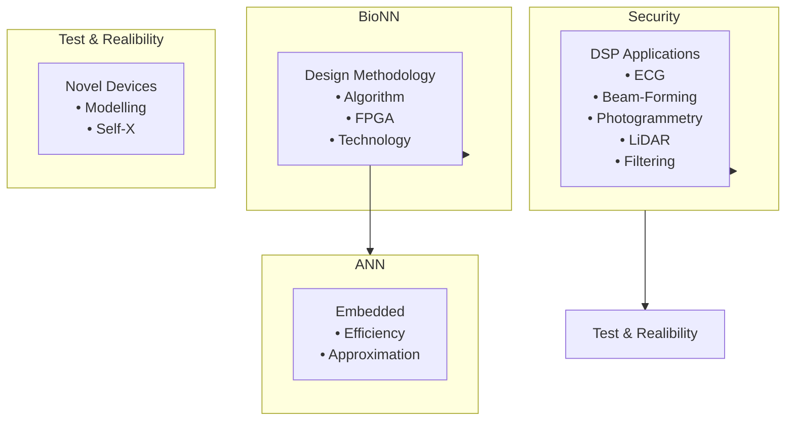
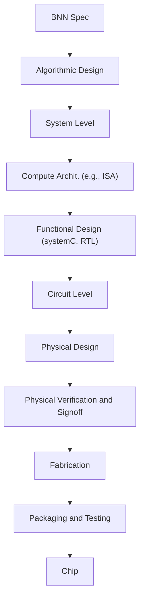
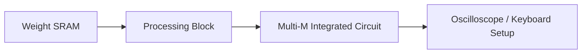

# Organisation und Einleitung

原始 PDF 第 1–15 页。

# Grundgebiete der Informatik 1

## Programmierung, Algorithmen und Datenstrukturen

Prof. Dr.‐Ing. Tobias Gemmeke

Integrierte Digitale Systeme und Schaltungsentwurf (IDS)

gemmeke@ids.rwth‐aachen.de

Chair of Integrated Digital Systems and Circuit Design

## RWTHAACHEN UNIVERSITY

**WS 2026/2027**

© T. Gemmeke, IDS, RWTH; R. Leupers, SSS

Herzlich Willkommen zur Einführung in die Informatik!

In diesem Bereich finden Sie ergänzende **Kommentare** zu den Folien, soweit diese nicht selbsterklärend sind.

Zusammen mit den Kommentaren sollten die Folien eine ausreichende Grundlage zur **Prüfungsvorbereitung** bilden. Es gibt kein spezielles Skript zu dieser Vorlesung, da zum Thema „Programmierung“ bereits eine Reihe von Büchern (siehe auch Hinweise im Lehr- und Lernportal Moodle) als Sekundärliteratur existiert.

Darüber hinaus wird natürlich auch die aktive Teilnahme an den **Übungen** dringend empfohlen, um den Stoff zu vertiefen.

**Korrekturen** und **Verbesserungsvorschläge** (am besten per email an den Dozenten) sind jederzeit erwünscht.

Bei **Fragen** zum Vorlesungsstoff stehen Ihnen der Dozent oder die Übungsleiter gerne zur Verfügung. Bitte vereinbaren Sie tel. oder per email einen Termin. Dies empfiehlt sich nicht erst während der Klausurvorbereitung!

1

---

## Inhalt

## 1. Einleitung

<u>1.1 Thematische Einordnung</u> 16
<u>1.2 Hardware und Software</u> 19
<u>1.3 Programmiersprachen</u> 22
<u>1.4 Algorithmen und Programme</u> 26

## 2. Einführendes Beispiel

<u>2.1 Temperaturumrechnung</u> 31
<u>2.2 Analyse des Beispiels</u> 35
<u>2.3 Ausführung und Fehlersuche</u> 42

## 3. Elementare Datentypen und Anweisungen

<u>3.1 Einführung</u> 47
<u>3.2 Variablen und Konstanten</u> 53
<u>3.3 Arithmetische und logische Operationen und Zuweisungen</u> 74
<u>3.4 Kontrollanweisungen</u> 81
<u>3.5 Zeiger</u> 59

2

2

---

## Inhalt

## 4. Funktionen und Programmaufbau

<u>4.1 Funktionen</u> 97
<u>4.2 Parameterübergabe</u> 107
<u>4.3 Polymorphie</u> 112
<u>4.4 Templates</u> 116
<u>4.5 Lambda Funktionen</u> 118
<u>4.6 Module und Programme</u> 120

## 5. Datentypen

<u>5.1 Arrays</u> 123
<u>5.2 Strukturen</u> 133
<u>5.3 Abstrakte Datentypen</u> 137
<u>5.4 Klassen</u> 139

<u>(De)Konstruktor</u> 141

<u>Public vs. private</u> 143

<u>Vererbung</u> 146

<u>Abstrakte Klassen</u> 150

<u>Überladen von Operatoren</u> 152

3

3

---

## Inhalt

## 6. Analyse von Algorithmen

<u>6.1 Laufzeitanalyse</u> 159
<u>6.2 O‐Notation für Wachstumsordnungen</u> 165
<u>6.3 Beispiel: Exponentialfunktion</u> 175
<u>6.4 Beispiel: Suchen in Arrays</u> 180

## 7. Sortieralgorithmen

<u>7.1 Einfache Verfahren (Selection/Insertion/Bubblesort)</u> 189
<u>7.2 Quicksort</u> 205
<u>7.3 Heapsort</u> 215

## 8. Lineare Datentypen

<u>8.1 Listen</u> 229
<u>8.2 Stacks</u> 242
<u>8.3 Queues</u> 251

## 9. Bäume

<u>9.1 Definition und Darstellung</u> 261
<u>9.2 Baumdurchläufe</u> 265
<u>9.3 Suchbäume</u> 269

4

4

---

## Inhalt

## 10. Graphen

<u>10.1 Definition und Grapheigenschaften</u> 277
<u>10.2 Berechnung kürzester Pfade</u> 283
<u>10.3 Datenstrukturen zur Graphrepräsentation</u> 294
<u>10.4 Graphdurchläufe</u> 300
<u>10.5 Spannbäume</u> 308

## 11. Techniken zum Algorithmenentwurf

<u>11.1 Rekursion und Iteration</u> 316
<u>11.2 Backtracking</u> 323
<u>11.3 Kombinatorische Optimierung</u> 330
<u>11.4 Schwierige Probleme und Heuristiken</u> 335
<u>11.5 Dynamische Programmierung</u> 341
<u>11.6 Branch and Bound</u> 346

5

5

---

## RWTH‐Studiengänge

• B.Sc. Elektrotechnik und Informationstechnik
• B.Sc. Computer Engineering
• B.Sc. Wirtschaftsingenieurwesen EET

6

© T. Gemmeke, IDS, RWTH; R. Leupers, SSS

6

---

## Übungsbetrieb

## • Koordination / Fachstudienbetreuung

– Dipl.‐Inform. Tatjana Eiden

## • Gemeinsame Globalübung

– Do 12:15‐13:15
– Vor allem: c/C++‐Programmierkurs
– Michael Gansen

## • Kleingruppenübungen:

– Interaktive Vertiefung und Ergänzung des Vorlesungsstoffes
– Tutoren: studentische Hilfskräfte
– Ca. 16 wöchentliche Termine zur Auswahl
– Vorauss. ab 2. Vorlesungswoche (siehe RWTHonline)

7

© T. Gemmeke, IDS, RWTH; R. Leupers, SSS

Aktuelle Informationen zum Übungsbetrieb sowie sonstige Informationen und Ankündigungen finden Sie auf der zugehörigen **Moodle-Seite**.

Die gemeinsame „Großübung“ ist hauptsächlich als **c/C++-Programmierkurs** für Programmieranfänger gedacht. Sie ist inhaltlich daher nur lose an die Vorlesung gekoppelt.

Zögern Sie nicht, vom Übungsangebot regen Gebrauch zu machen, denn „echte“Programmierung lernt man nur durch praktische Arbeit.

7

---

## Kleingruppenübungen

• Teilnahme nicht obligatorisch aber dringend empfohlen
• Anmeldungsinfo: **siehe RWTHonline**
• Anmeldeschluss beachten!
• **Gruppeneinteilung**: Benachrichtigung per email
• **Übungsaufgaben**: jeweils am Fr online über Moodle
Vorbereitungsaufgaben, Präsenzaufgaben und Nachbereitungsaufgaben

**Alle** Studierende mit 100 von 200 Punkten in den Hausübungen **haben** in 21/22 **bestanden.**

Teilnahme an der **Probeklausur** führte in 21/22 zu folgender **Verbesserung:**

$$
2 \xrightarrow {50\%} 1
$$

$$
3 \xrightarrow{90\%} <  3
$$

$$
4 \xrightarrow{90\%} <  4
$$

$$
5 \xrightarrow{80\%} <  5
$$

8

© T. Gemmeke, IDS, RWTH; R. Leupers, SSS

Die **Kleingruppenübungen** sind in erster Linie als eine interaktive Form der Übung gedacht, in der Aufgaben und Probleme mit dem Übungsleiter oder Kommilitonen intensiv diskutiert und gelöst werden können. Die Teilnahme macht vor allem dann Sinn, wenn auch regelmäßig die aktuellen Aufgaben bearbeitet werden.

8

---

## Organisatorisches

## Klausur

– 1. Versuch: siehe RWTHonline
– 2. Versuch: siehe RWTHonline

## • Fragestunde GGI1 bei Fr. Eiden

– Di 12:15‐13:45 (UMIC, ab 20.10.)
– Do 13:15‐14:00 (H02, ab 15.10.) im Anschluss an die Globalübung
– sowie nach vorheriger Absprache per E‐Mail

## • Aktuelle Nachrichten

– Siehe RWTHonline
– Sprechstunden bei Prof. Gemmeke n.V. per Email:
info@ids.rwth‐aachen.de

9

© T. Gemmeke, IDS, RWTH; R. Leupers, SSS

Weitere Einzelheiten zur **Klausur** werden rechtzeitig bekannt gegeben.

Das **CIP-Pool**-Angebot wendet sich in erster Linie an Studenten ohne jegliche Programmier- oder gar Computererfahrung. Hier besteht die Gelegenheit, Aufgaben unter fachlicher Anleitung zu lösen.

Der regelmäßige Besuch der **Moodle-Seite** wird dringend empfohlen, um aktuelle Neuigkeiten und Tipps von Kommilitonen zu erfahren.

9

---

## Literatur

B.W. Kernighan, D.M. Ritchie: Programmieren in C, 2. Auflage, Hanser, 1990, ISBN 3‐446‐15497‐3
R. Sedgewick: Algorithmen in C++, Addison‐Wesley, 2002, ISBN 3‐8273‐7026‐4
• In der Lehrbuchsammlung
• Kommentierte Vorlesungsfolien
Grundsätzlich auch andere Einführungen in die Programmierung als Hilfsmittel geeignet

**10**

© T. Gemmeke, IDS, RWTH; R. Leupers, SSS

Das Buch von **Kernighan/Ritchie** beinhaltet den Gebrauch der Programmiersprache C und stellt ein Standardwerk dar. Es bietet keine ausreichende Einführung in Algorithmen, ist aber als Nachschlagewerk sehr gut zu gebrauchen.

Das Buch von **Sedgewick** verwendet meist C++ (die objektorientierte Erweiterung von C) und behandelt Algorithmen und Datenstrukturen in umfangreicher Form, auch weit über den GGI1-Vorlesungsstoff hinaus.

Darüber hinaus existieren zahlreiche weitere **Lehrbücher und Skripten** zur Programmierung. Diese sind per Internetrecherche leicht zu finden. Für spezielle Hinweise sei wiederum auf den Moodle-Lernraum verwiesen.

10

---

## Über das IDS (www.ids.rwth‐aachen.de)

Lehrstuhl für Integrierte Digitale Systeme und Schaltungsentwurf (IDS)
• Schwerpunkte:
– Entwurfsmethodik integrierte digitale Schaltungen
– Beschleuniger für verschiedene Anwendungen:
• Simulation biologischer neuronaler Netzwerke
• Inferenz in künstlichen neuronalen Netzen
• Kryptographie
…

– Testmethoden

• Standort: UMIC Gebäude

– Mies‐van‐der‐Rohe Str. 15, RWTH Hörn Campus

natural_image

Exterior view of a modern multi-story office building with glass windows and surrounding green lawn (no signage or text visible)

**11**

text_image

en
7
cost A
model
cost B

© T. Gemmeke, IDS, RWTH; R. Leupers, SSS

Falls Sie sich bereits für „fortgeschrittene“ Software- oder Hardware-Themen interessieren, sind Sie herzlich eingeladen, das **IDS** einmal zu besuchen. Wir geben Ihnen gerne einen Einblick in die aktuellen Forschungsaktivitäten und Hinweise auf spätere. Vielleicht möchten Sie auch später einmal, z.B. als „HiWi“in Forschung oder Lehre, für uns tätig werden.

11

---

## Forschungsgebiete am Lehrstuhl IDS

flowchart

**12**

© T. Gemmeke, IDS, RWTH; R. Leupers, SSS

12

---

## Entwurfsablauf

Chip‐Entwurf

flowchart

vom Layout zum Bring‐Up

flowchart

13

© T. Gemmeke, IDS, RWTH; R. Leupers, SSS

13

---

## Kooperationsprojekte (Auswahl)

Advanced

Computing

natural_image

Illustration of a blue globe with three abstract digital icons representing neural networks and data, set against a dark background (no text or symbols)

Architectures (ACA)

text_image

ACA

natural_image

3D illustration of a human brain with colorful polyhedra and a grid-patterned head model (no text or symbols)

Neuro Sys

I&II

towards multi‐scale natural‐density

Neuromorphic Computing

natural_image

3D architectural rendering of a modern building with colorful structural elements, labeled 'active 3D' in the corner (no other text or symbols)

**14**

© T. Gemmeke, IDS, RWTH; R. Leupers, SSS

14

---

## IDS‐Lehrveranstaltungen

## Bachelor:

\*  Mehrere Lehrstühle tragen zur Durchführung der Veranstaltung bei

– Grundgebiete der Informatik 1 (GGI1)   1. Sem
– \*Projekt PETIT ("MATLAB meets LEGO Mindstorms„)   1. Sem
\*Praktikum Informatik   2 Teile
– VLSI Schaltungen & Architekturen (VLSI‐CA)   4. Sem Pflicht CE bzw. 6. Sem Wahl ET&IT
– \*Grundlagen Integrierter Schaltungen und Systeme (GISS)   5. Sem Wahl ME
Institutsprojekt „Anwendung von künstlichen neuronalen Netzen zur Linienverfolgung mit Braitenberg‐Vehikeln“   4. Sem
\*Praktikum Mikroelektronik   5. Sem Pflicht in ME
– Bachelor‐Arbeiten zu aktuellen Forschungsthemen

## Master

– VLSI Design for Digital Signal Processing – Fundamentals (VLSI‐DF)
– VLSI Design for Digital Signal Processing – Architecturs (VLSI‐DA)
– Computer Arithmetic – Fundamentals (CAR‐F)
– Computer Arithmetic – Advanced Topics (CAR‐A)
– Laboratory: VLSI Design
– Laboratory: FPGA Design
– Master‐Arbeiten zu aktuellen Forschungsthemen

**15**

© T. Gemmeke, IDS, RWTH; R. Leupers, SSS

Genauere Informationen zu diesen Veranstaltungen finden Sie im Menüpunkt „Studium“ auf der IDS Homepage: **www.ids.rwth-aachen.de**

15
