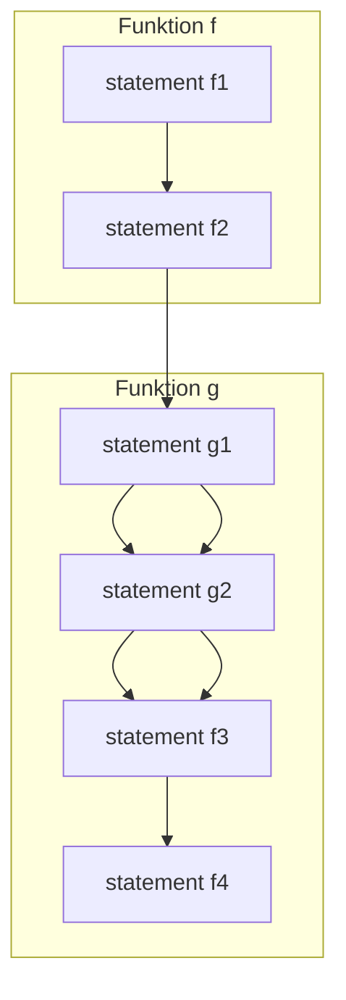
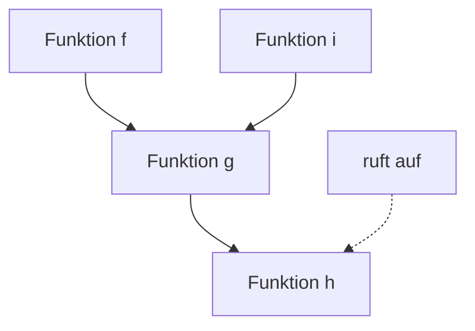
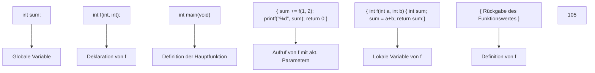
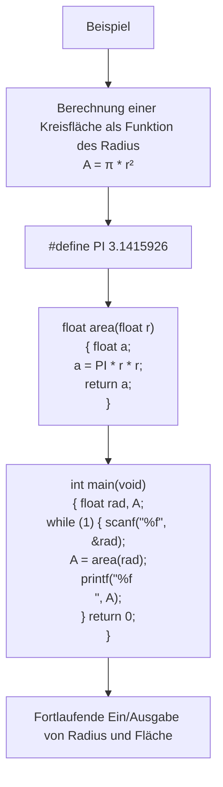
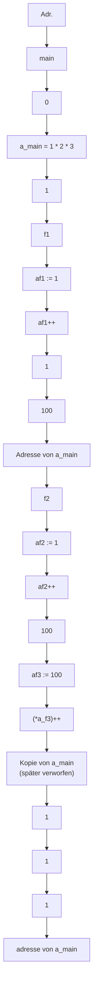
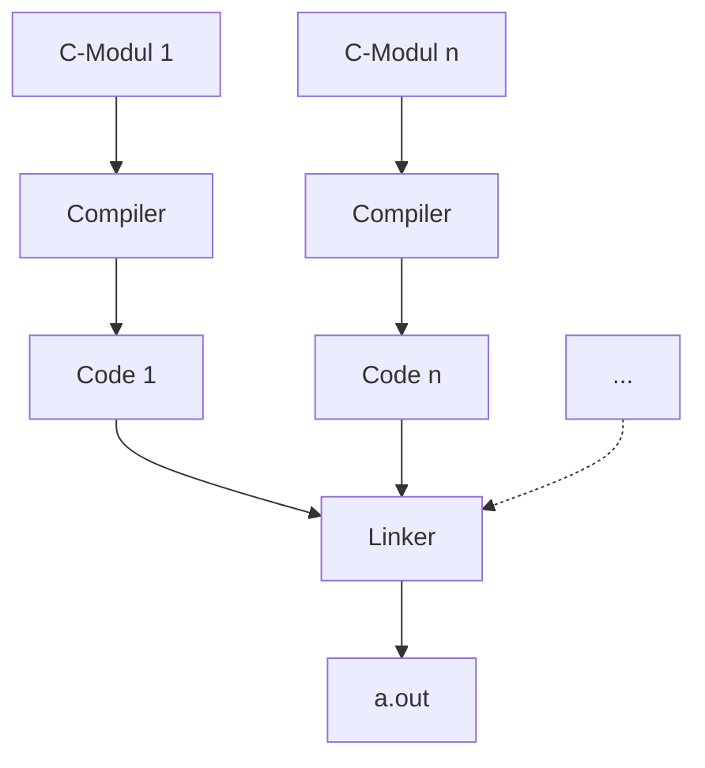

# 4. Funktionen und Programmaufbau

原始 PDF 第 97–122 页。

## 4. Funktionen und Programmaufbau

## 4.1 Funktionen

4.2 Parameterübergabe
4.3 Polymorhpie
4.4 Templates
4.5 Lambda Funktionen
4.6 Module und Programme

97

© T. Gemmeke, IDS, RWTH; R. Leupers, SSS

97

---

## Funktionen und Programmaufbau

**Def**.: Das **kartesische Produkt** $A \times B$ zweier Mengen 𝐴 und 𝐵 ist definiert durch

$$
A \times B = \{(a, b) \mid a \in A, b \in B \}
$$

**Def**.: Eine (binäre) **Relation** 𝑅 ist eine Teilmenge des kartesischen Produktes zweier Mengen: $R \subseteq A \times B$

**Def**.: Eine **Funktion** 𝐹 ∶ 𝐴 → 𝐵 ist eine rechtseindeutige Relation, <u>d.h. jedem</u> ${ \mathfrak { a } } \in A$ <u>ist höchstens ein</u> $b \in B$ <u>zugeordnet.</u>

In **Programmiersprachen**: Eine Funktion (oder: Prozedur, Subroutine) ist ein abgegrenztes **Teilprogramm**, welches aus einer Menge von **Eingabeparametern** eine fest definierte **Ausgabe** erzeugt
**Verwendung**: Einkapselung von häufig benötigten Teilprogrammen, Aufruf aus anderen Teilprogrammen

**98**

© T. Gemmeke, IDS, RWTH; R. Leupers, SSS

Funktionen in höheren Programmiersprachen wie C sind dem mathematischen **Funktionsbegriff** entlehnt.

Man stelle sich eine Code-Folge vor, die mehrmals im Programm vorkommt, z.B. eine mathematische Formel. Anstatt dieses Codestück mehrmals zu schreiben – was nicht nur Zeit beim Erstellen des Programms und Speicherplatz im ausführbaren Programm kostet, sondern auch eine häufige “Cut&Paste”- Fehlerquelle darstellt – kann der Code-Abschnitt in eine Funktion **gekapselt** werden, die von jeder Stelle des Programms aus verwendet werden kann.

Die **Hauptgründe**, Funktionen zu verwenden sind:

- Wiederverwendung von Code
- Übersichtlichkeit, bessere Lesbarkeit
- Modularisierung
- bessere Wartbarkeit

98

---

## Modell der Funktionsabarbeitung

**Zu jedem Zeitpunkt** befindet sich das Programm innerhalb einer bestimmten Funktion f
• Zu Beginn ist dies die Funktion main (s.o.)
Ausführung von f kann durch **Aufruf** einer anderen Funktion g jederzeit **unterbrochen** werden
• f übergibt **Parameter** an g
• g berechnet einen **Funktionswert** und springt an **Aufrufstelle** in f zurück


<details>
<summary>flowchart</summary>


</details>

**99**

© T. Gemmeke, IDS, RWTH; R. Leupers, SSS

Der zugehörige Code zu der obigen Darstellung könnte so aussehen:

```c
int g(int a, int b)
{
    a=0;  // g1
    b=a;  // g2
    return b;
}

int f(void)
{
    int x, y, z;
    x=1;          // f1
    y=0;          // f2
    z = g(x, y);  // Aufruf von g mit Übergabe von x und y
    printf("Rücksprung von g nach f"); // f3
    return z;      // f4
}
```

99

---

## Modell der Funktionsabarbeitung

Während der Ausführung kann g ihrerseits **weitere Funktionen** aufrufen (verschachtelte Funktionsaufrufe)
Ebenso können nach Ausführung von f auch **andere Funktionen** auf g zurückgreifen
**Vorteil**: Programmcode für mehrfach verwendete Routinen muss nur einmal vorhanden sein
– bessere **Wartbarkeit**
– geringere **Codegröße**


<details>
<summary>flowchart</summary>


</details>

**100**

© T. Gemmeke, IDS, RWTH; R. Leupers, SSS

Mit Hilfe von Funktionen können beliebig komplexe Aufrufhierarchien erzeugt werden. Funktionen können nicht nur andere Funktionen, sondern auch sich selbst aufrufen, diesen Fall nennt man **Rekursion**.

100

---

## Funktionen

• Funktionen besitzen eine **Deklaration** und eine **Definition**
**Deklaration**: Name, Definitionsbereich, Wertebereich (d.h. **Interface** der Funktion nach außen)
• **Definition**: Programmcode zur **Implementierung** der gewünschten Funktionalität
Erfolgt die Definition vor der ersten Verwendung einer Funktion, so darf die Deklaration **entfallen**
• **Allgemeine Form der Deklaration**:

```txt
- Typ ID (Parameter-Deklaration*);
- Parameter-Deklaration syntaktisch wie Variablendeklaration
- Jedoch: Parameter-ID kann auch entfallen
- float max(float x, float y);
    oder
    float max(float, float);
- Deklariert Funktion max: float × float → float
```

**101**

© T. Gemmeke, IDS, RWTH; R. Leupers, SSS

Eine Funktion sollte in einem Programm erst verwendet werden, nachdem sie dem Compiler bekannt gemacht (**deklariert**) wurde. Hierzu reicht ein einfacher Prototyp aus, in dem die Namen der Übergabeparameter fehlen können.

In der **Funktionsdefinition** wird die Funktionalität der Funktion programmiert.

Beispiel:

```txt
double quadrat (double); // Funktionsdeklaration

int main(void)
{
    double a, b = 12;
    a = quadrat(b);  // Funktionsaufruf
    return 0;
}

double quadrat(double x) // Funktionsdefinition
{
    return x*x;
}
```

101

---

## Funktionsdefinitionen

• **Allgemeine Form**:
– Typ ID (Parameter‐Deklaration\*) { statement\* }
Interface‐Definition **muss** vorheriger Deklaration entsprechen (falls vorhanden)
**Funktionsrumpf** innerhalb { /\* ... \*/ } kann beliebige Statements enthalten
Verlassen einer Funktion durch return**‐Statement**
– return Ausdruck;
– Typ von Ausdruck muss dem **Wertebereich** der Funktion entsprechen (falls nötig: type cast)
– Funktionen können **nicht** per goto verlassen werden (Labels nur gültig **innerhalb** einer Funktion)

**102**

© T. Gemmeke, IDS, RWTH; R. Leupers, SSS

Da eine Funktion im allgemeinen einen Wert zurückliefert, beginnt eine Funktionsdefinition immer mit einer Typangabe, gefolgt von einem eindeutigen Funktionsnamen. Der Rückgabewert der Funktion wird mit Hilfe des **return-Statements** an die aufrufende Funktion zurückgeliefert.

Es gibt auch Funktionen ohne Rückgabewerte, in diesem Fall wird der Typ **void** („leerer Typ“) als Funktionstyp angegeben. Die return-Anweisung darf in diesem Fall fehlen. Erreicht die Funktion ihr Ende, springt der Programmablauf automatisch zurück zur aufrufenden Funktion.

102

---

## Funktionsaufrufe

Kommunikation zwischen **aufrufender** (caller) und **aufgerufener** (callee) Funktion: void f(void) { int x; /\* ... ruft g auf \*/ }; int g(int a, int b) { return a+b; }
• a und b sind die **formalen Parameter** der Funktion g gemäß Deklaration
Aufruf von g durch f per Namen und Übergabe **der aktuellen Parameter**, z.B.
– In g werden die „Platzhalter“ a und b durch 1 bzw. 2 ersetzt, g wird ausgeführt und per return beendet
– Der Ausdruck g(1,2) liefert dann den **Rückgabewert** 3; dieser kann z.B. an eine Variable (hier: x) zur Weiterverarbeitung zugewiesen werden

$$
- x = g (1, 2);
$$

**103**

© T. Gemmeke, IDS, RWTH; R. Leupers, SSS

In runden Klammern hinter dem Funktionsnamen in der Funktionsdefinition folgt die Parameterliste, die der Funktion übergeben wird. Jeder Parameter muss einzeln mit einem Typ versehen werden. Einzelne Parameter werden durch Kommata getrennt. Die Namen der **formalen Parameter** sind Platzhalter für die **aktuellen Parameter**, die beim Aufruf an die Funktion übergeben werden.

Aktuelle Parameter können Konstanten, Variablen oder auch Ausdrücke sein, die vor dem Funktionsaufruf zunächst ausgewertet werden. Beispielsweise können auch die Rückgabewerte von Funktionsaufrufen wiederum als aktuelle Parameter übergeben werden: x = f(y, g(a,b)).

103

---

## Lokale und globale Variablen

Zwei Arten von Variablen:

– **Globale Variablen** sind im gesamten Programm **gültig** (d.h. können zugegriffen werden)
– **Lokale Variablen** sind nur in einer bestimmten Funktion gültig (ebenso wie **formale Funktionsparameter**)
– Lokale Variablen können globale Variablen gleichen Namens **verdecken**

Globale Variablen sollten zur besseren Programm‐Wartbarkeit **möglichst selten** verwendet werden (sonst Gefahr von unerwünschten Seiteneffekten)

```c
int a=2, b=2, i=10;
int f(int a, int b)
{
    int i;
    i = a+b;
    return i;
}
int main(void)
{
    /* ... */
    i -= f(a, b);
    return 0;
}
```

**104**

© T. Gemmeke, IDS, RWTH; R. Leupers, SSS

**Lokale** und **globale Variablen** unterscheiden sich hinsichtlich ihres Gültigkeitsbereichs. Im obigen Beispiel sind die Variablen a, b und i global, d.h. außerhalb der main-Funktion und außerhalb der Funktion f, deklariert.

Innerhalb von f wird die Variable i erneut deklariert, damit wird die globale Variable i von der lokalen verdeckt, d.h. auf die globale Variable i kann von f aus nicht mehr zugegriffen werden. Ebenso verhält es sich mit den formalen Parametern a und b der Funktion f, welche die globalen Variablen a und b verdecken. Auf die globalen Variablen a und b kann von f aus ebenfalls nicht mehr zugegriffen werden.

Das Beispiel zeigt bereits, dass durch die gleiche Namensgebung von lokalen und globalen Variablen leicht **Verwechselungsgefahr** besteht und damit unerwünschte Seiteneffekte auftreten können. Daher sollte auf die Verwendung von globalen Variablen weitgehend verzichtet werden.

104

---

Funktionen auf einen Blick


<details>
<summary>flowchart</summary>


</details>

Im Beispiel wird sowohl die **globale** Variable sum deklariert als auch innerhalb von f die **lokale** Variable sum. Innerhalb von f kann auf die globale Variable sum nicht zugegriffen werden. In der main-Funktion wird die globale Variable sum verwendet.

Die **formalen** Parameter a und b von f werden beim Aufruf durch die **aktuellen** Parameter 1 und 2 ersetzt. Der Aufruf von f liefert den Rückgabewert 3 zurück, der zum Wert der globalen Variable sum addiert und ausgegeben wird.

Der Vollständigkeit halber sollte die globale Variable sum mit 0 **initialisiert** werden (int sum = 0;), obwohl ein korrekter Compiler globale Variablen automatisch mit 0 initialisiert, sofern nichts anderes angegeben ist.

105

---


<details>
<summary>flowchart</summary>


</details>

Hier wird fortlaufend der Radius als **Benutzereingabe** eingelesen, die Kreisfläche mit Hilfe der Funktion area berechnet und anschließend ausgegeben. Die Kreiszahl Pi wird durch eine Präprozessoranweisung als Konstante definiert. Die Funktion area berechnet aus dem übergebenen Radius r und der Kreiszahl pi die **Kreisfläche** A und gibt diese als Rückgabewert zurück.

106

---

## 4. Funktionen und Programmaufbau

4.1 Funktionen
**4.2 Parameterübergabe**
4.3 Polymorhpie
4.4 Templates
4.5 Lambda Funktionen
4.6 Module und Programme

**107**

© T. Gemmeke, IDS, RWTH; R. Leupers, SSS

107

---

## Wert‐ und Referenzparameter

Bei Übergabe eines Wertes w an eine Funktion f wird dem formalen Parameter von f eine **lokale Kopie** von w zugewiesen (call by value)
f arbeitet nur mit der Kopie, kann w **nicht modifizieren**
Falls Modifikation von w erwünscht: Übergabe als **Referenzparameter** (call by reference)
– in C nur call‐by‐value (f1)
– in C++: Operator & (f2)C++
– **Nachbildung** in C: call by value mit Zeiger auf w (f3)

```c
void f1(int a) { a++; }
void f2(int& a) { a++; }
void f3(int* a) { (*a)++; }

int main(void)
{
    int a;
    a = 1;
    f1(a);  // a = 1
    f2(a);  // a = 2
    f3(&a); // a = 3
    return 0;
}
```

**108**

© T. Gemmeke, IDS, RWTH; R. Leupers, SSS

Alle Parameter, die an Funktionen übergeben werden, werden grundsätzlich **kopiert**, dieses Konzept wird **call-by-value** genannt. D.h. es wird nicht das Parameterobjekt selbst übergeben, sondern nur dessen Wert. Dies hat folgende Auswirkungen:

• Änderungen an einem Parameter in einer Funktion erscheinen nicht in der aufrufenden Funktion
• Soll eine Funktion einen Wert trotzdem dauerhaft ändern, so muss die Adresse des Wertes via Zeiger übergeben werden, damit die aufgerufene Funktion Zugriff auf das Parameterobjekt bekommt.
• Werden Strukturen übergeben, so wird von ihnen eine Kopie erstellt, was bei großen Strukturen viel Zeit und Arbeitsspeicher kostet. Deshalb wird häufig nur die Adresse von Strukturen übergeben, da die Adresse viel schneller und platzsparender als die Struktur selbst kopiert werden kann.

In C++ gibt es die Möglichkeit, Referenzparameter einzusetzen. Hier wird keine Kopie eines übergebenen Wertes angelegt, sondern eine Referenz auf den Wert. Dieses Konzept nennt man **call-by-reference**.

In C ist eine Parameterübergabe nur call-by-value möglich. Soll keine Kopie angelegt werden, so muss die Parameterübergabe per **Zeiger** geschehen.

108

---

Wert‐ und Referenzparameter


<details>
<summary>flowchart</summary>


</details>

**109**

© T. Gemmeke, IDS, RWTH; R. Leupers, SSS

Die in der main-Funktion deklarierte und mit 1 initialisierte lokale Variable a wird zunächst per **call by value** an die Funktion f1 übergeben. Die

Inkrementierung von a in f1 hat daher keine Auswirkung in main, da sie auf der lokalen Kopie erfolgt, die nach dem Aufruf von f1 wieder verworfen wird. a hat nach Aufruf von f1 immer noch den Wert 1.

Im Falle von c++ (hier nicht abgebildet) hätte eine anschließende

Inkrementierung von a in f2 (siehe vorhergehende Darstellung) sehr wohl eine Auswirkung in main, da an f2 die **Referenz** von a übergeben würde. a hätte daher nach dem Aufruf von f2 bereits den Wert 2.

Die abschließende Inkrementierung von a in f3 wirkt sich in main aus, da ein **Zeiger** auf a, d.h. die Adresse von a, an f3 übergeben wird. a hat daher nach dem Aufruf von f3 den Wert 2.

109

---

**Beispiel**: komplexe Zahlen c = (a,b) Realteil a, Imaginärteil b
**Produkt** zweier komplexer Zahlen
Komplexe Zahlen sind **kein Basis‐Datentyp** in C
**Naive Lösung**: zwei Funktionen für Real‐ und Imaginärteil

Funktionen mit mehreren Rückgabewerten

```c
float prd_real(float a1, float a2,
        float b1, float b2)
{
    return a1*a2-b1*b2;
}

float prd_imag(float a1, float a2,
        float b1, float b2)
{
    return a1*b2+a2*b1;
}

int main(void)
{
    float c_real, c_imag;
    c_real = prd_real( /* ... */ );
    c_imag = prd_imag( /* ... */ );
    return 0;
}
```

**110**

© T. Gemmeke, IDS, RWTH; R. Leupers, SSS

Als **Rückgabewerte** von Funktionen kommen alle in C **gültigen Datentypen** in Frage. Für komplexe Zahlen existiert in C jedoch kein gültiger Basis-Datentyp. Will man eine Funktion für komplexe Zahlen implementieren – beispielsweise das Produkt zweier komplexer Zahlen -, die als Rückgabewert ebenfalls eine komplexe Zahl ergibt, so ist dies nur über „Umwege“ möglich. Im obigen Beispiel ist die naive Lösung mit zwei Funktionen für den Real- und Imaginärteil angegeben.

110

---

Funktionen mit mehreren Rückgabewerten

<div class="docvortex-algorithm" style="white-space: pre-wrap; font-family:monospace;">
- Definition des Datentyps
complex als struct
- structs werden als
Wertparameter übergeben
- D.h. evtl. kopieren großer
Speicherblöcke (langsam)
- Übergabe als
Referenzparameter (per
Zeiger) evtl. besser
- Arrays (s.u.) werden immer
als Referenzparameter
übergeben
- Arrays als Rückgabewert
unzulässig (warum?)
</div>

**111**

© T. Gemmeke, IDS, RWTH; R. Leupers, SSS

Eine bessere und lesbarere Variante hierfür ist die **Definition eines neuen Datentyps complex** als Struktur mit Realteil und Imaginärteil als Komponenten.

Dieser neue Datentyp kann nun sowohl als Parametertyp als auch als Rückgabetyp bei Funktionen verwendet werden.

Zu beachten ist, dass structs bei der Parameterübergabe (außer natürlich bei explizitem Gebrauch des Adressoperators „&“) immer **call-by-value** übergeben werden, was je nach Größe der Struktur viel Zeit und Speicherplatz kostet. Deshalb wird häufig nur die Adresse von Strukturen übergeben, da die Adresse viel schneller und platzsparender als die Struktur selbst kopiert werden kann.

111

---

## 4. Funktionen und Programmaufbau

4.1 Funktionen
4.2 Parameterübergabe
4.4 Templates
4.5 Lambda Funktionen
4.6 Module und Programme

## 4.3 Polymorhpie

**112**

© T. Gemmeke, IDS, RWTH; R. Leupers, SSS

112

---

## Polymorphie

C++

• Auswahl der Funktionsdefinition in Abhängigkeit der Operanden

<div class="docvortex-algorithm" style="white-space: pre-wrap; font-family:monospace;">
#include &lt;stdio.h&gt;
#include &lt;math.h&gt;

// most of the time we compute square root
    float root(float x) {
        return pow(x,1/2.0);
    }

// ... but we can do any root
    float root(float x, float y) {
        return pow(x,1/y);
    }

int main( void )
{
    float x1 = 4, x2 = 27;

    printf("Square root of %.1f = %.3f\n", x1, root(x1));
    printf("Cubic root of %.1f = %.3f\n", x2, root(x2,3));

    return 0;
}
</div>

In C++, we can have different declarations for the same symbol of a function – this is called **polymorphism**. In c this is not possible. As an example, we want to compute the root of a number, which frequently is simply the square root. In this case, a single input parameter is required as given in the first declaration of the function root.

In c, only one of the declarations of root be included at a given time.

Activating both in C++ triggers the compiler to select the appropriate declaration during compile-time. The decision is based on the number of provided parameters given in the function call. As this decision is done prior to execution we call this **static polymorphism**.

113

---

## Polymorphie

C++

• Auswahl der Funktionsdefinition in Abhängigkeit der Operanden

```c
#include <stdio.h>

    #define TEST_INT
    #define TEST_FLOAT

#ifdef TEST_INT
int mult(int a, int b) {
    printf("Integer: %d x %d = %d\n", a, b, a*b);
    return a*b;
}
#endif

#ifdef TEST_FLOAT
float mult(float a, float b) {
    printf("Float: %.2f x %.2f = %.2f\n", a, b, a*b);
    return a*b;
}
#endif

int main( void )
{
    int i_a = 3, i_b = 4;
    float f_a = 3.1, f_b = 4.5;

    mult(i_a,i_b);
    mult(f_a,f_b);

    return 0;
}
```

**114**

(dynamische Polymorphie folgt später ...)

© T. Gemmeke, IDS, RWTH; R. Leupers, SSS

In this second example, we want to compute the result of a multiplication. In c, only one of the define blocks can be activated at a given time. Type-casting will be applied to convert the input operands to match the declaration of the function.

Activating both in C++ triggers the compiler to select the appropriate definition during compile time as can be seen in the output of the console. The decision is based on the type of the parameters given in the function call. As this decision is again done during compile-time we call this **static polymorphism**.

We will discuss dynamic (or run-time) polymorphism later on.

114

---

## Funktionen als Parameter

Funktionen sind keine Variablen, besitzen aber eine **Speicheradresse**
Daher gibt es **Zeiger auf Funktionen**, diese können als **Parameter** übergeben und „aufgerufen“ werden

Sinnvoll, falls **Aufrufstruktur** der Funktionen nicht statisch festliegen soll

Bsp.:

```txt
- Funktion f:
    int f(float, float);
- Zeiger auf f:
    int (*p)(float,float);
    p = &f;
```

```c
#include <stdio.h>
int add(int a, int b)
{
    return a+b;
}

int sub(int a, int b)
{
    return a-b;
}

int op(int (*f)(int,int), int a, int b)
{
    return f(a, b);
}

int main(void)
{
    char c;
    int result;
    scanf("%c", &c);
    if (c == 'a')
        result = op(add, 1, 2);
    else if (c == 's')
        result = op(sub, 1, 2);
    printf("%d\n", result);
    return 0;
}
```

**115**

© T. Gemmeke, IDS, RWTH; R. Leupers, SSS

In C ist der Name einer Funktion keine Variable, sondern (wie ein Arrayname) eine Adresskonstante. Es können deshalb Zeiger auf Funktionen definiert werden, die man dann wie Variablen verwenden kann. Damit wird es möglich, Funktionen als Parameter an Funktionen zu übergeben.

Solche **Funktionszeiger** werden beispielsweise benötigt, um dem Betriebssystem mitzuteilen, welche Funktionen des Anwenderprogramms aufzurufen sind, wenn bestimmte Ereignisse eintreten. So wird beispielsweise eine Signalbehandlung durchgeführt. Dabei meldet das Anwenderprogramm dem Betriebssystem die Funktion, die es aufrufen soll, wenn das Programm terminiert wird. In dieser Funktion kann die Anwendung noch ordnungsgemäß ihre Daten sichern, bevor es dem Betriebssystem „gehorcht“ und sich beendet.

115

---

## 4. Funktionen und Programmaufbau

4.1 Funktionen
4.2 Parameterübergabe
4.3 Polymorhpie
**4.4 Templates**
4.5 Lambda Funktionen
4.6 Module und Programme

**116**

© T. Gemmeke, IDS, RWTH; R. Leupers, SSS

116

---


<details>
<summary>flowchart</summary>

```mermaid
graph TD
  A["Template"] --> B["Typ als Variable"]
  B --> C["#include <cstdio><br>  B --> D[&quot;template <typename T><br>  C --> E[&quot;int mult(int a, int b) {<br>  C --> F[&quot;printf(&quot;Integer: %d x %d = %d\n&quot;, a, b, a*b);<br>  C --> G[&quot;return a*b;"]
  F --> H["float mult(float a, float b) {<br>  F --> I[&quot;printf(&quot;Float: %.2f x %.2f = %.2f\n&quot;, a, b, a*b);<br>  F --> J[&quot;return a*b;<br>  end"]
  style E fill:#fff,stroke:#333
  style F fill:#fff,stroke:#333
  style G fill:#fff,stroke:#333
  style H fill:#fff,stroke:#333
  style I fill:#fff,stroke:#333
  style J fill:#fff,stroke:#333
  style K fill:#fff,stroke:#333
  style L fill:#fff,stroke:#333
  style M fill:#fff,stroke:#333
  style N fill:#fff,stroke:#333
  style O fill:#fff,stroke:#333
  style P fill:#fff,stroke:#333
  style Q fill:#fff,stroke:#333
  style R fill:#fff,stroke:#333
  style S fill:#fff,stroke:#333
  style T fill:#fff,stroke:#333
  style U fill:#fff,stroke:#333
  style V fill:#fff,stroke:#333
  style W fill:#fff,stroke:#333
  style X fill:#fff,stroke:#333
  style Y fill:#fff,stroke:#333
  style Z fill:#fff,stroke:#333
  style AA fill:#fff,stroke:#333
  style AB fill:#fff,stroke:#333
  style AC fill:#fff,stroke:#333
  style AD fill:#fff,stroke:#333
  style AE fill:#fff,stroke:#333
  style AF fill:#fff,stroke:#333
  style AG fill:#fff,stroke:#333
  style AH fill:#fff,stroke:#333
  style AI fill:#fff,stroke:#333
  style AJ fill:#fff,stroke:#333
  style AK fill:#fff,stroke:#333
  style AL fill:#fff,stroke:#333
  style AM fill:#fff,stroke:#333
  style AN fill:#fff,stroke:#333
  style AO fill:#fff,stroke:#333
  style AP fill:#fff,stroke:#333
  style AQ fill:#fff,stroke:#333
  style AR fill:#fff,stroke:#333
  style AS fill:#fff,stroke:#333
  style AT fill:#fff,stroke:#333
  style AU fill:#fff,stroke:#333
  style AV fill:#fff,stroke:#333
  style AW fill:#fff,stroke:#333
  style AX fill:#fff,stroke:#333
  style AY fill:#fff,stroke:#333
  style AZ fill:#fff,stroke:#333
  style AL fill:#fff,stroke:#333
  style AM fill:#fff,stroke:#333
  style AN fill:#fff,stroke:#333
  style AO fill:#fff,stroke:#333
  style AP fill:#fff,stroke:#333
  style AQ fill:#fff,stroke:#333
  style AR fill:#fff,stroke:#33<nl>
```
</details>

Writing a dedicated function for each type we want to use appears cumbersome.

To resolve this, C++ provides the possibility to define **templates**. A template declaration precedes the function declaration and introduces a placeholder for the type using the keyword typename.

In the declaration of the function the placeholder (typically the letter ‘T’) is used in the places where normally we would have a specific type written.

117

---

## 4. Funktionen und Programmaufbau

4.1 Funktionen
4.2 Parameterübergabe
4.3 Polymorhpie
4.4 Templates
**4.5 Lambda Funktionen**
4.6 Module und Programme

**118**

© T. Gemmeke, IDS, RWTH; R. Leupers, SSS

118

---


<details>
<summary>flowchart</summary>

```mermaid
graph TD
  #include <iostream>
  #include <string>
  using namespace std;

  // Regular Function
  void report_age1(int val) {
    cout << "My age is " << val << endl;
  }

  int main( void )
  {
    int age = 23;

    // Lambda Function
    auto report_age2 = [](int val) --> string { return "My age is " + to_string(val); };
    auto report_age3 = [age]() --> string { return "My age is " + to_string(age); };

    report_age1(19);
    cout << report_age2(21) << endl;
    cout << report_age3() << endl;

    return 0;
  }
  #include <iostream>
  #include <string>
  using namespace std;

  #include <iostream>
  #include <string>
  using namespace std;

  // Regular Function
  void report_age1(int val) {
    cout << "My age is " << val << endl;
  }

  int main( void )
  {
    int age = 23;

    // Lambda Function
    auto report_age2 = [](int val) --> string { return "My age is " + to_string(val); };
    auto report_age3 = [image]() --> string { return "My age is " + to_string(age); };

    report_age1(19);
    cout << report_age2(21) << endl;
    cout << report_age3() << endl;

    return 0;
  }
  #include <iostream>
  #include <string>
  using namespace std;

  #include <iostream>
  #include <string>
  using namespace std;

  #include <iostream>
  #include <string>
  using namespace std;

  #include <iostream>
  #include <string>
  using namespace std;

  #include <iostream>
  #include <string>
  using namespace std;

  #include <iostream>
  #include <string>
  using namespace std;

  #include <iostream>
  #include <string>
  using ripple

  Anwendung von lambda-Funktionen
  Lokale und einmalige Nutzung
  Kein spezifischer Name
  Kleiner Funktionsumfang (,body')

  Falls die lokale Variable in der lambda-Funktion geändert werden soll, ist ein ein call-by-reference erforderlich. Hier wäre dies:
  "... [&age] ...".
```
</details>

Consider the basic example of report\_age1, that is used to display an int value in nice context.

In the **2**<strong><sup>nd</sup></strong> function report\_age2 the input parameter of type int is converted to a nicely formatted result of type string.

**Lambda** functions are brief ways to define a function. They are used in case of

- local and single use,
- no specific name, or
- small function bodies.

As shown in the **3**<strong><sup>rd</sup></strong> example, they can also overcome cases where a unary function must be used, but you would like to provide multiple parameters. The parameter age provides access to the local variable within the context of the lambda function.

If you wanted to modify the local variable, you have to use call-by-reference. Here, it would be “... [&age] ...” to update age within the lambda function.

119

---

## 4. Funktionen und Programmaufbau

4.1 Funktionen
4.2 Parameterübergabe
4.3 Polymorhpie
4.4 Templates
4.5 Lambda Funktionen
**4.6 Module und Programme**

**120**

© T. Gemmeke, IDS, RWTH; R. Leupers, SSS

120

---

## Module und Programme

C‐Compiler übersetzt immer **ein einzelnes** C‐Modul
**Modul** = globale Variablen und Funktionen
Entwicklung von Modulen kann **parallel** erfolgen
Modul (z.B. Library) muss nicht unbedingt **main‐Funktion** enthalten
Komplettes **C‐Programm** wird aus einzelnen Modulen zusammengesetzt (durch den Linker)
C‐Programm muss **genau eine** main‐Funktion enthalten
**Globale Variablen** und **Funktionen** gleichen Namens dürfen nur einmal vorkommen

**121**


<details>
<summary>flowchart</summary>


</details>

© T. Gemmeke, IDS, RWTH; R. Leupers, SSS

Module sind selbständig übersetzbare Programmeinheiten. Der Sinn der modularen Erstellung von Programmsystemen liegt darin, zusammengehörige Quellcodes in separaten Dateien zusammenzufassen.

Ein **Modul** bündelt typischerweise verschiedene logisch zusammengehörige Funktionen, die durch Programme bzw. andere Module genutzt werden können. Ein Modul kann jedoch nicht nur Funktionen, sondern auch Datentypen, Variablen und symbolische Konstanten exportieren.

Ein Modul besteht häufig aus zwei Teilen:

• einem Interfaceteil, der für andere Module sichtbar die Schnittstelle der zu exportierenden Ressourcen beschreibt,
• einem Implementationsteil, in dem diese Ressourcen realisiert werden; die nicht im Interfaceteil beschriebenen Ressourcen des Moduls sind für andere Module nicht sichtbar.

Die Trennung in Interface- und Implementationsteil wird unterschiedlich realisiert (z.B. über Header-Datei und Library).

121

---

## Module und Programme

Zweckmäßig: **Trennung** von Deklarationen und Definitionen in zwei Dateien (meist: \*.h und \*.c)
Deklarationen im **Header File**
Header File kann von allen C‐Modulen **eingebunden** werden

```c
#include "lib.h"    main.c
int main(void)
{
    /* ... */
    a = sqrt( /* ... */ );
    b = sin( /* ... */ );
    c = cos( /* ... */ );
    return 0;
}
```

```txt
/* Library lib.h
  mit math. Funktionen */
float sqrt( /* ... */ );
float sin( /* ... */ );
float cos( /* ... */ );
```

```txt
/* Implementierung     lib.c
  der math. Funktionen */
float sqrt( /* ... */ )
  { /* ... */ }
float sin( /* ... */ )
  { /* ... */ }
float cos( /* ... */ )
  { /* ... */ }
```

**122**

© T. Gemmeke, IDS, RWTH; R. Leupers, SSS

Im obigen Beispiel ist eine Trennung von Interfaceteil und Implementationsteil durch Aufteilung der Deklarationen im **Header File** (hier: lib.h) und der eigentlichen Implementierung im **Source File** (hier: lib.c) dargestellt. Das Header File kann nun per Präprozessor-Include von sämtlichen C-Sourcen (hier: main.c) eingebunden werden.

122
