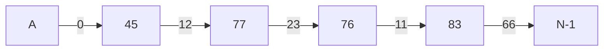

# 6. Analyse von Algorithmen

原始 PDF 第 159–188 页。

## 6. Analyse von Algorithmen

## 6.1 Laufzeitanalyse

6.2 𝒪‐Notation für Wachstumsordnungen
6.3 Beispiel: Exponentialfunktion
6.4 Beispiel: Suchen in Arrays

**159**

© T. Gemmeke, IDS, RWTH; R. Leupers, SSS

159

---

## Analyse von Algorithmen

Für jedes Problem gibt es **viele mögliche** Algorithmen und Implementierungen
Häufig gesucht: **effizienteste/schnellste** Implementierung
• Wie wird diese bestimmt?

```c
#define n 10

/* ... */

    int fact, count;

    fact = 1;

    for (count = 1; count <= n; count++) {
        fact *= count;
    }

    printf("factorial(%d) = %d", n, fact);
```

– Algorithmenentwicklung ist ein **kreativer** Prozess

– **Analyse** eines gegebenen Algorithmus mittels **Wachstumsordnungen**

• Bsp.: Fakultätsfunktion

Factorial: 𝑛! ൌ 1 ⋅ 2 ⋅ … ⋅ 𝑛 ൌ ∏ 𝑖 ௡௜ୀଵ

**160**

© T. Gemmeke, IDS, RWTH; R. Leupers, SSS

Da es für das gleiche Problem nicht nur viele mögliche unterschiedliche Algorithmen, sondern auch unterschiedlichste Darstellungen für denselben Algorithmus in Form von Programmen gibt, ist es das Ziel, Algorithmen miteinander vergleichen zu können. Dies nennt man **Komplexitätsanalyse von Algorithmen.** Die Komplexität kann als Maß für die **Effizienz** eines Algorithmus herangezogen werden.

Kriterien für die Analyse sind häufig **Laufzeit** und **Speicherplatzbedarf**. Die Komplexität wird ausgedrückt in Abhängigkeit von der Menge und Größe der bearbeiteten Daten.

Im obigen Beispiel ist die Berechnung der Fakultätsfunktion (hier: Fakultät von 10) dargestellt.

160

---

## Analyse von Algorithmen

Beispiel‐Ablauf für 𝑛 ൌ 5
• Welche **Laufzeit** ergibt sich?
– 19 Einzelschritte (= Statements)
• **Probleme**:
– Welche Laufzeit hat ein Schritt?
– Z.B. ist „++“ teurer als „\*=“ ?
– **Rechnerabhängig**!
Daher: **abstrakte** Analyse
– Wie viele Einzelschritte werden ausgeführt?
– Unabhängig von Rechnergeschwindigkeit (MIPS) und Kosten der Einzelschritte

## count

1

fact = 1 count = 1 count <= n? fact \*= count

2

count++ count <= n? fact \*= count

3

count++ count <= n? fact \*= count

4

count++ count <= n? fact \*= count

5

count++ count <= n? fact \*= count

6

count++ count <= n? printf(...)

**161**

© T. Gemmeke, IDS, RWTH; R. Leupers, SSS

Welche Möglichkeiten gibt es für das „**Messen**“ der Effizienz eines Algorithmus:

**1. Zählen der Rechenschritte**, die bei Durchführung für eine Eingabe gemacht werden

Nachteile: hoher Aufwand, Frage: Was ist ein Rechenschritt?, Rechnerabhängigkeit, Frage der Übertragbarkeit auf andere Programmiersprachen

**2. Abstrakte Analyse**: Operationen auf sehr hohem Niveau zählen (z.B. Anzahl der Vergleiche beim Suchen in Listen oder Anzahl der zu vertauschenden Elementpaare beim Sortieren)

Vorteile: Unabhängigkeit von der Rechnergeschwindigkeit und der Kosten der jeweiligen Rechenschritte
Nachteil: Grobe Abschätzung

161

---

## Analyse von Algorithmen

• Einzelschritte bei Funktion fact:

– **Initialisierung** von fact und count: 2 Schritte
– Pro **Schleifeniteration**: 3 Schritte $\left( < = , \ddot { \mathbf { \nabla } } = , + + \right)$
– **Schleifenende**: 1 Schritt

• Für beliebiges 𝑛:

$$
\begin{array}{l} T _ {\mathrm{fact}} (n) = 2 + 3 \cdot n + 1 \\ = 3 n + 3 \\ \end{array}
$$

• **Lineare Laufzeit** in Abhängigkeit der Eingabegröße 𝑛


<details>
<summary>line</summary>

| n | T |
| --- | --- |
| 0 | ~3 |
| 2 | ~9 |
| 4 | ~15 |
| 6 | ~21 |
| 8 | ~27 |
| 10 | ~33 |
| 12 | ~40 |
</details>

**162**

© T. Gemmeke, IDS, RWTH; R. Leupers, SSS

Jeder ausgeführte Befehl zählt als Rechenschritt. Im obigen Beispiel werden für die Initialisierung 2 Schritte, für die Ausgabe 1 Schritt und für jede Schleifeniteration 3 Schritte benötigt.

Für eine beliebige Eingabegröße n lässt sich dieser Zeitverlauf auch als Funktion in Abhängigkeit von n darstellen. Im Beispiel besitzt die Funktion T **lineare Laufzeit**, ist also eine Gerade.

162

---

## Analyse von Algorithmen

• **Annahme**: ein anderer Algorithmus fact2 hat Laufzeit
• fact2 ist schneller für $n \leq 3$
• Ab 𝑛 ൌ 4 benötigt fact2 stets höhere Laufzeit
• Differenz steigt mit 𝑛
**Ergebnis**: fact2 ist für fast alle 𝑛 langsamer als fact (d.h. die **asymptotische** Laufzeit von fact2 ist größer als von fact)

**163**


<details>
<summary>line</summary>

| n | T_fact | T_fact2 |
| --- | --- | --- |
| 0 | ~3 | ~1 |
| 2 | ~9 | ~5 |
| 4 | ~15 | ~15 |
| 6 | ~21 | ~35 |
| 8 | ~27 | — |
| 10 | ~33 | — |
| 12 | ~40 | — |
</details>

© T. Gemmeke, IDS, RWTH; R. Leupers, SSS

Annahme: es gibt mehrere mögliche Algorithmen für das Problem (hier: fact und fact2).

Interessant ist die Fragestellung, welcher Algorithmus der schnellste in Abhängigkeit von der Problemgröße n ist.

Für **große Werte von n** wird immer derjenige Algorithmus der schnellste sein, dessen **Laufzeit am wenigsten mit n** ansteigt. Im Beispiel ist dies bereits für n>3 für den Algorithmus fact der Fall, so dass fact2 für fast alle n langsamer ist als fact. Nur für n <= 3 ist fact2 schneller als fact.

163

---

## Analyse von Algorithmen

Konstante Faktoren und **Konstanten** vernachlässigen!
Analyse unabhängig von **Rechnerdetails**
Frage: wie **wächst die Laufzeit** bei Erhöhung der Eingabegröße 𝑛?
• **Näherung**:
Beeinflusst den **Vergleich** der Algorithmen nur unwesentlich


<details>
<summary>line</summary>

| n | T_fact | T_fact2 | n |
| --- | --- | --- | --- |
| 0 | ~3 | ~1 | 0 |
| 2 | ~9 | ~5 | ~2 |
| 4 | ~15 | ~15 | ~4 |
| 6 | ~21 | ~38 | ~6 |
| 8 | ~27 | — | ~8 |
| 10 | ~33 | — | ~10 |
| 12 | ~39 | — | ~12 |
| 14 | >40 | — | ~14 |
</details>

**164**

© T. Gemmeke, IDS, RWTH; R. Leupers, SSS

Konstanten und konstante Faktoren können bei der Analyse vernachlässigt werden, da sie für große n nur noch eine untergeordnete Rolle spielen und durch die Abstraktion von Rechnerdetails ohnehin wenig praktische Aussagekraft haben.

Für die Auswahl des schnellsten Algorithmus ist es also entscheidend, wie sich die Laufzeit bei **wachsendem n** entwickelt.

Als grobe Annäherung für die Laufzeiten von fact und fact2 erhält man n (**lineare Laufzeit**) und $\mathtt { n } ^ { 2 }$ (**quadratische Laufzeit**). Je schneller die Laufzeit mit wachsendem n ansteigt, umso langsamer ist der analysierte Algorithmus.

164

---

## 6. Analyse von Algorithmen

6.1 Laufzeitanalyse
**6.2** 𝓞**‐Notation für Wachstumsordnungen**
6.3 Beispiel: Exponentialfunktion
6.4 Beispiel: Suchen in Arrays

**165**

© T. Gemmeke, IDS, RWTH; R. Leupers, SSS

165

---

## 𝓞‐Notation

𝒪‐Notation (𝒪 = order) ist das gebräuchlichste Hilfsmittel zur **Wachstumsanalyse** von Algorithmen
• ℕ und ℝ seien die Menge der natürlichen bzw. reellen Zahlen

**Def**.: Sind 𝑓 ∶ ℕ → ℕ und  𝑔 ∶ ℕ → ℕ zwei Funktionen, so ist $f \in { \mathcal { O } } ( g )$ falls  $n _ { 0 } \in \mathbb { N } , \exists   c \in \mathbb { R } ,$ so dass $\forall   n \geq n _ { 0 } :   f ( n ) \leq c \cdot g ( n )$

$f \in { \mathcal { O } } ( g )$ heißt: $\nu ^ { \dagger }$ wächst nicht schneller als $\mathfrak { g } ^ { \prime \prime }$
𝒪‐Notation **eliminiert Konstanten** aus der Laufzeitberechnung
• $\begin{array} { r } { \mathrm { Z . B . : }   f ( n ) = \; 1 0 n ^ { 3 } \; + \; 2 0 n ^ { 2 } \; + \; 1 6 \in \mathcal { O } ( n ^ { 3 } ) , } \end{array}$ da $f(n) \leq 11n^3   (d.h.c = 11)$ sicherlich für alle $n   \geq   3 0$

**166**

| n | f(n) | c·g(n) |
| --- | --- | --- |
| 0 | 16 | 0 |
| 10 | 12016 | 11000 |
| 20 | 88016 | 88000 |
| 30 | 288016 | 297000 |
| 40 | 672016 | 704000 |
| 50 | 1300016 | 1375000 |
| 60 | 2232016 | 2376000 |
| 70 | 3528016 | 3773000 |
| 80 | 5248016 | 5632000 |
| 90 | 7452016 | 8019000 |
| 100 | 10200016 | 11000000 |

© T. Gemmeke, IDS, RWTH; R. Leupers, SSS

In der Regel ist man nicht an der exakten Anzahl von Operationen interessiert, sondern an **Komplexitätsklassen**: Wie verändert sich der Rechenaufwand, wenn man die Eingabegröße um einen bestimmten Faktor vergrößert? Wie ist der qualitative Verlauf des Laufzeitbedarfs?

Die **O-Notation** wird als das gebräuchlichste Hilfsmittel zur Wachstumsanalyse von Algorithmen verwendet. Bezeichnungen für O:

• Asymptotische obere Schranke
• (Wachstums)ordnung der Funktion
• Komplexitätsklasse

O(g) ist die Menge aller Funktionen, die höchstens so schnell wachsen wie $\mathbf { c } ^ { * } \mathbf { g } ,$ z.B. ist

• 2n<sup>2</sup> +5n + 13  O(n<sup>2</sup>)
• 2n<sup>2</sup> +5n + 13  O(n)
• 5n + 13  O(n<sup>2</sup>)
• 5n + 13  O(n)

O(f) untersucht das asymptotische Verhalten der Funktion f, d.h. das Verhalten, das für alle n oberhalb einer festen Grenze $\mathbf { n } _ { 0 }$ liegt. Hierbei werden Konstanten aus der Funktion eliminiert. Bei Summen setzt sich der am schnellsten ansteigende Term durch.

166

---

## 𝓞‐Notation

𝓞‐Notation gibt Wachstumsordnung nur **näherungsweise** an
• Nach **Definition** gilt z.B. auch

$$
1 0 ^ {2 0} n ^ {2} \in \mathcal {O} (1 / 1 0 0 \cdot n ^ {3})
$$

• Jedoch gilt $1 0 ^ { 2 0 }   n ^ { 2 }   \leq   1 / 1 0 0   n ^ { 3 }$ erst ab $n _ { 0 } \; = \; 1 0 ^ { 2 2 }$
Eingabegröße von $1 0 ^ { 2 2 }$ **unrealistisch**, daher wäre die obige Wachstumsordnung wenig sinnvoll
In der Praxis kommen jedoch eher **kleine konstante** Faktoren vor, daher ermöglicht die O‐Notation

– Die ungefähre **Abschätzung** der Laufzeit eines Algorithmus
– Den näherungsweisen **Vergleich** der Laufzeit verschiedener Algorithmen

• Vor allem: sinnvoll **vor** der detaillierten Implementierung

**167**

© T. Gemmeke, IDS, RWTH; R. Leupers, SSS

167

---

## 𝓞‐Notation

Mittels 𝒪‐Notation können auch **andere Maße** für die Qualität eines Algorithmus im Vergleich zu anderen abgeschätzt werden, z.B. **Speicherbedarf**
Außerdem kann die 𝒪‐Notation aussagen, ob sich die Suche nach einem **besseren Algorithmus** für ein Problem lohnt:
– Für viele praktisch relevante Probleme ist bekannt, dass ihre optimale Lösung **mindestens Zeit** 𝓞ሺ𝟐<sup>𝒏</sup>ሻ benötigt
– Daher ist die Suche nach einem effizienten Algorithmus **Zeitverschwendung**
– Für andere Probleme sind bessere **untere Schranken** bekannt
– Z.B. 𝒪ሺ𝑛 log 𝑛ሻ für das **Sortieren** von 𝑛 Zahlen
– Solche Algorithmen **wurden bereits gefunden**, daher lohnt die Suche nach besseren Verfahren kaum

**168**

© T. Gemmeke, IDS, RWTH; R. Leupers, SSS

Mittels O-Notation kann nicht nur die **Zeitkomplexität**, sondern auch de **Platzkomplexität**, d.h. der Bedarf an Speicherplatz, abgeschätzt werden.

Viele Probleme, genauer gesagt die Klasse der **NP-vollständigen** (NP = nichtdeterministisch polynomiell) Probleme, lassen sich höchstwahrscheinlich nicht effizient lösen. Alle bekannten deterministischen Algorithmen für diese Probleme erfordern exponentiellen Rechenaufwand, und es wird vermutet, dass es keine effizienteren Algorithmen gibt. Das vielleicht bekannteste NP-vollständige Problem ist das Problem des Handelsreisenden (traveling salesman problem, TSP).

168

---

## Rechnen mit 𝓞‐Notationen

Häufig wird die **Gesamtlaufzeit** eines Algorithmus als mathematischer Ausdruck der **Laufzeiten von Teilalgorithmen** bestimmt
**Rechenregeln**: $\mathcal { N } ^ { \prime }$ im Ausdruck vernachlässigen – Umformen des Ausdrucks wie gewohnt – Nur den führenden Term (höchster Exponent) behalten
• $2. B. $g ( n ) = \thinspace 2 n \cdot \mathcal { O } ( n ) \in \mathcal { O } ( n ^ { 2 } )$$
• 𝒪ሺ𝑛ሻ repräsentiert alle Funktionen f mit **linearem Wachstum**, d.h.

$$
f (n) = c _ {1} n + c _ {2} \text {mit} c _ {1}, c _ {2} \in \mathbb {R}
$$

$$
g (n) = 2 n \cdot (c _ {1} n + c _ {2}) = 2 c _ {1} n ^ {2} + 2 c _ {2} n
$$

$$
c _ {3} := 2 c _ {1}
$$

$$
c _ {4} := 2 c _ {2}
$$

$$
\stackrel {{\uparrow}} {{\Longleftrightarrow}} \stackrel {{\downarrow}} {{c}} _ {3} n ^ {2} + c _ {4} n \quad \text {mit} \mathrm{c} _ {3}, \mathrm{c} _ {4} \in \mathbb {R}
$$

$$
\in \mathcal {O} (n ^ {2}) + \mathcal {O} (n) \in \mathcal {O} (n ^ {2}) \text {gemäß Definition}
$$

**169**

© T. Gemmeke, IDS, RWTH; R. Leupers, SSS

Zur Bestimmung der Laufzeit in O-Notation existieren einige **Rechenregeln**. Die Gesamtlaufzeit eines Algorithmus kann dabei heruntergebrochen werden auf die Laufzeiten der Teilalgorithmen.

• Addition: $\mathrm{f}+\mathrm{g} \in \mathrm{O}(\max \{\mathrm{f}, \mathrm{g}\})$
• Multiplikation: $\mathbf { f } ^ { * } \mathbf { g } \in \mathrm { O } ( \mathbf { f } ^ { * } \mathbf { g } )$

• Linearität: $\mathrm{f}(\mathrm{n}) = \mathrm{c}_1 \mathrm{g}(\mathrm{n}) + \mathrm{c}_2$ mit $\mathbf { c } _ { 1 }$ und $\mathbf { c } _ { 2 }$ aus $\mathtt { R } ,$ so ist $\mathbf { f \in } \mathrm { O } ( \mathbf { g } )$

Beispiel: Ein Algorithmus A habe den maximalen Zeitbedarf

$$
\mathrm{T} _ {\mathrm{A}} (\mathrm{n}) = 3 \mathrm{n} ^ {2} + 8 \mathrm{n} + 4.
$$

$$
\text {Dann ist} \mathrm{O} (3 \mathrm{n} ^ {2} + 8 \mathrm{n} + 4)
$$

$$
= \mathrm{O} (3 \mathrm{n} ^ {2}) + \mathrm{O} (8 \mathrm{n}) + \mathrm{O} (4)
$$

$$
= \mathrm{O} (\mathrm{n} ^ {2}) + \mathrm{O} (\mathrm{n}) = \mathrm{O} (\mathrm{n} ^ {2}).
$$

Also ist $\mathrm { T _ { A } ( n ) \in O ( n ^ { 2 } ) }$ , aber auch $\mathrm { T _ { A } } (  { \mathsf { n } } ) \in  { \mathrm { O } } (  { \mathsf { n } } ^ { 3 } )$ , usw.

Interessant ist natürlich vor allem das minimale O(g), d.h. die **kleinste obere Schranke** bezüglich der Laufzeit, hier also $\mathrm { O } ( \mathbf { n } ^ { 2 } )$

**Faustregel**: Komplexitätsklasse (in O-Notation) ergibt sich aus $\mathbf { T } _ { \mathrm { A } } ( \mathbf { n } )$ durch:

• Extraktion des „dominanten“ (größten) Terms und
• Weglassen des Koeffizienten

169

---

## Rechnen mit 𝓞‐Notationen

## • Komplexeres Beispiel:

$$
\begin{array}{l} \left(\boldsymbol {n} + \mathcal {O} (\boldsymbol {1})\right) \left(\boldsymbol {n} + \mathcal {O} (\log \boldsymbol {n}) + \mathcal {O} (\boldsymbol {1})\right) \\ = n ^ {2} + n \cdot \mathcal {O} (\log n) + n \cdot \mathcal {O} (1) + \\ \mathcal {O} (1) \cdot n + \mathcal {O} (1) \cdot \mathcal {O} (\log n) + \mathcal {O} (1) \cdot \mathcal {O} (1) \\ = n ^ {2} + \mathcal {O} (n \log n) + \mathcal {O} (n \cdot 1) + \mathcal {O} (1 \cdot n) + \mathcal {O} (1 \cdot \log n) + \mathcal {O} (1 \cdot 1) \\ = \mathcal {O} (n ^ {2}) + \mathcal {O} (n \log n) + \mathcal {O} (n) + \mathcal {O} (n) + \mathcal {O} (\log n) + \mathcal {O} (1) \\ = \mathcal {O} (n ^ {2}) + \mathcal {O} (n \log n) + \mathcal {O} (2 \cdot n) + \mathcal {O} (\log n) + \mathcal {O} (1) \\ = \mathcal {O} (n ^ {2}) + \mathcal {O} (n \log n) + \mathcal {O} (n) + \mathcal {O} (\log n) + \mathcal {O} (1) \\ = \mathcal {O} (n ^ {2} + n \log n + n + \log n + 1) \\ = \mathcal {O} \left(\boldsymbol {n} ^ {2}\right) \\ \end{array}
$$

**170**

© T. Gemmeke, IDS, RWTH; R. Leupers, SSS

Die Anwendung der Rechenregeln wird im obigen Beispiel noch einmal illustriert.

170

---

## Wichtige Wachstumsordnungen


<details>
<summary>line</summary>

| Eingabegröße (n) | O(n) | \(O(\sqrt{n})\) | \(O(log2 n)\) | O(1) |
| --- | --- | --- | --- | --- |
| 0 | 0 | 0 | — | 1 |
| 2 | ~2.5 | ~1.3 | ~0.8 | 1 |
| 4 | ~5.5 | ~2.1 | ~2.0 | 1 |
| 6 | ~8.0 | ~2.7 | ~2.6 | 1 |
| 8 | ~10.5 | ~3.2 | ~3.1 | 1 |
| 10 | >10 | ~3.6 | ~3.5 | 1 |
| 12 | >10 | ~3.9 | ~3.8 | 1 |
| 14 | >10 | ~4.2 | ~4.0 | 1 |
| 16 | >10 | ~4.4 | ~4.2 | 1 |
| 18 | >10 | ~4.5 | ~4.3 | 1 |
| 20 | >10 | ~4.6 | ~4.4 | 1 |
</details>

**171**

© T. Gemmeke, IDS, RWTH; R. Leupers, SSS

Das obige Diagramm stellt die Laufzeit in Abhängigkeit von der Eingabegröße n dar und enthält einige in der Praxis relevante, **wichtige Wachstumsordnungen**:

• O(1): konstant, Beispiel: elementarer Befehl
• O(log<sub>2</sub> n): logarithmisch, Beispiel: binäre Suche
• O(√n):Wachstum wie die Quadratwurzelfunktion, Beispiel: Suche nach kleinstem Teiler eines gegebenen Wertes
• O(n): linear, Beispiel: Suche nach dem Minimum einer Folge

171

---

Wichtige Wachstumsordnungen


<details>
<summary>line</summary>

| Eingabegröße (n) | \(O(2^{n})\) | \(O(n^{3})\) | \(O(n^{2})\) | \(O(n log_{2} n)\) |
| --- | --- | --- | --- | --- |
| 0 | 0 | 0 | 0 | 0 |
| 2 | ~10 | ~5 | ~5 | ~2 |
| 4 | ~80 | ~30 | ~15 | ~5 |
| 6 | ~300 | ~150 | ~30 | ~8 |
| 8 | ~700 | ~450 | ~60 | ~12 |
| 10 | ~1300 | ~900 | ~100 | ~15 |
| 12 | >2000 | ~1500 | ~150 | ~18 |
| 14 | — | — | ~200 | ~22 |
| 16 | — | — | ~280 | ~28 |
| 18 | — | — | ~350 | ~35 |
| 20 | — | — | ~400 | ~40 |
</details>

**172**

© T. Gemmeke, IDS, RWTH; R. Leupers, SSS

Das obige Diagramm enthält weitere in der Praxis relevante, wichtige Wachstumsordnungen:

• O(n $\log _ { 2 } \mathbf { n } )$ : überlinear, Beispiel: effiziente Sortierverfahren
$\mathbf { O } ( \mathbf { n } ^ { 2 } )$ : quadratisch, Beispiel: einfache Sortierverfahren
$\mathrm { O } ( \mathbf { n } ^ { 3 } )$ : kubisch, Beispiel: Matrixmultiplikation
• O(2<sup>n</sup>): exponentiell, Beispiel: Backtracking

172

---

## Wichtige Wachstumsordnungen

Annahme: Rechner kann **1000 Operationen pro Sekunde** ausführen
• Welche **Eingabegröße** kann in Zeit t bearbeitet werden ?
Kleine konstante Faktoren spielen nur **geringe Rolle**!

<table><tr><td> $T(n)$ </td><td rowspan="2"> $t = 1\sec (1000_{\text{op}})$ </td><td rowspan="2"> $t = 1\min (60.000_{\text{Op}})$ </td><td rowspan="2"> $t = 1h (3.600.000_{\text{Op}})$ </td></tr><tr><td> $\log_2 n$ </td></tr><tr><td> $\sqrt{n}$ </td><td> $1.000.000$ </td><td> $3.600.000.000$ </td><td> $12.960.000.000.000$ </td></tr><tr><td> $n$ </td><td>1000</td><td>60.000</td><td>3.600.000</td></tr><tr><td> $n\log_2 n$ </td><td>140</td><td>4.895</td><td>204.094</td></tr><tr><td> $n^2$ </td><td>31</td><td>244</td><td>1.897</td></tr><tr><td> $n^3$ </td><td>10</td><td>39</td><td>153</td></tr><tr><td> $2^n$ </td><td>9</td><td>15</td><td>21</td></tr></table>

**173**

In der obigen Tabelle sind die wichtigen Wachstumsordnungen und die Anzahl der in Zeit t = 1 sec/1 min/1 h durchführbaren Operationen aufgelistet unter der Annahme, dass 1000 Operationen pro Sekunde ausgeführt werden können.

An diesem Beispiel erkennt man noch einmal klar die **Beziehung**

$$
\mathrm{O} (1) \subset \mathrm{O} (\log_ {2} \mathrm{n}) \subset \mathrm{O} (\sqrt {\mathrm{n}}) \subset \mathrm{O} (\mathrm{n}) \subset \mathrm{O} (\mathrm{n} \log_ {2} \mathrm{n}) \subset \mathrm{O} (\mathrm{n} ^ {2}) \subset \mathrm{O} (\mathrm{n} ^ {3}) \subset \mathrm{O} (2 ^ {\mathrm{n}})
$$

173

---

## Wichtige Wachstumsordnungen

• Was ändert sich, wenn der Rechner **10x schneller** wird?
Betrachte max. Eingabegröße 𝑚, die in vorgegebener Zeit bearbeitet werden kann
Bei **exponentieller Laufzeit** $\mathcal { O } ( 2 ^ { n } )$ lässt auch eine **Vertausendfachung** der Rechenleistung die max. Eingabegröße nur um ൎ 10 wachsen (da $\log _ { 2 } 1 0 0 0 \approx 1 0 )$

| $T(n)$ | vorher | nachher |
| --- | --- | --- |
| $\log_2 n$ | m | $m^{10}$ |
| $\sqrt{n}$ | m | 100 m |
| n | m | 10 m |
| $n \log_2 n$ | m | $\approx 8 \, m$ |
| $n^2$ | m | 3,16 m |
| $n^3$ | m | 2,15 m |
| $2^n$ | m | $m + 3,3$ |

$\log m^{10} = 10\log m$

$1 0 = { \sqrt { 1 0 0 } }$

Faktor hängt von 𝑚 ab

$1 0 \approx 3 { , } 1 6 ^ { 2 }$

$1 0 \approx 2 { , } 1 5 ^ { 3 }$

$1 0 \approx 2 ^ { 3 , 3 }$

**174**

Am Beispiel zeigt sich, dass eine Investition in die Entwicklung **effizienter Algorithmen** anstatt in die Verbesserung der Rechenleistung wesentlich effektiver ist.

Selbst eine Vertausendfachung der Rechenleistung bringt bei Algorithmen mit exponentieller Laufzeit keine wesentliche Verbesserung.

174

---

## 6. Analyse von Algorithmen

6.1 Laufzeitanalyse
6.2 𝒪‐Notation für Wachstumsordnungen
**6.3 Beispiel: Exponentialfunktion**
6.4 Beispiel: Suchen in Arrays

**175**

© T. Gemmeke, IDS, RWTH; R. Leupers, SSS

175

---

Beispiel: Exponentialfunktion

<div class="docvortex-algorithm" style="white-space: pre-wrap; font-family:monospace;">
- Berechne $b^n$ für $b \in \mathbb{R}$ und $n \in \mathbb{N}$
- Es gilt:
  - $b^0 = 1$, und für $n &gt; 0$:
  - $b^n = b \cdot b^{n-1}$
- Rekursiver Algorithmus (d.h. Algorithmus ruft sich selbst auf)
- Z.B. pow(10, 5)
  = 10*pow(10, 4)
  = 10*10*pow(10, 3)
  = 10*10*10*pow(10, 2)
  = 10*10*10*10*pow(10, 1)
  = 10*10*10*10*10*pow(10, 0)
  = 10*10*10*10*10*1
  = 100.000
</div>

**176**

```c
float pow(float b, int n)
{
    if (n == 0) {
        return 1;
    } else {
        return b * pow(b, n-1);
    }
}

int main(void)
{
    float b, int n;
    scanf("%f,%d", &b, &n);
    printf("%f", pow(b, n));

    return 0;
}
```

© T. Gemmeke, IDS, RWTH; R. Leupers, SSS

Es soll ein Algorithmus für die **Berechnung der Potenzfunktion** bzw.

Exponentialfunktion entwickelt werden, d.h. für die Berechnung von b<sup>n</sup> für b  R und n  N.

Für die Berechnung stehen die Operationen Multiplikation und Addition bzw. Subtraktion zur Verfügung.

Die erste Möglichkeit besteht in der **rekursiven** Berechnung, d.h. der Algorithmus ruft sich selbst auf. Er nutzt die Tatsache aus, dass

$$
\mathsf {b} ^ {\mathrm{n}} = \mathsf {b} * \mathsf {b} ^ {\mathrm{n-1}} \text {ist}.
$$

Im Beispiel ist die Aufrufreihenfolge für b=10 und n=5 angegeben. Wie man sehen kann, löst der Aufruf von pow(10,5) fünf weitere Aufrufe von pow aus bis die Abbruchbedingung (n==0) zutrifftt.

176

---

## Beispiel: Exponentialfunktion

## • Laufzeitanalyse:

– Funktion pow wird aufgerufen für n, n−1, n−2, …, 1, 0, d.h. ሺ𝑛 ൅ 1ሻ‐mal und unabhängig von Eingabe b
– Schritte innerhalb jedes pow‐Aufrufs:

• 2 Schritte (falls n = 0) oder
• 5 Schritte

– Gesamt:

$$
5 n + 2 = \mathcal {O} (n) + \mathcal {O} (1) = \mathcal {O} (n)
$$

• **Lineare** Laufzeit in 𝑛
Geht es auch schneller?

```c
float pow(float b, int n)
{
    if (n == 0) {
        return 1;
    } else {
        return b * pow(b, n-1);
    }
}

int main(void)
{
    float b, int n;
    scanf("%f,%d", &b, &n);
    printf("%f", pow(b, n));

    return 0;
}
```

**177**

© T. Gemmeke, IDS, RWTH; R. Leupers, SSS

Eine **Analyse** der Laufzeit ergibt folgendes:

Abhängig vom Exponenten n wird die Funktion pow (n+1)-mal aufgerufen.

Innerhalb eines Aufrufs trifft entweder die Abbruchbedingung (2 Schritte) zu, oder pow wird erneut aufgerufen (5 Schritte). Insgesamt abgeschätzt werden daher 5n+2 Schritte benötigt, das sind O(5n) + O(2) = O(n).

Die Laufzeit ist daher **linear** in Abhängigkeit von n.

Interessant ist die Frage, ob ein effizienterer Algorithmus gefunden werden kann.

177

---

Beispiel: Exponentialfunktion

<div class="docvortex-algorithm" style="white-space: pre-wrap; font-family:monospace;">
- n gerade: $b^n = (b^{n/2})^2$
- n ungerade: $b^n = b * b^{n-1}$
fastpow(10, 5)
= 10*fastpow(10, 4)
= 10*fastpow(10, 2)$^2$
= 10*(fastpow(10, 1)$^2$)$^2$
= 10*((10*fastpow(10, 0))$^2$)$^2$
= 10*((10*1)$^2$)$^2$
= 10*(10$^2$)$^2$
= 10*100$^2$
= 100.000
- Asymptotisch schneller als pow?
</div>

<div class="docvortex-algorithm" style="white-space: pre-wrap; font-family:monospace;">
float sqr(float x)
{
    return x*x;
}
float fastpow(float b, int n)
{
    if (n == 0) {
        return 1;
    } else if (n % 2 == 0) {
        // gerade!
        return sqr(fastpow(b, n/2));
    } else { // n ungerade
        return b * fastpow(b,n-1);
    }
}
</div>

**178**

© T. Gemmeke, IDS, RWTH; R. Leupers, SSS

Folgende Überlegung macht man sich hierbei zunutze:

$$
\mathrm{b} ^ {\mathrm{n}} = \mathrm{b} * \mathrm{b} ^ {\mathrm{n-1}} \text { für   ungeraden }
$$

$$
\mathrm{b} ^ {\mathrm{n}} = (\mathrm{b} ^ {\mathrm{n} / 2}) ^ {2} \text { für   gerade   n }
$$

Nach diesem Algorithmus wird die Funktion fastpow implementiert. Der Abbruch der Rekursion erfolgt wieder bei n=0. Der Aufruf von fastpow(10,5) löst noch vier weitere Aufrufe von fastpow aus bis die Abbruchbedingung zutrifft.

Die Laufzeit kann man nun für beliebige n untersuchen, um zu prüfen, ob fastpow asymptotisch tatsächlich schneller ist als pow.

178

---

Beispiel: Exponentialfunktion

Jeder Aufruf von fastpow benötigt 𝓞ሺ𝟏ሻ Schritte

```txt
- n = 0: sofortiges return
- n gerade: „/“ und „*“
- n ungerade: „,*“ und „-“
```

• Anzahl Aufrufe von fastpow: – n **gerade**: n wird halbiert, danach gerade oder ungerade – n **ungerade**: n-1 ist gerade

• **Spätestens** alle 2 Aufrufe wird n **halbiert**
• Max. 2 ⋅ 𝒪ሺlog 𝑛ሻ Aufrufe
**Gesamtlaufzeit**: 𝒪 1 ⋅ 𝒪 log 𝑛 ൌ 𝒪 log 𝑛 (hier: log ൌ log<sub>ଶ</sub>)

**179**

```lisp
float fastpow(float b, int n)
{
    if (n == 0) {
        return 1;
    } else if (n % 2 == 0) {
        // gerade!
        return sqr(fastpow(b, n/2));
    } else { // n ungerade
        return b * fastpow(b,n-1);
    }
}
```

© T. Gemmeke, IDS, RWTH; R. Leupers, SSS

Insgesamt ist die Laufzeit von fastpow (**logarithmisch**) also in der asymptotischen Betrachtung schneller als die von pow (**linear**).

179

---

## 6. Analyse von Algorithmen

6.1 Laufzeitanalyse
6.2 𝒪‐Notation für Wachstumsordnungen
6.3 Beispiel: Exponentialfunktion
**6.4 Beispiel: Suchen in Arrays**

**180**

© T. Gemmeke, IDS, RWTH; R. Leupers, SSS

180

---

## Beispiel

## • Problemstellung:

Kreditkartenunternehmen möchte prüfen, ob Transaktionen mit gestohlenen Karten durchgeführt wurden

## Modell:

– 𝑁 „verdächtige“ Kartennummern sind gespeichert
– 𝑀 Transaktionen sind zu prüfen, jede bezieht sich auf eine bestimmte Kartennummer

$$
- N \approx 10^{6}
$$

$$
- M \approx 1 0 ^ {9}
$$

• Anwendung ist **zeitkritisch**!


<details>
<summary>text_image</summary>

GLOBAL BANK
4321 1234 0000 1234
MAX MUSTERMANN
3234567810 12/22
Kurzmann
0000 1234
</details>


<details>
<summary>text_image</summary>

12348574845749282
58390217827532753
01829495275838688
...
Liste von M
Transaktionen
</details>

**8372004822348545 2285449902572639 4820567396929388**

**Datenbank mit** 𝑁 **verdächtigen Nummern**


<details>
<summary>text_image</summary>

vorhanden?
</details>

© T. Gemmeke, IDS, RWTH; R. Leupers, SSS

**181**

In der Informatik bedeutet das **Suchen** den Vorgang, einen oder mehrere Datensätze aus einer Menge von Datensätzen zu identifizieren. Dabei wird ein Suchschlüssel (hier: Kreditkartennummer) vorgegeben, der die Kriterien für die zu findenden Datenobjekte vorgibt.

Zum systematischen Suchen in Datenmengen gibt es in der Informatik verschiedene Suchalgorithmen.

181

---

## Lineare Suche

• Verdächtige Nummern in **Array** A in beliebiger Reihenfolge gespeichert
Für jede Transaktionsnummer m: prüfe ob **Suchschlüssel** (key) m in Array A enthalten ist
– **Ja**: Index zurückgeben
– **Nein**: Speziellen Wert zurückgeben (NOT\_FOUND)
– Aufruf aus main: search(A,m,0,N-1);

```c
#define NOT_FOUND -1
int search(int A[], int key, int l, int r)
{
    int i;
    for (i = l; i <= r; i++) {
        if (key == A[i]) return i;
    }
    return NOT_FOUND;
}
```

**182**

© T. Gemmeke, IDS, RWTH; R. Leupers, SSS

Der einfachste Algorithmus zum Suchen in einer Menge von Datensätzen ist die **lineare Suche**, d.h. es wird der Reihe nach jeder Schlüssel auf Übereinstimmung mit dem **Suchschlüssel** geprüft.

Im obigen Beispiel ist hierfür eine Funktion search implementiert, der als Parameter das Array A mit allen Datensätzen, der Suchschlüssel key, der linke und der rechte Index im Array A übergeben werden.

Eine Schleife läuft vom linken bis zum rechten Index, um jedes Element von A mit dem Suchschlüssel key zu vergleichen. Wird das Element gefunden, so kann die Schleife beendet und die Funktion mit dem gefundenen Index als Rückgabewert verlassen werden.

182

---

## Laufzeitanalyse

• **Bester** Fall: key = 45, sofort gefunden, 𝒪 1 Schritte
• **Durchschnittlicher** Fall: z.B. key = 76, 𝒪 𝑁/2 Schritte
• **Schlechtester** Fall: z.B. key = 99, 𝒪 𝑁 Schritte
• Wegen $\mathcal { O } ( N / 2 ) = \frac { 1 } { 2 } \cdot \mathcal { O } ( N ) = \mathcal { O } ( N ) ;$ Laufzeit schlimmstenfalls **linear**, aber auch im Durchschnitt
**Gesamtlaufzeit** für alle Transaktionen: 𝒪 𝑁 ⋅ 𝑀


<details>
<summary>flowchart</summary>


</details>

**183**

© T. Gemmeke, IDS, RWTH; R. Leupers, SSS

Für die Laufzeitanalyse wird von der Annahme ausgegangen, dass das Array A nicht sortiert vorliegt.

• Im besten Fall (**best case**) wird der Suchschlüssel sofort gefunden: O(1) Schritte
• Im schlechtesten Fall (**worst case**) wird das gesamte Array durchlaufen, ohne dass der Schlüssel gefunden wird: O(N) Schritte
• Im mittleren Fall (**average case**) wird der Schlüssel im Schnitt nach der Hälfte der Elemente von A gefunden, d.h. in O(N/2) Schritten

Da nach den Rechenregeln der O-Notation jedoch gilt $\mathrm { O } ( \mathrm { N } / 2 ) = \mathrm { O } ( \mathrm { N } )$ , ist die durchschnittliche, aber auch schlechteste Laufzeit linear, d.h. O(N).

Für eine Menge von M Suchschlüsseln in einem Array der Länge N erhält man also eine **Gesamtlaufzeit** von $\mathrm { O ( M ^ { * } N ) }$

183

---

## Binäre Suche

• Annahme: Array A ist **aufsteigend sortiert**
• Schnelle Prüfung, ob key (falls vorhanden) in **linker** oder **rechter** Hälfte des Arrays liegen müsste:
– Sei 𝑘 ൌ 𝑁/2 െ 1 falls 𝑁 gerade, sonst ሺ𝑁 െ 1ሻ/2
– Betrachte „**mittleres**“ Arrayelement A[k]
– key <= A[k]: key in **linker** Hälfte → A':= A[0...k]
– key > A[k]: key in **rechter** Hälfte $\to \mathsf { A } ^ { \mathsf { H } } : = \mathsf { A } \left[ \mathsf { k } { + } \mathsf { 1 } \ldots \mathsf { N } { - } \mathsf { 1 } \right]$

Dann: suche key in Array **halber Größe** (A' oder A")
• Z.B. key = 83, k = 8/2-1 = 3:
– key > A[3] = 45, also key in A" suchen


<details>
<summary>heatmap</summary>

| Segment | Value |
| --- | --- |
| 0 | 11 |
| 1 | 12 |
| 2 | 23 |
| k | 45 |
| N-1 | 66 |
| N-1 | 76 |
| N-1 | 77 |
| N-1 | 83 |
</details>

**184**

© T. Gemmeke, IDS, RWTH; R. Leupers, SSS

Die **binäre Suche** ist eine effiziente Alternative, die auf einem Array sehr schnell ein gesuchtes Element findet bzw. eine Aussage über das Fehlen dieses Elementes liefert. Voraussetzung ist, dass die Elemente des Arrays aufsteigend sortiert sind. Der Algorithmus basiert auf dem Prinzip „Teile und Herrsche“.

Zuerst wird das mittlere Element des Arrays A[k] überprüft. Es kann kleiner, größer oder gleich dem gesuchten Element sein. Ist das gesuchte Element kleiner als das mittlere Element, muss das gesuchte Element in der linken Hälfte A stecken, falls es sich dort überhaupt befindet. Ist es hingegen größer, muss nur in der rechten Hälfte A´´ weitergesucht werden. Die jeweils andere Hälfte muss nicht mehr betrachtet werden. Ist es gleich dem gesuchten Element, ist die Suche beendet.

184

---

## Binäre Suche

• **Vorheriges** Teilarray $\textsf { A } ^ { \intercal }$ nicht mehr relevant
• Ausnutzen, dass Array $\mathsf { A } ^ { \textsf { n } }$ **ebenfalls sortiert** ist
• Setze ${ \mathsf { A } } = { \mathsf { A } } ^ { \mathsf { m } } ,$ , wende $0 . \mathfrak { g } .$ Verfahren **erneut** an
• $k = 4/2 - 1 = 1$
• key > A[k] = 76, daher in $\mathsf { A } ^ { \mathsf { n } }$ (neu) weitersuchen
• **Fortsetzen**, bis key gefunden, oder Array nicht weiter teilbar


<details>
<summary>bar</summary>

| Segment | Value |
| --- | --- |
| A (Green) | 66 |
| A (Blue) | 76 |
| N-1 (Green) | 77 |
| N-1 (Green) | 83 |
</details>

185


<details>
<summary>bar</summary>

| Stage | Value |
| --- | --- |
| A | 77 |
| N-1 | 83 |
</details>


<details>
<summary>donut</summary>

| Category | Value |
| --- | --- |
| Schritt 4 | 0 |
| A | 83 |
</details>

© T. Gemmeke, IDS, RWTH; R. Leupers, SSS

Jede weiterhin zu untersuchende Hälfte wird wieder gleich behandelt: Das mittlere Element liefert wieder die Entscheidung darüber, wo bzw. ob weitergesucht werden muss.

Die Länge des Suchbereiches wird von Schritt zu Schritt **halbiert**. Spätestens wenn der Suchbereich auf 1 Element geschrumpft ist, ist die Suche beendet. Dieses eine Element ist entweder das gesuchte Element, oder das gesuchte Element kommt nicht vor.

Im vorliegenden Beispiel wird das gesuchte Element in vier Suchschritten gefunden.

185

---

## Binäre Suche

Implementierung: Array A nicht tatsächlich in A' und A" teilen, sondern nur Index‐Zeiger l und r umsetzen
• Aufruf: binsearch(A,m,0,N-1);

```c
#define NOT_FOUND -1
int binsearch(int A[], int key, int l, int r)
{
    int k;
    while (r >= l) {
        k = (l+r)/2;
        if (key == A[k]) return k;
        if (key < A[k]) r = k-1;
        else l = k+1;
    }
    return NOT_FOUND;
}
```

**186**

© T. Gemmeke, IDS, RWTH; R. Leupers, SSS

Bei der konkreten Implementierung muss das Array A nicht in zwei neue Arrays A´ und A´´ aufgeteilt werden. Es reicht aus, die Indizes l und r umzusetzen.

Über die Funktion **binsearch** wird die binäre Suche iterativ implementiert. Hierzu wird solange gesucht wie der rechte Index größer oder gleich dem linken Index ist. Pro Schleifendurchlauf wird nun der Index k des mittleren Elements bestimmt. Je nach Vergleich des gesuchten Elements mit dem mittleren Element wird

• k zurückgeliefert (das gesuchte Element wurde gefunden)
• der rechte Index angepasst (das Element befindet sich in der linken Hälfte)
• der linke Index angepasst (das Element befindet sich in der rechten Hälfte)

186

---

## Beispiel

• Suche nach key = 23:


<details>
<summary>text_image</summary>

k
1
r
A 11 12 23 45 66 76 77 83
</details>


<details>
<summary>text_image</summary>

l k r
A 11 12 23 45 66 76 77 83
</details>


<details>
<summary>text_image</summary>

k
1 r
A 11 12 23 45 66 76 77 83
</details>


<details>
<summary>text_image</summary>

A 11 12 23 45 66 76 77 83
</details>

**187**

© T. Gemmeke, IDS, RWTH; R. Leupers, SSS

Im obigen Beispiel kann man die Veränderung der Indizes beobachten.

In Schritt 1 wird in der linken Hälfte weitergesucht, da das Suchelement (23) kleiner ist als das mittlere Element (45).

In Schritt 2 wird in der rechten Hälfte weitergesucht, da das Suchelement größer ist als das mittlere Element (12).

Im letzten Schritt ist das Suchelement gleich dem mittleren Element.

Das gesuchte Element wird demnach nach 3 Suchschritten gefunden. Im Falle einer erfolglosen Suche laufen linker und rechter Rand aneinander vorbei.

187

---

## Laufzeitanalyse

• **Bester** Fall: key == A[k] im 1. Schritt: $\mathcal { O } ( 1 )$
• **Schlechtester** Fall: key erst nach 𝑡 Teilungsschritten gefunden bzw. gar nicht gefunden
– Wie oft kann 𝑁‐elementiges Array halbiert werden?
$\mathcal { O } ( \log N )$ mal (vgl. Bsp. Exponentialfunktion)
**Durchschnittlicher** Fall: Ebenfalls 𝒪 log 𝑁
• Gesamtlaufzeit für 𝑀 Transaktionen: $\mathcal { O } ( M \cdot \log N )$
• Abschätzung der **absoluten** Laufzeit:
– Annahme: Rechner mit $1 0 ^ { 9 }$ Operationen pro Sekunde
\_ $\mathcal { O } ( M \cdot N ) \approx 1 0 ^ { 1 5 } / 1 0 ^ { 9 } \; \mathrm { s e c } \approx 2 7 8 \; \mathrm { h } \approx 1 2 \; \mathrm { T a g e }$
– **Zusatzaufwand**: Sortierung des Arrays A, jedoch hierdurch keine signifikante Zunahme der Laufzeit (< 1 sec)

**188**

© T. Gemmeke, IDS, RWTH; R. Leupers, SSS

Die Laufzeitanalyse ergibt folgendes:

Im **best case** wird das Element sofort im ersten Schritt gefunden: O(1).

Im **worst case** wird das Element erst im letzten Teilungsschritt bzw. überhaupt nicht gefunden. Da es maximal $\log _ { 2 } \mathrm { N }$ Teilungsschritte für ein N-elementiges Array geben kann, ist der Aufwand hierfür $\mathrm { O } ( \log _ { 2 } \mathrm { N } )$

Im **average case** wird das Element nach der Hälfte aller möglichen Teilungsschritte gefunden, d.h. $\mathrm { O } ( 1 / 2 ^ { * } \log _ { 2 } \mathrm { N } ) = \mathrm { O } ( \log _ { 2 } \mathrm { N } ) .$

Als Gesamtlaufzeit ergibt sich daher für die Suche nach M Elementen in einer Nelementigen Menge der Aufwand $\mathrm { O } ( \mathrm { M } ^ { * } \log _ { 2 } \mathrm { N } )$

Für die Größen des Eingangsbeispiels $\mathrm { N { = } 1 0 ^ { 6 } }$ und $M { = } 1 0 ^ { 9 }$ bei einer Rechnerleistung von $1 0 ^ { 9 }$ Operationen pro Sekunde ergibt sich eine absolute Laufzeit von ca. 12 Tagen für $\mathrm { O ( M ^ { * } N ) }$ und 20 Sekunden für $\mathrm { O } ( \mathrm { M } ^ { * } \log _ { 2 } \mathrm { N } )$

Als zusätzlicher Aufwand kommt die **Sortierung** des Arrays hinzu. Hierfür wird im nächsten Kapitel eine Reihe von weit verbreiteten und bekannten Sortieralgorithmen unterschiedlicher Komplexität vorgestellt.

188
