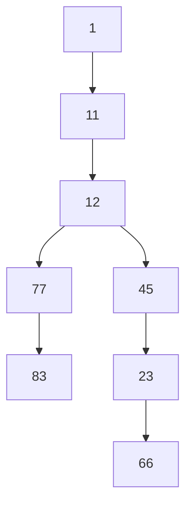
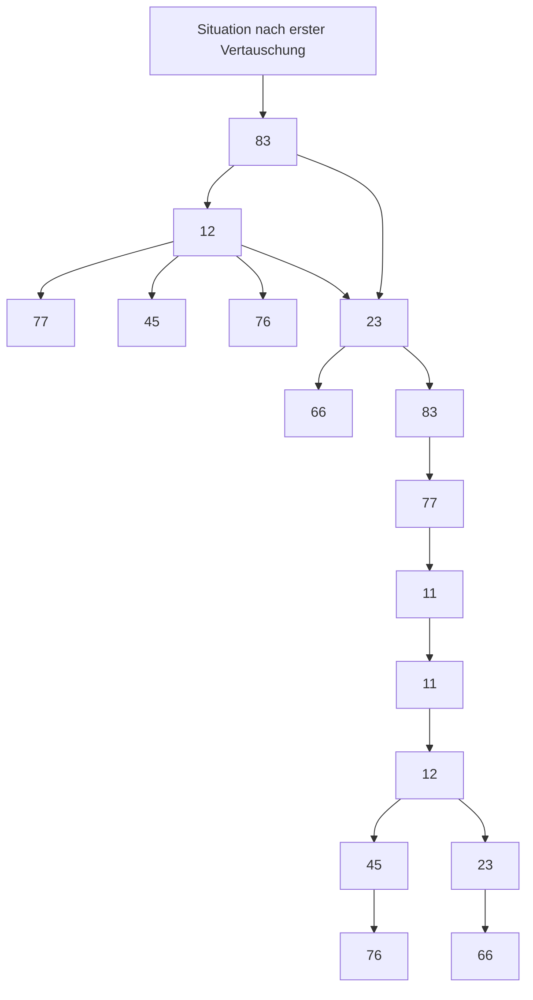
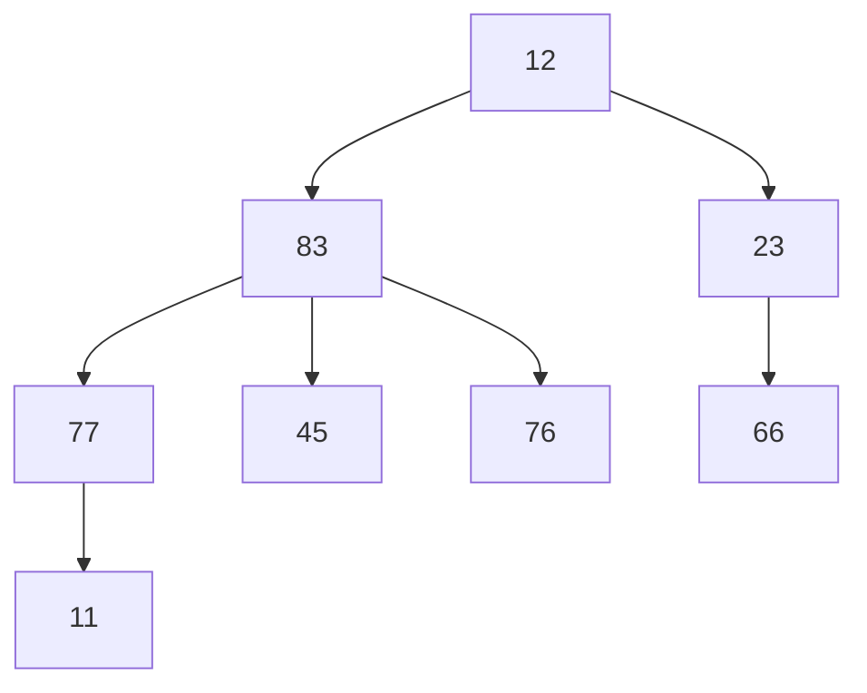

# 7. Sortieralgorithmen

原始 PDF 第 189–228 页。

## 7. Sortieralgorithmen

**7.1 Einfache Verfahren (Selection/Insertion/Bubblesort)**
7.2 Quicksort
7.3 Heapsort

**189**

© T. Gemmeke, IDS, RWTH; R. Leupers, SSS

189

---

## Warum Betrachtung von Sortieralgorithmen?

• Sortierung von Datensätzen wird als **Subroutine** in sehr vielen Anwendungen benötigt (s. Beispiel „Suchen in Arrays“)
• Einfachster Fall: Sortieren eines **Arrays von Zahlen** (z.B. int)
• Allg. Fall: Sortieren eines **Arrays von Datensätzen** vom Typ struct
• Beispiel:
• Sortierung nach Namen, Vornamen oder Geburtsdatum?
Erfordert Definition eines **Schlüssels** (key), d.h. struct‐Komponente, gemäß der sortiert werden soll
• Unterschiedliche Vergleichsfunktionen erforderlich

```c
typedef struct person {
    char name[100], vorname[100];
    struct datum { int tag, monat, jahr; } gebdatum;
} Person;
```

**190**

© T. Gemmeke, IDS, RWTH; R. Leupers, SSS

## Sortierte Datensätze können

• viel effizienter durchsucht werden (s. binäre Suche)
• leichter auf Duplikate geprüft werden
• von Menschen leichter gelesen werden.

Sortiert wird eine Menge von Datensätzen, meist in Form von Arrays. Hierzu wird eine **Schlüsselkomponente** der Arrayelemente benötigt, der die Datensätze vergleichbar macht.

## Schlüssel

• dienen der Identifikation der Datensätze,
• sind meist Bestandteil der Daten oder werden zusammen mit
„Nutzdaten“ gespeichert,
• müssen nicht unbedingt Zahlen sein (Bsp.: Name, Vorname / lexikographische Ordnung).

190

---

## Definition des Sortierproblems

• **Gegeben**: Folge $S   =   ( s _ { 1 } , \ldots , s _ { N } )$ von **Datensätzen** (struct)
Jeder Datensatz $s _ { i }$ besitzt einen Eintrag 𝑘𝑒𝑦 eines mittels einer Ordnungsrelation **linear geordneten Datentyps**
• Z.B. **Zahlen**: $\scriptstyle { \boldsymbol { \upsilon } } \leq { \boldsymbol { \theta } } ^ { \prime \prime }$ Relation, **Buchstaben**: alphabetische Reihenfolge, **Geburtsdatum**: 3‐stufiger Vergleich Jahr, Monat, Tag
Gesucht: **Permutation** (Anordnung) $S ^ { \prime } = ( s _ { 1 } ^ { \prime } , \dots , s _ { N } ^ { \prime } )$ der Elemente von $S ,$ so dass
Gleiche Schlüssel dürfen auch **mehrfach** vorkommen
Ein Sortieralgorithmus, der die ursprüngliche Reihenfolge bei gleichem Schlüssel beibehält, heißt **stabil**
Sprachelemente in c: Definition der Folge als Array: Person $s [ N ]$ Auslesen des Schlüssels von Datensatz 𝑖: s[i].key

$$
s _ {1} ^ {\prime}. k e y \leq s _ {2} ^ {\prime}. k e y \leq \dots \leq s _ {N} ^ {\prime}. k e y
$$

**191**

© T. Gemmeke, IDS, RWTH; R. Leupers, SSS

Die **Stabilität** ist für die Korrektheit eines Sortierverfahrens ohne Belang. Sie kann jedoch nützlich sein, wenn gewünscht ist, dass eine einmal hergestellte Ordnung durch erneutes Sortieren der Datensätze (z.B. nach Einfügen eines neuen Eintrags) nicht wieder durcheinandergebracht wird.

**Übung**: Untersuchen Sie die im folgenden besprochenen Sortieralgorithmen auf Stabilität.

191

---

## Analyse von Sortieralgorithmen

Wie üblich: Verwendung der 𝓞**‐Notation** zur Abstraktion von konstanten Faktoren und Rechnerdetails
Elementare Operationen von Sortieralgorithmen:
– **Vergleich** zweier Schlüssel
– **Vertauschen** von Daten in Folge S (Array oder File)
Daher Abschätzung der **Laufzeit** in diesen Größen
• **Reale Laufzeit**: abhängig von der Komplexität dieser Operationen
Bsp.: Sortieren eines **Bücherregals**, Vergleich der Autorennamen aufwendiger als Vertauschen
Bsp.: Sortieren einer **Datenbank** mit großen Datensätzen in einem File, Umkopieren auf Festplatte oder Magnetband aufwendiger als Key‐Vergleich
• Hier: nur Betrachtung der **Vergleichsoperationen**

**192**

© T. Gemmeke, IDS, RWTH; R. Leupers, SSS

Die Anzahl der Vergleichsoperationen ist eine **obere Schranke** für die Anzahl der Vertauschungen, da jede evtl. notwendige Vertauschung immer erst nach einem Vergleich durchgeführt werden kann. Für eine abstrakte Analyse ist die o.g. Einschränkung also zulässig.

192

---

## Sortieren durch Auswählen (Selection Sort)

Manuelles **alphabetisches Sortieren** eines Bücherregals mit 𝑁 Büchern:

– **Schlüssel**: Autorenname
– Durchlaufen der Bücher von links nach rechts
– **Merken** des jeweils „kleinsten“bisher gefundenen Buches und dessen **Position** 𝑝 im Regal
– Zum Schluss: „Kleinstes“ Buch **ganz links** hinstellen, dort bisher stehendes Buch (vorläufig) an Position 𝑝 stellen
– Verfahren **fortsetzen** mit 𝑝 ൌ 2


<details>
<summary>text_image</summary>

Hesse
Goethe
Hesse
Goethe
</details>

**193**

© T. Gemmeke, IDS, RWTH; R. Leupers, SSS

Für das Verständnis von Sortieralgorithmen ist es hilfreich, sich einmal zu überlegen, wie man Objekte (Bücher, Kartenspiele, etc.) **von Hand** sortiert.

Vielleicht haben Sie das hier gezeigte Selection Sort schon einmal „unbewusst“ angewendet.

Die Grundidee ist es, fortlaufend das kleinste Element zu suchen und nach links zu schaffen. Zu jedem Zeitpunkt befindet sich im linken Teil bereits eine sortierte Teilfolge, während der rechte Teil noch unsortiert ist. Der sortierte Teil wächst fortlaufend, bis zum Schluss der unsortierte Teil leer ist.

193

---

## Algorithmus im Detail

**Vereinfachung**: Sortieren von Arrays vom Typ int, d.h. Vergleichsoperation auf Zahlen, z.B. A[i] < A[j]
**Real**: Hilfsfunktion „less“ auf Sortierschlüsseln, jeweils Vergleich less(A[i].key, A[j].key)

```txt
void selection_sort(int A[], int l, int r)
{
    int i, j, min;
    for (i = l; i < r; i++) {
        min = i;
        for (j = i+1; j <= r; j++) {
            if (A[j] < A[min]) min = j;
        }
        exchange(A[i], A[min]); // vertauschen
    }
}
```

**194**

© T. Gemmeke, IDS, RWTH; R. Leupers, SSS

Zur einfacheren Darstellung des Algorithmus gehen wir hier von Integer-Arrays aus. Die Arrayelemente entsprechen dann unmittelbar den **Schlüsselelementen**, d.h. es wird direkt A[i] mit A[j] verglichen. In realen Anwendungen wird man meist eine Hilfsfunktion implementieren, die den Vergleich der Schlüsselelemente A[i].key und A[j].key vornimmt.

Der **Algorithmus** durchläuft das Array A vom linken Rand l bis zum rechten Rand r-1 mit Hilfe des Index i. In jedem Durchlauf i wird nun zunächst das Minimum auf den Index i gesetzt. Im Folgenden wird das Array von der i-ten Position aus nach rechts durchlaufen und das Minimum mit dem aktuellen Element verglichen und u.U. aktualisiert. Am Ende des Arrays angelangt wird das i-te Element mit dem dem gefundenen (lokal) minimalen Element vertauscht.

194

---

## Beispiel


<details>
<summary>heatmap</summary>

| Category | Value 1 | Value 2 | Value 3 | Value 4 | Value 5 | Value 6 |
| --- | --- | --- | --- | --- | --- | --- |
| Row 1 | 45 | 12 | 77 | 23 | 76 | 11 |
| Row 2 | 11 | 12 | 77 | 23 | 76 | 45 |
| Row 3 | 11 | 12 | 77 | 23 | 76 | 45 |
| Row 4 | 11 | 12 | 23 | 77 | 76 | 45 |
| Row 5 | 11 | 12 | 23 | 45 | 76 | 77 |
| Row 6 | 11 | 12 | 23 | 45 | 66 | 77 |
| Row 7 | 11 | 12 | 23 | 45 | 66 | 76 |
| Row 8 | 11 | 12 | 23 | 45 | 66 | 76 |
| Row 9 | 11 | 12 | 23 | 45 | 66 | 76 |
| Row 10 | 11 | 12 | 23 | 45 | 66 | 76 |
| Row 11 | 11 | 12 | 23 | 45 | 66 | 76 |
| Row 12 | — | — | — | — | — | — |
| Row 13 | — | — | — | — | — | — |
| Row 14 | — | — | — | — | — | — |
| Row 15 | — | — | — | — | — | — |
| Row 16 | — | — | — | — | — | — |
| Row 17 | — | — | — | — | — | — |
| Row 18 | — | — | — | — | — | — |
| Row 19 | — | — | — | — | — | — |
| Row 20 | — | — | — | — | — | — |
| Row 21 | — | — | — | — | — | — |
| Row 22 | — | — | — | — | — | — |
| Row 23 | — | — | — | — | — | — |
| Row 24 | — | — | — | — | — | — |
| Row 25 | — | — | — | — | — | — |
| Row 26 | — | — | — | — | — | — |
| Row 27 | — | — | — | — | — | — |
| Row 28 | — | — | — | — | — | — |
| Row 29 | — | — | — | — | — | — |
| Row 30 | — | — | — | — | — | — |
</details>

**noch unsortiert**

**aktuell min. Schlüssel**

**vertauscht**

**bereits sortiert**

Ergebnis

| 11 | 12 | 23 | 45 | 66 | 76 | 77 | 83 |
| --- | --- | --- | --- | --- | --- | --- | --- |

**195**

© T. Gemmeke, IDS, RWTH; R. Leupers, SSS

Im obigen **Beispiel** wird der **Selection Sort** anschaulich anhand einer beispielhaften Zahlenfolge dargestellt.

Im ersten Durchlauf wird das Element 11 als Minimum identifiziert und mit dem Element an Position 1 vertauscht. Die sortierte Folge enthält nun ein Element, der Algorithmus wird mit der restlichen Folge analog verfahren.

Im zweiten Durchlauf wird das Element 12 als Minimum identifiziert, steht jedoch schon an der richtigen Stelle, so dass kein Vertauschen notwendig ist. Die sortierte Folge enthält nun zwei Elemente.

Im dritten Durchlauf wird das Element 23 als Minimum identifiziert und mit dem Element an Position 3 vertauscht. Die sortierte Folge enthält nun drei Elemente.

Im vierten Durchlauf wird das Element 45 als Minimum identifiziert und mit dem Element an Position 4 vertauscht. Die sortierte Folge enthält nun vier Elemente.

Im fünften Durchlauf wird das Element 66 als Minimum identifiziert und mit dem Element an Position 5 vertauscht. Die sortierte Folge enthält nun fünf Elemente.

Im sechsten Durchlauf wird das Element 76 als Minimum identifiziert und mit dem Element an Position 6 vertauscht. Die sortierte Folge enthält nun sechs Elemente, usw.

Nach 7 Durchläufen ist die Folge sortiert.

195

---

## Laufzeitanalyse


<details>
<summary>flowchart</summary>

```mermaid
graph TD
  A["&quot;void selection_sort(int A["], int l, int r)\n{"] -->|"N-1 Iterationen"| B["N-1, N-2, ..., 1 Iterationen"]
  B -->|"O1 Operationen"| C["O(1) Operationen"]
  C -->|"O1 Operationen"| D["&quot;exchange(A[i"], A["min"]);\n}
```
</details>

• Aufruf: selection\_sort(A,0,N-1);

$$
\begin{array}{l} (\mathbf {1} + \mathbf {2} + \dots + N - \mathbf {2} + N - \mathbf {1}) \cdot \mathcal {O} (1) + (N - 1) \cdot \mathcal {O} (1) \\ = \boldsymbol {N} \cdot (\boldsymbol {N} - \boldsymbol {1}) / \boldsymbol {2} \cdot \mathcal {O} (1) + \mathcal {O} (N) = \mathcal {O} (N ^ {2}) + \mathcal {O} (N) = \mathcal {O} (N ^ {2}) \\ \end{array}
$$

**196**

© T. Gemmeke, IDS, RWTH; R. Leupers, SSS

Die **Laufzeitanalyse** ergibt folgendes Ergebnis:

Die äußere Schleife enthält O(N) Iterationen mit jeweils einer Vertauschung (d.h. O(1) Operationen) $\Rightarrow \mathrm{O}(\mathrm{N})^{*} \mathrm{O}(1)=\mathrm{O}(\mathrm{N})$

In der inneren Schleife werden im k-ten Durchlauf (N-k) Vergleiche (d.h. je O(1) Operationen) durchgeführt, also $((  N-1 ) + (  N-2 ) + \cdots + 2 + 1 ) *  O ( 1 ) =  N  * (  N-1 ) / 2 *$ $\mathrm { O } ( 1 )   =   \mathrm { O } ( \mathrm { N } ^ { 2 } )$

Die Anzahl der Vergleiche ist dabei immer identisch, auch bei einer Vorsortierung des Arrays!

Insgesamt ergibt sich also $\mathrm { O } ( \mathrm { N } ) + \mathrm { O } ( \mathrm { N } ^ { 2 } ) { = } \mathrm { O } ( \mathrm { N } ^ { 2 } )$

196

---

## Sortieren durch Einfügen (Insertion Sort)

Manuelles **alphabetisches Sortieren** eines Bücherregals mit 𝑁 Büchern:

– **Schlüssel**: Autorenname
– Durchlaufen der Bücher von links nach rechts (𝑖 ൌ 1 … 𝑁)
– Betrachtung des Buchs an Position 𝒑 = 𝒊
– Buch Nr. 𝑖 **entnehmen**
– Bücher **links** von 𝑝 ൌ 𝑖 (d.h. 𝑝 ൏ 𝑖) nach rechts rücken, bis korrekte **Einfügeposition** für Buch 𝑖 gefunden
– Verfahren **fortsetzen** mit 𝑖 ൌ 𝑖 ൅ 1


<details>
<summary>bar</summary>

| Category | Value |
| --- | --- |
| Hesse | ~1.0 |
| Goethe | ~1.0 |
</details>

**197**

© T. Gemmeke, IDS, RWTH; R. Leupers, SSS

Beim **Insertion Sort** ist die Grundidee, jeweils ein Element herauszunehmen, und durch Nach-Rechts-Schieben von größeren Elementen die richtige “Lücke” für das entnommene Element zu finden und es dort einzufügen. Nach entsprechender Behandlung des letzten (rechtesten) Elementes ist dann das gesamte Array sortiert.

197

---

## Algorithmus im Detail

Betrachtung aller Bücher von links nach rechts
**Erstes Buch** braucht nicht betrachtet zu werden, da kein linker Nachbar (d.h. zu Beginn i = l+1)

```lisp
void insertion_sort(int A[], int l, int r)
{
    int i, j, v;
    for (i = l+1; i <= r; i++) {
        v = A[i];
        for (j = i-1; j >= l; j--) {
            if (v < A[j]) A[j+1] = A[j];
            else break;
        }
        A[j+1] = v;
    }
}
```

**198**

© T. Gemmeke, IDS, RWTH; R. Leupers, SSS

Der Algorithmus durchläuft das Array von links nach rechts, fängt jedoch an Position i=l+1 an, da das erste Buch **automatisch** eine sortierte Folge der Länge 1 ist. Nun wird sukzessive von rechts nach links die richtige **Einfügeposition** für das gerade betrachtete Element in der bereits sortierten Folge gesucht. D.h. die Elemente der bereits sortierten Folge werden solange um eine Position nach rechts gerückt, bis das einzufügende Element aufgrund der verwendeten Ordnungsrelation größer ist als das gerade betrachtete Element in der sortierten Folge. An der aktuellen Position wird nun das gerade betrachtete Element eingefügt. Die sortierte Folge ist nun um ein Element gewachsen.

198

---

## Beispiel


<details>
<summary>bar_stacked</summary>

| Category | Value 1 | Value 2 | Value 3 | Value 4 | Value 5 | Value 6 |
| --- | --- | --- | --- | --- | --- | --- |
| Row 1 | 45 | 12 | 77 | 23 | 76 | 11 |
| Row 2 | 12 | 45 | 77 | 23 | 76 | 11 |
| Row 3 | 12 | 45 | 77 | 23 | 76 | 11 |
| Row 4 | 12 | 23 | 45 | 77 | 76 | 11 |
| Row 5 | 12 | 23 | 45 | 76 | 77 | 11 |
| Row 6 | 11 | 12 | 23 | 45 | 76 | 77 |
| Row 7 | 11 | 12 | 23 | 45 | 76 | 77 |
| Row 8 | 11 | 12 | 23 | 45 | 66 | 76 |
| Row 9 | — | — | — | — | — | 83 |
| Row 10 | — | — | — | — | — | 66 |
| Row 11 | — | — | — | — | — | 66 |
| Row 12 | — | — | — | — | — | 66 |
| Row 13 | — | — | — | — | — | 83 |
| Row 14 | — | — | — | — | — | 83 |
| Row 15 | — | — | — | — | — | 83 |
| Row 16 | — | — | — | — | — | 83 |
| Row 17 | — | — | — | — | — | 83 |
| Row 18 | — | — | — | — | — | 83 |
| Row 19 | — | — | — | — | — | 83 |
| Row 20 | — | — | — | — | — | 83 |
| Row 21 | — | — | — | — | — | 83 |
| Row 22 | — | — | — | — | — | 83 |
| Row 23 | — | — | — | — | — | 83 |
| Row 24 | — | — | — | — | — | 83 |
| Row 25 | — | — | — | — | — | 83 |
| Row 26 | — | — | — | — | — | 83 |
| Row 27 | — | — | — | — | — | 83 |
| Row 28 | — | — | — | — | — | 83 |
| Row 29 | — | — | — | — | — | 83 |
</details>

**noch unsortiert**

**aktuelles Element**

**bereits sortiert, aber zu verschieben**

**bereits sortiert**

**199**

© T. Gemmeke, IDS, RWTH; R. Leupers, SSS

Im ersten Schritt hat die sortierte Folge die Länge 1. Das Element 45 wird nun um eine Position nach rechts gerückt, da 12 kleiner 45 ist. Die 12 wird also vor der 45 eingefügt. Die sortierte Folge hat nun die Länge 2.

Im zweiten Schritt steht das Element 77 bereits an der richtigen Position. Die sortierte Folge hat nun die Länge 3.

Im dritten Schritt wird das Element 23 hinter der 12 eingefügt, alle anderen Elemente werden um eine Position nach rechts gerückt. Die sortierte Folge hat nun die Länge 4.

So wird mit in den nächsten Schritten fortgefahren, bis das Array komplett sortiert ist.

199

---

Laufzeitanalyse

<div class="docvortex-algorithm" style="white-space: pre-wrap; font-family:monospace;">
void insertion_sort(int A[], int l, int r)
{
    int i, j, v;
    for (i = l+1; i &lt;= r; i++) {
        v = A[i];
        for (j = i-1; j &gt;= l; j--) {
            if (v &lt; A[j]) A[j+1] = A[j];
            else break;
        }
        A[j+1] = v;
    }
}
</div>

• Aufruf: insertion\_sort(A,0,N‐1);

$$
\begin{array}{l} (\mathbf {1} + \mathbf {2} + \dots + N - \mathbf {2} + N - \mathbf {1}) \cdot \mathcal {O} (1) + (N - 1) \cdot \mathcal {O} (1) \\ = \boldsymbol {N} \cdot (\boldsymbol {N} - \boldsymbol {1}) / \boldsymbol {2} \cdot \mathcal {O} (1) + \mathcal {O} (N) = \mathcal {O} (N ^ {2}) + \mathcal {O} (N) = \mathcal {O} (N ^ {2}) \\ \end{array}
$$

**200**

© T. Gemmeke, IDS, RWTH; R. Leupers, SSS

Die **Laufzeitanalyse** ergibt: Die äußere Schleife wird N-1 mal durchlaufen, vom zweiten bis zum letzten Element des Arrays. In jedem Schleifendurchlauf wird nun die Einfügeposition des aktuellen Elements gesucht. Hier erfolgt im ersten Schleifendurchlauf eine Iteration, da mit nur einem Vorgängerelement verglichen werden muss. Im (N-1)-ten Schleifendurchlauf muss mit maximal N-1 Elementen verglichen werden. Für diese maximal N-1 Iterationen wird jeweils eine Operation (nach rechts rücken) der Komplexität O(1) ausgeführt. Das Einfügen selbst ist dann wiederum von der Komplexität O(1).

Insgesamt ergibt sich also eine **Gesamtlaufzeit** von O(N<sup>2</sup>).

200

---

## Bubblesort

Idee: Elemente mit kleinem Schlüssel sind „**leicht**“ und steigen wie Blasen im Array auf (d.h. wandern nach links)
Aufsteigen durch fortgesetztes **paarweises Vertauschen** der Elemente von rechts nach links implementiert


<details>
<summary>natural_image</summary>

Close-up of bubbles floating in water under blue sky (no text or symbols)
</details>

```txt
void bubble_sort(int A[], int l, int r)
{
    int i, j;
    for (i = l; i < r; i++) {
        for (j = r; j > i; j--) {
            if (A[j-1] > A[j])
                exchange(A[j-1],A[j]);
        }
    }
}
```

**201**

© T. Gemmeke, IDS, RWTH; R. Leupers, SSS

Ein weiteres elementares Sortierverfahren ist **Bubblesort**, das auf dem Prinzip des fortgesetzten Vertauschens von rechts nach links basiert.

Im ersten Durchlauf wandert dabei das kleinste Element an den Anfang des Arrays, im zweiten Durchlauf das zweitkleinste usw.

201

---

## Beispiel (1. Durchlauf der äußeren Schleife)

| 45 | 12 | 77 | 23 | 76 | 11 | 83 | 66 |
| --- | --- | --- | --- | --- | --- | --- | --- |
| 45 | 12 | 77 | 23 | 76 | 11 | 66 | 83 |
| 45 | 12 | 77 | 23 | 11 | 76 | 66 | 83 |
| 45 | 12 | 77 | 11 | 23 | 76 | 66 | 83 |
| 45 | 12 | 11 | 77 | 23 | 76 | 66 | 83 |
| 45 | 11 | 12 | 77 | 23 | 76 | 66 | 83 |
| 11 | 45 | 12 | 77 | 23 | 76 | 66 | 83 |

**noch unsortiert**

**aktuelle linke Grenze**

**zu vertauschen**

**bereits sortiert**

Kleinstes Element (11) am Ende des 1. Durchlaufs an der linken Position
Andere relativ „leichte“ Elemente (z.B. 66) sind bereits teilweise nach links gerückt, schwere nach rechts (45, 77)

**202**

© T. Gemmeke, IDS, RWTH; R. Leupers, SSS

Betrachtet werden im ersten Schritt die letzten beiden Elemente des Arrays, sie werden nötigenfalls vertauscht. So werden sukzessive paarweise Elemente verglichen, so dass das Element 11 im ersten Durchlauf an den Anfang des Arrays gerückt wird.

202

---

## Beispiel (2. und 3. Durchlauf der äußeren Schleife)


<details>
<summary>bar_stacked</summary>

| Category | Value 1 | Value 2 | Value 3 | Value 4 | Value 5 | Value 6 |
| --- | --- | --- | --- | --- | --- | --- |
| Row 1 | 45 | 12 | 77 | 23 | 76 | 66 |
| Row 2 | 45 | 12 | 77 | 23 | 66 | 76 |
| Row 3 | 45 | 12 | 23 | 77 | 66 | 76 |
| Row 4 | 12 | 45 | 23 | 77 | 66 | 76 |
| Row 5 | 12 | 45 | 23 | 77 | 66 | 76 |
| Row 6 | 12 | 45 | 23 | 66 | 77 | 76 |
| Row 7 | 12 | 23 | 45 | 66 | 77 | 76 |
| Row 8 | 12 | 23 | 45 | 66 | 77 | 76 |
| Row 9 | — | — | — | — | — | — |
| Row 10 | — | — | — | — | — | — |
| Row 11 | — | — | — | — | — | — |
| Row 12 | — | — | — | — | — | — |
| Row 13 | — | — | — | — | — | — |
| Row 14 | — | — | — | — | — | — |
| Row 15 | — | — | — | — | — | — |
| Row 16 | — | — | — | — | — | — |
| Row 17 | — | — | — | — | — | — |
| Row 18 | — | — | — | — | — | — |
| Row 19 | — | — | — | — | — | — |
| Row 20 | — | — | — | — | — | — |
| Row 21 | — | — | — | — | — | — |
| Row 22 | — | — | — | — | — | — |
| Row 23 | — | — | — | — | — | — |
| Row 24 | — | — | — | — | — | — |
| Row 25 | — | — | — | — | — | — |
| Row 26 | — | — | — | — | — | — |
| Row 27 | — | — | — | — | — | — |
| Row 28 | — | — | — | — | — | — |
| Row 29 | — | — | — | — | — | — |
| Row 30 | — | — | — | — | — | — |
</details>

**noch unsortiert**

**aktuelle linke Grenze**

**zu vertauschen**

**bereits sortiert**

**Eigenschaft**: nach 𝑖‐tem Durchlauf ist 𝑖‐tes kleinstes Element an seiner endgültigen Position
• Andere Elemente wurden weiter **vorsortiert**

**203**

© T. Gemmeke, IDS, RWTH; R. Leupers, SSS

Im zweiten Durchlauf wandert das Element 12 wiederum durch paarweise Vertauschung an die zweite Position, im dritten Durchlauf rückt die 23 an die dritte Position usw., d.h. im i-ten Durchlauf ist die Länge der sortierten Liste jeweils gleich i.

203

---

Laufzeitanalyse

<div class="docvortex-algorithm" style="white-space: pre-wrap; font-family:monospace;">
void bubble_sort(int A[], int l, int r)
{
    int i, j;
    for (i = l; i &lt; r; i++) {
        for (j = r; j &gt; i; j--) {
            if (A[j-1] &gt; A[j])
                exchange(A[j-1],A[j]);
        }
    }
}
</div>

$$
\begin{array}{l} (1 + 2 + \dots + N - 2 + N - 1) \cdot \mathcal {O} (1) \\ = N \cdot (N - 1) / 2 \cdot \mathcal {O} (1) = \mathcal {O} (N ^ {2}) \\ \end{array}
$$

Selection Sort, Insertion Sort und Bubblesort haben asymptotisch alle **quadratische Laufzeit** in der **Eingabegröße** 𝑁 und sind (bis auf konstante Faktoren) gleichwertig

**204**

© T. Gemmeke, IDS, RWTH; R. Leupers, SSS

Die **Laufzeitanalyse** ergibt N-1 Durchläufe. Dabei werden im i-ten Durchlauf Ni Iterationen, d.h. evtl. Vertauschungen in je O(1) Operationen durchgeführt.

204

---

## 7. Sortieralgorithmen

7.1 Einfache Verfahren (Selection/Insertion/Bubblesort)
**7.2 Quicksort**
7.3 Heapsort

**205**

© T. Gemmeke, IDS, RWTH; R. Leupers, SSS

205

---

## Divide‐and‐conquer

• „Divide et impera“, „Teile und herrsche“
• Verbreitetes Prinzip beim **Algorithmenentwurf**
D.h. selbst kein Algorithmus, nur ein „**Kochrezept**“ bei der Entwicklung
• Divide‐and‐conquer‐Idee:
– Mehrere kleine Probleme sind insgesamt **leichter zu lösen** als ein großes
– **Teile** großes Problem in mehrere kleine, löse diese, und berechne daraus die **Gesamtlösung**

• Hier:

– Zerlege zu sortierendes Array A in zwei Teile A' und A", die **unabhängig voneinander** sortiert werden können
– Sortiere A' und A" getrennt
– Zusammenfügen (**Konkatenation**) der sortierten Arrays A' und A" ergibt sortiertes Gesamtarray A

**206**

© T. Gemmeke, IDS, RWTH; R. Leupers, SSS

Mit **Quicksort** stellen wir jetzt ein etwas komplexeres Sortierverfahren vor, in dem Sinne, dass man so wohl nicht von Hand sortieren würde. Wie wir später sehen werden, würde man bei großen Datenmengen aber hiermit wesentlich schneller zum Ziel kommen.

Das “**divide and conquer**”-Prinzip findet seinen Einsatz auch bei vielen anderen Problemen in der Informatik.

206

---

## Quicksort‐Algorithmus

• Für Array $\mathsf { A } [ 1 \ldots r ]$ wähle ein **bestimmtes** A[k] aus
$\mathbb { A } [ \mathbb { k } ]$ ist das **Trennelement**
• Ordne Array so um, dass:
Dies wird realisiert, indem bzgl. des Trennelementes $, \mathsf { f a l s c h e ^ { \prime \prime } }$ Elemente in $\textsf { A } ^ { \intercal }$ und $\mathbb { A } ^ { \textsf { n } }$ **paarweise vertauscht** werden
• Achtung: Arrays $\mathbb { A } ^ { \intercal } , \mathbb { A } ^ { \mathsf { n } }$ sind danach i.a. **immer noch unsortiert**
• Sortiere die Teilarrays $\textsf { A } ^ { \intercal }$ und $\mathsf { A } ^ { \textsf { n } }$ mittels erneutem Aufruf des Quicksort‐Algorithmus (**Rekursion**)
• Anschließend ist $\mathbf { A } = \mathbf { A } ^ { \mathsf { T } } \mathbf { A } [ \mathbf { k } ] \mathbf { A } ^ { \mathsf { T } }$ ein sortiertes Gesamtarray

$$
- A ^ {\prime} = A [ 1 \dots k - 1 ] \text {hat nur Elemente} \leq A [ k ]
$$

$$
- A ^ {\prime \prime} = A [ k + 1 \dots r ] \text {hat nur Elemente} \geq A [ k ]
$$

**207**

© T. Gemmeke, IDS, RWTH; R. Leupers, SSS

Man sieht ein Grundproblem bei der möglichen “manuellen” Anwendung von Quicksort, $\mathbf { z . B . }$ bei einem Bücherregal: Man müsste häufig hin- und herlaufen und sich darüber hinaus diverse Informationen merken, um noch zu wissen, an welcher Stelle man weitermachen muss. In einer Implementierung in einem **Programm** ist beides allerdings sehr einfach zu bewerkstelligen.

207

---

Algorithmus im Detail

```c
void quick_sort(int A[], int l, int r)
{
    int k;
    if (r <= l) return;
    k = partition(A,l,r);
    quick_sort(A,l,k-1);
    quick_sort(A,k+1,r);
}
```

**208**


$$
>= \mathrm{A} [ \mathrm{k} ]
$$

$$
\Leftarrow \mathsf {A} [ \mathsf {k} ]
$$

**fertig sortiert**

© T. Gemmeke, IDS, RWTH; R. Leupers, SSS

Die Array-Darstellungen zeigen vier **prinzipielle Schritte** beim Ablauf von Quicksort:

1) Unsortiertes Array
2) Array mit der Eigenschaft “kleine Elemente links vom Trennelement, große rechts davon” (divide-Schritt)
3) Teilarray A´ nach rekursivem Quicksort-Aufruf bereits fertig sortiert, rechter Teil $\mathrm { A } ^ { \prime } { } ^ { \prime }$ noch unsortiert
4) Fertig sortiert

Quicksort besteht aus einer **Hauptfunktion** (“quick\_sort”), welche sich der **Hilfsfunktion** “partition” bedient, um den gewünschten Zustand (2) herzustellen. Diese liefert auch den Index k des Trennelementes zurück. Anschließend finden zwei rekursive Quicksort-Aufrufe statt, um die Sortierung fertigzustellen. Die Grenze zwischen den beiden Teilarrays ist dabei durch den Index k gegeben. Nach dem ersten rekursiven Aufruf bspw. ist die in Schritt 3) gezeigte Situation hergestellt.

208

---

Algorithmus im Detail

```txt
int partition(int A[], int l, int r)
{
    int i, j, k, v;
    k = r; v = A[k]; // willkürliches Trennelement
    i = l; // starte am linken Rand
    j = r-1; // starte am rechten Rand - 1
    while (1) { // durchlaufen bis Abbruch
        while (i < r && A[i] <= v) i++;
        while (j >= l && A[j] >= v) j--;
        if (i >= j) // aneinander vorbeigelaufen ?
            break; // Abbruch der while-Schleife
        else
            exchange(A[i],A[j]);
    }
    exchange(A[i],A[k]);
    return i;
}
```

**209**

© T. Gemmeke, IDS, RWTH; R. Leupers, SSS

Als erstes wird das **Trennelement** gewählt. Da in einem unsortierten Array jedes Element “so gut wie das andere” ist, wird willkürlich das letzte Element gewählt. Innerhalb der äußeren while-Schleife wird das paarweise Vertauschen von Elementen durchgeführt. Die beiden inneren while-Schleifen sorgen dafür, dass i bzw. j nach Abbruch auf “falsche” Elemente zeigen, d.h. Elemente, die vertauscht werden müssen.

Die äußere Schleife endet, wenn die Indizes i und j aneinander vorbeigelaufen sind. Dann muss noch das Trennelement durch Vertauschen mit Element i an die richtige Stelle in der “Array-Mitte” gebracht werden.

209

---

Beispiel (1. Durchlauf von partition)


<details>
<summary>bar</summary>

| Category | Value 1 | Value 2 | Value 3 | Value 4 | Value 5 | Value 6 |
| --- | --- | --- | --- | --- | --- | --- |
| i | 45 | 12 | 77 | 23 | 76 | 11 |
| j | — | — | — | — | — | — |
| j' | 45 | 12 | 77 | 23 | 76 | 11 |
| j' | — | — | — | — | — | — |
| j'' | 45 | 12 | 11 | 23 | 76 | 77 |
| j'' | — | — | — | — | — | — |
| A' | 45 | 12 | 11 | 23 | 66 | 77 |
| A' | — | — | — | — | — | — |
| A'' | — | — | — | — | — | — |
| A''' | — | — | — | — | — | — |
| A'''' | — | — | — | — | — | — |
| A''''' | — | — | — | — | — | — |
| A''''''' | — | — | — | — | — | — |
| A''''''''' | — | — | — | — | — | — |
| A''''''''''' | — | — | — | — | — | — |
| A''''''''''' | — | — | — | — | — | — |
| A''''''''''''' | — | — | — | — | — | — |
| A''''''''''''' | — | — | — | — | — | — |
| A''''''''''''' | — | — | — | — | — | — |
| A''''''''''''' | — | — | — | — | — | — |
| A''''''''''''' | — | — | 66 | 77 | 83 | 76 |
| A''''''''''''' | — | — | — | — | — | — |
| A''''''''''''' | — | — | — | — | — | — |
| A''''''''''''' | — | — | — | — | — | 66 |
</details>

Am Ende dieses Beispiels befindet sich das Element 66 an der richtigen Stelle im Array. Alle Elemente links davon sind kleiner als 66, alle Elemente rechts davon sind größer.

210

---

## Beispiel (Forts.)

| 45 | 12 | 11 | 23 | 66 | 77 | 83 | 76 |
| --- | --- | --- | --- | --- | --- | --- | --- |

| 11 | 12 | 45 | 23 | 66 | 77 | 83 | 76 |
| --- | --- | --- | --- | --- | --- | --- | --- |

| 11 | 12 | 23 | 45 | 66 | 77 | 83 | 76 |
| --- | --- | --- | --- | --- | --- | --- | --- |

| 11 | 12 | 23 | 45 | 66 | 77 | 83 | 76 |
| --- | --- | --- | --- | --- | --- | --- | --- |

| 11 | 12 | 23 | 45 | 66 | 77 | 83 | 76 |
| --- | --- | --- | --- | --- | --- | --- | --- |

| 11 | 12 | 23 | 45 | 66 | 77 | 83 | 76 |
| --- | --- | --- | --- | --- | --- | --- | --- |

| 11 | 12 | 23 | 45 | 66 | 77 | 83 | 76 |
| --- | --- | --- | --- | --- | --- | --- | --- |

...

| 11 | 12 | 23 | 45 | 66 | 76 | 77 | 83 |
| --- | --- | --- | --- | --- | --- | --- | --- |

**211**

**Trennelement**

$$
>= \mathrm{A} [ \mathrm{k} ]
$$

$$
\Leftarrow \mathsf {A} [ \mathsf {k} ]
$$

**fertig sortiert**

**noch nicht betrachtet**

© T. Gemmeke, IDS, RWTH; R. Leupers, SSS

Man beachte, dass aufgrund des **Rekursionsschemas** zunächst immer das linke Teilarray ganz fertig sortiert wird, bevor die rechte Hälfte betrachtet wird.

211

---

## Laufzeitanalyse

• **Schlechtester Fall**: zufällig gewähltes Trennelement ist das **Maximum** des Arrays
• Z.B. bei **vorsortiertem** Array
• i durchläuft N-1 Elemente, d.h. 𝓞ሺ𝑵 െ 𝟏ሻ **Vergleiche**
• Jeder Teilungsschritt **spaltet genau ein Element** ab und hinterlässt ein um ein Element kleineres Teilarray A'
• Ist A' ebenfalls schon sortiert, so **wiederholt** sich dieser Effekt
– Trennelement ist Maximum von A
– i durchläuft N-2 Elemente
– usw.
• **Analoger Effekt** bei Trennelement ganz links und Array‐Min.


<details>
<summary>text_image</summary>

i
max
</details>

**212**

© T. Gemmeke, IDS, RWTH; R. Leupers, SSS

Im Gegensatz zu anderen Sortierverfahren hängt die Laufzeit von Quicksort stark vom **Sortierungszustand** des Eingabearrays ab. Bei einem bereits sortierten Array findet keine Vertauschung statt, und die Arrayelemente werden jeweils O(N)-mal durchlaufen. Wie auf der nächsten Folie gezeigt, läuft dies auf eine **quadratische Laufzeit** hinaus.

Diesen schlechtesten Fall erhält man, wenn in jedem Durchlauf nur das Trennelement abgespalten wird, z.B. wenn das Trennelement jeweils das größte oder das kleinste Element des Arrays ist. In diesem Fall wird im Teilungsschritt nicht halbiert sondern nur um ein Element reduziert.

212

---

## Laufzeitanalyse

• Anzahl Vergleiche im **worst case**:
• Jedoch wesentlich besser im **best case**:
$T _ { N } : = \mathsf { Z e i t } ,$ um Array der Länge 𝑁 zu sortieren
– Pro Teilungsschritt durchlaufen 𝑖 und 𝑗 nicht mehr als 𝑁 Elemente, d.h. es gibt $\mathcal { O } ( N )$ Vergleiche
– Im besten Fall entstehen **jeweils 2 Teilarrays gleicher Größe**

$$
\mathcal {O} (N - 1) + \mathcal {O} (N - 2) + \dots + 1 = \mathcal {O} (N ^ {2})
$$

$$
\begin{array}{l} T _ {N} = 2 \cdot T _ {N / 2} + \mathcal {O} (N) \\ = 2 \cdot \left(2 \cdot T _ {N / 4} + \mathcal {O} (N / 2)\right) + \mathcal {O} (N) \\ = 4 \cdot T _ {N / 4} + 2 \cdot \mathcal {O} (N / 2) + \mathcal {O} (N) \\ = 4 \cdot T _ {N / 4} + \mathcal {O} (N) + \mathcal {O} (N) \quad \log N \text {Teilungsschritte,} T _ {1} = \mathcal {O} (1) \\ = \dots = \mathcal {O} (N) + \dots + \mathcal {O} (N) \quad \log N \text {mal} \\ = \log N \cdot \mathcal {O} (N) \\ = \mathcal {O} (N \log N) \\ \end{array}
$$

**213**

© T. Gemmeke, IDS, RWTH; R. Leupers, SSS

Im besten Fall ist die Laufzeit jedoch wesentlich kürzer. Beim Ansatz zur **Bestimmung von** $\mathbf { T } _ { \mathbf { N } }$ sieht man zunächst, dass pro partition-Schritt nur O(N) Operationen stattfinden können: Egal, wie weit i und j laufen, sie treffen sich nach O(N) Schritten mehr oder weniger in der Mitte des Arrays.

Für die nach dem ersten partition-Aufruf entstehenden Teilarrays gilt das gleiche Argument, so dass man für $\mathbf { T } _ { \mathbf { N } / 2 }$ die entsprechende Formel rekursiv einsetzen kann. Hierbei wird der **best case** vorausgesetzt, d.h. das Array wird jeweils genau in der Mitte geteilt. Somit ergibt sich dann die gezeigte Gesamtlaufzeit.

213

---

## Laufzeitanalyse

• Durch **einfache Techniken** kann man den worst case meist ausschließen
• Z.B. **Median von 3 Elementen** als Trennelement verwenden
Man kann zeigen: Quicksort hat auch im **durchschnittlichen Fall** (average case) eine Laufzeit von 𝓞 𝑵 𝒍𝒐𝒈 𝑵
D.h. Quicksort ist fast immer **effizient** und darüber hinaus recht **einfach** zu implementieren
• Z.B. N = 1.000.000, 10<sup>9</sup> Operationen pro sec – 𝒪 𝑁 log 𝑁 : Laufzeit < 1 sec – 𝒪 𝑁<sup>ଶ</sup> : Laufzeit ≈ 17 min
Daher: Quicksort ist das Sortierverfahren mit der **größten Verbreitung**
• Z.B. Bestandteil jeder C‐Standard‐Library (**qsort‐Funktion**)

**214**

© T. Gemmeke, IDS, RWTH; R. Leupers, SSS

Nimmt man den **Median** (das “Mittel”) mehrerer Elemente als Trennelement, so kann man den worst case (dass man ausgerechnet das Maximum erwischt) praktisch ausschließen.

Mit Hilfe einer umfangreicheren mathematischen Analyse kann man zeigen, dass die **average case Laufzeit** für “zufällige” Arrays der best case Laufzeit von der Größenordnung her entspricht.

214

---

## 7. Sortieralgorithmen

7.1 Einfache Verfahren (Selection/Insertion/Bubblesort)
7.2 Quicksort
**7.3 Heapsort**

**215**

© T. Gemmeke, IDS, RWTH; R. Leupers, SSS

215

---

## Heapsort

• **Selection Sort**: Sortierung durch fortgesetzte Minimumsauswahl (s.o.)
• 𝑁 Minima sind auszuwählen, jede Auswahl kostet im Mittel $\mathcal { O } \big ( N / 2 \big ) = \mathcal { O } \big ( N \big )$ Schritte, daher **Gesamtlaufzeit** $\mathcal { O } \big ( N ^ { 2 } \big )$
• Idee bei Heapsort: **Beschleunigung** der Minimumsauswahl
Betrachte folgende Anordnung der Array‐Elemente (Array‐Indizes **laufen hier von** 𝟏 … 𝑵 statt 0 … 𝑁 െ 1):

| 1 | 2 | 3 | 4 | 5 | 6 | 7 | 8 |
| --- | --- | --- | --- | --- | --- | --- | --- |
| 11 | 12 | 23 | 77 | 45 | 76 | 66 | 83 |

• „Unsortiert“, aber folgende **Eigenschaft** für jedes A[i]:

$$
\begin{array}{l} - A [ i ] \leq A [ 2 i ], \quad \text {falls} 2 i \leq N \\ - A [ i ] \leq A [ 2 i + 1 ], \text {falls} 2 i + 1 \leq N \\ \end{array}
$$

**216**

© T. Gemmeke, IDS, RWTH; R. Leupers, SSS

**Heapsort** ist im wesentlichen ein verbessertes Selection Sort. Grundlage hierfür ist die hier gezeigte “Heap-Eigenschaft” des Arrays.

216

---

## Veranschaulichung als Baumstruktur


<details>
<summary>flowchart</summary>


</details>

• Jedes Baumelement A[i] besitzt 0, 1, oder 2 „**Kinder**“
Kinder besitzen Arrayindex 2i **bzw.** 2i+1
• 12, 23 sind Kinder von 11; 77, 45 sind Kinder von 12 usw.

**Def**.: Gelten im Array A[1...N] für jedes A[i] die Eigenschaften A[i] ≤ A[2i] (falls 2i ≤ N) und A[i] ≤ A[2i+1] (falls 2i+1 ≤ N), so ist A ein **(Minimums‐)Heap**.

**217**

© T. Gemmeke, IDS, RWTH; R. Leupers, SSS

Analog kann man einen **Maximums-Heap** definieren, mit dem ein leicht abgewandeltes Heapsort ebenfalls arbeiten könnte (Übungsaufgabe!)

217

---

## Heapsort‐Prinzip

**Heap‐Eigenschaft**: Das (globale) **Array‐Minimum** befindet sich stets ganz oben im Heap (der sog. **Wurzel**)
**Folgerung**: Entnahme des Minimums aus einem Heap ist trivial (immer in A[1], d.h. Laufzeit 𝒪 1 )
**Ablauf von Heapsort**:

1. Verwandeln des unsortierten Arrays A[1...N] in einen Heap, danach ist Wurzel A[1] das Minimum
2. Vertausche Wurzel und A[N]
3. Min. befindet sich danach an der richtigen Stelle N (hier: **absteigende** Sortierreihenfolge!)
4. A[2...N-1] ist noch korrekter Heap, jedoch neues Element A[1] evtl. falsch
5. Wiederherstellen der Heap‐Eigenschaft von A[1...N-1]
6. Fortsetzen ab Schritt 2 mit nächstem Element N-1 und neuer Wurzel

**218**

© T. Gemmeke, IDS, RWTH; R. Leupers, SSS

Das hier gezeigte Heapsort berechnet eine **absteigende Sortierreihenfolge**. Dies tut aber der Korrektheit keinen Abbruch, und falls man eine aufsteigende Reihenfolge benötigt, so lässt sich diese in einem Durchlauf durch Invertieren des Arrays schnell herstellen.

218

---

## Heapsort‐Prinzip

**min i := i‐tes kleinstes Element im Array**

**Unsortiertes Array**

**Verwandeln in Heap**

**min1 an Position 1**

**Vertauschen mit** A[N]

**Heap   reparieren, min2 an Pos. 1**

**Vertauschen mit** A[N-1]

**Heap reparieren, min3 an Pos. 1**


**Fertig sortiert**


**219**

© T. Gemmeke, IDS, RWTH; R. Leupers, SSS

219

---

## Reparatur des Heaps


<details>
<summary>flowchart</summary>


</details>

„Einsinken lassen“ der Wurzel: Vertausche Wurzel mit kleinerem der beiden Kinder


<details>
<summary>flowchart</summary>


</details>

**220**

© T. Gemmeke, IDS, RWTH; R. Leupers, SSS

Bei der ersten Vertauschung wechseln 11 und 83 ihre Plätze im Array. Die 83 ist danach (bzgl. Heap-Eigenschaft) **falsch**, da sie größer ist als ihre Kinder. Sie wechselt ihren Platz daher zunächst mit der 12. Die 11 hat bereits ihren endgültigen Platz eingenommen und wird von nun an nicht mehr weiter betrachtet.

220

---

## Reparatur des Heaps

• **Fortsetzen abwärts im Baum**, bis keine kleineren Kinder mehr vorhanden
• Vernachlässige **bereits sortierten Bereich** am Ende von A
**Heap‐Eigenschaft** des unsortierten Bereichs von A wieder hergestellt


**221**

© T. Gemmeke, IDS, RWTH; R. Leupers, SSS

Anschließend tauscht die 83 noch ihren Platz mit der 45, wodurch die **Heap-Eigenschaft** wieder komplett hergestellt ist.

221

---

Heap‐Reparatur (Einsinken lassen der Wurzel)

```txt
void sink(int A[], int k, int N) // A[0] nicht benutzt
{
    int child; // speichert kleinstes Kind falls vorhanden
    while (1) { // durchlaufen bis Abbruch
        if (2*k > N) break;  // Knoten k hat kein Kind
        if (2*k+1 <= N) {   // Knoten k hat 2 Kinder
            if (A[2*k] < A[2*k+1]) child = 2*k;
            else child = 2*k+1;
        } else child = 2*k;     // 2k <= N, Knoten k hat 1 Kind
        if (A[k] > A[child]) { // Vertauschen notwendig?
            exchange(A[k], A[child]);
            k = child;    // Knoten k evtl. weiter sinken lassen
        } else break; // sonst: richtige Pos. für k gefunden
    }
}
```

**222**

© T. Gemmeke, IDS, RWTH; R. Leupers, SSS

Die while-Schleife läuft solange, bis der Knoten k seinen richtigen Platz im Heap gefunden hat. Im wesentlichen wird eine **Fallunterscheidung** durchgeführt:

1) Hat der Knoten 0, 1 oder 2 Kinder?
2) Muss noch mit einem Kind vertauscht werden?
Die Hilfsfunktion **exchange** soll zwei Arrayelemente vertauschen. Streng genommen müssten die Parameter per Zeiger übergeben werden, damit die Vertauschung wirksam wird, also:
void exchange(int\* a, int\* b)
und Aufruf wie folgt:
exchange(&A[k],&A[child]);

$$
\{\text {int} \mathrm{x}; \mathrm{x} = ^ {*} \mathrm{a}; ^ {*} \mathrm{a} = ^ {*} \mathrm{b}; ^ {*} \mathrm{b} = \mathrm{x}; \}
$$

**Übungsaufgabe**: Wie könnte man die Funktion sink rekursiv formulieren?

222

---

## Heapsort‐Algorithmus

Verwendung der Funktion **sink** auch zum einmaligen Heap‐Aufbau zu Beginn
Elemente mit Index > N/2 haben **keine Kinder**
• Dann **Vertauschen** und **Einsinken lassen** wie oben gezeigt

```txt
void heap_sort(int A[], int N) // A[0] nicht benutzt
{
    int i;
    for (i = N/2; i > 0; i--) { // Heap aufbauen
        sink(A,i,N);
    }
    for (i = N; i > 1; i--) {
        exchange(A[1], A[i]); // Min. ans akt. Heap-Ende setzen
        sink(A,1,i-1);          // Heap reparieren
    }
}
```

**223**

© T. Gemmeke, IDS, RWTH; R. Leupers, SSS

Der Vorteil der gezeigten Formulierung von sink ist, dass die Funktion sowohl für den Heap-Aufbau als auch für die “lokale Reparatur” benutzt werden kann. Dies macht die Formulierung der **Hauptfunktion** recht einfach.

Man beachte die unterschiedlichen **Parameter**: In der zweiten for-Schleife wird sink immer mit i-1 als Arraygrenze aufgerufen, da alle Elemente >= i sich bereits am endgültigen Platz befinden. Außerdem lässt man immer die Heap-Wurzel (d.h. A[1]) einsinken.

223

---

Laufzeitanalyse


<details>
<summary>flowchart</summary>

```mermaid
graph TD
  A["&quot;void heap_sort(int A["], int N)\n{"] --> B["for (i = N/2; i > 0; i--) \n    sink(A,i,N); // Heap aufbauen\n}"]
  B --> C["&quot;for (i = N; i > 1; i--) \n    exchange(A[1"],A["i"]);
    sink(A,1,i-1);\n}"]
```
</details>

Betrachtung der **worst case** Laufzeit
• 1. Schleife: 𝒪 𝑁 Aufrufe von sink
• 2. Schleife: 𝒪 𝑁 Aufrufe von $\sin \mathsf { k } + \mathcal { O } ( N )$
• Gesamt: $\mathcal { O } ( N ) \cdot T _ { \mathrm { s i n k } } + \mathcal { O } ( N )$

**224**

© T. Gemmeke, IDS, RWTH; R. Leupers, SSS

Wie üblich wird die **Laufzeit** durch Betrachtung der Einzelkomponenten des Algorithmus analysiert.

Für die Hauptfunktion ist dies einfach: Die beiden for-Schleifen führen offensichtlich jeweils O(N) Iterationen durch. Dies ist zu multiplizieren mit der Zeit, die für jede Iteration benötigt wird.

Das Vertauschen per exchange benötigt nur O(1), also ist entscheidend, was innerhalb von sink passiert. Diese Zeit $\mathbf { T _ { s i n k } }$ wird im folgenden analysiert.

224

---

Laufzeitanalyse für 𝑻<sub>𝐬𝐢𝐧𝐤</sub>

<div class="docvortex-algorithm" style="white-space: pre-wrap; font-family:monospace;">
void sink(int A[], int k, int N)
{
    int child;
    while (1) {
        if (2*k &gt; N) break;
        if (2*k+1 &lt;= N) {
            if (A[2*k] &lt; A[2*k+1])
                child = 2*k;
            else child = 2*k+1;
        } else child = 2*k;
        if (A[k] &gt; A[child]) {
            exchange(A[k], Aumas);
            k = child;
        } else break;
    }
}
</div>

Da die while-Schleife keine sichtbare Grenze besitzt, ist die Anzahl ihrer Iterationen zunächst einmal unklar. Man kann jedoch feststellen, dass jede Iteration nur O(1) benötigt, da –unabhängig vom vorliegenden Fall- nur Elementaroperationen ohne weitere innere Schleifen ausgeführt werden. Daher ist die **Laufzeit von sink** = O(1) \* (Anzahl Iterationen der while-Schleife)

225

---

## Laufzeitanalyse

In jedem Durchlauf der while‐Schleife wird k mindestens **verdoppelt** (child = 2k bzw. 2k+1; k = child; )
• Z.B. k = 1, 2, 4, 8, 16, 32, ...
• 32 nach 5 (= log 32) Schritten erreicht
**Allgemein**: k kann höchstens (𝐥𝐨𝐠 𝑵**)‐mal verdoppelt** werden, bis Arraygrenze N erreicht wurde und sink terminiert
**Gesamtlaufzeit**:
• Heapsort braucht auch im **worst case** nur 𝒪 𝑁 log 𝑁 Schritte

$$
\begin{array}{l} \mathcal {O} (N) \cdot T _ {\mathrm{sink}} + \mathcal {O} (N) \\ = \mathcal {O} (N) \cdot \left(\log N \cdot \mathcal {O} (1)\right) + \mathcal {O} (N) \\ = \mathcal {O} (N) \cdot \mathcal {O} (\log N) + \mathcal {O} (N) \\ = \mathcal {O} (N \log N) + \mathcal {O} (N) \\ = \mathcal {O} (N \log N) \\ \end{array}
$$

**226**

© T. Gemmeke, IDS, RWTH; R. Leupers, SSS

Wie schon häufiger kann man die **log-Funktion** zur Laufzeitabschätzung benutzen. Gemäß der Rechenregeln für die O-Notation ergibt sich die gezeigte Gesamtlaufzeit (hier: **worst case**!)

226

---

## Fazit zu Sortierverfahren

**Man kann zeigen**: Jeder allgemeine Sortieralgorithmus benötigt im worst case **mindestens Laufzeit** 𝓞 𝑵 𝐥𝐨𝐠 𝑵
D.h. Heapsort ist der „**bestmögliche**“ Sortieralgorithmus bis auf nichtsignifikante Terme + Konstanten
In der **Praxis** können jedoch andere Verfahren (z.B. Quicksort und sogar Bubblesort für kleine 𝑁) durchaus **schneller** sein
• In **Spezialfällen** kann man noch schneller sortieren
Sortierverfahren mit Verwendung zusätzlicher Zwischenspeicher – Bucket Sort, Radix Sort, Counting Sort (nächste Folie)


<details>
<summary>flowchart</summary>

```mermaid
graph LR
  A["Set"] --> B["x ≤ 20"]
  A --> C["10 ≤ x < 20"]
  A --> D["20 ≤ x"]
  B --> E["m-Buckets → O(m)"]
  C --> E
  D --> E
  E --> F["&quot;Stabile Sortierung je Radix (Buchstabe, Ziffer, ...)\nKey → [K"][e][y]\nm × Sortieren von Radix r → O(m) · O(f(r))"]
```
</details>

© T. Gemmeke, IDS, RWTH; R. Leupers, SSS

Der Nachweis der **unteren Schranke** O(N log N) für allgemeine Sortierverfahren ist aufwendig. Die Existenz dieser Schranke, sowie die Tatsache, dass es Verfahren gibt, die diese Schranke (asymptotisch) bereits realisieren, zeigt, dass die Suche nach besseren allgemeinen Sortierverfahren nicht mehr lohnen kann.

Für **kleine Werte** von N oder bei ganz **bestimmten Anforderungen** an die Sortierung kann es natürlich in der Praxis sehr wohl auf die durch die O-Notation versteckten Terme und Faktoren ankommen, so dass man nicht immer zu Heapsort oder Quicksort greifen sollte.

227

---

## Schlüsselindiziertes Zählen

• Lineare Komplexität in der Laufzeit

Idee: „Schlüsselindiziertes Zählen“
• 𝑚 ≔ Anzahl möglicher Schlüssel
Beispiele

• $\mathtt { P L Z } ; m _ { \mathrm { P L Z } } < 1 0 ^ { 5 }$
• Name (20 Buchstaben): $m _ { \mathrm { n a m e } } = 2 6 ^ { 2 0 } < 2 ^ { 5 ^ { 2 0 } } = 2 ^ { 1 0 0 } \approx 1 0 ^ { 3 0 }$

Beispiel: $\mathsf { A } [ ] : = \{ \verb ^ { i } \mathsf { a } ^ { i } , \verb ^ { i } \mathsf { b } ^ { i } , \verb ^ { i } \mathsf { a } ^ { i } , \verb ^ { i } \mathsf { c } ^ { i } , \verb ^ { i } \mathsf { a } ^ { i } , \verb ^ { i } \mathsf { e } ^ { i } , \verb ^ { i } \mathsf { f } ^ { i } , \verb ^ { i } \mathsf { a } ^ { i } \}$

C[m]

C[0] := 0

'a': C[1] =

C[1] += C[0] =

'b': C[2] =

C[2] += C[1] =

'c': C[3] =

C[3] += C[2] =

'd': C[4] =

C[4] += C[3] =

'e': C[5] =

C[5] += C[4] =

'f': C[6] =

for( all letters in A )

C[A[i]-'a'+1]++;

for( all C \ C[0] )

C[i] += C[i-1];

for( all letters in A )

B[C[A[i]-'a']++] = A[i];

$$
\rightarrow \mathrm{B} [ ]: \{\text {^ {\prime} a ^ {\prime}}, \text {^ {\prime} a ^ {\prime}}, \text {^ {\prime} a ^ {\prime}}, \text {^ {\prime} a ^ {\prime}}, \text {^ {\prime} b ^ {\prime}}, \text {^ {\prime} c ^ {\prime}}, \text {^ {\prime} e ^ {\prime}}, \text {^ {\prime} f ^ {\prime}} \}
$$

**228**

© T. Gemmeke, IDS, RWTH

Es gibt viele weitere Varianten an Sortieralgorithmen, welche für bestimmte Anwendungsfälle bessere Ergebnisse erzielen können.

Hier ist abschließend eine Variante dargestellt, welche in der Laufzeit sogar nur proportional zur Komplexität zunimmt. Hierzu sind allerdings zwei zusätzliche Speicherbereiche erforderlich. Einerseits in der Größe des zu sortierenden Arrays, um die sortierten Einträge aufzunehmen, und andererseits in der Größe aller möglichen Schlüssel m. Letzteres wächst exponentiell mit der verwendeten maximalen Anzahl an Symbolen n im Schlüssel.

In einem ersten Durchlauf wird die Anzahl eines jedes vorkommenden Schlüssels gezählt. In einem zweiten Schritt können dann die Einträge direkt an der richtigen Stelle im neuen Array abgespeichert werden. Beide Durchläufe haben die Komplexität O(n), d.h. insgesamt auch O(n+m). (O(m) für Initialisierung von c und aufaddieren im Zwischenschritt.)

Um das Problem der großen Anzahl an möglichen Schlüsseln zu überkommen, kann diese Algorithmus auch je Symbol einmal aufgerufen werden (engl. „radix sort“). Gibt es r verschiedene Symbole je Stelle mit maximal k Stellen, so ist die Laufzeit O(rk).

228
