# 8. Lineare Datentypen

原始 PDF 第 229–260 页。

## 8. Lineare Datentypen

**8.1 Listen**
8.2 Stacks
8.3 Queues

**229**

© T. Gemmeke, IDS, RWTH; R. Leupers, SSS

229

---

## Mengendarstellung

• **Problemstellung**: Verwaltung einer Menge von Objekten $A   =   \{ a _ { 1 } , \ldots , a _ { n } \}$ vom Typ T
Gewünschte **Operationen**: – Suchen, Einfügen und Entfernen von Elementen – Vereinigung und Durchschnitt zweier Mengen 𝐴 und 𝐵
• Prinzipiell wäre ein **Array** als Datenstruktur geeignet
• Jedoch zwei Probleme: – **Einfügen** eines neuen Elementes an einer bestimmten Po erfordert aufwendige **Umordnung** – **Größe** der Menge muss **statisch** feststehen (Bspw. Deklaration: T A[100]; erlaubt max. 100 Elemente)


<details>
<summary>flowchart</summary>

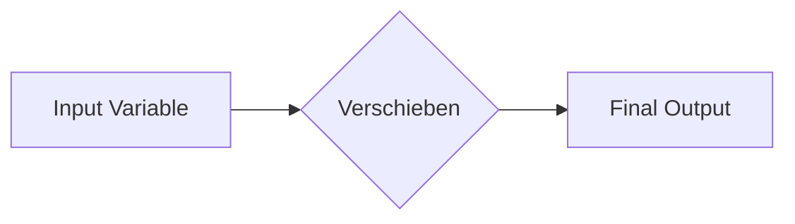
</details>

**230**

© T. Gemmeke, IDS, RWTH; R. Leupers, SSS

Eine sehr häufige Anwendung in der Informatik ist die Verwaltung von **Mengen**, z.B. in Datenbanken. Grundsätzlich sind hierfür sehr viele Datenstrukturen geeignet. Es kommt jedoch immer auf die gewünschten **Mengenoperationen** an, welche Datenstruktur sich als besonders effizient erweist.

230

---

## Verkettete Listen

**Def**.: Eine **(verkettete) Liste** ist entweder leer oder besteht aus einer Referenz auf einen **Knoten**, der ein Element und eine Referenz auf eine verkettete Liste enthält.

• Verwendung von **Zeigern** (siehe Kap. 3)
• Modellierung eines **Knotens** für ein Element vom Typ T:
typedef struct node {$\mathsf { T } ^ { \star }$ data; struct node\* next; } \*nodeptr;
• data ist Zeiger auf Listenelement vom Typ T
• next ist Zeiger auf Nachfolgerknoten


<details>
<summary>flowchart</summary>

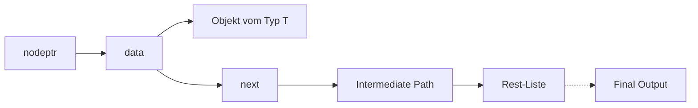
</details>

**231**

© T. Gemmeke, IDS, RWTH; R. Leupers, SSS

Eine Liste ist generell eine **rekursive Datenstruktur**. Sie besteht aus einem “Kopf” (dem ersten Knoten) und einer Restliste. Die Bezeichnung “verkettet” rührt daher, dass die Elemente wie in einer Kette aneinandergereiht sind, wobei jeweils ein Element per Zeiger auf das nächste Element verweist.

In einer Liste sind “**Nutzdaten**” eines beliebigen Typs T gespeichert. T ist variabel und für die Listenimplementierung auch nicht von Belang.

231

---

## Verkettete Listen

• Liste im **Speicher** (vgl. Kap. 3)
• Liste = 1. Element + Restliste
Darstellung einer leeren Liste: #define NULL 0
Zeigerwert NULL bedeutet, dass der Zeiger „nirgendwohin“ zeigt
Speicherzugriff per NULL‐Zeiger ist **unzulässig**, führt i.A. zum Programmabsturz


<details>
<summary>flowchart</summary>

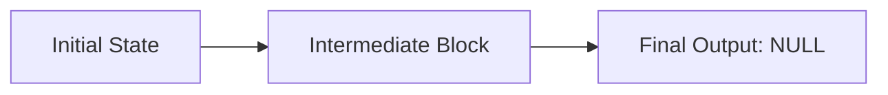
</details>

**232**


<details>
<summary>flowchart</summary>

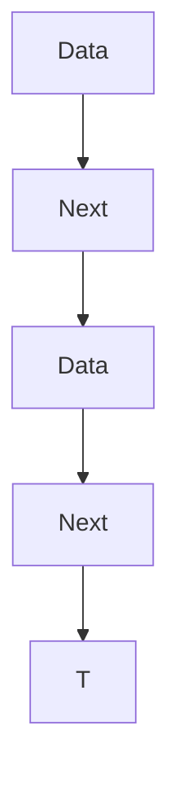
</details>

© T. Gemmeke, IDS, RWTH; R. Leupers, SSS

Rechts wird gezeigt, wie eine Liste tatsächlich im **Speicher** abgelegt sein könnte. Der obere data-Zeiger verweist auf ein Nutzdatum vom Typ T. Der zugehörige next-Zeiger verweist auf den nächsten Listenknoten, welcher sich theoretisch an beliebiger Stelle im Speicher (genauer gesagt: im Heap-Bereich) befinden kann.

Auch der nächste data-Zeiger verweist dann auf ein Objekt vom Typ T, und der zugehörige next-Zeiger verweist wiederum auf den **Nachfolgerknoten** in der Liste.

Zur Kennzeichnung des **Listenendes** wird der next-Zeiger des letzten Knotens mit **NULL** belegt. Diese spezielle “0” ist ein ausgezeichneter Zeigerwert, der immer so interpretiert wird, dass er “auf nichts” zeigt. Er darf daher auch nicht dereferenziert werden. Ein Anwendungsprogramm, welches Listen benutzt, fragt daher häufig durch einen expliziten Vergleich mit NULL ab, ob der letzte Knoten erreicht worden ist, bspw. nach folgendem Schema:

nodeptr n;

n = “erster Knoten in Liste”;

```c
while (n != NULL) /* Abbruch bei Listenende */
{ "verarbeite Objekt n->data"; /* n != NULL) */
    n = n->next; /* n weitersetzen */
}
```

232

---

## Listenoperationen

Definition des Datentyps **Liste**, Elemente vom Typ T

```c
typedef struct node {
    T* data;
    struct node* next; } Node, *nodeptr;

typedef struct list {
    nodeptr first, last; } List, *listptr;
```


<details>
<summary>flowchart</summary>

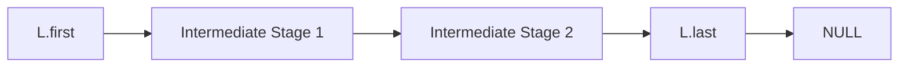
</details>

Erzeugung einer **leeren Liste** und **Leerheitstest**

```c
List L;
void Init(listptr L)
{
    L->first = NULL; L->last = NULL;
}

int IsEmpty(List L)
{
    return (L.first == NULL && L.last == NULL);
}
```

**233**

© T. Gemmeke, IDS, RWTH; R. Leupers, SSS

Die Datenstruktur “List” bedient sich der Datenstruktur “Node” für Listenknoten und besteht nur aus **zwei Zeigern**: einem auf das erste und einem auf das letzte Listenelement.

Die Datentypen "nodeptr" und "listptr" stellen Zeigertypen auf die jeweiligen Datenstrukturen Node und List dar.

Per Definition sollen bei einer **leeren Liste** beide Zeiger gleich NULL sein. Beim Leerheitstest (Funktion “IsEmpty”) wird daher diese Eigenschaft geprüft.

Auf den “last”-Zeiger könnte in einer Listenimplementierung prinzipiell auch verzichtet werden, auf “first” dagegen nicht. **Übungsaufgabe**: Warum ist das so, und welche Funktionen müssten dann wie angepasst werden?

233

---

## Listenoperationen

• **Einfügen** eines neuen Listenelements vom Typ T am Listenanfang


<details>
<summary>flowchart</summary>

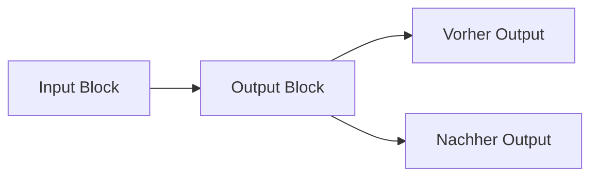
</details>

Funktion „malloc“ (siehe Kap. 3) stellt dynamisch Speicherplatz auf dem Heap bereit
Funktion „sizeof“ berechnet die erforderliche Anzahl von Bytes (hier z.B. insges. 8 Bytes bei 32‐Bit‐Zeigern)

```c
nodeptr newnode(T* item)
{
    nodeptr np;

    np = (nodeptr)malloc(sizeof(Node));
    np->data = item;
    np->next = NULL;

    return np;
}
```

**234**

© T. Gemmeke, IDS, RWTH; R. Leupers, SSS

Die Funktion **newnode** soll ein Nutzdatum item vom Typ T in einen Listenknoten einkapseln. Zunächst wird per malloc passender Speicherplatz auf dem Heap angefordert, dann wird der Anfang dieses Speicherblocks an die Zeigervariable np zugewiesen.

Die Komponenten des neuen Knotens werden passend **initialisiert**, d.h. data zeigt auf das Nutzdatum, und next wird – da über die Einbettung von np in eine Liste noch nichts weiteres bekannt ist – mit NULL belegt.

Anschließend wird np als Zeiger auf den nun fertigen Listenknoten per return zurückgeliefert.

234

---

Einfügen am Listenanfang

<div class="docvortex-algorithm" style="white-space: pre-wrap; font-family:monospace;">
void AppendFirst(T* item, listptr L)
{
    nodeptr np = newnode(item);
    if (IsEmpty(*L)) {
        L-&gt;first = np; L-&gt;last = np;
    } else {
        np-&gt;next = L-&gt;first;
        L-&gt;first = np;
    }
}

np --&gt; NULL
L-&gt;first --&gt; NULL
np --&gt; NULL
L-&gt;first --&gt; NULL
np --&gt; NULL
L-&gt;first --&gt; NULL
235
</div>

Die Skizze zeigt den **Ablauf beim Einfügen am Listenanfang**. Zunächst wird mittels “newnode” ein neuer Knoten “np” erzeugt, welcher das Nutzdatum “item” einkapselt.

Der Nachfolgerzeiger “next” von “np” wird auf das ursprünglich erste Element der Liste L umgelenkt. Abschließend wird “np” zum neuen **Listenanfang** gemacht, d.h. der Zeiger L->first wird entsprechend umgesetzt.

Der Sonderfall, dass die Liste L **leer** ist (IsEmpty-Funktion) wird vorab abgefangen. In diesem Fall wird “np” gleichzeitig zum ersten und letzten Listenelement.

235

---

Einfügen am Listenende

```txt
void AppendLast(T* item, listptr L)
{
    nodeptr np = newnode(item);
    if (IsEmpty(*L)) {
        L->first = np; L->last = np;
    } else {
        L->last->next = np;
        L->last = np;
    }
}

L->first
L->first
L->first
```

Analog kann man wie in der Skizze gezeigt das neue Element “np” am **Listenende** anfügen. Die Zeiger werden entsprechend “umgebogen”, und auch hier ist evtl. der Spezialfall einer leeren Liste L vorab zu behandeln.

236

---

Prüfen ob Element in Liste enthalten

```cpp
int IsIn(T* item, List L)
{
    nodeptr np;
    if (IsEmpty(L)) return 0; // false
    np = L.first;
    while (np != NULL) {
        if (Equal(np->data, item)) return 1; // true
        np = np->next;
    }
    return 0; // false
}
```


<details>
<summary>flowchart</summary>

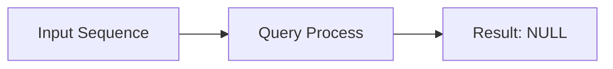
</details>

**Laufzeit** bei N‐elementiger Liste:

– Best case: O(1)
– Worst case: O(N)
– Average case: O(N/2) = O(N)

**237**

© T. Gemmeke, IDS, RWTH; R. Leupers, SSS

Zum **Auffinden** des Elementes “item” wird die Liste von links nach rechts durchlaufen. Ist die Liste leer, so kann “item” trivialerweise nicht enthalten sein. Ansonsten wird eine while-Schleife durchlaufen, welche terminiert, sobald per NULL-Zeiger das Listenende angezeigt wird.

Die **Equal-Funktion** (hier nicht weiter vertieft) soll prüfen, ob es sich bei dem aktuellen betrachteten Element um das gesuchte handelt. Man beachte, dass ein Vergleich per “==“-Operator i.a. nicht funktionieren wird: Da es sich bei T um einen beliebigen komplexen Datentyp handeln kann, welcher dann komponentenweise verglichen werden müsste, ist ein einfacher Zeigervergleich unzulässig. Es ist auch – je nach Implementierung – denkbar, dass verschiedene Zeiger auf das gesuchte Datum “\*item” zeigen, d.h. “\*(np->data)” und “\*item” sind evtl. identisch, obwohl die Zeiger “np->data” und “item” durchaus verschieden sein könnten.

Bei positivem Vergleich wird sofort 1 (wahr) per return zurückgeliefert. Wurde das Listenende erreicht, so wird 0 (falsch) zurückgegeben.

237

---

Einfügen hinter ein bestimmtes Listenelement

```c
// item2 hinter item1 einfügen
void InsertBehind(T* item1,
  T* item2, listptr L)
{
  nodeptr np, newnp;

  if (!IsIn(item1,*L)) {
    printf(„Fehler!“); return;
  }

  np = L->first;
  while (np != NULL) {
    if (Equal(np->data,item1)) {
      newnp = newnode(item2);
      newnp->next = np->next;
      np->next = newnp;
      if (np == L->last) {
        L->last = newnp;
      }
      break;
    }
    np = np->next;
  }
}
```


<details>
<summary>flowchart</summary>

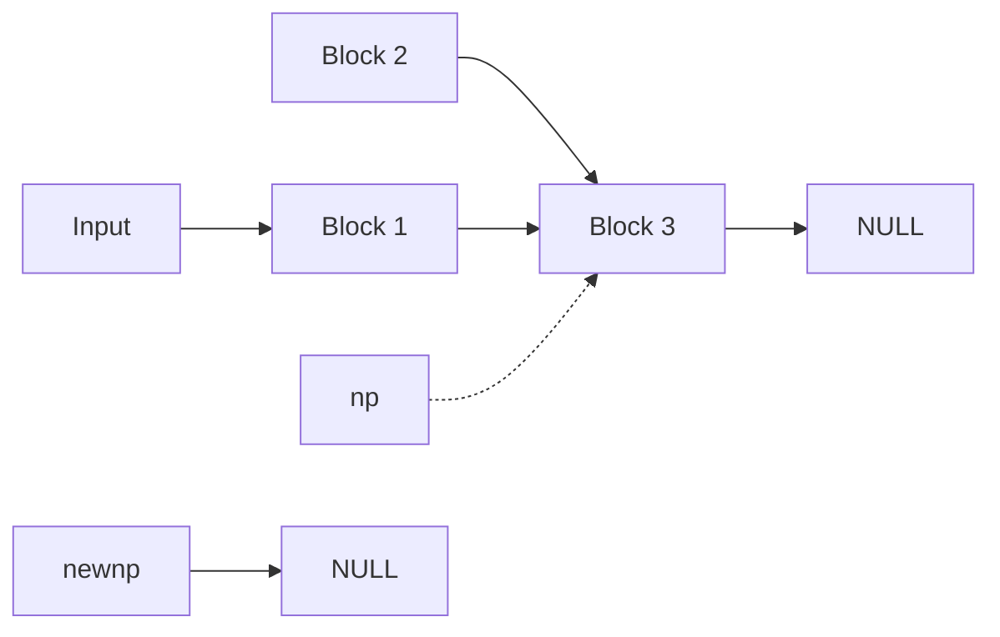
</details>


<details>
<summary>flowchart</summary>

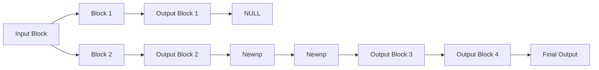
</details>

**238**

© T. Gemmeke, IDS, RWTH; R. Leupers, SSS

Zum **Auffinden** des Elementes “item” wird die Liste von links nach rechts durchlaufen. Ist die Liste leer, so kann “item” trivialerweise nicht enthalten sein. Ansonsten wird eine while-Schleife durchlaufen, welche terminiert, sobald per NULL-Zeiger das Listenende angezeigt wird.

Die **Equal-Funktion** (hier nicht weiter vertieft) soll prüfen, ob es sich bei dem aktuellen betrachteten Element um das gesuchte handelt. Man beachte, dass ein Vergleich per “= =“-Operator i.a. nicht funktionieren wird: Da es sich bei T um einen beliebigen komplexen Datentyp handeln kann, welcher dann komponentenweise verglichen werden müsste, ist ein einfacher Zeigervergleich unzulässig. Es ist auch –je nach Implementierung- denkbar, dass verschiedene Zeiger auf das gesuchte Datum “\*item” zeigen, d.h. “\*(np->data)” und “\*item” sind evtl. identisch, obwohl die Zeiger “np->data” und “item” durchaus verschieden sein könnten.

Bei positivem Vergleich wird sofort 1 (wahr) per return zurückgeliefert. Wurde das Listenende erreicht, so wird 0 (falsch) zurückgegeben.

238

---

Löschen eines Listenelementes

```c
void Delete(T* item, listptr L)
{
    nodeptr np1, np2;

    if (IsEmpty(*L)) return;
    np1 = L->first;
    if (Equal(np1->data,item)) {
        L->first = np1->next;
        if (L->first == NULL)
            L->last = NULL;
        free(np1);
        return;
    }
    np2 = np1->next;
    while (np2 != NULL) {
        if (Equal(np2->data,item)) {
            np1->next = np2->next;
            if (np2 == L->last)
                L->last = np1;
            free(np2);
            break;
        }
        np1 = np2;
        np2 = np2->next;
    }
}
```

**239**


<details>
<summary>flowchart</summary>

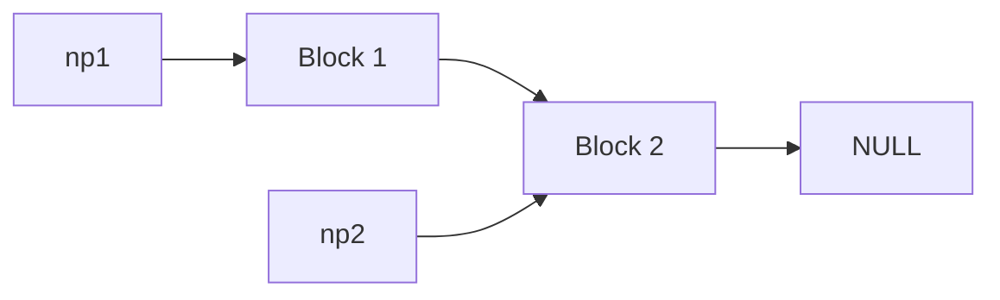
</details>


<details>
<summary>flowchart</summary>

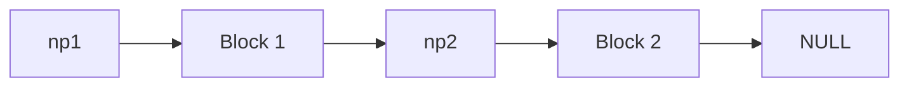
</details>

© T. Gemmeke, IDS, RWTH; R. Leupers, SSS

Das **Löschen** eines Elementes “item” aus Liste L ist etwas komplizierter, da verschiedene Fälle zu betrachten sind.

Ist L **leer**, so braucht nichts unternommen zu werden (bzw. es liegt möglicherweise sogar ein Fehler vor).

Ist “item” zufälligerweise das **erste Listenelement**, so muss L->first angepasst werden. Außerdem kann durch das Löschen (per “free”, dem Gegenstück zu “malloc”) die Liste ganz leer werden, was wiederum einen “reset” des Zeigers “L->last” notwendig macht.

Der **Normalfall** ist, dass “irgendwo” innerhalb der Liste zu löschen ist. Um das gesuchte Element aushängen zu können, muss die Liste mittels zweier (synchron und jeweils um eine Position versetzt laufender) Zeiger “np1” und “np2” durchlaufen werden. Auch hier ist der Sonderfall zu betrachten, dass “item” zufällig das letzte Listenelement ist.

239

---

## Zusammenfügen zweier Listen

• Falls Liste als Mengendarstellung: entspricht **Vereinigung**
• Evtl. **Mehrfachvorkommen** von Elementen ausschließen

L1:


<details>
<summary>flowchart</summary>

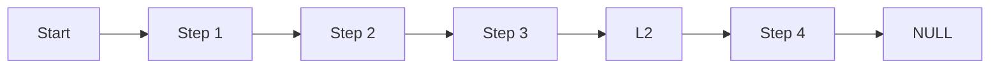
</details>

```c
listptr Union(listptr L1, listptr L2)
{
    if (IsEmpty(*L2)) return L1;
    if (IsEmpty(*L1)) return L2;

    L1->last->next = L2->first;
    L1->last = L2->last;

    return L1;
}
```

**240**

© T. Gemmeke, IDS, RWTH; R. Leupers, SSS

Die **Vereinigung** zweier Listen geschieht einfach durch Aneinanderhängen. Sonderfälle treten nur ein, wenn eine der beiden Listen zufällig leer ist.

Man beachte, dass durch das Aneinanderhängen **keine** neue Liste mit Kopien von Elementen aus den alten Listen erzeugt wird.

Zu beachten ist, ob mit Hilfe der Listen Mengen (im mathematischen Sinn) oder andere Daten zu verwalten sind. Bei Mengen gibt es kein **Mehrfachvorkommen** von Elementen, so dass u.U. zusätzlich sichergestellt werden muss, dass in der Vereinigung alle Elemente höchstens einmal vorhanden sind (**Übungsaufgabe**: wie lässt sich dies implementieren?)

240

---

Schnittmengenberechnung mittels Listen

```c
listptr Intersect(listptr L1, listptr L2)
{
    nodeptr np;
    listptr L = (listptr)malloc(sizeof(List));
    Init(L);
    np = L1->first;
    while (np != NULL) {
        if (IsIn(np->data, *L2)) AppendLast(np->data, L);
        np = np->next;
    }
    return L;
}
```

L1:


<details>
<summary>flowchart</summary>

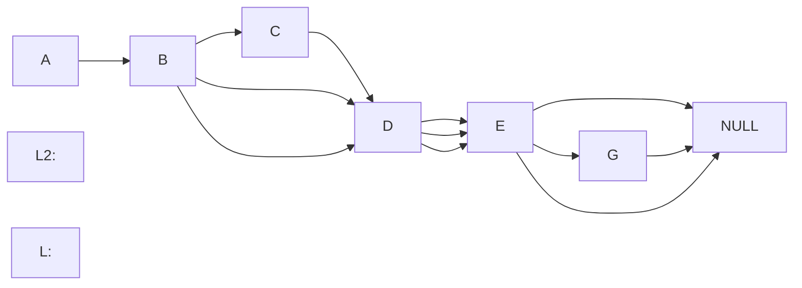
</details>

**241**

© T. Gemmeke, IDS, RWTH; R. Leupers, SSS

Analog zur Vereinigung lassen sich **Schnittmengen** berechnen. Im Gegensatz zur Funktion Union wird in der Funktion Intersect eine neue Liste mit Kopien von Elementen aus den beiden alten Listen generiert.

Zunächst wird eine neue Liste L erzeugt, welche den Schnitt von L1 und L2 aufnehmen soll. Anschließend wird L1 elementweise durchlaufen, und es wird jeweils geprüft, ob das aktuelle Element auch in L2 enthalten ist. Falls ja, so gehört es in die Schnittmengenliste L.

241

---

## 8. Lineare Datentypen

8.1 Listen
**8.2 Stacks**
8.3 Queues

**242**

© T. Gemmeke, IDS, RWTH; R. Leupers, SSS

242

---

## Stacks

**Def**.: Ein **Stack** (Stapel) ist ein ADT, der folgende Grundoperationen unterstützt:

1. Einfügen eines neuen Elementes $( , \mathsf { P u s h } ^ { n } )$
2. Entfernen des zuletzt eingefügten Elementes $( , P o p ^ { n } )$

• Stacks sind eine **grundlegende Datenstruktur** in vielen Anwendungen
– Ablagesystem auf Professorenschreibtisch
– Compiler‐Frontend (Analyse des Quellprogramms)
– Abarbeitung von C‐Funktionsaufrufen
Aufgrund der Pop‐Operation auch als **LIFO‐Datenstruktur** bezeichnet (last in, first out)
• Stack als ADT, d.h. **verschiedene Implementierungen** möglich (z.B. Listen und Arrays)

**243**

© T. Gemmeke, IDS, RWTH; R. Leupers, SSS

Der **Stack** ist eine Datenstruktur, auf die nur “von oben” zugegriffen werden kann. “Push” legt etwas auf den Stapel, und “Pop” nimmt das oberste Element herunter.

In diesem Fall unterscheiden wir genauer zwischen dem Stack als **abstrakter Datentyp** (ADT) und seiner Implementierung. Aus ADT-Sicht ist nur von Belang, dass der Stack Daten speichern kann, und dass Push und Pop das Gewünschte tun. Die eigentliche Realisierung als Programm ist unabhängig von dieser Sichtweise (und sollte es auch sein). Glücklicherweise kennen wir bereits zwei konkrete Datenstrukturen zur Stack-Implementierung.

243

---

## Push und Pop

push D

push EC

push B

push A


<details>
<summary>text_image</summary>

stack
D
C
B
A
</details>

pop → D

pop → E C

pop → B

pop → A

**244**

© T. Gemmeke, IDS, RWTH; R. Leupers, SSS

Die Animation veranschaulicht eine willkürliche **Folge von Stack-Zugriffen** an einem Beispiel. Push und Pop müssen bei typischen Stapeln nicht immer abwechselnd erfolgen. Zu Vermeiden sind jedoch zwei Sondersituationen:

(1) Der Versuch, etwas auf einen “vollen” Stack abzulegen
(2) Der Versuch, etwas von einem leeren Stack zu entnehmen

244

---

## Beispiel: Laufzeit‐Stack für C‐Funktionsaufrufe

• Siehe auch Kap. 5
Funktion f wird durch Aufruf von g **unterbrochen** und später **fortgesetzt**
g kann ihrerseits **weitere Funktionen** aufrufen
Umgebung zur Programmausführung muss einen **Stack noch aktiver Funktionen** verwalten
• **Funktionsaufruf** = Push
• **Funktionsende** = Pop


<details>
<summary>flowchart</summary>

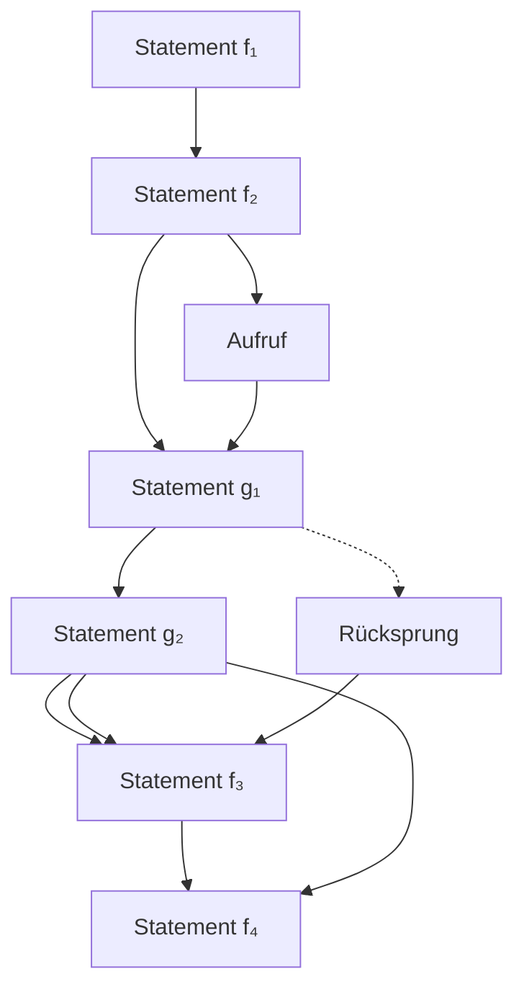
</details>

**245**

© T. Gemmeke, IDS, RWTH; R. Leupers, SSS

Das Konzept der **Funktionsaufrufe** in C wird über Stacks realisiert. Wird ein Programm ausgeführt, so ist dabei stets (für den Programmierer nicht direkt sichtbar) ein (Laufzeit-)Stack aktiv, auf dem Rücksprungpunkte aus Funktionen abgespeichert sind.

Da Funktionsaufrufe beliebig **verschachtelt** sein können, aber jede Funktion stets zur jeweils **letzten** aufrufenden Funktion zurückkehren muss, ist ein Stack genau die richtige Datenstruktur für diesen Zweck. Bei einem Aufruf von g aus f bspw. wird per Push auf dem Stack die aktuelle Position in f gespeichert. Nun wird g abgearbeitet (was evtl. zu weiteren Pushs führt), und der Rücksprung erfolgt dann nach f an die per Pop zu bestimmende Stelle.

245

---

## Beispiel: Laufzeit‐Stack für C‐Funktionsaufrufe


<details>
<summary>flowchart</summary>

This image displays a structured logic diagram representing a program or system with multiple input/output states (void f, void g, void h, i, int main) and their corresponding function blocks.
</details>

Das Beispiel zeigt, wie sich der Laufzeit-Stack für ein gegebenes (hier sicherlich nicht weiter sinnvolles) Programm entwickelt. Bei einer korrekten

Programmabarbeitung sollte am Ende in jedem Fall der gleiche **Stack-Zustand** wie am Anfang herrschen (d.h. es ist lediglich die main-Funktion aktiv).

Bei manchen **Programmierfehlern** (z.B. Schreiben in ein lokales Array jenseits seiner Grenzen) kann der Laufzeitstack beschädigt (d.h. mit ungültigen Daten gefüllt) werden. Als Folge könnte eine Funktion ihre richtige Rücksprungadresse “vergessen”, was unweigerlich zu einem Programmabsturz führt.

246

---

## Stack‐Implementierung durch Listen

Elemente auf Stack = Listenelemente
• Push = Einfügen am Listenanfang
• Pop = Entfernen des ersten Elementes
• Stack für beliebigen Elementtyp T:

```c
List L;

void Push(T* item,listptr L)
{
    AppendFirst(item, L);
}

T* Pop(listptr L)
{
    T* item;
    if (IsEmpty(*L)) return NULL;

    item = L->first->data;
    Delete(item, L);
    return item;
}
```


<details>
<summary>flowchart</summary>

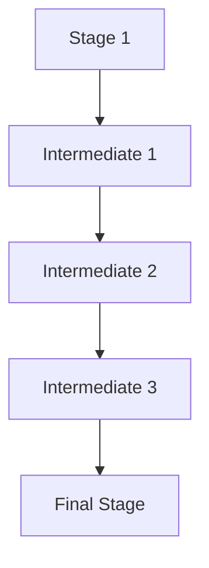
</details>

**247**

© T. Gemmeke, IDS, RWTH; R. Leupers, SSS

Stacks lassen sich wie gezeigt sehr leicht durch **Listen** implementieren. Der Unterschied zu einer “normalen” Liste liegt lediglich darin, dass man auf sie nur per Push und Pop zugreift, wodurch die Funktionalität des ADT Stack gewährleistet wird.

247

---

Stack‐Implementierung durch Arrays

• Vorgabe der **max. Stack‐Größe** notwendig
Elemente auf Stack = Arrayelemente
„top“ verweist stets auf das nächste freie Element (top = „**Stack‐Pointer**“)
Push = Einfügen und Erhöhen von top um 1
Pop = Entfernen und Erniedrigen von top um 1
Prüfen auf **Überlauf** (im Gegensatz zu Listen!)

```c
#define MAX 100
typedef struct stk
{ T* elems[MAX]; int top; } stack;

void Init(stack* s)
{ s->top = 0; }

int IsEmpty(stack s)
{ return (s.top == 0); }

void Push(T* item,stack* s)
{
    if (s->top == MAX)
        printf(„Stack voll!“);
    s->elems[s->top] = item;
    s->top++;
}

T* Pop(stack* s)
{
    if (IsEmpty(*s)) return NULL;
    s->top--;
    return s->elems[s->top];
}
```

**248**

© T. Gemmeke, IDS, RWTH; R. Leupers, SSS

Eine andere Variante besteht in der **Implementierung durch Arrays**. Der wesentliche Unterschied zur Listenimplementierung liegt darin, dass der Speicherplatz statisch festgelegt werden muss. Der hier gezeigte Stack kann exakt 100 Elemente speichern, was u.U. zum Überlauf oder zu Platzverschwendung führen kann.

Der Vorteil der Arrays liegt jedoch in der einfacheren Stack-Implementierung. Bzgl. Push und Pop beachte man, dass Inkrementieren und Dekrementieren des Stack-Pointers zueinander **asymmetrisch** erfolgen müssen (Push: einfügen, dann inkrementieren, Pop: dekrementieren, dann lesen), da per Definition der Stack-Pointer immer auf das nächste freie Element im Array verweisen soll.

248

---

## Beispiel‐Anwendung

• Auswertung geklammerter **arithmetischer Ausdrücke** $- \mathrm { ~ z . B . ~ } ( ( \mathrm { ~ 6 ~ } ^ { * } ( \mathrm { ~ 4 ~ } ^ { * } \mathrm { ~ 2 8 } ) ) + ( \mathrm { ~ 9 ~ } \mathrm { - } ( ( \mathrm { ~ 1 2 ~ } / \mathrm { ~ 4 } ) ^ { * } \mathrm { ~ 2 } ) ) )$
• **Innere Ausdrücke** vor äußeren auszuwerten
• Speicherung von Zwischenergebnissen notwendig
• **Zwei Stacks**: Operanden‐ und Operatorstack
• Abarbeitung eines Ausdrucks **von links nach rechts**:

${ \bf \nabla } _ { \nu } \left( { \bf \nabla } ^ { \prime } \right)$ keine Aktion
– Operand: Push auf Operandenstack
– Operator: Push auf Operatorstack
${ \bf \Phi } _ { \nu } ) ^ { \prime \prime } ;$ Pop des obersten Operators, Pop der obersten beiden Operanden, Ausdruck auswerten, Push Ergebnis auf Operandenstack

**249**

© T. Gemmeke, IDS, RWTH; R. Leupers, SSS

Mittels Stacks kann man einen einfachen “**Taschenrechner**” implementieren, welcher komplexe arithmetische Ausdrücke auswertet und dabei die Klammerung beachtet. Beim Durchlauf durch den Ausdruck ist folgende **Fallunterscheidung** zu machen:

(1) Öffnende Klammer: ein neuer Teilausdruck beginnt, aber es ist nichts zu speichern oder auszuwerten
(2) Operand: man befindet sich “mitten” in einem Ausdruck, und der Operand muss gespeichert werden
(3) Operator: man befindet sich “mitten” in einem Ausdruck, und der Operator muss gespeichert werden
(4) Schließende Klammer: Ende eines Teilausdrucks, der zuletzt gespeicherte Operator muss auf die zuletzt gespeicherten Operanden angewendet werden, und das Ergebnis muss (als evtl. Operand für andere noch offene Teilausdrücke) gespeichert werden

249

---

## Beispiel

$$
\left(\left(6 ^ {*} (4 ^ {*} 2 8)\right) + (9 - \left((1 2 / 4) ^ {*} 2\right))\right)
$$

Operandenstack

| 6 |
| --- |
| 6 4 |
| 6 4 28 |
| 6 112 |
| 672 |
| 672 9 |
| 672 9 12 |
| 672 9 12 4 |
| 672 9 3 |
| 672 9 3 2 |
| 672 9 6 |
| 672 3 |
| 675 |

Operatorstack

| * |
| --- |
| ** |
| * |
| (leer) |
| + |
| +- |
| +-/ |
| +- |
| +-* |
| +- |
| +(leer) |

**250**

© T. Gemmeke, IDS, RWTH; R. Leupers, SSS

Das Beispiel zeigt die **Entwicklung der beiden Stacks**. Jede neue Zeile entspricht dabei neuen, gemäß der obigen Fallunterscheidung angenommenen Stack-Zuständen.

250

---

## 8. Lineare Datentypen

8.1 Listen
8.2 Stacks
**8.3 Queues**

**251**

© T. Gemmeke, IDS, RWTH; R. Leupers, SSS

251

---

## Queues

**Def**.: Eine **Queue** (Warteschlange) ist ein ADT, der folgende Grundoperationen unterstützt:

1. Einfügen eines neuen Elementes $( , \mathsf { P u t } ^ { n } )$
2. Entfernen des zuerst eingefügten Elementes $( , \mathsf { G e t } ^ { n } )$

• Verbreitete Datenstruktur, z.B.
– Warteschlange von auszuführenden Prozessen
– Kommunikationspuffer z.B. für Druckaufträge
• **FIFO‐Prinzip**: first in, first out $( . ,$ zuerst gekommen, zuerst bedient“)


<details>
<summary>text_image</summary>

DEZZEN
nach Originalrezept
</details>

**252**

© T. Gemmeke, IDS, RWTH; R. Leupers, SSS

**Queues** haben eine gewisse Verwandtschaft mit Stacks. Der Zugriff erfolgt jedoch quasi umgekehrt: Statt des zuletzt eingefügten Elementes wird immer das zuerst eingefügte Element entnommen (FIFO). Auch hier betrachten wir die Queue zunächst als ADT.

Außer im wirklichen Leben (s. Foto) begegnet man Warteschlangen in sehr vielen IT-Anwendungen, z.B. bei der **Synchronisation paralleler Prozesse**.

**Beispiel: Druckerbetrieb**. Ein Drucker (Prozess 1) interagiert mit einer Menge von Benutzern (Prozesse 2…N). Jeder Prozess arbeitet mit seiner eigenen Geschwindigkeit, und Interaktionen finden nur gelegentlich und zu unvorhersagbaren Zeitpunkten statt. Damit das Gesamtsystem Drucker/Benutzer sinnvoll funktioniert, müssen die Prozesse synchronisiert werden. Möchte Prozess i (i > 1) drucken, so kann Prozess 1 zufällig gerade beschäftigt sein. Damit keine Aufträge verloren gehen, müssen diese in einem Speicher zwischengelagert (gepuffert) werden. Außerdem ist es “fair”, dass zuerst abgesandte Druckaufträge auch als erstes abgearbeitet werden. Daher ist eine Queue als Puffer sehr geeignet (bei einem Stack als Puffer würde immer der letzte Auftraggeber gewinnen, wodurch die “Fleissigen bestraft” und die “Nachzügler bevorzugt” würden).

Dieses Beispiel ließe sich auch für die Interaktion (Informations- und Auftragsaustausch) zwischen den Benutzern selbst fortsetzen. Eine Queue wird dann als Puffermodell allerdings nicht mehr ausreichen, da es in diesem Fall weitere Kriterien für “Fairness” gibt, z.B. Prioritäten.

252

---

## Put und Get

put D

put C

put B

put A


<details>
<summary>text_image</summary>

queue
D
C
B
A
</details>

get → A

**253**

© T. Gemmeke, IDS, RWTH; R. Leupers, SSS

Für den Zugriff auf eine Queue existieren zwei Funktionen Put und Get. Put hängt ein Element an das Ende der Queue, Get entfernt das erste Element aus der Queue. Ähnlich wie beim Stack sind auch hier die folgenden Sondersituationen zu vermeiden:

• Der Versuch, etwas an eine “volle” Queue mittels Put anzuhängen
• Der Versuch, etwas aus einer leeren Queue mittels Get zu entnehmen

253

---

## Put und Get

**queue**

D

C

B

get → B

**254**

© T. Gemmeke, IDS, RWTH; R. Leupers, SSS

254

---

## Put und Get

**queue**

D

C

get → C

**255**

© T. Gemmeke, IDS, RWTH; R. Leupers, SSS

255

---

## Queue‐Implementierung durch Listen

Queue‐Elemente = Listenelemente
• Put = Einfügen am Listenende
• Get = Entfernen des ersten Elementes
• Queue für beliebigen Elementtyp T:

```c
List L;

void Put(T* item,listptr L)
{
    AppendLast(item, L);
}

T* Get(listptr L)
{
    T* item;

    if (IsEmpty(*L)) return NULL;

    item = L->first->data;
    Delete(item, L);

    return item;
}
```

**256**


<details>
<summary>flowchart</summary>

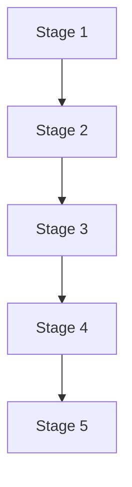
</details>

© T. Gemmeke, IDS, RWTH; R. Leupers, SSS

Ähnlich zu den Stacks lassen sich auch Queues leicht mittels **Listen** implementieren. Der Zugriff erfolgt dann per Put und Get.

256

---

## Queue‐Implementierung durch Arrays

Betrachte Dynamik von Queues im Vergleich zu Stacks in Array‐Implementierung:


<details>
<summary>bar_stacked</summary>

| Kategorie | Wert 1 | Wert 2 | Wert 3 | Wert 4 | Wert 5 | Wert 6 | Wert 7 |
| --- | --- | --- | --- | --- | --- | --- | --- |
| Stack (Verwendung) | ~10% | ~10% | ~10% | ~10% | ~10% | ~10% | ~10% |
| Stack (Tendenziellem) | ~10% | ~10% | ~10% | ~10% | ~10% | ~10% | ~10% |
| Stack (Speichereich) | ~10% | ~10% | ~10% | ~10% | ~10% | ~10% | ~10% |
| Stack (Spaicherausnutzung) | ~10% | ~10% | ~10% | ~10% | ~10% | ~10% | ~10% |
| Queue (Wandert) | ~10% | ~10% | ~10% | ~10% | ~10% | ~10% | ~10% |
| Queue (Weiter nach rechts) | ~10% | ~10% | ~10% | ~10% | ~10% | ~10% | ~10% |
| Queue (Schlechte Speicherausnutzung) | ~10% | ~10% | ~10% | ~10% | ~10% | ~10% | ~10% |
| Queue (Spaicherausnutzung 257) | ~10% | ~10% | ~10% | ~10% | ~10% | ~10% | ~10% |

© T. Gemmeke, IDS, RWTH; R. Leupers, SSS
</details>

Bei der Array-Implementierung von Queues ist eine **Besonderheit** zu beachten: Die anfangs genutzten Speicherplätze würden im Zeitablauf nicht mehr weiter verwendet und somit für die spätere Verwendung vergeudet. Eine solche “naive” Implementierung scheidet daher meist aus.

257

---

## Queue‐Implementierung durch Arrays

• Lösung: **ringförmiges** Array bzw. **zyklische** Adressierung


<details>
<summary>text_image</summary>

A[N-1] A[0]
</details>

**258**

© T. Gemmeke, IDS, RWTH; R. Leupers, SSS

Der Trick besteht darin, den für die Queue reservierten Speicherbereich (das Array) als **ringförmige** Struktur zu betrachten. D.h. der Nachfolger von A[N-1] wird per Definition zu A[0] statt A[N]. Die aktiven Elemente in der Queue können sich dann an beliebigen Stellen im Array befinden, und die Anfangselemente ab A[0] werden automatisch wiederverwendet, sobald die Grenze A[N] überschritten wird. Natürlich sind hierbei **Überlaufsituationen** (d.h. das Überschreiben von noch aktiven Elementen durch Put) zu vermeiden.

258

---

Zwei **Zeiger** (Array‐Indizes) first und last verweisen auf aktuellen Anfang (‐1) und Ende (+1) der Queue
Verwendung des Modulo‐Operators (%) zur **zyklischen Adressierung**
Prüfung auf **Über‐ und Unterlauf** (overflow, underflow) erforderlich

Queue‐Implementierung durch Arrays

```c
#define MAX 100

typedef struct q
{ T* elems[MAX];
    int first, last; } queue;

void Init(queue* q)
{
    q->first = 0;
    q->last = 1;
}

void Put(T* item,queue* q)
{
    if (q->last == q->first) overflow();
    else {
        q->elems[q->last] = item;
        q->last = (q->last+1) % MAX;
    }
}

T* Get(queue* q)
{
    q->first = (q->first+1) % MAX;
    if (q->first == q->last) underflow();
    else return q->elems[q->first];
}
```

**259**

© T. Gemmeke, IDS, RWTH; R. Leupers, SSS

Da der Speicher immer linear adressiert wird, muss die zyklische Adressierung anderweitig nachgebildet werden. Hierzu kann der **%-Operator** verwendet werden, welcher den Rest bei der ganzzahligen Division liefert. Damit wird gewährleistet, dass bei Put und Get niemals der Speicherbereich A[0…MAX-1] verlassen wird.

Die **Überlaufbehandlung** (normalerweise: Ausgabe einer Fehlermeldung) wird hier nicht weiter vertieft. Eine leere Queue wird dadurch gekennzeichnet, dass sich first und last um 1 unterscheiden (siehe Init-Funktion). Der Überlauf lässt sich somit durch einen Vergleich von first und last erkennen: Der last-Zeiger soll stets auf das nächste freie Element zeigen. Ist er bei Put identisch zum first-Zeiger, so wird die Queue als “voll” betrachtet (theoretisch würde jedoch noch ein zusätzliches Element hineinpassen, wenn man das Array bis zum letzten Feld füllt). Analog bei Get: Erreicht man durch Inkrementieren von first die Position last, so gibt es nichts mehr zu entnehmen.

259

---


<details>
<summary>state_timeline</summary>

| Step | Outcome |
| --- | --- |
| 1 | first |
| 2 | last |
| 3 | frei |
| 4 | verwendet |
| 5 | second |
| 6 | third |
| 7 | fourth |
| 8 | fifth |
| 9 | sixth |
| 10 | seventh |
| 11 | eighth |
| 12 | fifth |
| 13 | sixth |
| 14 | fifth |
| 15 | sixth |
| 16 | fifth |
| 17 | sixth |
| 18 | fifth |
| 19 | sixth |
| 20 | fifth |
| 21 | sixth |
| 22 | fifth |
| 23 | sixth |
| 24 | fifth |
| 25 | sixth |
| 26 | fifth |
| 27 | sixth |
| 28 | fifth |
| 29 | sixth |
| 30 | fifth |
| 31 | sixth |
| 32 | fifth |
| 33 | sixth |
| 34 | fifth |
| 35 | sixth |
| 36 | fifth |
| 37 | sixth |
| 38 | fifth |
| 39 | sixth |
| 40 | fifth |
| 41 | sixth |
| 42 | fifth |
| 43 | sixth |
| 44 | fifth |
| 45 | sixth |
| 46 | fifth |
| 47 | sixth |
| 48 | fifth |
| 49 | sixth |
| 50 | fifth |
| 51 | sixth |
| 52 | fifth |
| 53 | sixth |
| 54 | fifth |
| 55 | sixth |
| 56 | fifth |
| 57 | sixth |
| 58 | fifth |
| 59 | sixth |
| 60 | fifth |
| 61 | sixth |
| 62 | fifth |
| 63 | sixth |
| 64 | fifth |
| 65 | sixth |
| 66 | fifth |
| 67 | sixth |
| 68 | fifth |
| 69 | sixth |
| 70 | fifth |
| 71 | sixth |
| 72 | fifth |
| 73 | sixth |
| 74 | fifth |
| 75 | sixth |
| 76 | fifth |
| 77 | sixth |
| 78 | fifth |
| 79 | sixth |
| 80 | fifth |
| 81 | sixth |
| 82 | fifth |
| 83 | sixth |
| 84 | fifth |
| 85 | sixth |
| 86 | fifth |
| 87 | sixth |
| 88 | fifth |
| 89 | sixth |
| 90 | fifth |
| 91 | sixth |
| 92 | fifth |
| 93 | sixth |
| 94 | fifth |
| 95 | sixth |
| 96 | fifth |
| 97 | sixth |
| 98 | fifth |
| 99 | sixth |
| 100 | fifth |

© T. Gemmeke, IDS, RWTH; R. Leupers, SSS
</details>

**Beispiel-Zustände** einer Queue nach verschiedenen Operationen:

Queue 1: Zustand nach Init

Queue 2: nach Put einiger Elemente

Queue 3: nach Get einiger Elemente

Queue 4: Put weiterer Elemente, last-Zeiger geht zurück auf Array-Anfang

Queue 5: Get weiterer Elemente

Queue 6: Put weiterer Elemente, aktive Elemente befinden sich nun sowohl am Ende als auch am Anfang des Arrays

260
