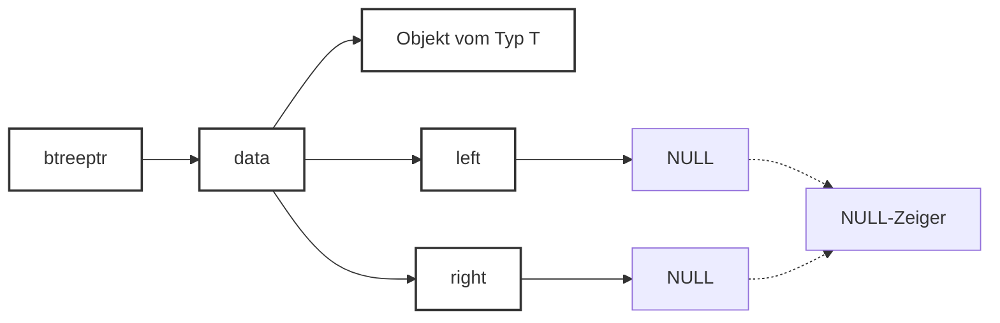
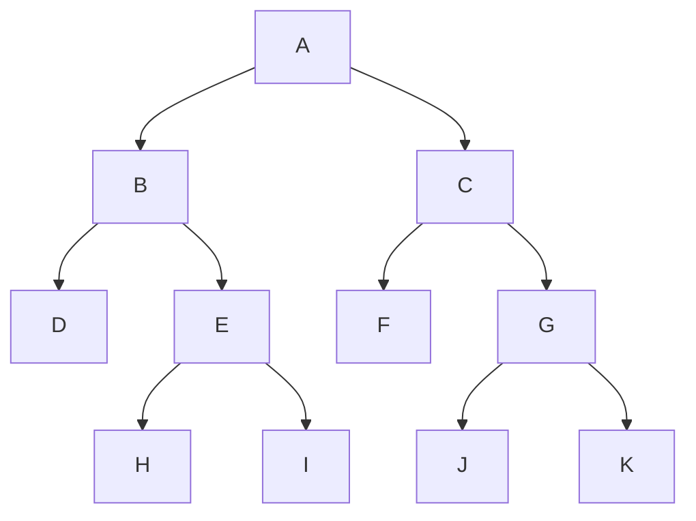
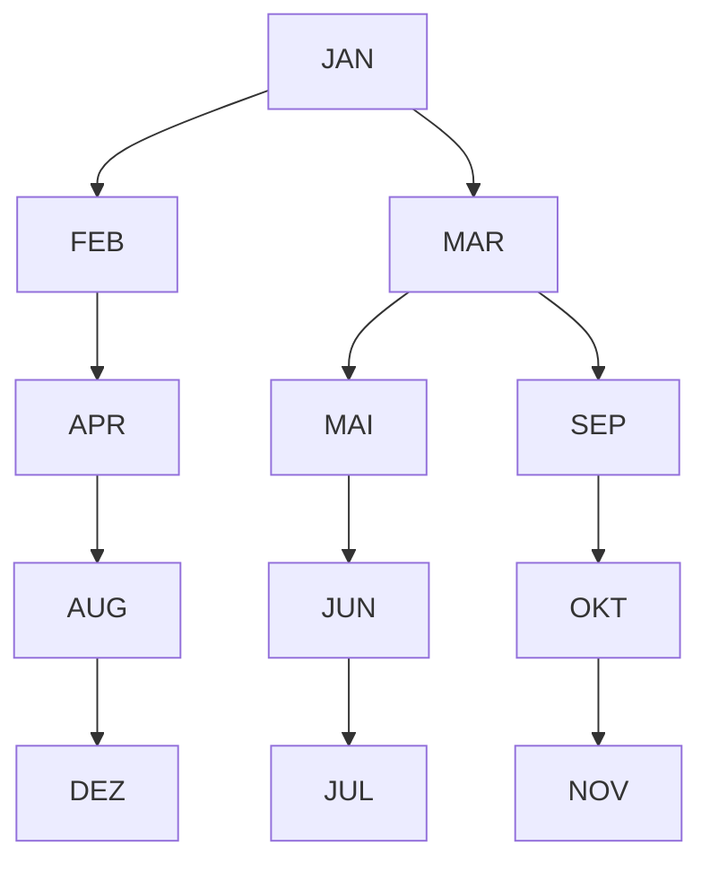
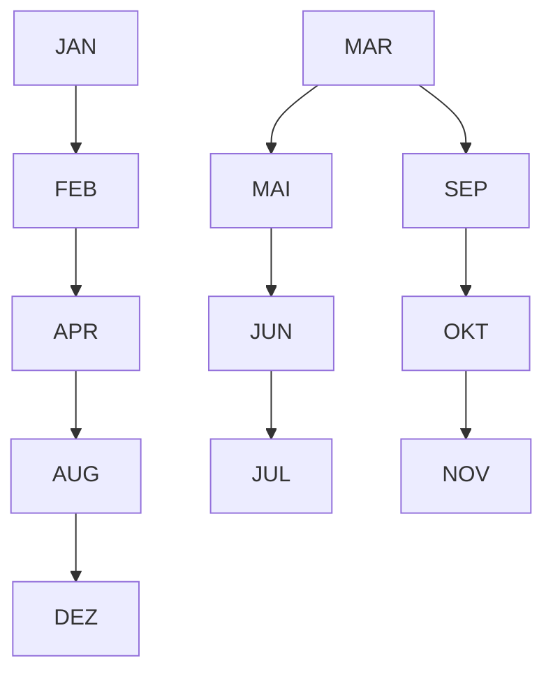
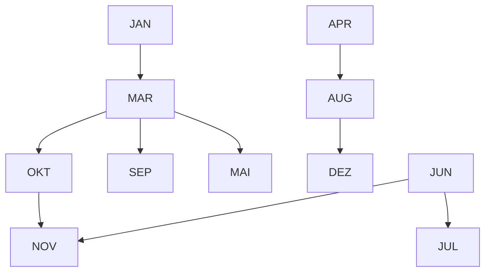
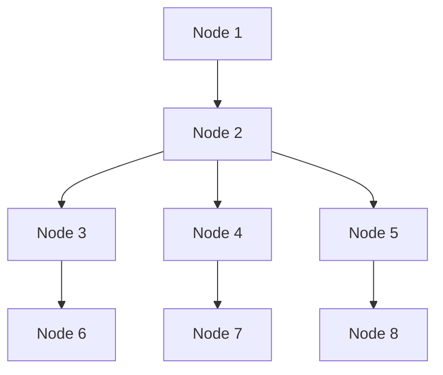

# 9. Bäume

原始 PDF 第 261–276 页。

## 9. Bäume

**9.1 Definition und Darstellung**
9.2 Baumdurchläufe
9.3 Suchbäume

**261**

© T. Gemmeke, IDS, RWTH; R. Leupers, SSS

261

---

## Bäume

**Def**.: Ein **Baum** besteht aus einem ausgezeichneten Knoten 𝑟 (**Wurzel**, root) und $k   \geq   0$ disjunkten Bäumen $T _ { 1 } , \ldots , T _ { k }$

Bäume sind eine äußerst verbreitete Datenstruktur mit einer **Vielzahl von Anwendungen**
Z.B. Darstellung von **Hierarchien** (Firmen‐Organigramm), Eltern‐Kind‐Beziehung (Stammbaum), Dateisysteme u.v.m.
Siehe auch Baumdarstellung von Arrays in **Heapsort**


**262**

Bäume werden **rekursiv** definiert. Unterhalb der Wurzel befinden sich weitere Bäume. Auf der untersten Ebene haben die Bäume dann keine “Kinder” mehr.

Eine weitverbreitete Baum-Anwendung sind **Directory-Systeme** zur Dateiverwaltung. Erst durch die durch den Datei-Baum induzierte Hierarchie werden tausende von Dateien auf einer Festplatte übersichtlich.

262

---

## Binärbäume

• Spezialfall: Bäume mit max. **zwei Teilbäumen**

**Def**.: Ein **Binärbaum** $B \; = \; ( r , B _ { L } , B _ { R } )$ ist entweder leer oder besteht aus einer Wurzel 𝑟 sowie einem linken und rechten Teilbaum $B _ { L }$ bzw. $B _ { R }$

Z.B. Heap im Heapsort‐Algorithmus: jeder Knoten besitzt max. zwei „Kinder“
Z.B. geschachteltes if-then-else‐Statement
Z.B. graphische Darstellung eines **Münzwurf‐Prozesses**


<details>
<summary>flowchart</summary>

This flowchart illustrates a hierarchical classification or grouping structure, starting from an initial category (11) and branching into multiple sub-categories with associated numerical values.
</details>

**263**

© T. Gemmeke, IDS, RWTH; R. Leupers, SSS

Der Spezialfall **Binärbaum** wird ebenfalls rekursiv definiert.

263

---

## Darstellung als C‐Datentyp

```c
typedef struct tr {
    T* data;
    struct tr *left,*right;
} btree, *btreeptr;
```

Bäume als dynamische Datenstruktur, ähnlich zu Listen: Zeiger data auf **Nutzdaten** eines beliebigen Typs T

Zeiger left und right verweisen auf **linken** und **rechten** Teilbaum


<details>
<summary>flowchart</summary>


</details>

**264**

© T. Gemmeke, IDS, RWTH; R. Leupers, SSS

Binärbäume lassen sich leicht als **C-struct** implementieren. Ähnlich zu Listen verweist ein Zeiger “data” auf das im Knoten abzuspeichernde Nutzdatum. Daneben verweisen “left” und “right” auf die Kinder.

264

---

## 9. Bäume

9.1 Definition und Darstellung
**9.2 Baumdurchläufe**
9.3 Suchbäume

**265**

© T. Gemmeke, IDS, RWTH; R. Leupers, SSS

265

---

## Baumdurchläufe

Häufige Anwendung: **Durchlaufen** eines Baumes, d.h. Besuchen/Verarbeiten aller Knoten in bestimmter Reihenfolge
• Z.B. beim Kopieren von Dateisystemen
• Sei $B \; = \; ( r , B _ { L } , B _ { R } )$
• L bezeichnet Durchlauf des **linken** Teilbaums $B _ { L }$
• R bezeichnet Durchlauf des **rechten** Teilbaums $B _ { R }$
• W bezeichnet Bearbeitung der **Wurzel** 𝑟
Drei prinzipielle Durchlaufschemata:
– **Inorder**: L W R
– **Preorder**: W L R
– **Postorder**: L R W
• In/Pre/Post bzgl. des Zeitpunkts der Wurzel‐Bearbeitung

**266**

© T. Gemmeke, IDS, RWTH; R. Leupers, SSS

Die **Bezeichnung** eines Baumdurchlaufs richtet sich danach, zu welchem Zeitpunkt bzgl. des linken und des rechten Teilbaums die Wurzel besucht/verarbeitet wird, z.B. zwischen den Teilbäumen im Falle von Inorder.

266

---

Rekursive Implementierung der Durchläufe

```c
void visit(T* item)
{ // Verarbeitung von item
}

void preorder(btreeptr b)
{
    if (b == NULL) return;

    visit(b->data);
    preorder(b->left);
    preorder(b->right);
}

void inorder(btreeptr b)
{
    if (b == NULL) return;

    inorder(b->left);
    visit(b->data);
    inorder(b->right);
}
```

```c
void postorder(btreeptr b)
{
    if (b == NULL) return;

    postorder(b->left);
    postorder(b->right);
    visit(b->data);
}
```

Laufzeit: 𝓞ሺ# Knotenሻ
Interner Ablauf der Rekursion: **Laufzeit‐Stack** für Funktionsaufrufe (vgl. Kap. 8)
**Übung**: nicht‐rekursive Implementierung mittels expliziter Stack‐Datenstruktur

**267**

© T. Gemmeke, IDS, RWTH; R. Leupers, SSS

Die Funktion “visit” steht hier als **Platzhalter** für eine beliebige Funktion, welche ein Datum vom Typ T verarbeitet (z.B. Ausgabe des Datums).

Die Durchläufe selbst lassen sich aufgrund der Baumstruktur sehr leicht rekursiv implementieren. Ein **leerer Baum** soll dabei durch einen NULL-Zeiger repräsentiert werden, damit die Rekursion terminiert.

Eine Rekursion lässt sich prinzipiell immer auflösen, indem der implizite **Laufzeitstack** bei der C-Programmausführung durch einen **explizit programmierten Stack** ersetzt wird. Dies erfordert jedoch zusätzlichen Programmieraufwand, daher ist die Programmierung mittels Rekursion in der Regel die elegantere Variante.

267

---

## Beispiel: Inorder‐Durchlauf (L W R)


<details>
<summary>flowchart</summary>


</details>

```c
void inorder(btreeptr b)
{
    if (b == NULL) return;
    inorder(b->left);
    visit(b->data);
    inorder(b->right);
}
```

• Inorder‐Reihenfolge:     D B H E I A F C J G K
• Preorder‐Reihenfolge:   A B D E H I C F G J K
• Postorder‐Reihenfolge: D H I E B F J K G C A

**268**

© T. Gemmeke, IDS, RWTH; R. Leupers, SSS

268

---

## 9. Bäume

9.1 Definition und Darstellung
9.2 Baumdurchläufe
**9.3 Suchbäume**

**269**

© T. Gemmeke, IDS, RWTH; R. Leupers, SSS

269

---

## Mengendarstellung durch Binärbäume

**Mengenoperationen** (vgl. Listen, Kap. 8): Einfügen, Löschen, Suchen (gemäß **Suchschlüssel** oder key), Schnitt, Vereinigung
In vielen Anwendungen insbes. schnelle Implementierung von **Einfügen, Löschen, Suchen** erforderlich
Beispiel: **Symboltabelle** im C‐Compiler

– Symboltabelle verwaltet **Informationen zu den Identifiern** (Variablen, Funktionen, etc.) eines Programms, z.B. Datentyp und Speicherbedarf
– **Variablendeklaration** für ID bewirkt **neuen Eintrag** in Symboltabelle mit Suchschlüssel ID
– **Variablenverwendung** bewirkt **Suchen** nach ID
– Variable **nicht mehr benötigt**: ID aus Symboltabelle **löschen**

**270**

© T. Gemmeke, IDS, RWTH; R. Leupers, SSS

Bei großen Datenmengen sind Listen zur **Mengenverwaltung** zu ineffizient. Da z.B. ein Compiler in der Regel sehr schnell arbeiten soll, benötigt er spezielle Datenstrukturen zur Verwaltung größerer Mengen von Objekten. Eine häufige Operation in einem Compiler ist bspw. das Suchen eines Variablennamens in der **Symboltabelle**. Anhand des gefundenen Objektes kann der Compiler dann Attribute wie den Datentyp bestimmen, was wiederum für die Codeerzeugung wichtig ist. Da ein Programm tausende von Variablen enthalten kann, muss diese Operation sehr effizient sein.

270

---

## Suchbäume

**Komplexität** der Mengenoperationen bei Listenimplementierung typischerweise 𝒪ሺ𝑁ሻ bei 𝑁 Elementen
• Zu **aufwendig** für häufigen Gebrauch
• Sortiertes Array: Suchen in Zeit 𝒪ሺlog 𝑁ሻ per **binärer Suche**, jedoch Einfügen und Löschen aufwendig
Binäre Suche: Berechnung eines **Entscheidungsbaums**, d.h. in jedem Schritt Verzweigung in linkes oder rechtes Teilarray
**Idee bei binären Suchbäumen**: Entscheidungsbaum als explizite Datenstruktur

**Def**.: Sei $B \; = \; ( r , B _ { L } , B _ { R } )$ ein Binärbaum und bezeichne keyሺ𝑛ሻ den Suchschlüssel für jeden Knoten 𝑛. 𝐵 heißt **Suchbaum**, falls gilt:

1. Für alle $n \in B _ { L } { : } \operatorname { k e y } ( n ) < \operatorname { k e y } ( r )$
2. Für alle $n \in B _ { R } : \operatorname { k e y } ( n ) > \operatorname { k e y } ( r )$
3. $B _ { L }$ und $B _ { R }$ sind Suchbäume

**271**

© T. Gemmeke, IDS, RWTH; R. Leupers, SSS

Der Datentyp **Suchbaum** ähnelt dem Konzept der binären Suche in sortierten Arrays. Alle Schlüssel im Suchbaum sind auf spezielle Weise angeordnet: links stehen alle Schlüssel die bzgl. der gegebenen **Ordnungsrelation** kleiner sind als die Wurzel, und rechts stehen alle größeren Schlüssel. Hierbei wird vorausgesetzt, dass bei den Daten kein **Mehrfachvorkommen** von Schlüsseln erlaubt ist.

Somit kann an jedem Punkt durch einen einfachen Vergleich festgestellt werden, in welchem Teilbaum die Suche fortgesetzt werden soll. Die Größe des noch zu untersuchenden Restbaumes **halbiert** sich dabei tendenziell in jedem Schritt.

271

---

## Beispiel

• Suchbaum für Monatsnamen, geordnet entsprechend der **lexikographischen** Reihenfolge:


<details>
<summary>flowchart</summary>


</details>

• **Übung**:

– Welcher Baum ergibt sich bei umgekehrter Reihenfolge?
– Wie kann man mittels Suchbäumen sortieren?

**272**

Der hier gezeigte Suchbaum ergibt sich durch Einfügen der Monatsnamen entsprechend der Reihenfolge das Jahresablaufes unter Verwendung der lexikographischen Ordnungsrelation.

Probieren Sie auch einmal andere **Einfügereihenfolgen** (z.B. direkt nach der lexikographischen Reihenfolge) aus. Man sieht, dass die Struktur des resultierenden Suchbaums erhebliche Unterschiede aufweisen kann.

272

---

Einfügen eines Elementes

```c
btreeptr insert(T* item, btreeptr b)
{
    btreeptr n;

    if (b == NULL) {
        n = (btreeptr)malloc(sizeof(btree));
        n->data = item;
        n->left = NULL; n->right = NULL;
        return n;
    }

    if (key(item) < key(b->data))
        b->left = insert(item,b->left);

    if (key(item) > key(b->data))
        b->right = insert(item,b->right);

    return b;
}
```


<details>
<summary>flowchart</summary>


</details>

Beispiel: Einfügen von „DEZ“

**273**

© T. Gemmeke, IDS, RWTH; R. Leupers, SSS

Die **insert-Funktion** arbeitet folgendermaßen: Ist der gegebene Baum b leer, so wird ein neuer Knoten (mit NULL-Zeigern als Nachfolgern) erzeugt und als Ergebnisbaum zurückgegeben.

Ansonsten wird geprüft, ob das neue Element item in den linken oder den rechten Teilbaum gehört. Ist z.B. der linke der richtige, so wird der left-Zeiger des aktuellen Knotens b ersetzt durch den **Ergebnisbaum**, der sich beim Aufruf von insert für den linken Teilbaum ergibt. Dieser Ergebnisbaum besitzt dann das Element item als neues **Blatt** (d.h. Knoten auf unterster Ebene, ohne Nachfolger).

Man beachte, dass der Baum immer “nach unten” wächst, d.h. neue Elemente werden stets an **Blattpositionen** eingefügt.

273

---

## Suchen eines Elementes

```c
T* search(T* item, btreeptr b)
{
    if (b == NULL) return NULL;

    if (key(item) == key(b->data))
        return b->data;

    if (key(item) < key(b->data))
        return search(item,b->left);

    if (key(item) > key(b->data))
        return search(item,b->right);
}
```


<details>
<summary>flowchart</summary>


</details>

**Beispiel**: Suchen von „NOV“
**Aufwand**: Länge des Pfades von der Wurzel zum gesuchten Element (bzw. zu der Stelle, an der sich das Element befinden müsste)

**274**

© T. Gemmeke, IDS, RWTH; R. Leupers, SSS

Das Suchen im Suchbaum arbeitet völlig analog zur **binären Suche** in Arrays. Es können vier Fälle auftreten:

1. Der Baum b ist leer, dann war die Suche erfolglos, und es wird NULL als Ergebnis zurückgegeben.
2. Der aktuelle Knoten b entält das gesuchte Element.
3. Es ist im linken Teilbaum (rekursiv) weiterzusuchen.
4. Es ist im rechten Teilbaum (rekursiv) weiterzusuchen.

274

---

## Laufzeitanalyse für binäre Suchbäume

**Löschen eines Elementes**: gleiches Prinzip, jedoch etwas aufwendiger beim Löschen von inneren Baumknoten (Wiederherstellung der Baumstruktur notwendig)
• Aufwand bestimmt durch **max. Pfadlänge** im Baum
Diese ist wiederum bestimmt durch die **Reihenfolge** der Einfügeoperationen (siehe Bsp. Monatsnamen)
• Extremfälle:

**a) ausgeglichener Baum**: Höhe der Teilbäume unterscheidet sich max. um 1, auf jeder Ebene verdoppelt sich die Anzahl der Knoten, daher Suchzeit 𝒪ሺlog 𝑛ሻ bei n Knoten

**b) entarteter Baum**: wie Liste, d.h. 𝒪ሺ𝑛ሻ


<details>
<summary>flowchart</summary>


</details>


<details>
<summary>flowchart</summary>

```mermaid
graph LR
  A[""] --> B[""]
  B --> C[""]
  C --> D[""]
  D --> E[""]
```
</details>

**275**

© T. Gemmeke, IDS, RWTH; R. Leupers, SSS

Bei einem **ausgeglichenen** Suchbaum sind die Teilbäume optimal “ausbalanciert”, und es wird eine minimale Suchzeit garantiert.

Der worst case ist der **entartete** Baum, welcher im Wesentlichen die gleichen Eigenschaften wie eine lineare Liste aufweist.

275

---

## Laufzeitanalyse für binäre Suchbäume

Man kann zeigen: Bei einem aus **zufälligen Schlüsseln** aufgebauten binären Suchbaum liegt die Suchzeit im average case bei 𝒪ሺlog 𝑛ሻ
• **Jedoch**: nicht garantiert, worst case ist stets 𝒪ሺ𝑛ሻ
Ausgeglichene binäre Suchbäume (**AVL‐Bäume**): 𝒪ሺlog 𝑛ሻ worst case für Suchen, Einfügen, Löschen garantiert
• Weitere Suchbaumstrukturen für **spezielle Anwendungen**
• Z.B. Verwaltung großer Mengen in **externen Dateien** (Files)
– **Zugriffszeit** = Zeit für Positionierung im File + Zeit für Übertragung der Daten in den Hauptspeicher
– Daher Übertragung von großen **zusammenhängenden Datenblöcken** statt einzelner Knoten sinnvoll
– Datenstruktur: **B‐Bäume**

**276**

© T. Gemmeke, IDS, RWTH; R. Leupers, SSS

Bei **AVL-Bäumen** (benannt nach den Erfindern) wird durch einen geringen Zusatzaufwand beim Einfügen und Löschen einzelner Elemente sichergestellt, dass stets eine optimale Baumstruktur vorliegt. Dadurch wird der worst case ausgeschlossen.

Ist die Suchzeit in einer Datei nicht vernachlässigbar gegenüber der Zeit, die der eigentliche Datentransport benötigt, so sollte auf weiterentwickelte Datenstrukturen zurückgegriffen werden. Bei **B-Bäumen** kann statt in 2 Richtungen in k>2 Richtungen verzweigt werden. Jeder Knoten besteht aus einem ganzen Block von Einzelelementen. Hierdurch wird die Suche in Files insgesamt effizienter, da die externe Suchzeit (z.B. auf der Festplatte statt im Hauptspeicher) nicht so häufig anfällt wie bei binären Suchbäumen.

276
