# 11. Techniken zum Algorithmenentwurf

原始 PDF 第 316–355 页。

## 11. Techniken zum Algorithmenentwurf

## 11.1 Rekursion und Iteration

11.2 Backtracking
11.3 Kombinatorische Optimierung
11.4 Schwierige Probleme und Heuristiken
11.5 Dynamische Programmierung
11.6 Branch and Bound

**316**

© T. Gemmeke, IDS, RWTH; R. Leupers, SSS

In diesem Kapitel sollen einige **Grundrezepte** für den Algorithmenentwurf vorgestellt werden, welche sich häufig für eine gegebene neue Problemstellung abwandeln lassen, um so zu einer guten und/oder effizienten Lösung zu kommen. Aus Zeitgründen können diese „Programmierparadigmen“ natürlich hier nur ansatzweise behandelt werden.

316

---

## Rekursion und Iteration

• **Rekursion**: lat. recurrere (zurücklaufen)

– Definition einer Funktion f mittels f selbst
– Im Programm: Berechnung von f durch erneuten Aufruf von f (mit anderen Parametern)
– Häufig elegante und kompakte Funktionsdefinition
– Nachteile: Höherer Speicherbedarf durch Laufzeit‐Stack sowie evtl. Gefahr von Endlosschleifen

• **Iteration**: lat. iterare (wiederholen)

– Berechnung einer Funktion f durch einzelne Schritte auf bestimmter Datenstruktur
– Typischerweise als Schleife (z.B. for) realisiert
– Vor‐ und Nachteile komplementär zur Rekursion

**317**

© T. Gemmeke, IDS, RWTH; R. Leupers, SSS

**Rekursion** ist uns bereits an verschiedenen Stellen begegnet (siehe z.B. DFS-Durchlauf durch Graphen). Das Gegenstück dazu ist die **Iteration**, welche ohne einen Stack auskommt.

317

---

## Beispiel: Fakultätsfunktion

• Siehe auch Kap. 3
• 𝐟𝐚𝐜𝐭 𝒏 ൌ 𝟏 ൈ 𝟐 ൈ … ൈ 𝒏
Laufzeit für beide Algorithmen 𝓞ሺ𝒏ሻ
Rekursive Variante ist **kompakter**
Wird mittels **Laufzeit‐Stack** abgearbeitet (s. Kap. 8)
D.h. **Zusatzaufwand** für Stack‐Bereitstellung und „Aufräumen“
Daneben: Compiler können Schleifen oft gut **optimieren**
Iterative Variante daher praktisch meist **schneller**

Iterativ

```c
int factorial(int n)
{
    int i, fact;

    fact = 1;
    for (i = 2; i <= n; i++) {
        fact *= i;
    }

    return fact;
}
```

Rekursiv

```txt
int factorial(int n)
{
    if (n <= 1)
        return 1;
    else return
        n * factorial(n-1);
}
```

**318**

© T. Gemmeke, IDS, RWTH; R. Leupers, SSS

318

---

## Beispiel: Fibonacci‐Zahlen

für 𝑛 ൑ 1 für 𝑛 ൐ 1

• **Fibonacci‐Folge**: ሺ0, 1, 1, 2, 3, 5, 8, 13, 21, 34, … ሻ
• Viele Anwendungen in der **Mathematik**
Auch in der **Natur** zu beobachten
• Siehe http://www.youtube.com/watch?v=iPKUe‐69PdA


<details>
<summary>natural_image</summary>

Close-up of a sunflower with yellow petals and green seedling, showing a bee pollinating the egg (no text or symbols visible)
</details>

**„Naive“ Rekursion:**

```lisp
int fib(int n)
{
    if (n <= 1)
        return 1;
    else
        return fib(n-1) + fib(n-2);
}
```

**319**

© T. Gemmeke, IDS, RWTH; R. Leupers, SSS

Bei einer rekursiven Implementierung einer Funktion muss sorgfältig auf die **Laufzeit** geachtet werden, wofür die Folge der Fibonacci-Zahlen ein gutes Beispiel bildet. Jedes Folgeglied (bis auf die beiden ersten) ergibt sich als Summe der letzten beiden Folgeglieder.

Die hier gezeigte “naive” Rekursion ergibt sich unmittelbar aus der Definition, weist aber ein sehr schlechtes **Laufzeitverhalten** auf, da sehr viele redundante Berechnungen stattfinden: In der Berechnung von fib(n-1) ist ja die Berechnung von fib(n-2) bereits enthalten. Dies wird aber von der hier gezeigten Funktion nicht ausgenutzt.

319

---

## Laufzeitanalyse

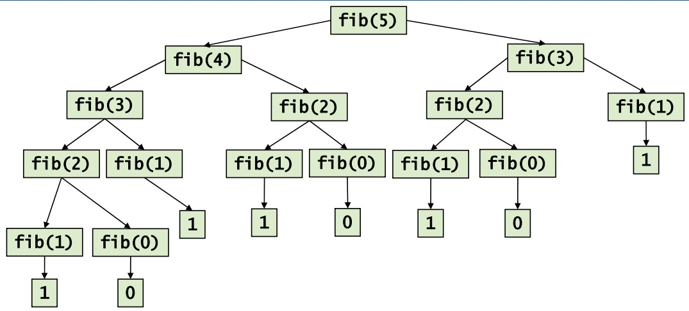

<details>
<summary>flowchart</summary>

This flowchart illustrates a multi-branch data structure or neural network architecture with five fully connected nodes (fib(0) to fib(5)) and their corresponding outputs.
</details>

• Aufruf von fib erfordert i.a. **zwei rekursive Aufrufe** von fib
• Rekursionsbaum wächst **exponentiell**!
• Zeitbedarf für Aufruf fib(n):

– 𝒪ሺ1ሻ für 𝑛 ൑ 1

– Zeit für fib(n-1) + Zeit für fib(n-2) + 1 für Addition

**320**

© T. Gemmeke, IDS, RWTH; R. Leupers, SSS

Am **Rekursionsbaum** sieht man sehr gut, wie viele gleiche Teilbäume er enthält und damit wie viele redundante Berechnungen erfolgen.

320

---

## Laufzeitanalyse

$$
T (n) \geq \mathrm{fib} (n) = \mathrm{fib} (n - 1) + \mathrm{fib} (n - 2)
$$

$$
\begin{array}{l} \geq 2 \times \operatorname{fib} (n - 2) \\ = 2 \times (\text {fib} (n - 3) + \text {fib} (n - 4)) \\ = 2 \times \mathrm{fib} (n - 3) + 2 \times \mathrm{fib} (n - 4) \\ \geq 4 \times \operatorname{fib} (n - 4) \\ \dots \\ \geq 2 ^ {k - 1} \times \operatorname{fib} (n - 2 (k - 1)) [ \text {setze} n = 2 k ] \\ = 2 ^ {k - 1} \times \operatorname{fib} (n - 2 (1 / _ {2} n - 1)) = 2 ^ {k - 1} \times \operatorname{fib} (2) \\ = 2 ^ {k - 1} \\ = 2 ^ {n / 2 - 1} = 1 / 2 \times 2 ^ {n / 2} \\ \end{array}
$$

• ${ \mathsf { A l s o } } \; T ( n ) \; = \; { \mathcal { O } } ( 2 ^ { n } )$ (mindestens)
• Zusätzlicher Overhead für **Stackverwaltung** (konst. Faktor)

**321**

© T. Gemmeke, IDS, RWTH; R. Leupers, SSS

Die Laufzeit T(n) zur Berechnung von fib(n) lässt sich aufgrund des o.g. Ansatzes **mit Hilfe der Fibonacci-Folge selbst** abschätzen.

T(n) ist (wegen +1) sicher größer als fib(n). Da stets $\mathrm{fitb(n-1)>fitb(n-2)}$ gilt, ergeben sich die weiteren hier gezeigten **Abschätzungen nach unten**.

In jedem Schritt verdoppelt sich der konstante Faktor $( 2 { , } 4 { , } 8 { , } 1 6 { , } \ldots 2 ^ { \mathrm { k - 1 } } )$ . Für 2k = n kann die Rekursion zurückgeführt werden auf fib(2) = 1. Somit ergibt sich die im vorherigen Bild angedeutete **exponentielle Laufzeit**.

321

---

## Iterative Berechnung der Fibonacci‐Folge

**Problem** der rekursiven Version: Bei Berechnung von fibሺ𝑛ሻ wird Teilfolge fibሺ𝑛 െ 2ሻ stets unnötig **doppelt** berechnet
• **Iterative** Version:

```c
int fib(int n)
{
    int f1, f2, f;
    if (n <= 1) return 1;

    f1 = 1;
    f2 = 0;
    for (i=2; i<=n; i++) {
        f = f1 + f2;
        f2 = f1;
        f1 = f;
    }

    return f;
}
```

• Laufzeit 𝓞ሺ𝟏ሻ für 𝑛 ൑ 1
Laufzeit 𝓞ሺ𝒏ሻ sonst

**322**

© T. Gemmeke, IDS, RWTH; R. Leupers, SSS

Die **iterative Version** vermeidet die Mehrfachberechnungen und berechnet fib(n) so in wesentlich kürzerer (nämlich linearer) Zeit.

Bei Bedarf noch etwas schneller geht es allerdings mittels der Formel von Moivre-Binet.

322

---

## 11. Techniken zum Algorithmenentwurf

11.1 Rekursion und Iteration
11.3 Kombinatorische Optimierung
11.4 Schwierige Probleme und Heuristiken
11.5 Dynamische Programmierung
11.6 Branch and Bound

## 11.2 Backtracking

**323**

© T. Gemmeke, IDS, RWTH; R. Leupers, SSS

323

---

## Backtracking

• „Rücksetzverfahren“
• **Grundprinzip**:

– Ausbau von Teillösung zu Gesamtlösung
– „Raten“, falls Weg zur Gesamtlösung nicht feststeht
– Rücknahme früherer Entscheidungen, falls keine Gesamtlösung erreichbar

• **Eigenschaften**:

– Existierende Lösung wird garantiert gefunden, indem notfalls alle Möglichkeiten ausprobiert werden
– Dieser Fall führt jedoch zu schlechtem Laufzeitverhalten

Analogie:

• DFS in Graphen
• TL = Teillösung

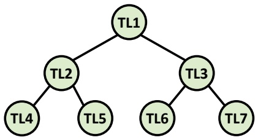

<details>
<summary>flowchart</summary>

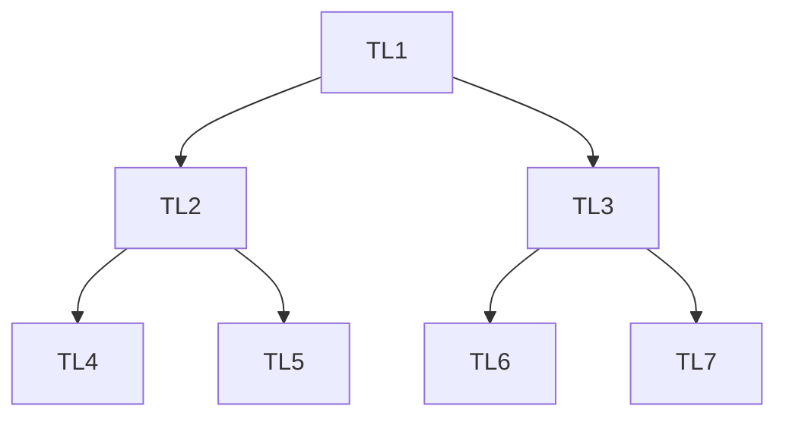
</details>

**324**

© T. Gemmeke, IDS, RWTH; R. Leupers, SSS

Beim Lösen eines komplexen Problems ist der Lösungsweg häufig nicht von vornherein klar. Es müssen daher Entscheidungen auf der Basis unvollständiger Information getroffen (d.h. es müssen Varianten “ausprobiert”) werden, um überhaupt bei der Lösung voranzukommen. Diese Entscheidungen können sich später als falsch herausstellen, so dass man auf einen früheren Punkt “**zurücksetzen**” muss.

Man kann dies vergleichen mit der Wegsuche in einem **Labyrinth**: Hat man von einem bestimmten Punkt A aus einen falschen Weg weiterverfolgt, so muss man zu A zurückgehen, und von dort aus Alternativen verfolgen. Führen alle Wege von A aus nicht zum Erfolg, so muss man zu einem noch früheren Rücksetzpunkt zurücklaufen.

324

---

## Beispiel aus der technischen Informatik

Schaltkreise für Boolesche Funktionen
• **Boolesche Funktion** ist eine Abbildung $f :   \{ 0 { , } 1 \} ^ { 2 }   \to   \{ 0 { , } 1 \}$
• **Schaltkreis** = Hardware‐Implementierung einer Booleschen Funktion
Einfache Funktionen $\left( f : \left\{ 0 { , } 1 \right\} \times \left\{ 0 { , } 1 \right\} \rightarrow \left\{ 0 { , } 1 \right\} \right)$ werden durch **Logikgatter** realisiert, z.B. AND, OR, NOR
• Komplexe Funktionen durch **Zusammensetzen** von Gattern

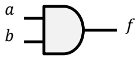

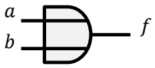

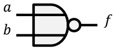

**325**

© T. Gemmeke, IDS, RWTH; R. Leupers, SSS

**Boolesche Funktionen** bilden ein Grundkonzept in der technischen Informatik und werden in der Hardware durch **Schaltkreise** realisiert. Aus diesen Schaltkreisen lassen sich beliebig komplexe Funktionen (und letztlich ganze Computer) aufbauen.

Das Grundelement eines Schaltkreises ist ein **logisches Gatter**. Dieses berechnet eine einfache Verknüpfung auf zwei Eingabebits, z.B. AND. Jede komplexe Funktion lässt sich auf einfache Gatterfunktionen zurückführen, bspw. kann eine bestimmte Anordnung von Gattern eine Addition von Binärzahlen durchführen.

325

---

## Testen von Schaltkreisen

Bei der Herstellung von **integrierten Schaltkreisen** (integrated circuit, IC) als Silizium‐Chips können Fehler auftreten
• **Fehlermodell**: eine beliebige Leitung im Schaltkreis ist (z.B. durch Kurzschluss) immer konstant 0 oder 1
• Beispiel:

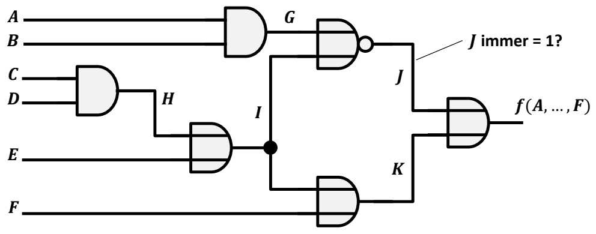

<details>
<summary>text_image</summary>

A
B
C
D
E
F
G
H
I
J
J immer = 1?
f(A, ..., F)
K
K
</details>

**326**

© T. Gemmeke, IDS, RWTH; R. Leupers, SSS

Leider können bei der Herstellung von Schaltkreisen **Produktionsfehler** vorkommen, die die Funktion beeinträchtigen. Daher muss jede integrierte Schaltung vor der Auslieferung **getestet** werden.

Da man in eine integrierte Schaltung (welche heute aus Millionen oder gar Milliarden von Transistoren besteht) nicht hineinschauen kann, muss man eine einfache **Annahme** treffen, welche Fehler vorliegen können. Z.B. kann man annehmen, dass es irgendwo ein fehlerhaftes Gatter gibt, welches immer eine Konstante (0 oder 1) statt der gewünschten Funktion berechnet.

Im **Beispiel** soll festgestellt werden, ob die Leitung J immer den Wert 1 hat, was auf einen Fehler hinweisen würde.

326

---

## Testen von Schaltkreisen

Nur **Ein‐ und Ausgänge** der Schaltung können gesetzt bzw. gemessen werden, jedoch keine internen Leitungen
• Wie kann 𝑱 ൌ 𝟏 getestet werden?
Geeigneten binären **Eingabevektor** (𝐴 െ 𝐹) wählen, so dass im korrekten Fall 𝐽 ൌ 0
• Beobachten der **Ausgabe** 𝐿

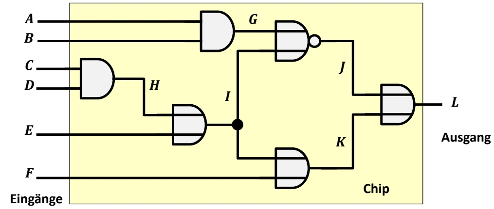

<details>
<summary>flowchart</summary>

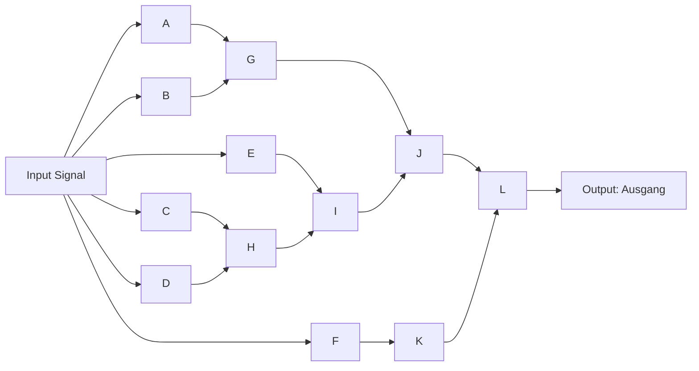
</details>

327

© T. Gemmeke, IDS, RWTH; R. Leupers, SSS

Das Problem ist, dass auf die Leitung J **nicht direkt zugegriffen** werden kann. Man muss daher die Eingänge A-F geeignet mit 0en und 1en beschalten, um den Fehler beobachtbar zu machen. Außerdem muss der Wert von J durch das rechte Gatter geleitet werden, damit er letztlich auf der Ausgangsleitung L sichtbar wird.

327

---

## Bestimmung des Eingabevektors

• Setze 𝑱 ൌ 𝟎, sonst Fehler nicht messbar
$J = G   \mathtt { N O R }   I , \mathtt { a l s o \: z . B . }   G = 1 , I = 1$
$G = A   \mathrm { A N D }   B ,   \mathrm { a l s o }   A = 1 , B = 1$
$I = H   \mathtt { 0 R }   E ,   \mathtt { a l s o \: z . B . }   H = 1 , E = 0$
$H = C \mathrm { A N D }   D , \mathrm { a l s o }   C = 1 , D = 1$
• Dieser Vektor 𝐴 െ 𝐸 erzwingt 𝐽 ൌ 0, **falls Schaltkreis korrekt**

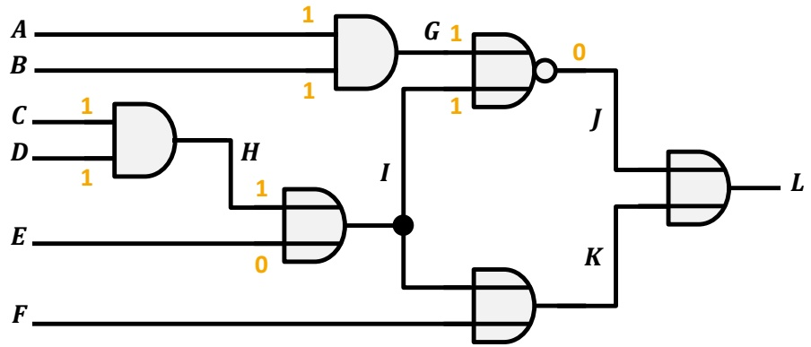

<details>
<summary>flowchart</summary>


</details>

**328**

© T. Gemmeke, IDS, RWTH; R. Leupers, SSS

Folgende Schritte werden durchgeführt, um eine **korrekte Belegung** der Eingänge herbeizuführen:

1. Es muss J = 0 erzwungen werden, da bei J = 1 der fehlerhafte Fall nicht vom fehlerfreien zu unterscheiden wäre.
2. J ergibt sich als NOR-Funktion (“weder…noch”) von G und I. Daher führt $\mathbf { z . B .   G } = 1$ und I = 1 zu J = 0.
3. Für eine 1 auf Leitung G müssen A und B auf 1 gesetzt werden.
4. Für eine 1 auf I müssen H oder E auf 1 gesetzt werden (oder beide).
5. Für H = 1 müssen C und D auf 1 gesetzt werden.

Hiermit wird $\mathbf { J } = 0$ im **fehlerfreien Fall** sichergestellt. Ob die Schaltung tatsächlich fehlerfrei ist, lässt sich jedoch erst feststellen, wenn Leitung J beobachtet werden kann. Dies kann nur indirekt über Leitung L erfolgen.

328

---

## Beobachtung der Ausgabe

• 𝐾 ൌ 1 impliziert 𝐿 ൌ 1, unabhängig von 𝐽
• Also 𝐾 ൌ 0 zu setzen
• 𝐾 ൌ 𝐼 OR 𝐹, also 𝐹 ൌ 0, 𝐼 ൌ 0 (Widerspruch zu 𝐼 ൌ 1)
Backtracking:
Dann ist 𝑳 ൌ 𝟎 ⇔ **Fehler** 𝑱 ൌ 𝟏 **liegt nicht vor**

$$
I = 0, H = 0, C = 0
$$

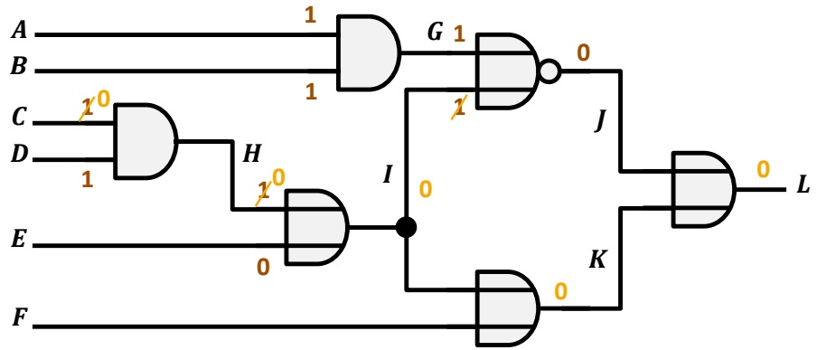

<details>
<summary>text_image</summary>

A
B
C
D
E
F
1
1
G 1
1
0
J
I
0
K
0
L
F
</details>

**329**

© T. Gemmeke, IDS, RWTH; R. Leupers, SSS

Da L als OR-Funktion berechnet wird, darf K nicht gleich 1 sein, um den Wert von J auf L beobachtbar zu machen. Dies führt dann zu der Anforderung I = 0 im Widerspruch zu der früher gewählten Belegung.

An dieser Stelle wird also **Backtracking** erforderlich. Das Setzen von I = 0 erfordert Änderungen von H und C. Schießlich wird hiermit das gewünschte Ergebnis erzielt.

329

---

## 11. Techniken zum Algorithmenentwurf

11.1 Rekursion und Iteration
11.2 Backtracking
**11.3 Kombinatorische Optimierung**
11.4 Schwierige Probleme und Heuristiken
11.5 Dynamische Programmierung
11.6 Branch and Bound

**330**

© T. Gemmeke, IDS, RWTH; R. Leupers, SSS

330

---

## Kombinatorische Optimierung

Konstruktion einer **Lösung eines Problems** durch Auswahl einer **Teilmenge** einer **Menge von diskreten Elementen**
Jede gültige Lösung muss einer Menge von **Randbedingungen** genügen
**Gesucht**: Lösung, die bzgl. einer **Zielfunktion** optimal ist (d.h. minimal oder maximal, je nach Problemstellung)
• **Beispiel**: minimaler Spannbaum in einem Graphen

– Menge der diskreten Elemente:

• alle Graphkanten

– Gültige Lösung:

• Alle Knoten werden genau einmal erfasst

• Zusammenhängend und keine Zyklen

– Zielfunktion:

• Summe der Kantengewichte → min

**331**

© T. Gemmeke, IDS, RWTH; R. Leupers, SSS

Die Lösung **kombinatorischer Optimierungsprobleme** gehört zu den häufigsten Anwendungen in der Informatik. Daher steht hierfür -je nach Schwierigkeitsgrad des Problems- eine Reihe von Algorithmen-Grundrezepten zur Verfügung.

**Beispiel**: Das Spannbaumproblem kann mittels eines Greedy-Verfahrens gelöst werden. Dies ist jedoch ein eher einfacher Fall. Die meisten wichtigen Optimierungsprobleme sind leider wesentlich schwieriger zu lösen.

331

---

## Optimierung durch Greedy‐Algorithmen

• Greedy = gierig
Ausgehend von Teillösung wähle Fortsetzung, welche zum **aktuellen**

## Zeitpunkt den größten Gewinn verspricht

Eigenschaften:

– Meist **geringe Laufzeit**
– Optimale Lösung evtl. **nicht gefunden**

Beispiel: **Kruskal‐Algorithmus**

– Greedy: wähle stets nächstbilligste Kante
– Laufzeit 𝒪ሺ 𝐸 log 𝐸 ሻ
– Optimum garantiert gefunden

```txt
Graph MinSpanningTree(Graph G = (V,E))
{
    Graph T; List L; Edge e;

    T = {};
    L = Sort(E);

    while (#Kanten in T < #Knoten in G-1
        && !IsEmpty(L)) {
        e = FirstElem(L);
        Delete(e,L);
        if (!Cycle(e,T)) {
            T = T ∪ {e};
        }
    }
}
```

**332**

© T. Gemmeke, IDS, RWTH; R. Leupers, SSS

Wie bereits erwähnt, ist der Kruskal-Algorithmus nicht unbedingt typisch für Greedy-Algorithmen, da er das Optimum garantiert immer findet. Oft werden **Greedy-Heuristiken** eingesetzt, welche nur näherungsweise zum Optimum führen, aber dafür stets sehr effizient sind.

332

---

## Beispiel: Münzwechselproblem

• Landeswährung enthält Münzen zu $\pmb { n } _ { 1 } , \dots , \pmb { n } _ { k }$ **Einheiten**
$n _ { 1 } > n _ { 2 }   \ldots   > n _ { k }$
$\operatorname { \mathsf { S t e t s } } \pmb { n } _ { \pmb { k } } = \pmb { 1 } ,$ , sonst nicht alle Beträge wechselbar
• Z.B. **Euro/Cent**:
**Problem**: Auszahlung von Betrag 𝑁 mit verfügbaren Münzen
• **Diskrete Elemente**: Münzen
**Gültige Lösung**: Menge von Münzen mit Gesamtwert 𝑁
• **Zielfunktion**: möglichst wenige Münzen verwenden

**333**


<details>
<summary>natural_image</summary>

Collection of scattered Euro and Italian coins on a white background (no text or symbols visible)
</details>

© T. Gemmeke, IDS, RWTH; R. Leupers, SSS

Das **Münzwechselproblem** ist ebenfalls ein gutes Beispiel für die Anwendung von Greedy-Algorithmen. Möchte man einen gewissen Betrag auszahlen, so wird man dies i.d.R. mit einer minimalen Anzahl von Münzen tun wollen. Bei einer “gut entworfenen” Stückelung der Münzen führt das Greedy-Verfahren zum Erfolg.

333

---

## Greedy‐Algorithmus

• **Strategie**: immer möglichst viele „große“ Münzen wählen, bevor man zu „kleineren“ greift
„Untere Gaußklammerfunktion“: 𝐟𝐥𝐨𝐨𝐫ሺ𝒙ሻ = größte ganze Zahl, die nicht größer ist als 𝑥
• Führt bei „guten“ Stückelungen immer zum **Optimum**
• **Schlechte Stückelung**: z.B. $n _ { 1 } = 2 n _ { 2 } + 1 , \quad n _ { 2 } > 1 , \quad n _ { 3 } = 1$

Greedy‐Münzwechsel

```c
void change(int N)
{
    int W, i;

    W = N;
    for (i=1; i<=k; i++) {
        f = floor(W/n_i);
        wähle f Münzen
        der Einheit n_i;
        W -= n_i * f;
    }
}
```

Schlechter Fall, z.B. 𝑁 ൌ 3𝑛<sub>ଶ</sub>

<div class="docvortex-algorithm" style="white-space: pre-wrap; font-family:monospace;">
z.B. $n_2 = 10$, $N = 30$, $n_1 = 21$
1 Münze zu Wert 21
dann $W = 30 - 21 = 9$
9 Münzen zu Wert 1
Zusammen 10 Münzen
Ausreichend wären 3 Münzen Wert 10
</div>

**334**

© T. Gemmeke, IDS, RWTH; R. Leupers, SSS

**Übung**: Man entwerfe einen Algorithmus, welcher auch bei der “schlechten” Stückelung die minimale Anzahl von Münzen ermittelt.

334

---

## 11. Techniken zum Algorithmenentwurf

11.1 Rekursion und Iteration
11.2 Backtracking
11.3 Kombinatorische Optimierung
**11.4 Schwierige Probleme und Heuristiken**
11.5 Dynamische Programmierung
11.6 Branch and Bound

**335**

© T. Gemmeke, IDS, RWTH; R. Leupers, SSS

335

---

## Komplexität von Optimierungsproblemen

Für viele wichtige kombinatorische Optimierungsprobleme ist bekannt, dass sie **nicht in akzeptabler Zeit optimal lösbar** sind, da ihre Laufzeit (höchstwahrscheinlich) mindestens in 𝒪ሺ2௡ሻ liegt
Sog. **NP‐vollständige** Probleme
**Rechenbeispiel**: Problemgröße 𝑛 ൌ 64, schneller Rechner führt 2<sup>32</sup> Operationen/sec aus
**Rechenzeit**: 2<sup>32</sup> sec ≈ 136 Jahre
• **Prinzipielle Möglichkeiten**:

1. Optimale Lösung (brute force) für kleine Werte von n
2. Optimale Lösung, und dafür sorgen, dass worst case möglichst selten eintritt
3. Gute, aber nicht notwendig optimale Lösung berechnen

**336**

© T. Gemmeke, IDS, RWTH; R. Leupers, SSS

Intuitiv bedeutet der Begriff “**NP-vollständig**”, dass es einen nichtdeterministischen Algorithmus gibt (d.h. einen der “richtig raten” kann), welcher das Problem effizient (in O(n<sup>k</sup>)) löst. Ob es auch einen entsprechenden deterministischen (und damit auch praktisch implementierbaren) Algorithmus gibt, ist allerdings unbekannt.

Sehr viele wichtige Optimierungsprobleme fallen in die Kategorie der NP-vollständigen Probleme. Ob diese überhaupt effizient lösbar sind, ist eins der größten offenen Probleme der theoretischen Informatik (**P = NP Problem**). Es wird jedoch allgemein vermutet, dass NP-vollständige Probleme nicht effizient lösbar sind.

Ob ein Problem NP-vollständig ist oder nicht, lässt sich mathematisch oft relativ einfach zeigen. Die Einstufung eines Problems kann somit Auskunft geben, ob die Suche nach einem effizienten Algorithmus überhaupt sinnvoll ist. In der Tat wäre das Auffinden eines solchen Algorithmus für ein NP-vollständiges Problem eine Sensation, denn dieser Algorithmus könnte dann **alle anderen NP-vollständigen** Probleme ebenfalls effizient lösen.

336

---

## Beispiele NP‐vollständiger Probleme

## • Traveling salesman problem:

– Modell: Graph mit Kantengewichten
– Gesucht: Kürzester Rundweg (Zyklus), der alle Knoten genau einmal enthält

## • Graph‐Färbung:

– Modell: ungerichteter Graph
– Gesucht: Färbung der Knoten mit min. Anzahl Farben, so dass benachbarte Knoten unterschiedliche Farben haben

## • Erfüllbarkeit Boolescher Funktionen:

– Gibt es für Funktion 𝑓 eine Eingabe 𝑥 mit 𝑓ሺ𝑥ሻ ൌ 1?


<details>
<summary>text_image</summary>

North Sea
Bremenhaven
Emden
Deuishurg
Essen
Düsseldorf
Köln
Benn
Frankfurt
am Main
Wiesbaden
Mannheim
Katsruhe
Stuttgart
München
Zugspitze
Niederland
Kiel
Lubeck
Hamburg
Bremen
Hannoverz
Berlin
Magdeburg
Leipzig
Dresden
Rostock
POL.
CZECH REPUBLIC
AUSTRIA
SWITZ.
LIECH.
54
54
51
48
48
0 50 100 km
0 50 100 ml
</details>

Kürzester Rundweg über die 15 größten Städte Deutschlands (von > 43 \* 10<sup>9</sup> möglichen)   [Wikipedia]

**337**

© T. Gemmeke, IDS, RWTH; R. Leupers, SSS

Hier sind nur drei von **tausenden** bereits als NP-vollständig nachgewiesenen Problem aufgeführt. Einige davon sind eher exotisch, aber sehr viele haben Anwendungen in der täglichen Praxis. Daher sind Lösungsverfahren hierfür von großem Interesse.

337

---

## Komplexität von Optimierungsproblemen

• Zur Kategorie 3 gehören **heuristische Algorithmen**
• **Heuristik**:

– Kompromiss zwischen Rechenaufwand und Lösungsqualität
– Basierend auf **problemspezifischem Wissen** und „Daumenregeln
– **Greedy‐Algorithmen** sind oft Heuristiken
– Gewünscht: möglichst oft sehr gute Lösung
– **Nachteil**: Lösung kann auch beliebig schlecht sein

Außerdem möglich: **Approximationsalgorithmen**

– Garantie, dass Lösungsqualität nicht um mehr als bestimmten Faktor vom Optimum abweicht
– Faktor = „**Güte**“ des Approximationsalgorithmus

**338**

© T. Gemmeke, IDS, RWTH; R. Leupers, SSS

Die Kunst beim Entwurf von **Heuristiken** besteht darin, mit einem effizienten Algorithmus möglichst oft und möglichst gut an das Optimum heranzukommen und dabei das Vorkommen von “Ausreißern” mit sehr schlechter Lösung zu minimieren.

Bei **Approximationsalgorithmen** gibt es keine Ausreißer, denn man kann nachweisen, dass eine bestimmte Güte nie unterschritten wird. Eine Heuristik kann in der Praxis natürlich oft wesentlich bessere Dienste leisten.

Man sieht, dass es bei der Auswahl eines Lösungsverfahrens außer auf das Problem selbst auch auf die konkreten Anforderungen an die Laufzeit und die Lösungsqualität ankommt.

338

---

## Beispiel für Heuristik

**Gegeben**: kantengewichteter **vollständiger**
Graph $G = ( V , E , w )$ , d.h. für alle Knoten 𝑢, 𝑣 gilt $\{ u , v \} \in E$
• **Gesucht**: Pfad $P \; = \; ( v _ { 1 } , \ldots , v _ { n } )$ in $G _ { \perp }$ der
– jeden Knoten in 𝑉 genau einmal enthält und
– eine maximale Kantengewichtssumme besitzt

• Vergleiche minimaler (bzw. maximaler) Spannbaum:

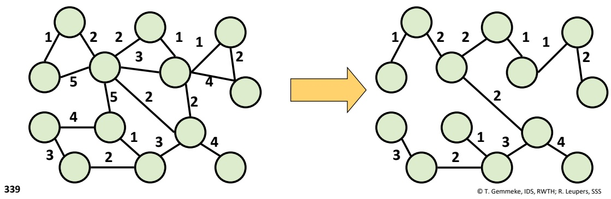

<details>
<summary>flowchart</summary>

This diagram illustrates a hierarchical tree structure transformation, showing how multiple nodes (labeled 1-5) are grouped and then connected to form a single node.
</details>

Bei einem **vollständigen Graphen** sind alle Knoten paarweise durch eine Kante verbunden.

339

---

## Maximal gewichteter Pfad

• Man kann zeigen: Problem ist **NP‐vollständig**
• Ausnutzung der **Ähnlichkeit** zum Spannbaumproblem
– Pfad = „entarteter“ (d.h. linearer) Spannbaum
– Modifikation des **Kruskal‐Algorithmus**: nächste Kante 𝑒 nur gültig, falls
• Kein Zyklus entsteht
• **Keine Verzweigungen** entstehen (d.h. kein „echter“ Baum)
– Erzeugt heuristisch **gute Lösungen** in kurzer Zeit

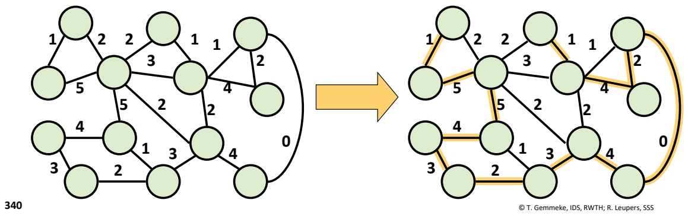

<details>
<summary>flowchart</summary>

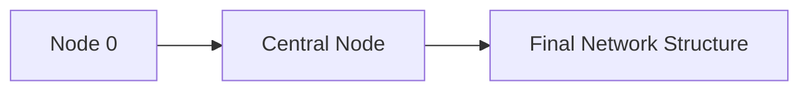
</details>

Der linke Graph ist zeichnerisch **kein vollständiger Graph** (da er sonst zu unübersichtlich würde), man kann jedoch voraussetzen, dass alle nicht explizit gezeigten Kanten das Gewicht 0 haben, und somit nichts zum Gewicht des gesuchten Pfades beitragen könnten.

Man beachte, dass durch die **Abwandlung des Kruskal-Algorithmus** (d.h. Hinzunahme des Tests auf Verzweigungen) aus einem optimalen Algorithmus eine echte Heuristik wird, d.h. es entstehen nicht immer optimale Lösungen. Dies folgt schon allein aus der Tatsache, dass der Kruskal-Algorithmus eine Laufzeit von O(N log N) (N = Anzahl der Graphkanten, s.o.) hat. Mit dieser Laufzeit kann offenbar kein NP-vollständiges Problem optimal gelöst werden.

340

---

## 11. Techniken zum Algorithmenentwurf

11.1 Rekursion und Iteration
11.2 Backtracking
11.3 Kombinatorische Optimierung
11.4 Schwierige Probleme und Heuristiken
**11.5 Dynamische Programmierung**
11.6 Branch and Bound

**341**

© T. Gemmeke, IDS, RWTH; R. Leupers, SSS

341

---

## Dynamische Programmierung

**Effizientes exaktes Lösen** von Optimierungsproblemen mit folgender Eigenschaft:

– Die optimale Lösung des Gesamtproblems kann effizient aus **optimalen Lösungen von Teilproblemen** berechnet werden

• Beispiel aus dem **Compilerbau**:

– Rechner besitzt elementare **Maschinenbefehle** (Assemblerbefehle, s. Kap. 1), z.B. Addition oder Multiplikation zweier Zahlen
– **Optimale Befehlsauswahl**: Wie kann ein komplexer arithmetischer Ausdruck in der Programmiersprache C am schnellsten mit den verfügbaren Assemblerbefehlen berechnet werden?

**342**

© T. Gemmeke, IDS, RWTH; R. Leupers, SSS

Die **Befehlsauswahl** ist ein zentraler Teil eines Compiler-Backends, welches den zielprozessorspezifischen Teil eines Compilers darstellt. Das Problem kann als ein **Muster-Überdeckungsproblem** aufgefasst werden. Der arithmetische Ausdruck kann als Baum dargestellt werden, und die einzelnen Maschinenbefehle entsprechen ebenfalls kleinen baumförmigen Mustern. Die Befehlsauswahl besteht darin, den Ausdrucksbaum möglichst effizient (d.h. mit wenigen oder “billigen” Befehlsmustern) zu überdecken.

342

---

## Beispiel: Befehlsauswahl

• Ausdruck: (a \* b) + (c \* d)
• Befehle:

– Modell:

• Rechner lädt Variablen (var) aus dem Speicher (load) und speichert Werte in Registern (r1, r2, r3)
• Jeder Befehl besitzt ein Kostenmaß (z.B. Zeit zur Ausführung)

– load: r1 = var, Kosten 1
– add: r1 = +(r1,r2), Kosten 2
– mul: r1 = \*(r1,r2), Kosten 2
– copy: ri = rj, Kosten 1
– muladd: r1 = +(\*(r1,r2),r3), Kosten 3

**343**

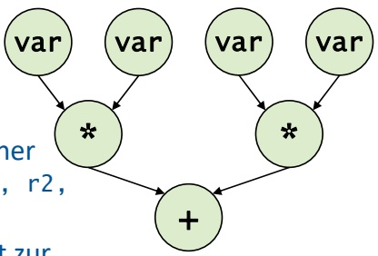

<details>
<summary>flowchart</summary>

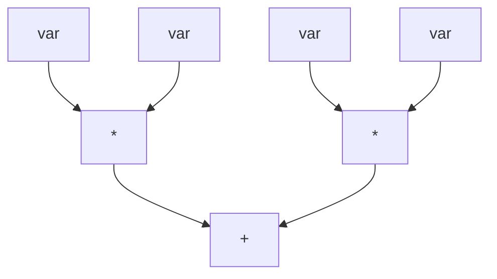
</details>

Abstrakte

Darstellung des

Ausdrucks als

Baum

© T. Gemmeke, IDS, RWTH; R. Leupers, SSS

In diesem Beispiel stehen sechs Maschinenbefehle zur Verfügung. Eine **optimale Befehlsauswahl** wird versuchen, den muladd-Befehl zu bevorzugen, da er eine Überdeckung von + und \* mit Kosten 3 erlaubt (statt insges. 4 bei getrennter Überdeckung mittels add und mul).

343

---

## Beispiel: Befehlsauswahl

## • Ansatz:

– Ausdrucksbaum mit möglichst „billiger“ Menge von Befehlen überdecken
– Lösung für den gesamten Ausdrucksbaum aus optimalen Lösungen für seine Teilbäume bestimmen

## • Für jeden Teilbaum merken:

– Welcher Befehl an dessen Wurzel passt $(z.B. ,,+ ''$ mittels „add“ zu überdecken, $v ^ { \star ^ { \prime \prime } }$ mittels $, \mathsf { m u l }   ^ { \prime \prime } )$
– In welchem Register das Ergebnis des Teilbaums gespeichert wird
– Welche Gesamtkosten hierbei entstehen

**344**

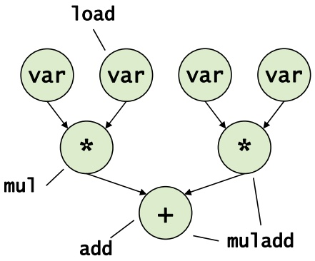

<details>
<summary>flowchart</summary>

This diagram illustrates a system process involving multiple variables (var) and operations such as loading, multiplication, addition, and multiplication add.
</details>

var**‐Knoten:**

**Überdeckung mit „**load“

**Ergebnis dann in Register** r1

**Kosten: 1**

**Überdeckung mit „**copy r1, $r 2 ^ { n }$

**Ergebnis dann in Register** r2

**Kosten: 2**

© T. Gemmeke, IDS, RWTH; R. Leupers, SSS

Aufgrund der Baumstruktur ist das Problem der Befehlsauswahl sehr gut für die **dynamische Programmierung** zugänglich. Die optimale Auswahl für jeden Knoten k hängt nämlich nicht vom gesamten Restbaum ab, sondern nur von der optimalen Auswahl für die Kinder von k. Diese lokal optimalen Lösungen können dann zu einer Gesamtlösung des bei k beginnenden Teilbaums zusammengesetzt werden.

344

---

## Beispiel: Befehlsauswahl

Überdeckung des Ausdrucksbaums

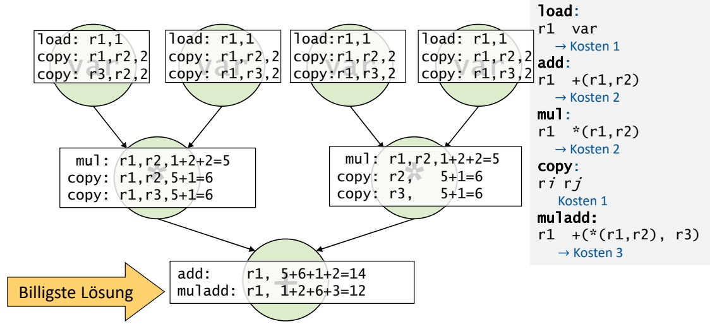

<details>
<summary>flowchart</summary>

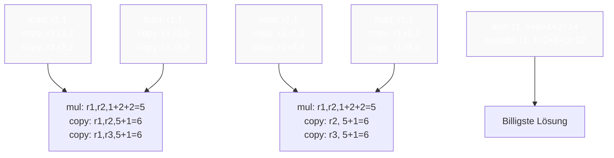
</details>

Aus dieser Lösung kann die **optimale Assembler‐Befehlsfolge** unmittelbar konstruiert werden
• **Laufzeit**: 𝒪ሺ𝑛ሻ bei n Baumknoten

**345**

© T. Gemmeke, IDS, RWTH; R. Leupers, SSS

**Überdeckung der var-Knoten**: Ein load-Befehl sorgt dafür, dass die Variable var in Register r1 geladen wird. Die Kosten hierfür betragen 1. Mittels copy kann der Wert von var auch zusätzlich noch von r1 in ein anderes Register kopiert werden (bspw. r2 oder r3), wofür eine zusätzliche Kosteneinheit anfällt, also insges. 2. Diese Information ist identisch für alle 4 var-Knoten und wird als Tabelle am jeweiligen var-Knoten vermerkt.

**Überdeckung der \*-Knoten**: Hierfür ist der mul-Befehl geeignet. Er erfordert, dass das linke Argument sich in r1 befindet und das rechte inr2. Die Kosten hierfür sind bereits aus den darüberliegenden Tabellen bekannt: 1 bzw. 2, zusammen 3. Mit den Kosten für mul selbst (2) ergeben sich also Gesamtkosten 5, um das Ergebnis eines bei \* beginnenden Teilbaums in r1 abzuspeichern. Zusätzlich kann wie oben der Wert nach r2 oder r3 kopiert werden, wofür wieder je eine zusätzliche Kosteneinheit anfällt.

**Überdeckung des +-Knotens**: Hierfür kann der add-Befehl eingesetzt werden. Er erfordert, dass das linke Argument sich in r1 befindet und das rechte in r2. Die Kosten hierfür sind bereits aus den darüberliegenden Tabellen bekannt: 5 bzw. 6, zusammen 11. Mit den Kosten für add selbst (2) ergeben sich also Gesamtkosten 13, um das Ergebnis eines bei + beginnenden Teilbaums in r1 abzuspeichern. Billiger geht es mit dem muladd-Befehl, bei dem sich Gesamtkosten 12 ergeben.

345

---

## 11. Techniken zum Algorithmenentwurf

11.1 Rekursion und Iteration
11.2 Backtracking
11.3 Kombinatorische Optimierung
11.4 Schwierige Probleme und Heuristiken
11.5 Dynamische Programmierung
**11.6 Branch and Bound**

346

© T. Gemmeke, IDS, RWTH; R. Leupers, SSS

346

---

## Branch and Bound

• „Verzweigung und Schranke“
**Exaktes Lösen** schwieriger (NP‐vollständiger) Optimierungsprobleme
• **Idee**:
– Lösen eines „schwierigen“ kombinatorischen Optimierungsproblems entspricht Durchlauf eines **Entscheidungsbaumes**
– Entscheidungsbaum typischerweise **exponentiell groß**
– „**Beschneidung**“ des Baumes verringert Laufzeit ohne Verlust an Optimalität
Ähnliches Konzept auch bei **Spielbäumen** (TicTacToe, Dame, Schach, …)
**Charakteristik**:
– Im worst case exponentielle Laufzeit
– Im average case wesentlich schneller

**347**

© T. Gemmeke, IDS, RWTH; R. Leupers, SSS

**Branch and Bound** ist ein sehr elegantes Verfahren zum Lösen NP-vollständiger Optimerungsprobleme. Durch eine geschickte Beschneidung des Lösungsraumes (d.h. Weglassen von Lösungen, welche sowieso nicht zum Optimum führen können) kann erheblich Zeit eingespart werden.

Bei einem kombinatorischen Optimierungsproblem müssen fortlaufend **Entscheidungen** getroffen werden, z.B. mit welchem Wert eine bestimmte Variable zu belegen ist. Die Suche kann als Baumstruktur aufgefasst werden: Jede Entscheidung entspricht einem Baumknoten, und bei N alternativen Möglichkeiten hat der Knoten N Nachfolger.

Branch and Bound nutzt nun aus, dass nicht alle (normalerweise exponentiell vielen) Nachfolger weiterverfolgt werden müssen, um das Optimum zu finden, sondern man versucht, die erfolgversprechendsten Wege zuerst zu verfolgen. Leider gelingt das nicht immer, und im **worst case** muss doch der ganze Entscheidungsbaum abgesucht werden.

347

---

## Entscheidungsbaum

Annahme: Vektor $V = ( x _ { 1 } , \ldots , x _ { n } )$ von 0/1‐Variablen so zu wählen, dass eine Kostenfunktion $f ( V )$ minimiert wird
• **Entscheidungsbaum**: Festlegen jeweils einer Variable

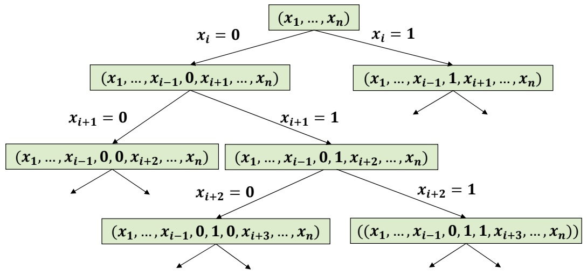

<details>
<summary>flowchart</summary>

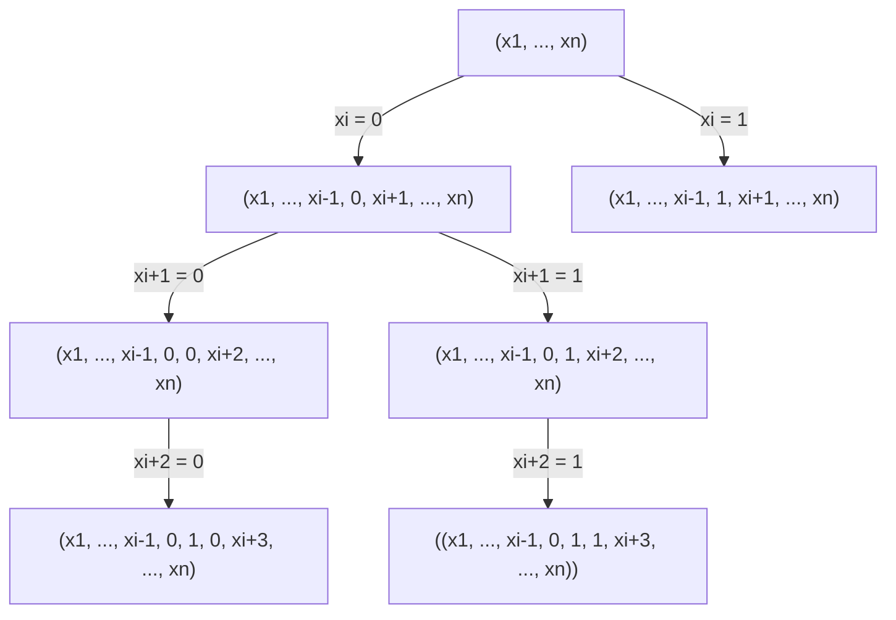
</details>

**348**

© T. Gemmeke, IDS, RWTH; R. Leupers, SSS

Bei diesem Beispielproblem besteht jede **Entscheidung** darin, eine **Belegung einer 0/1-Variable** festzulegen. An der Wurzel sind alle Variablen frei, und auf jeder Stufe wird genau eine Variable mit 0 oder 1 belegt. Offenbar hat der Baum exponentielle Größe in der Anzahl der Variablen.

348

---

## Schranken

Während der Verzweigung: Berechnung von **oberen** (upper bound, 𝑈) und **unteren Schranken** (lower bound, 𝐿) für die Kostenfunktion 𝑓 an jedem Knoten 𝐾, so dass im Teilbaum unterhalb von 𝐾
– in jedem Fall **mindestens Kosten** 𝑳 entstehen
– garantiert eine Lösung mit **Kosten höchstens** 𝑼 existiert
**Bound**: Besitzt Knoten 𝐾 eine **untere Schranke** 𝑳**, welche größer ist als das kleinste bisher bekannte U**, dann kann der Teilbaum unterhalb von 𝐾 von der Suche **ausgeschlossen** werden, ohne dass eine optimale Lösung verloren geht

• **Wichtig**:

– Schranken sind schnell zu berechnen (sonst zu aufwendig)
– Schranken sind „scharf“ (sonst kein effektives Bound)

**349**

© T. Gemmeke, IDS, RWTH; R. Leupers, SSS

Mit Hilfe der **Schranken** lässt sich oft schnell feststellen, welche Bereiche eines Baums noch von Interesse sind, da sich dort das Optimum “verbergen” könnte.

Das Verfahren funktioniert jedoch nur dann gut, wenn man gute Algorithmen zur Schrankenberechnung (d.h. schnell und/oder scharf) findet. Dies ist in der Tat der schwierigste Teil beim Entwurf eines Branch and Bound-Algorithmus.

349

---

## Beispiel für Bound

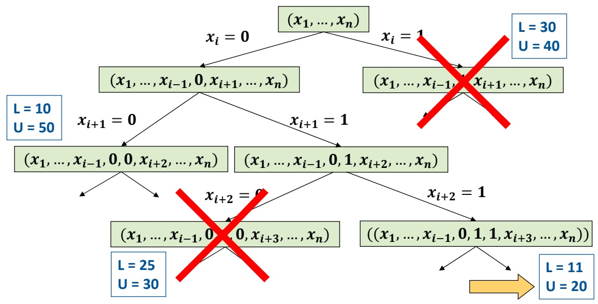

<details>
<summary>flowchart</summary>

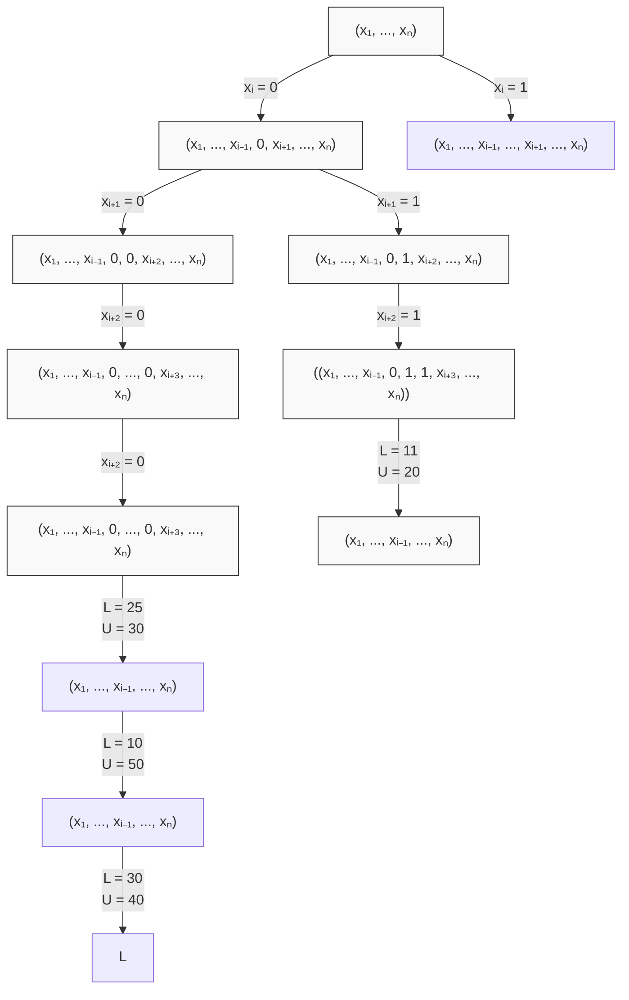
</details>

**350**

© T. Gemmeke, IDS, RWTH; R. Leupers, SSS

Gesucht ist hier die Variablenbelegung V, welche eine **Kostenfunktion** f(V) minimiert.

Beim Knoten rechts unten sind zwar erst 3 Variablen belegt, man weiss jedoch (U = 20), dass das Endergebnis die Kosten 20 in diesem Teilbaum nie übersteigen kann. Daher können die durchgestrichenen Teilbäume bereits zu diesem Zeitpunkt außer Betracht gelassen werden, da sie Kosten von mindestens 25 bzw. 30 bewirken würden.

Beim übrigen Teilbaum (ganz links) muss noch weitergesucht werden, da er theoretisch eine noch bessere Lösung liefern könnte (wegen L = 10).

350

---

## Beispiel: max. gewichteter Pfad in Graphen

**Branch**: bestimmte Kante wird in den Pfad aufgenommen (sofern gültig) oder aber explizit ausgeschlossen

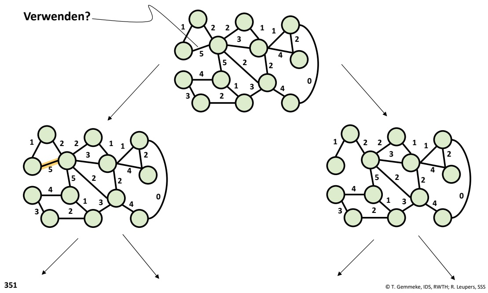

<details>
<summary>flowchart</summary>

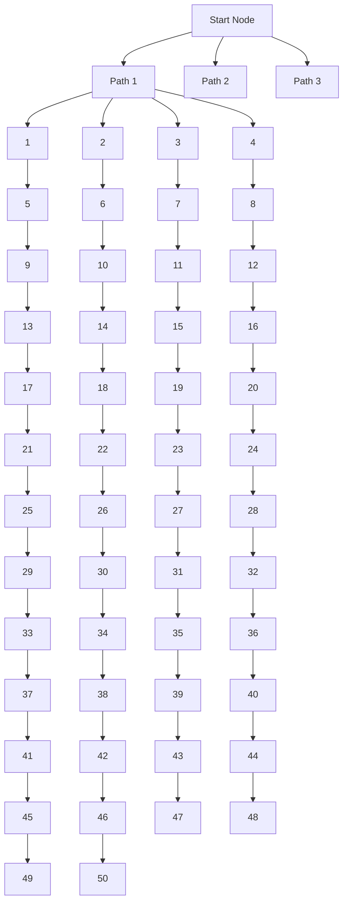
</details>

Alternativ zu dem o.g. abgewandelten Kruskal-Algorithmus zu **Pfadbestimmung** kann man auch Branch and Bound einsetzen. Während es sich bei dem o.g. Algorithmus ja um eine Heuristik handelt, würde dies immer das Optimum bestimmen.

Der **Entscheidungsbaum** ergibt sich einfach dadurch, dass man für jede Kante im Graphen festlegen muss, ob sie Teil des ausgewählten Pfades sein soll oder nicht.

351

---

## Beispiel: max. gewichteter Pfad in Graphen

Effiziente Berechnung der Schranken?
**Gegeben**: Graph mit 𝑛 Knoten und Teillösung mit 𝑘 bereits fest gewählten Kanten
• **Obere Schranke** 𝑼:
– Im besten Falle könnten noch die 𝑛 െ 𝑘 െ 1 „schwersten“unter den noch nicht betrachteten Kanten hinzugefügt werden – Optimale Lösung kann höchstens schlechter sein
• **Untere Schranke** 𝑳:
– Setze Teillösung mittels Heuristik durch Hinzunahme von 𝑛 െ 𝑘 െ 1 Kanten zu Gesamtlösung fort – Optimale Lösung kann höchstens besser werden
**Maximierungsproblem**: Falls für einen Knoten der Wert von 𝑈 kleiner ist als bisher bestes 𝐿, so kann der Teilbaum entfallen

**352**

© T. Gemmeke, IDS, RWTH; R. Leupers, SSS

Die **Berechnung von U** ist sehr schnell, da man lediglich einige Kantengewichte aufsummieren muss.

Die **Berechnung von L** könnte sich der bekannten Heuristik bedienen, welche ebenfalls recht schnell arbeitet. Da sie gute Ergebnisse liefert, wird L i.a. auch scharf sein.

352

---

## Bildnachweise

#20 Petr Kratochvil , „frau‐sitzt‐mit‐laptop “, publicdomainpictures.net
„PC‐CPU‐Feld‐Vektor‐Bild“, publicdomainvectors.org
#23 Ldorfman ‐ According to a work of Johanna Pung made for Wikimedia Deutschland –
Own work, CC BY‐SA 3.0,
commons.wikimedia.org/w/index.php?curid=21837408
#32 Max Pixel, “Medical Cold Fever Thermometer Temperature Digital“, maxpixel.net
#143 Tim Reckmann, „Kreditkarte“, CC‐BY 2.0, ccnull.de
#163 MartinStr, „blasen‐wasser‐sprudelnd‐lufblasen‐230014“, pixabay.com
#213 ACBahn, „Warteschlange Eisdiele“, commons.wikimedia.org, CC GNU 1.2
#245 „gps‐navigation‐garmin‐gerät‐304842“, pixabay.com
openstreetmap.de, Open Database Licence (ODbL) 1.0
#270 „Grundsätzliche Informationen zum Netzausbau”, www.buergerdialog‐stromnetz.de
#280 wirestock, „closeup‐bee‐sunflower‐field‐sunligh”, freepik.com
#294 „money\_coins\_loose\_change\_euro\_cent\_specie\_metal\_money\_finance”, pxhere.com

**353**

© T. Gemmeke, IDS, RWTH; R. Leupers, SSS

353

---

## Literaturnachweise

B.W. Kernighan, D.M. Ritchie: Programmieren in C, 2. Auflage, Hanser, 1990, ISBN 3‐446‐15497‐3
R. Sedgewick: Algorithmen in C++, Teil 1‐4, Addison‐Wesley, 2002, ISBN 3‐8273‐7026‐4
• K. Loudon: Mastering Algorithms with C, 1. Auflage, O‘Reilly, 1999, ISBN 978‐1‐56592‐453‐6

**354**

© T. Gemmeke, IDS, RWTH; R. Leupers, SSS

354

---

## Stichwortregister zu C++ Sprachelementen

• Abstrakte Datentypen 138

• Ausgabe 39

• Funktionen

– Lambda 119

– Overloading 153

• Klassen 140

– (De)Constructor 142

– Public vs. Private 144

– Inheritance 147

• Libraries 34

– Using & namespace 40

• Loops – Iterators 129

• Polymorphie – Statisch 113

– Dynamisch 149

• Smart Pointer 70

– Unique 71

– Shared 72

– Weak 73

• Streams ,39 155

• Template 117

**355**

© T. Gemmeke, IDS, RWTH

355
