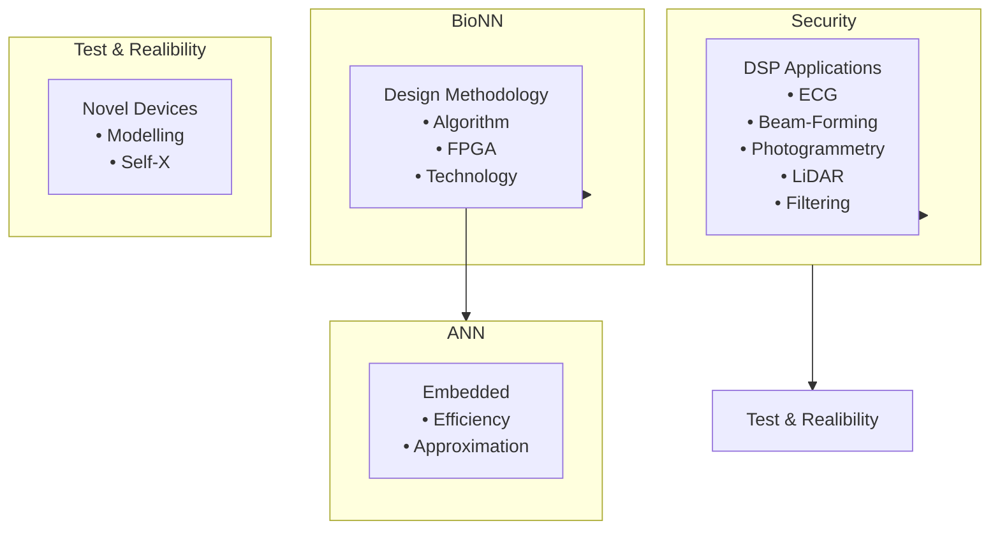
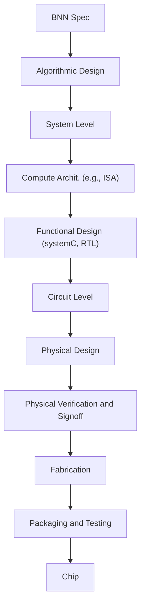
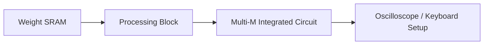
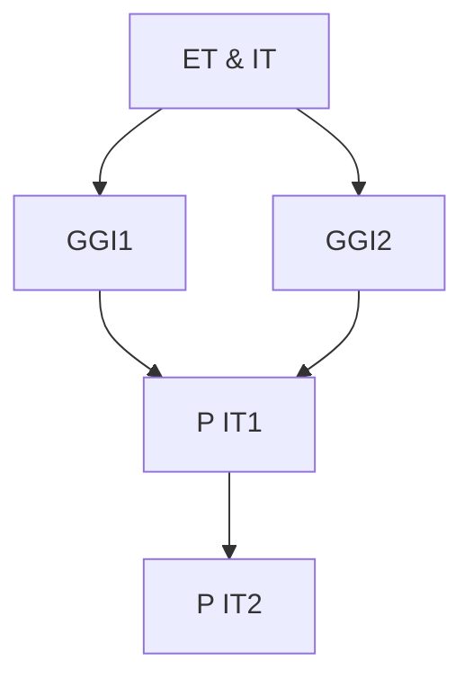
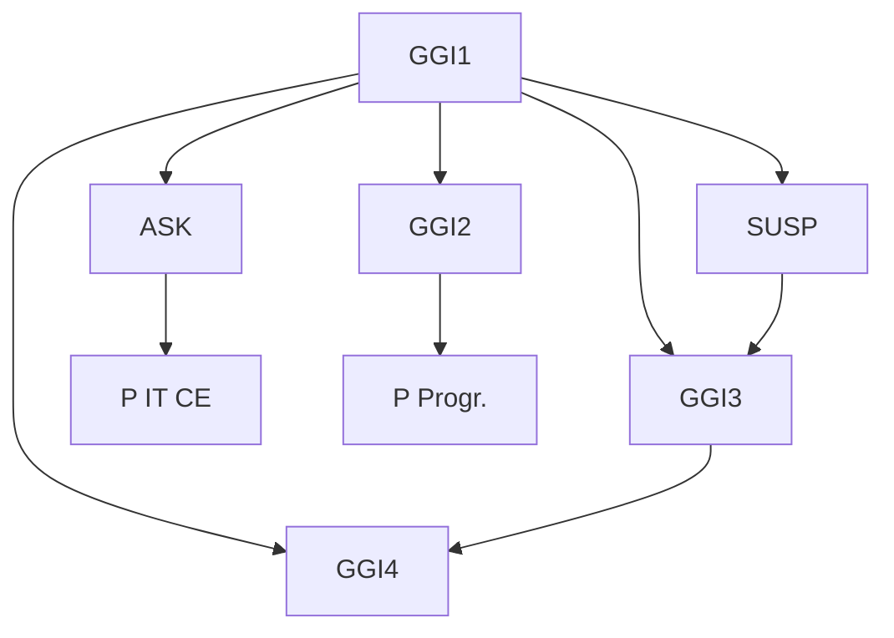
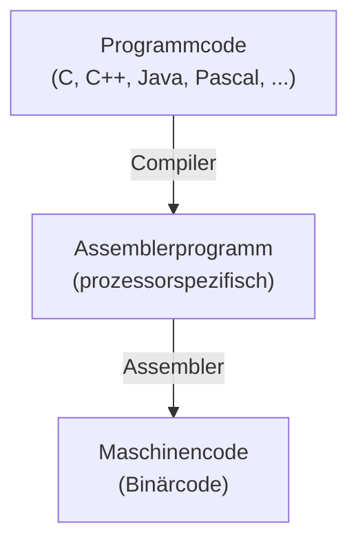
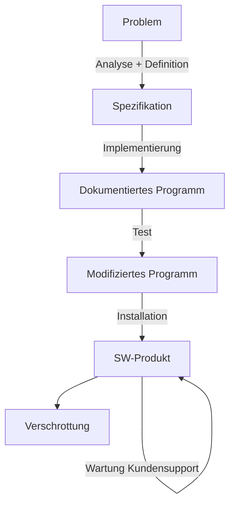

# Grundgebiete der Informatik 1

## Programmierung, Algorithmen und Datenstrukturen

Prof. Dr.‐Ing. Tobias Gemmeke

Integrierte Digitale Systeme und Schaltungsentwurf (IDS)

gemmeke@ids.rwth‐aachen.de


Chair of Integrated Digital Systems and Circuit Design

## RWTHAACHEN UNIVERSITY

**WS 2026/2027**

© T. Gemmeke, IDS, RWTH; R. Leupers, SSS

Herzlich Willkommen zur Einführung in die Informatik!

In diesem Bereich finden Sie ergänzende **Kommentare** zu den Folien, soweit diese nicht selbsterklärend sind.

Zusammen mit den Kommentaren sollten die Folien eine ausreichende Grundlage zur **Prüfungsvorbereitung** bilden. Es gibt kein spezielles Skript zu dieser Vorlesung, da zum Thema „Programmierung“ bereits eine Reihe von Büchern (siehe auch Hinweise im Lehr- und Lernportal Moodle) als Sekundärliteratur existiert.

Darüber hinaus wird natürlich auch die aktive Teilnahme an den **Übungen** dringend empfohlen, um den Stoff zu vertiefen.

**Korrekturen** und **Verbesserungsvorschläge** (am besten per email an den Dozenten) sind jederzeit erwünscht.

Bei **Fragen** zum Vorlesungsstoff stehen Ihnen der Dozent oder die Übungsleiter gerne zur Verfügung. Bitte vereinbaren Sie tel. oder per email einen Termin. Dies empfiehlt sich nicht erst während der Klausurvorbereitung!

## Inhalt

## 1. Einleitung

<u>1.1 Thematische Einordnung</u> 16
<u>1.2 Hardware und Software</u> 19
<u>1.3 Programmiersprachen</u> 22
<u>1.4 Algorithmen und Programme</u> 26

## 2. Einführendes Beispiel

<u>2.1 Temperaturumrechnung</u> 31
<u>2.2 Analyse des Beispiels</u> 35
<u>2.3 Ausführung und Fehlersuche</u> 42

## 3. Elementare Datentypen und Anweisungen

<u>3.1 Einführung</u> 47
<u>3.2 Variablen und Konstanten</u> 53
<u>3.3 Arithmetische und logische Operationen und Zuweisungen</u> 74
<u>3.4 Kontrollanweisungen</u> 81
<u>3.5 Zeiger</u> 59

2

## Inhalt

## 4. Funktionen und Programmaufbau

<u>4.1 Funktionen</u> 97
<u>4.2 Parameterübergabe</u> 107
<u>4.3 Polymorphie</u> 112
<u>4.4 Templates</u> 116
<u>4.5 Lambda Funktionen</u> 118
<u>4.6 Module und Programme</u> 120

## 5. Datentypen

<u>5.1 Arrays</u> 123
<u>5.2 Strukturen</u> 133
<u>5.3 Abstrakte Datentypen</u> 137
<u>5.4 Klassen</u> 139

<u>(De)Konstruktor</u> 141

<u>Public vs. private</u> 143

<u>Vererbung</u> 146

<u>Abstrakte Klassen</u> 150

<u>Überladen von Operatoren</u> 152

3

## Inhalt

## 6. Analyse von Algorithmen

<u>6.1 Laufzeitanalyse</u> 159
<u>6.2 O‐Notation für Wachstumsordnungen</u> 165
<u>6.3 Beispiel: Exponentialfunktion</u> 175
<u>6.4 Beispiel: Suchen in Arrays</u> 180

## 7. Sortieralgorithmen

<u>7.1 Einfache Verfahren (Selection/Insertion/Bubblesort)</u> 189
<u>7.2 Quicksort</u> 205
<u>7.3 Heapsort</u> 215

## 8. Lineare Datentypen

<u>8.1 Listen</u> 229
<u>8.2 Stacks</u> 242
<u>8.3 Queues</u> 251

## 9. Bäume

<u>9.1 Definition und Darstellung</u> 261
<u>9.2 Baumdurchläufe</u> 265
<u>9.3 Suchbäume</u> 269

4

## Inhalt

## 10. Graphen

<u>10.1 Definition und Grapheigenschaften</u> 277
<u>10.2 Berechnung kürzester Pfade</u> 283
<u>10.3 Datenstrukturen zur Graphrepräsentation</u> 294
<u>10.4 Graphdurchläufe</u> 300
<u>10.5 Spannbäume</u> 308

## 11. Techniken zum Algorithmenentwurf

<u>11.1 Rekursion und Iteration</u> 316
<u>11.2 Backtracking</u> 323
<u>11.3 Kombinatorische Optimierung</u> 330
<u>11.4 Schwierige Probleme und Heuristiken</u> 335
<u>11.5 Dynamische Programmierung</u> 341
<u>11.6 Branch and Bound</u> 346

5

## RWTH‐Studiengänge

• B.Sc. Elektrotechnik und Informationstechnik
• B.Sc. Computer Engineering
• B.Sc. Wirtschaftsingenieurwesen EET

6

© T. Gemmeke, IDS, RWTH; R. Leupers, SSS

## Übungsbetrieb

## • Koordination / Fachstudienbetreuung

– Dipl.‐Inform. Tatjana Eiden

## • Gemeinsame Globalübung

– Do 12:15‐13:15
– Vor allem: c/C++‐Programmierkurs
– Michael Gansen


## • Kleingruppenübungen:

– Interaktive Vertiefung und Ergänzung des Vorlesungsstoffes
– Tutoren: studentische Hilfskräfte
– Ca. 16 wöchentliche Termine zur Auswahl
– Vorauss. ab 2. Vorlesungswoche (siehe RWTHonline)

7

© T. Gemmeke, IDS, RWTH; R. Leupers, SSS

Aktuelle Informationen zum Übungsbetrieb sowie sonstige Informationen und Ankündigungen finden Sie auf der zugehörigen **Moodle-Seite**.

Die gemeinsame „Großübung“ ist hauptsächlich als **c/C++-Programmierkurs** für Programmieranfänger gedacht. Sie ist inhaltlich daher nur lose an die Vorlesung gekoppelt.

Zögern Sie nicht, vom Übungsangebot regen Gebrauch zu machen, denn „echte“Programmierung lernt man nur durch praktische Arbeit.

## Kleingruppenübungen

• Teilnahme nicht obligatorisch aber dringend empfohlen
• Anmeldungsinfo: **siehe RWTHonline**
• Anmeldeschluss beachten!
• **Gruppeneinteilung**: Benachrichtigung per email
• **Übungsaufgaben**: jeweils am Fr online über Moodle
Vorbereitungsaufgaben, Präsenzaufgaben und Nachbereitungsaufgaben

**Alle** Studierende mit 100 von 200 Punkten in den Hausübungen **haben** in 21/22 **bestanden.**

Teilnahme an der **Probeklausur** führte in 21/22 zu folgender **Verbesserung:**

$$
2 \xrightarrow {50\%} 1
$$

$$
3 \xrightarrow{90\%} <  3
$$

$$
4 \xrightarrow{90\%} <  4
$$

$$
5 \xrightarrow{80\%} <  5
$$

8

© T. Gemmeke, IDS, RWTH; R. Leupers, SSS

Die **Kleingruppenübungen** sind in erster Linie als eine interaktive Form der Übung gedacht, in der Aufgaben und Probleme mit dem Übungsleiter oder Kommilitonen intensiv diskutiert und gelöst werden können. Die Teilnahme macht vor allem dann Sinn, wenn auch regelmäßig die aktuellen Aufgaben bearbeitet werden.

## Organisatorisches

## Klausur

– 1. Versuch: siehe RWTHonline
– 2. Versuch: siehe RWTHonline

## • Fragestunde GGI1 bei Fr. Eiden

– Di 12:15‐13:45 (UMIC, ab 20.10.)
– Do 13:15‐14:00 (H02, ab 15.10.) im Anschluss an die Globalübung
– sowie nach vorheriger Absprache per E‐Mail

## • Aktuelle Nachrichten

– Siehe RWTHonline
– Sprechstunden bei Prof. Gemmeke n.V. per Email:
info@ids.rwth‐aachen.de

9

© T. Gemmeke, IDS, RWTH; R. Leupers, SSS

Weitere Einzelheiten zur **Klausur** werden rechtzeitig bekannt gegeben.

Das **CIP-Pool**-Angebot wendet sich in erster Linie an Studenten ohne jegliche Programmier- oder gar Computererfahrung. Hier besteht die Gelegenheit, Aufgaben unter fachlicher Anleitung zu lösen.

Der regelmäßige Besuch der **Moodle-Seite** wird dringend empfohlen, um aktuelle Neuigkeiten und Tipps von Kommilitonen zu erfahren.

## Literatur

B.W. Kernighan, D.M. Ritchie: Programmieren in C, 2. Auflage, Hanser, 1990, ISBN 3‐446‐15497‐3
R. Sedgewick: Algorithmen in C++, Addison‐Wesley, 2002, ISBN 3‐8273‐7026‐4
• In der Lehrbuchsammlung
• Kommentierte Vorlesungsfolien
Grundsätzlich auch andere Einführungen in die Programmierung als Hilfsmittel geeignet


**10**

© T. Gemmeke, IDS, RWTH; R. Leupers, SSS

Das Buch von **Kernighan/Ritchie** beinhaltet den Gebrauch der Programmiersprache C und stellt ein Standardwerk dar. Es bietet keine ausreichende Einführung in Algorithmen, ist aber als Nachschlagewerk sehr gut zu gebrauchen.

Das Buch von **Sedgewick** verwendet meist C++ (die objektorientierte Erweiterung von C) und behandelt Algorithmen und Datenstrukturen in umfangreicher Form, auch weit über den GGI1-Vorlesungsstoff hinaus.

Darüber hinaus existieren zahlreiche weitere **Lehrbücher und Skripten** zur Programmierung. Diese sind per Internetrecherche leicht zu finden. Für spezielle Hinweise sei wiederum auf den Moodle-Lernraum verwiesen.

## Über das IDS (www.ids.rwth‐aachen.de)

Lehrstuhl für Integrierte Digitale Systeme und Schaltungsentwurf (IDS)
• Schwerpunkte:
– Entwurfsmethodik integrierte digitale Schaltungen
– Beschleuniger für verschiedene Anwendungen:
• Simulation biologischer neuronaler Netzwerke
• Inferenz in künstlichen neuronalen Netzen
• Kryptographie
…

– Testmethoden

• Standort: UMIC Gebäude

– Mies‐van‐der‐Rohe Str. 15, RWTH Hörn Campus


<details>
<summary>natural_image</summary>

Exterior view of a modern multi-story office building with glass windows and surrounding green lawn (no signage or text visible)
</details>

**11**


<details>
<summary>text_image</summary>

en
7
cost A
model
cost B
</details>

© T. Gemmeke, IDS, RWTH; R. Leupers, SSS

Falls Sie sich bereits für „fortgeschrittene“ Software- oder Hardware-Themen interessieren, sind Sie herzlich eingeladen, das **IDS** einmal zu besuchen. Wir geben Ihnen gerne einen Einblick in die aktuellen Forschungsaktivitäten und Hinweise auf spätere. Vielleicht möchten Sie auch später einmal, z.B. als „HiWi“in Forschung oder Lehre, für uns tätig werden.

## Forschungsgebiete am Lehrstuhl IDS


<details>
<summary>flowchart</summary>


</details>

**12**

© T. Gemmeke, IDS, RWTH; R. Leupers, SSS

## Entwurfsablauf

Chip‐Entwurf


<details>
<summary>flowchart</summary>


</details>

vom Layout zum Bring‐Up


<details>
<summary>flowchart</summary>


</details>

© T. Gemmeke, IDS, RWTH; R. Leupers, SSS

## Kooperationsprojekte (Auswahl)

Advanced

Computing


<details>
<summary>natural_image</summary>

Illustration of a blue globe with three abstract digital icons representing neural networks and data, set against a dark background (no text or symbols)
</details>

Architectures (ACA)


<details>
<summary>text_image</summary>

ACA
</details>


<details>
<summary>natural_image</summary>

3D illustration of a human brain with colorful polyhedra and a grid-patterned head model (no text or symbols)
</details>

Neuro Sys

I&II

towards multi‐scale natural‐density

Neuromorphic Computing


<details>
<summary>natural_image</summary>

3D architectural rendering of a modern building with colorful structural elements, labeled 'active 3D' in the corner (no other text or symbols)
</details>

**14**

© T. Gemmeke, IDS, RWTH; R. Leupers, SSS

## IDS‐Lehrveranstaltungen

## Bachelor:

\*  Mehrere Lehrstühle tragen zur Durchführung der Veranstaltung bei

– Grundgebiete der Informatik 1 (GGI1)   1. Sem
– \*Projekt PETIT ("MATLAB meets LEGO Mindstorms„)   1. Sem
\*Praktikum Informatik   2 Teile
– VLSI Schaltungen & Architekturen (VLSI‐CA)   4. Sem Pflicht CE bzw. 6. Sem Wahl ET&IT
– \*Grundlagen Integrierter Schaltungen und Systeme (GISS)   5. Sem Wahl ME
Institutsprojekt „Anwendung von künstlichen neuronalen Netzen zur Linienverfolgung mit Braitenberg‐Vehikeln“   4. Sem
\*Praktikum Mikroelektronik   5. Sem Pflicht in ME
– Bachelor‐Arbeiten zu aktuellen Forschungsthemen

## Master

– VLSI Design for Digital Signal Processing – Fundamentals (VLSI‐DF)
– VLSI Design for Digital Signal Processing – Architecturs (VLSI‐DA)
– Computer Arithmetic – Fundamentals (CAR‐F)
– Computer Arithmetic – Advanced Topics (CAR‐A)
– Laboratory: VLSI Design
– Laboratory: FPGA Design
– Master‐Arbeiten zu aktuellen Forschungsthemen

**15**

© T. Gemmeke, IDS, RWTH; R. Leupers, SSS

Genauere Informationen zu diesen Veranstaltungen finden Sie im Menüpunkt „Studium“ auf der IDS Homepage: **www.ids.rwth-aachen.de**

## 1. Einleitung

## 1.1 Thematische Einordnung

1.2 Hardware und Software
1.3 Programmiersprachen
1.4 Algorithmen und Programme

**16**

© T. Gemmeke, IDS, RWTH; R. Leupers, SSS

## Was ist Informatik?

**Informatik** (Computer Science) ist die **Wissenschaft**, die sich mit der Entwicklung und Nutzung von Computersystemen beschäftigt
Wurzeln in der **Mathematik** und **Elektrotechnik**
**Informatikkenntnisse** (speziell: Programmierkenntnisse) gehören heute zum Handwerkszeug jedes Ingenieurs
Einteilung in drei große **Teilgebiete**:

1. <u>Theoretische Informatik</u>: Computermodelle, Sprachen, Boolesche Funktionen, Komplexitätsanalyse, ...
2. <u>Praktische Informatik</u>: Programmiersprachen, Compiler, Betriebssysteme, SW Engineering, Datenbanken, ...
3. <u>Technische Informatik</u>: Aufbau von Computer‐Hardware, Chip‐Entwurf, Netzwerke, Mobilfunk, ...

**17**

© T. Gemmeke, IDS, RWTH; R. Leupers, SSS

Viele Ingenieure sind heute in der **Software-Entwicklung** tätig. Daher ist ein Grundverständnis der Informatik (insbes. der praktischen Informatik) sowie Implementierungskenntnisse in gängigen Sprachen wie C/C++ unerlässlich.

Die **theoretische Informatik** ist eine mathematische Disziplin. Sie befasst sich z.B. mit der prinzipiellen Berechenbarkeit von Funktionen und versucht, beweisbar optimale Algorithmen für bestimmte Probleme zu finden.

In der **praktischen Informatik** geht es im weitesten Sinne um Software-Programmierung. Eine typische Disziplin sind Betriebssysteme (wie Windows oder Linux), die die Schnittstelle zwischen der Hardware und der Anwendungs-Software bilden und z.B. die Verwaltung und Zuteilung des Prozessors (CPU) für verschiedene Anwendungsprogramme übernehmen.

Die **technische Informatik** ist eng an der Hardware orientiert. Eine typische Fragestellung ist z.B. wie man für eine gewünschte Funktion die schnellst- oder kleinstmögliche Implementierung durch Logikgatter erzielt.

## Einordnung GGI1

**GGI1** ist in erster Linie in der **praktischen Informatik** angesiedelt
**GGI2**: Technische Informatik: Prinzipien des Digitalrechners
• **Automaten, Sprachen, Komplexität** (CE): Theoretische Informatik
**GGI3**: Praktische und Technische Informatik: Optimierung, Modellierung und Parallelität
• **SUSP:** Praktische Informatik: System‐SW und systemnahe Program.
• **GGI4:** Prakt. Inf.: Betriebssysteme
Daneben: **Projekte** und **Praktika**
Grundlagen für weitere **Spezialisierung** ab 5. Semester

**18**


<details>
<summary>flowchart</summary>


</details>

CE:


<details>
<summary>flowchart</summary>


</details>

© T. Gemmeke, IDS, RWTH; R. Leupers, SSS

Die Skizze zeigt den **Ablauf der Informatik-Veranstaltungen bis zum 4.**

**Semester** für ET/TI-Bachelor-Studenten. Nach GGI1 liegt der

Vorlesungsschwerpunkt eher auf der technischen Informatik. Jedoch kommen durch Praktika/Projekte auch die praktischen Anteile nicht zu kurz. Die Vorlesung ASK bietet eine kurze Einführung in die theoretische Informatik.

## 1. Einleitung

1.1 Thematische Einordnung
**1.2 Hardware und Software**
1.3 Programmiersprachen
1.4 Algorithmen und Programme

**19**

© T. Gemmeke, IDS, RWTH; R. Leupers, SSS

## Hardware und Software

HW = Physikalisch existierender, programmierbarer Rechner (Computer)

→ Modifikation aufwendig

SW = Auf HW ausführbares Programm (Textdatei) für gegebene Anwendung

→ Modifikation einfach

In GGI1 wird die HW als **Black Box** betrachtet, die Programmcode ausführen kann
Innerer HW‐Aufbau: siehe Vorlesung **GGI2**

User


<details>
<summary>natural_image</summary>

Woman smiling while using a laptop (no visible text or symbols)
</details>


SW


<details>
<summary>text_image</summary>

void rgb2ycc1 {
    signed char r, signed char g, signed char b,
    signed char *y, signed char *cb, signed char *cr}
    {
        *y = { 77*r + 150*g + 29*b } >> 8;
        *cb = { -43*r - 85*g + 128*b + 32768 } >> 8;
        *cr = {128*r - 107*g - 21*b + 32768 } >> 8;
    }
    void rgb2ycc(int NP, signed char *RGB, signed char *YCC)
    {
        int i;
        for (i = 0; i < 3 * NP; i += 3) {
            rgb2ycc(RGB[1], RGB[1+1], RGB[1+2], &YCC[1], &YCC[1+1], &YCC[1+2]);
        }
    }
}
</details>

HW


<details>
<summary>natural_image</summary>

Illustration of a desktop computer tower with a yellow arrow pointing downward (no text or symbols present)
</details>

© T. Gemmeke, IDS, RWTH; R. Leupers, SSS

**20**

Die Software befindet sich im **Speicher** der Hardware. Sie ist aus einzelnen **Anweisungen** aufgebaut, welche von der Hardware ausgeführt werden können. Hierdurch wird die Hardware sehr **flexibel** benutzbar.

Zwischen Hardware und Software gibt es noch weitere Abstufungen. In einem Gerät fest eingebaute Software, die sich – wenn überhaupt – nur sehr selten ändert, wird als **Firmware** bezeichnet.

## Abbildung von SW auf HW

SW wird meist in höheren **Programmiersprachen** entwickelt
Programmiersprachen als **Schnittstelle** sind sowohl für Menschen als auch für Computer verständlich
**Compiler** übersetzt Hochsprachen‐Programm in **Assemblerprogramm**, bestehend aus einzelnen (noch lesbaren) Prozessorbefehlen
• Übersetzung von **Quellcode** in **Zielcode**
Auch die direkte Entwicklung von **Assemblerprogrammen** ist möglich
Assembler übersetzt Assemblerprogramm in binären **Maschinencode**, der direkt auf der HW ausgeführt werden kann


<details>
<summary>flowchart</summary>


</details>

**21**

© T. Gemmeke, IDS, RWTH; R. Leupers, SSS

Programme in höheren Programmiersprachen sind weitgehend **HW-unabhängig** und können somit prinzipiell auf unterschiedlichen Computern laufen. Der **Compiler** ist ein spezielles Programm, welches ein solches Programm in HW-spezifische Befehle umsetzt, so dass diese auf einem realen Computer ausgeführt werden können.

Betrachtet man z.B. die **C-Anweisung**

$$
\mathrm{a} = \mathrm{b} + \mathrm{c} + \mathrm{d};
$$

zur Addition dreier Zahlen, so gibt es praktisch keinen Computer, der diese Anweisung direkt ausführen könnte. Der Compiler zerlegt sie daher in eine Folge von einfacheren **Assembler-Anweisungen**, z.B.:

ADD b,c,x

ADD x,d,a

Hierbei werden zunächst b und c addiert, und die Summe wird einer Hilfsvariaben x zugewiesen. Anschließend werden x und d addiert, und das Ergebnis wird in a gespeichert. Auch dieser Code kann noch nicht direkt ausgeführt werden. Da ein Computer letztlich nur Nullen und Einsen „versteht“, muss der **Assembler** ihn in noch in einen Binärcode umwandeln, dieser könnte z.B. so aussehen:

0010100101001001

1101001010010101

Dieser **Maschinencode** kann nun direkt auf der HW ausgeführt werden.

## 1. Einleitung

1.1 Thematische Einordnung
1.2 Hardware und Software
**1.3 Programmiersprachen**
1.4 Algorithmen und Programme

**22**

© T. Gemmeke, IDS, RWTH; R. Leupers, SSS

## Programmiersprachen

Computer wurden zu Anfang direkt in **Maschinencode** programmiert
• Später Übergang zu **symbolischem** Maschinencode (Assembler)
Dann Einführung von (höheren) **Programmiersprachen**
• **Vorteile**:

– lesbar und wartbar (bei gutem Programmierstil)
– portierbar (nicht unbedingt zu 100%)

• „Evolution“ der Sprachen setzt sich ständig fort
– Zukünftig: für parallele **Multiprozessorsysteme**
Eine neue Sprache alleine ist praktisch wertlos, man benötigt

– **Programmierwerkzeuge**, z.B. Compiler
– **Akzeptanz** bei den Benutzern (u.a. wegen legacy code)

**23**

© T. Gemmeke, IDS, RWTH; R. Leupers, SSS

In der Computer-“Urzeit“ wurden zur Programmierung noch keine Compiler oder Assembler verwendet. Bei steigender SW-Komplexität ist die Programmierung in Maschinencode aber extrem aufwendig und fehleranfällig. Auch

Assemblersprachen helfen hier nur begrenzt weiter. Daher fanden **höhere**

**Programmiersprachen** schnell Verbreitung.

Es existiert heute eine große Vielzahl von Programmiersprachen mit jeweils verschiedenen Vor- und Nachteilen und Einsatzgebieten. Hiervon hat jedoch nur eine relativ kleine Anzahl tatsächlich praktische Verbreitung gefunden. Dies liegt zum einen daran, dass eine neue Sprache auch stets von umfangreichen **SW-**

**Entwicklungstools** (Compiler, Assembler u.v.m.) unterstützt werden muss, welche zunächst einmal entwickelt werden müssen. Zum anderen verfügt die Industrie stets über einen großen Fundus an „alter“ SW (legacy code), welche nicht ohne riesigen Aufwand auf eine neue Sprache portiert werden könnte.

Daher gibt es nur selten einen Wechsel von Programmiersprachen auf breiter Front.

In neuerer Zeit fand ein solcher Wechsel z.B. von **C zu C++** statt. C++ erlaubt die **objektorientierte Programmierung** und erleichtert damit die Entwicklung und Wartung sehr großer SW-Pakete. Gleichzeitig war C++ als echte Erweiterung von C konzipiert, so dass die legacy-code-Problematik entfiel.

## Wahl der Programmiersprache

## Einteilung:

– **Imperative Sprachen**: konkrete Beschreibung eines Algorithmus als Folge von Anweisungen (Beispiel: C, Pascal)
– **Deklarative Sprachen**: Beschreibung des erwünschten Programmverhaltens, konkrete Umsetzung erfolgt teilweise durch den Compiler und Laufzeitsystem (Beispiel: LISP, Prolog)
**Objektorientierte Sprachen**: Zusammenfassung von Algorithmen und Daten zu Objekten, dadurch einfachere Programmwartung (Beispiel: C++, Java)
– Einteilung nicht disjunkt, z.B. C  C++

• Für GGI1: **C und C++** aufgrund großer praktischer Relevanz
Nicht alle **Sprachdetails** werden vorgestellt
• Programmieren lernt man nur durch **Übung**!

**24**

© T. Gemmeke, IDS, RWTH; R. Leupers, SSS

Bei **imperativen Sprachen** gibt der Programmierer dem Computer in einzelnen Schritten/Anweisungen genau vor, was zu tun ist. Hierdurch hat der Programmierer volle Kontrolle aber auch mehr Arbeit.

Anders bei **deklarativen Sprachen**: Hier wird nur spezifiziert, was zu tun ist, und die genaue Realisierung (bzw. zeitliche Abfolge der Anweisungen) bleibt teilweise dem Computer selbst überlassen. Dies spart Programmieraufwand, macht es jedoch schwieriger, ein Programm zu analysieren, z.B. die genaue Laufzeit vorherzusagen.

In **objektorientierten Sprachen** wie C++ werden Daten und dazugehörige Algorithmen syntaktisch zu „Klassen“ zusammengefasst, wodurch Programme leichter lesbar werden. Darüber hinaus wird durch ein **hierarchisches Klassenkonzept** Redundanz vermieden: Algorithmen für Klassen mit ähnlichen Eigenschaften müssen nur einmal programmiert werden.

**C++** ist deutlich komplexer als C. Die Vorlesung GGI1 baut zunächst ein solides Fundament in der „klassischen“ Programmiersprache C, welche auch heute immer noch sehr verbreitet ist. Aufbauend auf diesen Kenntnissen werden Erweiterungen hin zur objektorientierten Programmierung in C++ eingeführt.

## Software Life Cycle

• GGI1 stellt elementare Grundlagen der SW‐Entwicklung bereit
• Typischer SW Life Cycle:


<details>
<summary>flowchart</summary>


</details>

**25**

© T. Gemmeke, IDS, RWTH; R. Leupers, SSS

Die SW-Entwicklung besteht nicht nur aus der Implementierung in einer Programmiersprache. Zunächst muss das zu lösende Problem **analysiert** werden, und es muss – in Zusammenarbeit mit dem Kunden – genau **spezifiziert** werden, was eigentlich implementiert werden soll. Um Wartbarkeit auch noch nach Jahren und evtl. durch anderes Personal zu ermöglichen, muss das Programm **dokumentiert** werden.

Frisch entwickelte SW hat typischerweise noch eine Reihe von Fehlern („Bugs“), von denen möglichst viele in einer **Testphase** vor Auslieferung beseitigt werden sollten. Das getestete Programm muss nun beim Kunden „vor Ort“ in der dort vorliegenden HW- und SW-Umgebung in Betrieb genommen („**installiert**“) werden, was trotz der vermeintlichen HW-Unabhängigkeit höherer Programmiersprachen nicht immer einfach ist.

Im Laufe des Betriebs werden meist noch weitere Bugs entdeckt, und/oder der Kunde kann Änderungs- und Erweiterungswünsche haben, welche während der **Wartungs- und Supportphase** realisiert werden. Nach (mehr oder weniger) vielen Jahren wird die SW aufgrund von grundlegenden Neuerungen oder mangelnder Nachfrage dann nicht mehr weiter unterstützt und somit schrittweise „verschrottet“. Im PC-Bereich wird dies z.B. im nächsten Jahr für das verbreitete Microsoft-Betriebssystem Windows 10 der Fall sein, da mit Windows 11, … Nachfolger auf den Markt gekommen sind.

## 1. Einleitung

1.1 Thematische Einordnung
1.2 Hardware und Software
1.3 Programmiersprachen
**1.4 Algorithmen und Programme**

## Grundbegriffe aus GGI1

## • Algorithmus:

– Abstrakte Handlungsanweisung, um ein Problem zu lösen
– Ausgabe als Funktion der Eingabe
– In endlicher Zeit, eindeutig und deterministisch
– Kann in natürlicher Sprache formuliert sein

## • Programm:

– Codierung eines Algorithmus in Programmiersprache

## Datenstruktur:

– Mathematisches Objekt zur Speicherung von Daten
– Auf bestimmte Weise angeordnet und zusammengefasst
– Sinnvoll nur im Zusammenhang mit Operationen auf den Daten
– Beispiele: Arrays, Listen, Stacks, Bäume, Graphen, ...

**27**

© T. Gemmeke, IDS, RWTH; R. Leupers, SSS

Ein Programm ist eine Implementierung eines Algorithmus für eine konkrete HW/SW-Plattform. Programme führen Berechnungen auf Daten aus. Daten können z.B. Zahlen, Buchstaben oder auch komplexere, zusammengesetzte Objekte (**Datenstrukturen**) sein. Viele elementare Datenstrukturen werden in der Vorlesung vorgestellt.

Zu Datenstrukturen gehören auch stets **Algorithmen**, die Operationen auf Daten ausführen. Ein Beispiel ist das Suchen von Datensätzen in einer Datenbank. Algorithmen und Datenstrukturen bilden oft eine sehr enge Einheit, da der genaue Aufbau einer Datenstruktur großen Einfluss auf die **Effizienz** eines Algorithmus für ein bestimmtes Problem haben kann.

## Vom Problem zum Programm

Für jedes (per Computer lösbare) Problem gibt es **unendlich viele** Algorithmen
Für jeden Algorithmus existieren **unendlich viele** Implementierungen in einer Programmiersprache
• **Anforderung:** Finde den besten Algorithmus und die beste Implementierung hierfür; Kriterien:
– Korrektheit
– Effizienz (Laufzeit und/oder Speicherverbrauch)
– Eleganz, Programmierstil
Korrektheit eines Algorithmus lässt sich (mathematisch) beweisen, Korrektheit eines Programms oft nicht
Zur Bewertung der Effizienz von Algorithmen dient die **Komplexitätsanalyse**
• Guter **Programmierstil** muss praktisch erlernt werden

**28**

© T. Gemmeke, IDS, RWTH; R. Leupers, SSS

Aufgrund des riesigen **Lösungsraumes** ist die Implementierung eines „guten“Programms für ein gegebenes Problem oft eine schwierige Aufgabe. Jedoch kann man – zumindest für Teilprobleme – häufig auf bewährte Standardtechniken (Algorithmen und Datenstrukturen) zurückgreifen, von denen viele in dieser Vorlesung vorgestellt werden.

Der **Korrektheitsnachweis** für ein Programm ist deshalb schwierig, weil Implementierungsdetails in einer bestimmten Sprache oft für eine formale Analyse unzugänglich sind. Schwierigkeiten zeigen sich z.B. oft bei der Verwendung von Zeigern. Für compilierte Programme auf Assemblerebene müsste zudem die Korrektheit des Compilers nachgewiesen werden, was für realistische Sprachen praktisch unmöglich ist.

Ein wichtiges Mittel zur **Komplexitätsanalyse** ist die O-Notation, welche in Kap. 6 vorgestellt wird.

## Grenzen der Programmierung

• Wann ist ein Problem per Computer lösbar?

– Problemlösung muss **mathematisch exakt** als Algorithmus beschreibbar sein
– Bsp.: Sortiere eine Menge von Namen in lexikographischer Reihenfolge

• Jedoch: Viele wichtige Probleme sind **prinzipiell lösbar**, aber in der Praxis zu komplex

– Bsp.: Primfaktorzerlegung sehr großer Zahlen
– Bsp.: Optimale Routenplanung für Spediteure (**Traveling Salesman Problem**)
– Auch schnellere Rechner helfen **nicht** weiter

• Andere Probleme sind **prinzipiell unlösbar**

– Bsp.: Bestimme, ob ein Programm nach endlicher Zeit auf gegebener Eingabe anhält (**Halteproblem**)

**29**

© T. Gemmeke, IDS, RWTH; R. Leupers, SSS

Zu den prinzipiell **unlösbaren** („unentscheidbaren“) Problemen gehört z.B. die Aufgabe, zu einem gegebenen Programm zu entscheiden, ob es für eine bestimmte Eingabe terminieren wird, oder in eine Endlosschleife gerät („**Halteproblem**“). Dies liegt intuitiv daran, dass jeder Algorithmus zur Prüfung ebenfalls in eine Endlosschleife geraten kann, so dass keine Entscheidung zu erwarten ist.

Eine andere wichtige Klasse von „schwierigen“ Problemen sind die **NP-harten** und **NP-vollständigen** Probleme. Darunter fallen viele wichtige

Optimierungsprobleme in zahlreichen Anwendungsbereichen. Diese sind zwar entscheidbar, aber zur optimalen Lösung ist ein exponentieller Aufwand (O(2<sup>n</sup>), siehe Kap. 6) notwendig. Jedenfalls höchstwahrscheinlich, denn ein formaler Beweis hierfür steht noch aus, und die „P = NP“-Frage gehört zu den größten offenen Problemen der theoretischen Informatik.

## Inhalt der Vorlesung

1. Einleitung
2. Einführendes Beispiel
3. Elementare Datentypen und Anweisungen
4. Funktionen und Programmaufbau
5. Datentypen
6. Analyse von Algorithmen
7. Sortieralgorithmen
8. Lineare Datentypen
9. Bäume
10. Graphen
11. Techniken zum Algorithmenentwurf

**30**

© T. Gemmeke, IDS, RWTH; R. Leupers, SSS

## 2. Einführendes Beispiel

**2.1 Temperaturumrechnung**
2.2 Analyse des Beispiels
2.3 Ausführung und Fehlersuche

**31**

© T. Gemmeke, IDS, RWTH; R. Leupers, SSS

## Einführendes C‐Programmbeispiel

Umwandlung von Grad Fahrenheit in Grad Celsius
• ௬℃ ൌ ሺ5/9ሻ ൈ௫℉ – 32

```c
#include <stdio.h>

/* Umwandlung von Fahrenheit in Celsius
    fuer fahr = 0, 20, ..., 300   */
int main()
{
    int fahr, celsius;
    int lower, upper, step;

    lower = 0; // untere Grenze der Temperaturtabelle
    upper = 300; // obere Grenze
    step  = 20; // Schrittweite

    fahr  = lower;
    while (fahr <= upper)  {
        celsius = 5 * (fahr-32) / 9;
        printf("%d\t%d\n", fahr, celsius);
        fahr = fahr + step;
    }

    return 0;
}
```


<details>
<summary>line</summary>

| \({}^{\circ}F\) | \({}^{\circ}C\) |
| --- | --- |
| 0 | ~-1.5 |
| ~1.5 | 0 |
| ~3.5 | ~1.5 |
| ~5.5 | ~2.5 |
</details>

**32**

© T. Gemmeke, IDS, RWTH; R. Leupers, SSS

Zwischen Grad Celsius und Grad Fahrenheit besteht ein einfacher **linearer Zusammenhang**, der hier als allererstes C-Programmbeispiel dienen soll.

Das gezeigte **C-Programm** berechnet anhand der Umrechnungsformel die Celsius-Werte für eine Reihe von Fahrenheit-Werten im Intervall [0,300] mit Schrittweite von 20.

Nach **Übersetzung** durch den C-Compiler und **Starten** des Programms werden diese Werte fortlaufend auf dem Bildschirm ausgegeben (printf-Befehl). Anschließend beendet das Programm seine Arbeit.

Durch Modifikation der Intervallgrenzen (lower, upper) und der Schrittweite (step) könnte das Programm auch leicht so **modifiziert** werden, dass es andere Wertetabellen ausgäbe.

Die einzelnen **Komponenten** des Programms werden im folgenden im Detail betrachtet.