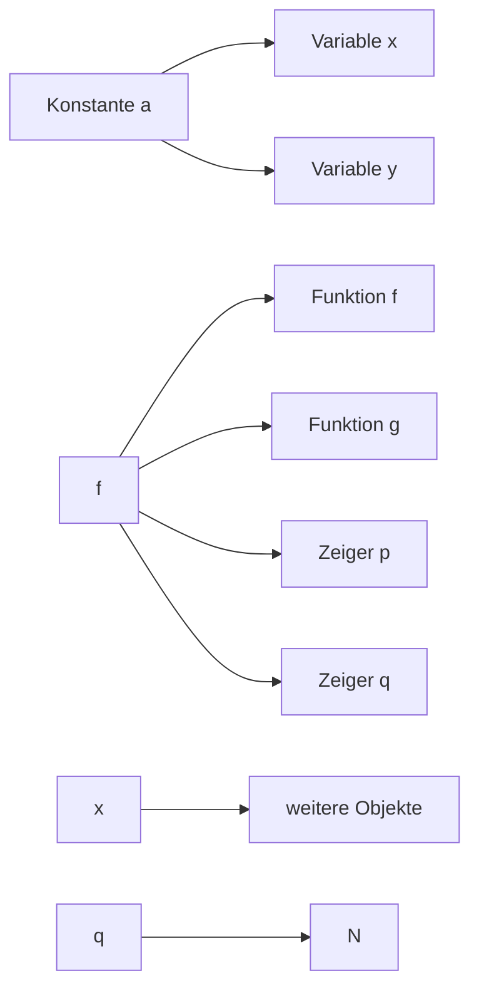
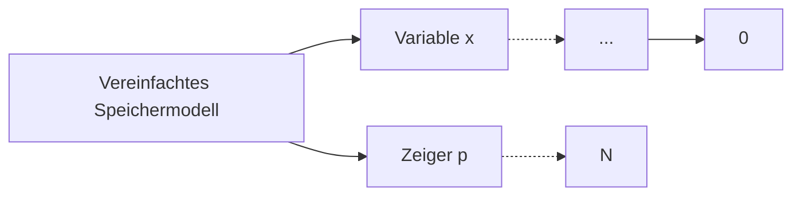
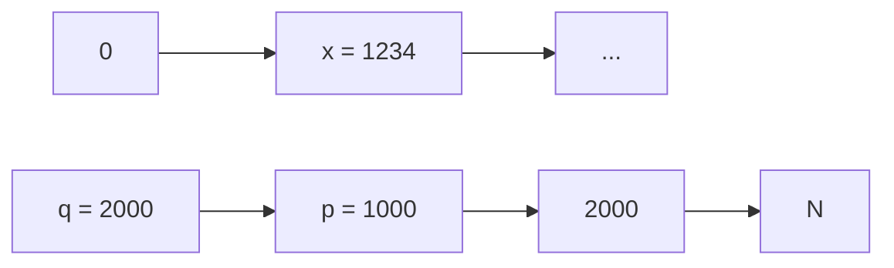
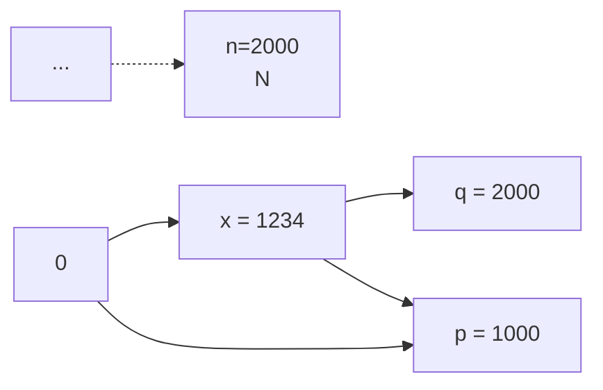

## Libraries

• Von vielen Programmen häufig wiederverwendeter Code wird in Bibliotheken (Libraries) abgelegt
• Library‐Code wird nur einmal compiliert und kann dann von allen Programmen eingebunden werden
• Dies erfolgt nach der Assemblierung durch den Linker
• C besitzt insges. 29 Standard‐Libraries, z.B.:
– stdio: Ein‐ und Ausgabe
– math: Mathematische Funktionen
– string: String‐Manipulation
Durch Einbinden einer Header‐Datei (z.B. „stdio.h“) werden die Library‐Funktionen dem benutzenden Programm bekannt gemacht
Programmierer können (und sollten) auch eigene, benutzerspezifische Libraries anlegen

**33**

© T. Gemmeke, IDS, RWTH; R. Leupers, SSS

Beim Einstieg in die C-Programmierung ist es sinnvoll, sich ein wenig mit den **Standard-Libraries** vertraut zu machen. Zum einen werden viele Funktionen von den meisten Programmen benötigt (z.B. für Ein- und Ausgabe von Daten), zum anderen findet man evtl. nützliche Funktionen, die man dann nicht selbst programmieren muss.

**Libraries** sind eine spezielle Form des Maschinencodes. Sie stellen selbst keine ausführbaren Programme dar. Vielmehr sucht der Compiler (eigentlich: der Linker) anhand von Funktionsnamen (s. auch Kap. 5), ob sich für eine bestimmte Funktion Code in der Library befindet. Falls ja, so wird dieser Code verwendet, ansonsten wird eine Fehlermeldung ausgegeben.

## Standardbibliothek C++ ‐ Beispiele

C++

• **Zeichenketten und Streams**
– string, iomanip, iostream, cstdio
• **Abtrakte Datentypen / Container**
– vector, array, (forward\_)list, queue, stack
– (unordered\_)set, (unordered\_) map
– iteratoren
• **Smart Pointer**
– unique\_prt
– shared\_prt
– weak\_ptr
• **Algorithmen**
– for\_each, sort, copy, find & search, transform
• **Funktoren**
– multiplies, negate, …

**34**

© T. Gemmeke, IDS, RWTH; R. Leupers, SSS

## 2. Einführendes Beispiel

2.1 Temperaturumrechnung
**2.2 Analyse des Beispiels**
2.3 Ausführung und Fehlersuche

**35**

© T. Gemmeke, IDS, RWTH; R. Leupers, SSS

## Analyse des C‐Programms

• **Einbinden** der Standard‐Library zur Ein/Ausgabe
– #include &lt;stdio.h&gt;
– Ermöglicht Kommunikation des Programms mit der Außenwelt (z.B. Benutzer)
– Siehe C‐Präprozessor
• **Kommentare**
– /\* Umwandlung … \*/
– // untere Grenze …
– Erläuterung der Programmfunktion für Entwickler
– Text innerhalb /\* … \*/ und in einer Zeile nach // wird vom Compiler ignoriert
• **Hauptfunktion** main
– int main() { … }
– Alle Anweisungen innerhalb { … } gehören zu main
– main wird nach Programmstart immer direkt aufgerufen
– Im Allg. ruft main dann weitere Funktionen auf

**36**

© T. Gemmeke, IDS, RWTH; R. Leupers, SSS

Die Standard-Libraries sind dem Compiler nicht automatisch bekannt. Vielmehr muss mit Hilfe eines **include-Statements** deklariert werden, dass man eine bestimmte Library verwenden möchte. Diese kann auch benutzerdefiniert sein.

**Kommentare** sind ein (leider oft vernachlässigtes) Mittel, Programme sauber zu dokumentieren, so dass auch nach längerer Zeit noch Wartungsarbeiten möglich sind. Zwar kann man einem Programm auch eine separate Dokumentation zur Seite stellen. Jedoch sind Kommentare oft praktischer, da sie sich direkt an der richtigen Stelle im Programm befinden, wodurch auch die Konsistenz zwischen Programmtext und Dokumentation gefördert wird. Für das eigentliche Programmverhalten sind Kommentare aber vollkommen bedeutungslos, da sie der Compiler einfach „überliest“.

Die **main-Funktion** ist der Einstiegspunkt eines jeden C-Programms. Sie kann sich an beliebiger Stelle im Programmtext befinden, definiert aber immer eindeutig, wo bei der Programmausführung begonnen wird. Im einfachsten Fall (wie im aktuellen Beispiel) besteht das gesamte Programm lediglich aus der main-Funktion.

## Analyse des C‐Programms

## • Variablen‐Vereinbarungen

– int fahr, celsius;
– Variablen sind benannte Speicherplätze für Werte
– Können lesend und schreibend zugegriffen werden
– Variablen müssen vor Verwendung vereinbart werden
– Hier: Verwendung von ganzzahligen (integer) Variablen

## • Zuweisungen

– lower = 0;
– upper = 300;
– Schreiben von Werten in die Variablen

## • Schleife

– while (fahr <= upper) { /\* ... \*/ }
– while ist (wie auch int) ein **C‐Schlüsselwort**
– Code innerhalb { … } wird solange wiederholt, bis Bedingung nicht mehr erfüllt

**37**

© T. Gemmeke, IDS, RWTH; R. Leupers, SSS

Die Semantik von **Zuweisungen** ist recht einfach. Der Wert auf der rechten Seite von “=„ wird an die linke Seite (meist eine Variable) zugewiesen. Der Operator “=„ in C ist also nicht mit dem mathematischen Gleichheitsoperator zu verwechseln. Dieser heißt in C „==“, was auch eine verbreitete Fehlerquelle bei der Programmierung darstellt.

**Schleifen** sind ein extrem wichtiges Programmierelement. Im Beispiel müsste man ohne Schleife sämtliche Tabelleneinträge durch separate Anweisungen ausgeben – eine mühselige Angelegenheit. Mit Hilfe der Schleife muss man den hierfür notwendigen Code jedoch nur ein einziges Mal hinschreiben.

**C-Schlüsselwörter** bilden den Kern der Programmiersprache C. Sie haben für den Compiler eine vordefinierte Bedeutung und weisen ihn an, bestimmte Code-Strukturen zu generieren (z.B. eine Schleife im Falle von „while“ oder Platz für eine ganzzahlige Variable im Falle von „int“). Daher dürfen Variablennamen nicht mit den C-Schlüsselwörtern übereinstimmen, ansonsten wird eine Fehlermeldung erzeugt. Umgekehrt wird der Compiler versuchen, alle Zeichenfolgen, die kein Schlüsselwort sind, als Variablennamen o.ä. zu interpretieren.

## Analyse des C‐Programms

## • Umrechnung

```txt
- celsius = 5 * (fahr-32) / 9;
- Rechenoperationen auf Variablen
```

## • Ausgabe

```txt
- printf("%d\t%d\n", fahr, celsius);
- Formatierte Ausgabe:
  - fahr als Integer-Zahl (erstes %d als Platzhalter)
  - Tabulator \t
  - celsius als Integer-Zahl (zweites %d als Platzhalter)
  - Zeilenumbruch \n
```

## • Vorbereitung des nächsten Schleifendurchlaufs

```txt
- fahr = fahr + step;
- fahr wird um step erhöht, bis upper überschritten
```

**38**

© T. Gemmeke, IDS, RWTH; R. Leupers, SSS

Die **printf-Funktion** aus der Standard-Library sieht auf den ersten Blick etwas kryptisch aus, ist aber eine mächtige, generische Funktion zur Ausgabe verschiedenster Daten. Standardmäßig gibt „printf“ die Daten auf dem Bildschirm aus. Die verwandte Funktion „fprintf“ funktioniert sehr ähnlich, gibt jedoch die Daten in Dateien (Files) aus, z.B. auf der Festplatte.

Der printf-Funktion werden stets zwei Parameter übergeben: (1) die Art der Ausgabe der Daten (z.B. ganzzahlig, Fließkomma, Hexadezimal) und (2) die auszugebenden Daten selbst. Für eine genaue Auflistung der printf-Möglichkeiten sei auf die **C-Dokumentation** verwiesen.

## Ausgabe

C++

## • Formatierte Ausgabe

Classic C++

```cpp
#include <iostream>  // std::cout, std::right, std::endl
#include <iomanip>   // std::setw

int main() {
    int val = 65;

    std::cout << "Formatted output using C++" << std::endl;
    std::cout << "-start-" << std::endl;
    std::cout << std::right;  // right-adjusted (manipulator)
    std::cout << """ << std::setw(10) << val << """ << std::endl;
    std::cout << "-end-" << std::endl;

    return 0;
}
```

C++11 oder c

```c
#include <cstdio> // printf; for c library: <stdio.h>, no "using ..." using namespace std;

int main() {
    int val = 65;

    printf("Now using C++11:\n");
    printf("-start-\n'%10d'\n-end-\n", val);

    return 0;
}
```

**39**

© T. Gemmeke, IDS, RWTH

Printing to the console is fundamentally a stream of bytes sent to a specific destination. C++ embraces this concept.

However, detailed output formatting becomes unnecessarily complex. Hence, C++11 has introduced the cstdio library that includes the printf function known from c.

## Libraries

C++

• Using und namespace

```cpp
#include <string>
#include <iostream>

int main( void ) {

    std::string msg = "Hello world!";

    std::cout << msg << std::endl;

    return 0;
}
```

**40**

std::cout ⭢ cout

© T. Gemmeke, IDS, RWTH

Referring to a specific function of the used libraries can sometimes be cumbersome to type and read considering the additional prefix.

This can be simplified by adding those to the local namespace with using.

Be careful when applying using namespace, as it brings many functions and variables to the scope of the program. Thereby conflicts with your own symbols of functions and variables may occur.

(Please note: the comma separated list in using requires at least C++17.)

## C‐Präprozessor

• C‐Präprozessor (cpp) läuft **vor dem Compiler** über den Quellcode (C‐nach‐C‐Übersetzung)
• cpp‐Anweisungen beginnen mit Zeichen #
• cpp‐Verwendung erhöht **Lesbarkeit** der Programme
• Vor allem folgende Anwendungen:

– **Symbolische Definitionen** (Konvention: Großbuchstaben)

• #define UPPER 300
• Alle Vorkommen von UPPER werden durch 300 ersetzt

– **Makros**

• #define MAX(a,b) (a > b) ? a : b
• Alle Vorkommen von MAX(..., ...) werden ersetzt

– **Einbinden** von Standard‐Libraries (und allgemein Header‐Dateien mit Deklarationen)

• #include &lt;stdio.h&gt;
• Datei stdio.h wird an dieser Stelle ins Programm eingefügt

**41**

© T. Gemmeke, IDS, RWTH; R. Leupers, SSS

In der Praxis muss der **Präprozessor** nicht separat vor dem Compiler aufgerufen werden. Vielmehr tut dies der Compileraufruf selbständig, und der Compiler arbeitet dann auf dem „vorverarbeiteten“ Code.

Von **symbolischen Definitionen** per #define sollte reger Gebrauch gemacht werden, um die Lesbarkeit der Programme zu erhöhen und Änderungen zu vereinfachen. Die #define-Anweisungen befinden sich typischerweise am Anfang des Programmtextes. Daher können z.B. neue Werte für Programmparameter einfach und lokal begrenzt eingestellt werden.

Die **#include-Anweisungen** können theoretisch zum Einbinden von beliebigem Programmtext benutzt werden. Dies würde allerdings nicht unbedingt zur Lesbarkeit beitragen. Daher werden sie in der Praxis nur zum Einbinden sog. Header Files verwendet, welche dem Programm die in einer Library verfügbaren Elemente bekannt machen.

## 2. Einführendes Beispiel

2.1 Temperaturumrechnung
2.2 Analyse des Beispiels
**2.3 Ausführung und Fehlersuche**

**42**

© T. Gemmeke, IDS, RWTH; R. Leupers, SSS

## Übersetzung und Ausgabe

Programm in **Textdatei** „temp.c“gespeichert
• Aufruf des **C‐Compilers** (z.B. aus Linux shell)
– cc temp.c (je nach Compiler)
– **Präprozessor** und **Assembler** werden implizit aufgerufen
– **Zielprogramm** $\scriptstyle { \boldsymbol { \upsilon } } ^ { \mathsf { a } }$ .out“ wird erzeugt
– **Ausführung** von ${ \boldsymbol { \nu } } ^ { \mathsf { a } } .$ .out“generiert die gezeigte Ausgabe

Ausgabe

| 0 | -17 |
| --- | --- |
| 20 | -6 |
| 40 | 4 |
| 60 | 15 |
| 80 | 26 |
| 100 | 37 |
| 120 | 48 |
| 140 | 60 |
| 160 | 71 |
| 180 | 82 |
| 200 | 93 |
| 220 | 104 |
| 240 | 115 |
| 260 | 126 |
| 280 | 137 |
| 300 | 148 |

**43**

© T. Gemmeke, IDS, RWTH; R. Leupers, SSS

Sofern noch keine Erfahrung mit **Dateien** und **Compilerbenutzung** vorhanden ist, sollten diese Dinge unbedingt praktisch geübt werden!

Kurzanleitungen verschiedener gängiger C/C++-Entwicklungsumgebungen finden Sie im Lernraum mit einigen Informationen zu den ersten Schritten zur Erstellung, Übersetzung und Ausführung eines C-Programms.

## Fehlerhafte Programme

• **Möglichkeit 1**: Programm entspricht nicht dem C‐Standard
Derartige Fehler werden vom Compiler (oder auch Linker) bemerkt und dem Programmierer mitgeteilt


<details>
<summary>flowchart</summary>

```mermaid
graph TD
  #include <stdio.h>
  /* Umwandlung von Fahrenheit in Celsius
    fuer fahr = 0, 20, ..., 300 */
  int mein()
  {
    int fahrigt *, celsius */;
    int lower, upper, step;

    lower = 0; // untere Grenze der Temperaturtabelle
    upper = 300; // obere Grenze
    step = 20; // Schrittweite

    fahr = lower
    while (fahr <= upper) {
        celsius = 5 * (fahr-32) ** 9;
        printf("%d\t%d\n", fahr, celsius);
        fahr = fahr + step;
    }

    return 0;
  }
  FehlendeMainFunktion["Fehlende main-Funktion"] --> VariableNichtDeklariert["Variable nicht deklariert"]
  UnbekannterOperator["Unbekannter Operator"] --> SemikolonVergessen["Semikolon vergessen"]
```
</details>

**44**

© T. Gemmeke, IDS, RWTH; R. Leupers, SSS

Vor allem am Anfang ist es sehr wahrscheinlich, dass man beim Programmieren **Fehler** macht. Die Frage ist nun, inwieweit man durch den Compiler Unterstützung bei der Fehlersuche bekommt.

Die hier gezeigte Möglichkeit ist der „beste Fall“, denn der Compiler zeigt anhand von Fehlermeldungen recht genau, was (und wo, d.h. in welcher Programmzeile) schiefgegangen ist. So kann man den Fehler leicht beheben und den Compiler erneut aufrufen.

## Fehlerhafte Programme

**Möglichkeit 2**: Programm ist gültig (d.h. compilierbar), führt aber nicht die gewünschte Funktion aus (es hat „Bugs“)
• Wesentlich schwieriger zu finden und zu beheben!

```c
#include <stdio.h>

/* Umwandlung von Fahrenheit in Celsius
    fuer fahr = 0, 20, ..., 300   */
int main()
{
    int fahr, celsius;
    int lower, upper, step;

    lower = 0; // untere Grenze der Temperaturtabelle
    upper = 300; // obere Grenze
    step  = 20; // Schrittweite

    fahr  = lower;
    while (fahr <= upper)  {
        celsius = 5 * (fahr+32) / 9;
        printf("%d\t%d\n", fahr, celsius);
        fahr = fahr + step;
    }

    return 0;
}
```


<details>
<summary>other</summary>

| Kategorie | Wert |
| --- | --- |
| Temperaturtabelle | N/A |
</details>

**45**

© T. Gemmeke, IDS, RWTH; R. Leupers, SSS

Da der Compiler nicht wissen kann, was der Programmierer ursprünglich implementieren wollte, kann es leicht zu **Bugs** kommen. Die meisten Software-Pakete haben Bugs, und manche werden erst sehr spät oder nie entdeckt. Zur Minimierung der Anzahl der Bugs hilft nur umfangreiches Testen und – bei nicht offensichtlichen Bugs – die geschickte Eingrenzung der Fehlerstelle, z.B. durch das temporäre Einstreuen zusätzlicher printf-Anweisungen zur Kontrolle von (sonst nach außen unsichtbaren) Zwischenergebnissen.

## Fehlerhafte Programme

• Programm unter Kontrolle eines **Debuggers** ausführen
Ermöglicht **Einzelschrittmodus**, Beobachtung von **Variablen** u.v.m.
Hilfreich vor allem bei **Endlosschleifen** und **Programmabstürzen**
Debugger kann Programmverhalten beeinflussen („**Heisenbugs**“)


**46**

© T. Gemmeke, IDS, RWTH; R. Leupers, SSS

Im Gegensatz zum gezeigten Bespiel sind manche Bugs sehr schwer zu finden. Das sog. „Debugging“ nimmt oft mehr Zeit in Anspruch als die eigentliche Programmierung!

Daneben wird ein Bug oft durch das komplexe Zusammenspiel verschiedener Programmteile bewirkt. Gerät das Programm in eine **Endlosschleife**, so „passiert“ nach außen nichts mehr, ohne dass ein Fehler direkt sichtbar wird. Ein **Absturz** ist ein unkontrollierter Programmabbruch aufgrund eines unzulässigen Programmverhaltens (z.B. Zugriff auf geschützte Speicherbereiche). Die genaue Absturzstelle (und noch weniger die Ursache) ist ebenfalls nicht direkt nach außen sichtbar.

In diesen Fällen hilft nur ein **Debugger-Werkzeug** weiter. Der Debugger ermöglicht eine kontrollierte Ausführung eines Programms unter „ständiger Beobachtung“ des Programmierers. Hiermit können die meisten Bugs relativ schnell gefunden werden. Im schlimmsten Fall arbeitet ein Programm unter Debugger-Kontrolle jedoch anders als das ursprüngliche Programm. Dies liegt daran, dass der Debugger selbst ein Programm ist, welches auf unerwünschte Weise mit dem fehlerhaften Programm interagieren kann. Denkbar ist natürlich auch, dass der Debugger selbst Bugs hat. In jedem Fall muss dann noch tiefer in die „Debugging-Trickkiste“ gegriffen werden.

**Literaturhinweis**: Grötker/Holtmann/Keding/Wloka: „The Developer´s Guide to Debugging“, Springer, 2008, ISBN 978-1-4020-5539-3

## 3. Elementare Datentypen und Anweisungen

## 3.1 Einführung

3.2 Variablen und Konstanten
3.3 Zeiger
3.4 Arithmetische und logische Operationen und Zuweisungen
3.5 Kontrollanweisungen

## Datentypen ‐ Einführung

**Def**.: Ein **Datentyp** (**DT**) ist eine Menge von Werten und eine <u>Sammlung von Operationen auf diesen Werten.</u>

Beispiel: **natürliche Zahlen** 1, 2, 3, ... – Operationen: +, ‐, \*, /, ...
Beispiel: **Zeichenketten** (Strings) über Alphabet A‐Z – Operationen:
• Bestimme Stringlänge
• Ordne Strings alphabetisch an
•...

Beispiel: Menge von **Personen‐Stammdaten** (Name, Geburtsdatum, Adresse, ...)

– Operationen:

• Finde Teilmenge aller Personen älter als 50 Jahre
• Finde Teilmenge aller Personen, die in Aachen wohnen
•...

**48**

© T. Gemmeke, IDS, RWTH; R. Leupers, SSS

Man beachte, dass durch die Definition des **Datentyps** Werte und Operationen zu einer Einheit zusammengefasst werden. Dies ist wichtig, da reine Daten ohne Operationen hierauf (z.B. Abfragen, Berechnungen oder Modifikationen) an sich wertlos sind.

## Datentypen ‐ Einführung

## Def.: Ein abstrakter Datentyp (ADT) ist ein Datentyp der nur über eine Schnittstelle zugänglich ist.

• Funktion vs. Implementierung des Datentyps
• Nur Funktion nach außen von Interesse
• Implementierung kann sich evtl. ändern
Beispiel: DT „Punkt“ in C
• Koordinaten:
struct point { float x; float y; }
Operation „Euklidischer Abstand“:

```lisp
float dist(struct point a, struct point b)
{
    float dx, dy;
    dx = a.x - b.x;
    dy = a.y - b.y;
    return sqrt(dx*dx + dy*dy);
}
```


<details>
<summary>text_image</summary>

y
a
dist(a,b)
b
x
</details>

**49**

© T. Gemmeke, IDS, RWTH; R. Leupers, SSS

Beim **ADT** wird die Implementierung explizit außen vor gehalten, d.h. für einen ADT kann es viele verschiedene Implementierungen z.B. als C-Code geben. Programme, die den ADT benutzen, sehen aufgrund des Interfaces nichts von seiner „inneren“ Implementierung. So ist es z.B. möglich, den ADT im Laufe der Zeit durch eine andere/bessere Implementierung zu ersetzen, ohne dass alle Programme entsprechend angepasst werden müssen.

Im Beispiel kann die Funktion „dist“ zwar als (Teil des) **Interface** aufgefasst werden, jedoch ist die Implementierung als C-struct auch nach außen sichtbar, so dass man bei schlechtem Programmierstil explizit auf die Koordinaten x und y zugreifen könnte.

## Datentypen ‐ Einführung

In der C‐Version sind Daten (point) und Operationen (dist) **getrennt**
Programme könnten (und i.d.R.: werden) ohne „dist“ auch **direkt** auf die x‐ und y‐Koordinaten zugreifen
Ändert sich die interne Implementierung von point, so wäre evtl. ein Großteil des **übrigen Programmcodes** betroffen
• **ADT‐Version** in C++: (siehe Kapitel 5)
• Daten und Operationen per Konstruktion (class) **vereinigt**
Interne Daten nur über Schnittstelle verfügbar!

```txt
class point {
    private:      // interne Repräsentation nicht nach außen sichtbar
        float x, y; // oder andere interne Repräsentation
    public:      // Schnittstelle für Benutzer von „point“
        float dist(point);
        /* ... */
};
```

**50**

© T. Gemmeke, IDS, RWTH; R. Leupers, SSS

In der **C++ Version** des Beispiel-ADT werden die Koordinaten x und y durch das Schlüsselwort „private“ vor direktem Zugriff von außen geschützt. D.h. dass ein Programm, welches versucht, diese direkt zuzugreifen, vom Compiler mit einer Fehlermeldung zurückgewiesen wird. Nur die unter „public“ sichtbaren Interface-Operationen sind nach außen verfügbar. Auf diese Weise kann der Programmierer des ADT für die gewünschte „Einkapselung“ der ADT-Daten sorgen.

## Objekte in C

Variablen, Konstanten und Programmcode (Funktionen) werden im **Speicher** abgelegt
Ein **Objekt** ist ein benannter Speicherbereich
Auf Objekte wird direkt (per **Namen**) oder indirekt (per **Zeiger**) zugegriffen; Zeiger (symbolische Adressen) sind selbst Objekte
Der **benötigte Speicherplatz** eines Objektes sowie die darauf **zulässigen Operationen** hängen vom Typ ab
Im Speicher befinden sich nur **Binärzahlen**; Interpretation ist den Operationen überlassen

Vereinfachtes Speichermodell


<details>
<summary>flowchart</summary>


</details>

**51**

© T. Gemmeke, IDS, RWTH; R. Leupers, SSS

Der Speicher ist das „Gedächtnis“ eines Programms. Er wird aus

Programmierersicht als eine lineare Folge von **Speicherplätzen** aufgefasst. In der Realität ist die Speicherarchitektur wesentlich komplexer, dies wird jedoch hier nicht weiter betrachtet.

Jeder Speicherplatz besitzt eine **Adresse**, ähnlich zu einer Hausnummer, unter der er angesprochen (d.h. gelesen oder geschrieben) werden kann. Der Inhalt eines Speicherplatzes bleibt erhalten, solange vom Programm kein neuer Wert hineingeschrieben wird (oder die Stromversorgung unterbrochen wird).

Im Beispiel laufen die Adressen von 0 bis N. In den ersten Speicherplätzen sind Konstanten und Variablen abgelegt. Auch die **Software** selbst befindet sich im Speicher (z.B. die Funktionen f und g).

Eine Besonderheit sind **Zeiger** (siehe Ende Kap.3). Diese verweisen auf andere Objekte im Speicher. Befindet sich z.B. die Funktion g an Adresse 1000 im Speicher, so hätte der Zeiger q den Wert 1000. Dies wird durch den Pfeil vom Zeigerobjekt q (welches sich an beliebiger Stelle im Speicher befinden kann) auf die Funktion g angedeutet.

Programmieranfängern bereitet das Verständnis der Zeiger erfahrungsgemäß oft große Schwierigkeiten. Da sie aber ein äußerst wichtiges

**Programmierhilfsmittel** darstellen, ist eine nähere (und vor allem praktische) Beschäftigung mit diesem Thema zwingend notwendig.

## Basis‐Datentypen in C

• char: **Zeichen** (character) = 1 Byte (8 Bits)
• int: **ganze Zahl** (integer)

– short int: kleinerer Wertebereich (mind. 16 Bit)
– long int: größerer Wertebereich (mind. 32 Bit)

• float: **Fließkommazahl** (floating point)

– Aufteilung in Exponenten und Mantisse
– z.B. „12.34E10“ ൌ 12,34 ⋅ 10<sup>ଵ</sup>଴
– double: größerer Wertebereich
– long double: noch größerer Wertebereich

• char und ganze Zahlen können **vorzeichenbehaftet** (Standardfall) oder **vorzeichenlos** sein:

– signed short int  ሾെ2<sup>ଵ</sup>଺ି<sup>ଵ</sup>, 2<sup>ଵ</sup>଺ି<sup>ଵ</sup> െ 1ሿ ൌ ሾെ32768, 32767ሿ
– unsigned short int  ሾ0, 2<sup>ଵ</sup>଺ െ 1ሿ ൌ ሾ0, 65535ሿ

**52**

© T. Gemmeke, IDS, RWTH; R. Leupers, SSS

Alle Datentypen in C können auf die **Basis-Datentypen** zurückgeführt werden. Diese sind Sprachelemente von C und somit dem Compiler implizit bekannt.

Je nach Anwendung verwendet man bei Zahlen-Datentypen solche mit oder ohne **Vorzeichen**. Der darstellbare Wertebereich ist durch die Anzahl der Bits beschränkt. Ist z.B. von vornherein bekannt, dass eine Variable niemals negative Werte annehmen kann, so kann durch die Verwendung von „unsigned“ eine bessere Ausnutzung des Wertebereichs erreicht werden.

Ganze Zahlen werden meist im **2er-Komplement** dargestellt. In diesem Format lassen sich bestimmte mathematische Operationen einfach in Hardware realisieren. Der jeweils halbe Wertebereich wird für negative bzw. positive Zahlen verwendet. Das erste Bit gibt das Vorzeichen an („1“ = negativ“). Da die 0 als positive Zahl aufgefasst wird, ergibt sich eine kleine Asymmetrie im Wertebereich.

**Beispiel**: 2er-Komplement bei 3-Bit-Zahlen

$$
0 0 0 = 0 \quad 1 0 0 = - 4
$$

$$
0 0 1 = 1 \quad 1 0 1 = - 3
$$

$$
0 1 0 = 2 \quad 1 1 0 = - 2
$$

$$
0 1 1 = 3 \quad 1 1 1 = - 1
$$

Die Negation einer Zahl erfolgt durch Invertieren der Bits und anschließender Addition von 1. Z.B. -2 = Inv(010) + 1 = 101 + 1 = 110

## 3. Elementare Datentypen und Anweisungen

3.1 Einführung
**3.2 Variablen und Konstanten**
3.3 Zeiger
3.4 Arithmetische und logische Operationen und Zuweisungen
3.5 Kontrollanweisungen

## Variablen

## • Variablen

– speichern Werte eines bestimmten **Datentyps**
– müssen vor Verwendung **vereinbart** werden

• z.B. float a, b; char x, y; double e, f;

– besitzen einen eindeutigen **Namen**
– Name sollte über **Verwendung** Aufschluss geben!

• z.B. int counter; ist besser als int c;

## • Schlüsselwörter sind als Namen nicht erlaubt

– z.B. for, while, goto, int, float, ... sind in C/C++ reserviert

## • Je nach Compiler:

– Es sind nur die ersten 31 Zeichen **signifikant**
– z.B. int einLangerVariablenName1234567890, einLangerVariablenName1234567891 gelten als gleich

**54**

© T. Gemmeke, IDS, RWTH; R. Leupers, SSS

Wird eine Variable verwendet, ohne vorher vereinbart worden zu sein, so erzeugt der Compiler eine Fehlermeldung. Die **Deklaration** dient dazu, eindeutig festzulegen welche Variablen welchen Typs im Programm verwendet werden. Auf diese Weise werden Fehler vermieden. Darüber hinaus kann der Compiler mit Hilfe der Vereinbarung bestimmen, wieviel Speicherplatz für die Variablen zu reservieren ist.

**Variablennamen** sind in C zwar quasi beliebig. Aussagekräftige Namen sind jedoch dringend zu empfehlen. Ein Programm, welches nur Variablennamen wie a, b, c, d etc. verwendet, kann nach einiger Zeit von niemandem mehr verstanden werden.

Manche C-Compiler betrachten auch mehr als 31 Zeichen als signifikant. Dies sollte jedoch nicht unbedingt ausgenutzt werden, da darunter die **Portierbarkeit** des Codes auf andere Rechner/Compiler-Plattformen beeinträchtigt wird. Zwar ist C als höhere Programmiersprache prinzipiell rechnerunabhängig, aber im Detail gilt dies leider nicht. Ein weiteres Beispiel hierfür ist die nicht eindeutige Standardisierung der Datentyp-Bitbreiten (Bsp. int: „16 Bits oder mehr“). So kann ein Programm auf verschiedenen Rechnern durchaus verschiedenes Verhalten zeigen.

## Variablen

• Aufbau von Variablennamen (Identifier‐Syntax)
• Kompakte Beschreibung mit **regulären Ausdrücken**
• Z.B. zulässig:
– int x, XX, y\_, a\_42;
• Z.B. unzulässig:
– int 0Z, 1234\_x, return;

```txt
- letter = "a" | "b" | ... | "z" | "A" | "B" | ... | "Z" | "_"
    - letter = ein Buchstabe oder „_"
- digit = "0" | ... | "9"
    - digit = eine Dezimalziffer
- identifier = letter { letter | digit }
    - identifier = ein letter, gefolgt von beliebig vielen Elementen (auch 0)
    letter oder digit
```

**55**

© T. Gemmeke, IDS, RWTH; R. Leupers, SSS

**Identifier** sind eindeutige Namen für Variablen, Konstanten, Datentypen, Funktionen etc. Mittels **regulärer Ausdrücke** (RAs) können bestimmte Sprachen (wie hier die Sprache der möglichen C-Identifier) kompakt beschrieben werden.

Grundlage für RAs ist immer ein **Alphabet**. Im Falle von C ist dies eine Teilmenge der sog. ASCII-Zeichen, welche aus Buchstaben, Ziffern und einigen Sonderzeichen bestehen. Jedes Element des Alphabets ist per Definition selbst schon ein RA.

Aus zwei beliebigen gegebenen RAs R1 und R2 kann man einen neuen, komplexeren RA R3 mittels dreier Regeln formen:

**1) Alternative**: R3 = R1 | R2 (R3 darf aus R1 oder R2 bestehen)
**2) Konkatenation** R3 = R1 R2 (R3 besteht aus dem Hintereinanderschalten von R1 und R2)
**3) Kleene‘sche Hülle**: R3 = {R1} (oder auch in vielen Sprachen (R1)\* ) (R3 besteht aus beliebig vielen Wiederhholungen von R1)

Mit Hilfe dieser Definition kann der **Aufbau** (oder die Syntax) von C-Identifiern wie gezeigt leicht erklärt werden: Jeder Identifier muss zu Beginn einen „letter“ (Buchstabe oder Unterstrich „\_“) haben, gefolgt von beliebig vielen weiteren Zeichen des Alphabetes. Man beachte jedoch die praktische Einschränkung auf 31 signifikante Zeichen, sowie das Verbot, Schlüsselwörter als Identifier zu verwenden.

Für eine genauere Erläuterung des RA-Begriffes sei hier auf spätere Vorlesungen (z.B. ASK oder Compilerbau) verwiesen.

## Variablen‐Vereinbarung

• Vereinbarung vor erster Verwendung der Variable

– Deklaration ermöglicht **Korrektheitsprüfungen** durch Compiler
– Definition allokiert benötigten **Speicherplatz**

• **Allgemeine Form** der Vereinbarung:

– Typ ID (, ID)\* ;
– Typ darf sein:

• Basis‐DT (Schlüsselwort): char, int, float, ...
• Zusammengesetzter DT (Zeiger, Array, Struct, ...)
• Benutzerdefinierter DT

– typedef unsigned long int UL;
– Macht UL als Abkürzung für unsigned long int bekannt
– Hilfreich vor allem bei zusammengesetzten DT

```c
int main(void)
{
    /* Variablen-
        Vereinbarungen */

    /* ... */

    /* Anweisungen mit
        Variablen-
        Verwendung */

    return 0;
}
```

**56**

© T. Gemmeke, IDS, RWTH; R. Leupers, SSS

Wir werden das Konzept der RAs im folgenden gelegentlich weiterverwenden. Z.B. hier bei der Vorstellung der Syntax von Vereinbarungen. Eine **Vereinbarung** setzt im wesentlichen einen Datentyp in Verbindung zu einem Identifier. Um Schreibarbeit zu sparen, reicht es bei mehreren gleichartigen Variablen, den Typnamen nur einmal zu nennen (daher die \*-Konstruktion).

Verwendet man den Zusatz „**typedef**“ in einer Vereinbarung, so wird dadurch ein Datentyp unter einem neuen (und meist kürzeren) Namen bekannt gemacht. Dies spart Schreibarbeit und verbessert die Programm-Lesbarkeit.

Generell sollte in einem Programm immer **Redundanz** vermieden werden. D.h. falls bestimmte Programmelemente mehrfach vorkommen, so sollten diese unter einem eindeutigen Namen möglichst nur einmal abgelegt und dann per Namen ggf. mehrfach instanziiert werden (vgl. auch die Verwendung von Makros im C-Präprozessor).

## Konstanten

• Falls Werte sich innerhalb eines Programms nie ändern, so werden diese als **Konstanten** statt Variablen dargestellt
Bessere **Lesbarkeit**, mehr **Optimierungsmöglichkeiten**
• Konstanten benötigen keine explizite Definition, da ihr **Typ implizit** ist; Beispiele:

12345: ganze Zahl (int)
12345U: vorzeichenlose ganze Zahl (unsigned int)
0xAFFE: ganze Zahl in Hexcode (int)
123.45:    Fließkommazahl (double)
123E-2:   Fließkommazahl (double)
'a': Zeichen (char)
"String": Zeichenkette (Array aus char, s. später) int‐Konstante als regulärer Ausdruck: "0" | ( [ "‐" ], dnz, { d } )

**57**

© T. Gemmeke, IDS, RWTH; R. Leupers, SSS

Für eine genaue Auflistung des möglichen **Aufbaus von C-Konstanten** und deren Datentypen sei auf die C-Dokumentation verwiesen.

## Weitere Formen von Konstanten

• **Symbolische Konstanten** im Präprozessor
– #define MAXCOUNT 1000
– Alle Vorkommen von MAXCOUNT im Programm werden durch 1000 ersetzt
– Bessere Lesbarkeit und Wartbarkeit des Codes

• **Konstante Ausdrücke**

– MAXCOUNT + 1, MAXCOUNT \* 2, ...
– Werden vom Compiler vorab ausgerechnet, nicht zur Programm‐Laufzeit (compile time‐Konstante)

• **Konstante Variablen**

– const int a = 100; (const ist ein type qualifier)
– Variable a darf kein neuer Wert zugewiesen werden
– Effekt: Ablage von a im read only‐Speicher (ROM)

**58**

© T. Gemmeke, IDS, RWTH; R. Leupers, SSS

Die **Präprozessorkonstanten** sind ein Spezialfall der echten Konstanten aus der vorherigen Folie, denn der Präprozessor nimmt nur eine rein textuelle Ersetzung vor.

Mit „compile time“ bezeichnet man den Zeitpunkt, zu dem der Compiler läuft (im Gegensatz zur „runtime“, d.h. Programm-Laufzeit). Hat der Präprozessor MAXCOUNT z.B. durch 1000 ersetzt, so steht anschließend der Ausdruck 1000+1 im Programm. Das Ergebnis wird auf jedem Rechner 1001 sein. Daher kann der Compiler dies bereits (ein einziges Mal) ausrechnen, um später (vielfach) „runtime“ zu sparen.

**Konstante Variablen** sind Objekte im Speicher, die nicht modifiziert werden dürfen. Der Compiler kann dies prüfen und ggf. eine Fehlermeldung ausgeben. Beim Speicher unterscheidet man ROM (read only) und RAM (random access memory). Letzterer kann beliebig zugegriffen werden. ROM-Speicher ist jedoch platzsparender.

## 3. Elementare Datentypen und Anweisungen

3.1 Einführung

3.2 Variablen und Konstanten

**3.3 Zeiger**

3.4 Arithmetische und logische Operationen und Zuweisungen

3.5 Kontrollanweisungen


## Zeiger

**Def**.: Ein **Zeiger** (engl. pointer) ist eine Variable, die die <u>Speicheradresse einer Variablen enthält.</u>

Zeiger gehören zu den **wichtigsten Konzepten** in C/C++ zur Definition komplexer und effizienter Datentypen
Zeiger gehören (leider) auch zu den **häufigsten Fehlerquellen** bei der Programmierung
• Bsp.:
– Der spezielle Zeigerwert NULL (0) wird oft verwendet, um einen „leeren“ Zeiger anzuzeigen (#define NULL 0)
– Der Versuch, einen Wert an Adresse 0 zu schreiben, führt in aller Regel zum **Programmabsturz**
– Enthält ein Zeiger einen sonstigen illegalen Wert, so kann sogar der **Programmcode** selbst überschrieben werden

**60**

© T. Gemmeke, IDS, RWTH; R. Leupers, SSS

Das Grundproblem bei der Programmierung mit Zeigern ist, dass bei mangelndem Verständnis ihrer Funktionsweise (oder einfach aus mangelnder Sorgfalt bei der Programmierung) die Zeiger „außer Kontrolle“ geraten können. Jedes Programm besitzt einen **Speicherbereich**, der ihm „gehört“, und in dem es seine Daten ablegt. Zeitgleich können auch noch andere Programme und Daten im Speicher vorhanden sein, welche natürlich nicht beeinflusst werden dürfen. Da ein Zeiger jeden beliebigen Wert annehmen kann, kann er bei fehlerhaftem Gebrauch insbes. auf einen Speicherbereich zeigen, der einem anderen Programm gehört. Der Versuch, auf diesen Bereich zuzugreifen, führt in aller Regel zum **Programmabsturz**.

Meist wird dieser Fehler vom Betriebssystem abgefangen und dem Benutzer gemeldet. Bei einfacheren Computersystemen kann es jedoch auch einen „totalen“ Absturz geben, über dessen Ursache dann zunächst einmal nichts bekannt ist. Derartige Bugs sind auch mit Debuggern oft schwer zu beheben, so dass bei der Programmierung mit Zeigern große **Sorgfalt** geboten ist. Es ist besser, eine Stunde länger in die saubere Programmierung zu investieren, als sich anschließend viele Stunden per Debugger auf Fehlersuche zu machen.

## Zeiger

• Alle **Programm‐Objekte** liegen im Speicher (s.o.)
• Jedes Objekt besitzt eine **Adresse** im Speicher (wie eine Hausnummer)
Häufig werden Objekte **per Namen** zugegriffen (z.B. Variable ${ { } _ { v } } { { \times } ^ { \prime \prime } } )$
Oft ist auch der **indirekte Zugriff** auf ein Objekt über seine Adresse sinnvoll
• Objekt‐Adressen werden in **Zeigern** gespeichert
Zeiger sind selbst Objekte mit Adressen, daher sind auch **Zeiger auf Zeiger** möglich


<details>
<summary>flowchart</summary>


</details>

© T. Gemmeke, IDS, RWTH; R. Leupers, SSS

**61**

Die gezeigte Struktur im Speicher würde bspw. durch das folgende Programm bewirkt (zur genauen Syntax s. folgende Folien):

int $x ; \quad //$ normale int-Variable

$\mathrm{int}^* \mathrm{p}; \quad //$ Zeiger auf einen int-Wert im Speicher

$\mathrm{p}=\&\mathrm{x}; \quad // \mathrm{p}=\mathrm{Adresse}(\mathrm{x}), \quad \mathrm{d.h.} \quad , \mathrm{p}$ auf x zeigen lassen“

Anschließend können $_ { 2 3 } \mathrm { { x } ^ { 6 6 } }$ und ${ \cos ^ { * } p ^ { \cos } }$ synonym verwendet werden. Man sagt auch $_ { 2 3 } \mathrm { { x } ^ { 6 6 } }$ und ${ \cos ^ { 4 } p ^ { 6 0 } }$ sind **Decknamen**, d.h. verschiedene Namen für das gleiche Objekt, welches sich an der Adresse von x im Speicher befindet.

## Zeigervereinbarung und ‐operationen

• Zeiger werden mittels \* deklariert
• Typ \* ID; vereinbart einen Zeiger auf ein Objekt vom Typ Typ
• Bsp.: int \* p; int \*\* q;
• Symbol \* gehört syntaktisch zu ID, nicht zum Typ, z.B.
Äquivalent wäre: typedef int\* intptr; intptr p, q;

```c
int * p, q;
vereinbart einen int-Zeiger p und
    eine int-Variable q, aber
    int *p,*q;
vereinbart zwei int-Zeiger
```


<details>
<summary>flowchart</summary>


</details>

**62**

© T. Gemmeke, IDS, RWTH; R. Leupers, SSS

Die Deklaration „int\*\* q“ ist zu lesen wie „(int\*)\* q“, d.h. q ist ein Zeiger auf „int\*“, somit ein **Zeiger auf einen Zeiger auf int**. Im Beispiel zeigt q auf p und p wiederum auf x. Synonyme Ausdrücke wären hier also „x“, „\*p“ und „\*\*q“.

Die C-Syntax ist in diesem Fall sicher nicht optimal lesbar, so dass bei komplexen Zeigerdeklarationen möglichst auf „typedef“-Deklarationen zurückgegriffen werden sollte, um komplexe Deklarationen nur einmal hinschreiben zu müssen. Die Minimierung der Redundanz beseitigt unnötige Fehlerquellen.

## Zeigerdeklaration und ‐operationen

• **Annahme**: Adresse von Objekt x in Zeiger p gespeichert
Wie erfolgt der Zugriff auf x? – \*‐Operator – Ausdruck \*pointer liefert Objekt x
• **Beispiel**: \*p liefert den Wert 1234 (int) \*q liefert den Wert 1000 (intptr)
**Schreibzugriff** per \*: \*p = 4321; überschreibt x mit 4321 \*\*q = 5678; überschreibt x mit 5678
Vergleiche Syntax der **Vereinbarung** – int \*p; – **implizite** Deklaration von p als Zeiger

**63**


<details>
<summary>flowchart</summary>


</details>

© T. Gemmeke, IDS, RWTH; R. Leupers, SSS

Der „\*“-Operator (nicht zu verwechseln mit dem „\*“-Operator für Zahlen, d.h. Multiplikation) „**dereferenziert**“ einen Zeiger. Somit ist auch die Syntax der Zeigerdeklaration besser zu verstehen: „int \*p“ kann als Deklaration einer int-Variable aufgefasst werden, die jedoch keinen eigenen Namen besitzt, sondern nur indirekt über den Zeiger p angesprochen werden kann (Man beachte, dass diese „int-Variable“ dann keinen festen Platz im Speicher hat, da p prinzipiell „überall“ hinzeigen kann).

## Adressoperator

Zeiger auf x wird auch als **Referenz** auf x bezeichnet
\*‐Operator heißt auch **Dereferenzierung** (indirection)
Erzeugung von Referenzen durch den **Adressoperator** &
& und \* sind invers zueinander: – \*(&x) = x
• & nur auf **Objekte** anzuwenden, \* nur auf **Zeiger**

```matlab
p = &x;
- An p wird die Adresse von x zugewiesen
  (p „zeigt“ dann auf x)
q = &p;
- An q wird die Adresse von p zugewiesen
```


<details>
<summary>flowchart</summary>


</details>

**64**

© T. Gemmeke, IDS, RWTH; R. Leupers, SSS

Es ist also z.B. unzulässig, den $\cos ^ { \theta ^ { \mathrm { d } } }$ -Operator (nicht zu verwechseln mit der logischen UND-Verknüpfung $_ { 0 } \theta ^ { 6 6 }$ **zweimal** hintereinander $( 0 , 0 , 0 , 1 )$ auf ein Objekt x anzuwenden, denn eine Adresse $, \ell x ^ { \epsilon }$ ist selbst kein Objekt mehr. Mehrfache „indirection“ wie $\mathrm { z . B . ~ , * * * p ^ { \omega } }$ ist dagegen zulässig, vorausgesetzt, dass der Ausdruck $\mathrm { s ^ { * * } p ^ { \mathrm { \textell o } } }$ ein Zeiger ist.