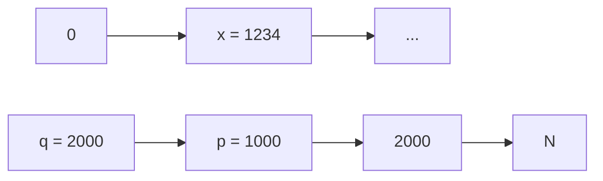
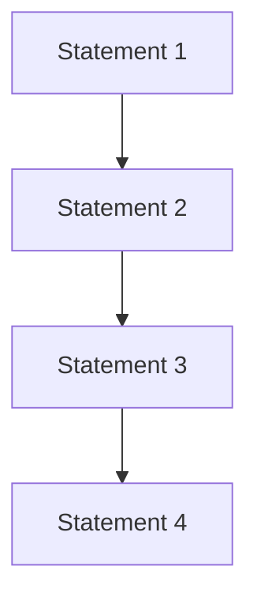
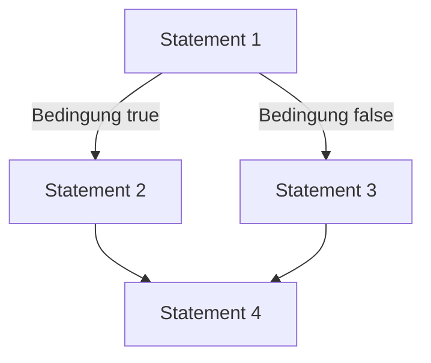
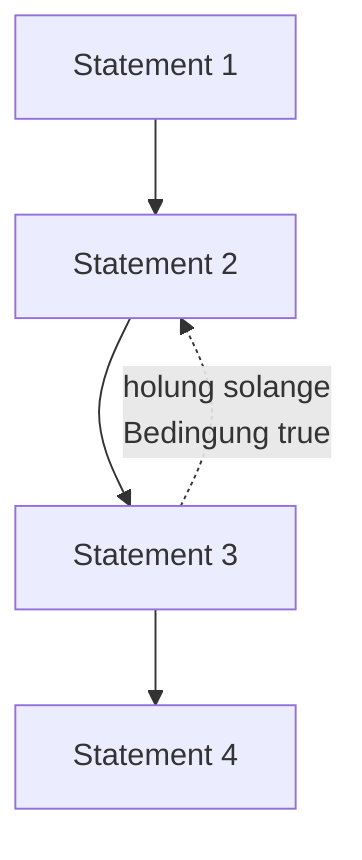
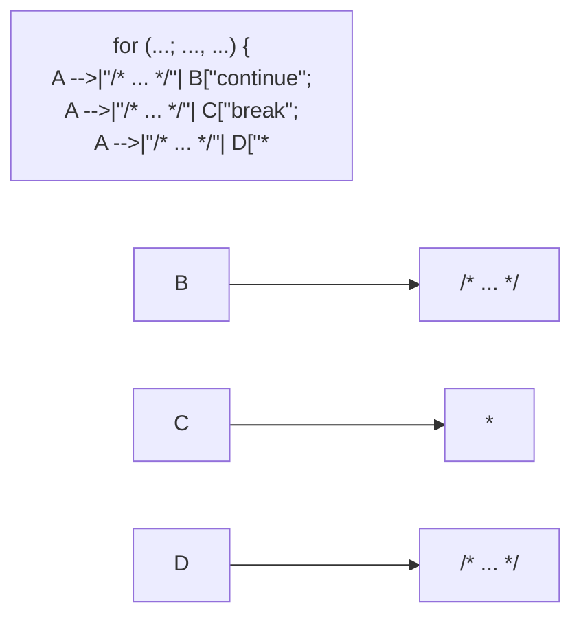

## Type cast mit Zeigern

Zeiger sind im Prinzip **identisch** mit (positiven) Integer‐Zahlen
Daher können Zeiger und int ineinander **umgewandelt** werden
Diese Eigenschaft von C/C++ bringt große **Flexibilität**, birgt jedoch auch **Gefahren**, z.B. möglicher Zugriff auf geschützte Speicherbereiche

```txt
p = (int*)x;
x = *p;
- lädt x mit dem Inhalt von Speicherstelle 1234
x = (int)q;
- lädt x mit 2000
```


<details>
<summary>flowchart</summary>


</details>

**65**

© T. Gemmeke, IDS, RWTH; R. Leupers, SSS

Die Identität von Zeigern und int-Zahlen (genauer gesagt: unsigned int, denn die Adressen sind immer positiv) resultiert daraus, dass Zahlen und Zeiger im Speicher die gleiche Darstellung haben. Die **Wertebereiche** müssen jedoch nicht immer gleich sein, abhängig von der zugrunde liegenden Computerarchitektur. So könnten unsigned int-Zahlen bspw. im Wertebereich [0,65535] liegen (bei 16-Bit-Darstellung), wogegen der Speicher 32-Bit-Adressen (d.h. [0, 2<sup>32</sup>-1]) haben kann.

## Wozu dienen Zeiger?

Allgemein: falls mittels eines **einzigen Objektes** (Zeiger) im Programmverlauf auf **verschiedene andere Objekte** zugegriffen werden soll
Oder falls (in der maschinennahen Programmierung) Zugriffe auf **vorgegebene feste Speicherstellen** notwendig sind
Vor allem sind Zeiger sinnvoll bei **dynamischen** (d.h. zur Laufzeit erzeugten) Datenstrukturen
Datenobjekte, deren Größe während der Programmentwicklung noch nicht feststeht und die daher **nicht statisch deklariert** werden können
Hierfür kann dynamisch (d.h. während der Programmlaufzeit) Speicher angefordert und wieder freigegeben werden
• Der Speicherbereich hierfür heißt **Heap** (Halde, Haufen)

**66**

© T. Gemmeke, IDS, RWTH; R. Leupers, SSS

Ist z.B. eine **Datenbank** zu implementieren, so kann der Programmierer nicht genau wissen, wie viele Datensätze später im Betrieb einmal zu speichern sind. Die statische Vorabreservierung eines möglichst großen Speicherbereichs wäre zwar denkbar, aber ineffizient (wegen Platzverschwendung) und unsicher (wegen möglicher Überläufe). Daher wäre dies ein typischer Anwendungsfall für **dynamische Datenstrukturen**, bei denen der notwendige Speicherbereich erst zur Programmlaufzeit ermittelt und reserviert wird.

In der **maschinennahen Programmierung** kann es vorkommen, dass auf ganz bestimmte (konstante) Adressen zugegriffen werden muss. Ist z.B. bekannt, dass ein bestimmtes Gerät einen zu verarbeitenden Wert immer an Adresse 1000 hinterlegt, so gäbe es mit Hilfe normaler Variablendeklarationen keine Möglichkeit, hierauf zuzugreifen, da der Compiler die Variablenadressen selbst bestimmt. Mit Hilfe einer Deklaration wie $\mathrm{int^{*}p=(int^{*})1000;}$ kann jedoch mittels Zeiger p auf die gewünschte Adresse direkt zugegriffen werden.

## Heap‐Speicher

Programmcode und Variablen im **statischen** Speicherbereich
• Zugriff auf den **Heap** wie folgt:
Anforderung von Heap‐Speicher mittels Funktion malloc (memory allocation)
int\* p = (int\*) malloc(1000);
– p zeigt dann auf Anfang von freiem 1000‐Byte Heap‐Block
– Adresse eines freien Blockes wird von malloc **automatisch** ermittelt (z.B. 5000)


<details>
<summary>bar_stacked</summary>

| Component | Relative Area |
| --- | --- |
| p = 5000 | N/A |
| H | N/A |
| E | N/A |
| A | N/A |
| P | N/A |
</details>

**67**

© T. Gemmeke, IDS, RWTH; R. Leupers, SSS

Im Falle der Standard-Library-Funktion „**malloc**“ ist ein type cast notwendig. Da die malloc-Funktion nicht „wissen“ kann, welcher Datentyp im Speicher abgelegt werden soll, gibt sie zunächst einmal einen „generischen“ Zeiger vom Typ „void\*“ zurück. Dieser kann dann (optional) explizit auf den gewünschten Typ (hier „int\*“) gecastet werden.

„malloc“ kann auch eine Fehlermeldung zurückgeben, falls **kein freier Speicher** mehr gefunden werden kann. Da heutige Computer mit Speicher meist sehr großzügig ausgestattet sind, ist ein solcher Fehler jedoch oft ein Hinweis auf einen Bug, z.B. malloc-Aufruf in einer Endlosschleife, welcher zwangsläufig irgendwann nicht mehr erfolgreich ausgeführt werden kann.

## Heap‐Speicher

Adressen **5000‐5999** durch malloc reserviert \*p = 1234; weist 1234 an erste Speicherzelle im Block zu

Da die an malloc übergebene **Blockgröße** variabel ist, kann Heap‐Speicher immer **passend** angefordert werden

Nach Verwendung sollte der Heap‐Block auch wieder **freigegeben** werden, um den Speicherplatz für andere Zwecke wiederverwenden zu können: free(p); // Block 5000-5999 freigeben

**68**


<details>
<summary>bar_stacked</summary>

| Stage | Value |
| --- | --- |
| Initial State | 0 |
| Transition | p = 5000 |
| Final Step | 1234 |
| Intermediate Level | 5000 |
| Intermediate Level | 6000 |
| Final Level | N |
</details>

© T. Gemmeke, IDS, RWTH; R. Leupers, SSS

„free“ ist das Gegenstück zu „malloc“. Die explizite **Freigabe von nicht mehr benötigten Speicherbereichen** ist bei ausreichend großem Speicher nicht unbedingt notwendig, es ist jedoch schlechter Programmierstil, so zu verfahren. Führt z.B. der Aufruf von „free“ zu einer Fehlermeldung, so ist dies ein sicherer Hinweis darauf, dass die Speicherverwaltung im Programm falsch angelegt ist. Ohne explizites „free“ könnte dies eine zeitlang unbemerkt bleiben und irgendwann zu einem fatalen Absturz führen.


<details>
<summary>text_image</summary>

#include <stdlib.h>
#include <stdio.h>

int main( void ) {
    int* p;
    printf("Any memory        @ %p: %d_%d_%d\n", p, p[0], p[1], p[2]);
    p = (int*) malloc(1000);
    printf("Allocated memory   @ %p: %d_%d_%d\n", p, p[0], p[1], p[2]);
    p[0] = 4;
    p[1] = 7;
    p[2] = 11;
    printf("Initialized memory @ %p: %d_%d_%d\n", p, p[0], p[1], p[2]);
    free(p);
    printf("Deallocated memory @ %p: %d_%d_%d\n", p, p[0], p[1], p[2]);
    return 0;
}

#include <cstdio>
#include <memory>
using namespace std;
int main( void ) {
    int* p;
    printf("Any memory       @ %p: %d_%d_%d\n", p, p[0], p[1], p[2]);
    p = new int[250];
    printf("Allocated memory   @ %p: %d_%d_%d\n", p, p[0], p[1], p[2]);
    p[0] = 4;
    p[1] = 7;
    p[2] = 11;
    printf("Initialized memory @ %p: %d_%d_%d\n", p, p[0], p[1], p[2]);
    delete [] p;
    printf("Deallocated memory @ %p: %d_%d_%d\n", p, p[0], p[1], p[2]);
    return 0;
}
</details>

Whether you use c or C++, dynamic memory allocation uses different commands. The result is the same.

Please note: the first printf statement can lead to a program crash as the pointer p is not initialized and my point to areas outside the allocated memory space. Sometimes variables are automatically initialized to zero - accessing the address zero also results in a crash.

## Smart Pointer

C++

• Motivation

```cpp
#include <iostream>
#include <memory>
#include <sys/resource.h>
using namespace std;

// get memory footprint
long get_mem() {
    struct rusage is;
    getrusage(RUSAGE_SELF, &is);
    return is.ru_maxrss; // in KB

}

void subA() {
    int a; int* pa = &a;
}

void subB() {
    int* pa = new int;
    // delete pa; // free memory space, no automatic deallocation
}

void subC() { unique_ptr<int> pa = make_unique<int>(); }

int main( void ) {
    long mem_base = get_mem();
    cout << "Memory base usage: " << mem_base << endl;

    for( long i=0; i<10000000; i++ ) {
        subA();
        if( i%1000000 == 0) cout << "Addt'l allocation: " << get_mem() - mem_base << endl;
    }
    return 0;
}
```

**70**

© T. Gemmeke, IDS, RWTH

subA creates a local integer variable. Itself as well as the local pointer to it get deleted, once we leave the context.

In subB the local pointer pa points to a newly requested memory location of size integer. The local pointer variable is deleted as we leave the context. However, the memory location allocated with new is not freed up. Missing the explicit delete command, there is no reference to this memory location available to the program – a memory leak is created.

subC uses a smart pointer, that keeps track of its usage. The original assignment increases the number of references to the allocated memory location by one. Leaving the context, the deletion of the local smart pointer reduces the reference count to zero, which automatically triggers memory management routine to freeup the memory resource.

## Smart Pointer

C++

## • Unique Pointer


<details>
<summary>flowchart</summary>

```mermaid
graph TD
  #include <iostream>
  #include <memory>
  using namespace std;

  subC() {
    unique_ptr<string> subC() {
      unique_ptr<string> p = make_unique<string>("unique");
      return p;
    }
  int main( void ) {
    unique_ptr<string> pu = subC();
    unique_ptr<string> pu2;

    if( pu != nullptr ) cout << "Unique pointer pu: " << *pu << endl;
    if( pu2 != nullptr ) cout << "Unique pointer pu2: " << *pu2 << endl;

    cout << "Moving ownership from pu to pu2 ..." << endl;
    pu2 = move(pu);

    if( pu ) cout << "Unique pointer pu: " << *pu << endl;
    if( pu2 ) cout << "Unique pointer pu2: " << *pu2 << endl;

    return 0;
  }
  #Anmerkung:
  Unique pointers können als Rückgabewert verwendet werden, falls der aktuelle Besitzer nur temporäre Gültigkeit im lokalen Kontext hat.

  ##Object Diagrams
  pu --> obj
  pu2 --> x
  move() --> move()
  pu --> x
  pu2 --> obj

  Im 2. Beispiel ist die Überprüfung auf Gültigkeit vereinfacht.
```
</details>

**71**

© T. Gemmeke, IDS, RWTH

Unique pointers assure that an object can only be owned by a single pointer. No other pointer can reference the same object.

The move() method is used to explicitly move ownership of an object from one pointer to another. If an object is owned by a temporary unique pointer, the object can be transferred using a return expression without explicitly requiring a call to move().

As best practice, objects handled by unique pointers should be created with make\_unique.

## Smart Pointer

C++

• Shared Pointer

```cpp
#include <iostream>
#include <memory>
using namespace std;

void show( shared_ptr<string>& p0, shared_ptr<string>& p1 ) {
    if( p0 != nullptr ) cout << "Shared pointer p0: '" << *p0 << "''' << endl;
    if( p1 != nullptr ) cout << "Shared pointer p1: '" << *p1 << "''' << endl;
    cout << " Ptr of p0 use count: " << p0.use_count() << endl;
    cout << " Ptr of p1 use count: " << p1.use_count() << endl << endl;
}

int main( void )
{
    shared_ptr<string> ptr0 = make_shared<string>("shared");
    shared_ptr<string> ptr1;
    show(ptr0, ptr1);

    cout << "Duplicating reference to object ..." << endl;
    ptr1 = ptr0;
    show(ptr0, ptr1);

    ptr0 = make_shared<string>("something new");
    show(ptr0, ptr1);

    return 0;
}
```

**72**

© T. Gemmeke, IDS, RWTH

Shared pointers shared\_ptr allow object ownership by multiple pointers. An internal counter keeps track whether there is still a pointer referencing it. If the count is down to zero, the object is automatically deleted.


<details>
<summary>flowchart</summary>

```mermaid
graph TD
  A["#include <iostream>"] --> B["Einen weak pointer zu de-referenzieren ist etwas kompliziert. Es benötigt eine temporäre Kopie der Referenz. Diese wird durch die Methode lock() erreicht."]
  C["#include <memory>"] --> D["using namespace std;"]
  D --> E["void show( shared_ptr<string>& p0, weak_ptr<string>& p1 ) {<br>    if( p0 != nullptr ) cout << &quot;Shared pointer p0: '&quot; << *p0 << &quot;' << endl;<br>    if( !p1.expired() ) cout << &quot;Weak pointer p1: '&quot; << *(p1.lock()) << &quot;' << endl;<br>    cout << &quot; Ptr of p0 use count: &quot; << p0.use_count() << endl;<br>    cout << &quot; Ptr of p1 use count: &quot; << p1.use_count() << endl << endl;<br>  }<br>  E --> F[&quot;int main( void ){<br>  D --> G[&quot;shared_ptr<string> ptr0 = make_shared<string>(&quot;shared&quot;);<br>  G --> H[&quot;weak_ptr<string> ptr1;<br>  H --> I[&quot;show(ptr0, ptr1);<br>  I --> J[&quot;cout << &quot;Duplicating reference to object ...&quot; << endl;<br>  J --> K[&quot;ptr1 = ptr0;<br>  K --> L[&quot;show(ptr0, ptr1);<br>  L --> M[&quot;ptr0 = make_shared<string>(&quot;something new&quot;);<br>  M --> N[&quot;show(ptr0, ptr1);<br>  N --> O[&quot;return 0;"]
  end
```
</details>

Weak pointers weak\_ptr can also point to objects owned by shared pointers. However, they do not add to the count metric. If no shared pointer is referencing the object, it is deleted. The weak pointer is then pointing to an invalid address.

In the figure, example obj1 points to obj2, which points itself to obj3. If obj3 used a shared\_ptr to point back to obj2, the re-assignment of obj1 to obj4 would lose any reference to the other two objects. However, the system could not identify the two objects being obsolete – a memory leak is created. With the indicated weak pointer, obj2 looses any reference to it. Once obj2 is deleted also obj3 is up for removal.

## 3. Elementare Datentypen und Anweisungen

3.1 Einführung
3.2 Variablen und Konstanten
3.3 Zeiger
**3.4 Arithmetische und logische Operationen und Zuweisungen**
3.5 Kontrollanweisungen

## Arithmetische und logische Operationen

Auf Variablen und Konstanten können verschiedene **Rechenoperationen** angewendet werden
• Multiplikative Operationen haben **Vorrang** – Der **Ausdruck** a\*b+c/d entspricht (a\*b) + (c/d)
Diese primitiven Rechenoperationen sind in der Programmiersprache „eingebaut“
Komplexere Operationen sind in **Libraries** verfügbar oder werden vom **Programmierer definiert**
Z.B. Standard‐Library math.h – sin, cos, tan, pow (power), sqrt (square root), ...
**Ergebnisse** der Operationen haben einen bestimmten DT, der sich aus dem Operator und den Argumenttypen ergibt

$$
\begin{array}{l} - +, -, *, / \\ - \% (\text {modulo, nicht bei float - Werten}) \end{array}
$$

**75**

© T. Gemmeke, IDS, RWTH; R. Leupers, SSS

Die **Datentypen von Operationsergebnissen** werden im Compiler mittels bestimmter Regeln hergeleitet (die sog. usual arithmetic conversions, s. C-Dokumentation). Zu beachten ist hierbei auch die definierte Präzedenz (Reihenfolge der Auswertung) der Operatoren. Bei Library-Funktionen ist (wie auch bei allen anderen C-Funktionen) der Ergebnistyp explizit in der Deklaration enthalten.

## Zuweisungen

## • Allgemeine Form:

– Ziel = Ausdruck
– = ist der Zuweisungsoperator
– Ausdruck wird berechnet, Wert wird in Ziel gespeichert

## Kurzformen:

```matlab
- ++, -:-: Increment, Decrement
    x++ entspricht x = x+1
- +=, *=, ...
    x += y entspricht x = x+y
```

```c
int main()
{
    int a,b;
    int c,d;

    a = 1;
    b = 2;

    c = a+b;
    d = c+1;
    d = d+1;
    printf("%d", d);
```

```c
return 0;
}
#define a 1
#define b 2

int main()
{
    int c,d;

    c = a+b;
    d = c+1;
    d++;
    printf("%d", d);

    return 0;
}
```

**76**

© T. Gemmeke, IDS, RWTH; R. Leupers, SSS

In der Sprache C gibt es verschiedene Elemente, die aus Zeiten resultieren, in denen die Compiler noch nicht sehr leistungsfähig waren. Ein Beispiel sind die **Kurzformen** für Zuweisungen wie $_ { 2 ^ { x + + } }$ statt $\mathbf { x } = \mathbf { x } + 1 ^ { \circ \circ }$ . Hierdurch wurde der Compiler angewiesen, einen speziellen Assemblerbefehl (increment) statt eines normalen Additionsbefehls zu erzeugen, wodurch u.U. effizienterer Code generiert werden konnte.

Moderne optimierende Compiler werden jedoch stets die beste Alternative wählen, unabhängig von der genauen Formulierung des Programms. Allerdings kann es je nach Verwendung von Kurz- oder Langformen zu unterschiedlichen **Seiteneffekten** kommen (auf die hier nicht weiter eingegangen werden soll), welche die Optimierung einschränken können.

## Arithmetische und logische Operationen

• **Vergleichsoperationen**
Ergebnis einer Vergleichsoperation ist stets ein **Boolescher Wert** (true oder false)
Boolescher DT in C: \_Bool – Äquivalenzen aus stdbool.h:
• **Schiebeoperationen** (shift)

```txt
>, >=, <, <=
== (Gleichheit), != (Ungleichheit)
```

```txt
• bool := _Bool
• false := 0
• true := 1
```

```txt
>> Rechtsshift
<< Linksshift
```

**77**

© T. Gemmeke, IDS, RWTH; R. Leupers, SSS

Man beachte, dass aufgrund der Konvention bzgl. **Boolescher Datentypen** es genau eine Möglichkeit zur Darstellung von „false“ gibt (die 0), aber sehr viele verschiedene für „true“. Auch dies kann eine Fehlerquelle bei der Programmierung sein.

## Arithmetische und logische Operationen

• Shift‐Operationen nützlich für
– Zugriff auf einzelne Bits eines Wertes
– Vereinfachung von Rechenoperationen, z.B.
• x >> 1 entspricht x/2
• x << 2 entspricht x\*4

Rechtsshift abhängig vom DT des ersten Arguments:

– **Logisches** Shift: Auffüllen links mit 0

– **Arithmetisches** Shift: Auffüllen links mit Vorzeichen

• Beispiel: unsigned char a = 128; signed char b = -128;

Binärdarstellung von a und b


<details>
<summary>other</summary>

| Row | Column 1 | Column 2 | Column 3 | Column 4 | Column 5 |
| --- | --- | --- | --- | --- | --- |
| 1 | 1 | 0 | 0 | 0 | 0 |
| 2 | — | — | — | — | — |
| 3 | — | — | — | — | — |
| 4 | — | — | — | — | — |
| 5 | — | — | — | — | — |
| 6 | — | — | — | — | — |
| 7 | — | — | — | — | — |
| 8 | — | — | — | — | — |
| 9 | — | — | — | — | — |
| 10 | — | — | — | — | — |

Vorzeichen bei b
</details>


<details>
<summary>text_image</summary>

0 1 0 0 0 0 0 0
1 1 0 0 0 0 0 0
</details>

$$
\mathbf {a} = 6 4
$$

$$
\mathbf {b} = - 6 4
$$

**78**

© T. Gemmeke, IDS, RWTH; R. Leupers, SSS

Bzgl. des Beispiels sei auf die o.g. **2er-Komplement**-Darstellung verwiesen. Die Bitfolge „10000000“ kann also unterschiedliche Interpretationen als Dezimalzahl haben, je nach Deklaration (signed bzw. unsigned). Bei Zahlen muss daher der richtige Shift-Modus (arithmetisch oder logisch) verwendet werden, um falsche Ergebnisse zu vermeiden (wie z.B. -128/2 = 64).

Da jedoch auf C-Ebene keine separaten Operatoren hierfür existieren, sorgt der Compiler automatisch hierfür. Ein Grundverständnis der Shifts ist jedoch notwendig, um den Compiler bei Bedarf dazu zwingen zu können, den gewünschten Modus zu verwenden.

## Arithmetische und logische Operationen

• &: bitweise **UND‐Verknüpfung**
• |: bitweise **ODER‐Verknüpfung**
• ^: bitweise **Exklusiv‐ODER‐Verknüpfung** (XOR, „entweder...oder“)
• Prüfen, Setzen oder Löschen **einzelner Bits** von Werten
• Bsp.:
– signed char a = -64, b = 0xFF; // oder b = -1;

a: **1 1 0 0 0 0 0 0**

**1 1 1 1 1 1 1 1**b:

**1 1 0 0 0 0 0 0**

a & b

**1 1 0 0 0 0 0 0**

**1 1 1 1 1 1 1 1**

**1 1 1 1 1 1 1 1**

a | b

**1 1 0 0 0 0 0 0**

**1 1 1 1 1 1 1 1**

**0 0 1 1 1 1 1 1**

a ^ b

**79**

© T. Gemmeke, IDS, RWTH; R. Leupers, SSS

Die gezeigten bitweisen logischen Operationen werden meist in der **maschinennahen Programmierung** verwendet, um einzelne Bits abzufragen oder zu manipulieren. Möchte man z.B. Bit Nr. 3 in einer bestimmten Speicherstelle auf 1 setzen, ohne die übrigen Bits zu verändern, so kann dies durch eine ODER-Verknüpfung mit einem Bitstring erfolgen, der an der 3. Stelle eine 1 hat und sonst nur Nullen.

## Typumwandlung (type cast)

Beispiel: – int a = 10, b; float pi = 3.14; – b = pi + a;
Welche Typen werden verwendet? – a wird in intern in float umgewandelt (10.0 = 1E1) – pi + a ergibt float‐Resultat (13.14) – Resultat wird in int zurückverwandelt (13)
In C/C++ gibt es umfangreiche **type cast‐Regeln** für alle Kombinationen der primitiven DT
Viele Einzelheiten der Typumwandlung sind jedoch **compilerabhängig** (und damit eine „beliebte“ Fehlerquelle) !
**Expliziter** type cast durch Programmierer: – Ziel = (Typ) Ausdruck;

**80**

© T. Gemmeke, IDS, RWTH; R. Leupers, SSS

In manchen Sprachen wird eine implizite Typumwandlung nur erlaubt, wenn dadurch keine Daten verloren gehen. Dann sollte insbes. von expliziten type casts, d.h. verlustbehafteten Typumwandlungen, sparsamer Gebrauch gemacht werden. Die mangelnde Standardisierung der **type casts** ist sicher eine Schwäche der Sprache C.

## 3. Elementare Datentypen und Anweisungen

3.1 Einführung
3.2 Variablen und Konstanten
3.3 Zeiger
3.4 Arithmetische und logische Operationen und Zuweisungen
**3.5 Kontrollanweisungen**

**81**

© T. Gemmeke, IDS, RWTH; R. Leupers, SSS

## Kontrollanweisungen

Bisher: Alle Anweisungen (statements) werden **sequentiell** abgearbeitet
• Kontrollanweisungen ermöglichen

– **bedingte Ausführung** von Code mittels Verzweigungen

– **wiederholte Ausführung** von Code mittels Schleifen


<details>
<summary>flowchart</summary>


</details>

**82**


<details>
<summary>flowchart</summary>


</details>


<details>
<summary>flowchart</summary>


</details>

© T. Gemmeke, IDS, RWTH; R. Leupers, SSS

Bedingte und wiederholte Ausführung sind **Grundelemente** fast aller Programmiersprachen, wenngleich die genaue Syntax unterschiedlich ist.

## Verzweigungen: if‐then‐else

Beispiel: Maximumsberechnung
• Allgemeine Formen:

```txt
- if ( expression ) {
    statement*
}
- if ( expression ) {
    statement*
} else { statement*
}
```

Bedingung muss true oder false ergeben (0 ≙ false)
„Beliebter“ Fehler bei Gleichheitstest:

– if (a = b) statt if (a == b)

```c
#include <stdio.h>

int main(void)
{
    int a, b, max;

    // Einlesen von a und b
    scanf("%d %d", &a, &b);

    if (a > b) {
        max = a;
    } else // d.h. a <= b
        max = b;
    }

    printf("max = %d", max);

    return 0;
}
```

**83**

© T. Gemmeke, IDS, RWTH; R. Leupers, SSS

Wir greifen hier wieder auf die **regulären Ausdrücke** zurück: statement\* steht hier also für beliebig viele (auch 0) Anweisungen bzw. Statements.

Bei nur einem Statement darf auf die **{}-Klammerung** in den Zweigen von if/else verzichtet werden, um Schreibarbeit zu sparen. Da sich hierdurch –inbes. bei späteren Codeänderungen- jedoch leicht Fehler einschleichen, sollte man grundsätzlich immer die {}-Klammerung verwenden. (Dieser Hinweis wird allerdings aus Platzgründen in diesem Skript leider auch nicht konsequent angewandt.)

**Übungsfrage**: was passiert konkret im Programm, wenn fälschlicherweise $\mathbf { , } \mathbf { a } =$ b“ statt $\mathsf { , a } = = \mathsf { b } ^ { \mathsf { \epsilon } \mathsf { \epsilon } }$ für den Gleichheitstest verwendet wird?

## Verzweigungen: if‐then‐else

Komplexere Bedingungen können durch **logische Verknüpfungen** geprüft werden

– ODER‐Operator ||: **mindestens eine** der Teilbedingungen muss true sein
– UND‐Operator &&: **alle** Teilbedingungen müssen true sein

```c
int a, b, c, x, y;
/* ... */
if (a > 10) {
    if (b >= 20) {
        if (c == 30) {
            x++;
        }
    }
}

if (a < 40) {
    y--;
} else if (b <= 50) {
    y--;
} else if (c != 60) {
    y--;
}
```

```c
int a, b, c, x, y;
/* ... */
if ((a > 10) && (b >= 20) && (c == 30)) {
    x++;
}

if ((a < 40) || (b <= 50) || (c != 60)) {
    y--;
}
```

**84**

© T. Gemmeke, IDS, RWTH; R. Leupers, SSS

In bestimmten Fällen sollte man sich der sog. **Short-Circuit-Auswertung** der logischen Verknüpfungen bewusst sein: Dies bedeutet, dass nur soviel von einer komplexen Bedingung ausgewertet wird wie nötig, um das Gesamtresultat zu kennen. Wenn bspw. bei einem Ausdruck der Form „a || b || c“ bereits der Teilausdruck a als true erkannt wurde, so werden b und c nicht mehr ausgeführt. Analog bei $\scriptstyle { \mathfrak { p } } ^ { \mathbf { a } }$ && b && $\mathbf { c } ^ { \mathfrak { c } \mathfrak { c } }$ und a = false.

In den gezeigten Codebeispielen ist dies ohne weitere Bedeutung, denn die Short-Circuit-Auswertung führt lediglich zu einer schnelleren Programmbearbeitung. Fehlerträchtig ist sie allerdings u.U. bei **Seiteneffekten** in den Teilausdrücken. Beispiel: „f(x) || g(y)“ für zwei Funktionen f und g. Wird die Auswertung nach f(x) abgebrochen, so ergibt sich evtl. ein anderes (unerwartetes!)

Programmverhalten als wenn g(y) noch ausgewertet worden wäre (und dabei z.B. eine globale Variable schreibt, die später noch gelesen wird).

## Dangling else‐Problem

• Betrachte folgenden Code: if (a > 100) if (b > 50) x++; else x--;
**Zwei Möglichkeiten** der Interpretation: – Wird x-- ausgeführt, falls (a <= 100) ?
(1) if (a > 100) if (b > 50) x++; <u>else</u> x--;
– Oder falls (a > 100) && (b <= 50) ?
(2) if (a > 100) if (b > 50) x++; <u>else</u> x--;
• **Konvention**: else gehört immer zum innersten freien if, d.h. Version (2) ist richtig
**Besser**: Vermeidung von Fehlern durch expliziten Gebrauch der **Blockstruktur** { statement\* } in der Programmierung – if (a > 100) { if (b > 50) x++; else x--; }

**85**

© T. Gemmeke, IDS, RWTH; R. Leupers, SSS

Auch das „dangling else“ ist eine häufige **Fehlerquelle** (nicht nur) bei Programmieranfängern.

## Verzweigungen: goto

Verzweigung auch über **Labels** und goto**‐Statements** möglich
Ein Label ist eine symbolische **Sprungmarke** im Code
• Syntax:

– ID: statement (ID ist Bezeichner des Labels)
– goto ID; (Sprung nach Position ID)

• Labels und gotos

– beeinträchtigen die **Lesbarkeit** des Programms
– sind ein „historisches Relikt“ in Programmiersprachen
– sind nicht notwendig und sollten nur bei **zwingenden Gründen** eingesetzt werden

**86**

© T. Gemmeke, IDS, RWTH; R. Leupers, SSS

**Labels und gotos** haben direkte Entsprechungen im Assemblercode. Daher war es früher üblich, Kontrollfluss mit diesen Mitteln zu beschreiben. Aufgrund der Unübersichtlichkeit des Codes werden sie allerdings heute kaum mehr verwendet. Man findet sie meist nur noch in automatisch generierten C-Programmen, deren Korrektheit dann vorausgesetzt werden kann und die nicht mehr für Modifikationen durch den menschlichen Programmierer vorgesehen sind.

## Verzweigungen: switch

Häufiger Fall: **Fallunterscheidung** über eine bestimmte Variable mit jeweils konstantem Vergleichswert
• Normale Implementierung: **Kette** von if‐then‐else Statements
• Gültig, aber umständlich
• Bsp.: Umrechung von römischen Ziffern:

```txt
char digit, int value;

/* ... */

if (digit == 'I') value = 1;
else if (digit == 'V') value = 5;
else if (digit == 'X') value = 10;
else if (digit == 'L') value = 50;
else if (digit == 'C') value = 100;
else if (digit == 'D') value = 500;
else if (digit == 'M') value = 1000;
else printf("Keine gültige Ziffer!");
```

**87**

© T. Gemmeke, IDS, RWTH; R. Leupers, SSS

## Verzweigungen: switch

• **Kompaktere** Implementierung: switch‐Statement
Allgemeine Form: switch (Ausdruck) {case Konstante<sub>1</sub>: statement\* /\* … \*/ case Konstante<sub>n</sub>: statement\* default: statement\*}

```txt
char digit, int value;

/* ... */

switch (digit)
{
    case 'I': value = 1;     break;
    case 'V': value = 5;     break;
    case 'X': value = 10;     break;
    case 'L': value = 50;     break;
    case 'C': value = 100;     break;
    case 'D': value = 500;     break;
    case 'M': value = 1000; break;
    default:
        printf("Keine gültige ziffer!");
        break;
}
```

• break: sofortiges Verlassen des ganzen switch‐Statements
• default: Code im „sonst“‐Fall (optional)

**88**

© T. Gemmeke, IDS, RWTH; R. Leupers, SSS

Ein verbreiteter Fehler ist das „Vergessen“ des **break-Statements** in jedem case-Zweig. Wird das gesamte switch-Statement nicht nach dem ersten erfolgreichen Test verlassen, so kann unerwünschtes Programmverhalten auftreten.

Der **default-Zweig** trifft immer dann zu, wenn alle anderen Tests negativ verlaufen sind. Er muss jedoch nicht vorhanden sein.

Das switch-Statement ist nicht nur eine kompaktere (und damit besser lesbare) Variante einer Kette von if-Statements. Es kann vom Compiler auch in **effizienteren Assemblercode** übersetzt werden.

## Schleifen

• Wiederholte Ausführung einer Anweisungsfolge
Bsp.: Berechnung der Fakultätsfunktion
• Ohne Schleife: Code muss bei Änderung von 𝑛 modifiziert werden

$$
n! := 1 \times 2 \times \dots \times n
$$

```c
#define N 10

    /* ... */

    int fact, count;

    count = 0;
    fact = 1;

    count++;
    fact *= count;

    /* ... N-fache wiederholung */

    count++;
    fact *= count;
    printf("factorial(%d) = %d", N, fact);
```

**89**

© T. Gemmeke, IDS, RWTH; R. Leupers, SSS

Selbst die **#define-Anweisung** nützt in diesem Fall nicht viel, da der Code in Abhängigkeit von N immer manuell dupliziert werden müsste. Schleifen dienen dazu, solche Redundanzen zu vermeiden.

## Schleifen

Flexiblere Variante
• Code zwischen L1 und L2 wird wiederholt bis Zähler größer als N
Umdefinieren von N (#define) reicht aus
• Jedoch: **schlechter Programmierstil**

(gotos sollten nicht verwendet werden!)

```c
#define N 10
    /* ... */

    int fact, count;

    count = 0;
    fact = 1;

L1: if (count >= N) goto L2;
    count++;
    fact *= count;
    goto L1;

L2: printf("factorial(%d) = %d",
        N, fact);
```

• C/C++ bietet drei Formen von **strukturierten Schleifen** – for, while, do

**90**

© T. Gemmeke, IDS, RWTH; R. Leupers, SSS

Wie später gezeigt wird, sind die drei **Schleifenformen** in C im Prinzip äquivalent, daher ist die konkrete Wahl eine Sache des Geschmacks und des guten Programmierstils. Generell kann man sich wie folgt orientieren:

• for-Schleife, falls die Anzahl der Durchläufe von vornherein feststeht
• do-Schleife, falls mindestens ein Durchlauf stattfinden muss
• while-Schleife: sonst

## for‐Schleifen

```c
#define N 10

    /* ... */

    int fact, count;

    fact = 1;
    for (count = 1; count <= N; count++) {
        fact *= count;
    }
    printf("factorial(%d) = %d", N, fact);
```

• Allgemeine Form: for (expr1; expr2; expr3) { statement\* }
• expr1: – Wird vor Schleifenbeginn einmal ausgeführt → Initialisierung
• expr2: – Bedingung für jeden Durchlauf (jede Iteration)
• expr3: – Wird nach statement\* ausgeführt
• Nach expr3 wird an den Schleifenanfang **zurückgesprungen**

**91**

© T. Gemmeke, IDS, RWTH; R. Leupers, SSS

Die häufigste Form der for-Schleife ist die hier gezeigte, d.h. es gibt einen **Schleifenzähler** (hier: count), welcher in Ausdruck1 auf einen Startwert gesetzt wird. Ausdruck2 prüft, ob die obere Grenze erreicht worden ist, und ggf. wird abgebrochen. Ansonsten wird der Zähler in Ausdruck3 modifiziert (wie hier: häufig inkrementiert).

Die allg. Form der for-Schleife lässt aber **beliebige Ausdrücke** zu. Man könnte daher auch viel komplexere Berechnungen durchführen oder den gesamten Schleifenkörper (statement\*) im for-Statement selbst unterbringen. Dies würde jedoch keine Verbesserung des Codes bewirken, sondern lediglich schlechtere Lesbarkeit.

## for‐Schleifen

Warum ist count = 1 ein **Ausdruck**?
– In C sind auch Zuweisungen Ausdrücke
– Das Ergebnis von $\_ ZieI = A u s d r u c k ^ { \prime \prime }$ ist per Definition $\ , Z   i e ^ { i \prime \prime }$

Der Wert von expr1 wird bei for‐Schleifen jedoch verworfen, nur der **Seiteneffekt** einer Zuweisung ist relevant

Zwei spezielle Statements für Ausnahmefälle in Schleifen erlaubt

– break: verlässt Schleife komplett

– continue: verlässt aktuelle Iteration

• Wie goto mit Vorsicht zu gebrauchen!


<details>
<summary>flowchart</summary>


</details>

**92**

© T. Gemmeke, IDS, RWTH; R. Leupers, SSS

Die Tatsache, dass in C **Zuweisungen** der Form $\mathbf { \nabla } _ { \mathbf { \nabla } ^ { \mathbf { a } } } = \mathbf { b } ^ { \mathbf { \nabla } ^ { \mathbf { a } } }$ auch gleichzeitig **Ausdrücke** mit dem Wert a sind, ist sicher etwas gewöhnungsbedürftig. In den meisten Fällen wird dieser Wert auch verworfen, da man nur an der Durchführung der Zuweisung an sich interessiert ist. Sinnvoll ist es aber manchmal, bestimmte Zwischenergebnisse zu speichern. Beispiel:

$$
\text {int} \mathrm{a}, \mathrm{b}, \mathrm{c}, \mathrm{d}, \mathrm{e}, \mathrm{x};
$$

$$
\mathrm{a} = \mathrm{b} + \mathrm{c} + (\mathrm{x} = \mathrm{d} + \mathrm{e});
$$

Hier wird der Ausdruck $\mathbf { \nabla } _ { 2 } \mathbf { b } + \mathbf { c } + \mathbf { d } + \mathbf { e } ^ { \mathbf { \nabla } \mathbf { c } }$ in a gespeichert, und zusätzlich wird der Teilausdruck $\mathbf { \nabla } _ { \mathbf { \nabla } ^ { \prime } } \mathbf { d } + \mathbf { c } ^ { \epsilon \epsilon }$ in x gespeichert. Dieser könnte dann woanders wiederverwendet werden, ohne neu berechnet werden zu müssen. Dieser Programmierstil ist aber nicht zu empfehlen, denn man könnte auch (etwas klarer) schreiben

$$
\text {int} \mathrm{a}, \mathrm{b}, \mathrm{c}, \mathrm{d}, \mathrm{e}, \mathrm{x};
$$

$$
\mathrm{x} = \mathrm{d} + \mathrm{e};
$$

$$
\mathrm{a} = \mathrm{b} + \mathrm{c} + \mathrm{x};
$$

und x stünde wie oben für weitere Berechnungen zur Verfügung.

## while‐Schleifen

for‐Schleifen werden vor allem für eine **feste Anzahl** von Iterationen verwendet
Soll die Schleife ausgeführt werden, <u>solange</u> eine bestimmte **Bedingung** gilt, so ist eine while‐Schleife besser
Allgemeine Form: while (expression) {statement\*}
expression wird ausgewertet – Falls nicht null, so wird die Schleife betreten Nach statement\* wird an den Anfang zurückgesprungen, und expression wird erneut geprüft

**93**

```c
#define N 10

    /* ... */

    int fact, count;

    fact = 1; count = 1;

    while(count <= N) {
        fact *= count;
        count++;
    }

    printf("factorial(%d) = %d",
        N, fact);
```

© T. Gemmeke, IDS, RWTH; R. Leupers, SSS

Auch in while-Schleifen sind **break** und **continue** erlaubt. Break ist (im Gegensatz zu for-Schleifen) bei while-Schleifen sogar verbreitet: Wenn die Abbruchbedingung sehr komplex ist, die Anzahl der Durchläufe nicht feststeht, und es mehrere Stellen im Schleifenkörper gibt, an denen die Schleife verlassen werden soll, so programmiert man häufig nach dem Schema:

```txt
while(1) // „für immer“
{ ...
    if (Bedingung1) break;
    ....
    if (Bedingung2) break;
    ....
}
```

Man muss allerdings aufpassen, dass keine echte **Endlosschleife** (siehe später) entsteht, d.h. dass eine Abbruchbedingung nach endlicher Zeit auch tatsächlich erfüllt ist.

Die Verwendung von continue ist bei sauberem Programmierstil dagegen unüblich und überflüssig.

## do‐Schleifen

Ebenfalls für Schleifen mit **unbekannter Anzahl** von Iterationen
• **Unterschied** zu while: Mindestens eine Iteration findet statt
Allgemeine Form: do { statement\* } while (expression)
statement\* wird ausgeführt, und expression wird ausgewertet
Falls true, so wird an den Anfang zurückgesprungen
Bsp.: **Mindestens eine** Benutzereingabe wird erwartet
break, continue können bei while‐ und do‐Schleifen ebenfalls verwendet werden

**94**

```txt
char c;
/* ... */

do {
    scanf("%c",&c);
    /* Berechnung auf c */
} while (c != 'q'); // quit?
```

© T. Gemmeke, IDS, RWTH; R. Leupers, SSS

Die do-Schleife bietet sich an, wenn zunächst einmal **eine Iteration** durchzuführen ist, bevor die Abbruchbedingung getestet werden kann (wie im gezeigten Beispiel). Unter den drei Schleifenformen in C ist sie aber in der Praxis die am seltensten gebrauchte.

Äquivalenz von for, while, do

<div class="docvortex-algorithm" style="white-space: pre-wrap; font-family:monospace;">
- for würde als einziges Schleifenkonstrukt ausreichen
- Jede Schleifenform lässt sich in die anderen umsetzen, z.B.
    while (Ausdruck) { statement* }
entspricht
    for (;Ausdruck;) { statement* }

    for (expr1; expr2; expr3) { statement* }
entspricht
    expr1;
    while (expr2) { statement* expr3; }

- Jedoch ist aus Gründen der Programm-Lesbarkeit die jeweils am besten geeignete Variante zu bevorzugen
- Der Einsatz von strukturierten Schleifen (for, while, do) und der Verzicht auf Sprünge (goto) führt beim Übersetzen auch oft zu besserem Maschinencode
</div>

## Endlosschleifen

Falls die Abbruchbedingung einer Schleife nie erfüllt ist, **terminiert** das Programm nicht
Compiler kann dies i.A. **nicht bemerken**
Bei Ausführung: Ab einem gewissen Zeitpunkt **kein Programmfortschritt** mehr zu beobachten
• **Abhilfe**:

– Programmabbruch
– Erneutes Starten unter Debugger‐Kontrolle

```txt
while ((a > 10) || (b > 20)) {
    if ( /* ... */ ) {
        /* ... */
        a = 100;
        /* ... */
    } else {
        /* ... */
        b = 30;
        /* ... */
    }
    /* danach Bedingung
        stets erfüllt */
}
```

**96**

© T. Gemmeke, IDS, RWTH; R. Leupers, SSS

Terminiert ein Programm nicht wie gewünscht nach „vernünftiger“ Zeit, so handelt es sich meist um einen Bug aufgrund einer **Endlosschleife**. Im gezeigten Beispiel könnte man dies theoretisch vorab im Compiler erkennen, aber im allg. ist dies praktisch nicht möglich. Mit Hilfe eines Debuggers lässt sich das Problem aber meist schnell finden und beseitigen.