## Queue‐Implementierung durch Arrays

Betrachte Dynamik von Queues im Vergleich zu Stacks in Array‐Implementierung:


<details>
<summary>bar_stacked</summary>

| Kategorie | Wert 1 | Wert 2 | Wert 3 | Wert 4 | Wert 5 | Wert 6 | Wert 7 |
| --- | --- | --- | --- | --- | --- | --- | --- |
| Stack (Verwendung) | ~10% | ~10% | ~10% | ~10% | ~10% | ~10% | ~10% |
| Stack (Tendenziellem) | ~10% | ~10% | ~10% | ~10% | ~10% | ~10% | ~10% |
| Stack (Speichereich) | ~10% | ~10% | ~10% | ~10% | ~10% | ~10% | ~10% |
| Stack (Spaicherausnutzung) | ~10% | ~10% | ~10% | ~10% | ~10% | ~10% | ~10% |
| Queue (Wandert) | ~10% | ~10% | ~10% | ~10% | ~10% | ~10% | ~10% |
| Queue (Weiter nach rechts) | ~10% | ~10% | ~10% | ~10% | ~10% | ~10% | ~10% |
| Queue (Schlechte Speicherausnutzung) | ~10% | ~10% | ~10% | ~10% | ~10% | ~10% | ~10% |
| Queue (Spaicherausnutzung 257) | ~10% | ~10% | ~10% | ~10% | ~10% | ~10% | ~10% |

© T. Gemmeke, IDS, RWTH; R. Leupers, SSS
</details>

Bei der Array-Implementierung von Queues ist eine **Besonderheit** zu beachten: Die anfangs genutzten Speicherplätze würden im Zeitablauf nicht mehr weiter verwendet und somit für die spätere Verwendung vergeudet. Eine solche “naive” Implementierung scheidet daher meist aus.

## Queue‐Implementierung durch Arrays

• Lösung: **ringförmiges** Array bzw. **zyklische** Adressierung


<details>
<summary>text_image</summary>

A[N-1] A[0]
</details>

**258**

© T. Gemmeke, IDS, RWTH; R. Leupers, SSS

Der Trick besteht darin, den für die Queue reservierten Speicherbereich (das Array) als **ringförmige** Struktur zu betrachten. D.h. der Nachfolger von A[N-1] wird per Definition zu A[0] statt A[N]. Die aktiven Elemente in der Queue können sich dann an beliebigen Stellen im Array befinden, und die Anfangselemente ab A[0] werden automatisch wiederverwendet, sobald die Grenze A[N] überschritten wird. Natürlich sind hierbei **Überlaufsituationen** (d.h. das Überschreiben von noch aktiven Elementen durch Put) zu vermeiden.

Zwei **Zeiger** (Array‐Indizes) first und last verweisen auf aktuellen Anfang (‐1) und Ende (+1) der Queue
Verwendung des Modulo‐Operators (%) zur **zyklischen Adressierung**
Prüfung auf **Über‐ und Unterlauf** (overflow, underflow) erforderlich

Queue‐Implementierung durch Arrays

```c
#define MAX 100

typedef struct q
{ T* elems[MAX];
    int first, last; } queue;

void Init(queue* q)
{
    q->first = 0;
    q->last = 1;
}

void Put(T* item,queue* q)
{
    if (q->last == q->first) overflow();
    else {
        q->elems[q->last] = item;
        q->last = (q->last+1) % MAX;
    }
}

T* Get(queue* q)
{
    q->first = (q->first+1) % MAX;
    if (q->first == q->last) underflow();
    else return q->elems[q->first];
}
```

**259**

© T. Gemmeke, IDS, RWTH; R. Leupers, SSS

Da der Speicher immer linear adressiert wird, muss die zyklische Adressierung anderweitig nachgebildet werden. Hierzu kann der **%-Operator** verwendet werden, welcher den Rest bei der ganzzahligen Division liefert. Damit wird gewährleistet, dass bei Put und Get niemals der Speicherbereich A[0…MAX-1] verlassen wird.

Die **Überlaufbehandlung** (normalerweise: Ausgabe einer Fehlermeldung) wird hier nicht weiter vertieft. Eine leere Queue wird dadurch gekennzeichnet, dass sich first und last um 1 unterscheiden (siehe Init-Funktion). Der Überlauf lässt sich somit durch einen Vergleich von first und last erkennen: Der last-Zeiger soll stets auf das nächste freie Element zeigen. Ist er bei Put identisch zum first-Zeiger, so wird die Queue als “voll” betrachtet (theoretisch würde jedoch noch ein zusätzliches Element hineinpassen, wenn man das Array bis zum letzten Feld füllt). Analog bei Get: Erreicht man durch Inkrementieren von first die Position last, so gibt es nichts mehr zu entnehmen.


<details>
<summary>state_timeline</summary>

| Step | Outcome |
| --- | --- |
| 1 | first |
| 2 | last |
| 3 | frei |
| 4 | verwendet |
| 5 | second |
| 6 | third |
| 7 | fourth |
| 8 | fifth |
| 9 | sixth |
| 10 | seventh |
| 11 | eighth |
| 12 | fifth |
| 13 | sixth |
| 14 | fifth |
| 15 | sixth |
| 16 | fifth |
| 17 | sixth |
| 18 | fifth |
| 19 | sixth |
| 20 | fifth |
| 21 | sixth |
| 22 | fifth |
| 23 | sixth |
| 24 | fifth |
| 25 | sixth |
| 26 | fifth |
| 27 | sixth |
| 28 | fifth |
| 29 | sixth |
| 30 | fifth |
| 31 | sixth |
| 32 | fifth |
| 33 | sixth |
| 34 | fifth |
| 35 | sixth |
| 36 | fifth |
| 37 | sixth |
| 38 | fifth |
| 39 | sixth |
| 40 | fifth |
| 41 | sixth |
| 42 | fifth |
| 43 | sixth |
| 44 | fifth |
| 45 | sixth |
| 46 | fifth |
| 47 | sixth |
| 48 | fifth |
| 49 | sixth |
| 50 | fifth |
| 51 | sixth |
| 52 | fifth |
| 53 | sixth |
| 54 | fifth |
| 55 | sixth |
| 56 | fifth |
| 57 | sixth |
| 58 | fifth |
| 59 | sixth |
| 60 | fifth |
| 61 | sixth |
| 62 | fifth |
| 63 | sixth |
| 64 | fifth |
| 65 | sixth |
| 66 | fifth |
| 67 | sixth |
| 68 | fifth |
| 69 | sixth |
| 70 | fifth |
| 71 | sixth |
| 72 | fifth |
| 73 | sixth |
| 74 | fifth |
| 75 | sixth |
| 76 | fifth |
| 77 | sixth |
| 78 | fifth |
| 79 | sixth |
| 80 | fifth |
| 81 | sixth |
| 82 | fifth |
| 83 | sixth |
| 84 | fifth |
| 85 | sixth |
| 86 | fifth |
| 87 | sixth |
| 88 | fifth |
| 89 | sixth |
| 90 | fifth |
| 91 | sixth |
| 92 | fifth |
| 93 | sixth |
| 94 | fifth |
| 95 | sixth |
| 96 | fifth |
| 97 | sixth |
| 98 | fifth |
| 99 | sixth |
| 100 | fifth |

© T. Gemmeke, IDS, RWTH; R. Leupers, SSS
</details>

**Beispiel-Zustände** einer Queue nach verschiedenen Operationen:

Queue 1: Zustand nach Init

Queue 2: nach Put einiger Elemente

Queue 3: nach Get einiger Elemente

Queue 4: Put weiterer Elemente, last-Zeiger geht zurück auf Array-Anfang

Queue 5: Get weiterer Elemente

Queue 6: Put weiterer Elemente, aktive Elemente befinden sich nun sowohl am Ende als auch am Anfang des Arrays

## 9. Bäume

**9.1 Definition und Darstellung**
9.2 Baumdurchläufe
9.3 Suchbäume

**261**

© T. Gemmeke, IDS, RWTH; R. Leupers, SSS

## Bäume

**Def**.: Ein **Baum** besteht aus einem ausgezeichneten Knoten 𝑟 (**Wurzel**, root) und $k   \geq   0$ disjunkten Bäumen $T _ { 1 } , \ldots , T _ { k }$

Bäume sind eine äußerst verbreitete Datenstruktur mit einer **Vielzahl von Anwendungen**
Z.B. Darstellung von **Hierarchien** (Firmen‐Organigramm), Eltern‐Kind‐Beziehung (Stammbaum), Dateisysteme u.v.m.
Siehe auch Baumdarstellung von Arrays in **Heapsort**


**262**

Bäume werden **rekursiv** definiert. Unterhalb der Wurzel befinden sich weitere Bäume. Auf der untersten Ebene haben die Bäume dann keine “Kinder” mehr.

Eine weitverbreitete Baum-Anwendung sind **Directory-Systeme** zur Dateiverwaltung. Erst durch die durch den Datei-Baum induzierte Hierarchie werden tausende von Dateien auf einer Festplatte übersichtlich.

## Binärbäume

• Spezialfall: Bäume mit max. **zwei Teilbäumen**

**Def**.: Ein **Binärbaum** $B \; = \; ( r , B _ { L } , B _ { R } )$ ist entweder leer oder besteht aus einer Wurzel 𝑟 sowie einem linken und rechten Teilbaum $B _ { L }$ bzw. $B _ { R }$

Z.B. Heap im Heapsort‐Algorithmus: jeder Knoten besitzt max. zwei „Kinder“
Z.B. geschachteltes if-then-else‐Statement
Z.B. graphische Darstellung eines **Münzwurf‐Prozesses**


<details>
<summary>flowchart</summary>

This flowchart illustrates a hierarchical classification or grouping structure, starting from an initial category (11) and branching into multiple sub-categories with associated numerical values.
</details>

**263**

© T. Gemmeke, IDS, RWTH; R. Leupers, SSS

Der Spezialfall **Binärbaum** wird ebenfalls rekursiv definiert.

## Darstellung als C‐Datentyp

```c
typedef struct tr {
    T* data;
    struct tr *left,*right;
} btree, *btreeptr;
```

Bäume als dynamische Datenstruktur, ähnlich zu Listen: Zeiger data auf **Nutzdaten** eines beliebigen Typs T

Zeiger left und right verweisen auf **linken** und **rechten** Teilbaum


<details>
<summary>flowchart</summary>

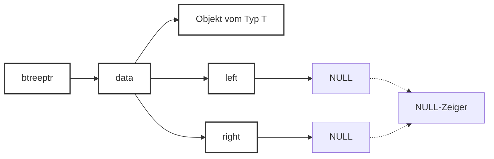
</details>

**264**

© T. Gemmeke, IDS, RWTH; R. Leupers, SSS

Binärbäume lassen sich leicht als **C-struct** implementieren. Ähnlich zu Listen verweist ein Zeiger “data” auf das im Knoten abzuspeichernde Nutzdatum. Daneben verweisen “left” und “right” auf die Kinder.

## 9. Bäume

9.1 Definition und Darstellung
**9.2 Baumdurchläufe**
9.3 Suchbäume

**265**

© T. Gemmeke, IDS, RWTH; R. Leupers, SSS

## Baumdurchläufe

Häufige Anwendung: **Durchlaufen** eines Baumes, d.h. Besuchen/Verarbeiten aller Knoten in bestimmter Reihenfolge
• Z.B. beim Kopieren von Dateisystemen
• Sei $B \; = \; ( r , B _ { L } , B _ { R } )$
• L bezeichnet Durchlauf des **linken** Teilbaums $B _ { L }$
• R bezeichnet Durchlauf des **rechten** Teilbaums $B _ { R }$
• W bezeichnet Bearbeitung der **Wurzel** 𝑟
Drei prinzipielle Durchlaufschemata:
– **Inorder**: L W R
– **Preorder**: W L R
– **Postorder**: L R W
• In/Pre/Post bzgl. des Zeitpunkts der Wurzel‐Bearbeitung

**266**

© T. Gemmeke, IDS, RWTH; R. Leupers, SSS

Die **Bezeichnung** eines Baumdurchlaufs richtet sich danach, zu welchem Zeitpunkt bzgl. des linken und des rechten Teilbaums die Wurzel besucht/verarbeitet wird, z.B. zwischen den Teilbäumen im Falle von Inorder.

Rekursive Implementierung der Durchläufe

```c
void visit(T* item)
{ // Verarbeitung von item
}

void preorder(btreeptr b)
{
    if (b == NULL) return;

    visit(b->data);
    preorder(b->left);
    preorder(b->right);
}

void inorder(btreeptr b)
{
    if (b == NULL) return;

    inorder(b->left);
    visit(b->data);
    inorder(b->right);
}
```

```c
void postorder(btreeptr b)
{
    if (b == NULL) return;

    postorder(b->left);
    postorder(b->right);
    visit(b->data);
}
```

Laufzeit: 𝓞ሺ# Knotenሻ
Interner Ablauf der Rekursion: **Laufzeit‐Stack** für Funktionsaufrufe (vgl. Kap. 8)
**Übung**: nicht‐rekursive Implementierung mittels expliziter Stack‐Datenstruktur

**267**

© T. Gemmeke, IDS, RWTH; R. Leupers, SSS

Die Funktion “visit” steht hier als **Platzhalter** für eine beliebige Funktion, welche ein Datum vom Typ T verarbeitet (z.B. Ausgabe des Datums).

Die Durchläufe selbst lassen sich aufgrund der Baumstruktur sehr leicht rekursiv implementieren. Ein **leerer Baum** soll dabei durch einen NULL-Zeiger repräsentiert werden, damit die Rekursion terminiert.

Eine Rekursion lässt sich prinzipiell immer auflösen, indem der implizite **Laufzeitstack** bei der C-Programmausführung durch einen **explizit programmierten Stack** ersetzt wird. Dies erfordert jedoch zusätzlichen Programmieraufwand, daher ist die Programmierung mittels Rekursion in der Regel die elegantere Variante.

## Beispiel: Inorder‐Durchlauf (L W R)


<details>
<summary>flowchart</summary>

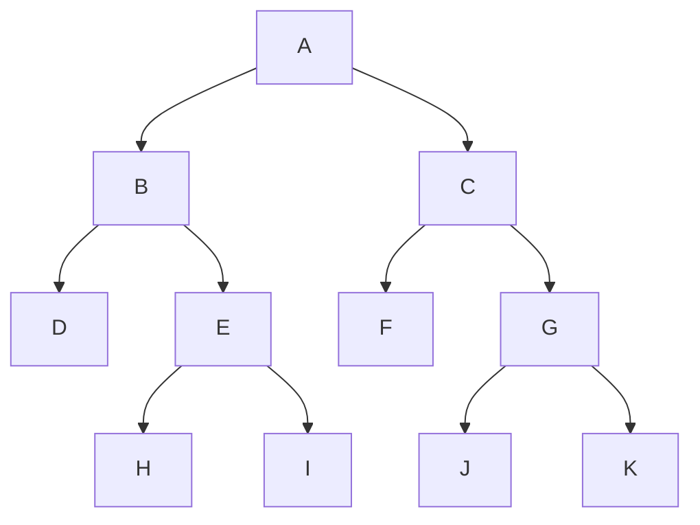
</details>

```c
void inorder(btreeptr b)
{
    if (b == NULL) return;
    inorder(b->left);
    visit(b->data);
    inorder(b->right);
}
```

• Inorder‐Reihenfolge:     D B H E I A F C J G K
• Preorder‐Reihenfolge:   A B D E H I C F G J K
• Postorder‐Reihenfolge: D H I E B F J K G C A

**268**

© T. Gemmeke, IDS, RWTH; R. Leupers, SSS

## 9. Bäume

9.1 Definition und Darstellung
9.2 Baumdurchläufe
**9.3 Suchbäume**

**269**

© T. Gemmeke, IDS, RWTH; R. Leupers, SSS

## Mengendarstellung durch Binärbäume

**Mengenoperationen** (vgl. Listen, Kap. 8): Einfügen, Löschen, Suchen (gemäß **Suchschlüssel** oder key), Schnitt, Vereinigung
In vielen Anwendungen insbes. schnelle Implementierung von **Einfügen, Löschen, Suchen** erforderlich
Beispiel: **Symboltabelle** im C‐Compiler

– Symboltabelle verwaltet **Informationen zu den Identifiern** (Variablen, Funktionen, etc.) eines Programms, z.B. Datentyp und Speicherbedarf
– **Variablendeklaration** für ID bewirkt **neuen Eintrag** in Symboltabelle mit Suchschlüssel ID
– **Variablenverwendung** bewirkt **Suchen** nach ID
– Variable **nicht mehr benötigt**: ID aus Symboltabelle **löschen**

**270**

© T. Gemmeke, IDS, RWTH; R. Leupers, SSS

Bei großen Datenmengen sind Listen zur **Mengenverwaltung** zu ineffizient. Da z.B. ein Compiler in der Regel sehr schnell arbeiten soll, benötigt er spezielle Datenstrukturen zur Verwaltung größerer Mengen von Objekten. Eine häufige Operation in einem Compiler ist bspw. das Suchen eines Variablennamens in der **Symboltabelle**. Anhand des gefundenen Objektes kann der Compiler dann Attribute wie den Datentyp bestimmen, was wiederum für die Codeerzeugung wichtig ist. Da ein Programm tausende von Variablen enthalten kann, muss diese Operation sehr effizient sein.

## Suchbäume

**Komplexität** der Mengenoperationen bei Listenimplementierung typischerweise 𝒪ሺ𝑁ሻ bei 𝑁 Elementen
• Zu **aufwendig** für häufigen Gebrauch
• Sortiertes Array: Suchen in Zeit 𝒪ሺlog 𝑁ሻ per **binärer Suche**, jedoch Einfügen und Löschen aufwendig
Binäre Suche: Berechnung eines **Entscheidungsbaums**, d.h. in jedem Schritt Verzweigung in linkes oder rechtes Teilarray
**Idee bei binären Suchbäumen**: Entscheidungsbaum als explizite Datenstruktur

**Def**.: Sei $B \; = \; ( r , B _ { L } , B _ { R } )$ ein Binärbaum und bezeichne keyሺ𝑛ሻ den Suchschlüssel für jeden Knoten 𝑛. 𝐵 heißt **Suchbaum**, falls gilt:

1. Für alle $n \in B _ { L } { : } \operatorname { k e y } ( n ) < \operatorname { k e y } ( r )$
2. Für alle $n \in B _ { R } : \operatorname { k e y } ( n ) > \operatorname { k e y } ( r )$
3. $B _ { L }$ und $B _ { R }$ sind Suchbäume

**271**

© T. Gemmeke, IDS, RWTH; R. Leupers, SSS

Der Datentyp **Suchbaum** ähnelt dem Konzept der binären Suche in sortierten Arrays. Alle Schlüssel im Suchbaum sind auf spezielle Weise angeordnet: links stehen alle Schlüssel die bzgl. der gegebenen **Ordnungsrelation** kleiner sind als die Wurzel, und rechts stehen alle größeren Schlüssel. Hierbei wird vorausgesetzt, dass bei den Daten kein **Mehrfachvorkommen** von Schlüsseln erlaubt ist.

Somit kann an jedem Punkt durch einen einfachen Vergleich festgestellt werden, in welchem Teilbaum die Suche fortgesetzt werden soll. Die Größe des noch zu untersuchenden Restbaumes **halbiert** sich dabei tendenziell in jedem Schritt.

## Beispiel

• Suchbaum für Monatsnamen, geordnet entsprechend der **lexikographischen** Reihenfolge:


<details>
<summary>flowchart</summary>

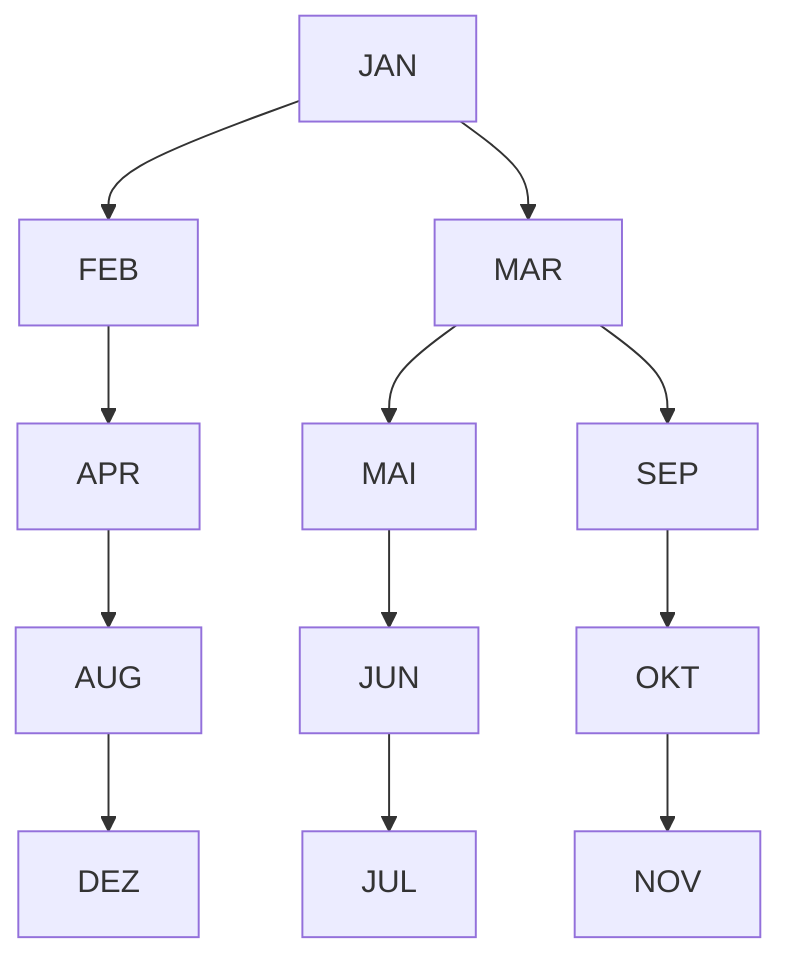
</details>

• **Übung**:

– Welcher Baum ergibt sich bei umgekehrter Reihenfolge?
– Wie kann man mittels Suchbäumen sortieren?

**272**

Der hier gezeigte Suchbaum ergibt sich durch Einfügen der Monatsnamen entsprechend der Reihenfolge das Jahresablaufes unter Verwendung der lexikographischen Ordnungsrelation.

Probieren Sie auch einmal andere **Einfügereihenfolgen** (z.B. direkt nach der lexikographischen Reihenfolge) aus. Man sieht, dass die Struktur des resultierenden Suchbaums erhebliche Unterschiede aufweisen kann.

Einfügen eines Elementes

```c
btreeptr insert(T* item, btreeptr b)
{
    btreeptr n;

    if (b == NULL) {
        n = (btreeptr)malloc(sizeof(btree));
        n->data = item;
        n->left = NULL; n->right = NULL;
        return n;
    }

    if (key(item) < key(b->data))
        b->left = insert(item,b->left);

    if (key(item) > key(b->data))
        b->right = insert(item,b->right);

    return b;
}
```


<details>
<summary>flowchart</summary>

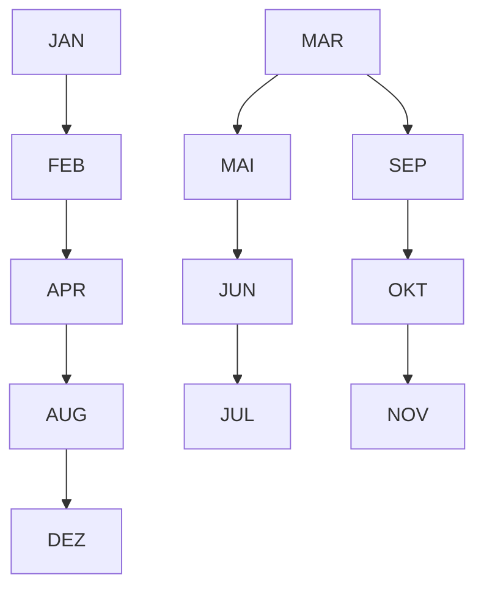
</details>

Beispiel: Einfügen von „DEZ“

**273**

© T. Gemmeke, IDS, RWTH; R. Leupers, SSS

Die **insert-Funktion** arbeitet folgendermaßen: Ist der gegebene Baum b leer, so wird ein neuer Knoten (mit NULL-Zeigern als Nachfolgern) erzeugt und als Ergebnisbaum zurückgegeben.

Ansonsten wird geprüft, ob das neue Element item in den linken oder den rechten Teilbaum gehört. Ist z.B. der linke der richtige, so wird der left-Zeiger des aktuellen Knotens b ersetzt durch den **Ergebnisbaum**, der sich beim Aufruf von insert für den linken Teilbaum ergibt. Dieser Ergebnisbaum besitzt dann das Element item als neues **Blatt** (d.h. Knoten auf unterster Ebene, ohne Nachfolger).

Man beachte, dass der Baum immer “nach unten” wächst, d.h. neue Elemente werden stets an **Blattpositionen** eingefügt.

## Suchen eines Elementes

```c
T* search(T* item, btreeptr b)
{
    if (b == NULL) return NULL;

    if (key(item) == key(b->data))
        return b->data;

    if (key(item) < key(b->data))
        return search(item,b->left);

    if (key(item) > key(b->data))
        return search(item,b->right);
}
```


<details>
<summary>flowchart</summary>

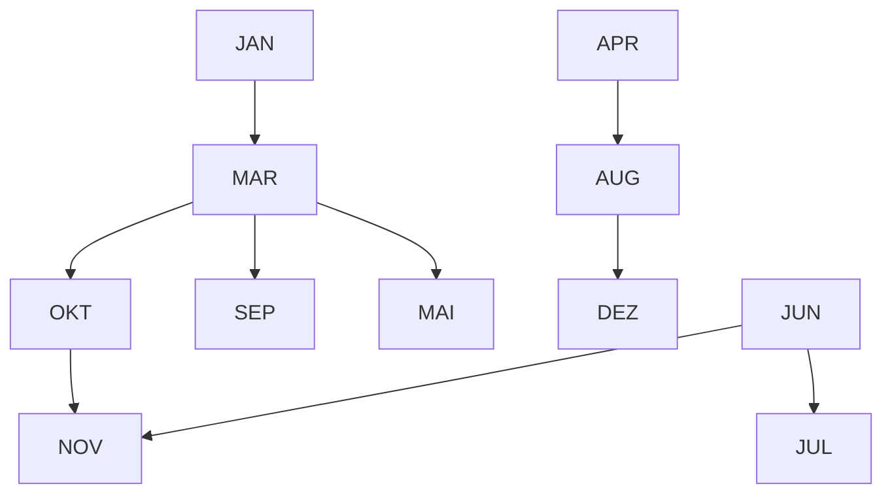
</details>

**Beispiel**: Suchen von „NOV“
**Aufwand**: Länge des Pfades von der Wurzel zum gesuchten Element (bzw. zu der Stelle, an der sich das Element befinden müsste)

**274**

© T. Gemmeke, IDS, RWTH; R. Leupers, SSS

Das Suchen im Suchbaum arbeitet völlig analog zur **binären Suche** in Arrays. Es können vier Fälle auftreten:

1. Der Baum b ist leer, dann war die Suche erfolglos, und es wird NULL als Ergebnis zurückgegeben.
2. Der aktuelle Knoten b entält das gesuchte Element.
3. Es ist im linken Teilbaum (rekursiv) weiterzusuchen.
4. Es ist im rechten Teilbaum (rekursiv) weiterzusuchen.

## Laufzeitanalyse für binäre Suchbäume

**Löschen eines Elementes**: gleiches Prinzip, jedoch etwas aufwendiger beim Löschen von inneren Baumknoten (Wiederherstellung der Baumstruktur notwendig)
• Aufwand bestimmt durch **max. Pfadlänge** im Baum
Diese ist wiederum bestimmt durch die **Reihenfolge** der Einfügeoperationen (siehe Bsp. Monatsnamen)
• Extremfälle:

**a) ausgeglichener Baum**: Höhe der Teilbäume unterscheidet sich max. um 1, auf jeder Ebene verdoppelt sich die Anzahl der Knoten, daher Suchzeit 𝒪ሺlog 𝑛ሻ bei n Knoten

**b) entarteter Baum**: wie Liste, d.h. 𝒪ሺ𝑛ሻ


<details>
<summary>flowchart</summary>

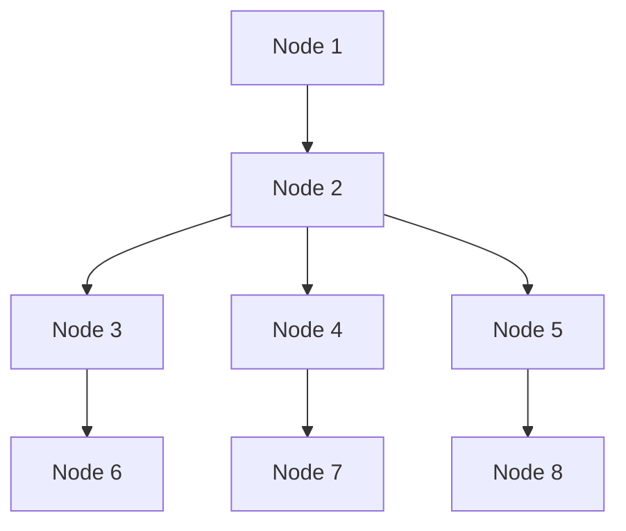
</details>


<details>
<summary>flowchart</summary>

```mermaid
graph LR
  A[""] --> B[""]
  B --> C[""]
  C --> D[""]
  D --> E[""]
```
</details>

**275**

© T. Gemmeke, IDS, RWTH; R. Leupers, SSS

Bei einem **ausgeglichenen** Suchbaum sind die Teilbäume optimal “ausbalanciert”, und es wird eine minimale Suchzeit garantiert.

Der worst case ist der **entartete** Baum, welcher im Wesentlichen die gleichen Eigenschaften wie eine lineare Liste aufweist.

## Laufzeitanalyse für binäre Suchbäume

Man kann zeigen: Bei einem aus **zufälligen Schlüsseln** aufgebauten binären Suchbaum liegt die Suchzeit im average case bei 𝒪ሺlog 𝑛ሻ
• **Jedoch**: nicht garantiert, worst case ist stets 𝒪ሺ𝑛ሻ
Ausgeglichene binäre Suchbäume (**AVL‐Bäume**): 𝒪ሺlog 𝑛ሻ worst case für Suchen, Einfügen, Löschen garantiert
• Weitere Suchbaumstrukturen für **spezielle Anwendungen**
• Z.B. Verwaltung großer Mengen in **externen Dateien** (Files)
– **Zugriffszeit** = Zeit für Positionierung im File + Zeit für Übertragung der Daten in den Hauptspeicher
– Daher Übertragung von großen **zusammenhängenden Datenblöcken** statt einzelner Knoten sinnvoll
– Datenstruktur: **B‐Bäume**

**276**

© T. Gemmeke, IDS, RWTH; R. Leupers, SSS

Bei **AVL-Bäumen** (benannt nach den Erfindern) wird durch einen geringen Zusatzaufwand beim Einfügen und Löschen einzelner Elemente sichergestellt, dass stets eine optimale Baumstruktur vorliegt. Dadurch wird der worst case ausgeschlossen.

Ist die Suchzeit in einer Datei nicht vernachlässigbar gegenüber der Zeit, die der eigentliche Datentransport benötigt, so sollte auf weiterentwickelte Datenstrukturen zurückgegriffen werden. Bei **B-Bäumen** kann statt in 2 Richtungen in k>2 Richtungen verzweigt werden. Jeder Knoten besteht aus einem ganzen Block von Einzelelementen. Hierdurch wird die Suche in Files insgesamt effizienter, da die externe Suchzeit (z.B. auf der Festplatte statt im Hauptspeicher) nicht so häufig anfällt wie bei binären Suchbäumen.

## 10. Graphen

## 10.1 Definition und Grapheigenschaften

10.2 Berechnung kürzester Pfade
10.3 Datenstrukturen zur Graphrepräsentation
10.4 Graphdurchläufe
10.5 Spannbäume

**277**

© T. Gemmeke, IDS, RWTH; R. Leupers, SSS

## Graphen

Graph: graphische Darstellung einer **Menge von Objekten und deren Beziehungen** (d.h. Relation)
• Bsp.: **topologische Information** einer Landkarte


<details>
<summary>flowchart</summary>

This image displays a map of Germany and its associated network diagram, illustrating the relationships between German states and their respective cities.
</details>

**278**

© T. Gemmeke, IDS, RWTH; R. Leupers, SSS

Das Beispiel zeigt, wie ein Graph abstrakte Information speichern kann. Ist man z.B. nur an der Frage interessiert, welche Bundesländer benachbart sind (aber nicht an der Länge und Gestalt der Grenzen), so genügt die **topologische Information**, d.h. die “Vernetzung” der Länder untereinander.

Diese wird durch den hier gezeigten Graphen erfasst. Jeder “**Knoten**” steht für ein Land, und jede “**Kante**” (Verbindung) zwischen zwei Ländern weist auf deren Nachbarschaft hin.

## Graphen

**Def**.: Eine (binäre) **Relation** 𝑅 ist eine Teilmenge des kartesischen Produktes zweier Mengen: $R \subseteq A   \times   B$

• Bei Graphen meist $R \subseteq A   \times   A$ für gegebene Menge 𝐴 ( $( \mathsf { K n o t e n } ^ { \prime \prime } )$
• $" aRb"$ als Schreibweise für $( a , b ) \in R ,$ “**Kante**” zwischen 𝑎 und 𝑏 im Graphen
• Spezialfall symmetrische Relation: $\mathsf { a R b } \Rightarrow \mathsf { b R a }$

**Def**.: Ein **(gerichteter) Graph** $G \; = \; ( V , E )$ besteht aus einer Menge 𝑉 von **Knoten** (vertices) und einer Menge 𝐸 von **Kanten** $( e d g e s )$ mit $E \subseteq V \times V .$

**Def**.: Gilt für alle Kanten $( u , v )$ eines Graphen $G \; = \; ( V , E )$ $(u,v) \in E \Rightarrow (v,u) \in E$ so heißt 𝐺 **ungerichtet**. **Schreibweise**: $\{ u , v \} \in E .$

**279**

© T. Gemmeke, IDS, RWTH; R. Leupers, SSS

Standardmäßig sind Graphen aufgrund des Relationsbegriffes **gerichtet**, d.h. die Kanten weisen in eine bestimmte Richtung. Graphisch werden die Kanten dann als Pfeil dargestellt.

Eine symmetrische Relation führt dagegen zu einem **ungerichteten** Graphen. Alle Kanten haben “beide” Richtungen, und werden daher nur als eine einzige richtungslose Kante gezeichnet.

## Pfade in Graphen

**Def**.: Eine Folge $( v _ { 1 } , \ldots , v _ { n } )$ von Knoten eines Graphen $G \; = \; ( V , E )$ heißt **Pfad**, falls für alle $i \; = \; 1 \ldots n - 1 \colon \{ v _ { i } , v _ { i + 1 } \} \in E .$

Bsp. Landkarte: Knoten = Bundesländer
**Ungerichteter Graph**, da Nachbarschafts‐Beziehung symmetrisch
• **Pfad** ${ \sf = { \sf , } { \sf R e i s e w e g } ^ { \prime \prime } }$ von einem Land in ein anderes
Im folgenden: Betrachtung **ungerichteter** Graphen


<details>
<summary>flowchart</summary>

This diagram illustrates a hierarchical classification or relationship structure among German states, with 'Nieders.' (National Living) being the most prominent category.
</details>

**280**

Ein Pfad ist eine **zusammenhängende Folge** von Knoten in einem Graphen. Zwei durch eine Kante verbundene Knoten heißen “adjazent”.

## Zusammenhang und Zyklen

**Def**.: Ein Graph 𝐺 ൌ ሺ𝑉, 𝐸ሻ heißt **zusammenhängend**, falls zwischen zwei beliebigen Knoten 𝑢, 𝑣  𝑉 mindestens ein Pfad existiert.

**Def**.: Ein Graph 𝐺 ൌ ሺ𝑉, 𝐸ሻ heißt **zyklenfrei**, falls zwischen zwei beliebigen Knoten 𝑢, 𝑣  𝑉 höchstens ein Pfad existiert.

• Bsp. Landkarte:

– zusammenhängend
– nicht zyklenfrei


<details>
<summary>flowchart</summary>

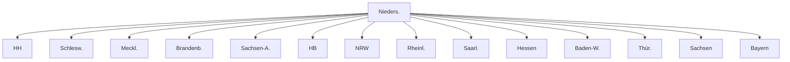
</details>

**281**

© T. Gemmeke, IDS, RWTH; R. Leupers, SSS

Im Beispiel bedeutet **zusammenhängend**, dass jedes Land von jedem anderen aus (evtl. über andere Länder) erreichbar ist. **Nicht zyklenfrei** bedeutet, dass es Rundreisen gibt.

## Graphen und Bäume, Kantengewichte

**Def**.: Ein zusammenhängender, zyklenfreier Graph $G = ( V , E )$ heißt **Baum**.


**Def**.: Ein Graph $G = ( V , E , w )$ mit einer Abbildung 𝑤: 𝐸 → ℝ heißt **(kanten)gewichteter Graph**.


<details>
<summary>flowchart</summary>

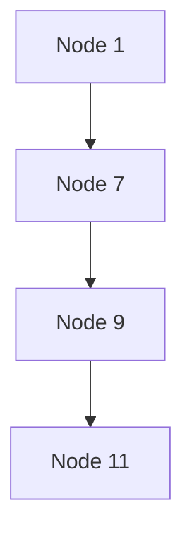
</details>

**282**

© T. Gemmeke, IDS, RWTH; R. Leupers, SSS

**Kantengewichte** werden z.B. verwendet, um Entfernungen zwischen zwei Knoten zu repräsentieren.

## 10. Graphen

10.1 Definition und Grapheigenschaften
**10.2 Berechnung kürzester Pfade**
10.3 Datenstrukturen zur Graphrepräsentation
10.4 Graphdurchläufe
10.5 Spannbäume

**283**

© T. Gemmeke, IDS, RWTH; R. Leupers, SSS

## Beispiel‐Anwendung: Navigationssystem


• **Knoten** = Geographische Orte
**Kanten** = Straßenverbindungen
• **Kantengewichte** = Länge bzw. Fahrtdauer
• **Gesucht**:

kürzester Pfad von 𝐴 nach 𝐵 gemäß Summe der Kantengewichte

**284**

© T. Gemmeke, IDS, RWTH; R. Leupers, SSS

Eine Teilfunktion eines **Navigationssystems** ist es, die kürzeste bzw. schnellste Verbindung zwischen zwei Orten über andere Orte zu bestimmen. Dabei sind geographische Einzelheiten zunächst belanglos, daher ist ein kantengewichteter Graph ein geeignetes Modell einer Strassenkarte.

Die **Kantengewichte** spiegeln dabei entweder direkt die Entfernung zweier Orte wider (falls die kürzeste Strecke gesucht ist), oder sie sind noch mit der zu erwartenden Durchschnittsgeschwindigkeit gewichtet (falls der schnellste Weg gewünscht ist). Z.B. können sich erhebliche Umwege lohnen, sofern man dann Autobahnen benutzen kann.

## Bestimmung kürzester Pfade

• **Dijkstra‐Algorithmus** (single source shortest path)
Bestimmung der kürzesten Pfade von einem Startknoten $v _ { 0 }$ aus zu allen anderen Graphknoten
• Idee:
– In jedem Schritt Betrachtung einer „**Nachbarschaft**“ 𝑁 von $v _ { 0 } ,$ innerhalb derer die kürzesten Pfade zu $v _ { 0 }$ bereits bekannt sind
– Schrittweise **Erweiterung von** 𝑵 um den jeweils am nächsten an 𝑁 liegenden Knoten


<details>
<summary>flowchart</summary>

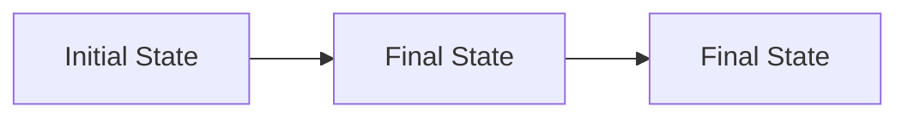
</details>

285

© T. Gemmeke, IDS, RWTH; R. Leupers, SSS

Der **Dijkstra-Algorithmus** findet alle kürzesten Wege von einem Startknoten aus gesehen auf einmal. Die Grundidee ist es, eine “Wellenausbreitung” (als ob man einen Stein am Startpunkt ins Wasser werfen würde) vom Startknoten aus vorzunehmen und dabei neue minimale Entfernungen vom Startknoten aus erreichter Knoten zu protokollieren.

## Ablauf des Dijkstra‐Algorithmus

**Bisher bekannter** min. Abstand dist(u,v) zwischen zwei Knoten kann durch neue Zwischenknoten **verkürzt** werden


<details>
<summary>flowchart</summary>

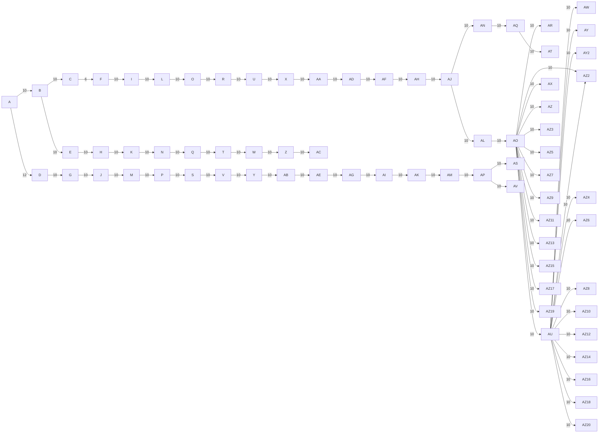
</details>

**Def**.: Ist 𝐺 ൌ ሺ𝑉, 𝐸ሻ ein Graph und ሼ𝑢, 𝑣ሽ  𝐸, so heißt 𝑣 **Nachfolger** von 𝑢, und 𝑢 heißt **Vorgänger** von 𝑣.


<details>
<summary>flowchart</summary>

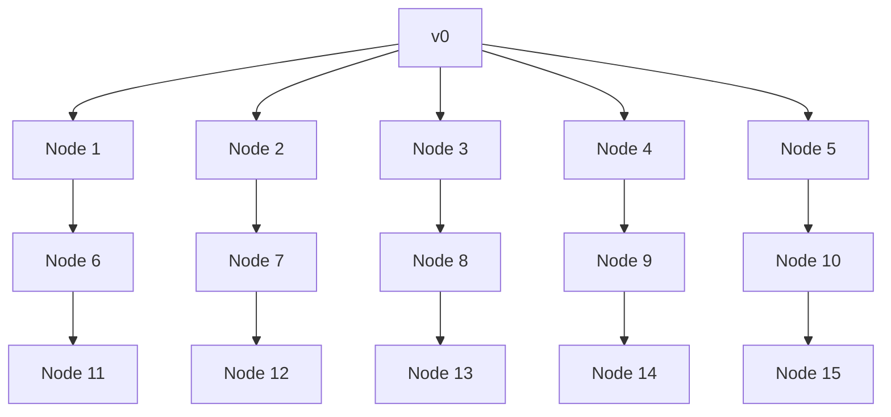
</details>

Graph G

bereits betrachteter Bereich


Alle Nachfolger bereits betrachtet


Nachfolger noch nicht betrachtet

Kürzeste Pfade von 𝑣଴ aus

© T. Gemmeke, IDS, RWTH; R. Leupers, SSS

Aufgrund der **Kantengewichte** kann es sinnvoll sein, “Umwege” über andere Knoten zu nehmen, um einen bestimmten Knoten mit minimalen Kosten zu erreichen. D.h. der Abstand eines Knotens vom Startknoten hängt nicht unmittelbar damit zusammen, wie viele Zwischenknoten besucht werden müssen.

Während der Abarbeitung des Algorithmus zerfällt der Graph in verschiedene **Regionen**: Der “blaue” Bereich, in dessen Zentrum der Startknoten liegt, wurde bereits vollständig abgearbeitet, und alle kürzesten Wege darin sind bekannt.

Der “grüne” Bereich bildet die Grenze von Knoten, die noch weiter untersucht werden müssen. Durch “orangene” Kanten werden jeweils die aktuell bekannten kürzesten Wege dargestellt.

Die Definition von **Vorgänger** und **Nachfolger** in ungerichteten Graphen ist natürlich “richtungslos”: Da für jede Kante (u,v) auch die Kante (v,u) in E enthalten ist, sind u und v gegenseitig Vorgänger und Nachfolger. Man könnte sie auch einfach als “Nachbarknoten” im Graphen definieren.

## Dijkstra‐Algorithmus

**Pseudo‐Code**: abstrakter Code für Algorithmus, nicht direkt compilier‐ und ausführbar!
Vorauss.: Datenstruktur für **Graphen** (graph) und **Mengen** (set) verfügbar
• graph unterstützt Zugriff auf Knoten und Kanten (s. später)
set unterstützt übliche Mengenoperationen
• Variablen:

– dist[v] bezeichnet den aktuell min. Abstand von Knoten 𝑣 zum Startknoten

– cost(u,v) bezeichnet Gewichtung der Kante ሼ𝑢, 𝑣ሽ

– Mengen **BLUE, GREEN und ORANGE** bezeichnen blaue und grüne Knoten sowie orangene Kanten

Orangene Kanten bilden stets einen **Baum von aktuell kürzesten Pfaden** vom Startknoten aus

**287**

© T. Gemmeke, IDS, RWTH; R. Leupers, SSS

Da der komplette Algorithmus als C-Code zu komplex zur Darstellung an dieser Stelle ist, greifen wir auf “**Pseudo-Code**” zurück. Hierunter versteht man eine Programmdarstellung, die nur die wesentlichen Schritte des Algorithmus abstrakt darstellt.

Programmdetails und die Implementierung der einzelnen benutzten Datenstrukturen werden als bekannt oder “leicht ergänzbar” vorausgesetzt. Die genaue Implementierung der Datenstruktur Graph wird jedoch erst etwas später erläutert.

Dijkstra‐Algorithmus

```txt
void shortest_path(graph G = (V = {v0,...,vn},E))
{
    set BLUE = {}, GREEN = {v0}, ORANGE = {}; dist[v0] = 0;

    while (GREEN != {}) { // solange noch unbearbeitete Knoten
        v = MinDist(GREEN); // v ∈ GREEN mit min. dist-Wert
        Insert(v, BLUE);   // BLUE = BLUE ∪ {v}
        Delete(v, GREEN);   // GREEN = GREEN \ {v}

        for (u ∈ Succ(v)) { // für alle Nachfolger u von v
            if (!(u ∈ GREEN ∪ BLUE)) { // neuer Knoten erreicht
                Insert({u,v}, ORANGE);
                Insert(u, GREEN);
                dist[u] = dist[v] + cost(u,v);
            } else if (u ∈ GREEN) {      // u erneut erreicht
                if (dist[v] + cost(u,v) < dist[u]) {
                    Insert({u,v}, ORANGE);
                    e = PreviousEdge(u);   // vorher orangene Kante zu u
                    Delete(e, ORANGE);     // ORANGE = ORANGE \ {e}
                    dist[u] = dist[v] + cost(u,v);
                }
            }
        }
    }
}
```

**288**

© T. Gemmeke, IDS, RWTH; R. Leupers, SSS

Der Algorithmus arbeitet in folgenden **Schritten**:

Zunächst werden die verwendeten Mengen initialisiert. Die äußere while-Schleife läuft dann solange, bis alle Knoten untersucht worden sind und somit alle kürzesten Pfade bestimmt sind.

Der Knoten v mit minimalem dist-Wert wird aus der GREEN-Menge in die BLUE überführt. Für diesen wird anschließend geprüft (indem alle Nachfolger betrachtet werden), ob er zu neuen kürzesten Wegen beitragen kann.

**Fall 1** (if): Der Knoten u wurde bisher noch gar nicht erreicht. Der kürzeste Weg zu u führt somit per Definition über v, und die Distanz wird entsprechend vermerkt.

**Fall 2** (else): u wurde bereits auf einem anderen Weg erreicht. Ist der neue Weg zu u über v kürzer als der bisher bekannte, so wird der Wert dist[u] entsprechend aktualisiert und die Menge der orangenen Kanten demzufolge angepasst.

Der Ablauf wird in den folgenden Folien am **Beispiel** verdeutlicht.