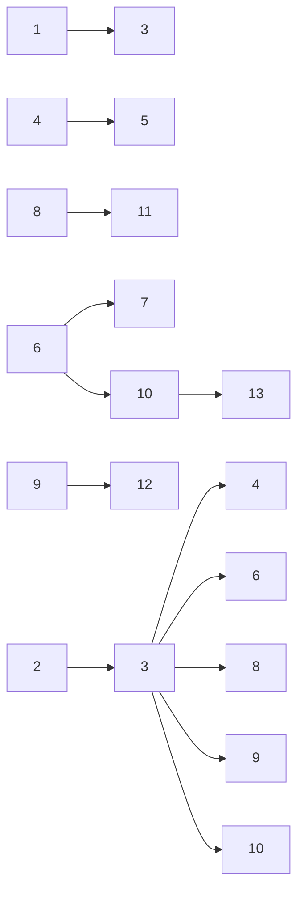
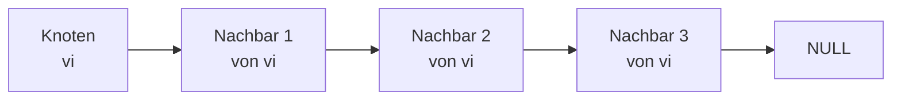
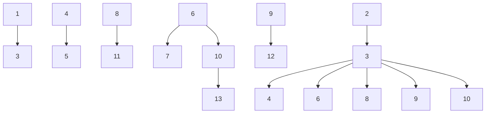
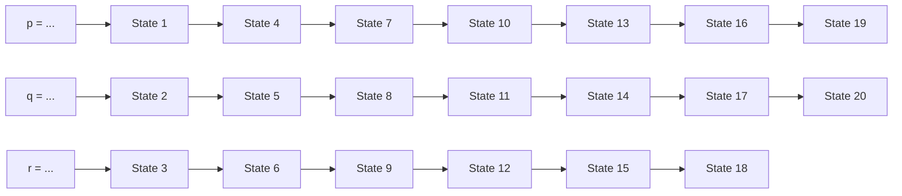
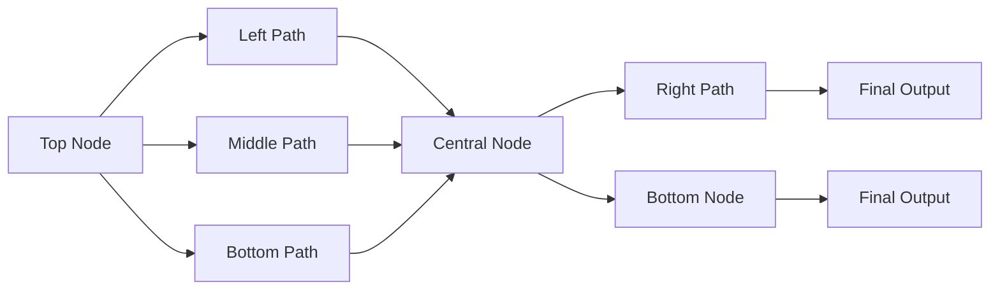
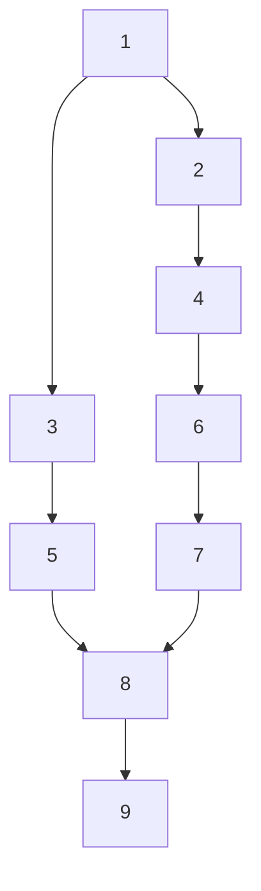
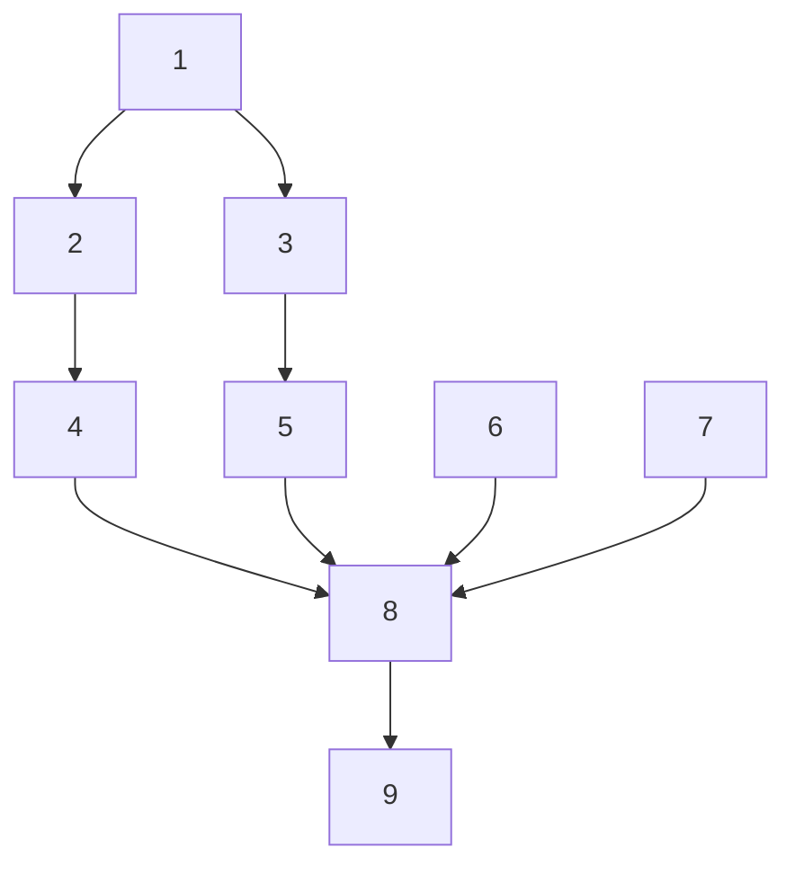
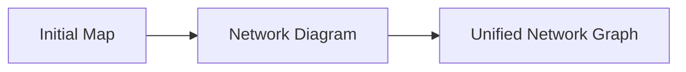
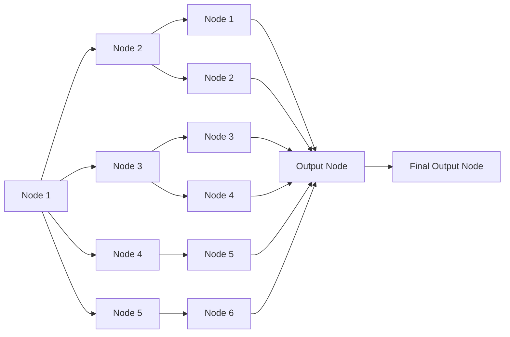

## Beispiel


**289**

© T. Gemmeke, IDS, RWTH; R. Leupers, SSS

Schritt 1: v0 ist Startknoten und wird dann zum ersten blauen Knoten.

Schritt 2: Die drei Nachfolger von v0 gelangen in die grüne Menge.

Schritt 3: Der mit 1 markierte Knoten besitzt den minimalen dist-Wert und wird daher zum nächsten blauen Knoten. Im folgenden werden die Knoten immer mit dem aktuell bekannten minimalen dist-Wert markiert.

Schritt 4: Zwei weitere Nachfolgerknoten gelangen in die grüne Menge und werden mit dist-Werten markiert.

Beispiel (Fortsetzung)


**290**

© T. Gemmeke, IDS, RWTH; R. Leupers, SSS

Schritt 1: Der mit 3 markierte Knoten wird der nächste blaue Knoten.

Schritt 2: Der linke mit 4 markierte Knoten wird der nächste blaue Knoten. Er besitzt aber keine weiteren Nachfolger mehr.

Schritt 3: Der rechte mit 4 markierte Knoten wird der nächste blaue Knoten.

Schritt 4: Seine Nachfolger werden erfasst und mit den dist-Werten 6 und 8 markiert. Der bereits mit 5 markierte Knoten ist zwar auch Nachfolger, er kann jedoch vom 4er-Knoten nur mit Distanz 2 erreicht werden (d.h. insges. mit Kosten 6) und behält daher seine alte Markierung.

Beispiel (Fortsetzung)


**291**

© T. Gemmeke, IDS, RWTH; R. Leupers, SSS

Schritt 1: Der mit 5 markierte Knoten weist aktuell den minimalen dist-Wert in der grünen Menge auf und wird daher zum blauen Knoten.

Schritt 2: Die Nachfolger gelangen in die grüne Menge und werden markiert.

Schritt 3: Der mit 6 markierte Knoten wird zum blauen Knoten.

Schritt 4: Die beiden bisher unerreichten Nachfolger von Knoten 6 werden erfasst.

Beispiel (Fortsetzung)


**292**

© T. Gemmeke, IDS, RWTH; R. Leupers, SSS

Schritt 1: Der linke 7er-Knoten wird (willkürlich, da es noch zwei weitere 7er-Knoten gibt) der nächste blaue Knoten.

Schritt 2: Der bisher mit 10 markierte Knoten erhält die neue Markierung 8, da über den 7er-Knoten ein neuer minimaler Weg gefunden wurde.

Schritt 3: Der mittlere 7er-Knoten wird zum blauen Knoten.

Schritt 4: Der rechte 7er-Knoten wird zum blauen Knoten.

## Beispiel (Fortsetzung), Laufzeit


• In jedem Durchlauf der while**‐Schleife** wird ein Knoten $\mathsf { , b l a u ^ { \prime \prime } }$
• Aufwand **für jeden Knoten**:

– Bestimmung des bzgl. dist min. $\mathsf { { \mathsf { { \mathsf { { \mathsf { { \mathsf { { \mathsf { { \mathsf { { \mathsf { { \mathsf { { \mathsf { } { \mathsf { } { \mathsf { } { \mathsf { \mathsf { { \mathsf { } { \mathsf { } } { \mathsf { } { \mathsf { \mathsf { } { \mathsf { } { \mathsf { } } { \mathsf { \mathsf { } { \mathsf { } } { \mathsf { \mathsf { } { \mathsf { } } { \mathsf { } } { \mathsf { \mathsf { } } { \mathsf { \mathsf { } } { \mathsf { } \mathsf { } } { \mathsf { \mathsf { } } \mathsf { } } { \mathsf { \mathsf { } \mathsf { } } \mathsf { } \mathsf { } \mathsf { } \mathsf { } \mathsf { } \mathsf { } \mathsf { } \mathsf { } \mathsf { } \mathsf } } \mathsf { \mathsf { } \mathsf { } \mathsf } } \mathsf { \mathsf { } \mathsf } } \mathsf { \mathsf } } \mathsf { \mathsf } } \mathsf { \mathsf } } \mathsf } } } } } } } } } } } } } } { } } } } } } } \mathsf { { } } } \mathsf { { } } } \mathsf { { } } \mathsf { } } \mathsf { { } } \mathsf{ { } } \mathsf{ } \mathsf{ } } \mathsf{ { } } \mathsf{ } \mathsf{ } \mathsf{ } \mathsf{ } \mathsf{ } \mathsf{ } \mathsf{ } \mathsf{ } }$ Knotens: $\mathcal { O } ( | V | )$
– Behandlung aller $\mathcal { O } ( | V | )$ Nachfolger: jeweils $\mathcal { O } ( 1 )$

• Gesamt: $\mathcal { O } \big ( | V | ^ { 2 } \big )$
• **Geschicktere** Implementierung möglich: $\mathcal { O } ( | E | \log \lvert V \rvert )$ , d.h. besser im Fall $| E | \ll | V | ^ { 2 }$ ( 𝐸 stets beschränkt durch $| V | ^ { 2 } )$

**293**

© T. Gemmeke, IDS, RWTH; R. Leupers, SSS

Schritt 1: Der rechte bisher mit 10 markierte Knoten erhält die Markierung 9, da er vom rechten 7er-Knoten mit Distanz 2 erreichbar ist

Schritt 2 etc.: Die übrigen Knoten gelangen letztlich auch in die blaue Menge, wodurch sich aber keine neuen kürzesten Wege mehr ergeben

Man versuche die **Aufwandsanalyse** für den einfachen Fall $\mathrm { O } ( | \mathrm { V } | ^ { 2 } )$ am Pseudocode nachzuvollziehen.

Da ein Graph nie mehr als $| \mathbf { V } | ^ { 2 }$ Kanten haben kann, wird die u.g. “geschicktere” Implementierung (ohne nähere Erläuterung hier) meist schneller zum Ergebnis führen.

## 10. Graphen

10.1 Definition und Grapheigenschaften
10.2 Berechnung kürzester Pfade
**10.3 Datenstrukturen zur Graphrepräsentation**
10.4 Graphdurchläufe
10.5 Spannbäume

**294**

© T. Gemmeke, IDS, RWTH; R. Leupers, SSS

## Graphrepräsentation

Datenstrukturen zur **internen Speicherung** von Graphen
• Gebräuchlich vor allem: **Adjazenzmatrix** und **Adjazenzlisten**
• Existiert zwischen zwei Graphknoten 𝑢 und 𝑣 eine Kante $e \; = \; \{ u , v \}$ , so heißen 𝑢 und 𝑣 **adjazent**

**Def**.: Ist $G \; = \; ( V , E )$ ein Graph mit Knotenmenge $V   =   \{ v _ { 1 } , \ldots , v _ { n } \} ,$ so heißt die $( n \times n ) \mathrm { - } \mathsf { M a t r i x }   A \; = \; ( a _ { i j } )$ mit

$$
a _ {i j} = 1, \text {falls} \{v _ {i}, v _ {j} \} \in E
$$

$$
a _ {i j} = 0, \text {sonst}
$$

**Adjazenzmatrix** zu 𝐺.

• $a _ { i j } = 1$ zeigt an, dass zwischen zwei Knoten $v _ { i }$ und $v _ { j }$ **e**ine Kante existiert
• $a _ { i j } = 0$ zeigt an, dass **keine Kante** vorhanden ist
• Knoten werden **implizit** gespeichert

**295**

© T. Gemmeke, IDS, RWTH; R. Leupers, SSS

Graphen auf dem Papier zu zeichnen ist sehr intuitiv, aber wie werden Graphen als **Datenstruktur** zur Verarbeitung durch ein Programm am besten intern gespeichert?

Eine Methode besteht darin, anzugeben welche Knotenpaare durch eine Kante verbunden (adjazent) sind. Hierfür genügt ein Bit pro Paar (1 = verbunden, $0 =$ nicht verbunden), was dann unmittelbar zur **Adjazenzmatrix** führt.

Die Knoten werden dabei gar nicht explizit gespeichert: Die Adjazenzmatrix ist ein **zweidimensionales Array**, und durch die Anzahl der Zeilen bzw. Spalten ist klar, wieviele Knoten vorhanden sind. Natürlich können bei Bedarf noch weitere Informationen über die Knoten (z.B. Markierungen) noch anderweitig separat gespeichert werden.

**Übung**: Wie könnte man bei der Darstellung von ungerichteten Graphen (anstelle von gerichteten) Platz in der Adjazenzmatrix sparen?

## Beispiel für Adjazenzmatrix


<details>
<summary>flowchart</summary>


</details>

|  | 1 | 2 | 3 | 4 | 5 | 6 | 7 | 8 | 9 | 10 | 11 | 12 | 13 |
| --- | --- | --- | --- | --- | --- | --- | --- | --- | --- | --- | --- | --- | --- |
| 1 | 0 | 1 | 1 | 0 | 0 | 0 | 0 | 0 | 0 | 0 | 0 | 0 | 0 |
| 2 | 1 | 0 | 1 | 0 | 0 | 0 | 0 | 0 | 0 | 0 | 0 | 0 | 0 |
| 3 | 1 | 1 | 0 | 1 | 0 | 1 | 0 | 0 | 1 | 1 | 0 | 0 | 0 |
| 4 | 0 | 0 | 1 | 0 | 0 | 1 | 0 | 0 | 0 | 0 | 0 | 0 | 0 |
| 5 | 0 | 0 | 0 | 0 | 0 | 1 | 1 | 0 | 0 | 0 | 0 | 0 | 0 |
| 6 | 0 | 0 | 1 | 1 | 1 | 0 | 1 | 0 | 0 | 1 | 0 | 0 | 0 |
| 7 | 0 | 0 | 0 | 0 | 1 | 1 | 0 | 0 | 0 | 0 | 0 | 0 | 0 |
| 8 | 0 | 0 | 0 | 0 | 0 | 0 | 0 | 0 | 1 | 0 | 1 | 0 | 0 |
| 9 | 0 | 0 | 1 | 0 | 0 | 0 | 0 | 1 | 0 | 0 | 0 | 1 | 0 |
| 10 | 0 | 0 | 1 | 0 | 0 | 1 | 0 | 0 | 0 | 0 | 0 | 1 | 1 |
| 11 | 0 | 0 | 0 | 0 | 0 | 0 | 0 | 1 | 0 | 0 | 0 | 1 | 0 |
| 12 | 0 | 0 | 0 | 0 | 0 | 0 | 0 | 0 | 1 | 1 | 1 | 0 | 0 |
| 13 | 0 | 0 | 0 | 0 | 0 | 0 | 0 | 0 | 0 | 1 | 0 | 0 | 0 |

## • Bei kantengewichteten Graphen:

– Kantengewicht statt 0/1 in Matrix eintragen
– spezieller Wert (z.B. ∞), falls keine Kante vorhanden

**296**

© T. Gemmeke, IDS, RWTH; R. Leupers, SSS

## Eigenschaften und Implementierung

• **Vorteil**: Adjazenz zweier Knoten kann in Zeit 𝓞ሺ𝟏ሻ geprüft werden
• **Nachteil**: Hoher Platzbedarf $( \mathcal { O } ( | V | ^ { 2 } ) )$ , unabhängig von 𝐸
C‐Implementierung:

```c
#define N 100

int adj_matrix[N][N];

int adjacent(int i, int j)
{
    return adj_matrix[i][j] == 1 ? 1 : 0;
}
```

**Bedingter Ausdruck** in C:
Bedingung $_ { \nu } 2 ^ { \prime \prime }$ then‐Ausdruck „:“ else‐Ausdruck
• Kürzere Schreibweise als if-then-else

**297**

© T. Gemmeke, IDS, RWTH; R. Leupers, SSS

Der **Adjazenztest** geht in O(1), da der Arrayzugriff in einem Schritt erfolgen kann.

Jedoch führt die Adjazenzmatrix oft zur **Platzverschwendung**: Sind nur wenige Kanten im Graphen vorhanden, so besteht sie fast nur aus 0en. Besser wäre es dann offenbar, die (nur wenigen) Kanten explizit zu speichern.

Die C-Implementierung der Adjazenzmatrix ist denkbar einfach. Hier wird auch ein neues C-Sprachelement eingeführt: Möchte man einem bestimmten Objekt einen Wert in Abhängigkeit von einer Bedingung zuweisen, so spart der **bedingte Ausdruck** etwas Schreibarbeit.

Das Gegenstück zur gezeigten Implementierung von “adjacent” wäre dann unter expliziter Verwendung von if-else:

else return 0;

## Adjazenzlisten

• Für jeden Knoten **Liste seiner Nachbarn** speichern
• **Array** von verketteten **Listen**


<details>
<summary>flowchart</summary>


</details>


<details>
<summary>flowchart</summary>


</details>

**1:  2, 3**
**2:  1, 3**
**3:  1, 2, 4, 6, 9, 10**
**4:  3, 6**
**5:  6, 7**
**6:  3, 4, 5, 7, 10**
**7:  5, 6**
**8:  9, 11**
**9:  3, 8, 12**
**10: 3, 6, 12, 13**
**11: 8, 12**
**12: 9, 10, 11**
**13: 10**

© T. Gemmeke, IDS, RWTH; R. Leupers, SSS

Eine Alternative zur Adjazenzmatrix bilden **Adjazenzlisten**. Bei dieser Datenstruktur werden nur die Graphkanten explizit abgespeichert. Jeder Knoten besitzt eine Liste seiner Nachbarn. Sind nur wenige Kanten vorhanden, so kann dies erheblich Platz sparen.

## Eigenschaften und Implementierung

• **Vorteil**: Speicherplatzbedarf nur 𝒪ሺ 𝑉 ൅ 𝐸 ሻ
• **Nachteil**: Test auf Adjazenz erfordert im worst case 𝒪ሺ 𝑉 ሻ

```c
#define N 100

List adj_list[N];

int adjacent(int i, int j)
{
    List L;

    L = adj_list[i];
    return IsIn(j, L);
}
```

• Auch **Mischformen** und **alternative Graphrepräsentationen** möglich
Auswahl je nach **Häufigkeit** der gewünschten Graphoperationen

**299**

© T. Gemmeke, IDS, RWTH; R. Leupers, SSS

Die Auswahl zwischen Adjazenzmatrix und Adjazenzlisten muss sich (wie bei allen anderen Datenstrukturen auch) nach den **Anforderungen der Operationen** richten. Steht z.B. die Minimierung des Speicherplatzes im Vordergrund, so sind Adjazenzlisten oft die bessere Wahl. Die Platzersparnis erkauft man sich jedoch mit einem höheren Aufwand beim Adjazenztest.

## 10. Graphen

10.1 Definition und Grapheigenschaften
10.2 Berechnung kürzester Pfade
10.3 Datenstrukturen zur Graphrepräsentation
**10.4 Graphdurchläufe**
10.5 Spannbäume

**300**

© T. Gemmeke, IDS, RWTH; R. Leupers, SSS

## Graphdurchläufe

**Gesucht**: Algorithmus, der alle Knoten eines Graphen der Reihe nach „besucht“
• Anwendungen u.a.:
– Systematisches **Bearbeiten** aller Graphknoten
– Prüfen ob Graph **zusammenhängend** ist
Beispiel: **garbage collection**
Aufsammeln und Freigabe von nicht mehr benötigtem dynamisch angeforderten Heap‐Speicher (garbage)
• Als **Graph‐Modell**:
– Speicherblöcke = Knoten
– Verweis (Zeiger) auf Speicherblock = Kante
**Idee**: Block von Programmvariablen aus nicht mehr erreichbar → Block nicht mehr benötigt, daher Freigabe

**301**

© T. Gemmeke, IDS, RWTH; R. Leupers, SSS

Graphdurchläufe werden häufig benötigt. Für den **Zusammenhangstest** bspw. beginnt man den Durchlauf an einem beliebigen Knoten. Werden dann im Durchlauf letztlich alle Knoten erreicht, so ist der Graph offensichtlich zusammenhängend.

Die Notwendigkeit zur **garbage collection** (Müllabfuhr) ergibt sich aus der fortwährenden Anforderung und Wiederfreigabe von Speicherblöcken auf dem Heap. Ein Programm “weiss” nicht, ob ein bestimmter Speicherblock später noch benötigt wird. Spätestens wenn der Heapspeicher knapp wird, sollte eine garbage collection durchgeführt werden, um nicht mehr benötigten Speicher wieder freizugeben.

Ein Speicherblock kann sicher dann als nicht mehr benötigt angesehen werden, **wenn es keinen Zeiger mehr gibt, der auf den Block verweist**. Der Block ist dann nicht mehr zugreifbar und somit offenbar überflüssig.

Es genügt jedoch nicht, die statischen im Programm selbst deklarierten Zeigervariablen zu betrachten, da sich Zeiger auch häufig auf dem Heap selbst befinden (z.B. bei Listen). Vielmehr muss geprüft werden, welche Speicherblöcke von Zeigervariablen aus erreichbar sind, welche dann wiederum indirekt über diese Blöcke erreichbar sind, usw.

## Entstehung von garbage


Blöcke 1 und 2 anschließend **nicht mehr erreichbar**
Jedoch nicht als $\mathrm { , f r e i ^ { \prime \prime } }$ markiert, da nicht mittels free explizit **freigegeben**
Falls malloc irgendwann im Programmverlauf **keinen freien Speicherplatz** mehr liefert, so muss eine garbage collection durchgeführt werden
• **Besserer Programmierstil**: immer Verwendung von free

© T. Gemmeke, IDS, RWTH; R. Leupers, SSS

Das einfache Beispiel zeigt, wie **garbage** entstehen kann. Da die zuerst an p und q zugewiesenen Speicherblöcke nicht freigegeben wurden, sind sie nach der zweiten Zuweisung an p und q nicht mehr erreichbar.

## Garbage collection

Im Programm deklarierte Zeigervariablen


<details>
<summary>flowchart</summary>


</details>


<details>
<summary>flowchart</summary>


</details>

Nicht erreichte Knoten freigeben

**303**

© T. Gemmeke, IDS, RWTH; R. Leupers, SSS

Die Idee ist es, einen **Graphdurchlauf** ausgehend von den deklarierten Zeigervariablen aus durchzuführen. Zu Anfang werden alle Speicherblöcke als “nicht mehr benötigt” angesehen. Sind Blöcke jedoch noch (direkt oder indirekt) über Zeiger erreichbar, so werden sie als “noch benötigt” markiert. Alle übrigen Blöcke können dann freigegeben werden.

## Graphdurchläufe

• Prinzipiell zwei Möglichkeiten für Graphdurchlauf:

– **Depth First Search** (DFS, **Tiefensuche**): ausgehend vom Startknoten möglichst lange Pfade verfolgen, oder
– **Breadth First Search** (BFS, **Breitensuche**): ausgehend vom Startknoten weitere Knoten in der Reihenfolge wachsenden Abstands vom Startpunkt besuchen


<details>
<summary>flowchart</summary>


</details>

DFS

1

2

4

8

5

6

3

7

9


<details>
<summary>flowchart</summary>


</details>

BFS

1

2

3

4

5

6

7

8

9

**304**

© T. Gemmeke, IDS, RWTH; R. Leupers, SSS

Beim **DFS** ist die Idee, einen Pfad möglichst lange “in die Tiefe” zu verfolgen. Beim **BFS** dagegen versucht man, alle Pfade gleichmäßig (ebenenweise, also zunächst “in der Breite”) abzuarbeiten.

## DFS ‐ Depth first search

• Algorithmus als **Pseudo‐Code**
• Vorauss.:

– Graphimplementierung verfügbar
– Knoten durch integer‐Zahlen identifiziert

```c
int visited[N]; // implizit mit 0 initialisiert

void dfs(int v) // DFS beginnend bei v
{ int w;
  visited[v] = 1; // markiere v als besucht
  process(v);      // Verarbeitung von v
  for ({v,w} ∈ E) // für alle Nachbarn w
  { // rekursiver Aufruf von dfs:
    if (!visited[w]) dfs(w);
  }
}

int main(void)
{
  int v;
  for (v = 0; v < N; v++)
    if (!visited[v]) dfs(v);

  return 0;
}
```

**305**

© T. Gemmeke, IDS, RWTH; R. Leupers, SSS

Der DFS-Durchlauf wird durch die main-Funktion ausgelöst. Für einen gegebenen Knoten v übernimmt dann die Funktion dfs die Tiefensuche.

v wird als besucht markiert und auf irgendeine Weise verarbeitet (process).

Anschließend werden die Nachfolger von v besucht. Durch die **Rekursion** wird die gewünschte DFS-Reihenfolge sichergestellt.

Ist der Graph **zusammenhängend**, so genügt ein einziger dfs-Aufruf von main aus, um alle Knoten zu erreichen. Andernfalls werden weitere Teile des Graphen erst durch weitere gezielte Aufrufe erreicht. Daher muss die main-Funktion einen dfs-Aufruf für alle Knoten v starten.

In BFS werden die Knoten „ebenenweise“besucht
Verwendung einer **Queue** (Kap. 8)
Queue speichert **noch zu bearbeitende Knoten auf nächster Ebene**, während „Geschwisterknoten“auf selber Ebene gerade bearbeitet werden

BFS – Breadth First Search

```c
int visited[N];

void bfs(int v) // BFS ab Knoten v
{
    int w; Queue Q;
    visited[v] = 1;
    process(v);
    Put(v,Q);
    while (!IsEmpty(Q)) {
        v = Get(Q);
        for ({v,w} ∈ E) {
            if (!visited[w]) {
                visited[w] = 1;
                process(w);
                Put(w,Q);
            }
        }
    }
}

void main()
{
    int v;
    for (v = 0; v < N; v++)
        if (!visited[v]) bfs(v);
}
```

**306**

© T. Gemmeke, IDS, RWTH; R. Leupers, SSS

Beim BFS-Durchlauf kommt die bereits bekannte **Queue-Datenstruktur** zum Einsatz. Die Steuerung von main aus erfolgt wie beim DFS. Durch das Einfügen verarbeiteter Knoten in die Queue wird jedoch sichergestellt, dass der Graph “ebenenweise” abgearbeitet wird.

## Laufzeitanalyse

Annahme: Graphdarstellung als **Adjazenzlisten**
**DFS**:
– Aufruf für alle Knoten aus main: 𝒪ሺ 𝑉 ሻ
– Einmalige Bearbeitung aller Kanten in for: 𝒪ሺ 𝐸 ሻ
– **Gesamt**: 𝒪ሺ 𝑉 ൅ 𝐸 ሻ

**BFS**

– Aufruf für alle Knoten aus main, jeder Knoten einmal in der Queue: 𝒪ሺ 𝑉 ሻ

– Einmalige Bearbeitung aller Kanten in for: 𝒪ሺ 𝐸 ሻ

– **Gesamt**: 𝒪ሺ|𝑉| ൅ 𝐸 ሻ

```txt
void dfs(int v)
{
    int w;
    visited[v] = 1;
    process(v);
    for ({v,w} ∈ E) {
        if (!visited[w]) dfs(w);
    }
}
```

```txt
void bfs(int v)
{
    int w; Queue Q;
    visited[v] = 1;
    process(v);
    Put(v,Q);
    while (!IsEmpty(Q)) {
        v = Get(Q);
        for ({v,w} ∈ E) {
            if (!visited[w]) {
                visited[w] = 1;
                process(w);
                Put(w,Q);
            }
        }
    }
}
```

**307**

© T. Gemmeke, IDS, RWTH; R. Leupers, SSS

Die **Laufzeitanalyse** ist in diesem Fall sehr einfach, und wie man sieht unterscheiden sich DFS und BFS nicht in der Effizienz, sondern nur im Ergebnis der Durchlaufreihenfolge. Bei der Queue wird natürlich vorausgesetzt, dass Put und Get in jeweils O(1) erfolgen.

## 10. Graphen

10.1 Definition und Grapheigenschaften
10.2 Berechnung kürzester Pfade
10.3 Datenstrukturen zur Graphrepräsentation
10.4 Graphdurchläufe
**10.5 Spannbäume**

**308**

© T. Gemmeke, IDS, RWTH; R. Leupers, SSS

## Spannbäume

Anwendung: z.B. **Leitungsplanung** zur Elektrifizierung entlegener Ortschaften
• **Graphmodellierung**:
– Ortschaften = Knoten
– Entfernungsmaß = Kantengewichte
Zur **Vernetzung** müssen nicht alle möglichen Leitungen realisiert werden, es müssen nur alle Knoten erreicht werden
• Mit **möglichst geringen** Gesamt‐Leitungskosten


<details>
<summary>flowchart</summary>


</details>

**309**

© T. Gemmeke, IDS, RWTH; R. Leupers, SSS

Ein **Spannbaum** dient dazu, alle Knoten in einem Graphen miteinander zu verbinden. Häufig wird ein Gesamtnetz mit kürzestmöglichen Verbindungen gesucht, z.B. um Leitungskosten zu minimieren. Wiederum spielt die genaue Geographie keine Rolle, so dass z.B. ein Graphmodell einer Landschaft ausreicht. Die Kantengewichte spiegeln dann neben den Entfernungen z.B. auch Landschaftsmerkmale wieder (z.B. ob Hindernisse wie Flüsse oder Berge zu überwinden sind).

## Minimale Spannbäume

**Def**.: Ein **Spannbaum** in einem ungerichteten, zusammenhängenden und kantengewichteten Graphen $G \; = \; ( V , E , w )$ ist ein zyklenfreier, zusammenhängender Teilgraph $G ^ { \prime } = ( V ^ { \prime } , E ^ { \prime } , w )$ mit $V ^ { \prime } = V$ und $E ^ { \prime } \subseteq E$

**Def**.: Ein **minimaler Spannbaum** in einem ungerichteten, zusammenhängenden und kantengewichteten Graphen $G = ( V , E , w )$ ist ein Spannbaum mit minimaler Kantengewichtssumme unter allen Spannbäumen zu 𝐺.


<details>
<summary>flowchart</summary>


</details>

Der **Spannbaum** umfasst gemäß Definition alle Knoten eines Graphen und bedient sich zur Vernetzung der Knoten einer Teilmenge der Kantenmenge E. Analog zum minimalen kann man auch einen **maximalen** Spannbaum definieren. Das **Beispiel** zeigt einen Graphen und einen dazugehörigen minimalen Spannbaum (gibt es noch weitere?)

## Kruskal‐Algorithmus

## Idee:

fortgesetzte Auswahl von Kanten mit geringem Gewicht – dabei Zyklen vermeiden

1. Beginne mit **leerem** Spannbaum 𝑇
2. Bilde Liste 𝐿 der Graphkanten von 𝐺, **sortiert nach aufsteigendem Gewicht** (s. Sortieralgorithmen)
3. Betrachte jeweils **nächstgrößere** Kante 𝑒 in 𝐿
4. Falls Einfügen von 𝑒 in 𝑇 einen **Zyklus** verursachen würde: 𝑒 als ungültig betrachten und verwerfen
5. Sonst: 𝑒 in 𝑇 **einfügen**
6. Fortsetzen ab 3, bis 𝑇 insgesamt 𝒏 െ 𝟏 **Kanten** enthält
𝑇 bildet dann einen **minimalen Spannbaum** zu 𝐺

**311**

© T. Gemmeke, IDS, RWTH; R. Leupers, SSS

Für das Spannbaumproblem sind effiziente Algorithmen bekannt. Einer davon ist der **Kruskal-Algorithmus**.

Es handelt sich um einen **Greedy-Algorithmus** (greedy = gierig, siehe auch Kap. 11). Dies bedeutet, dass keine globale Suche nach der optimalen Lösung stattfindet, sondern in jeder Situation immer die nächstbeste Verbesserung gewählt wird.

Im Falle der **Spannbaumkonstruktion** besteht das “gierige” Vorgehen darin, immer die nächste Kante mit geringstem Gewicht zu betrachten. Ist diese gültig, so wird sie den bisherigen (Teil-)Spannbaum hinzugefügt.

Greedy-Algorithmen sind häufig **Heuristiken**, d.h. sie liefern auf der Basis bestimmter einfacher Regeln zur Vorgehensweise meist (aber nicht garantiert) eine gute bis optimale Lösung. Der Kruskal-Algorithmus ist jedoch ein Spezialfall eines Greedy-Algorithmus, der immer die optimale Lösung findet.

Kruskal‐Algorithmus

```txt
Graph MinSpanningTree(Graph G = (V,E))
{
    Graph T; List L; Edge e;
    T = {};
    L = Sort(E); // sortierte Kantenliste

    while (#Kanten in T < #Knoten in G - 1 && !IsEmpty(L)) {
        e = FirstElem(L); // nächst-günstigste Kante
        Delete(e,L);
        if (!Cycle(e,T)) { // kein Zyklus in T ∪ {e} ?
            T = T ∪ {e};
        }
    }

    if (#Kanten in T < #Knoten in G - 1) {
        /* keine verfügbaren Kanten mehr, d.h.
            G ist nicht zusammenhängend */
        printf("Fehler - kein Spannbaum möglich!");
    }
    return T;
}
```

**312**

© T. Gemmeke, IDS, RWTH; R. Leupers, SSS

Der Algorithmus beginnt mit einem leeren Baum T und sortiert zunächst die Liste der Kanten nach **aufsteigendem Gewicht** (z.B. per Quicksort).

Ein **kompletter Spannbaum** für einen Graphen mit |V| Knoten muss immer |V|-1 Kanten besitzen. Die while-Schleife läuft daher, bis diese Kantenzahl erreicht ist (und solange überhaupt noch unbetrachtete Kanten verfügbar sind).

Die jeweils nächste Kante aus der sortierten Liste wird betrachtet. Sie ist dann **gültig**, wenn das Hinzufügen zum aktuellen Teil-Spannbaum T keinen Zyklus hervorrufen würde.

## Beispiel


$$
T = \{\}
$$

Sortierte Kantenliste:

$$
\begin{array}{c} L = \{\{1, 2 \}, \{4, 6 \}, \{5, 6 \}, \{9, 1 2 \}, \{1, 3 \}, \{3, 4 \}, \\ \{5, 7 \}, \{3, 1 0 \}, \{6, 1 0 \}, \{1 1, 1 2 \}, \{3, 6 \}, \\ \{8, 1 1 \}, \{1 0, 1 2 \}, \{6, 7 \}, \{8, 9 \}, \{1 0, 1 3 \}, \\ \{2, 3 \}, \{3, 9 \} \} \end{array}
$$


$$
T = \{\{1, 2 \} \}
$$

$$
\begin{array}{c} L = \{\{4, 6 \}, \{5, 6 \}, \{9, 1 2 \}, \{1, 3 \}, \{3, 4 \}, \\ \{5, 7 \}, \{3, 1 0 \}, \{6, 1 0 \}, \{1 1, 1 2 \}, \{3, 6 \}, \\ \{8, 1 1 \}, \{1 0, 1 2 \}, \{6, 7 \}, \{8, 9 \}, \{1 0, 1 3 \}, \\ \{2, 3 \}, \{3, 9 \} \} \end{array}
$$


**313**

© T. Gemmeke, IDS, RWTH; R. Leupers, SSS

Kanten mit gleichem Gewicht können willkürlich sortiert werden. In diesem Beispiel wird die am weitesten links stehende mit 1 markierte Kante als erste Kante in den Spannbaum eingefügt.

## Beispiel


$$
T = \{\{1, 2 \}, \{4, 6 \} \}
$$

$$
\begin{array}{c} L = \{\{5, 6 \}, \{9, 1 2 \}, \{1, 3 \}, \{3, 4 \}, \\ \{5, 7 \}, \{3, 1 0 \}, \{6, 1 0 \}, \{1 1, 1 2 \}, \{3, 6 \}, \\ \{8, 1 1 \}, \{1 0, 1 2 \}, \{6, 7 \}, \{8, 9 \}, \{1 0, 1 3 \}, \\ \{2, 3 \}, \{3, 9 \} \} \end{array}
$$


$$
\{6, 1 0 \}, \{3, 6 \}, \{6, 7 \}, \{8, 9 \} \text {   bilden   Zyklen   !   }
$$

$$
\begin{array}{c} T = \{\{1, 2 \}, \{4, 6 \}, \{5, 6 \}, \{9, 1 2 \}, \{1, 3 \}, \{3, 4 \}, \\ \{5, 7 \}, \{3, 1 0 \}, \{1 1, 1 2 \}, \{8, 1 1 \}, \{1 0, 1 2 \}, \\ \{1 0, 1 3 \} \} \end{array}
$$

$$
L = \{\{2, 3 \}, \{3, 9 \} \}
$$

**314**

© T. Gemmeke, IDS, RWTH; R. Leupers, SSS

Bei Kante {6,10} taucht zum ersten Mal ein Konflikt auf: Sie würde einen Zyklus (4,3,10,6) bewirken und ist daher **unzulässig**. Der Spannbaum wird mit gültigen Kanten gemäß der Reihenfolge aufsteigenden Gewichts vervollständigt.

## Laufzeitanalyse

• **Sortieren**: 𝒪ሺ 𝐸 log 𝐸 ሻ
• while**‐Schleife**:

– max. 𝐸 Durchläufe
– Entnahme und Löschen von 𝑒: 𝒪ሺ1ሻ
– Test auf Zyklus: bei Verwendung spezieller Datenstruktur („**union/find**“) praktisch in 𝒪ሺ1ሻ

• **Gesamtlaufzeit**: 𝒪 𝐸 log 𝐸

```txt
Graph MinSpanningTree(Graph G = (V,E))
{
    Graph T; List L; Edge e;

    T = {};
    L = Sort(E);

    while (#Kanten in T < #Knoten in G - 1 &&
        !IsEmpty(L)) {
        e = FirstElem(L);
        Delete(e, L);
        if (!Cycle(e, T)) { T = T ∪ {e}; }
    }

    if (#Kanten in T < #Knoten in G - 1) {
        printf("Fehler - kein Spannbaum möglich!");
    }

    return T;
}
```

**315**

© T. Gemmeke, IDS, RWTH; R. Leupers, SSS

Die Laufzeit wird dominiert durch den **Sortierschritt** zu Anfang, welcher bekanntlich O(N log N) bei N Objekten benötigt.

Die while-Schleife benötigt tendenziell weniger Zeit, jedoch unter der Voraussetzung, dass eine effiziente Implementierung des **Zyklustest** erfolgt (“union/find”-Datenstruktur, hier nicht weiter erläutert).

## 11. Techniken zum Algorithmenentwurf

## 11.1 Rekursion und Iteration

11.2 Backtracking
11.3 Kombinatorische Optimierung
11.4 Schwierige Probleme und Heuristiken
11.5 Dynamische Programmierung
11.6 Branch and Bound

**316**

© T. Gemmeke, IDS, RWTH; R. Leupers, SSS

In diesem Kapitel sollen einige **Grundrezepte** für den Algorithmenentwurf vorgestellt werden, welche sich häufig für eine gegebene neue Problemstellung abwandeln lassen, um so zu einer guten und/oder effizienten Lösung zu kommen. Aus Zeitgründen können diese „Programmierparadigmen“ natürlich hier nur ansatzweise behandelt werden.

## Rekursion und Iteration

• **Rekursion**: lat. recurrere (zurücklaufen)

– Definition einer Funktion f mittels f selbst
– Im Programm: Berechnung von f durch erneuten Aufruf von f (mit anderen Parametern)
– Häufig elegante und kompakte Funktionsdefinition
– Nachteile: Höherer Speicherbedarf durch Laufzeit‐Stack sowie evtl. Gefahr von Endlosschleifen

• **Iteration**: lat. iterare (wiederholen)

– Berechnung einer Funktion f durch einzelne Schritte auf bestimmter Datenstruktur
– Typischerweise als Schleife (z.B. for) realisiert
– Vor‐ und Nachteile komplementär zur Rekursion

**317**

© T. Gemmeke, IDS, RWTH; R. Leupers, SSS

**Rekursion** ist uns bereits an verschiedenen Stellen begegnet (siehe z.B. DFS-Durchlauf durch Graphen). Das Gegenstück dazu ist die **Iteration**, welche ohne einen Stack auskommt.

## Beispiel: Fakultätsfunktion

• Siehe auch Kap. 3
• 𝐟𝐚𝐜𝐭 𝒏 ൌ 𝟏 ൈ 𝟐 ൈ … ൈ 𝒏
Laufzeit für beide Algorithmen 𝓞ሺ𝒏ሻ
Rekursive Variante ist **kompakter**
Wird mittels **Laufzeit‐Stack** abgearbeitet (s. Kap. 8)
D.h. **Zusatzaufwand** für Stack‐Bereitstellung und „Aufräumen“
Daneben: Compiler können Schleifen oft gut **optimieren**
Iterative Variante daher praktisch meist **schneller**

Iterativ

```c
int factorial(int n)
{
    int i, fact;

    fact = 1;
    for (i = 2; i <= n; i++) {
        fact *= i;
    }

    return fact;
}
```

Rekursiv

```txt
int factorial(int n)
{
    if (n <= 1)
        return 1;
    else return
        n * factorial(n-1);
}
```

**318**

© T. Gemmeke, IDS, RWTH; R. Leupers, SSS

## Beispiel: Fibonacci‐Zahlen

für 𝑛 ൑ 1 für 𝑛 ൐ 1

• **Fibonacci‐Folge**: ሺ0, 1, 1, 2, 3, 5, 8, 13, 21, 34, … ሻ
• Viele Anwendungen in der **Mathematik**
Auch in der **Natur** zu beobachten
• Siehe http://www.youtube.com/watch?v=iPKUe‐69PdA


<details>
<summary>natural_image</summary>

Close-up of a sunflower with yellow petals and green seedling, showing a bee pollinating the egg (no text or symbols visible)
</details>

**„Naive“ Rekursion:**

```lisp
int fib(int n)
{
    if (n <= 1)
        return 1;
    else
        return fib(n-1) + fib(n-2);
}
```

**319**

© T. Gemmeke, IDS, RWTH; R. Leupers, SSS

Bei einer rekursiven Implementierung einer Funktion muss sorgfältig auf die **Laufzeit** geachtet werden, wofür die Folge der Fibonacci-Zahlen ein gutes Beispiel bildet. Jedes Folgeglied (bis auf die beiden ersten) ergibt sich als Summe der letzten beiden Folgeglieder.

Die hier gezeigte “naive” Rekursion ergibt sich unmittelbar aus der Definition, weist aber ein sehr schlechtes **Laufzeitverhalten** auf, da sehr viele redundante Berechnungen stattfinden: In der Berechnung von fib(n-1) ist ja die Berechnung von fib(n-2) bereits enthalten. Dies wird aber von der hier gezeigten Funktion nicht ausgenutzt.

## Laufzeitanalyse


<details>
<summary>flowchart</summary>

This flowchart illustrates a multi-branch data structure or neural network architecture with five fully connected nodes (fib(0) to fib(5)) and their corresponding outputs.
</details>

• Aufruf von fib erfordert i.a. **zwei rekursive Aufrufe** von fib
• Rekursionsbaum wächst **exponentiell**!
• Zeitbedarf für Aufruf fib(n):

– 𝒪ሺ1ሻ für 𝑛 ൑ 1

– Zeit für fib(n-1) + Zeit für fib(n-2) + 1 für Addition

**320**

© T. Gemmeke, IDS, RWTH; R. Leupers, SSS

Am **Rekursionsbaum** sieht man sehr gut, wie viele gleiche Teilbäume er enthält und damit wie viele redundante Berechnungen erfolgen.