# Grundgebiete der Informatik 1

# Programmierung, Algorithmen und Datenstrukturen

Prof. Dr.-Ing. Tobias Gemmeke

Integrierte Digitale Systeme und Schaltungsentwurf (IDS)

gemmeke@ids.rwth-aachen.de


<details>
<summary>natural_image</summary>

Abstract logo design with orange circle and blue curved lines forming a stylized 'S' shape (no text or symbols)
</details>

Chair of Integrated Digital Systems and Circuit Design

RWTH AACHEN UNIVERSITY

## Computerstudium an der elektronischen Großrechenanlage der TH Aachen um 1960

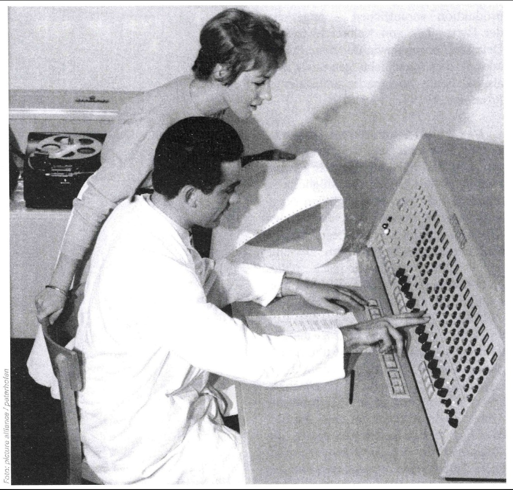

<details>
<summary>natural_image</summary>

Black-and-white photo of two women in lab coats examining a large display case, no visible text or symbols
</details>

## CIP-Pool 2050


generated with
chatGPT


<details>
<summary>natural_image</summary>

Digital illustration of a robotic hand interacting with a glowing holographic interface (no text or symbols)
</details>


<details>
<summary>text_image</summary>

CIP-Pool
LG
</details>

## CIP-Pool 2026

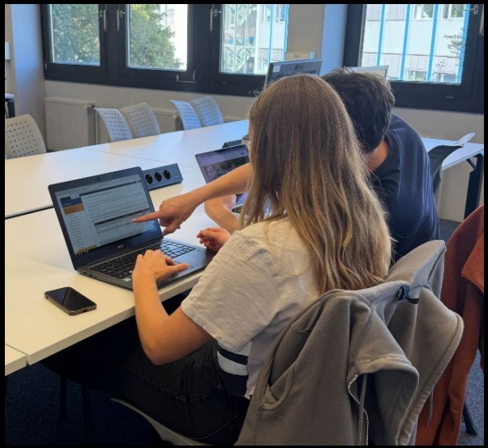

<details>
<summary>natural_image</summary>

Two people working at a conference table with laptops and tablets, viewed through windows (no visible text or symbols)
</details>

Praktika &

Lernraum

## - Koordination / Fachstudienbetreuung

- Dipl.-Inform. Tatjana Eiden
- Fragestunden

• Di 12:15-13:45 (UMIC, ab 20.10.)
- Do 13:15-14:00 (H02, ab 15.10.) im Anschluss an die Globalübung

## • Gemeinsame Globalübung

- Do 12:15-13:15
- Vor allem: c/C++-Programmierkurs
- Michael Gansen

## - Kleingruppenübungen:

- Interaktive Vertiefung und Ergänzung des Vorlesungsstoffes
- Tutoren: studentische Hilfskräfte
- Ca. 16 wöchentliche Termine zur Auswahl
- Vorauss. ab 2. Vorlesungswoche (siehe RWTHonline)


<details>
<summary>natural_image</summary>

Portrait of a smiling woman with short blonde hair and glasses, wearing a dark blazer (no text or symbols visible)
</details>


<details>
<summary>natural_image</summary>

Portrait of a man with short gray hair wearing a gray polo shirt (no text or symbols visible)
</details>

• Teilnahme nicht obligatorisch aber dringend empfohlen
- Anmeldungsinfo: siehe RWTHonline
• Anmeldeschluss beachten!
- Gruppeneinteilung: Benachrichtigung per email
- Übungsaufgaben: jeweils am Fr online über Moodle
- Vorbereitungsaufgaben, Präsenzaufgaben und Nachbereitungsaufgaben → 100P Voraussetzung für Probeklausur

Alle Studierende mit 100 von 200 Punkten in den Hausübungen haben in 21/22 bestanden.

Teilnahme an der Probeklausur führte in 21/22 zu folgender Verbesserung:


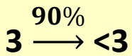


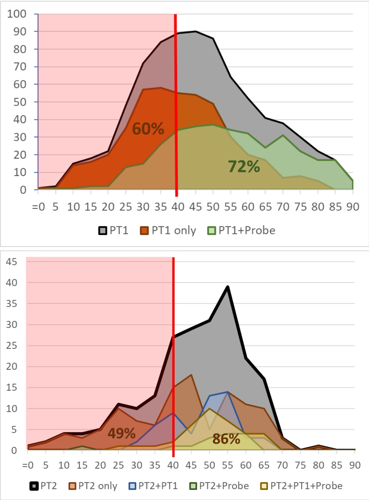

• B.W. Kernighan, D.M. Ritchie: Programmieren in C,
2. Auflage, Hanser, 1990, ISBN 3-446-15497-3
• R. Sedgewick: Algorithm in C++, Addison-Wesley, 2002, ISBN 3-8273-7026-4
• In der Lehrbuchsammlung
- Kommentierte Vorlesungsfolien (elektronisch)
- Grundsätzlich auch andere Einführungen in die Programmierung als Hilfsmittel geeignet

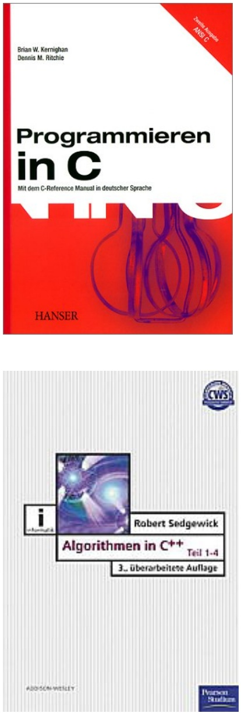

- Serious Gaming
- Grundlagen von Programmiersprachen
- Anwendung von Algorithmen
- Eigene Lösungsideen entwickeln

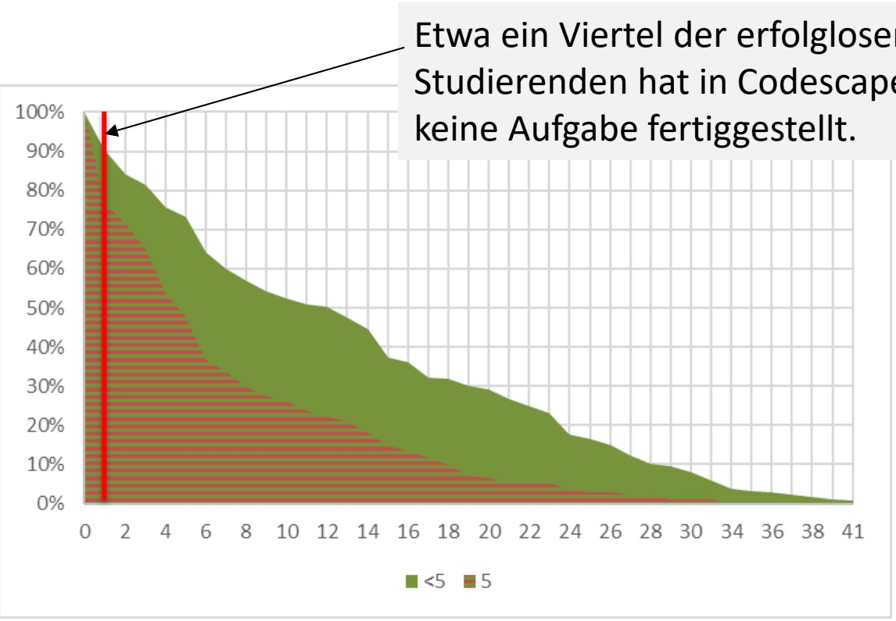

<details>
<summary>area_stacked</summary>

| X | <5 (%) | 5 (%) |
| --- | --- | --- |
| 0 | 100 | 0 |
| 2 | ~85 | ~15 |
| 4 | ~75 | ~30 |
| 6 | ~65 | ~40 |
| 8 | ~55 | ~35 |
| 10 | ~50 | ~30 |
| 12 | ~50 | ~25 |
| 14 | ~45 | ~20 |
| 16 | ~35 | ~15 |
| 18 | ~30 | ~10 |
| 20 | ~30 | ~5 |
| 22 | ~25 | ~5 |
| 24 | ~20 | ~5 |
| 26 | ~15 | ~2 |
| 28 | ~10 | ~2 |
| 30 | ~8 | ~1 |
| 34 | ~3 | ~0 |
| 36 | ~2 | ~0 |
| 38 | ~1 | ~0 |
| 41 | 0 | 0 |

Erwartete: 'Etwa ein Viertel der erfolglosestudierenden hat in Codescape keine Aufgabe fertiggestellt.'
</details>

## Über das IDS (www.ids.rwth-aachen.de)

- Lehrstuhl für Integrierte Digitale Systeme und Schaltungsentwurf (IDS)
- Schwerpunkte:

- Entwurfsmethodik integrierte digitale Schaltungen
- Beschleuniger für verschiedene Anwendungen:

- Simulation biologischer neuronaler Netzwerke
- Hardware für künstliche neuronale Netze
- Kryptographie
...

\- Testmethoden

• Standort: UMIC Gebäude
- Mies-van-der-Rohe Str. 15, RWTH Hörn Campus

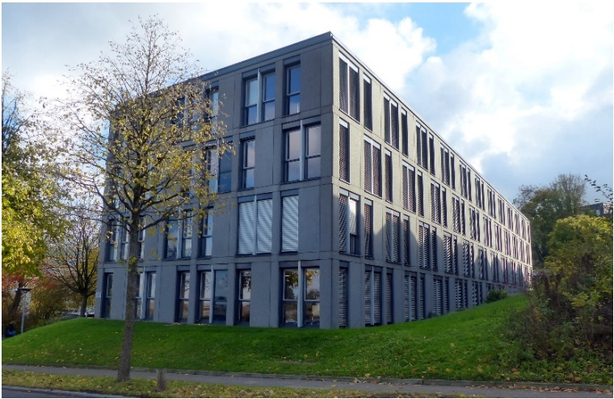

<details>
<summary>natural_image</summary>

Modern multi-story office building with glass windows and striped panels, surrounded by green lawn and trees under a partly cloudy sky (no signage or text visible)
</details>


<details>
<summary>text_image</summary>

en
7
cost
A
model
cost B
</details>

Stellenwertsystem

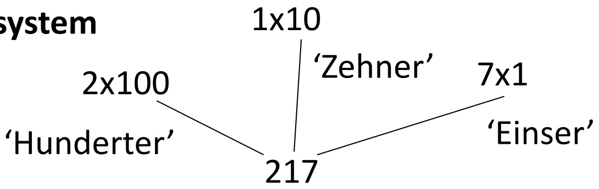

<details>
<summary>flowchart</summary>

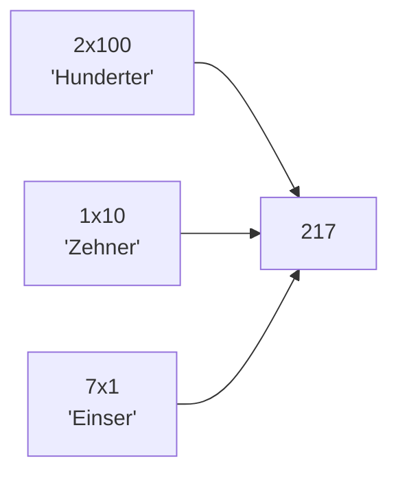
</details>

Stellenwertsystem


<details>
<summary>flowchart</summary>

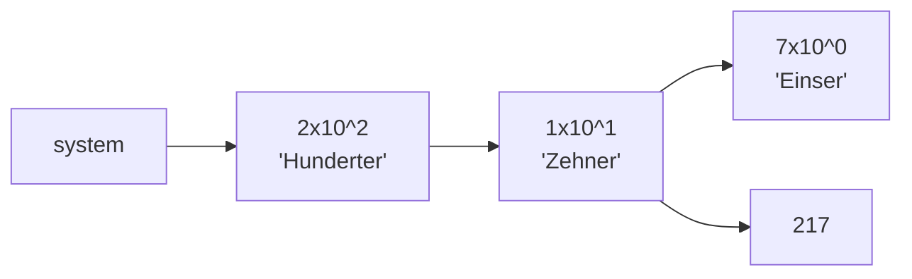
</details>

Dezimalsystem (r = 10)

| Gewicht | $10^{2}$ | $10^{1}$ | $10^{0}$ |
| --- | --- | --- | --- |
| Ziffern / Digits | 2 | 1 | 7 |

$$
X = \sum_ {i = 0} ^ {N - 1} x _ {i} \cdot r ^ {i}
$$

$$
2 \times 10^{2} + 1 \times 10^{1} + 7 \times 10^{0}
$$

Binärystem (r = 2)

| Gewicht | $2^{7}$ | $2^{6}$ | $2^{5}$ | $2^{4}$ | $2^{3}$ | $2^{2}$ | $2^{1}$ | $2^{0}$ |
| --- | --- | --- | --- | --- | --- | --- | --- | --- |
| Ziffern / Digits |  |  |  |  |  |  |  |  |

Stellenwertsystem

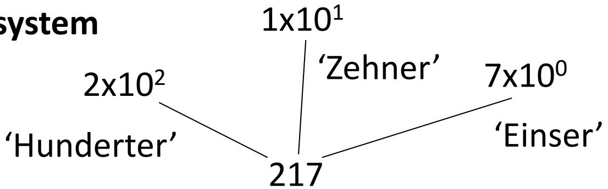

<details>
<summary>flowchart</summary>


</details>

Dezimalsystem (r = 10)

| Gewicht | $10^{2}$ | $10^{1}$ | $10^{0}$ |
| --- | --- | --- | --- |
| Ziffern / Digits | 2 | 1 | 7 |

$$
X = \sum_ {i = 0} ^ {N - 1} x _ {i} \cdot r ^ {i}
$$

Binärystem (r = 2)

| Gewicht | $2^{7}$ | $2^{6}$ | $2^{5}$ | $2^{4}$ | $2^{3}$ | $2^{2}$ | $2^{1}$ | $2^{0}$ |
| --- | --- | --- | --- | --- | --- | --- | --- | --- |
| Ziffern / Digits | 1 | 1 | 0 | 1 | 1 | 0 | 0 | 1 |

## Zahlendarstellung

$$
(0 0 1 0) _ {2}
$$

$$
(0 0 2) _ {1 0}
$$

$$
(0 1 1 1)_2
$$

$$
(0 0 7) _ {1 0}
$$

$$
(\ref{eq:10.0})_{2}
$$

$$
(0 1 6) _ {1 0}
$$

$$
(0 0 1 0) _ {1 6}
$$

$$
(13)_{10} = (?)^{16}\xrightarrow{(1101\ 1001)_2}\\ (9)_{16}
$$

$$
(2 1 7) _ {1 0}
$$

Dezimalsystem (r = 10)

| Gewicht | $10^{2}$ | $10^{1}$ | $10^{0}$ |
| --- | --- | --- | --- |
| Ziffern / Digits | 2 | 1 | 7 |

$$
X = \sum_ {i = 0} ^ {N - 1} x _ {i} \cdot r ^ {i}
$$

Binärystem (r = 2)

| Gewicht | $2^{7}$ | $2^{6}$ | $2^{5}$ | $2^{4}$ | $2^{3}$ | $2^{2}$ | $2^{1}$ | $2^{0}$ |
| --- | --- | --- | --- | --- | --- | --- | --- | --- |
| Ziffern / Digits | 1 | 1 | 0 | 1 | 1 | 0 | 0 | 1 |

Hexadezimalystem (r = 16)

| Gewicht | $16^{7}$ | $16^{6}$ | $16^{5}$ | $16^{4}$ | $16^{3}$ | $16^{2}$ | $16^{1}$ | $16^{0}$ |
| --- | --- | --- | --- | --- | --- | --- | --- | --- |
| Ziffern / Digits | 0 | 0 | 0 | 0 | 0 | 0 |  | 9 |

## Zahlendarstellung

| r | 10 | 2 | 16 |
| --- | --- | --- | --- |
|  | 00 | 0000 0000 | 00 |
|  | 01 | 0000 0001 | 01 |
|  | 02 | 0000 0010 | 02 |
|  | 03 | 0000 0011 | 03 |
|  | 04 | 0000 0100 | 04 |
|  | 05 | 0000 0101 | 05 |
|  | 06 | 0000 0110 | 06 |
|  | 07 | 0000 0111 | 07 |
|  | 08 | 0000 1000 | 08 |
|  | 09 | 0000 1001 | 09 |
|  | 10 | 0000 1010 |  |
|  | 11 | 0000 1011 |  |
|  | 12 | 0000 1100 |  |
|  | 13 | 0000 1101 |  |
|  | 14 | 0000 1110 |  |
|  | 15 | 0000 1111 |  |
|  | 16 | 0001 0000 |  |
|  | 17 | 0001 0001 |  |

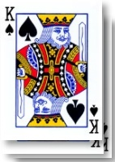

?

Zahlendarstellung

| r | 10 | 2 | 16 |
| --- | --- | --- | --- |
|  | 00 | 0000 0000 | 00 |
|  | 01 | 0000 0001 | 01 |
|  | 02 | 0000 0010 | 02 |
|  | 03 | 0000 0011 | 03 |
|  | 04 | 0000 0100 | 04 |
|  | 05 | 0000 0101 | 05 |
|  | 06 | 0000 0110 | 06 |
|  | 07 | 0000 0111 | 07 |
|  | 08 | 0000 1000 | 08 |
|  | 09 | 0000 1001 | 09 |
|  | 10 | 0000 1010 | 0A |
|  | 11 | 0000 1011 | 0B |
|  | 12 | 0000 1100 | 0C |
|  | 13 | 0000 1101 | 0D |
|  | 14 | 0000 1110 | 0E |
|  | 15 | 0000 1111 | 0F |
|  | 16 | 0001 0000 |  |
|  | 17 | 0001 0001 |  |
|  | 04 | 0000 0100 | 04 |
|  | 05 | 0000 0101 | 05 |
|  | 06 | 0000 0110 | 06 |
|  | 07 | 0000 0111 | 07 |
|  | 08 | 0000 1000 | 08 |
|  | 09 | 0000 1001 | 09 |
|  | 10 | 0000 1010 | 0A |
|  | 11 | 0000 1011 | 0B |
|  | 12 | 0000 1100 | 0C |
|  | 13 | 0000 1101 | 0D |
|  | 14 | 0000 1110 | 0E |
|  | 15 | 0000 1111 | 0F |
|  | 16 | 0001 0000 | 10 |
|  | 17 | 0001 0001 | 11 |

## American Standard Code for Information Interchange (ASCII)

USASCII code chart

<table><tr><td rowspan="2" colspan="5">Bits\b7b6b5</td><td rowspan="2">O O O</td><td rowspan="2">O O I</td><td rowspan="2">O I O</td><td rowspan="2">O I I</td><td rowspan="2">I O O</td><td rowspan="2">I O I</td><td rowspan="2">I I O</td><td rowspan="2">I I I</td></tr><tr></tr><tr><td>0</td><td>0</td><td>0</td><td>0</td><td>0</td><td>NUL</td><td>DLE</td><td>SP</td><td>0</td><td>@</td><td>P</td><td>`</td><td>p</td></tr><tr><td>0</td><td>0</td><td>0</td><td>1</td><td>1</td><td>SOH</td><td>DC1</td><td>!</td><td>1</td><td>A</td><td>Q</td><td>a</td><td>q</td></tr><tr><td>0</td><td>0</td><td>1</td><td>0</td><td>2</td><td>STX</td><td>DC2</td><td>&quot;</td><td>2</td><td>B</td><td>R</td><td>b</td><td>r</td></tr><tr><td>0</td><td>0</td><td>1</td><td>1</td><td>3</td><td>ETX</td><td>DC3</td><td>#</td><td>3</td><td>C</td><td>S</td><td>c</td><td>s</td></tr><tr><td>0</td><td>1</td><td>0</td><td>0</td><td>4</td><td>EOT</td><td>DC4</td><td>¶</td><td>4</td><td>D</td><td>T</td><td>d</td><td>†</td></tr><tr><td>0</td><td>1</td><td>0</td><td>1</td><td>5</td><td>ENQ</td><td>NAK</td><td>%</td><td>5</td><td>E</td><td>U</td><td>e</td><td>u</td></tr><tr><td>0</td><td>1</td><td>1</td><td>0</td><td>6</td><td>ACK</td><td>SYN</td><td>8</td><td>6</td><td>F</td><td>V</td><td>f</td><td>v</td></tr><tr><td>0</td><td>1</td><td>1</td><td>1</td><td>7</td><td>BEL</td><td>ETB</td><td>&#x27;</td><td>7</td><td>G</td><td>W</td><td>g</td><td>w</td></tr><tr><td>1</td><td>0</td><td>0</td><td>0</td><td>8</td><td>BS</td><td>CAN</td><td>(</td><td>8</td><td>H</td><td>X</td><td>h</td><td>x</td></tr><tr><td>1</td><td>0</td><td>0</td><td>1</td><td>9</td><td>HT</td><td>EM</td><td>)</td><td>9</td><td>I</td><td>Y</td><td>i</td><td>y</td></tr><tr><td>1</td><td>0</td><td>1</td><td>0</td><td>10</td><td>LF</td><td>SUB</td><td>*</td><td>:</td><td>J</td><td>Z</td><td>j</td><td>z</td></tr><tr><td>1</td><td>0</td><td>1</td><td>1</td><td>11</td><td>VT</td><td>ESC</td><td>+</td><td>;</td><td>K</td><td>[</td><td>k</td><td>{</td></tr><tr><td>1</td><td>1</td><td>0</td><td>0</td><td>12</td><td>FF</td><td>FS</td><td>,</td><td>&lt;</td><td>L</td><td>\</td><td>1</td><td>/</td></tr><tr><td>1</td><td>1</td><td>0</td><td>1</td><td>13</td><td>CR</td><td>GS</td><td>-</td><td>=</td><td>M</td><td>]</td><td>m</td><td>}</td></tr><tr><td>1</td><td>1</td><td>1</td><td>0</td><td>14</td><td>SO</td><td>RS</td><td>.</td><td>&gt;</td><td>N</td><td>^</td><td>n</td><td>~</td></tr><tr><td>1</td><td>1</td><td>1</td><td>1</td><td>15</td><td>SI</td><td>US</td><td>/</td><td>?</td><td>O</td><td>—</td><td>o</td><td>DEL</td></tr></table>

[General Electric TermiNet 300, \~1971]

```txt
char c0 = 0x61;
char c1 = 'a';
printf("char c0:%c char c1:%c\n", c0, c1);
```

> char c0:a  char c1:a


Unicode Character

UTF 0x0001F44D

- Serious Gaming
- Grundlagen von Programmiersprachen
• Anwendungstheorithmen
- Eigene
  - Nickeln

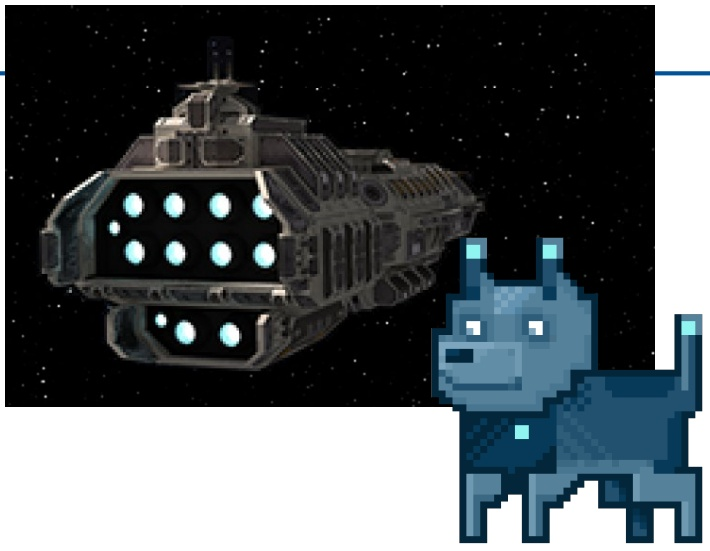

<details>
<summary>natural_image</summary>

Pixelated illustration of a futuristic spacecraft and a blue dog against a starry space background (no text or symbols)
</details>

Move!


<details>
<summary>natural_image</summary>

Cartoon illustration of a man with green hair and exaggerated facial expression (no text or symbols)
</details>

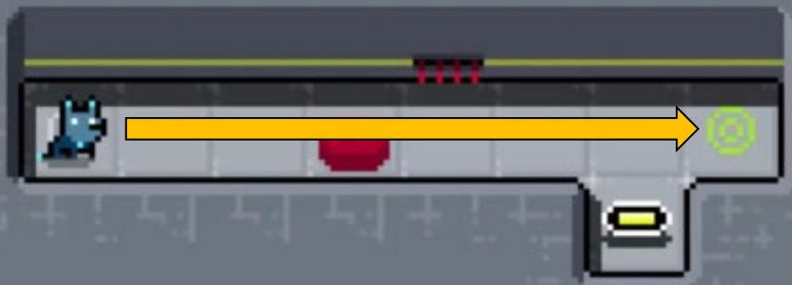

<details>
<summary>natural_image</summary>

Pixelated interface element with a yellow arrow pointing to a green circular icon, no readable text or symbols present.
</details>

move();

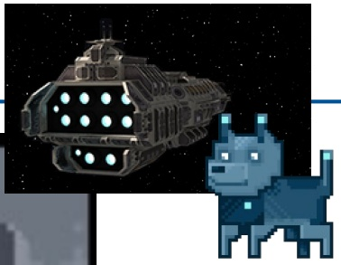

<details>
<summary>natural_image</summary>

Pixelated illustration of a futuristic vehicle and a blue dog in space (no text or symbols)
</details>

move();

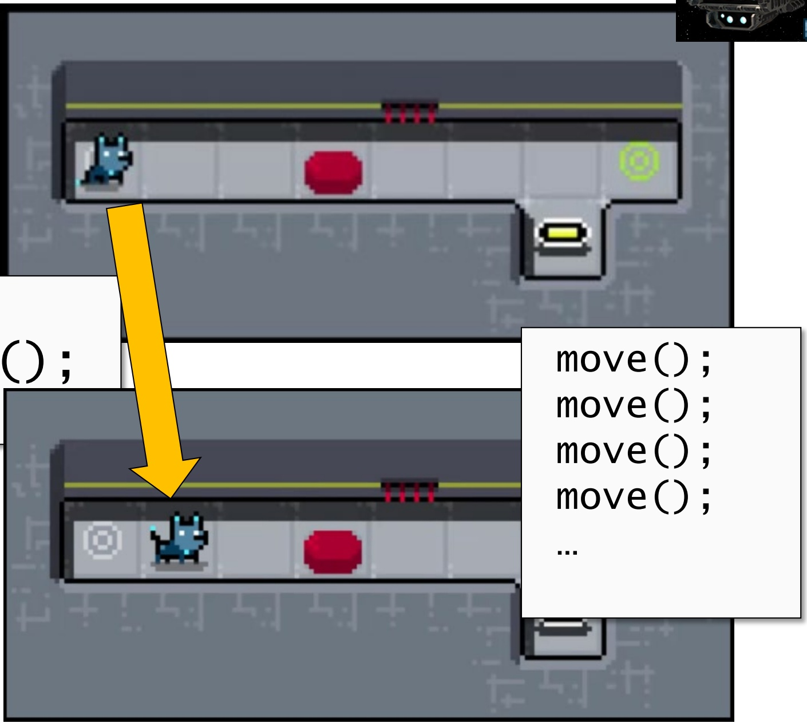

<details>
<summary>text_image</summary>

move();
move();
move();
move();
...
</details>

move();

move();

move();

move();

...

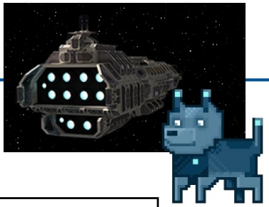

<details>
<summary>natural_image</summary>

Pixelated illustration of a futuristic vehicle and a blue dog in space (no text or symbols)
</details>


<details>
<summary>natural_image</summary>

Pixelated illustration of a futuristic vehicle and a blue dog in space (no text or symbols)
</details>


1. Einleitung
2. Einführendes Beispiel
3. Elementare Datentypen und Anweisungen
4. Zusammengesetzte Datentypen
5. Funktionen und Programmaufbau
6. Analyse von Algorithmen
7. Sortieralgorithmen
8. Lineare Datentypen
9. Bäume
10. Graphen
11. Techniken zum Algorithmenentwurf

## 2. Einführendes Beispiel

2.1 Temperaturumrechnung
2.2 Analyse des Beispiels
2.3 Ausführung und Fehlersuche

- Umwandlung von Grad Fahrenheit in Grad Celsius
- $\frac{y}{^{\circ}\mathrm{C}} = (5 / 9) \times \left(\frac{x}{^{\circ}\mathrm{F}} - 32\right)$

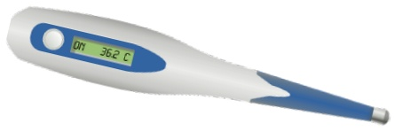

<details>
<summary>natural_image</summary>

Medical thermometer with digital display showing 36.2°C (no text or symbols on device body)
</details>


<details>
<summary>line</summary>

| \({}^{\circ}F\) | \({}^{\circ}C\) |
| --- | --- |
| ~-1.5 | ~-1.5 |
| 0 | 0 |
| ~1.5 | ~1.5 |
</details>

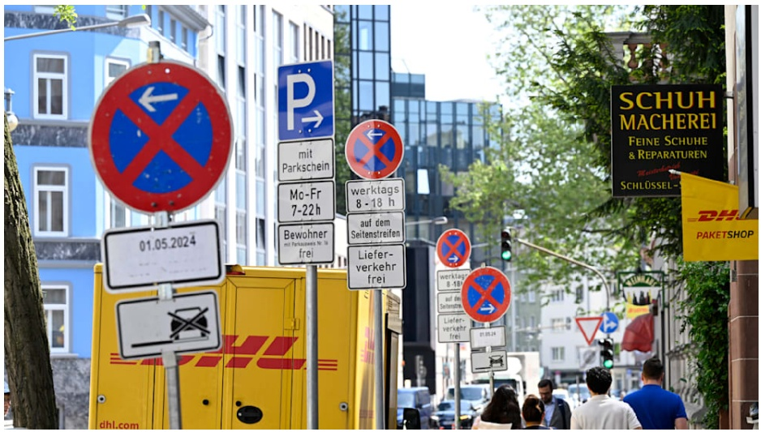

<details>
<summary>text_image</summary>

P →
mit Parkschein
Mo-Fr 7-22 h
Bewohner mit Parkkosten Nr. 19 frei
01.05.2024
werktags 8 -18 h
auf dem Seitenstreifen
Lieferverkehr frei
SCHUH MACHEREI
FEINE SCHUHE & REPARATUREN
Minderlage
SCHLÜSSL -
PHU PAKETSHOP
dhl.com
worktags 8-18 h
auf die Seitenstreifen
Lieferverkehr frei
01.05.24
</details>

Sven Moschitz, Bild, 2.5.2024


<details>
<summary>text_image</summary>

아플노래방이지하
로래방
로즈노래자
로또인력
엔젤노래방
HOCHIS
CHICKEN
만무
2009
驚安
티너
Tax Fre
</details>

@eomhyeok, unsplash, 30.11.2022


<details>
<summary>text_image</summary>

Night street photo of a crowded Japanese commercial district with numerous shop signs and advertisements including 'SHIDAX BIG', 'GODZILLA', and 'TOMAT CHINAS'.
</details>

Joshua Mellin, CNN, 17.12.2018

- Umwandlung von Grad Fahrenheit in Grad Celsius
- $\frac{y}{^{\circ}\mathrm{C}} = (5 / 9) \times \left(\frac{x}{^{\circ}\mathrm{F}} - 32\right)$

/\* Umwandlung von Fahrenheit in Celsius
    fuer fahr = 0, 20, ..., 300   \*/

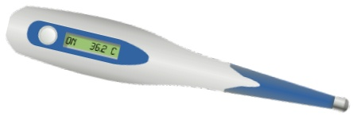

<details>
<summary>natural_image</summary>

Medical thermometer with digital display showing 36.2°C (no text or symbols on device body)
</details>


<details>
<summary>line</summary>

| \({}^{\circ}F\) | \({}^{\circ}C\) |
| --- | --- |
| ~-1.5 | ~-1.5 |
| 0 | 0 |
| ~1.5 | ~1.5 |
</details>

- Umwandlung von Grad Fahrenheit in Grad Celsius
- $\frac{y}{^{\circ}\mathrm{C}} = (5 / 9) \times \left(\frac{x}{^{\circ}\mathrm{F}} - 32\right)$

/\* Umwandlung von Fahrenheit in Celsius
    fuer fahr = 0, 20, ..., 300   \*/

celsius = 5 \* (fahr-32) / 9;


<details>
<summary>natural_image</summary>

Medical thermometer with digital display showing 36.2°C (no text or symbols on device body)
</details>


<details>
<summary>line</summary>

| \({}^{\circ}F\) | \({}^{\circ}C\) |
| --- | --- |
| 0 | ~-1.5 |
| ~1.5 | 0 |
| ~3.0 | ~1.5 |
| ~4.5 | ~3.0 |
| ~6.0 | ~4.5 |
| ~7.5 | ~6.0 |
| ~9.0 | ~7.5 |
</details>

- Umwandlung von Grad Fahrenheit in Grad Celsius
- $\frac{y}{^{\circ}\mathrm{C}} = (5 / 9) \times \left(\frac{x}{^{\circ}\mathrm{F}} - 32\right)$

/\* Umwandlung von Fahrenheit in Celsius
    fuer fahr = 0, 20, ..., 300   \*/

int fahr

celsius = 5 \* (fahr-32) / 9;


<details>
<summary>natural_image</summary>

Medical thermometer with digital display showing 36.2°C (no text or symbols on device body)
</details>


<details>
<summary>line</summary>

| \({}^{\circ}F\) | \({}^{\circ}C\) |
| --- | --- |
| 0 | ~-1.5 |
| ~1.5 | 0 |
| ~3.0 | ~1.5 |
| ~4.5 | ~3.0 |
| ~6.0 | ~4.5 |
| ~7.5 | ~6.0 |
| ~9.0 | ~7.5 |
</details>

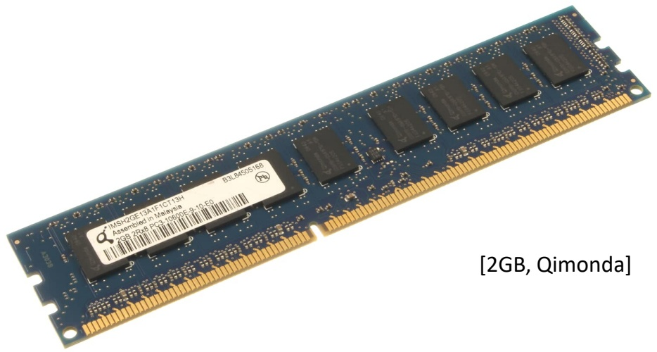

<details>
<summary>text_image</summary>

MSH2QE 13A-1PC113H
Assessed in Malaysia
RGB 20GB PC3-1065GE-8-15 E0
[2GB, Qimonda]
</details>

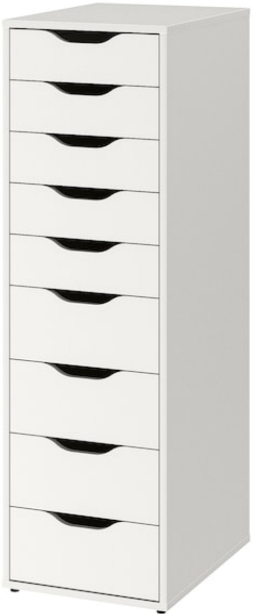

<details>
<summary>natural_image</summary>

White modular office cabinet with seven drawers, no visible text or labels
</details>

[Schubladenschrank "Alex", ikea]

- Umwandlung von Grad Fahrenheit in Grad Celsius
- $\frac{y}{^{\circ}\mathrm{C}} = (5 / 9) \times \left(\frac{x}{^{\circ}\mathrm{F}} - 32\right)$

/\* Umwandlung von Fahrenheit in Celsius
    fuer fahr = 0, 20, ..., 300   \*/

int fahr

celsius = 5 \* (fahr-32) / 9;


<details>
<summary>natural_image</summary>

Medical thermometer with digital display showing 36.2°C (no text or symbols on device body)
</details>

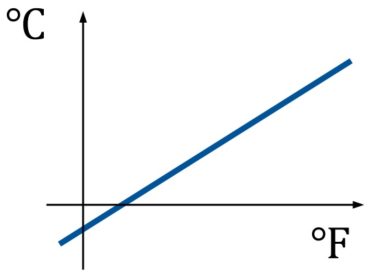

<details>
<summary>line</summary>

| \({}^{\circ}F\) | \({}^{\circ}C\) |
| --- | --- |
| 0 | ~-1.5 |
| ~1.5 | 0 |
| ~3.0 | ~1.5 |
| ~4.5 | ~3.0 |
| ~6.0 | ~4.5 |
| ~7.5 | ~6.0 |
| ~9.0 | ~7.5 |
</details>