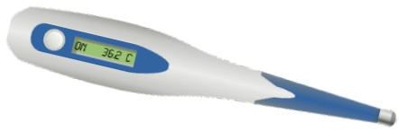
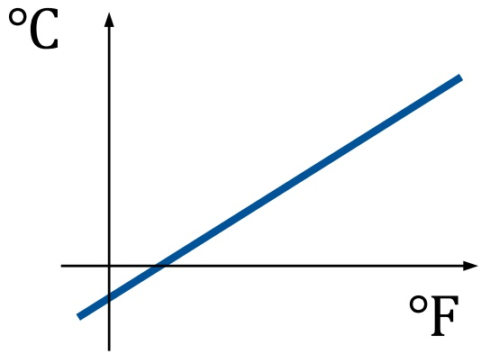
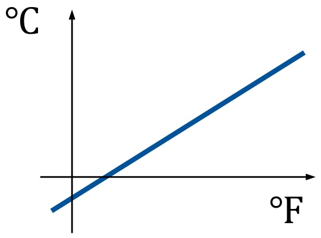
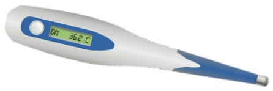
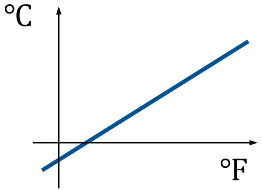

• Umwandlung von Grad Fahrenheit in Grad Celsius
•𝑦𝑦℃ = (5/9) ×𝑥𝑥℉ – 32

/\* Umwandlung von Fahrenheit in Celsius fuer fahr = 0, 20, …, 300

int fahr, celsius; int lower,

lower = 0; // untere Grenze der Temperaturtabelle

fahr = lower;

celsius = 5 \* (fahr-32) / 9;



<details>
<summary>natural_image</summary>

Illustration of a digital thermometer with temperature reading display (no text or symbols on the device itself)
</details>



<details>
<summary>line</summary>

| \({}^{\circ}F\) | \({}^{\circ}C\) |
| --- | --- |
| 0 | ~-1.5 |
| ~1.5 | 0 |
| ~3.0 | ~1.5 |
| ~4.5 | ~3.0 |
| ~6.0 | ~4.5 |
| ~7.5 | ~6.0 |
| ~9.0 | ~7.5 |
</details>

• Umwandlung von Grad Fahrenheit in Grad Celsius
•𝑦𝑦℃ = (5/9) ×𝑥𝑥℉ – 32

```txt
/* Umwandlung von Fahrenheit in Celsius
    fuer fahr = 0, 20, ..., 300   */

    int fahr, celsius;
    int lower,

    lower = 0; // untere Grenze der Temperaturtabelle

    fahr  = lower;
    while (fahr <= upper)  {
        celsius = 5  *  (fahr-32) / 9;

        fahr = fahr + step;
    }
```


<details>
<summary>natural_image</summary>

Medical thermometer with digital display showing 36.2°C (no text or symbols on device body)
</details>


<details>
<summary>line</summary>

| \({}^{\circ}F\) | \({}^{\circ}C\) |
| --- | --- |
| ~-1.5 | ~-1.5 |
| 0 | 0 |
| ~1.5 | ~1.5 |
</details>

• Umwandlung von Grad Fahrenheit in Grad Celsius
•𝑦𝑦℃ = (5/9) ×𝑥𝑥℉ – 32

```c
/* Umwandlung von Fahrenheit in Celsius
    fuer fahr = 0, 20, ..., 300   */

    int fahr, celsius;
    int lower

    lower = 0; // untere Grenze der Temperaturtabelle

    fahr = lower;
    while (fahr <= upper) {
        celsius = 5 * (fahr-32) / 9;
        printf("%d\t%d\n", fahr, celsius);
        fahr = fahr + step;
    }
```


<details>
<summary>natural_image</summary>

Medical thermometer with digital display showing 36.2°C (no text or symbols on device body)
</details>


<details>
<summary>line</summary>

| \({}^{\circ}F\) | \({}^{\circ}C\) |
| --- | --- |
| ~-1.5 | ~-1.5 |
| 0 | 0 |
| ~1.5 | ~1.5 |
</details>

## American Standard Code for Information Interchange (ASCII)

USASCII code chart

<table><tr><td rowspan="2" colspan="5">Bits\b7b6b5</td><td rowspan="2">O O O</td><td rowspan="2">O O I</td><td rowspan="2">O I O</td><td rowspan="2">O I I</td><td rowspan="2">I O O</td><td rowspan="2">I O I</td><td rowspan="2">I I O</td><td rowspan="2">I I I</td></tr><tr></tr><tr><td>0</td><td>0</td><td>0</td><td>0</td><td>0</td><td>NUL</td><td>DLE</td><td>SP</td><td>0</td><td>@</td><td>P</td><td>`</td><td>p</td></tr><tr><td>0</td><td>0</td><td>0</td><td>1</td><td>1</td><td>SOH</td><td>DC1</td><td>!</td><td>1</td><td>A</td><td>Q</td><td>a</td><td>q</td></tr><tr><td>0</td><td>0</td><td>1</td><td>0</td><td>2</td><td>STX</td><td>DC2</td><td>&quot;</td><td>2</td><td>B</td><td>R</td><td>b</td><td>r</td></tr><tr><td>0</td><td>0</td><td>1</td><td>1</td><td>3</td><td>ETX</td><td>DC3</td><td>#</td><td>3</td><td>C</td><td>S</td><td>c</td><td>s</td></tr><tr><td>0</td><td>1</td><td>0</td><td>0</td><td>4</td><td>EOT</td><td>DC4</td><td>¶</td><td>4</td><td>D</td><td>T</td><td>d</td><td>†</td></tr><tr><td>0</td><td>1</td><td>0</td><td>1</td><td>5</td><td>ENQ</td><td>NAK</td><td>%</td><td>5</td><td>E</td><td>U</td><td>e</td><td>u</td></tr><tr><td>0</td><td>1</td><td>1</td><td>0</td><td>6</td><td>ACK</td><td>SYN</td><td>8</td><td>6</td><td>F</td><td>V</td><td>f</td><td>v</td></tr><tr><td>0</td><td>1</td><td>1</td><td>1</td><td>7</td><td>BEL</td><td>ETB</td><td>&#x27;</td><td>7</td><td>G</td><td>W</td><td>g</td><td>w</td></tr><tr><td>1</td><td>0</td><td>0</td><td>0</td><td>8</td><td>BS</td><td>CAN</td><td>(</td><td>8</td><td>H</td><td>X</td><td>h</td><td>x</td></tr><tr><td>1</td><td>0</td><td>0</td><td>1</td><td>9</td><td>HT</td><td>EM</td><td>)</td><td>9</td><td>I</td><td>Y</td><td>i</td><td>y</td></tr><tr><td>1</td><td>0</td><td>1</td><td>0</td><td>10</td><td>LF</td><td>SUB</td><td>*</td><td>:</td><td>J</td><td>Z</td><td>j</td><td>z</td></tr><tr><td>1</td><td>0</td><td>1</td><td>1</td><td>11</td><td>VT</td><td>ESC</td><td>+</td><td>;</td><td>K</td><td>[</td><td>k</td><td>{</td></tr><tr><td>1</td><td>1</td><td>0</td><td>0</td><td>12</td><td>FF</td><td>FS</td><td>,</td><td>&lt;</td><td>L</td><td>\</td><td>1</td><td>/</td></tr><tr><td>1</td><td>1</td><td>0</td><td>1</td><td>13</td><td>CR</td><td>GS</td><td>-</td><td>=</td><td>M</td><td>]</td><td>m</td><td>}</td></tr><tr><td>1</td><td>1</td><td>1</td><td>0</td><td>14</td><td>SO</td><td>RS</td><td>.</td><td>&gt;</td><td>N</td><td>^</td><td>n</td><td>~</td></tr><tr><td>1</td><td>1</td><td>1</td><td>1</td><td>15</td><td>SI</td><td>US</td><td>/</td><td>?</td><td>O</td><td>—</td><td>o</td><td>DEL</td></tr></table>

[General Electric TermiNet 300, \~1971]

```txt
char c0 = 0x61;
char c1 = 'a';
printf("char c0:%c char c1:%c\n", c0, c1);
```

> char c0:a char c1:a

• Umwandlung von Grad Fahrenheit in Grad Celsius
•𝑦𝑦℃ = (5/9) ×𝑥𝑥℉ – 32

```c
/* Umwandlung von Fahrenheit in Celsius
    fuer fahr = 0, 20, ..., 300   */

    int fahr, celsius;
    int lower

    lower = 0; // untere Grenze der Temperaturtabelle

    fahr = lower;
    while (fahr <= upper) {
        celsius = 5 * (fahr-32) / 9;
        printf("%d\t%d\n", fahr, celsius);
        fahr = fahr + step;
    }
```


<details>
<summary>natural_image</summary>

Medical thermometer with digital display showing 36.2°C (no text or symbols on device body)
</details>


<details>
<summary>line</summary>

| \({}^{\circ}F\) | \({}^{\circ}C\) |
| --- | --- |
| ~-1.5 | ~-1.5 |
| 0 | 0 |
| ~1.5 | ~1.5 |
</details>

• Umwandlung von Grad Fahrenheit in Grad Celsius
•𝑦𝑦℃ = (5/9) ×𝑥𝑥℉ – 32

```c
#include <stdio.h>

/* Umwandlung von Fahrenheit in Celsius
    fuer fahr = 0, 20, ..., 300   */

    int fahr, celsius;
    int lower

    lower = 0; // untere Grenze der Temperaturtabelle

    fahr = lower;
    while (fahr <= upper) {
        celsius = 5 * (fahr-32) / 9;
        printf("%d\t%d\n", fahr, celsius);
        fahr = fahr + step;
    }
```


<details>
<summary>natural_image</summary>

Medical thermometer with digital display showing 36.2°C (no text or symbols on device body)
</details>


<details>
<summary>line</summary>

| \({}^{\circ}F\) | \({}^{\circ}C\) |
| --- | --- |
| ~-1.5 | ~-1.5 |
| 0 | 0 |
| ~1.5 | ~1.5 |
</details>

• Umwandlung von Grad Fahrenheit in Grad Celsius
•𝑦𝑦℃ = (5/9) ×𝑥𝑥℉ – 32

```c
#include <stdio.h>

/* Umwandlung von Fahrenheit in Celsius
    fuer fahr = 0, 20, ..., 300   */
int main()
{
    int fahr, celsius;
    int lower

    lower = 0; // untere Grenze der Temperaturtabelle

    fahr = lower;
    while (fahr <= upper) {
        celsius = 5 * (fahr-32) / 9;

        fahr = fahr + step;
    }

    return 0;
}
```


<details>
<summary>natural_image</summary>

Medical thermometer with digital display showing 36.2°C (no text or symbols on device body)
</details>



<details>
<summary>line</summary>

| \({}^{\circ}F\) | \({}^{\circ}C\) |
| --- | --- |
| ~-1.5 | ~-1.5 |
| 0 | 0 |
| ~1.5 | ~1.5 |
</details>

• Umwandlung von Grad Fahrenheit in Grad Celsius
•𝑦𝑦℃ = (5/9) ×𝑥𝑥℉ – 32

```c
#include <stdio.h>

/* Umwandlung von Fahrenheit in Celsius
    fuer fahr = 0, 20, ..., 300   */
int main()
{
    int fahr, celsius;
    int lower, upper, step;

    lower = 0; // untere Grenze der Temperaturtabelle
    upper = 300; // obere Grenze
    step  = 20; // Schrittweite

    fahr  = lower;
    while (fahr <= upper)  {
        celsius = 5  *  (fahr-32) / 9;
        printf("%d\t%d\n", fahr, celsius);
        fahr = fahr + step;
    }

    return 0;
}
```



<details>
<summary>natural_image</summary>

Medical thermometer with digital display showing temperature reading of 362°C (no additional text or symbols)
</details>



<details>
<summary>line</summary>

| \({}^{\circ}F\) | \({}^{\circ}C\) |
| --- | --- |
| 0 | ~-1.5 |
| ~1.5 | 0 |
| ~3.0 | ~1.5 |
| ~4.5 | ~3.0 |
| ~6.0 | ~4.5 |
| ~7.5 | ~6.0 |
| ~9.0 | ~7.5 |
</details>

## 2. Einführendes Beispiel

2.1 Temperaturumrechnung
**2.2 Analyse des Beispiels**
2.3 Ausführung und Fehlersuche

• **Einbinden** der Standard-Library zur Ein/Ausgabe

– #include &lt;stdio.h&gt;
– Ermöglicht Kommunikation des Programms mit der Außenwelt (z.B. Benutzer)
– Siehe C-Präprozessor

• **Kommentare**

– /\* Umwandlung … \*/
– // untere Grenze …
– Erläuterung der Programmfunktion für Entwickler
– Text innerhalb /\* … \*/ und in einer Zeile nach // wird vom Compiler ignoriert

• **Hauptfunktion** main

– int main() { … }
– Alle Anweisungen innerhalb { … } gehören zu main
– main wird nach Programmstart immer direkt aufgerufen
– Im Allg. ruft main dann weitere Funktionen auf

## • Variablen-Vereinbarungen

– int fahr, celsius;
– Variablen sind benannte Speicherplätze für Werte
– Können lesend und schreibend zugegriffen werden
– Variablen müssen vor Verwendung vereinbart werden
– Hier: Verwendung von ganzzahligen (integer) Variablen

## • Zuweisungen

– lower = 0;
– upper = 300;
– Schreiben von Werten in die Variablen

## • Schleife

– while (fahr <= upper) { /\* ... \*/ }
– while ist (wie auch int) ein **C-Schlüsselwort**
– Code innerhalb { … } wird solange wiederholt, bis Bedingung nicht mehr erfüllt

## • Umrechnung

– celsius = 5 \* (fahr-32) / 9;
– Rechenoperationen auf Variablen

## • Ausgabe

– printf("%d\t%d\n", fahr, celsius);
– Formatierte Ausgabe:

• fahr als Integer-Zahl (erstes %d als Platzhalter)
• Tabulator \t
• celsius als Integer-Zahl (zweites %d als Platzhalter)
• Zeilenumbruch \n

## • Vorbereitung des nächsten Schleifendurchlaufs

– fahr = fahr + step;
– fahr wird um step erhöht, bis upper überschritten

C-Präprozessor (cpp) läuft **vor dem Compiler** über den Quellcode (C-nach-C-Übersetzung)
• cpp-Anweisungen beginnen mit Zeichen #
• cpp-Verwendung erhöht **Lesbarkeit** der Programme
• Vor allem folgende Anwendungen:

– **Symbolische Definitionen** (Konvention: Großbuchstaben)

• #define UPPER 300
• Alle Vorkommen von UPPER werden durch 300 ersetzt

– **Makros**

• #define $\mathsf { M A X ( a , b ) ~ ( a > b ) ~ ? ~ a : b }$
• Alle Vorkommen von $\operatorname { M A X } ( \ldots , \ldots )$ werden ersetzt

**Einbinden** von Standard-Libraries (und allgemein Header-Dateien mit Deklarationen)

• #include &lt;stdio.h&gt;
• Datei stdio.h wird an dieser Stelle ins Programm eingefügt

**1.1.2022**

(**2201010001**)10

YY MM DD ####

(**22 01 01 0001**)10


<details>
<summary>natural_image</summary>

Simple calendar icon with grid layout and top tabs (no text or numbers)
</details>

**32.12.2021**

(**2112320001**)10

(**10000011001100001011111101010001**)2

(**1000 0011 0011 0000 1011 1111 0101 0001**)2 = -(**2093957295**)10

(**83 30 BF 51**)16

**Vorzeichen?**

⭢ MSB (Most Significant Bit) hat Gewicht −2<sup>𝑁𝑁−1</sup> hier: −2<sup>31</sup> = − 2147483648 10

Größte vorzeichenbehaftete 32b-Zahl:

$$
2 ^ {N - 1} - 1 = 2 ^ {3 1 - 1} = (2 1 4 7 4 8 3 6 4 7) _ {1 0}
$$